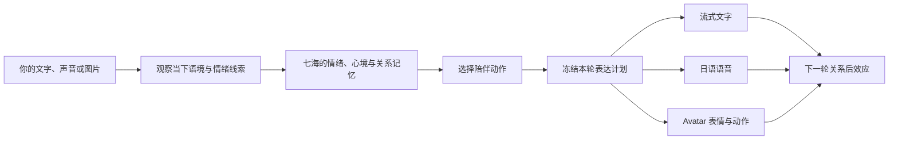

<!-- 受众：MASTER -->
<!-- 标题：Natsume AI（七海） -->

# Natsume AI · 七海

一个面向个人长期陪伴的实时情感数字生命项目。

七海不是“给聊天机器人加几个情绪标签”。她需要分清你的感受和自己的感受，记得关系里真正重要的事，在不同日子里保持连续的人格，并让文字、声音和形象表达同一种情绪。工具调用、自动化和任务规划是她的能力，但不是这个项目的主角。

> 当前版本可以运行文本陪伴主链，也已经具备情绪、关系和表达计划的持久状态；长期自然度、目标 Edge 上的日语语音和 Avatar 仍在实测阶段，尚未作为成品发布。

## 七海现在能做什么

- 进行低延迟的日常对话，不让普通聊天经过重型任务审计。
- 把用户情绪当作观察，而不是直接复制成七海自己的情绪。
- 保留七海自己的混合情绪、心境、需要、关系事件和未解决话题。
- 在安慰、玩笑、分享喜悦、表达委屈、设定边界、修复误解和安静陪伴之间选择不同回应方式。
- 让关系变化和上一轮回应的后效应跨会话保存，而不是只累计一个“好感度分数”。
- 在需要操作文件、调用工具或产生外部副作用时，切换到受管任务执行链。

当前还不能当作已经交付的部分：

- 日语声线方案 B 目前使用 GPT-SoVITS V4 预训练权重和七海参考音频进行参考条件推理；它不是已经训练完成的七海专属微调模型。
- 本机已经完成参考音频生成和人工选型，但另一台电脑上的 Edge、真实 TTS、VTS/VRM 与播放中打断尚未联合验收。
- 情感连续性已经有代码和持久状态，仍缺多日真实对话、固定场景和人工盲测证明。

更细的当前状态见 [能力与缺口矩阵](docs/50_project/arch/ARCHITECTURE_GAP_MATRIX.md)。机器可读状态在 [current_architecture_status.json](configs/release/current_architecture_status.json)。

## 一轮陪伴是怎样产生的



稳定人格由 [Soul.md](Soul.md) 定义。在线学习可以调整称呼、回复长度、幽默度、主动时段和表达强度等低风险偏好，但不能自动改写七海的身份、核心价值观或关系边界。

## 在本机说第一句话

### 准备环境

当前启动脚本以 Windows 为主。至少需要：

| 依赖 | 用途 |
|---|---|
| Python 3.11+ | Host、OBS 和运行工具 |
| PowerShell 7 | `scripts/runtime/*.ps1` 启停脚本 |
| Docker Desktop | Neo4j、Chroma 和 Redis |
| 一个可用的模型 Provider | 生成真实对话；默认陪伴路由使用 Gemini 配置 |
| Nginx（可选） | 在 `18180` 提供 Monitor；缺失时 Host 仍可启动，但 Monitor 会降级 |
| Node.js（仅开发 UI 时） | 重新构建 Monitor UI 或桌面形象 |

在仓库根目录执行：

```powershell
python -m venv .venv
.\.venv\Scripts\Activate.ps1
python -m pip install --upgrade pip
python -m pip install -r requirements.txt

if (-not (Test-Path .env)) {
    Copy-Item .env.example .env
}
if (-not (Test-Path configs/secrets/secret_store.runtime.local.json)) {
    Copy-Item configs/secrets/secret_store.runtime.example.json `
        configs/secrets/secret_store.runtime.local.json
}
```

然后编辑 `.env` 和 `configs/secrets/secret_store.runtime.local.json`：

- 填写实际使用的模型 Provider 和 API Key；
- 替换 `sec://neo4j/local-default` 对应的示例密码；
- 不要把本地密钥文件、模型、语料、用户数据或运行日志提交到 Git。

### 启动 Host 侧

```powershell
pwsh scripts/runtime/start_host_side.ps1 -StartupCheck
```

这一个入口默认会启动 Docker 外部依赖、Host、OBS，并在本机存在 Nginx 时启动 Monitor；不要预先再执行一次 `start_docker_services.ps1`。

检查状态：

```powershell
Invoke-RestMethod http://127.0.0.1:18080/health?skip_dependency_probes=1
Invoke-RestMethod http://127.0.0.1:18082/health
Start-Process http://127.0.0.1:18180/monitor/
```

通过真实流式接口和七海说第一句话：

```powershell
curl.exe -N http://127.0.0.1:18080/v1/chat `
    -H "Content-Type: application/json" `
    -d '{"message":"晚上好，七海。今天有点累。","session_id":"readme-local"}'
```

返回内容是 SSE 流。没有有效 Provider、模型路由或密钥时，Host 健康并不代表对话一定可生成。

### 停止 Host 侧

```powershell
pwsh scripts/runtime/stop_host_side.ps1
pwsh scripts/runtime/stop_docker_services.ps1
```

## 另一台电脑上的 Edge

Edge 承担中文 ASR、日语 TTS、VTS/VRM 和设备动作。当前部署中的 Edge 位于另一台电脑，不应从 Host 电脑盲目启动。

目标机准备好模型权重、参考音频、显卡环境和网络配置后，再在 Edge 电脑执行：

```powershell
pwsh scripts/runtime/start_edge_side.ps1
```

当前声线清单见 [gpt_sovits_nanami_v4.json](configs/voice/gpt_sovits_nanami_v4.json)，双机开发和非仓库资产同步见 [双节点工作流](docs/50_project/guides/DUAL_NODE_DEV_WORKFLOW.md)。远端 Edge 未启动时，文字对话可以单独运行，但不能宣称语音和 Avatar 已通过真实验收。

## 项目结构

| 路径 | 内容 |
|---|---|
| `host_brain/` | 七海的对话、情感生命、关系记忆、任务能力和 Host API |
| `edge_client/` | ASR、TTS、Avatar、设备和消息 Gateway 的 Edge 运行时 |
| `natsume_contracts/` | Host、Edge 与 Operator 之间的版本化合同 |
| `desktop_pet/` | 本地 Live2D 桌面形象运行时 |
| `configs/` | 非密钥配置、声线清单和机器状态 |
| `scripts/runtime/` | 服务启停、模型部署和真实链路测试入口 |
| `docs/` | 产品、理论、架构、测试、证据与历史归档 |

## 开发与文档

常用本地检查：

```powershell
python -m pytest tests/unit -q
python tools/doc_lint/doc_authority_gate.py --root .
python tools/doc_lint/doc_freshness_gate.py --root . --check-all
python tools/doc_lint/doc_link_gate.py --root .
```

进一步阅读：

- [文档地图](docs/00_index/00_DOCMAP.md)
- [理论原则](docs/15_theory/Theory.md)
- [产品需求](docs/20_prd/PRD.md)
- [当前代码架构](docs/50_project/arch/CURRENT_CODE_ARCHITECTURE.md)
- [系统架构](docs/50_project/arch/SYSTEM_ARCHITECTURE.md)
- [功能模块](docs/50_project/arch/FUNCTIONAL_MODULES.md)
- [数据流](docs/50_project/arch/DATA_FLOW_ARCHITECTURE.md)
- [当前任务](docs/30_devspec/DevTasks.md)
- [测试计划](tests/TESTPLAN.md)

历史方案和旧验收报告只用于追溯，不定义当前版本状态，统一从 [历史归档](docs/_history/README.md) 进入。
