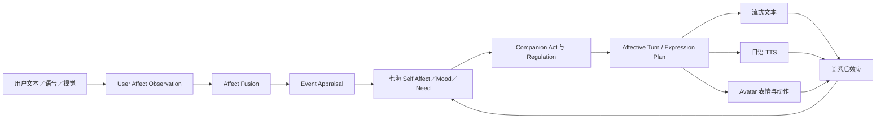
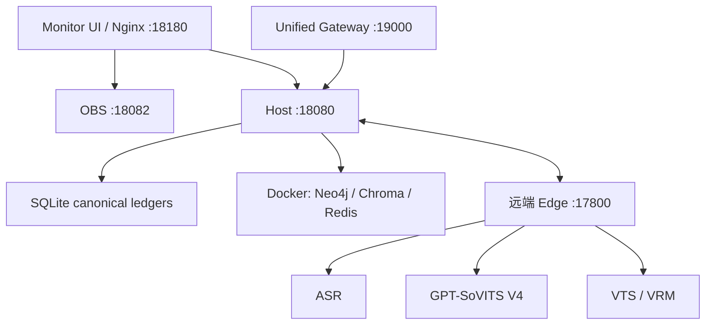

受众：MASTER
标题：Natsume AI（七海）实时情感数字生命

# Natsume AI

Natsume AI 是一个面向个人长期陪伴的实时情感数字生命项目。角色名为“七海”。项目的首要目标不是把普通聊天包装成复杂工作流，而是让七海在长期相处中保持自己的情绪因果、关系连续性、人格边界和文本／声音／Avatar 的一致表达。

当前仓库仍处于演进阶段，整体状态为 `INCOMPLETE`。已有能力不等于完成最终真实验收；静态合同、模拟测试和历史回执也不等于生产接线。

## 当前能力

| 范围 | 状态 | 当前事实 |
|---|---|---|
| 普通对话 | `WIRED` | 走轻量实时陪伴链，不强制进入重型 TaskGraph 审计 |
| 用户情绪观察 | `WIRED` | 文本／声学等观察与七海自身情绪分离，低置信观察不会直接改写自我状态 |
| 七海自我情绪 | `WIRED / PARTIAL` | canonical Life journal 负责状态演化、回放与兼容写入计量；真实长期体验仍待验收 |
| 关系与后效应 | `WIRED / PARTIAL` | 关系 episode、修复、主动权限和偏好版本已接线，长期自然度仍需真实多轮验证 |
| 流式文本 | `WIRED / PARTIAL` | 对话计划与分句交付已接线；真实模型首字延迟仍未达最终目标 |
| 日语语音 | `LOCAL_PASS` | 已选择 GPT-SoVITS V4 方案 B；本机 CUDA 样例通过，远端 Edge 尚未实测 |
| Avatar 表达 | `CONTRACT_READY` | 与文本、语音共享 ExpressionPlan；远端 VTS/VRM 尚未验收 |
| Skill／Plan／Delegate | `GOVERNED` | 涉及工具和副作用的路线继续使用受管 TaskGraph、预算、授权和回执 |
| Host／OBS／Monitor／Gateway | `PARTIAL` | 本地入口与局部实测存在；完整真实服务栈尚未完成最终验收 |
| 最终发布 | `NOT_READY` | 远端 Edge、真实三模态、真实 Provider 延迟和人工盲测仍是阻断项 |

机器可读状态见 [current_architecture_status.json](configs/release/current_architecture_status.json)，当前执行边界见 [演进执行合同](docs/30_devspec/NEXT_GENERATION_EVOLUTION_EXECUTION.md)。

## 设计主线



关键约束：

- `Soul.md` 是稳定人格宪法，在线学习不能修改核心人格、价值观或非操控原则。
- 用户情绪是观察，不是七海自己的情绪；二者必须保持身份、证据和生命周期隔离。
- 七海可以开心、委屈、生气、疲倦、吃醋和想念，但不能用威胁、排他、冷暴力或负罪感迫使用户回应。
- 普通聊天优先低延迟；只有工具、副作用、高风险动作和外部交付进入完整治理链。
- 情绪与关系状态采用有界持久化，不保存原始音视频，不把用户正文堆成审计日志。

## 运行拓扑



Host、OBS、Monitor 和 Docker 依赖可在本机启动；Edge 位于另一台电脑，未经用户明确允许不得远程启动。

## 快速开始

### 1. Python 环境

```powershell
python -m pip install -r requirements.txt
Copy-Item .env.example .env
```

按本机环境填写 `.env`。不要把密钥、模型、用户数据或运行日志提交到仓库。

### 2. 外部依赖与 Host 侧

```powershell
pwsh scripts/runtime/start_docker_services.ps1
pwsh scripts/runtime/start_host_side.ps1
```

默认端口：Host `18080`、OBS `18082`、Monitor `18180`、Neo4j HTTP `7474`／Bolt `17687`、Chroma `18000`、Redis `6379`。

### 3. Edge（仅在 Edge 电脑上）

```powershell
pwsh scripts/runtime/start_edge_side.ps1
```

默认语言链路为中文 ASR、日语 TTS；声线配置见 [gpt_sovits_nanami_v4.json](configs/voice/gpt_sovits_nanami_v4.json)。启动前必须确认模型路径、显存、VTS/VRM 和网络地址。

### 4. 停止服务

```powershell
pwsh scripts/runtime/stop_edge_side.ps1
pwsh scripts/runtime/stop_host_side.ps1
pwsh scripts/runtime/stop_docker_services.ps1
```

## 测试

小改动只运行受影响测试；波次结束运行集成测试；真实服务栈只在正式验收时集中启动。

```powershell
python -m pytest tests/unit -q
python tools/doc_lint/doc_audience_lint.py --root .
python tools/doc_lint/doc_authority_gate.py --root .
python tools/doc_lint/doc_freshness_gate.py --root . --check-all
python tools/doc_lint/doc_link_gate.py --root .
```

完整测试与真实服务验收见 [TESTPLAN](tests/TESTPLAN.md)。GitHub Actions 因账户额度未实际运行时，状态必须写作 `NOT_RUN_ACCOUNT_QUOTA`，不能记作通过。

## 仓库结构

| 路径 | 用途 |
|---|---|
| `host_brain/` | Host、情感生命、对话、任务、OBS 与生产组合根 |
| `edge_client/` | ASR、TTS、Avatar、设备和 Gateway Edge 运行时 |
| `natsume_contracts/` | Host／Edge／Operator 的版本化跨进程合同 |
| `configs/` | 非密钥配置、声线与机器状态 |
| `scripts/runtime/` | 本地与分布式服务启停入口 |
| `tools/` | 文档门禁、迁移、验收和开发工具 |
| `tests/` | 单元、合同、集成和 E2E 测试 |
| `docs/` | 当前权威文档、证据与历史归档 |

## 文档入口

- [文档地图](docs/00_index/00_DOCMAP.md)
- [理论原则](docs/15_theory/Theory.md)
- [产品需求](docs/20_prd/PRD.md)
- [开发规格](docs/30_devspec/DevSpec.md)
- [当前任务](docs/30_devspec/DevTasks.md)
- [当前代码架构](docs/50_project/arch/CURRENT_CODE_ARCHITECTURE.md)
- [系统架构](docs/50_project/arch/SYSTEM_ARCHITECTURE.md)
- [功能模块](docs/50_project/arch/FUNCTIONAL_MODULES.md)
- [数据流](docs/50_project/arch/DATA_FLOW_ARCHITECTURE.md)
- [部署架构](docs/50_project/arch/DEPLOYMENT_ARCHITECTURE.md)
- [缺口矩阵](docs/50_project/arch/ARCHITECTURE_GAP_MATRIX.md)
- [需求追溯](docs/60_trace/requirements_trace.md)

历史方案只用于追溯，不再定义当前完成状态，统一从 [历史归档](docs/_history/README.md) 进入。
