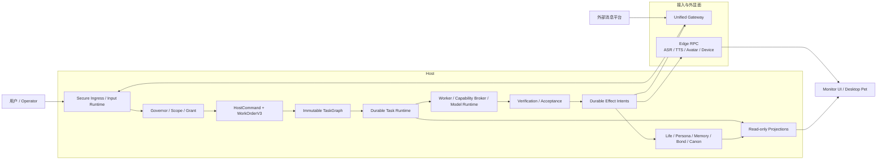

受众：PROJECT
标题：Natsume AI 工程总览与运行指南

# Natsume AI

Natsume AI 是一个本地优先、用户主权优先的个人数字生命系统。它把对话、人格表达、长期记忆、关系状态、主动行为、工具执行、设备能力和多平台消息接入放在同一套可审计运行时中，并要求所有真实动作都能回答四个问题：谁批准、执行了什么、依据什么验收、产生了什么副作用。

本仓库不是已经完成的“全自动进化 AI”。它已经具备较完整的 Host、Scheduler、Internal Agent、持久化、授权、任务、模型、Gateway、Edge 和观测基础设施，但可生产的 Durable DAG 并发/恢复、通用智能规划、受治理人格演化以及完整长期演化闭环仍在建设中。当前完成度必须以代码审计和机器状态为准，不能从历史 `PASS/DONE` 或目录数量推导。Durable 调度恢复会对持久 TaskGraph 重新检查依赖环，发现环以 `PLAN_CYCLE` 失败关闭。新建的 Chat、Skill、Plan、Delegate、Tool、Scheduler、Internal 与 Operator 图默认使用 `ATOMIC_GRAPH_SUCCESS_V1`：0090/0091 分别原子收口失败/成功，节点 `ACCEPTED` 在 Graph 与 graph-scope Budget 同事务终结前只属于内部结果。历史无 policy 图仍按 legacy 只读兼容；`HOST_TASK_RUNTIME_BOUNDED_FANOUT_ENABLED` 继续默认关闭，因此实际 sibling 并发、取消、通用恢复和整波 canary 仍未完成。

## 当前状态

最新 NE-01 批次把并发图的失败、重试、预算超限和人工 Review 放进同一个
Windows `spawn`/文件型 SQLite 恢复矩阵。进程 A 在两个根节点都形成 durable
outcome、但外层 0090 settlement 尚未提交时硬退出；全新 Host 只能重开既有
Attempt/Acceptance/Budget/Review，worker resolve 与调用均为 0，并且只公开
一个 Graph 终态。Review 图在新进程中先稳定进入 `BLOCKED`，拒绝后由下一
进程提交唯一 denial settlement；失败/预算图完成后再次启动 inventory=0。
首轮透明结果为 `2 passed, 1 failed`，失败暴露出已释放预算的
`BUDGET_BLOCKED` 图仍被永久 survivor 扫描。现在 Host recovery inventory
只把含 `READY/RETRY_PENDING/WAITING_* / RUNNING/CANCEL_REQUESTED` 等可行动
节点的 `BLOCKED` 图视为可恢复，纯终态阻断不再重复重放；最终启动/进程集合
`14 passed in 46.30s`，旧并发结算回归 `12 passed in 49.41s`。宽回归还
暴露并修正了一条旧测试夹具遗漏 durable ReviewRuntime 的问题，不改变生产
合同。该修复关闭 mixed terminal 的本地进程恢复子缺口，
但生产 fan-out 开关、七路线进程 canary 和整波集成尚未运行，NE-01 仍为
`IN_PROGRESS`。

最新 NE-01 恢复批次补齐两组真实跨进程证据。第一组覆盖取消绑定的
`COMMIT + SIDE_EFFECT_CONFIRMED` 与 `RELEASE + NO_SIDE_EFFECT`：目标
Operation 已提交而 Accepted handler 尚未返回时硬退出，新进程只重开同一
case-bound proof，随后由 cancellation continuation 把 Graph、Node 和
Attempt 收口为 `CANCELLED`；第四个进程确认零 pending continuation。第二组
在启用受控 fan-out 的测试组合中让一个根节点已 `ACCEPTED`、兄弟节点停在
`RESERVED/RUNNING` 后硬退出；live Lease 只允许 defer，过期后必须生成
current hold，经签名 `REACQUIRE` 后仅执行未知兄弟与 join，已验收兄弟不重跑。
恢复调度现在会把 checkpoint 节点终态先交给统一 parallel settlement，Host
只收到一个规范 Graph 终态，不再因节点终态与图终态重复而失败关闭。新增
跨进程集合 `3 passed in 32.25s`，独立相邻恢复回归 `16 passed in 83.15s`。
这证明的是本地 Windows/SQLite 受控子集；bounded fan-out 与 cancellation
生产开关仍为 `OFF`，部署签名 canary、整波集成和 NE-07 尚未执行，因此
NE-01 继续为 `IN_PROGRESS`。

最新 NE-01 进程恢复切片已把签名终态的“目标写入成功、处理进程尚未返回”
窗口纳入真实 Windows `spawn` 与文件型 SQLite 验证。`COMMIT +
SIDE_EFFECT_CONFIRMED` 会在独立签名进程确认 canonical WorkerProjection 后，
由目标 UoW 提交 Operation/Outbox；即使 Accepted handler 随即硬退出，新进程
也只重开同一 proof/receipt，并以零 worker 调用继续 Verification 与
Acceptance。无 cancellation intent 的 `RELEASE + NO_SIDE_EFFECT` 同样可在
目标失败终态提交后跨处理进程崩溃精确重放，下一次 Host 启动的 survivor 与
worker 都为零。0131 之后的全部相关集成测试也改为绑定唯一 current recovery
case ref 与 subject digest，不再使用无 case 的过时测试证据。新增跨进程
`2 passed in 18.33s`，既有签名回归 `5 passed in 18.06s`。这验证的是现有
Operation/Outbox UoW 与幂等 handler receipt，无新增生产 writer；取消绑定
组合、自动未知副作用归因、部署 fan-out、波次集成和 NE-07 仍未完成，因此
NE-01 保持 `IN_PROGRESS`。

最新 NE-01 切片关闭了 Scheduler 一次 sweep 内的可变批次窗口。
`SchedulerDefinitionRepository.read_clock_batch()` 先在一个 SQLite 读事务中
同时取得待恢复的 CLOCK occurrence 与新到期 definition，再把 capture time、
limit、顺序和深拷贝后的 JSON 行绑定为
`scheduler-clock-batch://sha256/...`。`SchedulerClock` 在执行第一个 worker
之前独立重开该合同，并且本轮不再二次查询 due rows；因此先执行的 pending
worker 不能改写或重新选择同一轮剩余任务。七路线 query-only 验收 reader
也会私下严格重开持久化 Command、WorkOrder、TaskGraph 及三者 digest，并对
Scheduler/Internal/Operator 重新执行
`ControlRouteExecutionPolicyV1` 绑定校验；公开收据仍只保留无正文、无
secret 的 policy/digest 证据。核心 Scheduler、合同和真实 SQLite
三控制路线集合为 `45 passed`；加入结构、控制 policy、coverage 与文档
回归后的最终受影响集合为 `100 passed in 64.61s`，架构 Gate 1～14 和统一
`static_scan,doc_gate` 也均通过。随后在 clean SHA `2a88f56e` 上完成 GR05
与三条控制路线的同库运行；七路均为 `PASS`，Scheduler/Internal/Operator
各自重开一个控制政策，其余路线为零，正式 receipt digest 为
`sha256:505c300bc88882258bc47d13c75a542fb4a9526fc4e16cf2b7e9875d8d9cdd1a`。
这只关闭 clock batch 与控制 policy 的提交绑定，Scheduler 与 NE-01 仍是
`INCOMPLETE / IN_PROGRESS`，远程
CI 仍记 `NOT_RUN_ACCOUNT_QUOTA`，Docker 全栈仍留到 NE-07。

NE-01 当前切片正在收口 Scheduler、Internal、Operator 复用
`route=delegate` 时的控制面语义。三者现在必须携带同一个
content-addressed `ControlRouteExecutionPolicyV1`，精确绑定 surface、
控制命令、target、Task Runtime owner、Review 层级、有限 Budget、
durable verification 与“只能由 Graph Acceptance 提交 Effect”的边界。
Policy 同时写入 WorkOrder input/metadata、Budget metadata、WorkOrder
input refs 与 TaskNode input refs，并在首次执行、exact replay、Review
continuation、Operation recovery、独立 Verifier/Acceptance 和 Effect
编译前重开。Operator 复用已有 durable Intent admission Review，不再叠加
第二个 TaskNode Review；Scheduler 的人工 trigger 与需要 Review 的 Internal
仍可使用 TaskNode Review，两种 authority 不能同时声明。Review 创建使用
TaskStore 暴露的同一可信时钟，固定时钟和重启测试不再因两个 clock 漂移。
同一 `RECOVERY_REQUIRED` Operation 版本也只能保留一个 current recovery
case，后续 Budget/Lease 推进只能 exact replay 该 case，不能制造第二个
签名对账 authority。最终三个互不重叠的本地回归组分别为 `29 passed`、
`32 passed` 和 `8 passed`，共 69 项、零失败。该切片不会把仍失败关闭的
一般恢复、
波次集成或 NE-07 提前写成完成，NE-01 继续为 `IN_PROGRESS`。
纯 WorkOrder replay normalization 已下沉 contracts，Acceptance Effect
audit projection 与 control policy composition 已拆成 focused 模块；
`governed_task_adapter.py`/`internal_task_runtime.py` 分别保持 1480/1499 行，
没有扩大巨石白名单，完整架构静态 Gate 1～14 为 `PASS`。

Operator 清单已经从“37 条均对外公布、其中 23 条永远阻断”改为严格
allow-list：生产 manifest、OpenAPI、生成式 Monitor client 和 domain handler
registry 现在只包含 14 条已进入 Governed Runtime 的命令，活动清单内
`blocked=0`。原 23 条旧命令不是改名为完成，而是从可执行合同中退役：
Avatar/Mate 统一迁往 `edge.command.push`，原始 Tool 与 Security Hunt 分别
迁往 governed Skill/Tool 和 Internal/Scheduler，Forge、Canon、Bio、Bond
只能在 NE-05/06 的 proposal/version authority 完成后以新合同返回。
退役映射由
[`operator_command_retirement.py`](host_brain/contracts/operator_command_retirement.py)
冻结；同源 BFF 对旧 ID 返回 `410 OPERATOR_COMMAND_RETIRED` 和替代 authority，
且不会进入 Secure Ingress，Monitor 也在发起网络请求前拒绝。后文出现的
`14/37 + 23 blocked` 是提交绑定历史口径，已由本段和机器状态取代。该清理
消除了伪能力与 dormant writer，但不证明一般恢复、真实 HTTP/Edge canary
或 NE-01 已完成。

NE-01 已封板 Plan 与 Delegate 的当前启用范围，接下来收口 Scheduler、
Internal、Operator 与一般恢复。当前唯一启用的
`CAPABILITY_SEARCH_V1` Plan 会在准入前冻结 content-addressed
`capability_plan_execution_policy.v1`：它绑定 Graph revision、原子完成策略、
Graph Budget digest、节点顺序、Skill Registry 风险/Review/执行政策，以及
“中间 Skill 零副作用、最终 Chat 唯一拥有 Graph Acceptance Effect”的边界。
首次执行、请求重放、Review continuation 与启动恢复都会重开同一政策；任何
Registry、预算、拓扑或 effect owner 漂移都在 worker/Effect 前失败关闭。

当前唯一启用的普通 Delegate 仍是只读 `pentest_agent`。它现在还必须冻结
content-addressed `governed_delegate_target_policy.v1`，先进入 durable
pre-execution Review，再由 claim-fenced continuation 执行；内部
token/tool/retry/model-cost 仍以 digest-bound attestation 精确为零。dispatcher
和 frozen executor 都会拒绝 side-effect、delivery 或 Outbox descriptor，
只有外层 Graph Acceptance 能提交结果。Operator/Scheduler 复用的
`route=delegate` 只是一条已认证控制传输：它继续使用 app-local target
allowlist 和有限非零预算，不会伪装成 `pentest_agent`、也不需要 child-agent
target policy。当前 Plan/Delegate 定向集合为 `89 passed`，真实
文件型 SQLite 的 Chat/Skill/Delegate/Plan 集成为 `1 passed`；后者已真实走
Delegate `WAITING_APPROVAL → approve/resume → ACCEPTED`。另一个控制面回归集合
为 `21 passed`，Scheduler 的同边界另由上述定向集合覆盖。干净提交
`2a88f56e2dc7c68d7f37100c6c2d408bc2fdf6a0` 的同库七路线收据已重开这些
事实，Plan 的 `CAPABILITY_SEARCH_V1` 与 Delegate 的只读 `pentest_agent`
启用范围均为 `COMPLETE`。这不包含通用 NE-02 搜索收益、其它 Delegate target
或 NE-07 的真实 provider/Docker 全栈。

NE-01 当前正在收口 Skill 的预算与副作用边界。canonical Host Registry 的 93 个
Skill 已被穷举分类：28 个 `INLINE_READ_ONLY`、13 个
`PRE_ACCEPTANCE_PROPOSAL_ONLY`、3 个 `POST_ACCEPTANCE_WORKSPACE`，以及
49 个 `BLOCKED_PENDING_ACCEPTANCE_EFFECT`。前三类共 44 个才进入运行期
manifest；后 49 个只保留 catalog 可见性，在 PlanningSearch、Scheduler
自动调度、Host admission 和 stale durable graph 执行四层都失败关闭，直到
存在 typed post-Acceptance Effect handler。新 Skill、缺失政策或
`skill_id/tool/action` 描述漂移同样默认拒绝，风险等级和可逆性不能被用来
推断写权限。

另一个仅供旧 Tool/Scheduler catalog 使用的 Personality Registry 有 19 个
条目，其中 5 个明确 blocked、14 个保持 `UNCLASSIFIED`；其 governed
manifest 为 0，不能自动调度或进入 Host Skill 执行。动态 MCP Skill 同样
固定为 blocked。这样旧目录不会因默认值重新获得执行 authority。

全部 44 个启用 Skill 都先消费 canonical Task precharge；普通只读 Skill
没有裸模型端口，需要模型的 Agent/声明式 Skill 必须使用 Task-bound
measurement guard。13 个 proposal-only Agent 只能产出有界候选或 staging
artifact，不能在 Acceptance 前投递用户可见结果；三条已审核 risk-4 Agent
写入继续使用 protected Workspace stage 与 post-Acceptance promotion。
`browser_research` 等在 Domain lifecycle 中包含用户可见投递的能力，以及会
持久化浏览器 profile/session 的“读取”动作，也属于 blocked 集合。本地代码
与定向测试已证明该分类；干净提交
`c68850f859048be955c15366e33ada3a917d9b12` 又在同一真实文件型 SQLite
重跑七路线，新的 v3 收据使 Skill 的预算与事务副作用控制均达到 `PASS`。
因此 Skill 对当前 44 个启用能力的生产范围为 `COMPLETE`；被禁用的 49 个
能力不计为完成，也不能由这份收据获得执行权。

Skill 的生产代码同时只允许
[`host_brain/app/governed_skill_execution.py`](host_brain/app/governed_skill_execution.py)
在已经准入的 TaskGraph 节点、有效 node-bound grant、Attempt/Lease/Budget
上下文和 app-local ports 下调用 `SkillMeta.handler`、绑定 sealed execution
authority 并进入 Capability Broker。旧
`host_brain/executive_runtime/skill_execution.py` 已物理删除；
`SkillLoader.execute()` 只保留可观测的失败关闭，Scheduler 也不能再把
Skill metadata 解释成第二条直接执行路径。机械 AST 清点要求三类敏感调用
各自只有上述 app-local owner；Skill receipt 持久化失败不得吞掉。本切片
已在干净提交 `3d68bd1eca69ad1593454634c2999d07b4d4f2f5` 上完成
`209 passed` 的受影响集合、真实 GR05 `1 passed`、静态/文档 Gate 和中文
交付元数据 Gate，因此 Skill 的 `canonical_execution_authority` 已提升为
`PASS`。本轮预算/副作用分类已由
[ne01_skill_policy_route_acceptance_20260727.json](docs/45_testing/test_reports/ne01_skill_policy_route_acceptance_20260727.json)
绑定到干净提交并提升其余两个控制；Skill 当前启用范围已封板，但其余三路
仍有 `PARTIAL` 控制，所以 NE-01 仍没有封板。

NE-01 已把 Chat 模型预算从“存在合同”推进为可由持久账本独立验收的生产链。GR05 不再伪造 `surface_model_attempt`，而是经真实 `Surface Runtime → ModelAttemptService → Provider adapter → WorkerProjection → 父子 Budget ledger` 执行普通 Chat 与 Plan 最终合成；只有最末端 provider transport 使用受控 adapter。provider 返回的 token、重试和模型成本必须同时匹配 canonical `model_attempt_log`、不可变 WorkerProjection、Graph Budget usage 与 Attempt-bound child usage，exact replay 不得再次调用 provider。干净提交 `3d68bd1eca69ad1593454634c2999d07b4d4f2f5` 的正式收据已重开并验证该 lineage，因此 Chat 的 `budget_enforcement` 升为 `PASS`，Chat 成为七路中第一条 `COMPLETE` 路线。该受控链证明治理和计量，不证明外部 provider 质量、PlanningSearch 收益或 NE-07 实栈。

真实调用同时暴露并修复了两个先前被假数据遮蔽的问题：内部 `governed_model_budget` guard 不再泄漏进 Life acceptance payload，只有实际测量可以持久化；Task Runtime 也不再覆盖 Surface executor 已提交的 audit path，瞬时 COMMIT 与 durable WorkerProjection 因此保持同一来源身份。验收采集器新增隐私有界的模型生命周期与 Worker 预算证据，只输出标识、digest 和用量，不输出 prompt、模型回复或 secret。

NE-01 的七路线提交绑定验收账本 v3 已覆盖全部七路；Scheduler、Internal、
Operator 仍缺的是各自其它控制，而不是提交绑定。只读采集器在一个事务中打开真实文件型 SQLite，核对 HostCommand、不可变 TaskGraph、Node、Attempt、Lease、Operation、父子 Budget、Verification、Acceptance、Artifact、WorkerProjection、Effect、Outbox，以及当前 recovery/cancellation 空集；对 Chat/Plan 还核对 ModelAttempt 和 Worker 模型预算。收据同时绑定干净 Git HEAD、仓库 migration head 和数据库已应用 migration head。请求标识只输出摘要，禁止用户正文、模型输出、secret 和原始 payload。

本地剩余路线驱动器又通过真实 Scheduler CommandService、Internal CommandService 和带 Review/HardState Effect/外层 outcome 的 Operator Runtime，把三路终态顺序写入同一个 canonical SQLite。最新串联运行绑定干净提交 `2a88f56e2dc7c68d7f37100c6c2d408bc2fdf6a0`，仓库与数据库 migration head 均为 `0135_task_review_denial_settlement.sql`；只读 validator 严格重开 admission digest 和控制政策后得到七路全部 `PASS`、reason code 全空。正式隐私安全收据见 [ne01_scheduler_clock_control_route_acceptance_20260727.json](docs/45_testing/test_reports/ne01_scheduler_clock_control_route_acceptance_20260727.json)，receipt digest 为 `sha256:505c300bc88882258bc47d13c75a542fb4a9526fc4e16cf2b7e9875d8d9cdd1a`。因此七路 `commit_bound_acceptance` 均为 `PASS`，Chat、Skill、当前启用 Plan 和 Delegate 范围均为 `COMPLETE`；Scheduler、Internal、Operator 和 NE-01 仍为 `INCOMPLETE / IN_PROGRESS`。

本地采集入口如下；必须为每条路线传入同一真实运行数据库中的 request id，且采集时 tracked worktree 必须干净：

```powershell
python scripts/runtime/collect_universal_runtime_acceptance.py `
  --database <runtime.sqlite3> `
  --route chat=<request-id> `
  --route skill=<request-id> `
  --route plan=<request-id> `
  --route delegate=<request-id> `
  --route scheduler=<request-id> `
  --route internal=<request-id> `
  --route operator=<request-id> `
  --output artifacts/local-gates/<commit>/universal-route-acceptance.json
```

NE-01 已把 Review 拒绝后的分散终态写入收为一个 canonical SQLite UoW。`0135_task_review_denial_settlement.sql` 追加不可变 settlement，精确绑定 terminal Review 状态、版本和 digest、Graph revision、Node、graph Budget、三条 Outbox，以及 POST Review 的 Acceptance/Attempt 和已有多节点 `BLOCKED` decision。PRE Review 拒绝只允许在零 Attempt 时将 Node/Graph 置为 `CANCELLED`；POST Review 拒绝必须重开 0134 Acceptance 与 `SUCCEEDED` Attempt 后将 Node/Graph 置为 `FAILED`；两条路径都在同一事务释放 graph Budget。提交中途故障会整体回滚，响应丢失或进程重启只重放同一 settlement，不创建 Attempt、Grant 或再次运行 Worker。真实 SQLite 已覆盖 PRE/POST、并行 Graph、exact replay、整体回滚和不可变篡改保护。一般取消/恢复、七路线 commit-bound receipt、波次集成和 NE-07 仍未收口，NE-01 保持 `IN_PROGRESS`。

NE-01 现在把节点 Acceptance 从调用栈里的瞬时判断提升为第二个独立持久事实。`0134_task_node_acceptance_decision.sql` 追加不可变 decision，精确绑定 Graph revision、Node、Attempt、规范化 `AcceptanceJudgement` digest、evidence、Node Outbox，以及可选的 Review、Graph 版本和 Graph Outbox。自动接受时，decision、TaskResult artifact、可选 Effect intents、`ACCEPTED` Node 与 Node Outbox 在同一个 SQLite UoW 中提交；需要人工判断时，非 `ACCEPT` decision、`WAITING_ACCEPTANCE_REVIEW` Node、`ReviewItem`、Node Outbox，以及直接单节点图的 `BLOCKED` Graph/Outbox 同成同败。进程重启从 decision 重开 Acceptance 和 Review identity，不重新运行 judge 或 worker；Scheduler snapshot 也投影 `node_acceptances`。ReviewStore 与 TaskStore 共用唯一 pending Review SQL writer。真实 SQLite 已覆盖 exact replay、重启、篡改和 decision 写入后的故障回滚；后续拒绝终态由 0135 单一 settlement authority 收口。

NE-01 现在把节点 Verification 从进程内临时值提升为持久 authority。`0133_task_node_verification_decision.sql` 追加不可变 decision，精确绑定 Graph revision、Node、Attempt、规范化 `VerificationResult` digest、evidence 与 Node Outbox；`VERIFYING → VERIFIED/VERIFICATION_FAILED` 与 decision 在同一 SQLite UoW 中提交。进程在 VERIFIED 后丢失时，Continuation 从 decision 重开验证结果，不再读取从未持久化的 Node 字段。直接单节点验证失败则在一个事务中同时关闭 Node、Graph、graph Budget 与三个 Outbox，响应丢失只允许 exact replay，任一身份或 Outbox 漂移使整个终态事务回滚。多节点失败仍由 decision 记录节点事实，再交给既有 0090 settlement 收口共享 Graph。该切片没有完成一般取消/失败恢复、七路线 commit-bound 验收或波次集成，NE-01 仍为 `IN_PROGRESS`。

NE-01 的预算 authority 已从“只有一条图级共享记录”推进到父子两层但仍保持单一总账。`0132_task_node_budget_reservation.sql` 为每次 Attempt 建立一个不可变绑定的 child `BudgetReservation`；新 Attempt、Lease、READY→LEASED 与 child reservation 在同一个 `BEGIN IMMEDIATE` 事务中提交，Graph reservation 仍是唯一 aggregate ceiling。普通用量、首个超限、terminal sibling observation 和 retry charge 都在同一 SQLite UoW 同时更新父账本、子账本与 append-only usage binding；响应丢失必须重开 exact Attempt/child/parent Outbox lineage。0132 对升级前 Attempt 回填已接受用量，不能在升级后重新获得已消费额度。真实 SQLite 已覆盖两根并发 claim、跨实例重开、exact replay、identity tamper、父级竞争和 retry。该切片没有完成七路线 Budget policy、所有 cancellation/release 组合、wave integration 或 NE-07 canary，因此 NE-01 仍为 `IN_PROGRESS`。

当前启用的 capability Plan 已把注册表里的 `require_confirm` 从“搜索阶段直接排除”改为不可变节点审批策略：候选快照冻结 `requires_review`，编译器把 candidate policy 重绑定到实际 TaskNode ID，并为图中每个节点生成完整覆盖的 `node_review_policies`。Scheduler 只让被标记的节点进入 pre-execution Review；缺项、字符串布尔或来源漂移均失败关闭。Review 决定消费后，Continuation Worker 重开同一 graph revision：审批前已 `ACCEPTED` 的节点继续绑定原 immutable WorkerProjection grant，尚未执行的节点使用 claim-fenced 续签 grant，worker 不重跑。真实 SQLite 的 `skill → skill → chat` 证明单一 confirm-required 节点等待、一次性续跑和全图原子完成。Plan 当前启用路径的 `node_bound_grant` 与 `review_resume` 控制可记为 `PASS`；每个 Attempt 也已取得独立 child Budget Reservation，但一般候选生成/恢复、所有取消与释放组合、事务副作用、commit-bound 七路线验收和 NE-01 仍未完成。

当前唯一启用的普通 Delegate 目标仍是只读 `pentest_agent`。它只接收冻结的 Domain Pack/SecureRun invocation，不取得模型、工具、嵌套派发或 Effect 端口；“没有上报用量”也不再被解释为零。dispatcher 现在生成 digest-bound `ReadonlyDelegateUsageAttestationV1`，精确绑定 command、graph/revision、node、attempt、node grant、target、adapter 与 invocation，并证明 adapter 内部 token、工具、retry 和模型成本均为零。Task Runtime 仍为外层 canonical Delegate dispatch 预扣恰好一次工具调用，执行器只把上述 attestation 转成 `WorkerBudgetUsage`；旧 `intent_agent_trace/repair_agent_trace` 不再具有预算证据资格。缺失、非零、篡改或 lineage 漂移会在 COMMIT 前失败关闭。真实 SQLite 投影与 BudgetUsage 定向集合为 `56 passed in 19.61s`。这只把当前启用 Delegate 目标的 `budget_enforcement` 控制提升为 `PASS`；一般 Delegate、route-level Review/restart、commit-bound 七路线验收、program-wide Budget 和 NE-01 仍未完成。

当前启用的通用 worker 路线不再使用“worker 返回 `APPROVE`，验收器就把全部条件写成 `PASS`”的兼容逻辑。Chat、Skill、Delegate、Plan、Tool 与 Operator 的通用节点现在共享独立 `DurableWorkerCommitVerifier` 和 `DurableWorkerCommitAcceptance`：两阶段分别重开 durable WorkerProjection，并复验 command/request、graph revision、node、attempt、route/target、node grant、WorkOrder/context lineage、receipt digest、完整 COMMIT 与节点输出合同。只有固定的结构性策略可自动通过；不能由机器证据证明的自然语言条件进入 durable post-execution Review。Plan 的最终 Chat 还必须实际消费已验收前驱 TaskResult artifact，并携带 artifact/receipt/payload digest 的规范 bundle attestation；只有 DAG 边而没有数据消费不再算满足依赖。该切片把当前 Delegate/Plan 已启用路径的 `verification` 控制提升为 `PASS`，但通用 PlanningSearch、program-wide Budget、一般恢复、commit-bound 七路线验收和 NE-01 仍未完成。

普通受治理 Skill 不再自动取得裸 `ModelAttemptService`。需要模型的 Skill 必须在注册元数据中显式声明 `model_budget_required`，由 Task Runtime 从当前 ACTIVE Budget 派生 graph/revision/node/attempt-bound guard，并只注入 `GovernedSkillModelBudgetRuntime`。每次真实模型调用都使用扣减后的剩余额度；cache、缺 usage、重复或不完整 measurement、额度超限以及 attestation 与 Task lineage 漂移全部失败关闭。worker 返回的服务端 attestation 还会在外层按 request/Budget/Graph/Node/Attempt 重验，再进入 `WorkerBudgetUsage` 和 durable Budget settlement。当前接线首先覆盖 `emergent_growth_weekly`；未声明的普通 Skill 没有裸模型端口，Agent Skill 继续使用其既有 sealed guard。该切片没有运行真实 provider，也不等于 program-wide Budget、Persona 演化或 NE-01 完成。

> 2026-07-26 的当前 locator 清点仍为具名业务 consumer `0`、具名 import `0`、全部 import-form consumer `0`，并且生产 `ProcessServiceContainer`、`process_services`、`process_environment` 与旧 wiring 文件均已物理删除；生产字段、锁和可变引用库存也是 `0/0/0`。ASGI 与 CLI 各自构造 fresh `ProcessApplicationPorts` 并显式传给 Host root，`build_production_host_application_ports()` 不再有全局回退。既有提交绑定测试数字只作历史证据。Chat 的本地持久投影屏障已接通，但 commit-bound 路线验收、外部 Chroma/Neo4j namespace、Token/MCP durable restart、跨进程租户隔离、通用 Delegate 和七路线 Runtime 仍未完成。波次集成与真实 Docker 服务栈未运行，`REMOTE_CI=NOT_RUN_ACCOUNT_QUOTA`。

当前 Chat Acceptance 不再把“Life command 已入账”误当成“本地可见状态已提交”。`conversation.user_turn → preference → life.conversation_turn_recorded → life.foreground_completed → surface.reply_delivery` 仍按固定顺序执行；两个 Life Effect 现在必须逐项验证同一 command 的完整 projection-intent 集合、payload digest 与 durable projection receipt。`surface.post_process` 只有在 assistant turn 与 LifeMemory admission 都持久成功后才会产生回执，因此外部 Gateway reply 不能先行。首次调用响应丢失可重开 exact command 并只派发自己的 intent；重启后的 reclaimed reconciliation 只读，不盲重放。缺失、失败、篡改或漂移继续保持 `UNKNOWN` 并阻断后续 delivery。该边界把 Chat 的 `transactional_side_effects` 控制提升为 `PASS`，但外部发送仍是幂等 eventual delivery，不宣称跨服务全局 SQL 事务，Chat 路线和 NE-01 也仍为 `INCOMPLETE / IN_PROGRESS`。当前受影响集合为 `106 passed in 117.58s`，波次集成和 NE-07 未运行。

当前 NE-01 已把同一真实写产物链从 Governed Internal 扩到三条已登记的直接 Agent Skill：`agent_worker`、`agent_self_heal`、`agent_self_evolve`。Skill payload 仍只能提交未准入的兼容 WorkOrder；server 在节点执行前用冻结的 HostCommand、TaskGraph、Attempt、Lease、node grant、Budget、risk-4 policy 和唯一已消费的 pre-execution Review 重建 `WorkOrderV3`，caller 不能选择 Workspace、ArtifactStore、Review ref 或执行 authority。`codex_runtime` adapter 只取得 app-local ArtifactStore/WorkspaceRuntime，写结果先密封为 protected stage；WorkerProjection 只转移 ref/digest，Graph Acceptance 再编译 `agent.workspace_artifact_promote`。Accepted handler 会重开 immutable admission、WorkerProjection、Node/Attempt/Lease、NodeArtifact、claimed/committed Effect、terminal Preview 和 sealed bytes，随后才用既有 0116 推进 `ACTIVE → ACCEPTED → PROMOTED`；提升失败会在可见对话、Life 和 delivery Effect 之前停止。真实 SQLite+Git 集成已证明源 `main` 不移动、accepted HEAD 可跨 Runtime 重建读取；既有 exact replay、seal 后篡改与 lifecycle 回滚证据继续适用。Domain Pack、未登记 Skill、其它 failure/cancellation、OS/container tenant、handle-level TOCTOU、七路线整体验收和 NE-01 仍未完成。

当前 NE-01 恢复切片由连续 migration `0130_task_operation_recovery_hold.sql` 与 `0131_task_operation_recovery_hold_binding.sql` 共同组成；仓库连续 migration head 已推进到 `0135_task_review_denial_settlement.sql`，0132～0135 不改写这两条恢复语义。现在 `RESERVED → RECOVERY_REQUIRED` mutation、Operation Outbox、append-only `operation-recovery-hold://...` 与 `OPERATION_RECOVERY_HOLD_RECORDED` Outbox 在同一个 SQLite 事务中提交，Hold 写入失败会把 Operation marker 一并回滚，不再依赖下一次请求重入补登记。subject 仍精确冻结 Graph、Node、Attempt、Operation、graph Budget、取消意图、active Lease 及各自版本；未决 unknown/cancellation case 的 current 身份由 exact Operation version 和取消身份决定，后续 Budget 计量、Lease 到期或 lifecycle fence 不会让恢复清单消失。Graph cancellation 会追加 intent-bound successor case，并使此前 unknown case 退出 current projection。checkpoint conflict 继续要求完整版本快照。exact replay 只能重开同一 case/outbox；UPDATE/DELETE、subject/outbox 漂移和过时 Operation 版本均失败关闭。

0131 进一步要求 `task_operation.reconcile` 在存在唯一 current hold 时，必须携带 exact case ref 与 subject digest；两者进入 Secure Ingress、不可变 WorkOrder/TaskGraph、风险 4 Review、Acceptance Effect 和 append-only reconciliation evidence。Accepted handler 复用既有 Operation/Outbox 单事务 authority 执行签名 `REACQUIRE/COMMIT/RELEASE`，随后必须重新打开同一 case并证明其已变为 non-current，才提交 v5 handler receipt。UNKNOWN case 不得伪装 cancellation intent；CANCELLATION case 必须绑定 exact intent 且只允许 `COMMIT/RELEASE`；每个 case 最多一份 evidence，响应丢失或进程重启只重开同一事实。checkpoint `CONFLICT` 继续隔离，不能借 0131 绕过。当前受影响回归为 `129 passed in 146.40s`，文档/机器状态合同为 `51 passed`，架构静态 Gate 1～14 与统一 `static_scan,doc_gate` 均通过。该链关闭的是“hold 与对账证据脱节”的当前断点，不推断副作用、不自动归因未知效果，也不代表一般恢复或 NE-01 完成。

同一切片把此前 four-root 证据扩展为两类一般形状验证：五节点 `root → (left,right) → join → tail` 菱形图在中间并发 wave 的两个 COMMITTED checkpoint 响应丢失后，按不可变图序续接并只在两个前驱均 accepted 后释放 join/tail；八个并发根节点的 checkpoint 也能跨 owner 收口，不存在固定四节点恢复上限。五个新核心 case 首轮为 `5 passed in 23.12s`；最终 online takeover、共享 Budget、多节点形状和取消跨进程四文件受影响集成为 `37 passed in 145.68s`，0 fail。所有已测试 worker 调用次数均为 1。该证据仍不是无限规模证明，也没有自动归因未知效果、覆盖所有 failure/cancellation/Workspace 终态或启用部署 fan-out；NE-01 继续 `IN_PROGRESS`。

当前 NE-01 切片已继续把 Scheduler 管理 HTTP 收入同一治理边界：`POST create`、`PATCH update`、`DELETE` 与 `POST enable/disable` 在 `/scheduler`、`/host-scheduler` 两个前缀下都只能调用 app-local Scheduler 管理 runtime，经 Scheduler Secure Ingress、typed Governor、`HostCommand(surface=SCHEDULER)`、不可变 `TaskGraph`、节点级 Attempt/Lease/Grant/Budget、Review、Verification、Acceptance、terminal Action Preview 与 `operator.state_control` Acceptance Effect 后，才写入 canonical Scheduler repository。提交结果先进入不可变 `scheduler_admin_operation_result`，再封口原 HTTP claim；进程在两者之间崩溃时，新实例只重开同一 operation receipt，不重复发布或删除 definition。list/get/health 保持只读，trigger 沿既有 governed occurrence 入口运行；路由中直接调用 `publish_definition/set_enabled/delete_definition` 的生产点为 0。

前一切片接入的 `scheduler.task.enable/disable` 与 `sys_mode.auto_rules.update/event.submit` 四条 Operator 命令及 0129 Host mode-policy journal 边界保持不变。Operator inventory 仍是 `14/37`，其余 `23/37` 继续失败关闭；Scheduler HTTP 切流不会虚增 Operator 数量。当前管理命令主批次为 `34 passed in 139.12s`；Scheduler occurrence/dispatcher/Preview/UoW 扩展回归为 `57 passed in 54.81s`，两组语义重叠且不相加。部署凭据、真实 HTTP/network canary、完整 Host 进程重启、Scheduler mutable batch 与全部 failure/cancellation 组合恢复、波次集成及 NE-07 全栈均未运行，所以 Scheduler 与 NE-01 仍为 `INCOMPLETE / IN_PROGRESS`。

当前分支继续清除了 Host 情感与回复形态的进程级可变状态：每个 Host root 惰性持有一个 `HostEmotionRuntime`，Input、Tribe 与 Lifecycle 共享该精确实例；情绪连续向量、前一情绪标签、用户情感画像、时间线与日记节流均不再由模块全局变量拥有。只有真实 Host admission 会推进连续状态，回放、Prompt 渲染和只读归一化保持纯函数。每个 Input composition 另行拥有一个 `ResponseFormDecider`，语音额度的检查与计数使用同一锁原子执行。该切片只证明 app-local identity、并发计数和负向库存；情感状态仍是单 Host 进程内连续状态，不是 NE-06 长期人格资产，也尚未经过波次集成、真实多 Host canary 或 NE-07 全栈验收。

内部旁车到 Governance owner 的既有批次都只作提交绑定历史。当前 Authority owner 集合证明每个 Host root 的 canonical SQLite connection、Memory stores、ModelAttempt 与 CapabilityBroker runtime identity 均隔离，Prompt/Route catalog 也不再共享可变实例；关闭失败会保留未完成资源并阻断新 epoch。生产 locator facade/Container 已物理清零，测试桥不属于可发布产品对象图；Chroma 与 Neo4j 仍使用配置级共享 namespace，所以不能外推为 tenant isolation、资源崩溃恢复、事务化 Chat、波次集成或 production canary 已完成。当前 fresh 完整架构静态 Gate 1～14 已全部 `PASS`、`failed_gates=[]`：Task Runtime feature-canary 合同和 Host lifecycle ports 已迁入中立 `host_brain/contracts/`，Persistence 与 Composition 分别直接依赖 canonical contract；旧导入路径只保留同一对象重导出，因此 application/persistence 与 app/composition 两个 SCC 均已消除。Gate 3 继续由 Research shadow ledger 的 1271/512/108 行职责拆分保持通过，没有扩大白名单。该结论只表示静态分层收口，不代表 Universal Runtime 七路线、NE-01 或完整架构项目完成。

最新 `dev` 还保留 #114 的精确 Internal 单节点后置审核取消恢复：真实 Operator Secure Ingress 发起取消后，immutable intent 的 `BLOCKED` 只表示围栏，另一个绑定该 intent 的 trusted final decision 必须为 `CANCELLED`；重启 terminal worker 先关闭 deterministic nonacceptance claim，再 tombstone/清理 Workspace，且不得重跑 Agent。既有 pre-checkpoint 取消子集仍只接受两种受信终态：`RELEASE + NO_SIDE_EFFECT + 无 receipt`，或 `COMMIT + SIDE_EFFECT_CONFIRMED + durable receipt`，并要求 finalized cancellation。当前分支另行关闭“不存在取消意图”的精确 raw worker failure：仅当单节点 Graph 仍 `ACTIVE`、原 Lease 已到期、恰好一个 graph Budget、零 WorkerProjection/Acceptance Effect、签名 `RELEASE + NO_SIDE_EFFECT + 无 receipt` 全部成立时，单一 SQLite UoW 才把 Operation、Attempt、Node、Graph、Lease、Budget 连同各自 Outbox 收口为失败终态。真实 SQLite + Git 证明响应丢失只重开同一签名终态，Internal Secure Ingress claim 必须先于 worktree/stage 清理提交；claim 失败或证据篡改时现场原样保留。该能力只关闭精确单节点无副作用失败，不覆盖一般 unknown-effect、多节点 failure 或其它取消，不能据此把 Internal、NE-01 或完整架构标成完成。

当前分支把 Host 与 Internal 的一次性启动恢复改成了生命周期托管的周期 survivor。完整 RuntimeGroup 与共享 Acceptance Effect owner 就绪后，Host 先执行 mandatory boot scan，再由 app-local async supervisor 定时或按 durable transition 唤醒同一个 exact continuation；live Lease 只 `DEFERRED`，到期后无需重启进程或客户端重放即可再次进入原 immutable admission。Host inventory 现按 immutable admission `(created_at_ms, command_id)` 使用受 surface digest 约束的 keyset cursor 分页，每页最多 500、整轮最多 10,000；页序、游标、surface、command identity 或重复 Graph 漂移都会失败关闭，不再因第 101 个 survivor 存在而让整批恢复停摆。独立进程写入 101 个真实 SQLite admission 后，由新 Runtime 跨两页全部重开。Internal 也在首次 sealed-checkpoint scan 后周期重扫 `HOLD` checkpoint，仍只允许原有 seal/lineage/higher-fence authority 继续执行。supervisor 串行化所有扫描、普通异常只保留不含正文的 type/reason 并在下一轮重试，关停先停止新扫描再等待活动事务结束，绝不通过取消 task 截断持久化写入。该 survivor 切片只关闭 Host exact admission 的分页发现、Internal sealed checkpoint 的周期发现和当前精确签名 raw-failure 终态重开；Direct Agent Skill 写入现有独立的 Acceptance promotion 链，但尚未获得同等 sealed-checkpoint survivor。一般 unknown effect、其它 cancellation、一般多节点/批次、Domain Pack 与其它 Skill 写入仍未完成。

当前分支继续关闭 Operation 预留后的一个真实断点：worker 自发取消、单节点时间预算到期、已识别 worker 异常、心跳丢失或调用方取消发生时，Runtime 会先用 exact Attempt/Lease/owner/fence/version 在同一个 SQLite 事务中把仍为 `RESERVED` 的 Operation 标成 `RECOVERY_REQUIRED`，同时写入 Operation Outbox、0130 recovery case 与 case Outbox；任一写入失败全部回滚。Runtime 随后只读重开这个同事务 case，并把 case ref/digest 放入 recovery projection；worker failure receipt 还把 case ref 作为证据。响应丢失只允许重开同一版本、原因码、case 和 Outbox。持久原因只接受有界大写机器码，不保存异常正文。调用方取消仍向上传播，marker/case 不会终结 Attempt、Node、Graph、Budget 或 Lease，也不会判断外部效果是否发生；后续只有签名 Operation reconciliation 才能 `COMMIT`、`RELEASE` 或在受控条件下 `REACQUIRE`。

新的 `task_operation.reconcile` 是第 5 条受治理 Operator 写路线。原始 Ed25519 attestation 在 HostCommand admission 前由 migration 0126 写入 append-only evidence ledger；WorkOrder/TaskGraph 与 Acceptance Effect 只携带 evidence ref/digest、Operation reservation/version、动作和 reconciler actor，不携带签名。请求经 Secure Ingress、Governor、风险 4 Review、Action Preview、Verification 与 Acceptance 后，Accepted handler 才重开并重新验签完整证据。`REACQUIRE` 只允许同一 Attempt、严格更高 fencing token、新 owner 和新的 Budget execution segment；无取消意图的 `RELEASE` 只允许当前精确单节点 raw-failure 矩阵，并原子终结六个聚合；其它 `RELEASE` 继续拒绝。真实 SQLite 集成已证明首次请求等待 Review、批准后续跑原 worker或终结精确失败、exact replay 不再次进入目标 runtime，并拒绝 evidence drift、非法更新和删除。该证明仍是本地临时密钥证据，功能默认关闭；Operation 路线本身不处理一般 unknown Effect，后者由下述独立第 6 条 route 负责。部署 key lifecycle、HTTP/network canary、多节点/批次恢复和 NE-01 波次验收仍未完成。

当前批次在同一 Operator 路线上保留独立的 signed checkpoint `COMMIT` 窄窗：worker 已经留下 canonical `worker-projection://.../<sha256>`，但心跳或返回链中断令 Operation 停在 `RECOVERY_REQUIRED` 时，签名证据可以确认“该投影就是已发生效果的 durable checkpoint”。0127 以数据库 trigger 禁止 WorkerProjection UPDATE/DELETE；服务和同一 SQLite UoW 都会重新打开 immutable HostCommand、Graph/Node、同一 Attempt、Operation scope/fingerprint、投影 digest 和已过期的旧 Lease。只有全部精确一致且 Graph 未取消时，Operation 才能写入唯一 `OPERATION_RECOVERY_COMMIT`，然后由原 route continuation完成终结，worker 调用数保持 1。与之并列的 signed raw-failure `RELEASE` 不接受任何 receipt，只在零投影/零 Effect/零取消、过期 Lease 和单 Budget 矩阵中将 Operation `RELEASED`、Attempt/Node/Graph `FAILED`、Lease `EXPIRED`、Budget `RELEASED` 原子提交。两条路径的响应丢失都只允许精确重开；其它 `RELEASE`、任意外部 receipt、live Lease、projection 漂移或取消中的 Graph 仍失败关闭，因此状态仍是 `GENERAL_RECOVERY_INCOMPLETE`，不是一般 unknown-effect 或多节点恢复完成。

新的 `task_effect.reconcile` 是第 6 条受治理 Operator 写路线，并首次为不依赖取消意图的 `GENERAL_UNKNOWN_EFFECT` 提供正向签名归因。Secure Ingress 先验证完整 Ed25519 请求，0128 再把签名、subject snapshot 与确定性 proof/outbox identity 写入 append-only evidence sidecar；WorkOrder、TaskGraph、Review 与外层 Acceptance Effect 只携带 evidence ref/digest 和最小 effect/case/outcome 身份。风险 4 Review 通过且外层 Graph 已 Verification/Acceptance 后，Accepted handler 才重开 evidence、重新验签并调用通用对账 authority，在 canonical SQLite UoW 中提交 proof、目标 Effect 状态与 Outbox。真实 SQLite 已证明 Review 前零 proof、exact replay 不重复 mutation、signature/subject/evidence drift 拒绝以及 evidence/case/proof 的 UPDATE/DELETE 物理阻断。该路线只覆盖 cancellation-independent general Effect；取消绑定的 Effect 对账继续走独立合同。部署 key lifecycle、真实 HTTP/network canary、一般多节点恢复和七路线 commit-bound acceptance 仍未完成，因此状态为 `SIGNED_GENERAL_ACCEPTANCE_EFFECT_RECONCILIATION_LOCAL_PROVEN / DEFAULT_OFF / NE01_IN_PROGRESS`，不是 NE-01 封板。

此前双 checkpoint、共享 `EXCEEDED` 缺失落账和 four-root mixed settlement 的证据继续有效：唯一 `TASK_STORE_BUDGET_EXCEEDED` winner、与其共用 Outbox/version/dimensions 的 `ALREADY_EXCEEDED` sibling 以及响应丢失后的精确重开都不重跑 worker。0130 之后，安全自动续接范围已增加五节点菱形图和八根节点 batch；因此“只验证到四个根节点”不再是当前缺口。当前准确口径为 `GENERAL_SHAPE_COMMITTED_CHECKPOINT_RECOVERY_LOCAL_PROVEN / DURABLE_UNKNOWN_CANCELLATION_CONFLICT_HOLD_LOCAL_PROVEN / GENERAL_RECOVERY_INCOMPLETE`：精确 COMMITTED checkpoint 可以按 immutable graph order续接；`CONFLICT` 被持久隔离，`RESERVED/RECOVERY_REQUIRED` 的未知效果与取消交叉被持久登记但仍必须签名对账。尚未覆盖的是无限规模、其它 failure/cancellation 组合、自动 unknown-effect attribution、部署 fan-out canary、Workspace 一般终态与整波验收。

Edge 指令的旧进程级 owner 已退役，首条正向受治理链也已接通：Obs `edge.command.push` 仅接受 `edge.somatic + emotion_state_command`，经 Secure Ingress、typed Governor、风险 4 Review、immutable TaskGraph、Attempt/Lease/Grant/Budget、Verification/Acceptance 后，编译确定性的 `edge.embodiment_enqueue` Effect；Accepted handler 重开 terminal Preview，把 `set_expression` 命令写入 app-local `HostEmbodimentRuntime` durable outbox。外层请求只证明“已持久入队”，物理投递由独立 outbox worker 完成；claim 失效后只能查询 receipt 并对账 `IN_DOUBT`，不得重发。计入 Task/Review 与本轮四条状态控制后，当前共 `14/37` 条命令进入 governed 主链；其余 `23/37`、更多 Edge command type、真实 Edge/Gateway 网络 canary 和 NE-07 Docker 服务栈仍未验收，因此具身/Operator/NE-01 继续 `INCOMPLETE`。

该切片的本地证据使用真实 SQLite，覆盖 Review 前零 outbox、Acceptance 后 durable enqueue、精确重复请求、一次物理 dispatch、未知结果的只读 receipt reconciliation，以及不支持 command 在 Graph admission 前拒绝。测试中的物理端口是记录型 adapter，不是实际 Edge 进程；不能据此宣称设备、Avatar、VTS、ASR/TTS 或 Docker 全栈通过。

| 范围 | 当前结论 | 说明 |
|---|---|---|
| Universal Runtime 七路线 | `CHAT + SKILL + PLAN + DELEGATE COMPLETE / THREE INCOMPLETE / NE-01 IN_PROGRESS` | fail-closed Gate 覆盖 `chat/skill/plan/delegate/scheduler/internal/operator`。干净提交 `2a88f56e` 的同库 v3 正式收据严格重开 admission digest 与控制政策并使七路提交绑定控制全部 `PASS`；当前 `CAPABILITY_SEARCH_V1` Plan 与只读 `pentest_agent` Delegate 的 authority、Budget、Review 和事务副作用控制也全部通过。Plan/Delegate 的 `COMPLETE` 只覆盖已启用范围；Scheduler/Internal/Operator 仍有各自 `PARTIAL` 控制 |
| 本地交付元数据 | `WIRED_FAIL_CLOSED / REMOTE_CI_NOT_RUN` | `scripts/ci/check_delivery_metadata.py` 审计 `origin/dev..HEAD` 的中文 vertical-slice 提交、单父历史、PR 固定七章节、真实 Markdown 换行和完成口径；feature merge commit、字面量 `\\n` 与无边界整体完成声明会失败。该本地 Gate 不替代 GitHub Actions；当前远程状态仍为 `NOT_RUN_ACCOUNT_QUOTA` |
| Durable Task Runtime | `PARTIAL_ATOMIC_DEFAULT / ATTEMPT_BOUND_NODE_BUDGET_LOCAL_PROVEN / GENERAL_SHAPE_RECOVERY_INCOMPLETE / NE01_IN_PROGRESS` | 新生产 Graph 统一声明 `ATOMIC_GRAPH_SUCCESS_V1`，0090/0091 原子收口失败/成功。0132 在 READY claim 的同一事务内创建 Attempt-bound child Budget Reservation，父级仍是唯一总额度；用量、超限、retry 与 replay 同时绑定父子账本。五节点菱形与八根节点 checkpoint 已证明依赖释放、跨 owner 恢复和 worker exactly-once；0130/0131 的 signed hold/reconciliation 边界保持。七路线提交绑定已通过；无限规模、其它 failure/cancellation 组合、Workspace 一般终态、bounded fan-out 部署启用、key/HTTP/network canary 与波次验收仍未完成 |
| Scheduler | `PARTIAL / ADMIN_AND_OCCURRENCE_GOVERNED` | occurrence 生产 worker 只生成不可变 operation plan，真实 handler 在 Acceptance 后执行；0117 继续封闭 DUE→occurrence owner/fence。Clock 先在一个 SQLite snapshot 冻结 pending+due batch，执行前重验且同轮不二次查询。管理 HTTP 统一生成 `SCHEDULER HostCommand → TaskGraph`，直接 definition/admin writer 为 0。提交绑定已通过；一般多节点与 unknown-effect 恢复、完整进程重启、波次集成和 canary 仍缺 |
| Acceptance Effect 恢复 | `PARTIAL / EXACT_POST_ACCEPTANCE_EFFECTS_AND_AUTHENTICATED_SURFACE_QUERY` | visible turn、Preference 与 Life conversation projection 已拆成三个独立 post-Acceptance Effect。Preference store 的 privacy gate contract 缺失/非 `bool` 时失败关闭且零写；配置显式 false 或 malformed env 会保守解析为 `bool false`，只写 `DISABLED` receipt，事件、当前 profile 和 0118 child profile version 都为 0。启用时，0118 在一个 SQLite UoW 中写事件、append-only profile child version 与 evaluation receipt，并以 sealed-child trigger 和 reconcile full-set 校验拒绝追加/篡改；无信号也写真实 `NO_SIGNAL`。推荐反馈只能绑定 admission timestamp 以前、同 person 且 exact conversation/session 的 delivery，并保存 canonical full-delivery digest。Surface 初次 POST 响应丢失后，只能用既有 `internal_reply` HMAC/timestamp/nonce 对 Gateway durable outbox 做只读查询；Gateway 从同一 SQLite outbox payload 重开并精确校验 `effect_id`，Host 同时校验 outbox/delivery/platform/conversation/payload digest。`NOT_FOUND` 永远保持 `UNKNOWN`，不得盲目重发 |
| Internal Agent | `PARTIAL / GOVERNED_WRITE_PROMOTION + SIGNED_RAW_FAILURE_CLEANUP` | 外部入口只接受尚未准入的 v2 描述并编译为 V3；准入后的 worker、Executor、Review 与 Workspace 原生消费同一个 `WorkOrderV3`。exact authority 下的写 Worker可密封 bounded manifest/binary patch，Acceptance 逐字重算后生成 deterministic accepted HEAD，并以 0116 晋升 artifact；源分支不变，response loss、lifecycle rollback 后 Runtime 重建和 post-seal tamper 均有真实 SQLite+Git 证据。提交绑定已通过；一般 unknown-effect、其它 failure/cancellation、handle-level TOCTOU 与 OS/container isolation 仍缺 |
| Agent Skill / 单写节点 Plan Workspace | `PARTIAL / DIRECT_AND_SINGLE_PLAN_WRITER_SUCCESS_FAILURE_CANCELLATION_LOCAL_PROVEN` | `agent_worker/self_heal/self_evolve` 的真实 Direct Skill admission 冻结 registry risk/confirm policy；risk 4 节点必须重开唯一已消费的 task/node-bound Review。公共 payload 不能注入 V3、Workspace、ArtifactStore、grant、Budget、Review 或 fence。Direct success/failure 与 Plan 单写节点整图成功、下游失败、下游等待 Acceptance Review 后整图取消均由真实 SQLite+Git 证明；Plan 只允许一个 reviewed 非结果写 owner，整图 Acceptance 前 Effect 为零。失败须证明零 Effect；取消还须重开 immutable `BLOCKED` intent 与可信 `CANCELLED` decision，才能 abandon。源 HEAD 不动且再次重启零重放。其它 Plan terminal 组合、多 Workspace、Domain Pack、其它 Skill 与真实服务 canary 仍失败关闭 |
| Visual Agent 直连 HTTP | `RETIRED_COMPATIBILITY_ONLY / PRODUCTION_OFF` | `/v1/agent/run` 只保留 `AGENT_INIT → LOOP_DONE` 的确定性 SSE 拒绝，终态为 `REJECTED / VISUAL_AGENT_GOVERNED_ADMISSION_REQUIRED`，执行轮次和副作用均为 0；它不再解析模型或直连 ClawdBot/Edge。恢复视觉自动化必须生成新的 immutable TaskGraph revision；旧 authority 退役不是能力 `PASS` |
| 旧 SubAgent 直调 | `RETIRED_FAIL_CLOSED / PRODUCTION_OFF` | `SubAgentDispatcher` 已移除全局 handler map、模型网关构造和独立 `skill_exec_log` writer；Executive compatibility port/wiring 与 legacy `_dispatch_to_sub_agent` 也已删除。任何 direct dispatch 固定返回 `LEGACY_SUB_AGENT_DISPATCH_RETIRED` 且零副作用。`intent_agent_handler` 仅生成无副作用的 governed handoff，不能因 legacy context 直调模型。当前正向 Delegate 仍仅允许 `pentest_agent` 的受治理只读交接；这不是通用 Delegate 平台或 NE-01 完成 |
| Workspace 隔离 | `PARTIAL_DIRECT_AGENT_SKILL_SUCCESS_AND_VERIFICATION_FAILURE_LIFECYCLE / GENERAL_CROSS_ROUTE_INCOMPLETE` | 0101 authority 继续绑定 graph epoch/root WorkOrder/owner/configured root/allow-list；W2 保留冻结 source、独立 worktree、Lease、heartbeat、handoff/takeover 和 cleanup continuation。Internal 与三条已登记的 risk-4 Agent Skill 均已把 write 候选以最多 1000 条安全路径和 32 MiB binary patch 密封；成功只在 Graph Acceptance 的 `agent.workspace_artifact_promote` Effect 中生成 deterministic accepted HEAD。Direct Agent Skill 的失败结果现在也必须把同一密封 descriptor/digest 写入不可变 WorkerProjection，canonical Verification failure 后由生产 terminal worker 精确 abandon，并在重启后清理 worktree；成功 promotion 也由同一生命周期 worker 重启清理。caller 不能注入 app-local owner，源 branch 不动。其它 Direct Skill terminal matrix、Plan 内写节点、Domain Pack、其它 Skill、逐操作失租抢占、OS/container/tenant 与句柄级 TOCTOU 仍未完成，真实 canary 未运行 |
| Runtime Guardian 心跳生命周期 | `PARTIAL / APP_LOCAL_LIFESPAN_PROBE_STATE` | 每个 Host ASGI lifespan 创建一个 `ServiceHealthHeartbeat`，独占 heartbeat task、可选 keepalive task、Guardian observer、probe cache 与 HTTP transport；一个 Host 不能重绑、取消、读取或关闭另一个 Host scope 的资源。没有显式 observer 的 compatibility probe 只更新其兼容 cache，绝不回退写入全局 degradation reducer；独立 Obs health projection 与 probe registry 已停止读取任何跨进程不可见 cache，只消费 durable ledger/projection。兼容顶层 helper 仍只服务嵌入调用和测试，不能成为 Host production authority；Windows graceful stop、多实例 canary 与 NE-07 真实服务栈仍未验收，因此不宣称 Guardian/NE-03 已封板 |
| 显式 Composition / 具身执行 | `INCOMPLETE / STATIC_LAYERING_PASS / PRODUCTION_LOCATOR_PHYSICALLY_RETIRED` | 每个 `create_app()` 独立拥有 Lifecycle/HardState、Authority、Governance、Bond、Memory，以及 fresh Tribe state/registry/event bus/23-Agent catalog，并通过 typed Host bundle 供给 Input、Agent、Context、Multimodal、heartbeat、RouteCatalog 与 startup。`HostLifecycleApplicationPorts` 现由中立合同层唯一拥有，旧 App 路径保持对象身份兼容；feature-canary repository 同样只依赖中立合同，fresh Gate 1 的 SCC 为 0。生产 locator inventory 为 named0/0、all-form0、module/field/lock/ref=`0/0/0/0`，旧测试桥只在 pytest 中安装。23 个 Agent backing singleton/setter 及共享状态的无上下文 fallback 已物理删除；EventBus 仍易失，完整 Host multi-app canary、外部 Chroma/Neo4j namespace、完整 Worker scope、真实 executor、事务化 Chat 与资源崩溃恢复未收口，NE-01 继续 `IN_PROGRESS`。 |
| Planning Search | `PARTIAL_RULED_OBJECTIVE_CAPABILITY_SEARCH_V1 / D20C_ACCEPTANCE_PENDING_EXTERNAL` | Thalamus 现仅把明确的“研究/调研计划”与“前端可用性计划”编译为固定 `target_id=planning_search` 的 server-owned `CAPABILITY_SEARCH_V1`，并让 `task/tag/risk` 经 Governor 严格 schema 绑定；Host 只接受该 catalog-backed 入口，顶层或 `args` 内的 legacy `planned_steps/steps` 会在上下文构造和 admission 前拒绝。Host 再从 app-composed `SkillRegistry` 的冻结、低风险、免确认能力中生成至少两条竞争候选，在虚拟态中选择两项不同 Skill 的有界顺序路径，最后编译为 `skill → skill → chat` immutable TaskGraph。节点的标准 worker 输出是 `receipt_ref + narrative`，路径长度、依赖与候选目录均由服务端冻结，worker 不会二次规划。显式 Governor-bound `failure_replan` 会先由 canonical TaskStore 重开 `FAILED` predecessor 和 evidence，再以同 root 的 `graph_revision + 1` 准入替换图；它不是自动触发或按失败自适应选择不同候选。仅建议、禁止调用工具、通用计划、Code/Pentest 仍不会借此获得执行 authority。Research D20b/D20c 的机械证据链仍不构成真实外部 provider/cohort 或收益/promotion 结论。 |
| Capability Planning Risk Authority | `LOCAL_TARGETED_PASS / NE-02_PARTIAL` | `CAPABILITY_SEARCH_V1` 的 effective risk ceiling 固定为 `min(intent.planning_max_risk_level, Governor approved binding.risk_level)`；Governor decision/grant reference 与 server-owned 两项执行步数均写入冻结 virtual state，缺失或畸形 binding risk 失败关闭。它只收紧当前 Research/Frontend 窄切片的候选空间，不构成通用规划、真实收益或生产 promotion。 |
| Persona 演化 | `CENTRAL_FENCE_WIRED` | legacy 直写已中央拒绝；proposal、Review、版本激活和 rollback 替代链尚未实现 |
| 长期演化 | `INCOMPLETE` | NE-03 的 World/Scene/Intent/Guardian 与 Action Preview/Catalog 生产 authority 已进入 Host 对象图且本地 commit-bound Gate 已绑定；长周期目标 owner、Evolution Lab、Skill Compiler、Knowledge OS 及后续真实全栈仍未完成 |

本轮 NE-01 还收口了一个此前明确缺失的窄窗口：无前置 Review 的到期 `RETRY_PENDING` 不再先独立提交 READY，而是与 Attempt、Lease、Heartbeat 和 claim Outbox 在同一 SQLite writer UoW 中完成；若 Attempt Outbox identity 漂移，READY promotion 也会回滚。需要新 Review 的重试仍先落 durable Review、后续再 claim，不能以原子化为由绕过审批。该证据只覆盖这条 retry 边界，不代表 general/multi-node recovery、生产 canary 或 NE-01 完成。

最新 Host 恢复切片把一条此前依赖客户端重复请求的路径接入生产生命周期：`task_store.recover_startup()`、完整 RuntimeGroup 与共享 Acceptance Effect owner 就绪后，`HostCommandRepository.list_nonterminal_admission_page()` 在每个只读事务中联结 HostCommand 与当前 TaskGraph，只查询 `CHAT/HOST_INPUT/TOOL/GATEWAY` 的 `CREATED/ACTIVE/BLOCKED` admission。仓库按 immutable admission `(created_at_ms, command_id)` 生成 surface-bound keyset cursor；continuation 逐页校验严格递增键、页尾游标、command/Graph 唯一性和总扫描上限，因此超过 100 个 survivor 会继续下一页，而不是整批失败或静默截断。Scheduler/Internal/Operator 记录不进入该页。每条结果仍只重开同一 immutable `HostCommand + WorkOrderV3 + ExecutorAssignment + TaskGraph` tuple，不重建原始请求、不重新 Governor/规划，也不在 scanner 内直接重放 worker；live Lease 或 `GOVERNED_EXECUTION_IN_PROGRESS` 一律记录为 `DEFERRED`。独立 OS 进程先写入 101 个真实 SQLite admission，随后新 Runtime 跨两页全部重开；持久 Lease 到期也无需重启 Host 即可重入。它仍不处理一般 unknown-effect、多节点/批次结算或真实服务栈验收，NE-01 保持 `IN_PROGRESS`。

控制面现在不再缺席这条生命周期恢复。`GovernedRuntimeGroup` 在 Host mandatory scan 之后、Scheduler clock 之前，以独立 surface 集合分页扫描 `INTERNAL/SCHEDULER/OPERATOR`，并按 immutable command 的 surface 与 Operator target 路由到唯一 `internal_agent/scheduler/operator` continuation；每条路线只接收原 admission tuple，不接收伪造的 Operation 签名。App composition 显式注入 continuation 与 supervisor factory，Composition 不反向依赖 App；Internal 的 exact startup 执行也已拆入 `internal_startup_admission.py`，没有用大文件白名单掩盖职责增长。mandatory pass 成功后由 RuntimeGroup 自己的 supervisor 周期/wake 重扫；并发 boot 调用只执行一次，关停会先停止新 scan、等待活动 re-entry 自然完成，再关闭各 surface，不能用 task cancellation 截断未知事务。101 条控制面记录跨两页的路由测试和三条真实 SQLite admission 重开测试已通过。Internal 原 sealed-checkpoint survivor 继续作为更窄的恢复 authority，通用 scanner 不会因此取得 seal、Lease、worker、Effect 或副作用归因权；完整进程 worker 恢复、一般 unknown-effect/failure/cancellation 与波次集成仍未完成。

Host 的安全重启子集已有真实 OS 进程证据，而不再只是同进程异常模拟。进程 A 分别在“Attempt/Lease/预算预扣完成但尚未建立 Operation”和“worker receipt、Operation、Budget 已提交但 Attempt 尚未成功”两个边界执行硬退出；进程 B 通过真实 `GovernedHostRuntime` mandatory startup scan 重开同一 SQLite。前一种情况只取得 `fence + 1`、复用同一 Attempt 并执行一次 worker；后一种情况从 committed checkpoint 完成 Verification/Acceptance，worker 调用为 0。第三条依赖图还证明已 ACCEPTED 的 root artifact 保持逐字段不变，只恢复崩溃的 child；进程 C 再次启动时三种情况均为零 survivor、零 worker。最终定向测试为 `3 passed in 22.41s`。这里的 worker 是遵循生产 Task Runtime 协议的受控持久投影 worker，不是真实模型、Skill 或外部 provider；并发 fan-out、RESERVED unknown-effect、签名 reacquisition、其它 failure/cancellation、控制面真实 worker 和 NE-01 波次集成仍未证明。

同一 Runtime 的精确拒绝性 Review continuation 现在只携带 immutable `graph/revision/node` 身份，绝不签发 worker node grant。调度器先确认目标仍处于等待 Review 的 checkpoint、没有活跃 sibling，再从 ReviewStore 重开 `REVIEW_DENIED`；任一 node、状态、grant 或决策漂移都以 `GOVERNED_DURABLE_STATE_CONFLICT` 失败关闭。它仅终结当前拒绝路径，不把通用 Review 恢复或多节点并发恢复提升为完成。

Plan compatibility 的循环依赖现在也 fail-closed：`PlanIntentSearch` 对真实 dependency cycle 返回 `PLAN_CYCLE`，兼容 `SkillDag` 在 cycle 时只输出空批次，不能再忽略依赖并伪造串行执行。它是遗留路径安全围栏，不是原生多节点恢复、动态 replan 或 NE-01 完成证据。

最近一次 post-checkpoint `EXACT_REJECTED` response-loss 回归还修正了 generic failure bundle 与专用 checkpoint Budget 拒绝链的边界：generic bundle 不得替 node/Attempt-bound rejection authority 释放 graph Budget；后者会独立重验 BudgetReservation、rejected BudgetUsage 与 Outbox lineage。`tests/integration/test_ne01_multinode_budget_settlement_hold.py` 与 `tests/integration/test_ne01_operation_online_takeover.py` 的唯一组合复跑为 `26 passed in 69.45s`。这是本地窄切片证据，不与其他批次相加；NE-01 wave integration、真实模型、Docker 全服务栈和远程 CI 仍分别为未运行/`NOT_RUN_ACCOUNT_QUOTA`。

当前活动波次为 NE-01。此前职责拆分将 Acceptance、ASGI、Scheduler 三个 owner 降为1262、1389、2942行；本切片又把 Acceptance owner 降到966行，并把 sys-mode handler 独立为368行。general Effect persistence 也拆成1426行 proof/case authority 与716行 signed-evidence sidecar，Runtime 拆成793行 service、88行 command dispatcher 和34行 port，仍复用唯一 TaskStore UoW。上一 checkpoint UoW 切片把 exact C-boundary read-only reopen 补进 `task_internal_agent_budget_rejection_store.py`；该文件仍只处理受约束的 Budget rejection/replay，WorkerProjection INSERT 仍只有一个物理 owner。那些提交各自绑定的静态结果只作历史；本分支当前独立重跑为 Gate 1～14 `PASS`、`failed_gates=[]`，Gate 1/3 均已真实归零且未扩大白名单。生产 Service Locator 已物理清零；旧执行 authority、一般恢复、七路线、wave integration、真实模型和 Docker 全栈仍是独立缺口，NE-01 继续 `PARTIAL / IN_PROGRESS`，`REMOTE_CI=NOT_RUN_ACCOUNT_QUOTA`。

第三个切片删除了 Obs 五个模块中的零参数 locator refresher。Tool/MCP authority、Host lifecycle、#89、ReAct、Visual、HardState、Context 与各类 Host owner 的数字均只作提交绑定历史。随后生产 `process_service_container.py`、`process_services.py`、`process_environment.py` 与旧 wiring 已物理删除；ASGI/CLI 只消费 fresh 显式 construction ports。fresh 生产库存为 named0/0、all-form0、locator module/field/lock/ref=`0/0/0/0`；pytest-only bridge 不可从 fresh 生产进程加载。三十五项 app-local owner 仍不能外推成外部 namespace 隔离、崩溃恢复或 legacy Executive generic Delegate 切流。

旧 `/v1/agent/run` 曾在 HTTP route 内自行解析模型、选择 ClawdBot/Edge 客户端并反复规划执行，绕过 canonical TaskGraph。该 production chain 与可直接导入的 raw Agent Loop/ClawdBot/Edge client 已物理删除，历史 `agent_loop_log` 只读保留且公共 writer/列常量已删除；兼容端点无论 mock、Edge 还是自定义 URL 参数都只返回两个固定 SSE 事件。真实 `/v1/chat` adapter 仅允许 `response_format=text` 进入预检和模型链，`actions`、大小写/空白变体和未知值都会在 Bio Ops、Immune、runtime resolver、模型、Prompt Registry、Memory、Ledger 前固定拒绝；legacy Action Planner 的公共模型入口只会抛出同一 governed-admission reason，纯 ActionPlan parser 仅产生 `NONE_PROPOSAL_ONLY` 数据。正向恢复必须先完成受治理 proposal → 新 immutable TaskGraph revision 编译；该安全退役不等于视觉能力或通用 Agent Runtime 已完成。

HardState 运行期真相现由每个 Host lifespan 的 `HostHardStateOwner` 与 0115 durable journal 共同封口；自动规则、last-interaction 和事件结果则由同一 Host runtime authority 下的 0129 mode-policy journal 封口。两个 owner 都要求 canonical SQLite 与 exact scope/owner/lease/fence，先提交 immutable next-state 再替换内存快照，并完整校验 revision/digest/head chain。`sys_mode.switch`、`sys_mode.auto_rules.update` 和 `sys_mode.event.submit` 都已走 `Secure Ingress → HostCommand → immutable TaskGraph → Review continuation → Acceptance Effect → canonical journal`；历史回放按永久 operation/event ID 重开，不因后续超过 1000 条事件而再次执行。`NO_CHANGE` 不制造 event，外层 receipt 必须保持 `side_effects_executed=false`。当前共覆盖 `14/37` 个 Operator 写命令，其余 `23/37` 仍失败关闭；Scheduler CRUD HTTP 已作为独立 `SCHEDULER` surface 进入相同 TaskGraph/Acceptance 边界，不改变 Operator 计数。整条 Universal Runtime 仍未完成。Obs Life Body 仍只读 durable runtime projection，不能通过查询创建第二个 Host owner。

前一 app-local owner 切片的证据继续保留为 `210 passed`、D7b `7 passed`、operator/focus/runtime projection `29 passed`，批次独立且禁止相加。0115 durable authority 的历史权威 consolidated 回归为单一核心批次 `84 passed in 66.37s`，neutral contract 修复后的外围 affected batch 另为 `67 passed in 35.78s`；外围67与核心84可能重叠，二者及旧 `83`/`82` 均不得叠加。新的 Operator 切片使用一个 app-local `AcceptanceEffectRuntime` 作为 Host 与 Operator 共用的投递/恢复 owner；启动时若仍有 `PENDING/CLAIMED` Effect，受治理 admission 会失败关闭。Review pending 时外层 OBS WAL 与中央 claim 不提前封口；若 TaskGraph/Review 已落库但 outer WAL append 失败，重启会在 admission 继续关闭的状态下，用 canonical Secure Ingress、HostCommand、TaskNode、ReviewItem 与 terminal continuation 精确复验。零条 Review 保守转 `UNCERTAIN` 后开放 admission；唯一 `PENDING/APPROVED/CONSUMED/REJECTED/EXPIRED/CANCELLED` 恢复同一 `WAITING_REVIEW` 并交既有 worker/finalizer 收口；多条或绑定漂移则启动失败关闭。`RECOVERY_PENDING` 或结果不确定时 durable defer。`APPLIED/REPLAYED/NO_CHANGE` 使用分别绑定 `runtime_scope_id` 的状态专用持久回执；前两者必须重开 exact HardState event，后者必须证明没有 event 且 `side_effects_executed=false`。调用 HardState 后发生响应丢失、`success=False` 或后置归因失败时，必须先重开 exact event：已存在则规范化为 `REPLAYED`，读取不确定则保持 `PENDING + RECONCILIATION_REQUIRED`/`UNKNOWN`，只有权威明确证明事件不存在才进入普通失败。关停顺序固定为先停止并排空 Operator ingress，再停 Scheduler producer、关闭 Task Runtime 与 Effect owner、quiesce Workspace，随后才停止 ModeTransition/Activity 依赖、关闭 command/security stores，最后清空 app 引用；关键关停失败会保留依赖和已发布引用并返回稳定的可重试错误。最终集中回归为单一批次 `265 passed in 179.82s`，不与上述历史批次相加；首轮最终批次的旧测试桩失败如实记录在测试计划。commit-bound acceptance、production canary 和 NE-01 wave integration 仍未作为波次证据，`REMOTE_CI=NOT_RUN_ACCOUNT_QUOTA`。因此总体 NE-01/Operator 继续 `INCOMPLETE`。

Scheduler governed occurrence 不再在 worker 内调用领域 handler。worker 只把冻结 occurrence/definition/worker/fingerprint 与 graph/node/Attempt authority 编译为一个 `scheduler.operation.execute` 描述；canonical WorkerProjection 是 Acceptance 前的不可变计划 checkpoint。Graph Verification/Acceptance 与该 Effect intent 由既有 TaskStore canonical UoW 同成同败，随后 Host lifespan 内共享的 `AcceptanceEffectDispatcher` 才重开 Action Preview、claim Effect 并调用真实 handler。实际结果继续写入既有不可变 `SchedulerExecutionResultRepository`；native Scheduler ingress claim 绑定该实际结果 receipt，Operator 外层则保留独立的 checksum-chained OBS outcome receipt，并且只能在实际结果已可归因后封口。Review 前调用数为 0、Effect commit 后为 1，duplicate 只重放既有结果；所有过期 claim 或 handler 调用后的响应丢失都只能调用显式只读 `reconcile()`，缺少 reconciler 时持续保持 `RECONCILIATION_REQUIRED`，不能盲目再调普通 handler。生产 sys-mode 已提供 exact HardState 只读恢复器；Scheduler handler 结果必须显式给出合法状态和真实 durable `receipt_ref`，空结果不再补成成功。0117 进一步删除 `SchedulerClock._retry_state`：`admit_due_occurrence` 在同一 `BEGIN IMMEDIATE` 内校验 live DUE owner/fence、写 immutable occurrence、推进 definition head，并把原 retry row 原子转为同 owner/fence 的 `OCCURRENCE` claim。独立 lifecycle task 在 dispatch 前续租并在执行中 heartbeat；lease 过期不能自我续活，clear/defer 还必须使用实际调用时间，故慢执行期间第二实例不能重复 dispatch，异常退避也不再取旧 tick 时间。该 Clock 单元/合同/durable-UoW 定向批次为 19 项、47.53 秒。definition/admin 写入口、mutable batch freezing、一般未知外部效果人工归因、波次集成与 canary 仍未收口，所以这里只能定级为 `PARTIAL / DURABLE_CLOCK_OCCURRENCE_FENCE`，`REMOTE_CI=NOT_RUN_ACCOUNT_QUOTA`。

通用 Acceptance Effect 的恢复边界继续收紧，但不能外推为整条 Universal Runtime 的整体完成。可见 user turn、Preference evaluation 与 Life conversation projection 现在由三个独立 post-Acceptance Effect 驱动；visible turn 精确重开 turn/`MemoryEvent`。Preference store privacy gate contract 缺失/非 `bool` 立即失败关闭且零写；配置 false 或 malformed env 则保守解析为 disabled，提交零 event/profile 的 `DISABLED` receipt。启用时以 effect-bound deterministic operation ID 在一个 UoW 中写 event、append-only profile child version 和 evaluation receipt，0118 trigger 封住 receipt 后新增 child，reconcile 再校验 child 全集以发现绕过 trigger 的篡改；无信号写真实 `NO_SIGNAL`。推荐反馈仅选择 admission time 不晚于当前请求且 exact person/conversation/session 的 delivery，并绑定 canonical full-delivery digest。Life 以 deterministic command ID 重开 exact command receipt。Surface 初次 POST 返回 500、畸形或丢失响应时仍先进入 `UNKNOWN`；恢复只能通过真实 `internal_reply` HMAC/timestamp/nonce 的只读 Gateway query 重开原 delivery。Gateway 从同一 SQLite outbox snapshot 的 canonical payload 校验 `effect_id`，Host 重新派生并校验 delivery/payload identity；`NOT_FOUND` 绝不等价于未执行。连续 migration head 现为 `0135_task_review_denial_settlement.sql`；0128～0132 的 Effect、mode-policy、recovery 与节点预算边界保持原语义，0133 固化节点 Verification，0134 固化节点 Acceptance/Review 创建边界，0135 原子收口 Review 拒绝后的 Node/Graph/graph Budget 与三条 Outbox；这些切片都不启用部署密钥、网络入口或自动副作用推断。这些切片仍不改变 NE-01 `IN_PROGRESS` 或任何路线验收，真实服务栈金丝雀尚未运行。

签名终态修复不会把 `attestation_signature` 或 key ID 写入通用 WorkOrder/TaskGraph。Secure Ingress 完整验证后，0119 在独立 append-only 表中保存 exact command、request、principal、claim/audit/body digest；TaskGraph、Review 与 Acceptance Effect Intent 只携带 `signed_command_ref + signed_command_sha256`。风险 4 表示“必须 Review、可以由人工批准”，风险 5 仍保留给不可执行的绝对阻断语义；Effect 执行前还会按 exact Graph/Node/Attempt/Grant/Context/Scene/Guardian 生成 Action Preview。真实 SQLite 集成已证明 Review 前 proof 不存在且目标 Budget 不变，Review continuation 后仅 Acceptance handler 写入签名 proof并释放目标 Budget，重复请求只重开同一 Graph、Effect、proof 和 0119 行。本切片同时删除四条仍被阻断的 Canon Operator 命令在该适配器中的 dormant route writer，保留 manifest 覆盖但不再保留不可达直写实现。该证据是本地 governed integration，不是外部 HTTP/network canary、NE-01 波次验收或 NE-07 全栈验收；功能默认关闭，`REMOTE_CI=NOT_RUN_ACCOUNT_QUOTA`。

Internal Agent 当前状态为 `PARTIAL / INTERNAL_WRITE_PROMOTION_AND_SIGNED_RAW_FAILURE_CLAIM_BEFORE_CLEANUP`。外部入口只保留未准入的 v2 `AgentWorkOrder` 描述；显式 `WorkOrderV3` 或顶层 graph identity 会以 `INTERNAL_RUNTIME_PRE_ADMITTED_WORK_ORDER_FORBIDDEN` 拒绝，不能被降级并重建另一张图。准入后的 frozen worker、`AgentRuntimeExecutor`、prompt、review 与 Workspace 原生消费同一 `WorkOrderV3`。真实 model/executor 结果先进入 exact-inventory protected stage，公共 WorkerProjection 只公开 stage ref/digest 与有界摘要；write 还会密封 frozen-base path manifest 与 binary patch，Acceptance 重算 deterministic accepted HEAD 并经 0116 晋升，调用方 source branch 不移动。sealed checkpoint 可由首次与周期 survivor 重建并续接，检查点拒绝链保持 A/B/C 三个独立原子边界。Operation 预留后的已知 interruption 有立即持久 marker，post-COMMIT settlement 继续按 `EXACT_ACCEPTED / EXACT_REJECTED / MISSING / CONFLICT` 处理。终态 worker 除精确 sealed abandon/cleanup 外，现可处理 finalized、单节点、零 projection/effect/result 的两种签名未 sealed 取消：`RELEASE + NO_SIDE_EFFECT` 保持 v1 claim digest，`COMMIT + SIDE_EFFECT_CONFIRMED + durable receipt` 使用 v2 claim digest；两者都先提交 claim，再清理真实 Git Workspace/stage。Direct Agent Skill 与受限 single-writer Plan 由同一 route-specific reconciler 重开精确 Task/Lease/Operation/projection；真实 SQLite+Git 已证明 Direct success/Verification failure，以及 Plan graph success、downstream failure、downstream post-review cancellation 都能跨 runtime 收口且不改 source HEAD。取消路径还须证明 finalized intent/decision 在三份 node-state snapshot 中保留同一 accepted writer 且零 Effect。该结论仍不覆盖其它 Plan/Direct terminal 组合、多 Workspace、一般 unknown-effect、Domain Pack/其它 Skill、handle-level TOCTOU、OS/container isolation 与七路线验收。

上一检查点 UoW 切片的 fresh 主证据为最终唯一去重的 10 文件受影响批次：`130 passed in 296.69s`、`0 failed/skip`。首轮同一批次如实记录为 `128 passed + 2 failed`：一项是结构阈值恰好 550 行，另一项是只读重开测试仍消费旧的嵌套 usage 形状；修正实现与测试后整批复跑通过，未扩大结构 Gate 或白名单。旧 87/35/3/62/46/4、上一结构切片 265 和中立 Budget/Projection 16 项均为历史或重叠证据，禁止相加。该批次不与当前 settlement 批次相加。NE-01 波次集成、真实模型、NE-07 Docker/前后端服务栈与 canary 均未运行，`REMOTE_CI=NOT_RUN_ACCOUNT_QUOTA`。

当前 post-COMMIT Budget settlement 历史切片的最终唯一去重 12 文件批次为 `71 passed in 99.50s`、0 fail/skip；先前 25、5、34、40、42、26 与 28 项 focused run 只作重叠历史，禁止相加。真实 SQLite 状态只按 `EXACT_ACCEPTED / EXACT_REJECTED / MISSING / CONFLICT` 四类解释：前三类在单节点 Lease 到期后由更高 fence owner 只读重开或幂等补写，分别继续到 `ACCEPTED` 或 `BUDGET_BLOCKED`；`CONFLICT` 保持 fail closed，worker 调用始终为 1。普通单节点和 Internal Agent 的 exact rejected closeout 共用同一 Store 事务；canonical 模式精确绑定 HostCommand、持久 TaskNode route 与 WorkerProjection，只接受生产支持的 chat/skill/delegate/tool 路由，并拒绝把 Internal Agent 路线降级到 generic。响应丢失、后续重复 HostCommand 和 terminal reconciliation 共用同一只读 exact resolver；缺失、未知或冲突 release Outbox 失败关闭，Runtime 保留 durable corruption 原因。当前新增的双 COMMITTED checkpoint 子集已覆盖 accepted+accepted 与有 exact sibling 拒绝证据的 accepted+rejected；其余多节点/批次仍保持安全 hold，general recovery 仍 `INCOMPLETE`。这些证据也不等于 NE-01 波次集成或七路线验收完成。

当前 pre-Operation Attempt takeover 切片关闭的是 worker 首次调用前的持久崩溃窗。`node_execution_preparation.py` 只准备 frozen input、Grant 与候选绑定；`preoperation_attempt_recovery.py` 从同一 scheduler snapshot 校验 Graph/Node/latest Attempt/Lease、唯一 graph Budget 和 canonical PRECHARGE 矩阵，不拥有写 authority。Operation 尚不存在且旧 Lease 已到期时，Runtime 复用同一 deterministic Attempt，并由 `TaskLeaseTakeoverAuthorityMixin` 在 TaskStore 的一个 `BEGIN IMMEDIATE` 中同时证明 deterministic reservation id 与同 scope/fingerprint Operation 均不存在后取得更高 fence；`task_lease_replay_identity.py` 将 Attempt、owner、TTL、expected version、takeover mode 和 reservation ID 绑定成确定性的 Lease/初始 Heartbeat identity，提交后响应丢失只能重开完全一致、未续租、fence 连续且 Outbox 相同的行，任何 TTL、模式、reservation、Lease 或 Heartbeat 漂移均失败关闭。普通 Attempt/Lease/Operation 必须存在且只存在一个 `ACTIVE` graph Budget；takeover 仅允许唯一 `ACTIVE/EXCEEDED` lineage。并发 Operation 出现转 `RECOVERY_REQUIRED`，任一 sibling 仍有 live owner 则先返回 `GOVERNED_EXECUTION_IN_PROGRESS`。Operation 已 `RESERVED` 后的 worker 异常或 reservation collision 只保留 reconciliation authority，不再伪写 Attempt/Node/Graph failure 或释放 Budget/Lease。Graph/Budget terminal writer 同时拒绝活跃 Node、Attempt、Lease 与未决 Operation，并与后续 Attempt 建立互斥。最终工作树的五组互不重叠受影响验证分别为 `184 passed in 289.38s`、`69 passed in 23.43s`、`23 passed in 101.70s`、`68 passed in 228.20s`、`52 passed in 123.58s`，合计 396 项、0 fail/skip；架构 Gate 1～14 全部通过且未扩大白名单，`task_repository.py` 4585 行、takeover mixin 230 行。串行兼容组曾因 364 秒命令上限被截断且没有测试失败结果，拆成后三组后全部通过；新增 AST 门禁首跑的 1 个失败来自测试误把 `_require_version(attempt, ...)` 当成 `conn` 首参，最终补齐纯模块与精确早返回门禁后 identity/structure 为 `12 passed in 1.32s`，不掩盖也不计入 396。该切片仍只能定级为 `CANONICAL_PRE_OPERATION_ATTEMPT_TAKEOVER_PROVEN / POST_RESERVATION_RECOVERY_HOLD_PROVEN / GENERAL_MULTI_NODE_RECOVERY_INCOMPLETE`：普通 Graph+Budget 终态和 success/effect 的完整原子 UoW、multi-node/batch settlement recovery、unknown effect、legacy 缺 Grant 兼容、七路线、wave integration、真实模型和 Docker 全栈仍未完成。生产 Service Locator 已在后续切片物理退役，不能继续列作当前缺口。

当前 pre-Operation 切片的文档、交付元数据、coverage 与 freshness 合同最终复跑为 `45 passed`、0 fail/skip；该批次只验证陈述和机器状态一致性，不与 396 项代码证据相加。上一 post-COMMIT settlement 的 71/39 与本切片早期 198/49/45 计数均仅保留为历史，不参与当前结果。

NLE Canon raw-mutation trusted-site 本轮只同步既有路径与符号的精确源码行号，没有新增 trusted site 或扩大 allowlist；扫描器合同与攻击性回归为 `45 passed in 97.17s`，随后统一 delivery `static_scan,doc_gate` 实跑为 `PASS`、`failures=[]`。该批次与核心84、外围67可能重叠，禁止相加；Operator adapter 仍保持 fail-closed。

TaskStore authority 封口的调用库存为：生产 Graph 私有 hook 恰好 1 次，位于 `HostCommandRepository._admit_normalized()`；Acceptance Effect 私有 hook 恰好 6 次，仅分布在 `transition_graph_and_stage_acceptance_effects()`、`commit_node_acceptance()` 与 `complete_parallel_graph_success()` 三个 canonical UoW；Graph/Node 的 `INSERT` SQL 只在 Graph 私有 hook，Effect 的 `INSERT` SQL 只在 Effect 私有 hook。0124 在 SQLite 边界要求连接进入 exact `graph_id + revision` scope，封闭 Graph/Node/HostCommand 新准入 INSERT。0125 对 Effect 私有 hook 增加七字段 exact scope，并要求 `PENDING`、零 claim/fence/attempt/version、创建/可用/更新时间一致且无 receipt/reason/error/terminal time；plain SQLite、未授权或错误 scope、非规范初始状态和 trigger 漂移均失败关闭。既有行不重写，exact replay 不重新进入写 scope。当前 Effect/Graph authority 受影响去重批次为 `99 passed in 245.03s`；其它运行期 UPDATE/DELETE、一般恢复、波次集成与真实服务栈仍未完成，因此 NE-01 保持 `IN_PROGRESS`。

该封口的本地测试证据按原始批次记录为：authority/structure `19 passed`、HostCommand admission `1 passed`、NLE/Operation/Heartbeat `77 passed`、Acceptance Effect Store `15 passed`、Parallel/Settlement/Atomic `45 passed`、Terminal classification `32 passed`；Cancellation 首跑为 `29 passed + 1 fixture failed`，修正 fixture 后该 case 通过；Integration 首跑为 `46 passed + 3 fixture failed`，修正后 3 个 cases 通过。第三个 fixture 缺失 `node_risk_level` 可在干净 `origin/dev` 复现。全部 fixture 修复和重命名后，authority、两份结构合同、recovery、代表性 cancellation、durable artifact baseline、dispatcher 顺序与 HostCommand admission 的最终关键回归为 `26 passed in 35.33s`；该复跑不覆盖或抹去首轮失败记录。TaskStore 切片当时的 full architecture static Gate 仍为 `FAIL [1,6,10]`；本轮未运行 NE-01 波次集成，状态是 `NOT_RUN_PER_WAVE_POLICY`。

随后完成的 NE-01 SQLite 边界切片关闭了 full architecture static Gate 10：0112 Runtime Context schema readiness 已从 runtime 层的私有 SQLite 检查下沉到 `RuntimeEventRepository`，`RuntimeEventStore` 只暴露 readiness port；Service Catalog 的 SQLite 连接、SQL 与事务移入 `SQLiteServiceCatalogRolloutRepository`，`rollout_authority.py` 仅保留合同、Protocol 和 Guardian Observer，runner 依赖该 Protocol。`ACTIVATION_STARTED` receipt 与 rollout head 在同一事务提交，故障注入证明任一步失败共同回滚。World Observation 原 `_write_lock` 实际是纯 `RLock` 误判，已按真实职责重命名为 `_transition_lock`，没有新增写 authority。`host_startup.py` 与 ASGI 仍承担 concrete repository wiring，typed composition 尚未完成；本切片也没有新增 migration。该切片完成时的 fresh full static 为 `FAIL [11]`：Gate 1/6/10 均已通过；Gate 11 是 ToolBroker production-service inventory 仍同时命中 `process_runtime_services.py` 与 `tools/broker.py`。`origin/dev` 基线为 `FAIL [1,6,10]`，NE-01 继续 `IN_PROGRESS`。

该切片证据按不重叠口径分别保留：Runtime Context 定向 `7 passed`；Catalog unit/contract `15 passed`；真实 Host socket integration `6 passed`；Repository/Global 独立复跑 `16 passed`，其中与前述 15 项有重叠，禁止相加。Global SQLite boundary 为 `PASS`；波次 integration 为 `NOT_RUN_PER_WAVE_POLICY`，远程 CI 为 `NOT_RUN_ACCOUNT_QUOTA`。
最新的 Obs 生命周期切片进一步关闭 Gate 6。`ObsApplicationContainer` 不再暴露含糊的泛化 `start()`，只提供 `start_projection_jobs()`，而生产唯一调用点是 `obs_fastapi_app.py` 的嵌套 ASGI `lifespan`：先对 ports bundle 执行原子 single-use claim，再构造 app-local daemon，启动后才 `yield`；关闭时按 stop/join/in-flight fence、精确 leader lease release、owned SQLite close、state clear 收口。stop timeout 或 rollback close failure 会保留原 container/ports 句柄供精确重试，不能用新对象图掩盖未关闭资源。`dataclasses.replace()` 继承同一 claim，不能通过 derived bundle 绕过；两个独立 ports/app 仍彼此隔离。没有 module-global daemon，也没有新 migration。

该 Gate 的本地证据保持原始批次：完整 Obs app 首跑为 `13 passed + 1 test fixture failed`，失败仅因旧 monkeypatch 仍指向已删除的 `start`；修正后该 case `1 passed`，最终生命周期关键批次 `12 passed`，daemon cadence/shutdown/serialization/start-single-flight `4 passed`。批次有重叠，禁止相加。该 Obs 切片完成时 full architecture static 为 `FAIL [11]`，Gate 1/6/10 均已通过；Gate 11 当时仍是 ToolBroker production-service inventory 双命中，`origin/dev` 基线仍为 `FAIL [1,6,10]`。

当前 Obs 监督切片进一步把 app-local daemon 的 `running/generation/wave/failure/recovery` 快照接入真实 `/health`：普通 job/lease-renew 失败只暴露错误类型和 opaque incident，不泄漏异常正文，后台线程继续下一波；恢复成功会清零连续失败计数；进程控制类异常退出会令生命周期进入 `FAILED`，必须先 `close/stop` 才能重新启动。新合同/单测首批 `6 passed in 13.13s`；受影响回归首次 `67 passed, 1 failed in 169.29s`，唯一失败是旧 Host 测试未进入 lifespan，修正 fixture 后单测 `1 passed in 22.08s`，最终受影响集合 `68 passed in 211.30s`，这些批次有重叠不得相加。本切片没有 migration，也没有 durable SLO journal、Guardian acknowledgement 或部署 canary；NE-01 仍 `IN_PROGRESS`，wave integration=`NOT_RUN_PER_WAVE_POLICY`、`REMOTE_CI=NOT_RUN_ACCOUNT_QUOTA`，不能宣称 Projection 或 NE-01 完成。

此前的 Gate 1 Service Catalog 分层切片把启动协调器迁到 `host_brain/service_catalog/startup_coordinator.py`，`host_brain/composition/service_catalog_startup.py` 仅保留同对象兼容重导出；稳定 rollout 合同进入 `host_brain/contracts/service_catalog.py`，旧合同路径同样只保留同对象重导出。`rollout_authority.py` 现在只承担 Guardian observer，SQLite repository 只依赖稳定 contracts。由此 application→composition 两条依赖与 Service Catalog persistence→application 一条依赖均归零，Gate 1 SCC 从 `application/composition/persistence` 缩为 `application/persistence`。该切片完成时尚有 11 条 persistence→application 依赖，其中 PlanningSearch 7 条、Evolution/Lab/Skill/World 4 条；证据为 Catalog contract/unit `61 passed`、真实 Catalog/Host socket integration `7 passed`、边界复跑 `7 passed`，后两组可能重叠不得相加。

此前的 PlanningSearch 持久化合同分层切片新增纯合同包 `host_brain/contracts/planning_search/`，承接 core、benchmark、calibration、code、research 共八组合同与模型；旧 `host_brain/planning_search/` 同名模块只保留同对象重导出，并保持 `__all__`、类型 identity、`isinstance` 与序列化形状兼容。`code_benchmark`、`calibration`、`research_shadow` 三个 SQLite repository 已不再导入 `host_brain.planning_search`，清除了其中 7 条 persistence→application 反向依赖。边界合同 `5 passed`，D13/D18/D19/D20 回归 `60 passed, 1 skipped`；唯一跳过项来自 Windows 缺少 symlink 权限，不得记为通过，`py_compile` 与 `git diff --check` 均通过。该切片完成时 Gate 1 仍为 `FAIL`，application/persistence SCC 只剩 Evolution/Lab/Skill/World 4 条 persistence→application；application→composition=0、Edge violation=0、reverse import=0，Gate 6/Gate 10 继续 `PASS`。这只是持久化合同分层，不是 PlanningSearch 功能、生产切流或收益证明；无 migration，typed Composition 与 NE-01 仍未完成。

最终 Gate 1 合同切片新增纯 `contracts/evolution.py`、`contracts/evolution_lab.py`、`contracts/runtime_context.py` 与 `contracts/skill_lifecycle.py`。旧 Evolution、Evolution Lab、Runtime Context 路径均保持同对象重导出；`skills/skill_lifecycle.py` 只保留应用服务并重导出合同。Evolution Governance、Evolution Lab、Skill Lifecycle 与 World Observation 四个仓储现在只依赖中立 contracts，最后 4 条 persistence→application 反向依赖归零。fresh Gate 1 评估为 `PASS`：`issues=[]`、SCC=`[]`、Edge finding/violation=0、reverse imports=`[]`；Gate 6/Gate 10 也继续通过。但 #87 组合后的 full architecture static 仍为 `FAIL [11]`，因为 ToolBroker production-service inventory 期望只命中 `process_runtime_services.py`，实际还命中 `tools/broker.py`。边界合同 `4 passed`，Context/World、Evolution Lab、Skill、Evolution Governance 定向 `32 passed`，`py_compile` 与 diff-check 通过；无 migration，wave integration=`NOT_RUN_PER_WAVE_POLICY`、`REMOTE_CI=NOT_RUN_ACCOUNT_QUOTA`。该切片只关闭 Gate 1，不表示 Universal Governed Runtime、typed Composition、PlanningSearch 收益或 NE-04～NE-06 生产功能闭环；NE-01 仍为 `IN_PROGRESS`。

Gate 11 收口随后退役最后一条 process-owned ToolBroker 路径：`get_tool_broker` accessor、`tool_broker` container slot 与 Host lifecycle ToolBroker provider 的当前库存均为 0；唯一 `ToolBroker` 构造点为 `host_brain/tools/broker.py`，count=1，并由 app-local Tool Runtime composition 持有。Gate 11 自身和当前 full static 均为 `PASS`；前者是历史提交证据，后者由当前 Gate 1～14 独立重跑证明，不能互相替代。定向证据为结构/生命周期/bridge/route-token/seed `43 passed`，ASGI + Tool/MCP + HTTP + broker + MCP audit + 真实 SQLite `98 passed`；补充 `1 passed` 与 43 项批次重叠，禁止相加；`py_compile`、policy JSON 校验和 whitespace/diff-check 均通过。生产 executor 仍为 0，真实 workspace-bound governed Tool/MCP executor、完整 Host/Worker typed Composition 与波次集成均未完成，因此 NE-01 仍为 `IN_PROGRESS / PRODUCTION_OFF`，`REMOTE_CI=NOT_RUN_ACCOUNT_QUOTA`。生产 Service Locator 已在后续切片物理退役。
Operator 首个正向切片只迁移 `scheduler.task.trigger`：它经过 HMAC Secure Ingress、OPERATOR HostCommand、immutable TaskGraph、durable Review、一次性 resume、node grant、Budget/Attempt、Verification、Acceptance 与 Receipt。恢复前还会经 ASGI 注入的只读 lookup 对 checksum-chained OBS Outcome Journal 做 exact claim/audit/command/scope/body/terminal/domain-result 复验；缺少或篡改 authority 时 fail closed。其余 36/37 命令继续在 handler 前阻断。

外部 HTTP `/tools/execute` 已切到 `TOOL Secure Ingress → HostCommand → immutable TaskGraph → Review/resume → node grant/Budget/Attempt/Lease → exact Tool binding → app-local governed execution port → Verification/Acceptance/Receipt`，0114 只扩展 canonical Worker Projection 的 `tool` route。真实 SQLite 集成使用显式声明为本地可重放的测试 adapter 证明了该治理内核和重启幂等；生产 composition 现有 handler 只是 declarative payload 或未具备 workspace/reconciliation 约束，因而全部保持 `FAIL_CLOSED_NO_GOVERNED_EXECUTOR`，`/tools/health` 与 Host startup projection 都如实为 `DEGRADED`。原始 `ToolBroker.execute()` 与 `execute_bound()` 都固定以 `GOVERNED_TOOL_TASK_AUTHORITY_REQUIRED` 拒绝且不查 handler/Token；Frozen Tool Worker 取得的 app-local port 先由 `TaskStore` 在单个 SQLite 读事务内原子复验 Graph/Node/Attempt/Lease/Reservation 与 owner/fence/expiry，随后分阶段 fail-closed 复验 node grant 和 exact binding，不能把三段描述为同一原子区间。全部检查通过后，`before_handler` 才在 handler 调用前写入 `PENDING` dispatch marker。`tools.MCPAdapter` 映射为 `MCP_TASK_AUTHORITY_REQUIRED`，不再登记 callback；process-owned `get_mcp_tool_broker` accessor 与 `mcp_tool_broker` container slot 已删除，未进入 ASGI 的兼容 `MCPToolBroker` 仍不能登记或执行 handler；MCP Skill bridge 默认关闭并在关闭时清除缓存中的 `mcp::*`。MCP registry 仍提供只读能力清单，但真实 MCP provider 尚未编译为 governed Tool node，所以这只是旧执行 authority 清零，不是 Tool/MCP 平面完成。普通 ReAct 的 `GovernedToolNode → CapabilityBroker` 是独立待审路线；本切片只清零 ToolBroker/MCP direct/callback authority，不能外推为全部 Tool authority 已清零。另有一个已记录的启动顺序 P2：Tool seed readiness 早于 governed runtime activation；当前生产 executor 为 0，因此不会误报 `READY`，但启用首个真实 executor 前必须把 runtime activation 纳入同一 readiness 状态机，本切片未修复该边界。

真实 Chat/Delegate/三节点 Plan + replay 还揭出并修复了四个 fail-closed 兼容断点。Host lifecycle/HardState 与三十五项 wrapper/state/runtime/publication/authority owner 已由 Host root 持有，ToolBroker/MCP legacy direct/callback、ReAct 与 Visual 直连 authority 已安全退役。生产 locator facade/Container 已物理清零，canonical ledger、Episodic/LifeMemory、Model 与 Capability runtime 进入 app-local owner；但外部 Chroma/Neo4j namespace、进程资源崩溃恢复、atomic/fan-out/cancellation/reconciliation 开关、Operator 33/37 旧入口、真实 Edge canary、workspace-bound 真实 executor 与完整 Worker composition 仍未闭环，NE-01 继续是 `IN_PROGRESS / PRODUCTION_OFF`。

NE-02 的 Research shadow 已新增语料绑定、执行 profile/budget、双臂回执合同和 0107 append-only SQLite ledger；D20b 的 `ResearchCitationVerifier` 会在每次验证时重新构造 corpus loader，重算 snapshot/manifest/source id/ref/digest/tier 绑定，并校验 UTF-8 byte offset 与 span digest。0107 terminal receipt 还会重新打开 registration、RunSpec 与两条 arm evidence，拒绝 binding/profile/budget、plan、model、verifier 或 evidence digest 漂移，并对完全相同请求只返回 exact replay。0121 进一步为每个 arm 的 deterministic execution ID 写 reservation、fenced call claim、external-call start、empty-audit retry authorization、evidence persisted 或 reconciliation-required 的 append-only event chain；未知外部效果不能重新请求。新 RunSpec 只接收 cohort key 的 digest：账本 owner 在同一 SQLite 写事务中以 `secrets.randbelow(2)` 选择 `BASELINE/SELECTED` 顺序，精确重放在取熵前重开原规格；调用方无法传入 order 或自报随机化。旧规格和旧 terminal receipt 保持只读重开，但不能生成新的外部执行或 terminal receipt。新的 `ResearchPairedExecutionRunner` 只重开既存 RunSpec 的 baseline/selected 实际顺序，不接受调用方替换 plan、budget 或 arm order；私有 prompt/output 不写入研究账本。模型 output 必须先通过版本化 JSON citation envelope，其 schema digest 在外呼前精确匹配 profile，parser 随即丢弃 answer 正文，只把 citation span 交给 fresh verifier；只有 canonical `ModelAttemptService` 回执的 rendered prompt digest、工具调用数、token/成本和延迟可进入 evidence。每臂都使用 fresh citation verifier，单臂与成对 token/工具/时延预算会在 evidence/terminal 前失败关闭；重启时已有 evidence 只重开，不重发外呼，审计存在而缺 evidence 固定为 reconciliation，只有空审计才可取得新 fence 重试。D20c 的 `AttestedExternalResearchAdapter` 只经 canonical `ModelAttemptService` 发起一个前台 request；在调用前先重开该 execution ID 的 `model_attempt_log`，任何已有 started/terminal 记录或读取故障都标记为需 reconciliation 并拒绝再次外呼。它随后要求 exact route/output identity、token/成本、工具调用数、provider/总延迟齐全，并重开同一 request 的 started/terminal pair，核对 terminal record 与 provider latency 后才把完整 provider attestation 嵌入 model receipt，任一 cache/retry/audit drift/缺测量都会拒绝。没有真实 provider 凭据、生产 prompt/workload 或 paired cohort 时，它固定是 `ACCEPTANCE_PENDING_EXTERNAL`，不能构成收益证明；本地 in-process model double 只验证恢复机械链，不是外部 attestation。脚本重放与未 attested 的 canonical attempt 永远不能形成收益结论。D20c 已冻结外部 provider attestation 合同：必须是新请求、真实 provider、模型/路由/响应摘要、token、成本与延迟齐全；localhost、mock、disabled、test、placeholder 和 cache 路径会被拒绝。该合同仍不等于已获得外部凭据后的真实收益证明。NE-01 的 fan-out/atomic 生产开关即使显式设置，也必须同时提供 `HOST_TASK_RUNTIME_CANARY_RECEIPT`，缺失时启动失败关闭。NE-03 已冻结 workspace-scoped `WorldFactV2`、`WorldSnapshotV2`、`ContextPackV2`、typed `IntentFrameV1` 和 `SceneDecisionV2` 合同，并由 Host ASGI lifespan 构造唯一 app-local Runtime Context composition。
NE-03 的 0111 Observation Journal 由 SQLite 原子分配 scope revision；生产 observation application 只接受服务端 principal、Bond/Emotion 投影和 composition-owned environment，写入同时要求 canonical source event 与真实 Host lease。读取不续期 TTL，到期通过显式 expiry transition 生效。`SceneResolver` 从重开的 World、Task、app-local Guardian、关系和时间推导场景，同一 `scene revision/digest` 被 Surface、Proactive 和 Task admission 冻结消费；生产 caller 不再指定最终 scene/constraints。Intent admission 通过真实 authority adapter 重开 HostCommand、WorkOrder、TaskGraph、Scene 和 Grant，按节点持久化 restrict-only 仲裁；`BLOCK/REVIEW` 失败关闭，Review continuation 绑定 durable ReviewStore。

Action Preview 由 Host lifespan 唯一实例在签发和执行两个时点重开 Command/Task/Attempt/Lease/Grant/Context/Scene/Guardian；derived effect 到达终端时还会递归重开原 Scheduler Attempt/Lease，receipt 自身不授予权限，只能落在 typed descriptor 的 exact scope/args 内。Scheduler Proactive 的 typed proof、固定 request ID 与真实消息现已贯穿到终端 Edge push；遗留 `EdgeCommandPusher` 没有生产 proof 发行者，因此继续隔离且不能通过构造/注入关闭门禁。Acceptance surface 当前只允许验收合同精确绑定的最小文本投递，`raw_extra`、媒体、二次回复、voice/performance/avatar 变换都必须另有独立 effect/Preview；公开具身 submit/enqueue 无 proof 时在调用端口前失败，只有已被 durable outbox claim 的私有 dispatcher 才能继续执行。旧 WorkOrder/effect 以及尚未迁入 Governed Operator TaskGraph 的 36 个直写命令失败关闭；`scheduler.task.trigger` 是目前唯一已迁移的 Operator 正向路线，不能把 1/37 写成管理面完成。Guardian 与 Host runtime scope/owner/fence 绑定，health/heartbeat 经注入端口读取它。0113 Host Service Catalog 生产入口以 ENFORCE 为默认目标，但 fresh DB 必须从 AUDIT 逐级真实启动、HTTP identity 核验并关闭中间候选；pending 恢复必须命中同 operation/snapshot/stage/candidate 的 listener，`REGISTERED` 崩溃以同 operation ID 续跑，候选停止失败保持待对账而不能伪造 `ROLLED_BACK`。Store 与 SQLite trigger 同时阻断非法状态机、stage/rank 漂移、scope/activation identity 漂移和 stage skip。真实 socket/Uvicorn、重启、crash takeover 与 terminal append failure 的 commit-bound 定向证据已通过；部署多实例 canary 尚未执行。NE-03 已按这些已知边界合入；当前活动波次为 NE-01。长周期目标没有独立 durable owner，上游 Bond 原始证据仍由既有投影提供，任何未实测边界不得写成完成。

当前 commit-bound 本地证据为：NE-03 wave `239 passed`，既有受影响路径回归 `101 passed`，raw transport 私有化后的回归 `36 passed`，Service Catalog 关闭加固回归 `6 passed`；独立审计在静态边界扫描后又分别复跑 Guardian/Catalog `42 passed` 与 ActionPreview/Edge `47 passed`。另用 production CLI Host、隔离 runtime 环境和 fresh SQLite 完成了 AUDIT→SHADOW→PREFLIGHT→CANARY→ENFORCE 的真实五阶段启动，共留下 5 个 operation / 15 个 receipt；`/health` 返回 HTTP 200、`status=OK`、`service_identity=host.main/http`，Guardian durability 为 `READY`、fencing token 为 5。Windows Ctrl+Break 按现有停止脚本的 crash-stop 语义清除了进程与监听端口，但不伪造正常 lease release；旧 lease 到期后，同一 SQLite、同一端口和同一安全快照已由更高 coordinator fence=2 接管，重新保持 ENFORCE 与 health OK，Guardian fence 递增到 6，ledger 累计为 6 个 operation / 18 个 receipt。该证据证明 crash-fenced recovery，不是 graceful-stop PASS；显式 `HostCatalogRuntime.close()` 已用嵌套清理保证 candidate stop 异常时仍尝试释放 coordinator authority 与 reservation，但 Windows 后台优雅停止脚本仍留到 NE-07 实栈验收。commit-bound Gate 已成功退出，部署多实例 canary 仍未执行，本地状态为 `LOCAL_ACCEPTANCE_PASSED_WITH_KNOWN_BOUNDARIES`，远程 CI 仍是 `NOT_RUN_ACCOUNT_QUOTA`。
NE-04 的 0108 V1 ledger 和 runner 仍是 self-attested shadow：dataset digest 没有由 runner 独立重算，缺失 verifier evidence 时会自行补 hash，端口隔离依赖可绕过的属性名检查，而且没有生产 composition。新的 0122 V2 账本与 runner 平行保留 V1：运行器必须重算 ephemeral dataset 并与 workspace-scoped manifest 精确绑定，输出必须同时携带 sandbox、零 effect audit 和独立 verifier identity/evidence，再把 evidence 与 run receipt 写入同一 SQLite 事务。V2 仍只是结构性本地 SQLite 边界，尚无真实 container、只读挂载、外部模型、Golden Experiment、Review、activation 或 promotion；V1/V2 均不能成为收益或生产影响证据。
NE-05 已有确定性 `SkillDraftV1`、安全接收与 0109 lifecycle 记录。V1 rollback 现在必须从目标 bundle 自己既有的不可变 `ACTIVATED` receipt 重开 Lab/Review/SBOM/signature/sandbox evidence；从未独立激活、跨 skill kind/name 的目标会失败关闭，不再复制被替换版本的证据。但 Lab/Review/Sandbox URI 仍未查询真实 authority，supply-chain 状态与 terminal receipt 不是同一 UoW，exact replay 仍有缺陷，Host 也仍从旧 Skill registry 解析；因此不构成真实 activation/rollback 闭环。生产 Governor 的 restrict-only maturity policy 已默认开启，缺失或伪造 scorecard 最高风险。
NE-06 的 0110 V1 ledger 只持久化 Feedback、Knowledge、Identity 的事件名与引用；APPLIED/ACTIVE/ROLLED_BACK 没有切换真实 policy/persona/knowledge/identity owner，引用也未查询 Lab/Review/Snapshot authority。Prefrontal 的一个参数漂移已修复，但 V1 不具备 activation authority。
World projection 现在按 `(key, source_ref)` 去重：不同来源且值不同的观察会保留并显式标记为冲突；同值多来源只作为佐证保留，不伪造冲突。该兼容投影不替代 workspace-scoped `WorldResolver`、Scene 或 Guardian 的生产 authority。

D6 的 ledger-stats 投影只保留每张表按时间戳与持久行身份稳定排序后的最新 5,000 条公开记录；`truncated=true` 表示更旧尾部未物化，不再让整张高流量表永久返回 503。截断后只有 `start_ms` **严格晚于**最老保留记录时间的窗口可被权威回答；相等时间仍可能存在被持久行身份裁掉的同毫秒记录，因此边界窗口、直接全表读取和未命中的 `request_id` 都以 `PROJECTION_SOURCE_TRUNCATED` 失败关闭。投影轮询没有新事实时复用原 `source_cursor/source_digest`，只刷新 freshness，immutable journal 不增长；来源不可用和超出保留期的查询也继续失败关闭。这个边界是“可查询的最新有界窗口”，不是完整历史统计。

ModelAttempt 的非流式生产路径会保留 provider 显式回报的 prompt、completion、total token 维度；未回报的维度保持 `null`，只有 prompt 与 completion 都明确测得时才可推导 total。LLM 总览、按模型分组和时序桶同时公开 `measured_calls` 与 `is_lower_bound`，部分覆盖的和只能按下界展示，完全缺测不得补成 0。当前 `ModelAttemptService.stream()` 没有生产调用者，且流式 adapter 尚未把最终 usage 带回终态记录，因此该路径明确为 `UNMEASURED / NOT_ENABLED`；未来接入生产前必须先增加 typed final response/usage 合同与回归测试。

权威入口：

- [当前代码事实](docs/50_project/arch/CURRENT_CODE_ARCHITECTURE.md)
- [系统架构总览](docs/50_project/arch/SYSTEM_ARCHITECTURE.md)
- [功能模块地图](docs/50_project/arch/FUNCTIONAL_MODULES.md)
- [关键数据流](docs/50_project/arch/DATA_FLOW_ARCHITECTURE.md)
- [目标架构](docs/50_project/arch/TARGET_ARCHITECTURE.md)
- [架构差距矩阵](docs/50_project/arch/ARCHITECTURE_GAP_MATRIX.md)
- [下一代正式执行合同](docs/30_devspec/NEXT_GENERATION_EVOLUTION_EXECUTION.md)
- [机器可读状态](configs/release/current_architecture_status.json)

终态对账现已增加可重复执行的真实 SQLite restart canary。脚本通过 canonical `HostCommandRepository.admit()` 建立两条隔离任务：唯一 `FAILED + ACTIVE Budget` 由默认开启的 exact-auto 以 `SYSTEM_DURABLE_EVIDENCE` 精确释放预算；`CANCELLED + ACTIVE Budget` 保持 `SIGNED_REPAIR_REQUIRED`、无 proof、零状态改写，并阻断 production readiness。完整 cancellation 依赖束使用进程内临时 verification-only 公钥通过启动 preflight，私钥不落盘。定向合同/单元/集成为 `95 passed`，CLI canary 为 `PASS`；这不等于已完成签名 Operator HTTP canary、部署存量清理、Operation/Effect canary、NE-01 波次集成或 NE-07 全栈实测，远程 CI 仍为 `NOT_RUN_ACCOUNT_QUOTA`。

### 本次组合根与 Chat 端口重放

本次进一步把真实 Chat 检索主链中的 `conversation_history`、用户偏好构造器，以及绑定 `ledger`、`life_memory_store`、`bond_neo4j_client` 的 recall factory 都封入同一 Host-lifespan `AgentRuntimeApplicationPorts`。`chat_retrieval_helpers.py` 不再自行 import `process_services`；缺少低层依赖时不会回读全局 locator。该切片的端口/检索定向集合为 `48 passed in 5.55s`，相邻 Surface/read-route 单元集合为 `17 passed in 1.17s`，最终单元/契约/文档 Gate 为 `75 passed in 9.12s`；集合存在覆盖重叠时不得相加。HTTP 集成、波次集成和 NE-07 真实服务栈均未运行。

在同一 Host lifespan 中，`AgentRuntimeApplicationPorts` 与 Life authority 先组装为 immutable ports，再注入 Chat、Gateway、ASR、Context、RouteCatalog 和各 runtime。缺失必要端口稳定拒绝或降级，不能回读 singleton。`HostAuthorityRuntimeOwner` 先打开 migration-ready ledger，并持有 Memory/Model/Capability runtime；Governance 与 Bond 随后绑定该 exact ledger，关闭时底层 authority 最后释放。生产 locator 模块及其字段/锁/引用均为 0；测试桥只为旧 pytest 夹具保留。`TribeRuntimeScope` 直接拥有 fresh state registry、Host registry、event bus 和懒构造的 23-Agent catalog；Host bind 只建立本 scope 所有权，不再改写进程级 active context。ASGI lifespan 为启动期与其派生后台任务激活 exact context，HTTP middleware 为每个请求显式激活并在 `finally` 撤销；legacy shared-state/cross-Agent getter 和显式 `TribeRuntimeAgentPorts` 因而解析同一 catalog。两个异步重叠 scope 已证明 Agent/registry identity 隔离；同一执行上下文不能切换到另一个 scope，active execution 阻断解绑，解绑后的继承 context 以 `TRIBE_RUNTIME_CONTEXT_STALE` 失败关闭。现在 23 个 Agent getter、state registry、Host registry 与 event bus 均只接受 exact execution context，旧 backing singleton 和 setter 已物理归零；测试中的裸 Agent 行为用显式隔离 registry/context 构造。易失 bus 仍不是 durable event authority；完整 Host multi-app、外部 Chroma/Neo4j namespace 和资源崩溃恢复仍未验收，这不构成事务化 Chat acceptance、通用 Delegate、七路线或 NE-01 封板。

## 系统全景



图中是生产主干的方向，不表示每条入口都已完全接线。Scheduler 与 Internal Agent 已接通；DAG 生产并发/恢复、全局 composition 和长期演化 pipeline 仍是明确缺口，详见差距矩阵。

## 运行面

| 运行面 | 启动入口 | 核心职责 | 主要边界 |
|---|---|---|---|
| Host Main | `python -m host_brain` | 对话入口、Governor、Task/Agent Runtime、Life、Memory、业务 API | 真实命令与长期状态的主要协调面 |
| Observability | `python -m host_brain.obs_main` | 只读运行投影、Trace、健康状态、Operator BFF | 不应成为业务事实 writer |
| Monitor UI | `host_brain/app/monitor_ui/` | Task、Review、健康、数字生命和运维视图 | 通过 Query/Operator API 读取和发命令 |
| Edge RPC | `python -m edge_client` | ASR、TTS、Avatar、桌面与设备 actuator | 物理副作用必须回传 receipt |
| Unified Gateway | Edge lifecycle 中的 `edge_client/gateway/bootstrap.py` | 平台 webhook、消息归一化、Host 回流与出站投递 | 平台适配器不拥有 Host 业务状态 |
| Desktop Pet | `desktop_pet/main.cjs` | Electron + Live2D 本地表现 | 只消费状态和动作，不裁决事实 |
| External Services | `scripts/runtime/docker-compose.external.yml` | Neo4j、Chroma、Redis | 日常启动可按配置降级；NE-07 最终验收必须启动真实固定版本容器并完成写入、读取、重启持久性和清理，不允许内存 fallback |

Host 与 Edge 之间的共享数据结构位于 `natsume_contracts/`。该目录是跨进程版本化合同，不是重复实现或可删除的临时目录。

## 核心运行链

### Governed 请求

Host canonical 请求的目标 lineage 是：

```text
request
  → Secure Ingress
  → Governor decision + grant
  → HostCommand + WorkOrderV3 + BudgetPolicy
  → immutable TaskGraph revision
  → node Attempt + Lease + node-bound grant
  → worker / model / capability execution
  → Verification
  → Acceptance
  → durable effect intents
  → effect receipts and read-only projections
```

对受认证的 Host Input/Gateway，`cortex_dispatch` 会在 Governor 决策前把 Secure Ingress principal 写入 intent；`GovernedHostRuntime` 随后为 direct `chat/skill/delegate` 与 approved-plan 统一冻结 `surface / principal_id / ingress_claim_ref / ingress_audit_ref / input_sha256`。Plan 在首次 HostCommand/TaskGraph 落库前以 base request、session 与 command principal 只读预检 parent Governor binding，direct route 也在 admission 前预检；child grant 派生会再次检查，避免竞态扩权。只有同时具备成对 ingress ref 且 `input_source=GATEWAY` 的请求才记录为 `GATEWAY`；其他认证输入记录为 `HOST_INPUT`，无 ingress 才是 `CHAT`。半绑定 ref、畸形摘要或 parent binding 漂移会失败关闭。D10 在该边界内只启用 `pentest_agent`：它拿到不可变的 command/graph/node/attempt/lease/fence/grant invocation，并在真正调用前复验 node grant；其 handler 只生成 Domain Pack/SecureRun handoff、不写 legacy `skill_exec_log`。其他 Delegate target 在 admission 前拒绝，因此这不是通用子 Agent 平台，也不代表 Host 已具备候选计划搜索。

对于 direct `skill` 与已选中的 `plan` 内已登记 `codex_production` 节点，Profile/default 展开都在 HostCommand/WorkOrderV3/TaskGraph admission 前完成。Plan 仅可从已批准候选输入和 immutable node binding 生成该载荷；调用方自带的冻结载荷会在 admission 前失败关闭，replan 会按 `graph_revision + 1` 重建新的 node-bound 载荷。冻结的 adapter payload 以 `node_id` 写入 WorkOrder input pack，带 payload digest、root/graph/node/revision、business scope、operation fingerprint、Review/approval ref；worker 会重验这些字段后才经 CapabilityBroker dispatch，且强制 `start_background=false`。重放比较只屏蔽 payload 内轮换的 Review/approval 引用及其派生 digest，真正执行始终读取首次 durable admission 的原载荷，其余字段漂移仍失败关闭。因此执行期不能因 profile 默认值变化而重建另一份工作单。此切片不等于 Plan 或 NE-01 完成：通用多节点恢复、全路线 Budget/Receipt、commit-bound acceptance 与真实服务栈验收仍未完成。

当前 `chat`、`skill`、`delegate`、`plan`、Scheduler 和 Internal Agent 进入这条主链。`task_progress`、`recent_turn` 只读取 durable projection；旧 Executive 的生产入口、`route_planning`、`conversation_execution`、`skill_routing`、application `composition`、application port wiring、legacy diagnostic direct-skill matrix、legacy SkillDag 执行和进程内任务 registry 已物理退役。Cortex 的 contextual-session/style、clarification 直答、LLM unavailable fallback 和异步 post-process compatibility branch，以及 Surface 的 `schedule_async_post_process()` fire-and-forget 入口也已物理删除：canonical route 未获 Governed Runtime 支持会在可见对话写入前拒绝，支持时只把冻结上下文交给 TaskGraph；提交后的 Projection 仍经 durable `surface.post_process` 处理。`executive_runtime/runtime.py` 与 `app/executive_runtime.py` 只保留 fail-closed 拒绝边界；`SkillDag` 类型及 adapter 仅保留为零生产调用者的兼容合同，不能调度 worker。旧 Executive 内对 Runtime Capability Forge 自动 gap synthesis/replan/route override 的调用已删除，但独立 Forge `runtime-match` 端点仍是 NE-05 待退役边界，不能记为 authority 清零。`app/intelligent_runtime.py` 已物理删除，不能再以 prompt outline 或只读 SkillDag hint 的名义形成第二执行 authority；`SkillComposer` 本身也不暴露 `execute()`。实际执行只能重新经 Governed admission 形成 immutable TaskGraph。这是旧 authority 的部分负向收口，不等于通用 PlanningSearch、全路线 receipt 或 NE-01 完成。Internal 的既有 Agent executor 只在 child grant 验证后接收由 V3 投影的兼容对象，不再拥有 admission authority。0096 后，Task-bound Review 的批准后一次性 resume、拒绝和到期会在原 Review 事务中排入 continuation；composition-owned worker 按 immutable HostCommand surface 回到原 Host/Internal/Scheduler runtime，POST continuation 不重跑 worker，PRE continuation 不制造伪 Attempt。

Review HTTP 决策使用独立的 server-owned `review.operator / review:decide` Secure Ingress policy；`internal:agent:execute` 不能越权审批，actor 必须等于认证 principal，Task-bound Review 只能由 Task Runtime 内部创建。Internal/Scheduler 的拒绝或到期结果使用 exact `review-decision://...` durable ref；升级前误写入的 POST pre-acceptance receipt 只能在 HostCommand、Graph revision、Review/node/version 与旧 receipt 全部匹配的单事务 CAS 中替换。生产 Operator credential 仍需部署配置，真实 canary 尚未运行。

Durable 启动门禁当前按 `migration → TaskStore 0093/0094/0095/0098/0099 与 0102 artifact readiness、Review 0096、grant uniqueness 0097 → task_store.recover_startup → 0099 bounded terminal inventory → 可选且默认关闭的 exact system auto → publisher/worker → runtime activation` 执行；任一步异常都在路由开放前 fail closed。0102 readiness 以 migration asset checksum 和完整 table/column/FK/index/trigger snapshot 建立 Store 级 READY 缓存，并在首次启动扫描 CREATED/ACTIVE/BLOCKED 图与可投递 Effect inventory；非终态 Node 的空 `output_contract`、`ACCEPTED` Node 缺 exact artifact，或可投递 terminal legacy Effect 缺 exact artifact，都会要求显式 reconciliation，热路径不重复全库扫描。0099 的 bounded inventory、graph-wide 写围栏、签名修复和默认关闭边界保持不变；不能因任一 schema/readiness 通过就宣称生产可开。

0099 readiness 不只看对象名：它从受信 migration 资产重建 canonical schema，严格比较 `sqlite_master` 中 3 张 table、4 个 index 与 10 个 trigger 的全部 SQL，再由 Python codec 复核 case/subject/proof 语义。Runtime 重入不会静默修复 `BLOCKED/FAILED/CANCELLED/COMPLETED + 未结 Budget`；终态 Graph 在创建或激活新 Budget 前由 Runtime 快照与 Store 写事务双重拒绝。任一同 Graph/revision 的未决 current case 都是 graph-wide 写围栏，只有 0099 proof UoW 能显式 bypass。Inventory 单次最多覆盖 10,000 Graph；结构漂移只进入 quarantine。旧 case 的替代链最终必须落到 trusted proof。Operation/Effect/terminal Operator 与 system auto 均默认关闭，启用还要求 Secure Ingress、可执行 Gateway、verification-only Ed25519 公钥环和外部部署 inventory/canary；Host 不加载私钥。

0093 已把 Task Runtime Outbox drain 从单进程锁升级为持久化跨进程权威：每次 claim 绑定 `owner + token + expiry + 单调递增 fencing token`，过期 claim 可由新 owner takeover。0095 又将投递 predecessor/head 身份扩展为 `aggregate_type + aggregate_id + graph_revision`：`TASK_GRAPH` 必须携带存在的正整数 revision；0098 只为 `GRAPH_CANCELLATION_EFFECT_RECONCILIATION` 增加同样的 revision，并要求 case ID、revisioned payload ref 与 immutable inventory 物理一致；其他 aggregate 保持 `NULL`。因此同一 graph ID 的不同 revision 独立保序，revision 内仍严格按 version/creation/id 投递。Publisher 每次只做 `claim 一条 → 幂等 append runtime event → 用 owner/token/fence/version 封口`；append 失败会释放 claim 并持久化 backoff 与错误，append 成功但 complete 丢失时则由幂等 event append 与过期 takeover 收敛。Composition 直接使用当次 boot/construction 的 `recovery_id::outbox` 作为唯一 publisher owner，并在启动发布后拉起可关闭的后台续投线程；线程根据 canonical backlog 中 aggregate head 的最早 available/claim-expiry 时间等待，并以有界轮询兜底，所以旧进程死亡时即使 claim 尚未到期，新进程也会在到期后自动接管。Publisher close 会与前台 publish 临界区线性化，必须等待已进入的发布，避免 close 返回后继续访问 Store。显式 drain 只有数据库 `total_pending=0` 才能返回 `DRAINED`，仍有活 claim、backoff 或被 predecessor 阻塞的消息时返回 `DEFERRED`。`list_pending_outbox` 保持完整 PENDING inventory，投递 eligibility 只属于 claim/backlog API；0093/0095/0098 readiness 是 Store 实例级状态，正常构造/显式 assert 验证后由热路径复用，只有显式诊断 `force_revalidate` 才重扫 schema/全表；逐条 claim/complete/release 只保留事务内 CAS、trigger 与记录校验。Event append/claim complete 已提交后，如果 backlog 诊断读取失败，只返回脱敏 `DEGRADED`，不会把已提交投递伪报为失败。Runtime Event 将 Graph aggregate key 投影为 `graph_id@revision`，Operator 也只读取同一 exact revision；进程内 asyncio/threading 锁仅作降噪，不再被当作跨进程 authority。

0095 对历史兼容同样不靠猜测：普通多 revision `TASK_GRAPH_CREATED` 通过 Graph Outbox evidence 中不可变且跨 replan revision 唯一的 HostCommand `command_id` 精确回填；ACTIVE 等非 attempt governed transition 则由 Migration Runner 注册的 deterministic `natsume_sha256_hex`，使用 revision-bound command ID 重算升级前五段 digest，并同时匹配原 `outbox_id + idempotency_key`。因此升级只增加 `graph_revision` 精确维度，不改变既有 Outbox ID/key，不会打断 response-loss replay；无法解析的自定义 producer 仍令整笔迁移回滚。`graph_revision` 物理形状固定为 `INTEGER / nullable / no default / non-PK`。新 Graph `payload_ref` 固定为 `taskstore://event/TASK_GRAPH/{graph_id}@{revision}/{version}`；旧 ref 只允许 durable codec/replay 兼容读取，新 insert/update trigger 拒绝。新 Runtime Event 使用 `graph_id@revision`，旧 journal 保持不可变并经 source Outbox revision 精确归属；unique partial `TASK_STORE_OUTBOX source_ref` 围栏保证一次 Outbox 只投影一个事件，升级前 append 成功但 complete 未确认的重投只有在 legacy event 可全字段重建时才返回原 journal。Operator 查询还要求 ReviewStore 按 canonical `task-node://.../<revision>/...` subject ref 过滤，避免同 graph ID 的不同 revision 混读。

PlanningRecovery 不在普通调度热路径扫描 Outbox：`read_scheduler_snapshot()` 默认 `include_graph_outboxes=false`，只有 failure recovery 显式设为 `true`，在同一只读事务取得 exact terminal Graph Outbox，并把它实际的 durable `payload_ref` 作为失败证据；这样 pre-0095 legacy ref 不会被合成为不存在的新 ref。仅未提供该可选扩展字段的旧版或替代 Store 实现才合成 revisioned fallback；生产 DurableTaskStore 提供 inventory 后，缺行、畸形或歧义都 fail closed。0100 已把此前止血升级为 append-only durable revision supersession：`admit_replan()` 在一个 `BEGIN IMMEDIATE` 中重新验证 same-root `FAILED` predecessor、精确 terminal evidence 及 Node/Attempt/Lease/Operation/Review/Budget/Effect/cancellation/0099 静止事实，原子写 revision+1 Graph/HostCommand/Outbox 和确定性 supersession；响应丢失只精确重放，插入后故障整笔回滚。共享 Store 围栏阻止旧 revision 再 claim/retry/写 Budget/推进节点或恢复 Review。当前安全子集仍拒绝 `BLOCKED`、全部历史 Review continuation 和全部 Acceptance Effect，且自动 failure-triggered replan/生产 canary 未完成，因此仍是 `PARTIAL_DURABLE_SUPERSESSION_SAFE_SUBSET`，不是完整自动重规划。Runtime Event 的 `created_ts_ms=0` 也保留为零；由于 current revisioned 与 legacy unrevisioned 两条历史 append 路径都可能用时钟替代零值，时间容差可对两种可重建 candidate 生效，但除时间外的全部字段仍必须严格精确。

`schedule_retry` 提交后若仅丢失响应，同一确定性调用会严格核对 Attempt、Node、Lease、Graph、Budget、BudgetUsage 及关联 Outbox 后返回原决定，不重复扣减 retry budget。普通或重试耗尽的 direct、non-deferred pre-reservation resolver failure 通过 `fail_running_attempt_bundle` 在一个事务内落 `Attempt FAILED`、`Node FAILED`、`Graph FAILED/BLOCKED`、`Lease RELEASED`、同一 graph-scope `Budget RELEASED` 及五条 Outbox；Budget release 只接受精确 budget id/version、无 attempt lineage 的 release Outbox，并在 response-loss replay 中逐项复核。任何一条 Outbox 插入失败都会整笔回滚。并行 deferred child 仍不得取得共享 Budget authority，必须由 outer settlement 统一收口；其他终态路径也不能据此宣称全部预算收口。一旦已有 operation reservation，该边界拒绝接管。

Budget 超额竞争使用一个 `BEGIN IMMEDIATE + CAS` authority：首个越界 usage 唯一推进 Reservation 到 `EXCEEDED` 并拥有唯一 `BUDGET_EXCEEDED` Outbox；持旧 ACTIVE version 的竞争者先得到 CAS conflict，刷新到 terminal version 后才允许以同 version 的 `ALREADY_EXCEEDED` usage 记录失败，并引用 winner Outbox，不能再次推进 Budget。Runtime 的 CAS 尝试下限随已批准的 `BudgetPolicy.limits.concurrency + 1` 扩展，不再固定为 4。8/16/32 线程、8 个跨进程写者、连续 8 次 CAS 冲突、重启重放、篡改与 settlement winner 选择均有测试，但这只证明 canonical Budget charge/terminal contention，不等于 program-wide Budget 覆盖或生产 canary。

reservation 建立后，Coordinator 启动 `DurableExecutionHeartbeat`，每轮先续 Lease、再续 Operation Reservation，并在流事件及最终结果前执行 checkpoint；任一心跳失败只返回 `RECOVERY_REQUIRED`，绝不 COMMIT。两类续租支持同参响应丢失后的精确重放。在线收紧会在写事务持锁后把已过期的 `RESERVED` 原子推进到 `RECOVERY_REQUIRED + Outbox`。canonical COMMITTED checkpoint 要求 exact COMMITTED Outbox/Attempt/历史 Lease/receipt digest、canonical WorkerProjection 和唯一 graph Budget，并把 worker BudgetUsage 严格归为 `EXACT_ACCEPTED / EXACT_REJECTED / MISSING / CONFLICT`：前两类只读核对，`MISSING` 仅在 stable usage id 与所有 worker-kind 行都缺失时，才由同 Attempt 更高 fence owner 使用 `reservation.updated_ts_ms - attempt.started_ts_ms` 的正持久时间上界幂等结算；`CONFLICT` 一律阻断。写响应和首次读回同时丢失时，原 owner 不释放 Lease/Budget，也不覆盖可能已原子提交的 usage/`EXCEEDED` 事实。DAG 外层必须先处理 active Operation checkpoint，再考虑 aggregate Budget 的 `EXCEEDED` 终态；`EXACT_REJECTED` 也必须完成 higher-fence 接管并释放新 Lease，不能提前封板遗留执行权。共享 Budget 已由 sibling 推进为 `EXCEEDED` 时，`MISSING` checkpoint 只有在同一 scheduler snapshot 精确证明唯一 `TASK_STORE_BUDGET_EXCEEDED` winner 后才可补写；结果必须是 version-stable、与 winner 共用 Outbox/dimensions 的 `ALREADY_EXCEEDED`。真实 SQLite 现覆盖双 checkpoint、four-root mixed settlement、五节点菱形中间 wave 和八根节点宽 batch。0130 会把 `CONFLICT`、unknown side effect 与 cancellation crossing 作为不可变 case + Outbox 保存；前者零 takeover Lease隔离，后两者等待签名对账，均不盲重放 worker。当前还支持一个更窄的 operation-free 窗口：已有持久 Attempt、旧 Lease 已过期且 canonical PRECHARGE/Budget lineage 精确时，Store 在同一事务证明对应 Operation 不存在后，才允许同 Attempt 以更高 fence 首次调用 worker。pre-Attempt/pre-budget、零或非法时间、public projection、其它 failure/cancellation 组合、无限规模和自动未知副作用归因仍 fail closed。

签名 `RELEASE + NO_SIDE_EFFECT` 的 post-reservation 失败不再局限于单节点 Graph。Store 会先在一个 SQLite UoW 中只提交 Operation `RELEASED`、目标 Attempt/Node `FAILED`、原 Lease `EXPIRED` 及四条精确 Outbox；多节点 Graph 与共享 Budget 在这一步保持 `ACTIVE`，目标恢复事务没有共享终态 authority。进程重开后，既有 0090 fan-in 从 durable failed outcome 重建唯一 `FAILURE` decision，再原子提交 Graph `FAILED`、Budget `RELEASED` 与各自 Outbox，任何仍为 READY 的 sibling 都不会先取得 worker 调用。Acceptance 使用 v4 node-failure receipt，只摘要不会随 0090 从 `PENDING` 变为 `COMMITTED` 的节点失败事实；单节点 v3 receipt 摘要保持兼容。真实迁移 SQLite 已证明两根并发额度 1 的原子图、重启、零 sibling 执行、exact replay 和 0090 Outbox 篡改失败关闭；并发额度 2、两节点同时签名失败时，0090 只选一个代表节点，但 decision outcomes 中另一个合法失败节点的 receipt 仍可精确重开。它仍不等于自动判定未知副作用，也不覆盖其它 failure/cancellation、Workspace promotion、七路线 commit-bound acceptance 或 NE-01 封板。

`TaskGraph.completion_policy` 是持久可选 v1 扩展：缺省保持 `LEGACY_NODE_TERMINAL_V1` 行为；`ATOMIC_GRAPH_SUCCESS_V1` 必须显式冻结，并同时指定 sink `result_node_id`。legacy 多 sink 图不得声明单一 result，不能靠最后完成或最后声明的节点隐式选结果。`PlanningGraphCompiler` 默认保持 legacy；只有调用方显式请求，或失败重规划继承前一 revision，才生成 atomic policy。

Coordinator 的 `atomic_graph_success_enabled` 与 `bounded_fanout_enabled` 是两个独立且默认 `false` 的进程能力开关，Host、Scheduler、Internal 三处生产 composition 均未开启。Application 在 `repository.admit` 前确认 atomic capability、node-grant service 与 parent grant；不具备能力的进程对 atomic 图 fail closed，不先写 admission。Coordinator 只接受覆盖 admitted Graph 全部节点的 exact grant map。atomic policy 即使顺序执行也由 outer 统一成功封口；terminal-leaf 实际有界并行还必须启用 bounded fan-out。child 只能提交 Attempt、Node、Lease、Reservation 以及 Budget usage/`EXCEEDED`，不能终结共享 Graph/Budget。

每次 governed 执行会在建立/消费 Budget、解析 worker 之前验证 `0090` parallel failure/review decision schema 与 `0092` graph-cancellation schema；启用 B5 terminal success 时还会验证 `0091` success decision schema，缺表或缺列直接 fail-fast。`ACTIVE` 多节点重入若仍发现 live Node、active/latest Attempt 或 `ACTIVE` Lease，会返回 `GOVERNED_EXECUTION_IN_PROGRESS`，不解析新 worker、不重复执行，也不抢占现有 owner authority。结算窗口若出现 ownership fence，或 CAS 后重读发现新的 active Node/Attempt/Lease，也映射为 `IN_PROGRESS`；没有任何 active ownership 事实的纯 CAS 漂移仍是 durable state conflict，不能被软化成“正在执行”。

正常的 node-local 非接受不再触发 fail-fast cancel。outer 会等待所有已启动 sibling 到达 durable node-local terminal。live 与 crash/re-entry 都从 durable Node、Attempt、Reservation 和 BudgetUsage 重建同一 canonical v2 payload/ref；outcomes 覆盖整个 admitted Graph 中所有具备 latest stable Attempt 的 durable terminal Node，不只当前 claimable batch，当前 batch 只决定裁决优先级与 selected node。`RETRY_PENDING` 可作为非 selected durable outcome，并可在重入时重建。Graph `FAILED/BLOCKED`、可选 Budget `RELEASED`、对应 Outbox 和 `0090` decision row 同事务提交，response-loss 只允许 exact replay。BUDGET selected 必须绑定唯一 `BUDGET_EXCEEDED` winner；`ALREADY_EXCEEDED` sibling 只能引用 winner authority，不能成为 terminal selected evidence。decision row 每次读取都校验自身 digest、Graph/Budget Outbox 与 Attempt lineage，BUDGET 另校验 usage；terminal replay 还校验 Graph target/version，并要求 selected outcome 的 Attempt 仍是该节点 current latest。测试覆盖跨批次 canonical digest 稳定、`RETRY_PENDING` 非 selected outcome、live/re-entry identity、response-loss 与 newer-Attempt replay rejection。

全节点 `ACCEPTED` 后，B5 outer 从每个节点已冻结的 durable worker projection 重算 canonical digest，并精确校验 command、request、graph/revision、node/attempt、route、target、receipt 与 node grant，只允许显式 `result_node_id` 对应投影生成整图 effect intents 和公开结果。`complete_parallel_graph_success()` 在一个 Store UoW 中原子提交 `Graph COMPLETED + Budget CONSUMED + Graph/Budget 两条 Outbox + 全图 durable effect intents + 0091 canonical success decision`。legacy 单节点若在 Node `ACCEPTED` 后、Graph/Effect 封口前断电，重启必须从 exact COMMITTED checkpoint、SUCCEEDED Attempt 与 canonical projection 重建，并通过共享 finalizer 原子提交 Graph 与 Effects；篡改或缺失检查点时 Graph 保持 ACTIVE，worker 不重跑。已完成图的 replay 只读并复核 authority，不重新编译 effects。

B5C 的取消 authority 是 graph revision 级、两阶段且 first-writer-wins。`task_graph.cancel` 已接入 Operator Command Gateway、同源 BFF 与 Task Runtime UI，命令必须带 exact `graph_id + graph_revision + reason_code`，并要求 `obs:write + task-runtime:cancel`。Gateway 认证后的 server-owned authority 会携带 durable audit/claim、request、principal、tenant、认证 body digest、action 与 scopes；同一个 `SecureIngressGraphCancellationAuthorityVerifier` 被注入 Host、Internal、Scheduler 三个运行时，重新读取已提交且尚未写入 terminal `claim_result_ref` 的 Secure Ingress audit/claim 并核对 canonical body 后，才签发以 `audit_ref` 为 `request_identity` 的取消 authority。Outcome 一旦封口，该 authority 不能被进程内复用为新的取消 bearer；公开 duplicate 只重放原 outcome。Application 不接受调用方自报 `request_id/request_identity/source`。第一阶段先在 0092 UoW 中写 canonical intent，把 Graph 推入 `BLOCKED`、节点/Attempt/Lease/Review/Token/operation/effect 写入取消或 reconciliation 状态；只有 intent 已持久化后才 cancel/join 本进程 child 与 heartbeat。本地 task registry 只是加速器，不是取消 authority；Outbox publisher 故障也不能阻止 durable intent 之后的本地 cancel/join。执行重入会发现 durable intent 并尝试 advance/finalize；待 active Attempt/Lease 消失、operation/effect/review 完成对账后，第二阶段才原子提交 Graph `CANCELLED`、Budget 释放/取消、Outbox 与 canonical cancellation decision。完整 reconciliation evidence 由 cancellation decision 的摘要绑定，operation reconciliation proof 在封口与终态 getter 中都必须重验结构、digest、key 与签名；终态 Outbox 只引用 decision、intent 与 request identity 这三个稳定 authority ref，不展开证据清单，避免证据规模突破 Outbox 上限。请求和封口的响应丢失只允许 `request_id + request_identity + source + reason_code` 全部一致的精确 replay，0091 success 与 0092 cancel 谁先提交，谁就成为终局 authority。

Operator 路由先按 immutable HostCommand surface 把 exact revision 送回 Host、Internal 或 Scheduler owner。若下游调用抛错，Gateway 不凭异常猜测结果：Runtime Group 会重读该 revision 的 durable cancellation intent；只有 intent 与本次 `request_id + audit_ref + OPERATOR + reason + graph/revision` 全部一致，才标记“可能已发生副作用”，没有 intent 则按明确未执行拒绝，读取失败或畸形事实则保守标为不确定。只有 cancellation handler 显式翻译成 OBS 封闭端口异常的确定性可被命令路由采信；任意依赖异常即使伪装同名字段也一律按可能已执行处理。UI 随后刷新 durable detail，不用按钮响应乐观宣称 Graph 已取消。

0094 新增的 `GraphCancellationContinuationWorker` 是 composition-owned 扫描与协调器，不是第二套取消状态机。它只 claim 仍为 `REQUESTED` 且尚无 0092 decision 的 intent，持久绑定 owner、不可猜 token、expiry、单调 fencing token、attempt 与 retry deadline；claim/heartbeat/defer/complete 都在取得 `BEGIN IMMEDIATE` 写锁后才采样时钟，不让等锁时间吞掉 lease 或用过期时间授权 CAS。处理期间 heartbeat，进程失联后由 expiry takeover。每次重入都从 `HostCommandRepository` 按 exact `graph_id + revision` 读取 command、work order、assignment 与 graph，重建 `AdmittedExecution(replayed=true)`，再调用既有 `GraphCancellationRuntime.continue_graph_cancellation()`。Runtime 未显式收到 `local_pending` 时必须先对共享 registry 执行 `cancel_and_join`；仍有本地 task 未静默时不得 advance/finalize，worker 只能 durable defer。只有 canonical 0092 intent 已 `FINALIZED` 且 decision 存在时才清理协调行；operation/effect/review 等事实仍未 reconciliation 时同样只 durable defer，不能伪造取消完成。0094 表只保存协调元数据，0092 intent/decision 仍是唯一业务真相。worker 停机先给有界 grace，再 cancel 并有界 join；如协程拒绝响应取消，容器 fail closed 且保持 Task/Command Store 打开，供后续重试停机，绝不在活 worker 下关库。

取消不会撤销已经验收的事实：`NODE` scope 且所属 Node 已 `ACCEPTED`、Attempt 已 `SUCCEEDED` 的 effect 继续按既有 delivery authority 派发/重试；未验收 NODE effect 与未完成 Graph 的 GRAPH effect 被 fence。`task_operation.reconcile` 只接受 exact signed `COMMIT/RELEASE`；0098 的 `task_effect.reconcile` exact 绑定 case/intent/effect/fence/Attempt/resolution/actor/Outbox/revision，PENDING proof 可进入新 decision evidence，FINALIZED correction 只作 trusted overlay。0099 另行冻结历史 Graph/Budget 终态 case/proof/supersession：migration 不修改 Graph/Budget，inventory 在 `recover_startup` 后运行；proof 与 Graph/Budget Outbox 在主 Store 同一事务校验并追加，supersession 只能把旧观察链接到新的 current case，不能直接授权业务突变。`TERMINAL_HEALTHY_CLOSURE` 只能在同 Graph/revision 已有历史未决且未 supersede case、而 current 完整 classifier 已返回 healthy 时冻结；它固定为 `SIGNED_REPAIR_REQUIRED + NONE`，只允许 `SIGNED_OPERATOR`，Graph/Budget/Outbox 零写入，snapshot 再漂移就继续追加 supersession replacement。system auto 只允许上文唯一 exact failure bundle 类别且显式 opt-in；其余可修复类别要求签名，`COMPLETED` 不一致和结构冲突不得自动修复。仓库没有外部部署 SQLite inventory、完整 active/retired/revoked 密钥生命周期或 canary 证据，因此只能证明机制，不证明任何部署已清理。

独立 Obs 与主 Host 的 terminal 查询都不会回退到可写 `DurableTaskStore`：仅当 `HOST_NLE_OPERATOR_VIEWS_ENABLED=true` 时，从 canonical DB path 显式构造 query-only repository，并以 SQLite `mode=ro + PRAGMA query_only=ON` 读取；authority 缺失即 503。两组 `candidates/cases/challenge` GET 都要求 `obs:task-runtime:read`。0099 terminal challenge 从 `request.state.operator_query_context.authority.principal_id` 绑定认证 actor；GET 必须提供 `attestation_ref/key_id/issued_ts_ms`，若认证 authority 自带 key ID则拒绝请求 key 漂移。它复用 runtime 权威 builder，把 current case/subject 和确定性 Graph/Budget Outbox 编进 Store 实际验证的 final canonical Ed25519 bytes，并返回配套 `command_request`；HTTP challenge → 真实签名 → Store round-trip 已通过。该成功只证明机制，不证明外部部署 key lifecycle 或 inventory remediation。

这仍是 `PARTIAL_B5C_DURABLE_CANCELLATION_SHADOW / PRODUCTION_OFF`，不是 Lane B 或完整架构完成。0099 关闭的是一组历史终态“静默修复”漏洞，不是通用恢复器；general/multi-node/pre-budget recovery 仍缺。外部 deployment inventory、Operator credential、完整 active/retired/revoked key lifecycle、remediation 与真实 canary 均未知，Review canary 也未完成，因此 NE-01 保持 `IN_PROGRESS`，生产 atomic/bounded/cancellation 必须关闭。

`task_progress` 与 `recent_turn` 是暂态的 durable projection/read route：它们不创建 Task，也不写入 user/assistant visible turn、Memory、Life、Preference、Outbox 或 Delivery。只有已准入 TaskGraph 的 Acceptance 才能提交可见对话及其派生副作用；后续若需要把查询结果纳入历史，必须先把查询路线编译为受治理图，不能恢复 Cortex 直写。

### Planning Search

`host_brain/planning_search/` 是领域无关、无真实副作用端口的搜索内核，提供候选扩展、排序、虚拟状态转换、reward 和 Conditional MCTS。它只能选择规划，不能直接执行工具。D20a 新增的 Research pure-shadow adapter 以 `ResearchTaskSnapshot` 冻结任务与来源的公开元数据；规划可见的是 `source_id`、governed `source_ref`、content digest、authority/relevance/cost hints，以及受限的任务文字；它没有专用的本机 locator、来源 bytes、answer-key 或 verifier-decision 字段，且 constraints 拒绝这些命名 key。任务文字不是内容级 DLP 边界。它按当前虚拟状态从 `query`、`quick-answer`、`primary-source`、`independent-source`、`cross-check`、`resolve-conflict` 与 `stop` 动态生成纯 L1/L2 候选；仅在冻结的 `virtual_transition_ready=true` 时向 L3 提供虚拟 transition/reward。选中路径不会读取来源、回答用户或获得执行权。

Host 的唯一生产 Plan 入口是 `route=plan + target_id=planning_search + args.planning_mode=CAPABILITY_SEARCH_V1`：它从当前冻结的 Registry 重建竞争候选，选中后才编译 immutable TaskGraph；caller 不能用顶层或 `args` 的 `planned_steps/steps` 重新授权既定执行列表。保留的 `plan_intent_search.py` 仅是纯 compatibility/contract adapter，不由 Host production adapter 导入或调用。`planning_search` 现在已有不可变、append-only 的 SQLite calibration repository；Pentest 只有显式注入该 repository 时才把 shadow prediction/outcome 写入 durable evidence，缺注入仍只是兼容内存 ledger。校准库不可用、schema 漂移或 busy 时会写出 `mcts_durable_calibration_unavailable` 事件并跳过这条可选 evidence，不会阻断既有 L1/L2 baseline。无论哪种情况，L3 都被强制为 shadow-only：校准阈值不能替换 baseline 的真实动作，且 Pentest outcome 目前只是标记为 `UNVERIFIED_RUNTIME_RECORD` 的运行记录投影，不是 Task/Run receipt 或 promotion authority。D20a 的 `FrozenResearchCorpusLoader` 也只是实验输入边界：它只从可信实验根目录下 manifest 列出的 repository-relative 普通文件读取，读前/读后核对文件身份、大小并在读完后核对 digest，在稳定的受信输入状态中检测并拒绝绝对路径、遍历、ADS colon component、case alias、link/reparse point 与未列来源；公开 receipt 仅保留来源元数据，不带本机路径或正文。它不是 hostile concurrent replacement 的原子 TOCTOU 防线，且尚未把 `ResearchTaskSnapshot` 与 manifest 的 corpus/source id/ref/digest/tier 精确绑定，因此不证明来源独立性。它不是生产 Research route、TaskGraph/Host/BrowserWorker 接线、网页抓取、真实模型、独立 verifier、paired cohort 或收益证明，也不是 OS/tenant/sandbox。Research benefit 仍为 `UNPROVEN`。Code 已有 private-bare 双 worktree、`VERIFIED_CLEAN`、0106 durable ledger，以及 D19 预注册冻结 pytest argv 的同主机受信子进程验证证据：PASS 必须对应 exit code 0，receipt 会绑定 run/arm/plan/budget 并在重启回放重验 paired test/wall limit，启动前已预留命令预算，且带 D19 plan 的失败 arm 不能形成终态。它仍不是 hermetic Python、独立信任域 verifier 或生产影响，更没有真实模型/工具收益。因此不能把“存在 MCTS 类”写成“系统已经具备通用自主规划能力”。

### 状态与副作用

Task Acceptance 会原子登记 effect intent，随后由 durable dispatcher 分别应用对话、Memory、Life、Gateway、Edge 等副作用。正确语义是“验收后可恢复的最终一致”，不是“所有外部系统处在同一个数据库事务”。

详细流程和图见 [关键数据流](docs/50_project/arch/DATA_FLOW_ARCHITECTURE.md) 与 [架构图册](docs/50_project/arch/diagrams/00_INDEX.md)。

## 功能能力

| 能力域 | 对用户提供什么 | 主要实现 |
|---|---|---|
| 对话与最终表达 | 流式对话、人格化表达、媒体/语音响应 | `host_brain/agent_runtime/`、`host_brain/persona/`、`host_brain/surface_runtime/` |
| 治理与安全入口 | 身份、范围、规则裁决、授权 token、拒绝与审计 | `host_brain/secure_ingress/`、`host_brain/governor/` |
| 任务执行 | Durable DAG、Attempt、Lease、Budget、Review、验收与恢复 | `host_brain/orchestration/`、`host_brain/task_runtime/` |
| 模型运行 | Provider 路由、模型尝试、重试、用量与失败证据 | `host_brain/model_runtime/`、`host_brain/integrations/` |
| Capability / Skill | 内置能力目录、授权执行、签名接收与隔离 | `host_brain/capability_plane/`、`host_brain/skills/`、`host_brain/airlock/` |
| 记忆与知识素材 | 对话经历、语义/向量召回、Canon、来源证据 | `host_brain/memory/`、`host_brain/retrieval/`、`host_brain/canon/` |
| 数字生命 | Life 状态、情绪、关系、人格表达、主动性 | `host_brain/digital_life/`、`host_brain/persona/`、`host_brain/bond/`、`host_brain/tribe/` |
| 多平台与设备 | 平台消息、ASR/TTS、Avatar、桌面和设备动作 | `edge_client/gateway/`、`edge_client/actuators/`、`desktop_pet/` |
| 观测与运维 | 健康、Trace、任务投影、Review 定位、Operator 命令 | `host_brain/observability/`、`host_brain/app/obs_*`、Monitor UI |
| 安全实验室 | 有授权、受隔离、可审计的 Pentest 工作流 | `host_brain/pentest/`、`host_brain/security_immune/` |

模块职责、依赖方向、入口和已知限制见 [功能模块地图](docs/50_project/arch/FUNCTIONAL_MODULES.md)。

## 仓库结构

```text
Natsume_Ai/
├─ host_brain/                 Host、领域能力与后端运行时
│  ├─ app/                     ASGI、HTTP adapters、composition wiring、Monitor UI
│  ├─ orchestration/           Command、Plan 编译、Graph revision、node grant
│  ├─ task_runtime/            Durable 执行状态机
│  ├─ planning_search/         无副作用规划搜索内核
│  ├─ model_runtime/           模型路由与 ModelAttempt
│  ├─ digital_life/ persona/   Life 状态与最终表达
│  ├─ memory/ retrieval/       记忆写入、召回与上下文材料
│  ├─ capability_plane/ skills/ 能力治理与内置 Skill
│  └─ persistence/ audit/      Repository、SQLite、Migration、Journal
├─ edge_client/                Edge RPC、Gateway、平台与设备 adapters
├─ natsume_contracts/          Host/Edge 共享的运行时中立合同
├─ desktop_pet/                Electron + Live2D 桌面表现
├─ configs/                    可提交策略、发布与机器状态配置
├─ scripts/runtime/            本地运行、外部服务与验收脚本
├─ tests/                      unit / contract / integration / e2e / security
├─ tools/                      静态扫描、文档门禁和发布工具
├─ docs/                       产品、理论、架构、工程合同与历史证据
├─ runtime/                    本地可变数据，Git 忽略
└─ artifacts/                  临时验收产物，Git 忽略
```

顶层不承载通用 `data/`、`flows/`、`skills/`、`integrations/` 杂物目录。模块资产必须归属于明确 bounded context；可变数据进入 `runtime/`。

## 本地启动

### 1. 环境要求

- Python 3.11 或更高版本。
- Node.js `^20.19.0` 或 `>=22.12.0` 与 npm：Monitor UI 的 Vite 8 构建要求；Desktop Pet 和其他前端工具也使用该运行时。
- Docker：仅 Neo4j、Chroma、Redis 等外部服务需要。
- 真实模型、平台和设备能力需要各自密钥或本机依赖；缺失时应显式降级，不能伪装成功。

### 2. 安装

```powershell
python -m venv .venv
.\.venv\Scripts\Activate.ps1
python -m pip install --upgrade pip
python -m pip install -r requirements.txt
python -m pip install -e .\natsume_contracts -e .\edge_client -e ".\host_brain[dev]"
python -m pip install "pre-commit>=4,<5"
```

复制配置模板并只在本地 `.env` 中填写真实密钥：

```powershell
Copy-Item .env.example .env
```

建议将可变数据显式放入 `runtime/`：

```dotenv
NATSUME_DATA_DIR=runtime/data
NATSUME_AUDIT_DB=runtime/host/audit.sqlite3
```

`.env.core.example`、`.env.optional.example` 和 `.env.experimental.example` 分别解释核心、可选和实验配置；实际字段的最终解释以 `host_brain/app/settings/` 与 `edge_client/config.py` 为准。

### 3. 可选外部服务

```powershell
docker compose -f scripts/runtime/docker-compose.external.yml up -d
docker compose -f scripts/runtime/docker-compose.external.yml ps
```

该 Compose 只启动外部依赖，不会代替 Host、Obs、Edge 或前端进程。

### 4. 启动后端

```powershell
# Host，本文示例显式固定为 18080
python -m host_brain --host 127.0.0.1 --port 18080 --startup-check

# 独立 Observability，本文示例显式固定为 18082
python -m host_brain.obs_main --host 127.0.0.1 --port 18082

# Edge RPC，本文示例显式固定为 17800
python -m edge_client --host 127.0.0.1 --port 17800
```

若只需验证 Host transport → Edge 的真实 TCP/HMAC/durable receipt 链，而不希望启动 QQ、Unified Gateway、ASR、TTS、VTS 或任何硬件，请运行：

```powershell
python scripts/runtime/test_edge_tcp_receipt_smoke.py --timeout-seconds 60
```

该脚本以动态 loopback 端口和独立 SQLite 启动两次真实 Edge 子进程，验证 HMAC、owner/session/lease/fence、幂等回执、receipt query v2 与重启回放。legacy ownerless command 不会被 receipt query 猜测归属。它故意把 MateEngine `health` 指向未监听的 loopback 地址；通过时的预期回执是 `DEGRADED/MATEENGINE_UNAVAILABLE`，并且始终表示 `physical_effect_status=NOT_TESTED`，不是设备成功证明。Host→Edge 明文 HTTP 只允许 loopback/localhost，远端地址必须使用 HTTPS。

Host 与独立 Obs 若要读取实时 sys-mode、Capability Forge、Semantic Recall、Governance 和 Organ/Tribe，必须在两个进程中配置同一非空 `HOST_OBS_READ_TOKEN`；该值不得复用 `HOST_INTERNAL_TRIBE_TOKEN`。`HOST_OBS_HOST_API_BASE_URL` 指向远端时必须使用 HTTPS，只有 loopback/localhost 允许 HTTP。未配置不会伪造健康空数据，而会让对应投影保持 `SOURCE_UNAVAILABLE`。

Gateway 通常由 Edge lifecycle 按 `EDGE_GATEWAY_ENABLED` 与 `EDGE_GATEWAY_PLATFORMS` 装配，不应再单独复制一套业务状态。
省略这些 CLI 参数时，实际绑定地址取决于类型化设置、`.env` 和运行时环境文件；启动后应以进程日志和健康探测为准。

### 5. 启动前端

```powershell
# Monitor UI 开发服务
Set-Location host_brain/app/monitor_ui
npm ci
npm run dev
```

```powershell
# Desktop Pet
Set-Location desktop_pet
npm ci
npm start
```

### 6. 健康与接口

服务启动后，使用运行时 OpenAPI 和健康接口核对真实路由；不要依赖文档中的固定路由数量。常用入口：

- Host：`http://127.0.0.1:18080/docs`、`/health`、`/ready`。
- Observability：`http://127.0.0.1:18082/docs`、`/obs/*`。
- Edge：地址和端口由 `EDGE_RPC_HOST/EDGE_RPC_PORT` 决定。

## 开发与验证

按改动风险选择最小充分验证：

```powershell
# 单元或定向测试
python -m pytest -q tests/unit/<test_file>.py

# 稳定合同与集成测试
python -m pytest -q tests/contract tests/integration

# 全量 Python 测试
python -m pytest -q

# 架构与仓库静态门禁
python tools/static_scan/run_all.py --root .

# 文档权威、受众和新鲜度门禁
python tools/doc_lint/doc_audience_lint.py --root .
python tools/doc_lint/doc_authority_gate.py --root .
python tools/doc_lint/doc_freshness_gate.py --root . --check-all

# 当前暂存改动的提交前检查
python -m pre_commit run
```

PR/推送的 freshness workflow 会把 Git 变更集传入门禁：只要生产代码或工程工具发生变化，同一变更集内就必须包含 README、权威文档或机器架构状态之一；仅依赖旧文档的时间戳不能通过。架构语义变化仍应按 policy 的 source→doc 映射同步对应事实、数据流、图和追溯文档。

前端验证命令由各自 `package.json` 定义。Monitor UI 至少应运行 `npm run build`；涉及 Operator client、Task Runtime 页面或交互时再运行对应 lint、typecheck 和测试。

## 架构约束

1. 一个长期状态只能有一个权威 writer；Projection、Cache、UI 和模型输出不能反向成为事实。
2. 搜索、模拟、benchmark 和 counterfactual 路径不得持有真实工具或外部副作用端口。
3. worker 只执行冻结的 TaskGraph revision；失败重规划必须生成新 revision。
4. 所有模型与工具调用都必须关联 request、graph/node、attempt、grant 和 receipt。
5. Acceptance 之前不得提交不可逆副作用；Acceptance 之后通过 durable intent/outbox 投递。
6. 人格、策略、知识和 capability maturity 的自动变化只能生成 proposal，不能直接修改生产真相。
7. Host、Obs、Gateway、Edge 和 UI 通过版本化合同协作，不共享隐式全局状态。
8. 新功能必须进入现有 bounded context；禁止以顶层杂物目录或第二套 registry 绕过架构。

## 文档体系

| 想了解什么 | 阅读入口 |
|---|---|
| 产品为何存在、用户主权是什么 | [白皮书与宪法](docs/10_whitepaper/index.md) |
| 核心理论和概念模型 | [理论体系](docs/15_theory/index.md) |
| 系统现在如何组织 | [系统架构总览](docs/50_project/arch/SYSTEM_ARCHITECTURE.md) |
| 每个代码域负责什么 | [功能模块地图](docs/50_project/arch/FUNCTIONAL_MODULES.md) |
| 请求、状态和副作用如何流动 | [关键数据流](docs/50_project/arch/DATA_FLOW_ARCHITECTURE.md) |
| 当前哪些能力真的接通 | [当前代码事实](docs/50_project/arch/CURRENT_CODE_ARCHITECTURE.md) |
| 最终应演进到哪里 | [目标架构](docs/50_project/arch/TARGET_ARCHITECTURE.md) |
| 目标和代码还差什么 | [架构差距矩阵](docs/50_project/arch/ARCHITECTURE_GAP_MATRIX.md) |
| 接下来按什么顺序实施 | [正式执行合同](docs/30_devspec/NEXT_GENERATION_EVOLUTION_EXECUTION.md) |
| 需求如何映射到代码和测试 | [需求追溯矩阵](docs/60_trace/requirements_trace.md) |
| 历史计划为何不再是 authority | [历史程序目录](docs/_history/programs/2026-07/README.md) |

文档权威顺序是：生产代码与 machine status → Current → Target → Gap → Active Execution → PRD/DevSpec/Trace → 历史证据。历史 `DONE/PASS` 只对其固定提交、环境和声明范围成立。

## 提交约定

- 提交标题统一为 `重构/修复/功能/测试/文档/性能/安全/构建：中文结果`，Feature 分支禁止 merge commit，同步 `dev` 使用 rebase。
- PR 标题和正文统一使用中文；正文从真实 Markdown 文件通过 `--body-file` 提交，固定包含目标、生产接线、旧路径、本地验证、远程 CI、边界、风险与回滚七节。
- GitHub Actions 因账户额度未运行时只记录 `NOT_RUN_ACCOUNT_QUOTA`；本地证据绑定 commit SHA 写入被忽略的 `artifacts/local-gates/<sha>/`。
- 不提交 `.env`、密钥、`runtime/`、`artifacts/`、模型文件或本地服务数据。
- 修改生产架构时同步更新 Current、Gap、机器状态、执行合同和相应数据流图。
- 删除或移动文档时同步更新目录索引与文档门禁策略。

## 当前 NE-01 边界：Agent 多轮模型预算

截至 2026-07-26，Chat、Internal Agent 与受治理 Agent Skill 已共用同一
Task-bound `ModelBudgetGuard` 构造规则。Internal 与只读 Agent Skill 的
ReAct 多轮请求不再按自身 `max_steps/timeout` 获得一组新的隐式额度：
每次请求前都会从冻结的 graph/node/attempt 剩余额度扣除已测得 Token、
provider retry、模型成本和经过时间；缺失 usage、重复 measurement、缓存
结果、绑定漂移或额度耗尽都会在下一次模型调用前失败关闭。

这只关闭了 Internal/Agent Skill 的多轮模型预算旁路。七路线
`commit_bound_acceptance`、program-wide Budget 策略、一般多节点恢复、
生产真实模型 canary、波次集成和 NE-07 Docker 全栈仍未完成，因此
NE-01 保持 `IN_PROGRESS`。

## 当前 NE-01 边界：`RESERVED` 未知副作用跨进程签名恢复

当前 Host 已能处理一个此前只在同进程测试中成立、真实重启会永久卡住的
恢复窗口。进程 A 在 Operation 已持久化为 `RESERVED`、worker 尚未启动时
硬退出；新进程在原 Lease 存活期间只返回 `DEFERRED`，到期后只提交
`RECOVERY_REQUIRED` 与唯一 current recovery hold，worker 调用数保持 0。
受信 reconciler 提交与该 case、Operation version 和
`NO_SIDE_EFFECT` 精确绑定的 Ed25519 证明后，Store 才允许同一 Attempt
取得严格更高的 fence。

启动恢复已经把旧 Lease 写成 `EXPIRED` 时，换权不再错误要求它仍为
`ACTIVE`；但只接受 Operation 精确绑定、唯一且最高 fence 的原始 Lease，
任何其他活跃 owner 仍失败关闭。TaskStore 会在一致性 scheduler snapshot
内验签 Operation，但只向 Host survivor 投影 replacement Lease 所需的
`reservation/attempt/lease/owner/fence/status/version` 与
`signed_reacquisition_verified`；原始证明、业务 scope、fingerprint、
receipt 和 reconciler 不离开 persistence 边界。只有这一条最小已验证
execution fence 可越过发现层的普通 live Lease 停点，DAG Runtime 仍须
复验当前 owner、Lease 和 fence 后才可执行 worker。签名仅保存在
append-only evidence/Operation proof 字段，不进入 HostCommand、WorkOrder、
Assignment、TaskGraph JSON 或通用 scheduler snapshot。

定向集合为 `10 passed in 16.20s`，包含启动判定、既有签名换权与新的
Windows spawn 跨进程链；相邻恢复/Operator/online takeover 集合为
`33 passed in 137.00s`，两组重叠不相加。最终新进程只执行一次 worker，
完成 Verification、Acceptance 与 Graph，第三次重启为零重放。该证据使用
生产 Task Runtime 协议上的受控 projected worker，不是外部模型、Skill 或
provider；签名 `COMMIT/RELEASE`、其它失败/取消、并发 fan-out、波次集成和
NE-07 仍未完成，因此 NE-01 继续为 `IN_PROGRESS`。

## 当前 NE-01 边界：Direct Agent Skill Workspace 终态恢复

三条已登记 write Agent Skill 不再只有“成功后晋升”的半条生命周期。
成功结果仍只能提出 post-Acceptance promotion；失败结果不得提出 Effect，
但必须把同一密封 stage descriptor 与公开结果 digest 写入不可变
WorkerProjection。生产 terminal continuation 会按 route 分派：Skill
reconciler 先重开 HostCommand、TaskGraph、Attempt、Lease、Operation、
Verification/Review/cancellation authority 与密封物；Internal reconciler
不再把同一 Skill stage 误报为损坏，随后继续作为通用 Workspace lifecycle
cleaner 清理已 `PROMOTED/ABANDONED` 的 worktree。

真实 SQLite 与真实 Git worktree 已证明成功和 Verification failure 在新
Runtime 中分别清理，源 `main` HEAD 与失败文件均不被污染；再重启不会重放。
本切片还修复了 cleanup takeover 的旧版本 CAS：取得新 Workspace Lease 后
必须重开递增后的 authority version，不能拿租约前版本开始清理。当前定向
集合为 `57 passed`，无 migration。该前序集合不含 Plan；下一节记录的受限
单写节点切片已补上 Plan success/downstream-failure/downstream-cancellation，但其它 Direct Skill
terminal matrix、Domain Pack、OS/container isolation、NE-01 wave
integration 和 NE-07 全栈仍未完成，状态保持 `IN_PROGRESS`，
`REMOTE_CI=NOT_RUN_ACCOUNT_QUOTA`。

## 当前 NE-01 边界：Plan 写节点的原子 Workspace 终态

`CAPABILITY_SEARCH_V1` Plan 现在可以包含至多一个需要人工 Review、风险等级
为 4、Effect 模式为 `POST_ACCEPTANCE_WORKSPACE` 的 Agent Skill 写节点。该
节点仍在自己的 Attempt、Lease、child Grant、Budget、Verification 与
Acceptance 下执行，但 worker 只能形成受保护的 Workspace proposal；整张
图成功前不会产生 promotion Effect。多个写节点、写节点兼任最终结果、缺失
Review 或缺失 Runtime Context/Scene 的 Action Preview 均在执行或 Effect
入队前失败关闭。

整图成功时，非结果写节点的 promotion 与最终 Chat Effect 在同一个
parallel-success UoW 中暂存，handler 再按精确 node-bound operation
fingerprint 重开 admission、projection、Review、Preview 和密封 artifact，
最后推进 accepted HEAD。若后续结果节点验证失败，图进入 `FAILED`；若后续
结果节点等待 Acceptance Review 时收到受治理取消，图进入 `CANCELLED`，已验收
写节点仍保持 `ACCEPTED`。两条非成功路径都不会留下半提交 Effect；fresh
Runtime 只有在重开 exact Acceptance decision、artifact、Operation、
projection 且确认零 Effect 后才能 `ABANDONED → CLEANED`，取消路径还必须
重开 immutable `BLOCKED` intent 与可信 final `CANCELLED` decision，并确认
三份 node-state snapshot 都保留同一 accepted writer。

真实 SQLite 与真实 Git worktree 已覆盖整图成功 promotion、下游失败与
下游 post-review 取消后的 abandon/cleanup、源分支不变和第二次重启零重放。
本切片无 migration，仍未覆盖其它 Plan failure/cancellation/unknown-effect
组合、多个独立 Workspace
的并发写入、强租户隔离、NE-01 波次集成或 NE-07 全栈；总体继续为
`IN_PROGRESS`，`REMOTE_CI=NOT_RUN_ACCOUNT_QUOTA`。
