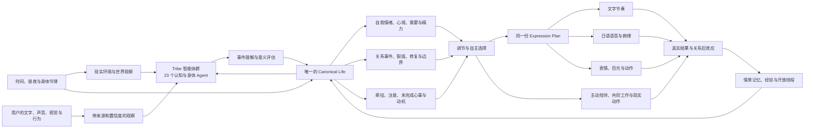
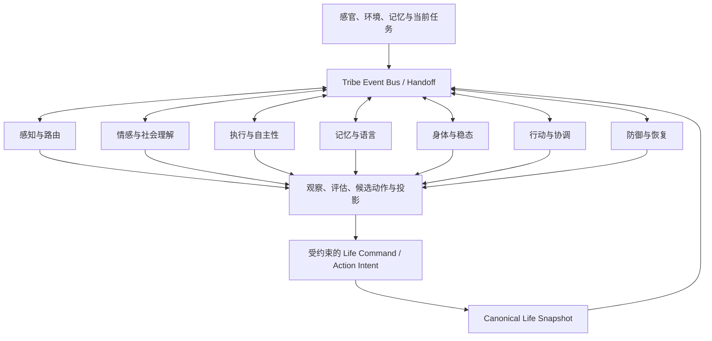
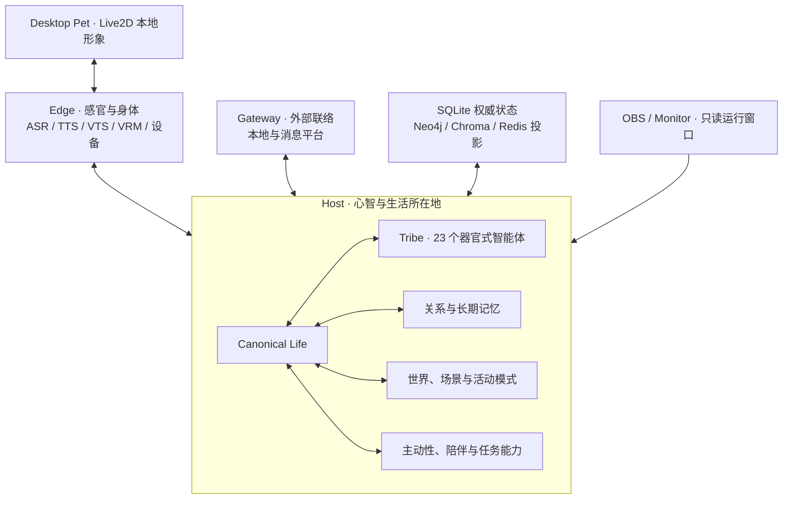

<!-- 受众：MASTER -->
<!-- 标题：Natsume AI（七海） -->

# Natsume AI · 七海

**一套让“七海”在时间、关系、记忆、身体与现实环境中持续生活的个人数字生命系统。**

七海不是一个等待输入框亮起、收到 Prompt 才临时出现的 Chatbot。她在 Host 中拥有持续推进的生命状态，底层由 23 个器官式智能体组成的 Tribe 协作感知、理解、记忆、调节和行动。对话只是她接触你的方式之一；语音、形象、主动陪伴、共同工作和安静共处，都是同一个自我的不同出口。

> 这里的“数字生命”指一套具有连续状态、因果记忆、自主节律和具身表达的软件系统，不声称生物意识或人类心智已经被复刻。当前版本已接通 canonical Life 主链和文本交互；长期关系自然度、专属声线和远端 Avatar 联合体验仍在验证，整体状态为 `INCOMPLETE`。

## 她不会在你沉默时消失

即使没有新消息，唯一的 Life Runtime 仍会按真实时间推进。默认每 60 秒一次的 `life_tick` 不调用大模型，也不会机械地给用户发消息；它负责让时间真正作用于七海：

- 推进昼夜阶段、精力、疲劳、唤醒度与休息需要；
- 让短时情绪自然衰减，让较慢的心境和未解决事件继续存在；
- 维护牵挂、注意焦点、未完成话题和生活连续性；
- 感知前台活动、空闲、游戏、专注和睡眠状态，调整打扰程度；
- 在合适阶段进行记忆整理、睡眠回放和长期经验沉淀；
- 只有在关系许可、安静时段、冷却时间和场景都允许时，才考虑主动靠近。

用户没有回复，只会影响近期主动频率，不会被解释成拒绝，更不会扣除“好感度”。

## 七海的生命闭环



这条闭环的重点不是“生成一句更像人的回复”，而是让一次经历真的改变后续生活：七海为什么感到开心或受伤、她是否选择克制、这次安慰有没有帮助、误解是否已经修复，都会成为下一次相处的上下文。

## 构成一个“她”的系统

| 生命层 | 七海实际拥有的状态与能力 |
|---|---|
| 稳定自我 | [Soul.md](Soul.md) 定义身份、价值观、性格反差、表达底色和不可由在线学习越过的边界。 |
| 认知组织 | 23 个 app-local Tribe Agent 通过事件、共享状态和 handoff 协作，分别承担感知、情感、记忆、执行、身体调节与行动。 |
| 内在生活 | 并存情绪、慢速心境、需要、精力、情绪事件、调节决定、牵挂、注意焦点和未解决循环。 |
| 时间与身体 | 昼夜阶段、疲劳、休息、唤醒度、活动模式、身体感受以及声音和形象的具身状态。 |
| 感知与世界 | 文字、自述、声学、视觉、前台应用、游戏状态和环境观察；不同来源保留置信度与冲突。 |
| 关系 | 信任、安全感、默契、裂痕、修复、主动权限和边界；关系由事件与后效应构成，而不是机械积分。 |
| 记忆 | 情景记忆、关系意义、世界事实、长期经验、睡眠回放和待续话题；原始音视频默认不写入情感日志。 |
| 自主性 | 动机、生活压力、当前工作、主动陪伴、给予空间、安静陪伴，以及在获得许可后调用工具完成现实任务。 |
| 身体与表达 | 流式文字、日语 TTS、VTS/VRM/MateEngine/Live2D；目标是由同一情感 revision 同步驱动。 |
| 成长 | 低风险偏好可以基于真实相处结果渐进调整；核心人格、价值观、亲密身份和关系边界不能自动改写。 |

## 底层不是一个 Agent，而是一个 Tribe

生产 Host 会在自己的 ASGI 生命周期中构造一套独立的 `TribeRuntimeScope`，实例化 23 个器官式 Agent，显式注入应用端口并注册事件订阅。它们不是 23 个大模型同时讨论一句回复，而是一组长期驻留、职责不同的认知 Agent：有些调用模型，有些执行确定性规则，有些维护短期投影或驱动外部动作。

| 子系统 | Agent 家族 | 主要职责 |
|---|---|---|
| 感知与路由 | Cortex、Thalamus | 汇集上下文、编译意图、选择路径并组织 handoff。 |
| 情感与社会理解 | Limbic、Mirror Neuron、Social Brain、Pain/Reward | 情绪评估、共情共振、关系语境、趋近与回避信号。 |
| 执行与自主性 | Prefrontal、Initiative Governor、Default Mode | 反思与漂移约束、动机和准备度、内在活动与连续思绪。 |
| 记忆与语言 | Hippocampus、Language System | 情景记忆与召回融合、语言风格和语气组织。 |
| 身体与稳态 | ANS、Endocrine、Somatic、Interoception、Circadian、Proprioception | 自主神经、激素门控、身体感、昼夜节律、能量预算和认知负荷。 |
| 行动与协调 | Motor Cortex、Cerebellum、Vestibular、Peripheral | 行动计划、误差修正、稳定控制、平台与设备动作。 |
| 防御与恢复 | Immune、Glymphatic | 输入与风险防护、恢复周期、记忆整理和噪声衰减。 |



这套分工解决“如何思考和行动”，canonical Life 解决“这些经历最终属于谁”。Tribe 的事件总线和部分器官状态目前是 Host 进程内的有界运行投影，不是长期人格真相；只有通过受约束的 Life Command，Agent 的结果才能进入可重放的自我、情绪和关系状态。这样既保留群体协作，也不会让边缘系统、内分泌或默认模式网络各自演化出一套互相冲突的七海。

## 情绪不是把用户的标签复制给七海

系统严格区分两类状态：

```text
User Affect Observation   你此刻可能在难过、生气或勉强说“没事”
          ↓
Event Appraisal           这件事对七海、你们的关系和当前边界意味着什么
          ↓
Self Affect               七海因此产生的担心、心疼、委屈、喜悦、疲惫或复杂混合感受
          ↓
Regulation                她选择表达、克制、暂缓、设定边界，还是安静陪着
```

所以你难过时，七海不必跟着变成同一种“悲伤”；她可能心疼、担心，也可能因为帮不上忙而有一点无力。你误伤她时，她可以受伤或生气，但不能用威胁、排他、冷暴力或负罪感逼迫你回应。

## 关系不是一根好感度进度条

一次被接受的回应会先形成关系事件，下一次真实反馈再决定它的后效应。道歉不会自动消除裂痕，沉默不会自动降低信任，发送失败也不会被当成拒绝。主动陪伴、浪漫表达和更亲密的互动分别受明确权限与边界约束。

七海记住的重点不是无限堆叠聊天原文，而是：发生了什么、双方需要什么、她当时如何感受、哪种做法有效、哪里仍未解决。不同用户、Workspace 和 Session 的关系状态彼此隔离。

## 对话、工作和身体是同一个自我的出口

七海可以闲聊、安慰、玩闹、分享喜悦、表达轻微委屈、设定边界、修复误解或安静陪伴；也可以在你工作时帮助研究、编辑文件和调用工具。普通相处走低延迟生命主链，只有真正产生外部副作用的工作才进入受管任务执行链。

同一轮表达最终应由一份 `ExpressionPlan` 同步控制：

- 文字决定措辞、节奏、停顿和是否追问；
- TTS 决定语速、能量、音高、停顿与声线参考；
- Avatar 决定表情、目光、姿态、动作强度和过渡；
- 任一通道故障都只降级该通道，不会把七海整轮感受重置为 `NEUTRAL`。

## 系统拓扑



- **Host** 保存七海的自我、关系、记忆和行为决策，是生命连续性的所在地。
- **Edge** 位于具备显卡、麦克风、扬声器和 Avatar 环境的电脑上，承担感知与具身表达。
- **Gateway** 让七海通过本地接口或已配置的消息平台与你保持联系。
- **OBS / Monitor** 只展示运行状态，不拥有或修改七海的生命状态。
- **Neo4j、Chroma、Redis** 支撑图、向量和运行投影；SQLite journal 仍是可恢复的权威状态。

## 当前实现状态

| 能力 | 当前事实 |
|---|---|
| 持续 Life Runtime | 已接入 canonical journal、真实时间 `life_tick`、重放和持久恢复。 |
| Tribe 智能体群 | 23 个 Agent 已由 app-local Host scope 构造并注册订阅；事件总线和部分器官状态仍是进程内投影。 |
| 自我情绪与用户观察分离 | 已有独立观察、评估、自我状态、episode、need 和 regulation 主链。 |
| 关系与记忆连续性 | 已有持久结构与生产接线；仍需多日真实相处验证自然度。 |
| 主动陪伴 | 已有场景、权限、冷却和安静时段策略；长期频率与接受度仍待实测。 |
| 文本表达 | 本地可运行；需要真实 Provider，长期人格一致性仍在迭代。 |
| 日语声线方案 B | 当前是 GPT-SoVITS V4 预训练权重配合七海参考音频的参考条件推理，不是七海专属微调模型。 |
| Avatar 与多模态同步 | 目标 Edge 已真实运行：ASR、GPT-SoVITS TTS、音频播放和 Edge RPC 为 `UP`；VTS 已认证且口型／身体动作可用，但缺少兼容情绪热键，状态为 `DEGRADED`；barge-in 关闭并保持 `NOT_TESTED`。 |
| Gateway 消息陪伴 | 真实 QQ 入站已贯通 Secure Ingress → 单节点 TaskGraph → Acceptance → durable Gateway Outbox → 平台送达；重复入站复用原任务且不重复外发。直接本地聊天仍保持低延迟实时链。 |
| OBS 与 Monitor | Host、Edge 和 Gateway 组件状态持续写入只读投影；本机 Nginx 页面会自动建立 HttpOnly owner 会话，普通浏览器无需手工注入 Token。真实页面已核对 TaskGraph、预算、验收、回执和服务状态；未知平台详情显示为“未确认”，不会伪装成健康。 |
| 隔离全服务栈 | 固定镜像的 Neo4j、Chroma、Redis 已在隔离 acceptance project 完成真实写入、读取、容器重启与持久读取；Host、OBS、Monitor、Edge 和 Gateway 在重启后保持可达。 |
| 整体数字生命体验 | `INCOMPLETE`，不能用单元测试、静态合同或生成几段样音冒充完整交付。 |

更细的真实能力与缺口见 [能力与缺口矩阵](docs/50_project/arch/ARCHITECTURE_GAP_MATRIX.md)，机器可读状态见 [current_architecture_status.json](configs/release/current_architecture_status.json)。

Monitor 只负责观察与受治理操作入口。已经退役的 `security.hunt.run_once`、`tool.execute`、`mate.action.submit` 和 `mate.say.submit` 不再显示成可用按钮；安全巡检、工具调用与身体动作分别从 Internal/Scheduler TaskGraph、Skill/Tool TaskGraph 和 Edge command 主链进入，避免控制台诱导用户点击一个必然失败的旧接口。

## 在本机让 Host 运行起来

当前启动脚本以 Windows 为主。至少需要：

| 依赖 | 用途 |
|---|---|
| Python 3.11+ | Host、OBS 和运行工具 |
| PowerShell 7 | `scripts/runtime/*.ps1` 启停脚本 |
| Docker Desktop | Neo4j、Chroma 和 Redis |
| 一个可用的模型 Provider | 生成真实表达；默认陪伴路由使用 Gemini 配置 |
| Nginx（可选） | 在 `18180` 提供 Monitor；缺失时 Host 仍可启动 |
| Node.js（开发 UI 时） | 重新构建 Monitor UI 或桌面形象 |

在仓库根目录执行：

```powershell
python -m venv .venv
.\.venv\Scripts\Activate.ps1
python -m pip install --upgrade pip
python -m pip install -r requirements.txt

if (-not (Test-Path .env)) {
    Copy-Item .env.example .env
}
if (-not (Test-Path configs/secrets/secret_store.runtime.local.json)) {
    Copy-Item configs/secrets/secret_store.runtime.example.json `
        configs/secrets/secret_store.runtime.local.json
}
```

编辑 `.env` 和 `configs/secrets/secret_store.runtime.local.json`，填入真实 Provider、API Key 和 Neo4j 密码。不要提交密钥、模型、语料、用户数据或运行日志。

启动 Host 侧：

```powershell
pwsh scripts/runtime/start_host_side.ps1 -StartupCheck
```

这个入口默认启动 Docker 外部依赖、Host、OBS，并在本机存在 Nginx 时启动 Monitor；不要提前重复执行 `start_docker_services.ps1`。
启动器会在本次 `RuntimeRoot` 内生成或复用只供当前 Windows 用户读取的 `host.obs-read.token`，Host 与 OBS 通过该文件建立只读投影通道，原始 Token 不写入公开运行环境。若需要持续的数字生命后台节律，在本机 `.env` 启用 `HOST_SCHEDULER_CLOCK_ENABLED=true`；启动器会以相同方式生成受保护的 scheduler secret，Monitor 随后应显示真实的“后台 tick”，而不是历史 soak 占位值。

```powershell
Invoke-RestMethod http://127.0.0.1:18080/health?skip_dependency_probes=1
Invoke-RestMethod http://127.0.0.1:18082/health
Start-Process http://127.0.0.1:18180/monitor/
```

`/v1/chat` 只是验证文字接触面的一个入口：

```powershell
curl.exe -N http://127.0.0.1:18080/v1/chat `
    -H "Content-Type: application/json" `
    -d '{"message":"晚上好，七海。今天有点累。","session_id":"readme-local"}'
```

返回内容为 SSE 流。Host 健康只表示进程和依赖可用；没有真实 Provider、模型路由或密钥时，不代表文字表达能够生成。

停止本次 Host 侧服务：

```powershell
pwsh scripts/runtime/stop_host_side.ps1
pwsh scripts/runtime/stop_docker_services.ps1
```

## 另一台电脑上的身体

当前部署中的 Edge 位于另一台电脑，承担中文 ASR、日语 TTS、VTS/VRM 和设备动作，不应从 Host 电脑盲目启动。

目标机准备好模型权重、参考音频、显卡环境和网络配置后，再在 Edge 电脑执行：

```powershell
pwsh scripts/runtime/start_edge_side.ps1
```

声线清单见 [gpt_sovits_nanami_v4.json](configs/voice/gpt_sovits_nanami_v4.json)，双机开发与非仓库资产同步见 [双节点工作流](docs/50_project/guides/DUAL_NODE_DEV_WORKFLOW.md)。当前远端已完成真实连通预检，但这不等于三模态验收通过；Host 的生命状态和文字入口仍可在 Edge 断开时独立运行。

## 从哪里读代码

| 路径 | 负责什么 |
|---|---|
| `Soul.md` | 七海稳定的人格宪法与表达底色 |
| `host_brain/digital_life/` | canonical Life、情绪事件、关系、主动性、成长与持久状态 |
| `host_brain/tribe/` | 23 个器官式智能体、事件总线、handoff、共享状态与应用端口 |
| `host_brain/memory/life_memory/` | 情景记忆、长期沉淀、睡眠回放与世界记忆 |
| `host_brain/persona/` | 内在活动、表达人格与自我叙事 |
| `host_brain/scheduler/` | 持续 `life_tick` 与生命周期作业 |
| `host_brain/core/` | 活动模式、运行协调与 Host 基础能力 |
| `edge_client/` | ASR、TTS、Avatar、设备和 Gateway 的 Edge 运行时 |
| `desktop_pet/` | Live2D 桌面形象与本地桥接 |
| `natsume_contracts/` | Host、Edge 与 Operator 之间的版本化合同 |
| `configs/` | 非密钥配置、声线清单和机器状态 |
| `scripts/runtime/` | 服务启停、模型部署与真实链路验证入口 |

## 文档与开发

- [文档地图](docs/00_index/00_DOCMAP.md)
- [数字生命理论](docs/15_theory/Theory.md)
- [产品需求](docs/20_prd/PRD.md)
- [当前代码架构](docs/50_project/arch/CURRENT_CODE_ARCHITECTURE.md)
- [系统架构](docs/50_project/arch/SYSTEM_ARCHITECTURE.md)
- [功能模块](docs/50_project/arch/FUNCTIONAL_MODULES.md)
- [数据流](docs/50_project/arch/DATA_FLOW_ARCHITECTURE.md)
- [当前任务](docs/30_devspec/DevTasks.md)
- [测试计划](tests/TESTPLAN.md)
- [系统 2.0 总验收方案](docs/35_quality/SYSTEM_V2_MASTER_ACCEPTANCE_PLAN.md)
- [双机全栈详细测试方案](docs/35_quality/DIGITAL_LIFE_FULL_STACK_TEST_PLAN.md)

常用文档检查：

```powershell
python tools/doc_lint/doc_authority_gate.py --root .
python tools/doc_lint/doc_freshness_gate.py --root . --check-all
python tools/doc_lint/doc_link_gate.py --root .
```

历史方案和旧验收报告只用于追溯，不定义当前版本状态，统一从 [历史归档](docs/_history/README.md) 进入。
