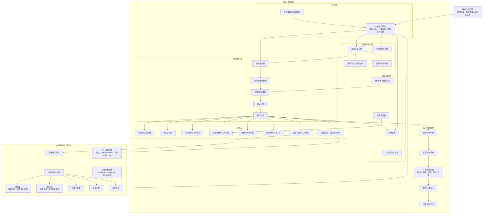

受众：PROJECT
标题：Natsume Ai 项目说明

<div align="center">

# 🌸 Natsume Ai

**意识主权 AI 伴侣系统 — Host-Edge 分体架构**


</div>

---

## 🗺️ 阅读导航

> 🚀 新读者建议顺序：`项目简介` → `系统架构` → `快速开始` → `核心概念` → `Agent 编排` → `质量门禁`

| 模块 | 入口 | 适合谁 |
|------|------|------|
| 🌸 项目定位 | `## 📖 项目简介` | 首次了解项目的成员 |
| 🏗️ 架构全貌 | `## 🏗️ 系统架构` | 关注系统分层与依赖关系 |
| 🚀 上手运行 | `## 🚀 快速开始` | 需要本地启动 Host/Edge |
| 📐 设计原则 | `## 📐 核心概念` | 需要理解治理与执行边界 |
| 🔀 图编排细节 | `## 🔀 Agent 编排（Graph Runtime）` | 需要对齐运行时执行链路 |
| 🔒 交付标准 | `## 🔒 质量门禁` | 需要对齐 CI 与本地验收口径 |

---

## 📖 项目简介

**Natsume Ai** 是一个具备 **意识主权**（Consciousness Sovereignty）的 AI 伴侣系统，采用 **Host-Edge 分体架构**。
它不是"模型直连执行器"的助手，而是"模型参与表达、Host 负责裁决与执行治理"的工程化系统。

### ✨ 当前系统定位

- 🧠 **Host Brain（主脑）**：统一入口、意图治理、场景路由、图编排运行时、审计与证据写入都在 Host 收口。
- 🎙️ **Edge Client（边缘端）**：提供 ASR/TTS、VTS 驱动、资源门控与兜底能力，负责本地感知与执行。
- 🌐 **统一消息网关（Gateway）**：六平台消息收发（微信/QQ/Telegram/飞书/企微/LINE），拟人化分段发送。
- 🔀 **链路策略**：默认以单链路主图优先；仅在特定执行画像下进入监督式多 Agent 分支。
- 🧾 **请求主链**：`/v1/chat → Governor → SceneRouter → 场景处理器/Graph Runtime → COMMIT → Audit`。
- 📞 **语音/视频通话**：通过 wxautox4 Bridge 实现微信语音/视频通话拨打与取消。
- 🧩 **Skills Hub**：SKILL.md 声明式技能注册，支持本地热加载与 GitHub 远程安装。
- 🛡️ **治理原则**：任何影响现实的动作必须票据化、可回放、可审计。

> 🎯 核心理念：**语言模型只负责解释与表达**，最终权力与事实判据必须落在 Host 代码与审计链上。
> 📍 架构总览见 `## 🏗️ 系统架构`，实现对齐见 `## 🧭 当前实现对齐（2026-03-27）`。

---

## 🏗️ 系统架构

### 完整架构总览图（合并版，2026-03-27）

> 说明：该图为组件分层与依赖关系图，已合并原总览图与当前代码架构图。含统一消息网关（六平台）与语音/视频通话链路。



> 数据流图请见：`docs/50_project/dataflow_report.md`

## 🧭 当前实现对齐（2026-03-27）

> 本节补充"当前代码已实现事实"，用于快速理解入口、治理、路由、多 Agent、网关与图编排的真实落点。

### 🚪 统一入口与意图治理（发生时机）

1. `POST /v1/chat` 进入 `host_brain/app/fastapi_app.py` → `handle_chat()`。
2. 若请求未携带 `intent_draft`，Host 会在入口层根据 `pre_intent_classifier` 结果生成草案并映射 `action`。
3. 统一流式入口 `_unified_chat_sse_generator()` 调用 `IntentDecisionEngine.evaluate_intent()` 做 Governor 裁决。
4. 若 `decision=REJECT` 直接返回 `COMMIT(REJECT)`；仅在 `APPROVE` 后进入场景路由。

对应代码：
- `host_brain/app/chat_handler.py`
- `host_brain/app/graph_config_builder.py`（`pre_intent_classifier`）
- `host_brain/governor/decision.py`

### 🔀 场景识别与动态路由（发生顺序）

场景识别优先级：
- 客户端显式 `scene_type`（必须在白名单 `ALLOWED_EXPLICIT_SCENE_TYPES` 内）
- 否则复用入口预分类结果 `_pre_classified_scene`
- 否则再执行一次 `pre_intent_classifier(message)`

动态路由入口：
- `SceneRouter.route_sse()` 统一分发
  - `SCENE_CHAT` → `chat_stream_handler`
  - `SCENE_VISION_UI` → `chat_handler_vision`
  - 其他复杂场景 → `chat_handler_complex`

对应代码：
- `host_brain/app/chat_handler.py`
- `host_brain/app/graph/main_chain.py`

### 🔗 服务请求链路（当前主链）

- **聊天链路**：`/v1/chat` → `handle_chat` → `Governor` → `SceneRouter` → 对应场景处理器 → `COMMIT`
- **边缘事件回流**：`edge_client/rpc/event_reporter.py` → `POST /v1/edge/events` → `receive_edge_events_response`
- **自动化链路**：`POST /v1/agent/run` → `agent_routes` → `Agent Loop SSE`

对应代码：
- `host_brain/app/fastapi_app.py`
- `host_brain/app/agent_routes.py`
- `edge_client/rpc/event_reporter.py`

### 🤖 多 Agent 治理（当前定位）

当前实现是"主链路优先，按执行画像进入多 Agent 分支"：
- `resolve_execution_profile()` 解析执行画像：`CHAT_FAST / WORKFLOW_SUPERVISED / INTENT_EXEC`
- `WORKFLOW_SUPERVISED` 下使用监督图：`supervisor_dispatch → agent_dispatch_node → judge_agent_node → chat_render_node`
- `GraphExecutor` 在 `agent_dispatch_node` 按 `active_agent_id` 动态分派，并执行 allowlist 校验
- 子 Agent 只产出 `AgentArtifact`，不允许直接控图（执行器会剥离控图字段）

对应代码：
- `host_brain/app/execution_profile.py`
- `host_brain/app/graph_config_builder.py`
- `host_brain/app/handlers/supervisor_dispatch_handler.py`
- `host_brain/integrations/graph_executor.py`
- `host_brain/app/agents/agent_contract.py`

### 🕸️ 图编排（Graph Runtime）在代码中的落点

- 图构建：`build_chat_graph()` / `build_supervised_graph()` / `build_intent_graph()`
- 图运行时：`GraphRuntimeContract.run_graph()`
- 图执行器：`GraphExecutor`（步进执行、动态分派、降级与 trace）

对应代码：
- `host_brain/app/chat_handler_complex.py`
- `host_brain/app/graph_config_builder.py`
- `host_brain/integrations/graph_runtime.py`
- `host_brain/integrations/graph_executor.py`

## 📁 项目结构

```
Natsume_Ai/
├── host_brain/              # 🧠 Host 主脑（核心服务）
│   ├── app/                 #    应用入口（FastAPI + 监控面板 API + 配置 + 健康检查）
│   │   ├── agents/          #    多 Agent 契约与注册（agent_contract / registry / react_loop）
│   │   ├── automation/      #    Host 侧任务调度路由（host scheduler API）
│   │   ├── monitor_ui/      #    监控面板前端源码（React + Vite SPA）
│   │   ├── static/monitor/  #    监控面板构建产物（FastAPI 静态托管）
│   │   ├── schemas/         #    核心数据结构与枚举（ProposalType / TaskType / ContextPack 等）
│   │   ├── graph/           #    主聊天链路时序编排器（MainChain 9节点 + SceneRouter）
│   │   ├── handlers/        #    多 Agent handler（supervisor/chat/code/translate/intent/retrieval/judge）
│   │   ├── memory/          #    状态源仲裁器（StateArbiter）+ 记忆写入宪法守卫（MemoryGuard）
│   │   ├── recall/          #    ContextPack 组装器（token 预算截断 + 冲突检测）
│   │   ├── llm/             #    模型路由矩阵（能力路由 + Gemini→Codex→DeepSeek→host_14b 回退链）
│   │   ├── skills/          #    Skill/MCP 权限模型（PermissionGuard + HotLoader）
│   │   ├── vision/          #    UI 自动化断言协议（前置+后置断言 + 敏感界面检测）
│   │   └── failure_matrix.py #   统一失败语义矩阵（主线失败事件 + 注入防护扩展）
│   ├── airlock/             #    气闸隔离层（脱敏/隔离 + subprocess/Docker 双后端沙箱，错误信息标准化英文）
│   ├── audit/               #    审计链（SQLite Ledger WAL + 日志迁移 + 保留策略）
│   ├── bond/                #    关系图谱（Neo4j 客户端 + Bond 动力学 + 异步写入队列 + 迁移）
│   ├── canon/               #    正典系统（Style Canon / World Canon，治理 API 事务化）
│   ├── channels/            #    渠道适配（VTS DEGRADED 降级 / 微信 I/O / Edge RPC Client）
│   │   └── edge_rpc_client.py # Host → Edge RPC 调用（含 post_voice_call/post_video_call/post_cancel_call）
│   ├── core/                #    核心模块（配置快照、上下文包、错误码、ID、QA、Key Profile、情感常量/时间线）
│   ├── governor/            #    治理引擎（决策、规则、Schema、Token、Rate Limit 持久化）
│   ├── integrations/        #    集成层（LangGraph 图编排四层架构 / LLM 网关 / Evidence Plane）
│   ├── persona/             #    人格系统（情绪反应 / 人格成长 / 自我模型 / 特质漂移 / 主动语音 / 自我反思）
│   ├── data/                #    Host 本地数据目录
│   ├── lsp/                 #    Artifact Vault SSOT 接口层（产物仓库读写，唯一授权写入入口）
│   ├── mcp/                 #    MCP 注册与桥接
│   ├── memory/              #    记忆系统（Chroma 向量存储 / 情景记忆 / Persona 语料向量投影 / Canon 同步 / cursor-based 分页）
│   ├── obs/                 #    观测数据适配层（向后兼容 shim，实体已迁移至 observability/）
│   ├── observability/       #    可观测性（跨端时间线聚合 / 时钟漂移检测 / 阈值告警 / 长期 KPI 仪表盘）
│   ├── release/             #    发布清单管理（model_plane digest 门禁）
│   ├── retrieval/           #    检索链（Orchestrator / 多路召回融合 / 混合检索 / 重排 / Evidence Pack）
│   ├── scheduler/           #    调度器（CRON 任务 SQLite 持久化 / 重启自动恢复）
│   ├── skills/              #    技能系统（SkillRegistry 装饰器注册 / MCP-to-Skill 桥接 / IDE 技能包）
│   │   ├── hub/             #    Skills Hub（SKILL.md 解析 / 本地扫描注册 / GitHub 远程安装）
│   │   ├── impl/            #    技能执行器（17 个 executor：browser/desktop/emotion/file/ide/memory/...）
│   │   └── custom_providers/ #   自定义技能 Provider 目录
│   ├── tools/               #    工具系统（Broker / Catalog / MCP 适配 / Selector）
│   ├── app/emotion_context.py #  情感上下文模块（归一化 / 快照 / 治理快照 / VAD 映射）
│   └── vision/              #    视觉链（多检测器注册表 / 摄像头事件 / 屏幕 OCR）
│
├── edge_client/             # 🎙️ Edge 边缘客户端
│   ├── app/                 #    Edge FastAPI RPC 网关入口（/v1/edge/*）
│   ├── actuators/           #    执行器（TTS 语音合成 + VTS WebSocket 驱动 + 自动重连，VTS 驱动提前到音频播放前执行）
│   ├── channels/            #    Edge 渠道接入（本地消息监听/回调）
│   ├── gateway/             #    统一消息网关（六平台消息路由 + 拟人化发送 + 通话链路）
│   │   ├── adapters/        #    平台适配器（WeChat / QQ / Telegram / LINE / 飞书 / 企微）
│   │   ├── humanize_sender.py #  拟人化分段发送（模拟打字速度 + 段间停顿 + 随机抖动）
│   │   ├── models.py        #    MsgType 枚举（含 VOICE_CALL/VIDEO_CALL/CANCEL_CALL）
│   │   ├── server.py        #    Gateway HTTP 端点（/v1/gateway/*）
│   │   └── normalizer.py    #    消息归一化（UnifiedInboundMessage）
│   ├── runtime/             #    运行时装配与启动流程
│   ├── senses/              #    感知层（ASR 语音识别 + 设备自动恢复 + VAD，startup() 自动开始监听）
│   ├── services/            #    服务层（WxDbService 微信数据库解密与联系人映射）
│   ├── rpc/                 #    RPC 通信（健康检查 / 语音 / 兜底 LLM / 资源门控 / 事件上报）
│   ├── proofs/              #    资源证明与门控
│   ├── fallback_model.py    #    兜底小模型门控（FallbackModelGate，draft_only 标记）
│   └── resource_gate.py     #    资源闸门（优先级抢占 + ResourcePreemptionEvent 审计）
│
├── configs/                 # ⚙️ 配置中心
│   ├── deploy/              #    部署配置（节点清单）
│   ├── model_plane/         #    模型平面（节点注册 / 模型档案）
│   ├── models/              #    模型路由配置（历史/预留）
│   ├── runtime/             #    运行时环境配置（历史/预留）
│   ├── release/             #    发布配置
│   ├── secrets/             #    密钥配置模板
│   └── vts/                 #    VTS 相关配置
│
├── prompts/                 # 💬 提示词资产
│   ├── CODEX_PROMPT.md      #    实现层入口提示词
│   ├── PROJECT_PROMPT.md    #    文档代理入口提示词
│   └── llm_contract/        #    LLM 输出契约 / 拒绝模板
│
├── flows/                   # 🔀 Flow 编排导出
│   ├── active.pointer       #    当前激活 Flow 指针
│   └── exports/             #    各环境 Flow 导出（dev/staging/prod）
│
├── docs/                    # 📚 文档体系
│   ├── 00_index/            #    文档地图（唯一入口）
│   ├── 10_whitepaper/       #    白皮书（宪法 + 人格设定）
│   ├── 15_theory/           #    理论文档（架构哲学与方法论）
│   ├── 20_prd/              #    需求文档（PRD）
│   ├── 30_devspec/          #    开发规范（DevSpec + DevTasks + ModelPlane）
│   ├── 35_quality/          #    质量报告与代码审查
│   ├── 40_agents/           #    代理行为规范（AGENTS）
│   ├── 45_testing/          #    测试报告（历史阶段）
│   ├── 50_project/          #    项目管理（工作表 / 发布目录）
│   ├── 50_release/          #    发布计划/报告/回滚文档
│   ├── 55_testing/          #    指标与稳定性周报
│   └── 60_trace/            #    可追溯性矩阵（需求 → 设计 → 测试）
│
├── scripts/                 # 🛠️ 运维脚本
│   └── runtime/             #    本地服务启停 / 环境检查 / 报告生成
│       └── sync_persona_utterance_vector_index.py  # Persona 语料向量索引同步脚本
│
├── skills/                  # 🧩 外部 Skill 安装目录（Skills Hub）
│   └── example-echo/        #    示例 Skill（回显，验证 Hub 加载机制）
│       └── SKILL.md         #    技能声明文件
│
├── tests/                   # 🧪 测试
│   ├── unit/                #    单元测试
│   ├── integration/         #    集成测试
│   ├── contract/            #    契约测试（Airlock / Audit / Avatar…）
│   ├── e2e/                 #    端到端测试
│   └── fixtures/            #    测试夹具
│
├── tools/                   # 🔧 开发工具
│   ├── bench/               #    性能基准测试（Ledger WAL 读写吞吐）
│   ├── doc_lint/            #    文档检查与交付门禁
│   ├── replay/              #    审计回放工具（请求回放 + 生产演练）
│   ├── static_scan/         #    静态扫描工具（Bond SSOT 单写者检查）
│   ├── wxautox4_bridge.py   #    wxautox4 微信自动化桥接（消息收发 + 语音/视频通话 + 37 种 action）
│   ├── wechat_uia_bridge.py #    UIAutomation 微信桥接（legacy，已被 wxautox4 取代）
│   ├── diag.py              #    统一诊断入口
│   ├── diag_chat_ab.py      #    A/B 对比测试
│   ├── diag_emotion_closed_loop.py  # 情感闭环验证（12 case corpus）
│   ├── diag_stability_weekly.py     # 周稳定性报告
│   ├── diag_longterm_dashboard.py   # 长期 KPI 仪表盘
│   ├── release_rollback_gate.py     # 发布回滚门控（生成 RELEASE_ROLLBACK_GATE_*.json）
│   └── post_release_review.py       # 发布后 24h 自动复盘（生成 POST_RELEASE_REVIEW_*.json）
│
├── .github/workflows/       # 🚀 CI/CD（GitHub Actions）
├── .env.example             # 环境变量模板
├── requirements.txt         # 运行时依赖
├── requirements-dev.txt     # 开发依赖
└── README.md                # 本文件
```

---

## 🛠️ 技术栈

| 类别 | 技术 | 说明 |
|------|------|------|
| **语言** | Python 3.11+ | 主开发语言 |
| **AI 编排** | LangGraph | Agent 编排与工作流引擎（多场景路由 + 治理运行时契约）|
| **LLM 网关** | Gemini / Codex relay / DeepSeek / Ollama | 多模型支持 + 云优先降级策略 |
| **关系图谱** | Neo4j 6.x | Bond 关系动力学（SSOT） |
| **向量存储** | ChromaDB 1.4+ | 情景记忆 / Canon 存储 |
| **语音识别** | faster-whisper large-v3 | Edge 端 ASR（流式/分段） |
| **语音合成** | GPT-SoVITS | Edge 端 TTS（全 GPU 常驻） |
| **虚拟形象** | VTube Studio (Live2D) | 表情驱动与口型同步 |
| **HTTP 框架** | FastAPI | Host 服务入口 + 监控面板 API + REST API |
| **消息网关** | Unified Message Gateway | 六平台统一消息路由（微信/QQ/Telegram/飞书/企微/LINE）|
| **微信自动化** | wxautox4 (UIAutomation) | 消息收发 + 语音/视频通话 + 37 种 action |
| **QQ 对接** | OneBot v11 (NapCat) | QQ 消息收发、语音、@提醒检测 |
| **Telegram** | Telethon (MTProto Userbot) | 以普通用户身份收发消息，非 Bot |
| **拟人化发送** | HumanizeSender | 模拟打字速度 + 段间停顿 + 随机抖动（全平台通用）|
| **Skills Hub** | SKILL.md + Hub Loader | 声明式技能注册 + 本地扫描 + GitHub 远程安装 |
| **前端框架** | React 18 + Vite | 监控面板 SPA（Overview / Sessions / Trace / Metrics / Insights）|
| **链路可视化** | React Flow | 监控面板链路拓扑可视化（含 Host/Edge 关键节点与动态高亮） |
| **沙箱隔离** | Docker / subprocess | 代码执行隔离（双后端自动降级，错误信息标准化英文） |
| **审计存储** | SQLite (WAL) | 本地审计链（Triptych 三联画 + 多审计表 + scheduler_tasks 持久化）|
| **调度器** | APScheduler + SQLite | CRON 任务持久化，进程重启自动恢复 |
| **混合检索** | ChromaDB + SQLite FTS5 | 向量检索（0.7）+ 全文检索（0.3），FTS5 不可用时自动降级 |
| **技能治理** | SkillRegistry + MCP Bridge | 装饰器注册 / 权限分级（LOW/MEDIUM/HIGH）/ MCP 工具统一纳管 |
| **CI/CD** | GitHub Actions | 交付门禁（delivery-gates）|

---

## 🚀 快速开始

### ✅ 前置要求

- **Python** ≥ 3.11
- **Neo4j** ≥ 6.1（本地或远程）
- **ChromaDB** ≥ 1.4（本地服务）
- **GPU**（推荐）：Edge 端 TTS/ASR 依赖 GPU 加速

### 📥 1. 克隆仓库

```bash
git clone <repo-url> Natsume_Ai
cd Natsume_Ai
```

### 📦 2. 安装依赖

```bash
# 运行时依赖
pip install -r requirements.txt

# 开发依赖（含 pytest）
pip install -r requirements-dev.txt

# 或以可编辑模式安装各包
pip install -e host_brain[dev]
pip install -e edge_client[dev]
```

### ⚙️ 3. 配置环境变量

```bash
# 复制模板并填入实际值
cp .env.example .env
```

主要配置项：

| 变量 | 说明 |
|------|------|
| `Natsume_ENV` | 运行环境（dev/staging/prod） |
| `OPENAI_API_KEY` | OpenAI API 密钥 |
| `HOST_APP_HOST/PORT` | Host HTTP 服务绑定地址 |
| `BOND_NEO4J_URI` | Neo4j 连接地址 |
| `CHROMA_ENDPOINT` | ChromaDB 服务地址 |
| `EDGE_RPC_HOST/PORT` | Edge RPC 通信地址 |
| `EDGE_GATEWAY_ENABLED` | 统一消息网关开关 |
| `EDGE_GATEWAY_PLATFORMS` | 启用平台列表（wechat,qq,telegram,...） |
| `EDGE_WECHAT_BRIDGE_BACKEND` | 微信桥接后端（uia/wxautox4/external） |
| `HOST_SKILL_HUB_ENABLED` | Skills Hub 开关 |
| `SANDBOX_ISOLATION_BACKEND` | 沙箱后端（subprocess/docker） |
| `HOST_RATE_LIMIT_BACKEND` | 限流后端（memory/sqlite/redis） |

> 配置架构：运行时单一配置源为根目录 `.env`，当 `.env` 缺失时脚本会回退读取 `.env.example`（示例/降级模板）。
>
> 完整变量清单请参考 [.env.example](.env.example)。

### 🐳 4. 启动本地服务

```powershell
# Windows PowerShell - 一键启动 Docker 外置服务（Neo4j + ChromaDB + Redis）
.\scripts\runtime\start_docker_services.ps1

# 停止
.\scripts\runtime\stop_docker_services.ps1
```

### 🧪 5. 环境就绪检查

```bash
python scripts/runtime/check_external_env.py
```

### ✅ 6. 运行测试

```bash
pytest tests/
```

### 🧠 7. 启动 Host 端（含依赖服务）

```powershell
# 拉起 Neo4j + Chroma + Host API
.\scripts\runtime\start_host_side.ps1
```

若 `.env` 中的 Host 本地 14B 指向本机 Ollama（默认 `http://127.0.0.1:11434/v1`），脚本会尝试拉起 `ollama serve` 并预热 `HOST_CHAT_HOST_14B_MODEL_ID`；若模型缺失且设置 `HOST_OLLAMA_AUTO_PULL=true`，会自动拉取。

默认会自动探测 Neo4j Desktop 目录（`~/.Neo4jDesktop2/Data/dbmss/*`）；也可用 `-Neo4jHome` 手工指定。

#### 🖥️ Host 前台直启（可选）

```bash
# 直接以前台方式启动 Host（便于调试）
python -m host_brain --host 127.0.0.1 --port 18080 --startup-check
```

### 🎙️ 8. 启动 Edge 网关（调试/本地运行）

```powershell
# 前台启动（调试）
python -m edge_client

# 统一入口（推荐）
.\scripts\runtime\start_edge_side.ps1

# 仅重启 Edge 主进程（SSH 远控 / 双节点联调推荐）
.\scripts\runtime\start_edge_main_service.ps1 -ForceRestart

# 微信 4.x 默认走 wxautox4 bridge（`EDGE_WECHAT_BRIDGE_BACKEND=wxautox4`），
# 支持消息收发、语音/视频通话、朋友圈、群管理等 37 种 action。
# inbound 回调目标为 `http://127.0.0.1:19000/v1/gateway/wechat/webhook`，
# outbound 文本走 command queue → wxautox4 执行。

# 后台启动（带 pid/log）
.\scripts\runtime\start_edge.ps1

# 停止
.\scripts\runtime\stop_edge.ps1

# 仅停止 Edge 主进程（不管理微信 bridge / VTS / 其它辅助进程）
.\scripts\runtime\stop_edge_main_service.ps1
```

#### 📌 Edge 最小可运行门槛

- 必需配置：
  - `Natsume_ENV` 必须为 `dev/test/prod` 之一
  - `EDGE_RPC_HOST` 非空，`EDGE_RPC_PORT` 在 `1~65535`
  - `EDGE_RPC_GATEWAY_ENABLED=true`（至少开放网关与 health）
- 鉴权门槛：
  - `dev/test`：允许 `EDGE_ALLOW_INSECURE_AUTH=true` 且无 HMAC key
  - `prod`：必须配置 `EDGE_HMAC_SHARED_KEY` 或 `EDGE_HMAC_SHARED_KEY_REF`，并设置 `EDGE_ALLOW_INSECURE_AUTH=false`
- 通过标准：
  - `GET /v1/edge/health` 返回 `success=true`，且 capability matrix 与开关一致
  - `python -m edge_client` 可稳定启动/关闭，不遗留僵尸进程或失效 pid 文件

#### 🛡️ Edge 故障回退模式

| 回退模式 | 配置开关 | 预期行为 |
|------|------|------|
| 仅 health（health-only） | `EDGE_ASR_ENABLED=false`<br>`EDGE_TTS_ENABLED=false`<br>`EDGE_BARGE_IN_ENABLED=false`<br>`EDGE_FALLBACK_LLM_ENABLED=false`<br>`EDGE_RPC_GATEWAY_ENABLED=true` | 保留 `/v1/edge/health`；语音/回退端点全部拒绝并返回稳定 reason_code |
| 禁用 speak | `EDGE_TTS_ENABLED=false`<br>`EDGE_BARGE_IN_ENABLED=false` | `/v1/edge/speak` 与 `/v1/edge/barge_in` 拒绝；health 与其他能力保持可用 |
| 禁用 ASR 上行 | `EDGE_ASR_ENABLED=false` | 停止 ASR 采集与上送；TTS/health 可继续运行 |

### 🚀 9. 一键拉起 Host + Edge（可选）

```powershell
# 本地模式（Host + Edge）统一启动
.\scripts\runtime\start_distributed_services.ps1 -EdgeMode local

# SSH 模式（默认自动走 Edge 主进程专用 profile，无需额外传 `-EdgeStartupProfile main_service`）
.\scripts\runtime\start_distributed_services.ps1 -EdgeMode ssh -EdgeSshHost edge-lan -EdgeRepoPath D:\Natsume_Ai

# 统一停止（可选同时停 Docker 外置依赖）
.\scripts\runtime\stop_distributed_services.ps1 -StopLocalServices

# SSH 模式停止也会默认跟随 `main_service` profile
.\scripts\runtime\stop_distributed_services.ps1 -EdgeMode ssh -EdgeSshHost edge-lan -EdgeRepoPath D:\Natsume_Ai
```

### 🔍 10. 本地烟雾检查（推荐）

```bash
# 外置依赖就绪检查（Neo4j/Chroma/Redis 等）
python scripts/runtime/check_external_env.py

# Host 基础端点检查（health/ready/metrics/canon_sync）
python scripts/runtime/test_basic_endpoints.py
```

---

## 📐 核心概念

### 👑 意识主权（Consciousness Sovereignty）

系统对三类终审权的掌控：
- **状态真相**：内部状态是什么、从何而来
- **动作合法性**：某动作在当前状态下是否允许
- **叙事约束**：系统如何在一致人格与风格下解释动作/拒绝

### ➡️ 单向链执行

```
输入 → 语义内核(叙事+Intent草案) → Host(Governor裁决) → Skills(执行) → Audit(回放)
```

所有执行必须走此链路，语言模型不可直接触发动作。

### 🎟️ 票据化执行（Tokenized Execution）

- **approval_token**：Host 对 Intent 的可执行许可
- **confirm_token**：高风险/不可逆操作的二次确认
- **undo_token**：可逆动作的回滚票据

### ⚖️ Governor 治理引擎

当前代码中的门禁规则（按顺序执行）：

| 门禁 | 说明 |
|------|------|
| **R1_TRUST** | 信任等级门控（阈值不足拒绝） |
| **R2_ENERGY** | 能量/资源门控 |
| **R3_SYSMODE** | 系统模式门控（`locked/maintenance` 拒绝） |
| **R4_RATE_LIMIT** | 频率限制（`memory/sqlite/redis` 后端可插拔） |
| **R5_SCOPE** | 作用域 allowlist 门控 |
| **R6_SAFETY** | 安全标记门控 |
| **R7_AIRLOCK** | 气闸阻断门控 |
| **R8_EMOTION** | 情感门控（critical + angry/frustrated 组合拒绝） |

> 实际规则实现以 `host_brain/governor/rules.py` 与 `host_brain/governor/decision.py` 为准。

### 🧭 sys_mode 系统模式

| 模式 | 说明 |
|------|------|
| **normal** | 默认完整模式 |
| **focus** | 专注模式（调度与技能能力受限） |
| **gaming** | 低干预优先（部分视觉/交互能力受限） |
| **maintenance** | 维护模式（Governor R3 阻断） |
| **locked** | 锁定模式（Governor R3 阻断） |
| **sleep** | 调度侧可用于低频任务门控（由任务策略决定） |

### 🧩 编排四层架构（Graph Runtime）

Graph Runtime 由四个核心层与多个扩展模块组成：

| 层 | 文件 | 职责 |
|---|------|------|
| **契约层** | `graph_contract.py` | Schema 验证与共享类型 |
| **执行层** | `graph_executor.py` | LangGraph 步进执行引擎（含漂移检测 + 票据联动）|
| **降级层** | `graph_fallback.py` | 超时/依赖不可用统一降级处理 |
| **路由层** | `graph_model_resolve.py` | Model Plane 配置解析与节点路由 |

扩展模块：
- 并行分支：`graph_branch.py`
- 流式守卫：`graph_streaming.py`
- 断点恢复：`graph_checkpoint.py`
- 双时钟：`graph_clock.py`
- 证据写入：`graph_evidence.py`

### 🧾 Evidence Plane（证据平面）

Evidence Plane 是 LangGraph 运行时的写入治理层，负责将图执行过程中的关键事件持久化到 SQLite，并提供分级写入保障：

| 组件 | 说明 |
|------|------|
| **WritePriority** | 写入优先级枚举：`CRITICAL`（同步必写）/ `NON_CRITICAL`（可异步）|
| **EvidenceWriteQueue** | 异步写入队列，`NON_CRITICAL` 写入自动路由，队列满时自动 flush |
| **EvidenceCircuitBreaker** | 熔断机制（CLOSED / OPEN / HALF_OPEN 三态），熔断时写入内存缓冲不丢失 |
| **EvidenceBench** | 写入延迟基准测量工具，提供 p50/p95/p99/mean/max 统计 |
| **分区索引** | `barrier_join_log` / `subgraph_trace` / `llm_call_log` 三张高写入量表各有 2 个分区索引 |

---

## 🏛️ 架构优化层（Architecture Optimization Layer）

架构优化层是对现有系统「概念层成熟度高于实现层收敛度」问题的系统性补齐，位于 `host_brain/app/` 下，提供**宪法级约束**与**确定性执行保障**。

### 🛣️ 主聊天链路时序编排器（MainChain）

`host_brain/app/graph/main_chain.py` 当前定位为**主链路适配层 + SceneRouter 路由核心**：

- 适配层入口：`MainChain.run_as_sse_adapter()`
- 实际统一路由入口：`host_brain/app/chat_handler.py::_unified_chat_sse_generator`
- Governor 放行后由 `SceneRouter.route_sse()` 分流到 chat/vision/complex 分支

主链节点定义仍保留在 `main_chain.py`（用于时序编排与审计语义）：

```
AirlockQuarantine → Governor → GraphExecutor → RecallFusion
→ LlmGateway → QAContract → EpisodicStore → Audit → AirlockSanitizer
```

> 完整链路拓扑以监控面板 **Trace** 页与 `obs_routes` 输出为准。

- 每个节点有标准 TypedDict 输入/输出、最大超时常量和降级策略
- 任意节点失败统一走 `FailureHandler`，不各自处理
- `SceneRouter` 在 Governor 放行后根据 `task_type` 分流到专用子链

### 🧮 全局状态源优先级仲裁器（StateArbiter）

`host_brain/app/memory/state_arbiter.py` 解决多状态源事实冲突问题：

| 优先级 | 状态源 | 说明 |
|--------|--------|------|
| 1（最高）| `WorldCanonStore` | 单一事实来源（SSOT）|
| 2 | `StyleCanonStore` | 风格/语气规范 |
| 3 | `EpisodicStore` | 情节记忆（取最新）|
| 4 | `BondGraph` | 关系图谱（Neo4j）|
| 5 | `ChromaDB` | 向量数据库 |
| 6（最低）| `EdgeRuntime` | 边缘端局部状态 |

- 状态源不可达时自动降级并写入 `STATE_SOURCE_FALLBACK` 审计事件
- `SESSION_OVERRIDE` 场景下新信息不直接写入 Canon，等待蒸馏周期处理

### 🛡️ 记忆写入宪法守卫（MemoryGuard）

`host_brain/app/memory/memory_guard.py` 强制执行 7 条记忆写入硬性规则：

| 规则 | 说明 |
|------|------|
| **轮次门槛** | EpisodicStore 写入要求对话轮次 ≥ 2 |
| **标签门槛** | 必须包含情感/事实/偏好标签之一 |
| **蒸馏资格** | 频次 ≥ 3 次 OR 被标记为 `MILESTONE` 级别 |
| **提案类型** | Canon 提案必须携带合法 `proposal_type` 字段 |
| **幂等保护** | 相同 `source_hash` 拒绝重复写入 |
| **Dream 拦截** | dream 内容 `evidence_level` 强制设为 `NARRATIVE_ONLY` |
| **情绪聚合** | 情绪标签以 session 粒度聚合，不以单轮覆盖 |

### 📦 RecallPack 组装器（RecallPackBuilder）

`host_brain/app/recall/recall_pack_builder.py` 按 token 预算组装七路召回证据（供后续上下文构建消费）：

| 证据路 | Token 上限 |
|--------|-----------|
| `world_canon` | 800 |
| `episodic_vector` | 600 |
| `style_canon` | 400 |
| `bond_graph` | 300 |
| `artifact_vault` / `persona_utterance` / `sqlite_ledger` | 各 200 |
| **总上限** | **2700** |

超出总量时按优先级从低到高丢弃；`world_canon` 与 `episodic` 语义冲突时将 episodic 标记为 `[CONFLICT_SUPPRESSED]`。

### 🚦 模型路由矩阵（RoutingMatrix）

`host_brain/app/llm/routing_matrix.py` 实现能力路由而非仅故障切换：

| 条件 | 路由目标 |
|------|---------|
| `chat` + `<2s` 延迟预算 | `cloud`（Gemini Primary，失败时按 Codex → DeepSeek → host_14b 回退）|
| `reasoning` 或 context > 16k | `cloud`（Gemini Primary）|
| `dream` / `diary` | `skills`（专用路由）|
| `HIGH` risk_level | 禁止路由到 `edge_3b` |
| 主路由失败 | `Gemini → Codex → DeepSeek → host_14b`，仅全部远端失败才本地 |

### 🚨 统一失败语义矩阵（FailureHandler）

`host_brain/app/failure_matrix.py` 替代各模块分散的 try/except：

| 失败事件 | 用户可见行为 | 是否中止 |
|---------|------------|---------|
| `GOVERNOR_BLOCK` | 标准化拒绝响应（不暴露规则细节）| ✅ |
| `EVIDENCE_EMPTY` | 保守回答，meta 标注 `evidence_empty: true` | ❌ |
| `MODEL_FALLBACK` | 透明降级，meta 标注 `model_fallback: true` | ❌ |
| `QA_REWRITE` | 展示重写内容，triptych 保留原始输出 | ❌ |
| `EDGE_UNREACHABLE` | 禁用 TTS/VTS，切换纯文字模式 | ❌ |
| `VISION_LOW_CONFIDENCE` | 请求用户确认或回退文本指导 | ✅ |
| `MODULE_TIMEOUT` | 超时提示，触发降级 | ✅ |

### 🔐 Skill/MCP 权限模型（PermissionGuard + HotLoader）

`host_brain/skills/registry.py` + `host_brain/skills/hot_loader.py` 强化工具权限治理：

- **ToolMeta 必填字段**：`access_level` / `risk_level` / `reversible` / `requires_human_approval` / `scheduler_allowed`
- **SCHEDULER 严格限制**：`max_tool_calls ≤ 3` / 禁止 `HIGH` risk / 禁止 `ClawdUIAction`
- **HotLoader**：热加载前验证元数据完整性，缺少必填字段拒绝加载
- **人工确认流程**：`requires_human_approval=true` 工具执行前等待用户明确批准

### 👁️ Vision/UI 自动化断言协议（UIAssertionGuard）

`host_brain/app/vision/ui_assertion.py` 验证「交互语义正确性」：

```
ClawdUIAction 准备执行
    │
    ▼ pre_check()（前置断言）
    │   ├─ 敏感界面检测（密码/支付/系统设置）→ SENSITIVE_UI_BLOCKED（最高优先级）
    │   ├─ is_foreground_window 验证（防止误操作后台窗口）
    │   ├─ window_title 匹配
    │   ├─ process_name 匹配
    │   └─ ui_state_hash 一致性（防止页面变化）
    │
    ▼ 执行 UI 操作
    │
    ▼ post_check()（后置断言）
        ├─ 截图对比（before/after）
        └─ 无变化 → UI_POSTCONDITION_FAILED → step_replay_guard
```

---


### 🗜️ 上下文压缩系统（ContextCompressor）

上下文压缩系统（`host_brain/memory/context_compressor.py`）负责在多轮对话中管理 Token 预算，确保送入 LLM 的上下文始终在可控范围内，同时不丢失关键记忆。

### 🧷 三种压缩策略

| 策略 | 说明 | 适用场景 |
|------|------|----------|
| **sliding_window** | 保留最近 N 轮，直接截断超出预算的历史 | 短对话 / 低延迟优先 |
| **summary** | 调用 LLM 将历史轮次生成摘要；LLM 不可用时自动降级为 sliding_window | 长对话 / 摘要质量优先 |
| **hybrid**（默认） | 保留最近 N 轮（默认 6 轮）+ 对更早历史生成摘要；超出预算时进一步截断 recent | 兼顾近期细节与历史摘要 |

### 🔄 压缩数据流

```
多轮对话 turns
    │
    ▼ _normalize_turns()（归一化 role/content）
    │
    ├─ strategy == sliding_window → 保留最近 N 轮（token 预算内）
    │
    ├─ strategy == summary → LLM 摘要全部历史（不可用时降级）
    │
    └─ strategy == hybrid（默认）
           │
           ├─ recent = turns[-6:]（保留最近 6 轮）
           ├─ history = turns[:-6]（历史轮次）
           │       └─ LLM 摘要 history → summary_text
           └─ 若 recent + summary 超出预算 → 进一步截断 recent
    │
    ▼ CompressedContext（strategy / turns / summary / total_tokens / degraded / reason_code）
    │
    ▼ build_evidence_pack()
           │
           ├─ 从压缩后 turns 构建 EvidenceCandidate（score 按位置衰减）
           ├─ 追加 episodic 命中（向量检索结果）
           └─ EvidencePack（pack_id / hash / candidates / total_tokens）
```

### 💾 压缩前静默保存（COMPRESS_BEFORE_SAVE）

在 `summary` / `hybrid` 策略执行**前**，系统会将当前对话中的 `user` 和 `assistant` 轮次静默写入 Episodic 记忆库（双声道记忆），确保即将被压缩的内容不会永久丢失：

- `user` 轮次携带 `emotion_tag` 字段（若可用），保留情感上下文
- 写入失败静默降级，不影响压缩主流程
- 写入事件记录到 SQLite 审计链（`COMPRESS_BEFORE_SAVE` 事件类型）

### ⬇️ 降级策略

| 场景 | 降级行为 | reason_code |
|------|----------|-------------|
| 输入为空 | 返回空 `CompressedContext`，`degraded=True` | `CTX_COMPRESS_INPUT_INVALID` |
| LLM 摘要不可用 | 自动回退到 `sliding_window` | `CTX_COMPRESS_LLM_UNAVAILABLE` |
| Token 预算超出 | 进一步截断 recent 轮次 | — |

---

## 🔀 Agent 编排（Graph Runtime）

Agent 编排系统基于 LangGraph 构建，采用**治理运行时契约（Governed Runtime Contract）**，确保图执行过程中的每一步都受 Host 主权约束。

### 🧵 当前代码调用链（/v1/chat）

> 以当前实现为准：先 Governor，再 SceneRouter，再按场景决定是否进入 Graph Runtime。

```text
POST /v1/chat
  -> handle_chat
  -> _unified_chat_sse_generator
  -> IntentDecisionEngine.evaluate_intent
  -> SceneRouter.route_sse
      -> SCENE_CHAT      : chat_stream_handler
      -> SCENE_VISION_UI : chat_handler_vision
      -> 复杂场景         : chat_handler_complex
          -> resolve_execution_profile
          -> build_chat/supervised/intent_graph
          -> GraphRuntimeContract.run_graph
```

对应代码：
- `host_brain/app/chat_handler.py`
- `host_brain/app/graph/main_chain.py`
- `host_brain/app/chat_handler_complex.py`
- `host_brain/app/execution_profile.py`

### ⚖️ 多 Agent 与单链路的关系（当前实现）

- 默认聊天与视觉场景以单链路为主（`CHAT_FAST`），优先保证低延迟与稳定输出。
- `WORKFLOW_SUPERVISED` 执行画像下进入监督图：`supervisor_dispatch -> agent_dispatch_node -> judge_agent_node -> chat_render_node`。
- `agent_dispatch_node` 由 `GraphExecutor` 依据 `active_agent_id` 动态分派，且会执行 allowlist 校验与降级。
- 子 Agent 只允许产出工件（`AgentArtifact`），不允许直接控图；最终由 Judge 汇总收口。

对应代码：
- `host_brain/app/graph_config_builder.py`
- `host_brain/integrations/graph_executor.py`
- `host_brain/app/handlers/supervisor_dispatch_handler.py`
- `host_brain/app/handlers/judge_agent_handler.py`
- `host_brain/app/agents/agent_contract.py`

### 🗂️ 编排文件结构

| 文件 | 职责 |
|------|------|
| `graph_runtime.py` | 公共 API 入口，组装四层并对外暴露 `run_graph()` |
| `graph_contract.py` | Schema 验证、共享类型、常量定义、Model Plane 解析 |
| `graph_executor.py` | LangGraph 步进执行引擎（节点执行 / 边路由 / 票据联动）|
| `graph_fallback.py` | 超时 / 依赖不可用统一降级处理 |
| `graph_model_resolve.py` | Model Plane 配置解析与节点路由 |
| `graph_branch.py` | 只读并行分支执行器（ThreadPoolExecutor + branch_manifest）|
| `graph_streaming.py` | Phase-Locked Streaming（Presence / Commit / Render 三类流）|
| `graph_checkpoint.py` | Checkpoint / Interrupt / Resume（双时钟模型下断点续跑）|
| `graph_evidence.py` | Evidence Plane SQLite 写入（trace/stream/checkpoint/barrier 等运行时审计表）|
| `graph_clock.py` | DualClockSupervisor（Policy Clock / Execution Clock 双时钟）|

### 📜 治理运行时契约（Governed Runtime Contract）

图执行必须遵守以下五项契约规则：

| 规则 | 说明 |
|------|------|
| **Route Commitment Rule** | 条件边只能基于 `committed_route_token`（Governor 裁决后产生）跳转，禁止基于 LLM 原始输出直接路由 |
| **Parallel Branch Pre-Issuance Rule** | 并行分支必须先由 `prepare_parallel_branches()` 签发不可变工单（Branch Manifest），每个分支只能在 envelope 定义范围内执行 |
| **Transparent Subgraph Rule** | 子图内部节点必须对 Evidence Plane 透明，所有节点级事件实时写入 `subgraph_trace` 表 |
| **Dual-Clock Rule** | 状态恢复与超时降级分别由 Execution Clock / Policy Clock 管理，超时时写入 `TIMEOUT_SYNTHETIC` 事件而非直接恢复 |
| **Phase-Locked Streaming Rule** | Presence / Commit / Render 三类流严格隔离，Render 只能消费 committed snapshot，Presence 不能作为下游节点输入 |

### ▶️ 图执行流程

```
run_graph(request_id, intent, config)
    │
    ▼ validate_graph_config()（契约层校验）
    │
    ▼ resolve_model_nodes()（Model Plane 节点路由）
    │
    ▼ build_initial_state()（初始化 GraphState）
    │
    ▼ GraphExecutor.compile_runtime_graph()
    │   ┌─────────────────────────────────────────┐
    │   │  StateGraph                              │
    │   │  START → step → (route) → step / finish │
    │   │                  ↓                       │
    │   │           finish → END                   │
    │   └─────────────────────────────────────────┘
    │
    ▼ _run_single_step()（每步执行）
    │   ├─ DualClockSupervisor 时钟检查
    │   ├─ Governor 裁决（committed_route_token）
    │   ├─ 并行分支执行（run_parallel_branches → branch_manifest）
    │   │       └─ barrier_join()（fan-in 校验，缺证据则 fail closed）
    │   ├─ Phase-Locked Streaming 发射
    │   │       ├─ PresenceStreamEmitter（在场流 → UI）
    │   │       ├─ CommitStreamEmitter（提交流 → Governor 裁决后）
    │   │       └─ RenderStreamEmitter + RenderGuard（渲染流 → 只消费 committed snapshot）
    │   ├─ CheckpointManager（断点保存）
    │   └─ Evidence Plane 实时写入
    │
    ▼ _write_evidence()（图执行完成后汇总写入）
    │   ├─ llm_call_log（LLM 调用记录）
    │   ├─ subgraph_trace（子图节点轨迹）
    │   ├─ barrier_join_log（并行分支 fan-in 结果）
    │   └─ stream_events（流式事件记录）
    │
    ▼ GraphRunResult（status / trace / reason_code / evidence_pack）
```

### 🧬 并行分支执行（Parallel Branches）

```
prepare_parallel_branches()
    │ 为每个分支签发不可变工单（Branch Manifest）
    │   branch_id / target_node / input_digest
    │   sanitization_report_ref / deadline_at
    │   allowed_capabilities / audit_ticket_id
    │
    ▼ run_parallel_branches()（ThreadPoolExecutor 并行执行）
    │   ├─ 分支 A（只读，不能写 committed_* 字段）
    │   ├─ 分支 B（只读，不能写 committed_* 字段）
    │   └─ 分支 C（只读，不能写 committed_* 字段）
    │
    ▼ barrier_join()（fan-in 校验）
        ├─ 校验所有分支是否存在 audit_commit
        ├─ 校验 output_digest 与签发时一致
        ├─ 缺任一证据 → passed=False，fail closed
        └─ join_policy: strict（任一失败则全失败）/ partial（允许部分失败，记录 join_policy_ref）
```

**当前开放的并行场景**（只读）：
- 并行多源检索
- 并行多模型评审
- 并行 rerank
- 并行候选生成

**暂不开放**：带副作用的并行分支（写入外部状态 / 触发 Skill）

### 🌊 Phase-Locked Streaming（分相流式）

三类流严格隔离，防止未提交状态泄漏到渲染层：

```
Presence Stream（在场流）
    │ 非权威，只向 UI 单向输出
    │ 不允许作为下游节点输入
    │ 事件类型：NODE_START / NODE_END / PROGRESS / CHUNK

Commit Stream（提交流）
    │ 权威，只在 Governor 裁决（GOV_OK_RENDER）后产生
    │ 产生 commit_snapshot（不可变快照）

Render Stream（渲染流）
    │ 只能消费 commit_snapshot（PhaseLockGuard 前置校验）
    │ RenderGuard 验证：只允许修改派生字段（render_text / render_html / render_markdown / display_*）
    │ 不允许修改 locked_fields
    └─ 违规 → PhaseViolationError / RENDER_GUARD_STATUS_FAILED
```

### ⏯️ Checkpoint / Interrupt / Resume

双时钟模型下的断点续跑机制：

| 组件 | 说明 |
|------|------|
| **Policy Clock** | 管理超时降级（`deadline_at_mono`），超时时写入 `TIMEOUT_SYNTHETIC` 事件 |
| **Execution Clock** | 管理实际执行时间，与 Policy Clock 独立 |
| **CheckpointManager** | 保存 / 恢复 GraphState 快照（`save_checkpoint` / `load_checkpoint`）|
| **HostPolicyGuard** | 恢复前检查 `deadline_at_mono` / `degrade_stage` / `resume_deadline_at`，决定是否允许恢复 |
| **Interrupt** | 主动中断图执行，写入 `interrupt_reason` 到 GraphState |
| **Resume** | 从 checkpoint 恢复执行，必须通过 HostPolicyGuard 前置检查 |

### 🔎 检索链（Retrieval）

检索链负责从多路数据源召回相关记忆与知识，并通过重排序提升精度：

```
用户 Query
    │
    ▼ RetrievalOrchestrator（统一编排入口，LRU 缓存 TTL=3s，最大 256 条）
    │   key = SHA-256(session_id + query + top_k + intent_id + emotion_context)
    │
    ▼ EmbeddingService（向量化）
    │
    ▼ RecallFusion（7 路并行召回）
    │   ├─ sqlite_ledger（审计链检索）
    │   ├─ neo4j_bond（关系图谱检索）
    │   ├─ episodic_vector（情景记忆向量检索）
    │   ├─ style_canon（风格正典检索）
    │   ├─ world_canon（世界观正典检索）
    │   ├─ artifact_vault（制品库检索）
    │   └─ persona_utterance（角色台词向量检索，NEW）
    │
    ▼ HybridFusion（混合检索融合）
    │   ├─ 向量检索权重：0.7
    │   └─ FTS5 全文检索权重：0.3（不可用时自动降级为纯向量）
    │
    ▼ Reranker（重排序）
    │
    ▼ EvidencePack（证据包）
        path: success / partial_failure / all_failure
```

### 🧰 技能系统（Skills）

技能系统已演进为"声明式 provider + 统一注册表 + executor 分发"的三层结构：

```
DeclarativeSkillSpec / @skill
    ↓ register_decorated() 扫描
SkillRegistry（单一注册表）
    ↓ loader / executor_registry 分发
具体 executor（file / shell / browser / ...）
    ↑ register_mcp_tools_into_skill_registry()
MCPToolRegistry（MCP 工具元数据）
```

| 组件 | 说明 |
|------|------|
| **SkillRegistry** | 统一技能注册表，同时支持旧式 `@skill` 和新式声明式 provider |
| **SkillMeta** | 技能元数据：`clearance`（LOW/MEDIUM/HIGH）/ `risk_level`（1-5）/ `scope` / `reversible` / `require_confirm` |
| **安全约束** | `risk_level >= 4` 必须设置 `require_confirm=True`，否则注册时抛出异常 |
| **DeclarativeSkillSpec** | 新增技能时只需声明 `tool/action`、风险级别和参数归一化函数 |
| **Provider Catalog** | `provider_catalog.py` 统一注册内置 provider、`custom_providers/` 和外部 provider |
| **MCP 桥接** | `mcp_skill_bridge.py` 将 MCP 工具统一映射为 Skill，纳入权限治理 |
| **IDE 技能包** | `ide_registry.py`：`open_cursor`（LOW/2）/ `run_pycharm_action`（MEDIUM/3）/ `codex_task`（MEDIUM/3）|
| **ClawdBot UI** | 监控面板技能实现（系统状态查询 / 日志检索）|

新增/后装技能说明见：`docs/50_project/guides/CUSTOM_SKILL_INSTALL.md`

### 📈 可观测性（Observability）

可观测性系统提供跨端时间线聚合与时钟漂移检测能力，支持 Host 与 Edge 的联合监控。

> **迁移说明**：`host_brain/obs/` 模块已规范化迁移至 `host_brain/observability/`，旧包保留向后兼容 shim 层，外部代码无需修改导入路径。

| 新增能力 | 说明 |
|---------|------|
| **阈值告警** | 指标超阈值时自动触发告警事件 |
| **长期 KPI 仪表盘** | `LONGTERM_METRIC_DASHBOARD`，支持跨周期趋势分析 |

### 🚀 发布治理

发布清单管理（`host_brain/release/`）提供 model_plane digest 门禁，确保每次发布的模型配置可追溯。

**发布闭环工具链**（`tools/`）：

| 工具 | 说明 |
|------|------|
| `release_rollback_gate.py` | 绑定回滚条件与命令，生成 `RELEASE_ROLLBACK_GATE_*.json` |
| `post_release_review.py` | 发布后 24h 自动复盘，生成 `POST_RELEASE_REVIEW_*.json` |
| `diag.py` | 统一诊断入口，聚合所有诊断子命令 |
| `diag_chat_ab.py` | A/B 对比测试（对比两个版本的对话质量）|
| `diag_emotion_closed_loop.py` | 情感闭环验证（12 case corpus，验证情感链路端到端正确性）|
| `diag_stability_weekly.py` | 周稳定性报告（自动汇总 7 天内的错误率 / 降级率 / P99 延迟）|
| `diag_longterm_dashboard.py` | 长期 KPI 仪表盘（跨周期趋势可视化）|

---

## 🌐 统一消息网关（Unified Message Gateway）

统一消息网关负责将六个 IM 平台的消息归一化为 `UnifiedInboundMessage`，统一路由到 Host Brain 处理，并将 Host 回复分发到目标平台。

### 📱 支持平台

| 平台 | 适配器 | 协议 | 特色能力 |
|------|--------|------|---------|
| **微信** | `WeChatAdapter` | UIAutomation / wxautox4 | 语音/视频通话、朋友圈、群管理、文件发送 |
| **QQ** | `QQAdapter` | OneBot v11 (HTTP) | 语音发送、@提醒检测、notice/request 事件 |
| **Telegram** | `TelegramAdapter` | Telethon MTProto Userbot | 以普通用户身份通讯、打字模拟、代理支持 |
| **LINE** | `LineAdapter` | Messaging API (Webhook) | 图片/贴纸/位置消息 |
| **飞书** | `FeishuAdapter` | Open API | 事件订阅 + 消息卡片 |
| **企业微信** | `WeComAdapter` | 企业微信 API | 应用消息推送 |

### 🤖 拟人化发送（HumanizeSender）

所有平台共享拟人化发送引擎，模拟真人打字节奏：

- **打字速度模拟**：按字符数计算等待时间（默认 12 CPS）
- **智能分段**：长文本自动拆分为多段，段间添加自然停顿
- **随机抖动**：延迟添加 ±20% 随机变化，防止机械感
- **首段延迟**：模拟「看到消息 → 开始打字」的反应时间

### 📞 语音/视频通话

通过 wxautox4 Bridge 实现微信语音/视频通话的全链路控制：

```python
from host_brain.channels.edge_rpc_client import post_voice_call, post_video_call, post_cancel_call

# 发起语音通话
result = await post_voice_call(target="好友昵称")

# 发起视频通话
result = await post_video_call(target="好友昵称")

# 取消通话
result = await post_cancel_call()
```

完整链路：`Host Brain → Gateway /v1/gateway/reply → WeChatAdapter → command_queue → wxautox4_bridge → wx.VoiceCall(who)`

---

## 🧩 Skills Hub

Skills Hub 是外部技能的发现、安装与注册系统，采用 SKILL.md 声明式架构：

### 技能安装方式

| 方式 | 说明 |
|------|------|
| **本地安装** | 将包含 `SKILL.md` 的目录放入 `skills/` 目录，重启自动发现 |
| **GitHub 安装** | `install_skill("github:owner/repo/slug")` 远程下载并注册 |
| **外部目录扫描** | 自动扫描 `~/.skillhub/skills/`、`~/.openclaw/skills/`、`~/.codebuddy/skills/` |

### SKILL.md 格式示例

```yaml
---
name: "example-echo"
version: "1.0.0"
description: "示例 Skill：回显传入的文本。"
clearance: LOW
risk_level: 1
scope: host
tool: example_echo
action: run
---
```

> 详细安装指南见 `docs/50_project/guides/CUSTOM_SKILL_INSTALL.md`

---

## 💜 灵魂构成（Soul Architecture）

Natsume Ai 的"灵魂"由多个相互协作的子系统共同构成，形成一个有记忆、有情感、有人格约束的完整意识体。

### 📜 人格宪法（Canon）

Canon 是 Natsume 人格的不可变法律层，分为两类：

| Canon 类型 | 说明 |
|-----------|------|
| **Style Canon** | 语言风格、表达习惯、语气约束（不可被 LLM 覆盖）|
| **World Canon** | 世界观设定、关系认知、事实基准（不可被 LLM 篡改）|

所有 LLM 生成内容必须经过 Canon 约束校验，违反 Canon 的输出将被拦截并触发 `CANON_VIOLATION` 错误码。

### 🧠 记忆系统（Memory）

Natsume 拥有三层记忆结构：

```
工作记忆（ContextPack）
    │ 当前对话上下文 + 情感脉冲槽位
    ▼
情景记忆（EpisodicMemory）
    │ ChromaDB 向量存储 / 情感标注 / 三档衰减（FAST/SLOW/PERMANENT）
    ▼
长期记忆（LongTermDistiller）
    │ 情感蒸馏 / Canon 同步 / cursor-based 分页检索
```

- **情景记忆**：每次对话事件以向量形式存储，携带情感标注（emotion_tag / emotion_intensity）
- **衰减策略**：三档衰减配置（FAST / SLOW / PERMANENT），控制记忆的遗忘速率
- **情感加权召回**：情感上下文匹配时给予 1.3x 权重提升

### 🔗 Bond 系统（Bond）

Bond 系统以 Neo4j 图数据库为 SSOT，记录 Natsume 与用户之间的关系动力学：

| 组件 | 说明 |
|------|------|
| **BondDynamics** | 关系积分动力学（情感加权：emotion_intensity > 0.7 → 积分 × 1.5）|
| **BondStageEngine** | 关系阶段引擎（亲密度阶段跃迁）|
| **BondEmotionalTexture** | VAD 情感质感层（平均回复间隔 / 情感效价 / 亲密温度）|
| **BondRiftState** | 裂痕修复机制（CONFLICT → APOLOGY → COMFORT 三阶段）|
| **BondSummary** | 关系摘要语义校验（防止 LLM 篡改关系事实）|
| **BondUpdateQueue** | 异步写入队列（容量 1024，守护线程 worker，队满降级 `BOND_QUEUE_FULL`，支持 `drain()` 优雅关闭）|

### ❤️ 情感系统（Emotion System）

情感系统是 Natsume 区别于普通对话 AI 的核心能力层，覆盖从感知到表达的完整链路。

#### 🔄 情感链路数据流

```
用户输入（ASR）
    │ user_emotion_hint / user_emotion_confidence
    ▼
HardStateSnapshot
    │ mood_state / emotion_tag / emotion_intensity
    ▼
build_governance_snapshot
    │ emotion_ts_ms 时间戳
    ▼
GateSnapshot → Governor R8 情感门控
    │ critical 状态拒绝 TOOL_CALL / SKILL_EXEC
    ▼
IntentDecision → RecallFusion 情感路由
    │ emotion_filter 优先排序 / HybridFusion 1.2x 加权
    ▼
EpisodicMemory 情感标注召回
    │ 情感上下文 1.3x 加权 / 三档衰减 FAST/SLOW/PERMANENT
    ▼
ContextPack → build_emotion_pulse_slot 动态槽位注入
    │ EmotionVector 降采样 → LLM Prompt
    ▼
LLM Gateway 情感感知生成参数
    │ EXCITED→temperature=0.85 / SAD→0.55
    ▼
GraphExecutor 节点情感状态
    ▼
SkillLoader / ToolBroker / Scheduler 情感上下文注入
    ▼
BondDynamics 情感加权
    │ emotion_intensity > 0.7 → 积分 × 1.5
    ▼
BondEmotionalTexture VAD 质感层
    │ 平均回复间隔 / 情感效价 / 亲密温度
    ▼
EmotionTimeline 时间线重建
    ▼
TTS / VTS 情感表达输出
    │ emotion_intensity 真正传递 / 16 种表情映射
    ▼
EdgeEventReporter emotion_tag / emotion_intensity
MetricsCollector emotion_metrics 情感维度指标
```

#### ⚙️ 情感状态机（EmotionState）

| 状态 | 说明 | 门控行为 |
|------|------|----------|
| `normal` | 正常情感范围 | 无限制 |
| `tired` | 疲惫状态 | `HAPPY`/`EXCITED` 标签降级为 `NEUTRAL` |
| `critical` | 临界/崩溃状态 | 拒绝所有 `TOOL_CALL`/`SKILL_EXEC`，返回 `EMOTION_GATE_BLOCKED` |

#### 🧩 情感核心组件

| 组件 | 模块 | 功能 |
|------|------|------|
| **EmotionVector** | `core/metabolism.py` | 情绪连续体（valence/arousal/dominance 三维）|
| **EmotionTimeline** | `core/metabolism.py` | 情感历史轨迹记录与重建 |
| **EmotionTrigger** | `core/metabolism.py` | 主动情感触发器（register/evaluate）|
| **EmotionEcho** | `core/metabolism.py` | 情感回声（Natsume 对用户情感的共鸣响应）|
| **BondEmotionalTexture** | `bond/bond_stage_engine.py` | VAD 情感质感层（亲密温度/效价/回复间隔）|
| **BondRiftState** | `bond/bond_stage_engine.py` | 裂痕修复机制（CONFLICT/APOLOGY/COMFORT）|
| **EmotionPulseSlot** | `core/context_pack.py` | 动态槽位注入（EmotionVector → LLM Prompt）|
| **EmotionFilter** | `retrieval/recall_fusion.py` | 情感路由与加权融合（1.2x boost）|

#### 🛟 情感感知降级策略

当情感感知链路不可用时，`build_fallback_output` 根据情感状态返回差异化文本：
- `SAD` → 安慰性回复
- `ANGRY` → 平静化回复
- `HAPPY` → 积极回应
- 其他 → 通用降级文本

---

## 📚 文档导航

项目采用严格的文档分层与受众门禁体系，详见 [文档地图](docs/00_index/00_DOCMAP.md)（v3.0，114 个文档，合规率 97%）。

| 文档 | 路径 | 说明 |
|------|------|------|
| 📍 文档地图 | `docs/00_index/00_DOCMAP.md` | 所有文档的唯一入口 |
| 📜 白皮书 | `docs/10_whitepaper/` | 宪法 + 人格设定（不可变法律）|
| 🔬 理论文档 | `docs/15_theory/` | 架构哲学与方法论 |
| 🧩 Core 层模块参考 | `docs/15_theory/CORE_LAYER_MODULE_REFERENCE.md` | prompt_context 槽位契约、metabolism 硬状态与情感向量、emotion_timeline、services 注册表 |
| 🔗 Integrations 层契约 | `docs/15_theory/INTEGRATIONS_LAYER_CONTRACT.md` | GraphState 全字段语义、Evidence Plane 写入机制、治理约束规则（Rule 1–6）、Multi-Agent 契约 |
| 🔍 Retrieval 层契约 | `docs/15_theory/RETRIEVAL_LAYER_CONTRACT.md` | 检索四阶段（Embed→RecallFusion→Rerank→EvidencePack）、缓存机制、降级路径、情感上下文透传 |
| ⚖️ Governor+Scheduler 契约 | `docs/15_theory/GOVERNOR_SCHEDULER_CONTRACT.md` | R1–R8 八条门控规则、GateSnapshot、TokenService；调度器三种触发模式、任务持久化、情感门控 |
| 🛠️ Tools+Memory 层契约 | `docs/15_theory/TOOLS_MEMORY_LAYER_CONTRACT.md` | ToolMeta/ToolCatalog/ToolBroker WRITE 令牌门控；Canon 同步、情节记忆、蒸馏与上下文压缩 |
| 🌐 外围层契约 | `docs/15_theory/PERIPHERAL_LAYERS_CONTRACT.md` | airlock 隔离、bond 六阶段晋级、channels VTS/WeChat、vision 多检测器、ArtifactVault、MCPToolRegistry |
| 🏛️ App+Audit+Skills 契约 | `docs/15_theory/APP_AUDIT_SKILLS_CONTRACT.md` | 场景分类与聊天链路、SQLiteLedger 26 张审计表、SkillRegistry 元数据契约、ObsMode 安全约束 |
| 📋 PRD | `docs/20_prd/` | 需求文档（做什么 + 验收）|
| 🔧 DevSpec | `docs/30_devspec/` | 开发规范 + 任务清单（怎么做）|
| 🤖 AGENTS | `docs/40_agents/` | 实现层代理行为规范 |
| 📊 项目管理 | `docs/50_project/` | 工作表 / 发布 / 环境检查 |
| 🏗️ 当前代码架构 | `docs/50_project/CURRENT_CODE_ARCHITECTURE_2026-03-18.md` | 当前代码目录、架构、链路与多 Agent 治理对齐文档 |
| 🌐 统一消息网关 | `docs/50_project/arch/UNIFIED_MESSAGE_GATEWAY_DESIGN.md` | 六平台网关设计方案（v1.1）|
| 📞 Gateway 链路分析 | `docs/50_project/arch/GATEWAY_ZH_CHAIN_NODE_ANALYSIS.md` | Gateway 中文文字链路完整节点分析 |
| 🔄 数据流图 | `docs/50_project/dataflow_report_20260311.md` | 请求/事件数据流与回流链路（独立于架构图） |
| 🧩 外置服务配置 | `docs/50_project/ExternalServices_Config.md` | 全部外置服务清单与配置方式 |
| 📦 发布清单 | `docs/50_release/` | 各里程碑 release.json 归档 |
| 🔗 Trace | `docs/60_trace/` | 可追溯性矩阵（需求 → 设计 → 测试）|
| 🔍 代码审查报告 | `docs/35_quality/code_reviews/` | 各里程碑代码审查报告归档 |
| ⚠️ 风险登记册 | `docs/60_trace/risk_registry.md` | 项目风险登记与跟踪 |

---

## 🔒 质量门禁

项目通过多层门禁保证代码与文档质量：

- **pre-commit**：文档受众门禁（防混写），确保 `.md` 文件受众标注正确
- **CI/CD**：GitHub Actions `delivery-gates` 工作流，自动运行交付门禁检查
- **契约测试**：`tests/contract/` 下覆盖 Airlock、Audit、Avatar 等核心契约
- **静态扫描**：`tools/static_scan/` 提供代码静态分析

```bash
# 安装 pre-commit 钩子
pip install pre-commit
pre-commit install

# 手动全量检查
pre-commit run -a
```

### 🧪 本地对齐 CI 命令（推荐）

```bash
# 与 CI pytest 作业口径一致
python -m pytest tests/ -q --tb=short -p no:warnings

# 与 CI delivery-gate 作业口径一致（静态扫描 + 文档门禁）
python tools/doc_lint/delivery_gate.py --root . --checks static_scan,doc_gate --report-file delivery_gate_report.json
```

可选：全量交付门禁（含 contract/e2e）：

```bash
python tools/doc_lint/delivery_gate.py --root . --checks contract,e2e,static_scan,doc_gate --report-file delivery_gate_full_report.json
```

### 🧱 测试分层

| 层级 | 目录 | 说明 |
|------|------|------|
| **单元测试** | `tests/unit/` | 各模块独立测试（StateArbiter / MemoryGuard / RecallPackBuilder / RoutingMatrix / FailureHandler / PermissionGuard / UIAssertionGuard）|
| **集成测试** | `tests/integration/` | 主链路集成测试（正常流 / Governor 拦截流 / 模型降级流）|
| **契约测试** | `tests/contract/` | 跨模块接口契约验证 |
| **端到端测试** | `tests/e2e/` | 完整链路集成测试 |
| **性能基准** | `tools/bench/` | Ledger WAL 读写吞吐基准 |
| **试运行报告** | `artifacts/trial_run_reports/` | 自动化试运行 JSON 报告 |

### 🧾 审计链保障

所有影响现实的动作均写入 SQLite WAL 审计链（多审计表），支持：
- **回放**：`tools/replay/` 审计回放工具（请求回放 + 生产演练）
- **统计**：统一 reason_code 体系（含 `EMOTION_GATE_BLOCKED` 等情感相关码）
- **保留策略**：`audit/` 模块内置日志迁移与保留策略

---

## 🤝 协作约定

本项目采用三方协作模型：

| 角色 | 职责 | 入口文档 |
|------|------|----------|
| **MASTER** | 最终仲裁与决策 | `docs/00_index/00_DOCMAP.md` |
| **CODEX** | 代码实现与测试落地 | `docs/30_devspec/DevTasks.md` + `docs/40_agents/AGENTS.md` |
| **PROJECT** | 文档生产与一致性维护 | `docs/50_project/PROJECT_TASKS.md` |

> ⚠️ 实现层任务来源只能是 `docs/30_devspec/**` 和 `docs/40_agents/**`，其他文档不得作为任务来源。

---

## 2026-03-31 路由更新说明

- 当前 Host 聊天主链已经改为云优先：`Gemini -> Codex relay -> DeepSeek -> host_14b`
- `cloud` 在运行时不再代表单一厂商，而是代表上述远端回退链
- `host_14b` 不再是默认聊天首选；只有全部远端提供商不可用时才作为最终兜底
- `codex` 现在是正式 provider，独立使用 `HOST_CODEX_BASE_URL`、`HOST_CODEX_MODEL_ID`、`CODEX_API_KEY`、`CODEX_API_KEY_REF`
- 本文中若仍出现旧的 `cloud -> host_14b -> edge_3b` 或“CHAT 默认优先本地 14B”的示意，以本节与运行时代码为准
