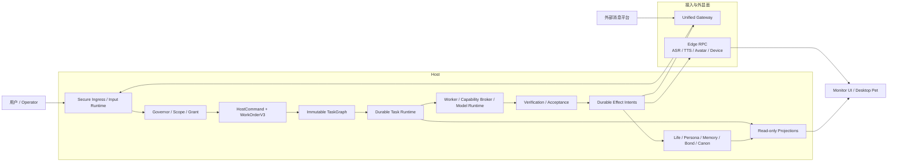

受众：PROJECT
标题：Natsume AI 工程总览与运行指南

# Natsume AI

Natsume AI 是一个本地优先、用户主权优先的个人数字生命系统。它把对话、人格表达、长期记忆、关系状态、主动行为、工具执行、设备能力和多平台消息接入放在同一套可审计运行时中，并要求所有真实动作都能回答四个问题：谁批准、执行了什么、依据什么验收、产生了什么副作用。

本仓库不是已经完成的“全自动进化 AI”。它已经具备较完整的 Host、Scheduler、Internal Agent、持久化、授权、任务、模型、Gateway、Edge 和观测基础设施，但真实 Durable DAG 并发/恢复、通用智能规划、受治理人格演化以及完整长期演化闭环仍在建设中。当前完成度必须以代码审计和机器状态为准，不能从历史 `PASS/DONE` 或目录数量推导。

## 当前状态

| 范围 | 当前结论 | 说明 |
|---|---|---|
| Host `chat/skill/delegate/plan` | `WIRED` | 四类 canonical route 已进入 Governed Runtime |
| Durable Task Runtime | `PARTIAL_B1_STORE` | Coordinator 已消费 B0，原子 claim、到期 promotion、预算并发门禁与 store 级 retry deadline/attempt 2 已接；生产失败尚未调用 `schedule_retry`，真正并行、retry budget、heartbeat/takeover、Review continuation 未闭环 |
| Scheduler | `WIRED` | 真实 occurrence 已贯通 V3、Budget、child grant、Review、Verification、Acceptance 与 Receipt |
| Internal Agent | `WIRED` | 外部 v2 仅作边界输入，进入 runtime 前编译为 V3；Budget、child grant、Review、Verification、Acceptance、Receipt 与 replay 已贯通 |
| Workspace 隔离 | `PARTIAL_D0_PATH_FENCE` | scoped I/O 与 Verification 已统一拒绝路径逃逸；durable owner、隔离 worktree 和 OS/tenant 边界未完成 |
| 显式 Composition | `INCOMPLETE` | 已删除首批 5 个零消费者全局槽位和 4 个 accessor；排除 6 个 lock 与 `application_ports` 端口束后仍有 54 个可变服务引用，尚未形成 Host/Obs/Worker 显式 scopes |
| Planning Search | `KERNEL_AVAILABLE / BENEFIT_UNPROVEN` | 公共搜索内核存在；Host 尚不生成竞争方案，跨领域真实收益未证明 |
| Persona 演化 | `CENTRAL_FENCE_WIRED` | legacy 直写已中央拒绝；proposal、Review、版本激活和 rollback 替代链尚未实现 |
| 长期演化 | `INCOMPLETE` | World/Scene/Identity 等有局部资产，Evolution Lab、Skill Compiler、Knowledge OS 等未形成完整生产闭环 |

权威入口：

- [当前代码事实](docs/50_project/arch/CURRENT_CODE_ARCHITECTURE.md)
- [系统架构总览](docs/50_project/arch/SYSTEM_ARCHITECTURE.md)
- [功能模块地图](docs/50_project/arch/FUNCTIONAL_MODULES.md)
- [关键数据流](docs/50_project/arch/DATA_FLOW_ARCHITECTURE.md)
- [目标架构](docs/50_project/arch/TARGET_ARCHITECTURE.md)
- [架构差距矩阵](docs/50_project/arch/ARCHITECTURE_GAP_MATRIX.md)
- [下一代正式执行合同](docs/30_devspec/NEXT_GENERATION_EVOLUTION_EXECUTION.md)
- [机器可读状态](configs/release/current_architecture_status.json)

## 系统全景



图中是生产主干的方向，不表示每条入口都已完全接线。Scheduler 与 Internal Agent 已接通；DAG 生产并发/恢复、全局 composition 和长期演化 pipeline 仍是明确缺口，详见差距矩阵。

## 运行面

| 运行面 | 启动入口 | 核心职责 | 主要边界 |
|---|---|---|---|
| Host Main | `python -m host_brain` | 对话入口、Governor、Task/Agent Runtime、Life、Memory、业务 API | 真实命令与长期状态的主要协调面 |
| Observability | `python -m host_brain.obs_main` | 只读运行投影、Trace、健康状态、Operator BFF | 不应成为业务事实 writer |
| Monitor UI | `host_brain/app/monitor_ui/` | Task、Review、健康、数字生命和运维视图 | 通过 Query/Operator API 读取和发命令 |
| Edge RPC | `python -m edge_client` | ASR、TTS、Avatar、桌面与设备 actuator | 物理副作用必须回传 receipt |
| Unified Gateway | Edge lifecycle 中的 `edge_client/gateway/bootstrap.py` | 平台 webhook、消息归一化、Host 回流与出站投递 | 平台适配器不拥有 Host 业务状态 |
| Desktop Pet | `desktop_pet/main.cjs` | Electron + Live2D 本地表现 | 只消费状态和动作，不裁决事实 |
| External Services | `scripts/runtime/docker-compose.external.yml` | Neo4j、Chroma、Redis | 可选依赖；不可用时按配置降级 |

Host 与 Edge 之间的共享数据结构位于 `natsume_contracts/`。该目录是跨进程版本化合同，不是重复实现或可删除的临时目录。

## 核心运行链

### Governed 请求

Host canonical 请求的目标 lineage 是：

```text
request
  → Secure Ingress
  → Governor decision + grant
  → HostCommand + WorkOrderV3 + BudgetPolicy
  → immutable TaskGraph revision
  → node Attempt + Lease + node-bound grant
  → worker / model / capability execution
  → Verification
  → Acceptance
  → durable effect intents
  → effect receipts and read-only projections
```

当前 `chat`、`skill`、`delegate`、`plan`、Scheduler 和 Internal Agent 进入这条主链。`task_progress`、`recent_turn` 只读取 durable projection；Executive 的生产入口、SkillDag 执行和内存任务 registry 已删除。Internal 的既有 Agent executor 只在 child grant 验证后接收由 V3 投影的兼容对象，不再拥有 admission authority。

### Planning Search

`host_brain/planning_search/` 是领域无关、无真实副作用端口的搜索内核，提供候选扩展、排序、虚拟状态转换、reward 和 Conditional MCTS。它只能选择规划，不能直接执行工具。

当前 Host Plan 只把 Governor 已批准的步骤合法化并编译为图，并不会从目标生成多套竞争方案。Pentest 已接公共搜索 adapter，但 L3 仍处于未校准 shadow；Research/Code 只有模拟证据。因此不能把“存在 MCTS 类”写成“系统已经具备通用自主规划能力”。

### 状态与副作用

Task Acceptance 会原子登记 effect intent，随后由 durable dispatcher 分别应用对话、Memory、Life、Gateway、Edge 等副作用。正确语义是“验收后可恢复的最终一致”，不是“所有外部系统处在同一个数据库事务”。

详细流程和图见 [关键数据流](docs/50_project/arch/DATA_FLOW_ARCHITECTURE.md) 与 [架构图册](docs/50_project/arch/diagrams/00_INDEX.md)。

## 功能能力

| 能力域 | 对用户提供什么 | 主要实现 |
|---|---|---|
| 对话与最终表达 | 流式对话、人格化表达、媒体/语音响应 | `host_brain/agent_runtime/`、`host_brain/persona/`、`host_brain/surface_runtime/` |
| 治理与安全入口 | 身份、范围、规则裁决、授权 token、拒绝与审计 | `host_brain/secure_ingress/`、`host_brain/governor/` |
| 任务执行 | Durable DAG、Attempt、Lease、Budget、Review、验收与恢复 | `host_brain/orchestration/`、`host_brain/task_runtime/` |
| 模型运行 | Provider 路由、模型尝试、重试、用量与失败证据 | `host_brain/model_runtime/`、`host_brain/integrations/` |
| Capability / Skill | 内置能力目录、授权执行、签名接收与隔离 | `host_brain/capability_plane/`、`host_brain/skills/`、`host_brain/airlock/` |
| 记忆与知识素材 | 对话经历、语义/向量召回、Canon、来源证据 | `host_brain/memory/`、`host_brain/retrieval/`、`host_brain/canon/` |
| 数字生命 | Life 状态、情绪、关系、人格表达、主动性 | `host_brain/digital_life/`、`host_brain/persona/`、`host_brain/bond/`、`host_brain/tribe/` |
| 多平台与设备 | 平台消息、ASR/TTS、Avatar、桌面和设备动作 | `edge_client/gateway/`、`edge_client/actuators/`、`desktop_pet/` |
| 观测与运维 | 健康、Trace、任务投影、Review 定位、Operator 命令 | `host_brain/observability/`、`host_brain/app/obs_*`、Monitor UI |
| 安全实验室 | 有授权、受隔离、可审计的 Pentest 工作流 | `host_brain/pentest/`、`host_brain/security_immune/` |

模块职责、依赖方向、入口和已知限制见 [功能模块地图](docs/50_project/arch/FUNCTIONAL_MODULES.md)。

## 仓库结构

```text
Natsume_Ai/
├─ host_brain/                 Host、领域能力与后端运行时
│  ├─ app/                     ASGI、HTTP adapters、composition wiring、Monitor UI
│  ├─ orchestration/           Command、Plan 编译、Graph revision、node grant
│  ├─ task_runtime/            Durable 执行状态机
│  ├─ planning_search/         无副作用规划搜索内核
│  ├─ model_runtime/           模型路由与 ModelAttempt
│  ├─ digital_life/ persona/   Life 状态与最终表达
│  ├─ memory/ retrieval/       记忆写入、召回与上下文材料
│  ├─ capability_plane/ skills/ 能力治理与内置 Skill
│  └─ persistence/ audit/      Repository、SQLite、Migration、Journal
├─ edge_client/                Edge RPC、Gateway、平台与设备 adapters
├─ natsume_contracts/          Host/Edge 共享的运行时中立合同
├─ desktop_pet/                Electron + Live2D 桌面表现
├─ configs/                    可提交策略、发布与机器状态配置
├─ scripts/runtime/            本地运行、外部服务与验收脚本
├─ tests/                      unit / contract / integration / e2e / security
├─ tools/                      静态扫描、文档门禁和发布工具
├─ docs/                       产品、理论、架构、工程合同与历史证据
├─ runtime/                    本地可变数据，Git 忽略
└─ artifacts/                  临时验收产物，Git 忽略
```

顶层不承载通用 `data/`、`flows/`、`skills/`、`integrations/` 杂物目录。模块资产必须归属于明确 bounded context；可变数据进入 `runtime/`。

## 本地启动

### 1. 环境要求

- Python 3.11 或更高版本。
- Node.js `^20.19.0` 或 `>=22.12.0` 与 npm：Monitor UI 的 Vite 8 构建要求；Desktop Pet 和其他前端工具也使用该运行时。
- Docker：仅 Neo4j、Chroma、Redis 等外部服务需要。
- 真实模型、平台和设备能力需要各自密钥或本机依赖；缺失时应显式降级，不能伪装成功。

### 2. 安装

```powershell
python -m venv .venv
.\.venv\Scripts\Activate.ps1
python -m pip install --upgrade pip
python -m pip install -r requirements.txt
python -m pip install -e .\natsume_contracts -e .\edge_client -e ".\host_brain[dev]"
python -m pip install "pre-commit>=4,<5"
```

复制配置模板并只在本地 `.env` 中填写真实密钥：

```powershell
Copy-Item .env.example .env
```

建议将可变数据显式放入 `runtime/`：

```dotenv
NATSUME_DATA_DIR=runtime/data
NATSUME_AUDIT_DB=runtime/host/audit.sqlite3
```

`.env.core.example`、`.env.optional.example` 和 `.env.experimental.example` 分别解释核心、可选和实验配置；实际字段的最终解释以 `host_brain/app/settings/` 与 `edge_client/config.py` 为准。

### 3. 可选外部服务

```powershell
docker compose -f scripts/runtime/docker-compose.external.yml up -d
docker compose -f scripts/runtime/docker-compose.external.yml ps
```

该 Compose 只启动外部依赖，不会代替 Host、Obs、Edge 或前端进程。

### 4. 启动后端

```powershell
# Host，本文示例显式固定为 18080
python -m host_brain --host 127.0.0.1 --port 18080 --startup-check

# 独立 Observability，本文示例显式固定为 18082
python -m host_brain.obs_main --host 127.0.0.1 --port 18082

# Edge RPC，本文示例显式固定为 17800
python -m edge_client --host 127.0.0.1 --port 17800
```

Gateway 通常由 Edge lifecycle 按 `EDGE_GATEWAY_ENABLED` 与 `EDGE_GATEWAY_PLATFORMS` 装配，不应再单独复制一套业务状态。
省略这些 CLI 参数时，实际绑定地址取决于类型化设置、`.env` 和运行时环境文件；启动后应以进程日志和健康探测为准。

### 5. 启动前端

```powershell
# Monitor UI 开发服务
Set-Location host_brain/app/monitor_ui
npm ci
npm run dev
```

```powershell
# Desktop Pet
Set-Location desktop_pet
npm ci
npm start
```

### 6. 健康与接口

服务启动后，使用运行时 OpenAPI 和健康接口核对真实路由；不要依赖文档中的固定路由数量。常用入口：

- Host：`http://127.0.0.1:18080/docs`、`/health`、`/ready`。
- Observability：`http://127.0.0.1:18082/docs`、`/obs/*`。
- Edge：地址和端口由 `EDGE_RPC_HOST/EDGE_RPC_PORT` 决定。

## 开发与验证

按改动风险选择最小充分验证：

```powershell
# 单元或定向测试
python -m pytest -q tests/unit/<test_file>.py

# 稳定合同与集成测试
python -m pytest -q tests/contract tests/integration

# 全量 Python 测试
python -m pytest -q

# 架构与仓库静态门禁
python tools/static_scan/run_all.py --root .

# 文档权威、受众和新鲜度门禁
python tools/doc_lint/doc_audience_lint.py --root .
python tools/doc_lint/doc_authority_gate.py --root .
python tools/doc_lint/doc_freshness_gate.py --root . --check-all

# 当前暂存改动的提交前检查
python -m pre_commit run
```

PR/推送的 freshness workflow 会把 Git 变更集传入门禁：只要生产代码或工程工具发生变化，同一变更集内就必须包含 README、权威文档或机器架构状态之一；仅依赖旧文档的时间戳不能通过。架构语义变化仍应按 policy 的 source→doc 映射同步对应事实、数据流、图和追溯文档。

前端验证命令由各自 `package.json` 定义。Monitor UI 至少应运行 `npm run build`；涉及 Operator client、Task Runtime 页面或交互时再运行对应 lint、typecheck 和测试。

## 架构约束

1. 一个长期状态只能有一个权威 writer；Projection、Cache、UI 和模型输出不能反向成为事实。
2. 搜索、模拟、benchmark 和 counterfactual 路径不得持有真实工具或外部副作用端口。
3. worker 只执行冻结的 TaskGraph revision；失败重规划必须生成新 revision。
4. 所有模型与工具调用都必须关联 request、graph/node、attempt、grant 和 receipt。
5. Acceptance 之前不得提交不可逆副作用；Acceptance 之后通过 durable intent/outbox 投递。
6. 人格、策略、知识和 capability maturity 的自动变化只能生成 proposal，不能直接修改生产真相。
7. Host、Obs、Gateway、Edge 和 UI 通过版本化合同协作，不共享隐式全局状态。
8. 新功能必须进入现有 bounded context；禁止以顶层杂物目录或第二套 registry 绕过架构。

## 文档体系

| 想了解什么 | 阅读入口 |
|---|---|
| 产品为何存在、用户主权是什么 | [白皮书与宪法](docs/10_whitepaper/index.md) |
| 核心理论和概念模型 | [理论体系](docs/15_theory/index.md) |
| 系统现在如何组织 | [系统架构总览](docs/50_project/arch/SYSTEM_ARCHITECTURE.md) |
| 每个代码域负责什么 | [功能模块地图](docs/50_project/arch/FUNCTIONAL_MODULES.md) |
| 请求、状态和副作用如何流动 | [关键数据流](docs/50_project/arch/DATA_FLOW_ARCHITECTURE.md) |
| 当前哪些能力真的接通 | [当前代码事实](docs/50_project/arch/CURRENT_CODE_ARCHITECTURE.md) |
| 最终应演进到哪里 | [目标架构](docs/50_project/arch/TARGET_ARCHITECTURE.md) |
| 目标和代码还差什么 | [架构差距矩阵](docs/50_project/arch/ARCHITECTURE_GAP_MATRIX.md) |
| 接下来按什么顺序实施 | [正式执行合同](docs/30_devspec/NEXT_GENERATION_EVOLUTION_EXECUTION.md) |
| 需求如何映射到代码和测试 | [需求追溯矩阵](docs/60_trace/requirements_trace.md) |
| 历史计划为何不再是 authority | [历史程序目录](docs/_history/programs/2026-07/README.md) |

文档权威顺序是：生产代码与 machine status → Current → Target → Gap → Active Execution → PRD/DevSpec/Trace → 历史证据。历史 `DONE/PASS` 只对其固定提交、环境和声明范围成立。

## 提交约定

- 提交信息、PR 标题和 PR 正文统一使用中文。
- 不提交 `.env`、密钥、`runtime/`、`artifacts/`、模型文件或本地服务数据。
- 修改生产架构时同步更新 Current、Gap、机器状态、执行合同和相应数据流图。
- 删除或移动文档时同步更新目录索引与文档门禁策略。
