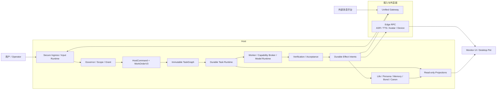

受众：PROJECT
标题：Natsume AI 工程总览与运行指南

# Natsume AI

Natsume AI 是一个本地优先、用户主权优先的个人数字生命系统。它把对话、人格表达、长期记忆、关系状态、主动行为、工具执行、设备能力和多平台消息接入放在同一套可审计运行时中，并要求所有真实动作都能回答四个问题：谁批准、执行了什么、依据什么验收、产生了什么副作用。

本仓库不是已经完成的“全自动进化 AI”。它已经具备较完整的 Host、Scheduler、Internal Agent、持久化、授权、任务、模型、Gateway、Edge 和观测基础设施，但可生产的 Durable DAG 并发/恢复、通用智能规划、受治理人格演化以及完整长期演化闭环仍在建设中。当前完成度必须以代码审计和机器状态为准，不能从历史 `PASS/DONE` 或目录数量推导。Durable 调度恢复会对持久 TaskGraph 重新检查依赖环，发现环以 `PLAN_CYCLE` 失败关闭。新建的 Chat、Skill、Plan、Delegate、Tool、Scheduler、Internal 与 Operator 图默认使用 `ATOMIC_GRAPH_SUCCESS_V1`：0090/0091 分别原子收口失败/成功，节点 `ACCEPTED` 在 Graph 与 graph-scope Budget 同事务终结前只属于内部结果。历史无 policy 图仍按 legacy 只读兼容；`HOST_TASK_RUNTIME_BOUNDED_FANOUT_ENABLED` 继续默认关闭，因此实际 sibling 并发、取消、通用恢复和整波 canary 仍未完成。

## 当前状态

| 范围 | 当前结论 | 说明 |
|---|---|---|
| Universal Runtime 七路线 | `INCOMPLETE / COMMIT_BOUND_ACCEPTANCE_MISSING` | fail-closed Gate 现覆盖 `chat/skill/plan/delegate/scheduler/internal/operator`。Chat/Skill 的既有控制最完整，但当前提交没有七路线真实验收回执；Plan/Delegate 仍有节点级治理缺口；Scheduler 的 governed occurrence 已把真实 handler 移到 Acceptance 后。Internal 只保留尚未准入的外部 v2 描述兼容；显式 V3 或顶层图身份会在入口拒绝，且已删除 post-admission 的 V3→legacy executor 回投；这不等于七路线闭环。Operator 已有 `scheduler.task.trigger`、`sys_mode.switch` 与 `task_terminal.reconcile` 三条 governed vertical slice，其余 34 个写命令继续安全阻断；3/37 不等于 Operator 平面完成。旧 GR-06 四路线回执只算历史证据，不能令任何当前路线变为 `COMPLETE` |
| 本地交付元数据 | `WIRED_FAIL_CLOSED / REMOTE_CI_NOT_RUN` | `scripts/ci/check_delivery_metadata.py` 审计 `origin/dev..HEAD` 的中文 vertical-slice 提交、单父历史、PR 固定七章节、真实 Markdown 换行和完成口径；feature merge commit、字面量 `\\n` 与无边界整体完成声明会失败。该本地 Gate 不替代 GitHub Actions；当前远程状态仍为 `NOT_RUN_ACCOUNT_QUOTA` |
| Durable Task Runtime | `PARTIAL_ATOMIC_DEFAULT_B5C / NE01_IN_PROGRESS` | 新生产 Graph 已统一声明 `ATOMIC_GRAPH_SUCCESS_V1`：0090/0091 原子收口失败/成功，公开 replay 只接受 `Graph COMPLETED + graph Budget CONSUMED`。正数 `time_ms` 现从 durable remaining projection 取得单节点 worker 硬截止；剩余为零会在 Operation/worker 前留下 `TIME_GUARD` Budget 拒绝，worker 超时会把时间用量结算为超限但保留 Operation 并返回 `RECOVERY_REQUIRED`，绝不伪装成普通失败；`time_ms=0` 保持兼容的不设截止。该边界不等于 general/multi-node 时间预算或未知效果恢复。在所有 live owner fence 清除后，DAG scheduler 可对 exact canonical COMMITTED checkpoint 的多节点 `EXACT_ACCEPTED / EXACT_REJECTED / MISSING` usage 做同 Attempt、更高 fence continuation，绝不重放已 COMMIT 的 worker；accepted 路径继续 READY sibling，rejected 路径交给既有 parallel settlement。0099 `EXACT_REPAIRABLE` 由 Host 默认自动处理且只接受 canonical durable evidence；signed-required/quarantine 不自动修改。bounded fan-out、真实 canary、general multi-node/unknown-effect recovery、Workspace 全写路线和 Service Locator 清零仍未验收，因此不是 NE-01 完成或 Full Architecture PASS |
| Scheduler | `PARTIAL / DURABLE_CLOCK_OCCURRENCE_FENCE` | 生产 worker 只生成不可变 operation plan；Graph Verification/Acceptance 与 `scheduler.operation.execute` staging 在同一 TaskStore UoW 提交，真实 handler 由共享 app-local `AcceptanceEffectDispatcher` 在 Acceptance 后调用，实际结果写回既有不可变 Scheduler result ledger。0117 令 `admit_due_occurrence` 在同一 `BEGIN IMMEDIATE` 内把 DUE retry authority 原子转成 occurrence-bound claim；执行前续租、执行中按 lease/3 heartbeat，clear/defer 都要求 exact owner/fence、未过期 lease 与实际发生时间。第二实例、过期 owner 和 stale fence 均不能 dispatch 或自我复活。definition/admin 直写 authority、mutable batch freezing、波次集成与 canary 仍缺，因此 Scheduler/NE-01 继续未完成 |
| Acceptance Effect 恢复 | `PARTIAL / EXACT_POST_ACCEPTANCE_EFFECTS_AND_AUTHENTICATED_SURFACE_QUERY` | visible turn、Preference 与 Life conversation projection 已拆成三个独立 post-Acceptance Effect。Preference store 的 privacy gate contract 缺失/非 `bool` 时失败关闭且零写；配置显式 false 或 malformed env 会保守解析为 `bool false`，只写 `DISABLED` receipt，事件、当前 profile 和 0118 child profile version 都为 0。启用时，0118 在一个 SQLite UoW 中写事件、append-only profile child version 与 evaluation receipt，并以 sealed-child trigger 和 reconcile full-set 校验拒绝追加/篡改；无信号也写真实 `NO_SIGNAL`。推荐反馈只能绑定 admission timestamp 以前、同 person 且 exact conversation/session 的 delivery，并保存 canonical full-delivery digest。Surface 初次 POST 响应丢失后，只能用既有 `internal_reply` HMAC/timestamp/nonce 对 Gateway durable outbox 做只读查询；Gateway 从同一 SQLite outbox payload 重开并精确校验 `effect_id`，Host 同时校验 outbox/delivery/platform/conversation/payload digest。`NOT_FOUND` 永远保持 `UNKNOWN`，不得盲目重发 |
| Internal Agent | `PARTIAL / INTERNAL_SEALED_CHECKPOINT_CONTINUATION` | 外部入口只接受尚未准入的 v2 描述并编译为 V3；显式 V3 或携带顶层图身份的 payload 以 `INTERNAL_RUNTIME_PRE_ADMITTED_WORK_ORDER_FORBIDDEN` 拒绝，不能经 compatibility 重建第二张图。准入后的 frozen worker、`AgentRuntimeExecutor`、prompt、review 与 Workspace 路径原生消费同一个 `WorkOrderV3`，不再把 V3 回投 `AgentWorkOrder`。V3 顶层 graph/node/revision 与遗留 metadata 冲突时失败关闭。受治理 Internal 单节点在 stage seal 后、WorkerProjection 前崩溃时，下一次 runtime activation 会扫描密封清单，重开 seal-bound recovery envelope、历史 Lease→更高 fence completion Lease、Operation/Budget/Preview/Grant/Task lineage，重建唯一 WorkerProjection 并继续 Verification、Acceptance、Effect、Secure Ingress claim 与 clean/no-change 0116 promotion；Agent 调用数保持 1，之后客户端调用只是幂等 replay。`InternalAgentCheckpointUnitOfWorkPort` 现为唯一公开检查点 mutation authority，并把 WorkerProjection 的唯一 SQL writer 接入同一 canonical SQLite；持久化边界明确分为 A（projection + Operation COMMITTED + Operation Outbox）、B（BudgetUsage + Budget EXCEEDED + Budget Outbox）和 C（重验 A/B 后原子关闭 Graph/Node/Attempt/Lease/Budget并写 5 条 terminal Outbox），不能表述为整链单事务。响应丢失只允许一次 mutation 后只读重开。单节点 Operation 已 `COMMITTED` 后若 BudgetUsage 写响应与首次重读同时丢失，现在只返回不附加 lifecycle/finalization mutation 的 `RECOVERY_REQUIRED`；Lease 到期后更高 fence owner 按 `EXACT_ACCEPTED / EXACT_REJECTED / MISSING / CONFLICT` 只读重开、幂等补写或阻断，worker 不重跑。app-local 终态 worker 只处理精确 sealed abandon/cleanup，不承担 live checkpoint 周期续跑。除 outer DAG scheduler 对 exact canonical `COMMITTED` checkpoint 的多节点 `EXACT_ACCEPTED / EXACT_REJECTED / MISSING` 窄窗外，多节点/批次仍安全 hold；周期 survivor continuation、crash-left unsealed partial cleanup、failure/cancel/budget Secure Ingress claim closeout、一般 write、handle-level TOCTOU、OS/container isolation与七路线验收也仍缺 |
| Visual Agent 直连 HTTP | `RETIRED_COMPATIBILITY_ONLY / PRODUCTION_OFF` | `/v1/agent/run` 只保留 `AGENT_INIT → LOOP_DONE` 的确定性 SSE 拒绝，终态为 `REJECTED / VISUAL_AGENT_GOVERNED_ADMISSION_REQUIRED`，执行轮次和副作用均为 0；它不再解析模型或直连 ClawdBot/Edge。恢复视觉自动化必须生成新的 immutable TaskGraph revision；旧 authority 退役不是能力 `PASS` |
| 旧 SubAgent 直调 | `RETIRED_FAIL_CLOSED / PRODUCTION_OFF` | `SubAgentDispatcher` 已移除全局 handler map、模型网关构造和独立 `skill_exec_log` writer；Executive compatibility port/wiring 与 legacy `_dispatch_to_sub_agent` 也已删除。任何 direct dispatch 固定返回 `LEGACY_SUB_AGENT_DISPATCH_RETIRED` 且零副作用。`intent_agent_handler` 仅生成无副作用的 governed handoff，不能因 legacy context 直调模型。当前正向 Delegate 仍仅允许 `pentest_agent` 的受治理只读交接；这不是通用 Delegate 平台或 NE-01 完成 |
| Workspace 隔离 | `PARTIAL_W2_NO_CHANGE_PROMOTION_WIRED / GENERAL_WRITE_INCOMPLETE` | 0101 authority 继续绑定 graph epoch/root WorkOrder/owner/configured root/allow-list；W2 保留服务端派生 `workspace_id`、冻结 source commit、独立 Git worktree、租约、heartbeat、handoff/takeover 和 cleanup continuation。Internal clean/no-change result 已接入 0116 `ACTIVE→ACCEPTED→PROMOTED`；启动期可从 sealed checkpoint 恢复 projection 并继续 accepted promotion，终态 worker 可精确 abandon/cleanup 已密封终态 stage。dirty worktree 或前移 HEAD 失败关闭。一般 write promotion、crash-left unsealed partial cleanup、failure/cancel/budget claim closeout、周期 survivor continuation、Domain/Skill/Codex runtime、逐操作失租抢占、OS/container/tenant 与句柄级 TOCTOU 隔离仍未完成，真实 canary 未运行 |
| 显式 Composition / 具身执行 | `INCOMPLETE / PARTIAL_HOST_LIFECYCLE_AND_DURABLE_HARD_STATE` | D1～D8 的 app-local 查询、冷聚合、Direct Skill 冻结依赖、Obs app assembly 和 durable embodiment authority 继续成立。每个 `create_app()` 独立拥有 `HostLifecycleContainer`；0115 的 runtime-scoped mode journal 令模式切换在 durable lease/fence 下提交并可重启恢复。Lifecycle Runtime、Tribe 与 Input Runtime composition 已消费 ASGI 显式传入的 typed Host service bundle；`ApplicationModelAttemptServicePort` 也改为构造期注入 provider。新的 `AgentRuntimeApplicationScope` 在 Life authority 就绪后才发布 immutable `AgentRuntimeApplicationPorts`，并显式供给 Input→Cortex、Life projection 与 Acceptance conversation effect；同一 bundle 还提供 model RouteCatalog、Bond stage engine、session topic/tactic stores、VTS ledger、TTS router 与 meta-learning loop。`agent_runtime_shared` 不再提供全局端口，conversation writer/VTS driver 也不再直接导入 locator。无生产调用者的 `intelligent_runtime` 二次 PlanningAgent/SkillComposer/直接执行路径已删除；TTS 已拆为仅接受 Host scope 显式依赖的 `tts_route`。该切片不证明 legacy Executive 的 generic delegate 已获得 app-local 端口。当前全仓机械库存为 named33/83、all-form37。`ProcessServiceContainer` 仍有 `50 fields / 46 mutable refs`（3 个 lock），底层共享实例、heartbeat、共享 resource status、其余 process-wide locator、完整 Worker scope 与真实 executor仍未收口；production canary/NE-01 波次集成尚未运行，因此 NE-01 继续 `IN_PROGRESS`。 |
| Planning Search | `PARTIAL_EXPLICIT_HOST_CAPABILITY_SEARCH / D20C_ACCEPTANCE_PENDING_EXTERNAL` | Host 仅在显式 `CAPABILITY_SEARCH_V1` 模式下，从 app-composed `SkillRegistry` 的冻结、低风险、免确认能力中生成至少两条竞争候选，并将选中路径编译为 immutable TaskGraph；Research D20b 已能用 fresh loader 对 snapshot/manifest/source 精确握手后的 UTF-8 citation span 做机械校验，D20c 已有 canonical ModelAttempt adapter，但没有真实外部 provider/cohort 证据，Research/Code/Pentest 的真实收益和生产 promotion 均未证明。 |
| Persona 演化 | `CENTRAL_FENCE_WIRED` | legacy 直写已中央拒绝；proposal、Review、版本激活和 rollback 替代链尚未实现 |
| 长期演化 | `INCOMPLETE` | NE-03 的 World/Scene/Intent/Guardian 与 Action Preview/Catalog 生产 authority 已进入 Host 对象图且本地 commit-bound Gate 已绑定；长周期目标 owner、Evolution Lab、Skill Compiler、Knowledge OS 及后续真实全栈仍未完成 |

本轮 NE-01 还收口了一个此前明确缺失的窄窗口：无前置 Review 的到期 `RETRY_PENDING` 不再先独立提交 READY，而是与 Attempt、Lease、Heartbeat 和 claim Outbox 在同一 SQLite writer UoW 中完成；若 Attempt Outbox identity 漂移，READY promotion 也会回滚。需要新 Review 的重试仍先落 durable Review、后续再 claim，不能以原子化为由绕过审批。该证据只覆盖这条 retry 边界，不代表 general/multi-node recovery、生产 canary 或 NE-01 完成。

最近一次 post-checkpoint `EXACT_REJECTED` response-loss 回归还修正了 generic failure bundle 与专用 checkpoint Budget 拒绝链的边界：generic bundle 不得替 node/Attempt-bound rejection authority 释放 graph Budget；后者会独立重验 BudgetReservation、rejected BudgetUsage 与 Outbox lineage。`tests/integration/test_ne01_multinode_budget_settlement_hold.py` 与 `tests/integration/test_ne01_operation_online_takeover.py` 的唯一组合复跑为 `26 passed in 69.45s`。这是本地窄切片证据，不与其他批次相加；NE-01 wave integration、真实模型、Docker 全服务栈和远程 CI 仍分别为未运行/`NOT_RUN_ACCOUNT_QUOTA`。

当前活动波次为 NE-01。此前职责拆分将 Acceptance、ASGI、Scheduler 三个 owner 分别降至 1262、1376、2942 行，并保持原 writer、lifespan/task owner 和 repository UoW owner。上一 checkpoint UoW 切片把 exact C-boundary read-only reopen 补进 `task_internal_agent_budget_rejection_store.py`；该文件仍只处理受约束的 Budget rejection/replay，WorkerProjection INSERT 仍只有一个物理 owner。独立 Gate 1–14 重新评估为 `PASS`、`failed_gates=[]`、`各 Gate issues=[]`，Gate 3 为 `issues=[]`、`new_mixed_over_800=[]`，没有扩白名单。上一结构提交的 36 文件 `265 passed` 只作历史，不能与当前集中批次相加。静态通过不关闭 Service Locator、旧执行 authority、一般恢复、七路线、wave integration、真实模型或 Docker 全栈缺口，NE-01 继续 `PARTIAL / IN_PROGRESS`，`REMOTE_CI=NOT_RUN_ACCOUNT_QUOTA`。

第三个切片删除了 Obs 五个模块中的零参数 locator refresher。Tool/MCP authority 切片随后删除 process-owned `get_mcp_tool_broker` accessor 与 `mcp_tool_broker` container slot，把 Tool seed/route 改为 app-local provider，并将该切片的 `process_services` 消费库存从 51 模块/163 个导入名降到 47/147；旧 ToolBroker/MCP direct/callback authority 已失败关闭。Host lifecycle 切片在其 commit-bound 基线上把具名 `from host_brain.composition.process_services import ...` 清单从 47 模块/152 个导入名降到 45/124，把全部 import 形式的 consumer modules 从 52 降到 51，并记录 Container 为 56 fields/4 locks/51 mutable refs。两个快照的统计范围与基线不同，不能相互替代；两项删除叠加后的 Gate 11 修复前 Container 为 55 fields/4 locks/50 mutable refs。#89 基线继续删除 process-owned `get_tool_broker` accessor、`tool_broker` container slot 和 `HostLifecycleApplicationPorts.tool_broker` provider，形成具名 45 modules/123 names、all-form 51 modules、Container 54 fields/4 locks/49 mutable refs 的 commit-bound 历史。ReAct 窄切片的 43/120/49 也是提交绑定的历史；Visual 切片后的终态库存为具名 41 modules/117 names、all-form 47 modules、Container 54/4/49。本轮 HardState app-local 切片的 fresh 库存进一步降为具名 40 modules/116 names、all-form 46 modules、Container 52 fields/3 locks/48 mutable refs；process `get_hard_state`、`get_endocrine_state`、`set_sys_mode` 及对应 slot/lock 均为 0。随后删除两个无消费者 Obs cache，Container 降为50/3/46；第一条 typed bundle 提交让 Lifecycle Runtime 与 Tribe composition 退出 locator，形成 named40/116、all-form44 的提交绑定快照；第二条让 Input Runtime composition 只消费同一 `HostLifecycleApplicationPorts`，形成named39/110、all-form43快照；模型端口随后只消费构造期注入 provider。本轮先删除 `AGENT_RUNTIME_PORTS` 这个全局 authority，随后把 active scope 的 model RouteCatalog、Bond stage engine、session topic/tactic stores、VTS ledger、TTS router/meta-learning 也改为同一 Host bundle 显式供应；conversation writer 与 VTS driver 退出直接 locator import。无生产调用者的 `intelligent_runtime` 二次规划/直接执行模块已物理删除，TTS 则被抽为只接受 scope 显式 router/meta provider 的 `tts_route`，当前机械库存为 named33/83、all-form37、Container50/3/46。这个结果不代表底层共享服务实例自动 app-local，也没有删除 Container slot，更不证明 legacy Executive generic delegate 已切流。无 Task-bound Action Preview 的 Gateway voice 继续零 Effect，不得以旧测试期待绕过。`ToolBroker` 构造点仍恰好 1 个，只位于 `host_brain/tools/broker.py` 的 app-local `ToolRuntimeBoundary`，由每个 `GovernedHostToolRuntimeComposition` 懒构造并持有，不再由 process locator 或 Host lifecycle provider 发布。ReAct 的 `run_skill` 与 `dispatch_sub_agent` 不再出现在工具发现中，注入旧 ToolSpec 也在低层执行前以 `REACT_TOOL_GOVERNED_ADMISSION_REQUIRED` 失败关闭；普通 `GovernedToolNode → CapabilityBroker` 与其他 Agent Tool 路线仍须独立审计。

旧 `/v1/agent/run` 曾在 HTTP route 内自行解析模型、选择 ClawdBot/Edge 客户端并反复规划执行，绕过 canonical TaskGraph。该 production chain 与可直接导入的 raw Agent Loop/ClawdBot/Edge client 已物理删除，历史 `agent_loop_log` 只读保留且公共 writer/列常量已删除；兼容端点无论 mock、Edge 还是自定义 URL 参数都只返回两个固定 SSE 事件。真实 `/v1/chat` adapter 仅允许 `response_format=text` 进入预检和模型链，`actions`、大小写/空白变体和未知值都会在 Bio Ops、Immune、runtime resolver、模型、Prompt Registry、Memory、Ledger 前固定拒绝；legacy Action Planner 的公共模型入口只会抛出同一 governed-admission reason，纯 ActionPlan parser 仅产生 `NONE_PROPOSAL_ONLY` 数据。正向恢复必须先完成受治理 proposal → 新 immutable TaskGraph revision 编译；该安全退役不等于视觉能力或通用 Agent Runtime 已完成。

HardState 运行期真相现由每个 Host lifespan 的 `HostHardStateOwner` 与 0115 durable journal 共同封口。`HOST_SYS_MODES` 与 `HOST_MODE_TRANSITIONS` 已上移到 neutral `contracts/host_hard_state.py`，journal persistence 不再反向导入 core application；当前 fresh 全仓 static Gate 已恢复为 `PASS / issues=[]`，但这只是结构与依赖扫描结论，不能解释为 HardState、NE-01 或完整架构完成。composition 只在 bootstrap 将显式 `HOST_SYS_MODE` 转成候选初始 mode；生产 owner 在 migration、canonical SQLite 和 exact Host runtime lease/fence 未绑定前拒绝写入。绑定后，repository 在一个 `BEGIN IMMEDIATE` UoW 内验证完整 event chain、expected revision/mode 和当前 scope/owner/lease/fencing token，再原子追加不可变 event 并推进 canonical head；owner 只在 durable commit 成功后替换内存快照。成功 transition 只以 HardState journal 作为 canonical audit；重启会从已验证 head 恢复，而不是重新采用 bootstrap mode。同 event 的 exact replay 返回原提交，但不会再次追加进程内 history 或 legacy `error_log`；payload drift、并发 stale head、篡改、过期/释放 lease 和旧 fence 均失败关闭。当前 `sys_mode.switch` 正向切片已用 typed Operator action 进入 `Secure Ingress → HostCommand → immutable TaskGraph → Review continuation → Acceptance Effect → HardState journal`；历史回放按永久 event ID 重开，不因后续超过 1000 条事件而再次执行。`NO_CHANGE` 不制造 event，外层 receipt 必须保持 `side_effects_executed=false`。连同 `scheduler.task.trigger` 和 `task_terminal.reconcile`，当前只覆盖 3/37 Operator 写命令；其余 34 个入口和整条 Universal Runtime 仍未完成。`chat_generation_payload` 与 `RoutingMatrix` 的旧环境变量 fallback 已删除，但它们接收显式 mode 的其他正向生产调用点尚未形成证据。Obs Life Body 仍只读 durable runtime projection，不能通过查询创建第二个 Host owner。

前一 app-local owner 切片的证据继续保留为 `210 passed`、D7b `7 passed`、operator/focus/runtime projection `29 passed`，批次独立且禁止相加。0115 durable authority 的历史权威 consolidated 回归为单一核心批次 `84 passed in 66.37s`，neutral contract 修复后的外围 affected batch 另为 `67 passed in 35.78s`；外围67与核心84可能重叠，二者及旧 `83`/`82` 均不得叠加。新的 Operator 切片使用一个 app-local `AcceptanceEffectRuntime` 作为 Host 与 Operator 共用的投递/恢复 owner；启动时若仍有 `PENDING/CLAIMED` Effect，受治理 admission 会失败关闭。Review pending 时外层 OBS WAL 与中央 claim 不提前封口；若 TaskGraph/Review 已落库但 outer WAL append 失败，重启会在 admission 继续关闭的状态下，用 canonical Secure Ingress、HostCommand、TaskNode、ReviewItem 与 terminal continuation 精确复验。零条 Review 保守转 `UNCERTAIN` 后开放 admission；唯一 `PENDING/APPROVED/CONSUMED/REJECTED/EXPIRED/CANCELLED` 恢复同一 `WAITING_REVIEW` 并交既有 worker/finalizer 收口；多条或绑定漂移则启动失败关闭。`RECOVERY_PENDING` 或结果不确定时 durable defer。`APPLIED/REPLAYED/NO_CHANGE` 使用分别绑定 `runtime_scope_id` 的状态专用持久回执；前两者必须重开 exact HardState event，后者必须证明没有 event 且 `side_effects_executed=false`。调用 HardState 后发生响应丢失、`success=False` 或后置归因失败时，必须先重开 exact event：已存在则规范化为 `REPLAYED`，读取不确定则保持 `PENDING + RECONCILIATION_REQUIRED`/`UNKNOWN`，只有权威明确证明事件不存在才进入普通失败。关停顺序固定为先停止并排空 Operator ingress，再停 Scheduler producer、关闭 Task Runtime 与 Effect owner、quiesce Workspace，随后才停止 ModeTransition/Activity 依赖、关闭 command/security stores，最后清空 app 引用；关键关停失败会保留依赖和已发布引用并返回稳定的可重试错误。最终集中回归为单一批次 `265 passed in 179.82s`，不与上述历史批次相加；首轮最终批次的旧测试桩失败如实记录在测试计划。commit-bound acceptance、production canary 和 NE-01 wave integration 仍未作为波次证据，`REMOTE_CI=NOT_RUN_ACCOUNT_QUOTA`。因此总体 NE-01/Operator 继续 `INCOMPLETE`。

Scheduler governed occurrence 不再在 worker 内调用领域 handler。worker 只把冻结 occurrence/definition/worker/fingerprint 与 graph/node/Attempt authority 编译为一个 `scheduler.operation.execute` 描述；canonical WorkerProjection 是 Acceptance 前的不可变计划 checkpoint。Graph Verification/Acceptance 与该 Effect intent 由既有 TaskStore canonical UoW 同成同败，随后 Host lifespan 内共享的 `AcceptanceEffectDispatcher` 才重开 Action Preview、claim Effect 并调用真实 handler。实际结果继续写入既有不可变 `SchedulerExecutionResultRepository`；native Scheduler ingress claim 绑定该实际结果 receipt，Operator 外层则保留独立的 checksum-chained OBS outcome receipt，并且只能在实际结果已可归因后封口。Review 前调用数为 0、Effect commit 后为 1，duplicate 只重放既有结果；所有过期 claim 或 handler 调用后的响应丢失都只能调用显式只读 `reconcile()`，缺少 reconciler 时持续保持 `RECONCILIATION_REQUIRED`，不能盲目再调普通 handler。生产 sys-mode 已提供 exact HardState 只读恢复器；Scheduler handler 结果必须显式给出合法状态和真实 durable `receipt_ref`，空结果不再补成成功。0117 进一步删除 `SchedulerClock._retry_state`：`admit_due_occurrence` 在同一 `BEGIN IMMEDIATE` 内校验 live DUE owner/fence、写 immutable occurrence、推进 definition head，并把原 retry row 原子转为同 owner/fence 的 `OCCURRENCE` claim。独立 lifecycle task 在 dispatch 前续租并在执行中 heartbeat；lease 过期不能自我续活，clear/defer 还必须使用实际调用时间，故慢执行期间第二实例不能重复 dispatch，异常退避也不再取旧 tick 时间。该 Clock 单元/合同/durable-UoW 定向批次为 19 项、47.53 秒。definition/admin 写入口、mutable batch freezing、一般未知外部效果人工归因、波次集成与 canary 仍未收口，所以这里只能定级为 `PARTIAL / DURABLE_CLOCK_OCCURRENCE_FENCE`，`REMOTE_CI=NOT_RUN_ACCOUNT_QUOTA`。

通用 Acceptance Effect 的恢复边界继续收紧，但不能外推为整条 Universal Runtime 的整体完成。可见 user turn、Preference evaluation 与 Life conversation projection 现在由三个独立 post-Acceptance Effect 驱动；visible turn 精确重开 turn/`MemoryEvent`。Preference store privacy gate contract 缺失/非 `bool` 立即失败关闭且零写；配置 false 或 malformed env 则保守解析为 disabled，提交零 event/profile 的 `DISABLED` receipt。启用时以 effect-bound deterministic operation ID 在一个 UoW 中写 event、append-only profile child version 和 evaluation receipt，0118 trigger 封住 receipt 后新增 child，reconcile 再校验 child 全集以发现绕过 trigger 的篡改；无信号写真实 `NO_SIGNAL`。推荐反馈仅选择 admission time 不晚于当前请求且 exact person/conversation/session 的 delivery，并绑定 canonical full-delivery digest。Life 以 deterministic command ID 重开 exact command receipt。Surface 初次 POST 返回 500、畸形或丢失响应时仍先进入 `UNKNOWN`；恢复只能通过真实 `internal_reply` HMAC/timestamp/nonce 的只读 Gateway query 重开原 delivery。Gateway 从同一 SQLite outbox snapshot 的 canonical payload 校验 `effect_id`，Host 重新派生并校验 delivery/payload identity；`NOT_FOUND` 绝不等价于未执行。连续 migration head 为 `0120_task_runtime_feature_canary_receipt.sql`：0118 的 Conversation 权威和0119的签名 Operator 入站权威保持不变；0120 仅增加签名、持久化、build/migration/config 精确绑定的 bounded fan-out 门禁，真实服务栈金丝雀尚未运行，NE-01 仍为 `IN_PROGRESS`。

签名终态修复不会把 `attestation_signature` 或 key ID 写入通用 WorkOrder/TaskGraph。Secure Ingress 完整验证后，0119 在独立 append-only 表中保存 exact command、request、principal、claim/audit/body digest；TaskGraph、Review 与 Acceptance Effect Intent 只携带 `signed_command_ref + signed_command_sha256`。风险 4 表示“必须 Review、可以由人工批准”，风险 5 仍保留给不可执行的绝对阻断语义；Effect 执行前还会按 exact Graph/Node/Attempt/Grant/Context/Scene/Guardian 生成 Action Preview。真实 SQLite 集成已证明 Review 前 proof 不存在且目标 Budget 不变，Review continuation 后仅 Acceptance handler 写入签名 proof并释放目标 Budget，重复请求只重开同一 Graph、Effect、proof 和 0119 行。本切片同时删除四条仍被阻断的 Canon Operator 命令在该适配器中的 dormant route writer，保留 manifest 覆盖但不再保留不可达直写实现。该证据是本地 governed integration，不是外部 HTTP/network canary、NE-01 波次验收或 NE-07 全栈验收；功能默认关闭，`REMOTE_CI=NOT_RUN_ACCOUNT_QUOTA`。

Internal Agent 当前状态为 `PARTIAL / INTERNAL_SEALED_CHECKPOINT_CONTINUATION`。外部入口只保留未准入的 v2 `AgentWorkOrder` 描述；显式 `WorkOrderV3` 或顶层 graph identity 会以 `INTERNAL_RUNTIME_PRE_ADMITTED_WORK_ORDER_FORBIDDEN` 拒绝，不能被降级并重建另一张图。准入后的 frozen worker、`AgentRuntimeExecutor`、prompt、review 与 Workspace 原生消费同一 `WorkOrderV3`，并拒绝 V3 顶层 graph identity 与 legacy metadata 的漂移。真实 model/executor 结果仍先进入 exact-inventory protected stage，公共 WorkerProjection 只公开 stage ref/digest 与有界摘要。对受治理 Internal 单节点，seal 后、WorkerProjection 前崩溃可由下一次 runtime activation 主动扫描并重开 seal-bound recovery envelope、历史 Lease→更高 fence completion Lease 及 Operation/Budget/Preview/Grant/Task lineage，重建唯一 WorkerProjection 后继续 Verification、Acceptance、Effect、Secure Ingress claim、canonical result 与 clean/no-change 0116 promotion；Agent 不重跑。Host、Internal、Scheduler、Operator 四个生产 coordinator 都显式取得 composition-owned `InternalAgentCheckpointUnitOfWorkPort`；`DurableTaskStore` 不再向通用 `TaskStorePort` 暴露检查点 mutation。检查点拒绝链保持三个独立、可恢复的原子边界：A 提交 projection/Operation，B 记账并推进 Budget，C 在重验 A/B 后提交 rejected terminal bundle。五个故障点证明的是 C 内部零半状态；响应丢失只调用一次 mutation，再通过只读 authority 重开已提交 terminal。新的通用单节点 post-COMMIT settlement hold 覆盖 `EXACT_ACCEPTED / EXACT_REJECTED / MISSING / CONFLICT`，保证首次不附加 Attempt/Node/Graph failure或Lease/Budget release，并保留可能已提交的usage/`EXCEEDED`；更高fence只读重开、幂等补写或阻断，进程控制异常直接传播。app-local 周期 worker 只做精确终态 sealed abandon/cleanup。这个结论仍不覆盖周期 survivor continuation、crash-left unsealed partial cleanup、failure/cancel/budget claim closeout；多节点/批次只有安全hold、settlement recovery仍缺，也不覆盖一般 write、handle-level TOCTOU、OS/container isolation 与七路线验收。

上一检查点 UoW 切片的 fresh 主证据为最终唯一去重的 10 文件受影响批次：`130 passed in 296.69s`、`0 failed/skip`。首轮同一批次如实记录为 `128 passed + 2 failed`：一项是结构阈值恰好 550 行，另一项是只读重开测试仍消费旧的嵌套 usage 形状；修正实现与测试后整批复跑通过，未扩大结构 Gate 或白名单。旧 87/35/3/62/46/4、上一结构切片 265 和中立 Budget/Projection 16 项均为历史或重叠证据，禁止相加。该批次不与当前 settlement 批次相加。NE-01 波次集成、真实模型、NE-07 Docker/前后端服务栈与 canary 均未运行，`REMOTE_CI=NOT_RUN_ACCOUNT_QUOTA`。

当前 post-COMMIT Budget settlement 切片的最终唯一去重 12 文件批次为 `71 passed in 99.50s`、0 fail/skip；先前 25、5、34、40、42、26 与 28 项 focused run 只作重叠历史，禁止相加。真实 SQLite 状态只按 `EXACT_ACCEPTED / EXACT_REJECTED / MISSING / CONFLICT` 四类解释：前三类在单节点 Lease 到期后由更高 fence owner 只读重开或幂等补写，分别继续到 `ACCEPTED` 或 `BUDGET_BLOCKED`；`CONFLICT` 保持 fail closed，worker 调用始终为 1。普通单节点和 Internal Agent 的 exact rejected closeout 共用同一 Store 事务；canonical 模式精确绑定 HostCommand、持久 TaskNode route 与 WorkerProjection，只接受生产支持的 chat/skill/delegate/tool 路由，并拒绝把 Internal Agent 路线降级到 generic。响应丢失、后续重复 HostCommand 和 terminal reconciliation 共用同一只读 exact resolver；缺失、未知或冲突 release Outbox 失败关闭，Runtime 保留 durable corruption 原因。多节点/批次只保证安全 hold，恢复仍 `INCOMPLETE`；该证据也不等于 NE-01 波次集成或七路线验收完成。

当前 pre-Operation Attempt takeover 切片关闭的是 worker 首次调用前的持久崩溃窗。`node_execution_preparation.py` 只准备 frozen input、Grant 与候选绑定；`preoperation_attempt_recovery.py` 从同一 scheduler snapshot 校验 Graph/Node/latest Attempt/Lease、唯一 graph Budget 和 canonical PRECHARGE 矩阵，不拥有写 authority。Operation 尚不存在且旧 Lease 已到期时，Runtime 复用同一 deterministic Attempt，并由 `TaskLeaseTakeoverAuthorityMixin` 在 TaskStore 的一个 `BEGIN IMMEDIATE` 中同时证明 deterministic reservation id 与同 scope/fingerprint Operation 均不存在后取得更高 fence；`task_lease_replay_identity.py` 将 Attempt、owner、TTL、expected version、takeover mode 和 reservation ID 绑定成确定性的 Lease/初始 Heartbeat identity，提交后响应丢失只能重开完全一致、未续租、fence 连续且 Outbox 相同的行，任何 TTL、模式、reservation、Lease 或 Heartbeat 漂移均失败关闭。普通 Attempt/Lease/Operation 必须存在且只存在一个 `ACTIVE` graph Budget；takeover 仅允许唯一 `ACTIVE/EXCEEDED` lineage。并发 Operation 出现转 `RECOVERY_REQUIRED`，任一 sibling 仍有 live owner 则先返回 `GOVERNED_EXECUTION_IN_PROGRESS`。Operation 已 `RESERVED` 后的 worker 异常或 reservation collision 只保留 reconciliation authority，不再伪写 Attempt/Node/Graph failure 或释放 Budget/Lease。Graph/Budget terminal writer 同时拒绝活跃 Node、Attempt、Lease 与未决 Operation，并与后续 Attempt 建立互斥。最终工作树的五组互不重叠受影响验证分别为 `184 passed in 289.38s`、`69 passed in 23.43s`、`23 passed in 101.70s`、`68 passed in 228.20s`、`52 passed in 123.58s`，合计 396 项、0 fail/skip；架构 Gate 1～14 全部通过且未扩大白名单，`task_repository.py` 4585 行、takeover mixin 230 行。串行兼容组曾因 364 秒命令上限被截断且没有测试失败结果，拆成后三组后全部通过；新增 AST 门禁首跑的 1 个失败来自测试误把 `_require_version(attempt, ...)` 当成 `conn` 首参，最终补齐纯模块与精确早返回门禁后 identity/structure 为 `12 passed in 1.32s`，不掩盖也不计入 396。该切片仍只能定级为 `CANONICAL_PRE_OPERATION_ATTEMPT_TAKEOVER_PROVEN / POST_RESERVATION_RECOVERY_HOLD_PROVEN / GENERAL_MULTI_NODE_RECOVERY_INCOMPLETE`：普通 Graph+Budget 终态和 success/effect 的完整原子 UoW、multi-node/batch settlement recovery、unknown effect、legacy 缺 Grant 兼容、七路线、wave integration、Service Locator 清零、真实模型和 Docker 全栈仍未完成。

当前 pre-Operation 切片的文档、交付元数据、coverage 与 freshness 合同最终复跑为 `45 passed`、0 fail/skip；该批次只验证陈述和机器状态一致性，不与 396 项代码证据相加。上一 post-COMMIT settlement 的 71/39 与本切片早期 198/49/45 计数均仅保留为历史，不参与当前结果。

NLE Canon raw-mutation trusted-site 本轮只同步既有路径与符号的精确源码行号，没有新增 trusted site 或扩大 allowlist；扫描器合同与攻击性回归为 `45 passed in 97.17s`，随后统一 delivery `static_scan,doc_gate` 实跑为 `PASS`、`failures=[]`。该批次与核心84、外围67可能重叠，禁止相加；Operator adapter 仍保持 fail-closed。

本轮 TaskStore authority 封口的调用库存为：生产 Graph 私有 hook 恰好 1 次，位于 `HostCommandRepository._admit_normalized()`；Acceptance Effect 私有 hook 恰好 6 次，仅分布在 `transition_graph_and_stage_acceptance_effects()`、`commit_node_acceptance()` 与 `complete_parallel_graph_success()` 三个 canonical UoW；Graph/Node 的 `INSERT` SQL 只在 Graph 私有 hook，Effect 的 `INSERT` SQL 只在 Effect 私有 hook。`tests/task_runtime_authority_fixtures.py` 明确只生成 raw/orphan 测试状态，不写 `host_command_journal`，不能充当 canonical admission 证据。该切片没有新增 migration 或 SQLite trigger，故 NE-01 仍为 `IN_PROGRESS`。

该封口的本地测试证据按原始批次记录为：authority/structure `19 passed`、HostCommand admission `1 passed`、NLE/Operation/Heartbeat `77 passed`、Acceptance Effect Store `15 passed`、Parallel/Settlement/Atomic `45 passed`、Terminal classification `32 passed`；Cancellation 首跑为 `29 passed + 1 fixture failed`，修正 fixture 后该 case 通过；Integration 首跑为 `46 passed + 3 fixture failed`，修正后 3 个 cases 通过。第三个 fixture 缺失 `node_risk_level` 可在干净 `origin/dev` 复现。全部 fixture 修复和重命名后，authority、两份结构合同、recovery、代表性 cancellation、durable artifact baseline、dispatcher 顺序与 HostCommand admission 的最终关键回归为 `26 passed in 35.33s`；该复跑不覆盖或抹去首轮失败记录。TaskStore 切片当时的 full architecture static Gate 仍为 `FAIL [1,6,10]`；本轮未运行 NE-01 波次集成，状态是 `NOT_RUN_PER_WAVE_POLICY`。

随后完成的 NE-01 SQLite 边界切片关闭了 full architecture static Gate 10：0112 Runtime Context schema readiness 已从 runtime 层的私有 SQLite 检查下沉到 `RuntimeEventRepository`，`RuntimeEventStore` 只暴露 readiness port；Service Catalog 的 SQLite 连接、SQL 与事务移入 `SQLiteServiceCatalogRolloutRepository`，`rollout_authority.py` 仅保留合同、Protocol 和 Guardian Observer，runner 依赖该 Protocol。`ACTIVATION_STARTED` receipt 与 rollout head 在同一事务提交，故障注入证明任一步失败共同回滚。World Observation 原 `_write_lock` 实际是纯 `RLock` 误判，已按真实职责重命名为 `_transition_lock`，没有新增写 authority。`host_startup.py` 与 ASGI 仍承担 concrete repository wiring，typed composition 尚未完成；本切片也没有新增 migration。该切片完成时的 fresh full static 为 `FAIL [11]`：Gate 1/6/10 均已通过；Gate 11 是 ToolBroker production-service inventory 仍同时命中 `process_runtime_services.py` 与 `tools/broker.py`。`origin/dev` 基线为 `FAIL [1,6,10]`，NE-01 继续 `IN_PROGRESS`。

该切片证据按不重叠口径分别保留：Runtime Context 定向 `7 passed`；Catalog unit/contract `15 passed`；真实 Host socket integration `6 passed`；Repository/Global 独立复跑 `16 passed`，其中与前述 15 项有重叠，禁止相加。Global SQLite boundary 为 `PASS`；波次 integration 为 `NOT_RUN_PER_WAVE_POLICY`，远程 CI 为 `NOT_RUN_ACCOUNT_QUOTA`。
最新的 Obs 生命周期切片进一步关闭 Gate 6。`ObsApplicationContainer` 不再暴露含糊的泛化 `start()`，只提供 `start_projection_jobs()`，而生产唯一调用点是 `obs_fastapi_app.py` 的嵌套 ASGI `lifespan`：先对 ports bundle 执行原子 single-use claim，再构造 app-local daemon，启动后才 `yield`；关闭时按 stop/join/in-flight fence、精确 leader lease release、owned SQLite close、state clear 收口。stop timeout 或 rollback close failure 会保留原 container/ports 句柄供精确重试，不能用新对象图掩盖未关闭资源。`dataclasses.replace()` 继承同一 claim，不能通过 derived bundle 绕过；两个独立 ports/app 仍彼此隔离。没有 module-global daemon，也没有新 migration。

该 Gate 的本地证据保持原始批次：完整 Obs app 首跑为 `13 passed + 1 test fixture failed`，失败仅因旧 monkeypatch 仍指向已删除的 `start`；修正后该 case `1 passed`，最终生命周期关键批次 `12 passed`，daemon cadence/shutdown/serialization/start-single-flight `4 passed`。批次有重叠，禁止相加。该 Obs 切片完成时 full architecture static 为 `FAIL [11]`，Gate 1/6/10 均已通过；Gate 11 当时仍是 ToolBroker production-service inventory 双命中，`origin/dev` 基线仍为 `FAIL [1,6,10]`。NE-01 仍 `IN_PROGRESS`，wave integration=`NOT_RUN_PER_WAVE_POLICY`、`REMOTE_CI=NOT_RUN_ACCOUNT_QUOTA`。此外，后台 daemon 若因未捕获的 lease renew 等异常退出，`/health` 还不会直接呈现 `daemon.running/last_failure`，continuous-SLO supervision 尚未闭环，因此不能宣称 Projection 或 NE-01 完成。

此前的 Gate 1 Service Catalog 分层切片把启动协调器迁到 `host_brain/service_catalog/startup_coordinator.py`，`host_brain/composition/service_catalog_startup.py` 仅保留同对象兼容重导出；稳定 rollout 合同进入 `host_brain/contracts/service_catalog.py`，旧合同路径同样只保留同对象重导出。`rollout_authority.py` 现在只承担 Guardian observer，SQLite repository 只依赖稳定 contracts。由此 application→composition 两条依赖与 Service Catalog persistence→application 一条依赖均归零，Gate 1 SCC 从 `application/composition/persistence` 缩为 `application/persistence`。该切片完成时尚有 11 条 persistence→application 依赖，其中 PlanningSearch 7 条、Evolution/Lab/Skill/World 4 条；证据为 Catalog contract/unit `61 passed`、真实 Catalog/Host socket integration `7 passed`、边界复跑 `7 passed`，后两组可能重叠不得相加。

此前的 PlanningSearch 持久化合同分层切片新增纯合同包 `host_brain/contracts/planning_search/`，承接 core、benchmark、calibration、code、research 共八组合同与模型；旧 `host_brain/planning_search/` 同名模块只保留同对象重导出，并保持 `__all__`、类型 identity、`isinstance` 与序列化形状兼容。`code_benchmark`、`calibration`、`research_shadow` 三个 SQLite repository 已不再导入 `host_brain.planning_search`，清除了其中 7 条 persistence→application 反向依赖。边界合同 `5 passed`，D13/D18/D19/D20 回归 `60 passed, 1 skipped`；唯一跳过项来自 Windows 缺少 symlink 权限，不得记为通过，`py_compile` 与 `git diff --check` 均通过。该切片完成时 Gate 1 仍为 `FAIL`，application/persistence SCC 只剩 Evolution/Lab/Skill/World 4 条 persistence→application；application→composition=0、Edge violation=0、reverse import=0，Gate 6/Gate 10 继续 `PASS`。这只是持久化合同分层，不是 PlanningSearch 功能、生产切流或收益证明；无 migration，typed Composition 与 NE-01 仍未完成。

最终 Gate 1 合同切片新增纯 `contracts/evolution.py`、`contracts/evolution_lab.py`、`contracts/runtime_context.py` 与 `contracts/skill_lifecycle.py`。旧 Evolution、Evolution Lab、Runtime Context 路径均保持同对象重导出；`skills/skill_lifecycle.py` 只保留应用服务并重导出合同。Evolution Governance、Evolution Lab、Skill Lifecycle 与 World Observation 四个仓储现在只依赖中立 contracts，最后 4 条 persistence→application 反向依赖归零。fresh Gate 1 评估为 `PASS`：`issues=[]`、SCC=`[]`、Edge finding/violation=0、reverse imports=`[]`；Gate 6/Gate 10 也继续通过。但 #87 组合后的 full architecture static 仍为 `FAIL [11]`，因为 ToolBroker production-service inventory 期望只命中 `process_runtime_services.py`，实际还命中 `tools/broker.py`。边界合同 `4 passed`，Context/World、Evolution Lab、Skill、Evolution Governance 定向 `32 passed`，`py_compile` 与 diff-check 通过；无 migration，wave integration=`NOT_RUN_PER_WAVE_POLICY`、`REMOTE_CI=NOT_RUN_ACCOUNT_QUOTA`。该切片只关闭 Gate 1，不表示 Universal Governed Runtime、typed Composition、PlanningSearch 收益或 NE-04～NE-06 生产功能闭环；NE-01 仍为 `IN_PROGRESS`。

Gate 11 收口随后退役最后一条 process-owned ToolBroker 路径：`get_tool_broker` accessor、`tool_broker` container slot 与 Host lifecycle ToolBroker provider 的当前库存均为 0；唯一 `ToolBroker` 构造点为 `host_brain/tools/broker.py`，count=1，并由 app-local Tool Runtime composition 持有。当前 Gate 11 与 fresh full static 均为 `PASS`、`failed_gates=[]`；Gate 3 的三项旧债已通过 owner 拆分关闭且未扩白名单。定向证据为结构/生命周期/bridge/route-token/seed `43 passed`，ASGI + Tool/MCP + HTTP + broker + MCP audit + 真实 SQLite `98 passed`；补充 `1 passed` 与 43 项批次重叠，禁止相加；`py_compile`、policy JSON 校验和 whitespace/diff-check 均通过。生产 executor 仍为 0，真实 workspace-bound governed Tool/MCP executor、完整 Host/Worker typed Composition、全局 Service Locator 删除及波次集成均未完成，因此 NE-01 仍为 `IN_PROGRESS / PRODUCTION_OFF`，`REMOTE_CI=NOT_RUN_ACCOUNT_QUOTA`。
Operator 首个正向切片只迁移 `scheduler.task.trigger`：它经过 HMAC Secure Ingress、OPERATOR HostCommand、immutable TaskGraph、durable Review、一次性 resume、node grant、Budget/Attempt、Verification、Acceptance 与 Receipt。恢复前还会经 ASGI 注入的只读 lookup 对 checksum-chained OBS Outcome Journal 做 exact claim/audit/command/scope/body/terminal/domain-result 复验；缺少或篡改 authority 时 fail closed。其余 36/37 命令继续在 handler 前阻断。

外部 HTTP `/tools/execute` 已切到 `TOOL Secure Ingress → HostCommand → immutable TaskGraph → Review/resume → node grant/Budget/Attempt/Lease → exact Tool binding → app-local governed execution port → Verification/Acceptance/Receipt`，0114 只扩展 canonical Worker Projection 的 `tool` route。真实 SQLite 集成使用显式声明为本地可重放的测试 adapter 证明了该治理内核和重启幂等；生产 composition 现有 handler 只是 declarative payload 或未具备 workspace/reconciliation 约束，因而全部保持 `FAIL_CLOSED_NO_GOVERNED_EXECUTOR`，`/tools/health` 与 Host startup projection 都如实为 `DEGRADED`。原始 `ToolBroker.execute()` 与 `execute_bound()` 都固定以 `GOVERNED_TOOL_TASK_AUTHORITY_REQUIRED` 拒绝且不查 handler/Token；Frozen Tool Worker 取得的 app-local port 先由 `TaskStore` 在单个 SQLite 读事务内原子复验 Graph/Node/Attempt/Lease/Reservation 与 owner/fence/expiry，随后分阶段 fail-closed 复验 node grant 和 exact binding，不能把三段描述为同一原子区间。全部检查通过后，`before_handler` 才在 handler 调用前写入 `PENDING` dispatch marker。`tools.MCPAdapter` 映射为 `MCP_TASK_AUTHORITY_REQUIRED`，不再登记 callback；process-owned `get_mcp_tool_broker` accessor 与 `mcp_tool_broker` container slot 已删除，未进入 ASGI 的兼容 `MCPToolBroker` 仍不能登记或执行 handler；MCP Skill bridge 默认关闭并在关闭时清除缓存中的 `mcp::*`。MCP registry 仍提供只读能力清单，但真实 MCP provider 尚未编译为 governed Tool node，所以这只是旧执行 authority 清零，不是 Tool/MCP 平面完成。普通 ReAct 的 `GovernedToolNode → CapabilityBroker` 是独立待审路线；本切片只清零 ToolBroker/MCP direct/callback authority，不能外推为全部 Tool authority 已清零。另有一个已记录的启动顺序 P2：Tool seed readiness 早于 governed runtime activation；当前生产 executor 为 0，因此不会误报 `READY`，但启用首个真实 executor 前必须把 runtime activation 纳入同一 readiness 状态机，本切片未修复该边界。

真实 Chat/Delegate/三节点 Plan + replay 还揭出并修复了四个 fail-closed 兼容断点：Runtime Context 重开只返回 canonical context 投影、Scene digest 在 Preview 边界确定性转为 `sha256:`、同一 Guardian lease 只允许 expiry 单调续期、terminal proof 与 handler payload 不再共享 `action_args`；Chat 的已消费 model budget guard 不进入公开投影但 typed usage 保留。Host lifecycle 与 HardState 已改为 app-local owner，ToolBroker/MCP legacy direct/callback、ReAct `run_skill`/`dispatch_sub_agent` 与 Visual Agent 直连 authority 已安全退役；两个无消费者的 Obs 全局缓存也已删除。上述工作仍不等于能力封板：atomic、fan-out、cancellation 与 reconciliation 的生产开关关闭，当前仍有 40 个具名 locator 消费模块、46 个 all-form 消费模块、46 个可变 service 引用、36 个 Operator 旧入口，workspace-bound 真实 Tool/MCP/Visual executor与完整 Host/Worker composition 仍待迁移，NE-01 继续是 `IN_PROGRESS / PRODUCTION_OFF`。

NE-02 的 Research shadow 已新增独立语料绑定、执行 profile/budget、citation verifier、双臂回执合同和 0107 append-only SQLite ledger；D20b 的 `ResearchCitationVerifier` 会在每次验证时重新构造 corpus loader，重算 snapshot/manifest/source id/ref/digest/tier 绑定，并校验 UTF-8 byte offset 与 span digest。0107 terminal receipt 还会重新打开 registration、RunSpec 与两条 arm evidence，拒绝 binding/profile/budget、plan、model、verifier 或 evidence digest 漂移，并对完全相同请求只返回 exact replay。D20c 的 `AttestedExternalResearchAdapter` 只经 canonical `ModelAttemptService` 发起一个前台、非缓存 attempt；它要求 exact route/output identity、token/成本、provider/总延迟齐全，并把完整 provider attestation 嵌入 model receipt，任一 cache/retry/缺测量都会拒绝。没有真实 provider 凭据、生产 prompt/workload 与 audit lookup 时，它固定是 `ACCEPTANCE_PENDING_EXTERNAL`，不能构成收益证明。脚本重放与未 attested 的 canonical attempt 永远不能形成收益结论。D20c 已冻结外部 provider attestation 合同：必须是新请求、真实 provider、模型/路由/响应摘要、token、成本与延迟齐全；localhost、mock、disabled、test、placeholder 和 cache 路径会被拒绝。该合同仍不等于已获得外部凭据后的真实收益证明。NE-01 的 fan-out/atomic 生产开关即使显式设置，也必须同时提供 `HOST_TASK_RUNTIME_CANARY_RECEIPT`，缺失时启动失败关闭。NE-03 已冻结 workspace-scoped `WorldFactV2`、`WorldSnapshotV2`、`ContextPackV2`、typed `IntentFrameV1` 和 `SceneDecisionV2` 合同，并由 Host ASGI lifespan 构造唯一 app-local Runtime Context composition。
NE-03 的 0111 Observation Journal 由 SQLite 原子分配 scope revision；生产 observation application 只接受服务端 principal、Bond/Emotion 投影和 composition-owned environment，写入同时要求 canonical source event 与真实 Host lease。读取不续期 TTL，到期通过显式 expiry transition 生效。`SceneResolver` 从重开的 World、Task、app-local Guardian、关系和时间推导场景，同一 `scene revision/digest` 被 Surface、Proactive 和 Task admission 冻结消费；生产 caller 不再指定最终 scene/constraints。Intent admission 通过真实 authority adapter 重开 HostCommand、WorkOrder、TaskGraph、Scene 和 Grant，按节点持久化 restrict-only 仲裁；`BLOCK/REVIEW` 失败关闭，Review continuation 绑定 durable ReviewStore。

Action Preview 由 Host lifespan 唯一实例在签发和执行两个时点重开 Command/Task/Attempt/Lease/Grant/Context/Scene/Guardian；derived effect 到达终端时还会递归重开原 Scheduler Attempt/Lease，receipt 自身不授予权限，只能落在 typed descriptor 的 exact scope/args 内。Scheduler Proactive 的 typed proof、固定 request ID 与真实消息现已贯穿到终端 Edge push；遗留 `EdgeCommandPusher` 没有生产 proof 发行者，因此继续隔离且不能通过构造/注入关闭门禁。Acceptance surface 当前只允许验收合同精确绑定的最小文本投递，`raw_extra`、媒体、二次回复、voice/performance/avatar 变换都必须另有独立 effect/Preview；公开具身 submit/enqueue 无 proof 时在调用端口前失败，只有已被 durable outbox claim 的私有 dispatcher 才能继续执行。旧 WorkOrder/effect 以及尚未迁入 Governed Operator TaskGraph 的 36 个直写命令失败关闭；`scheduler.task.trigger` 是目前唯一已迁移的 Operator 正向路线，不能把 1/37 写成管理面完成。Guardian 与 Host runtime scope/owner/fence 绑定，health/heartbeat 经注入端口读取它。0113 Host Service Catalog 生产入口以 ENFORCE 为默认目标，但 fresh DB 必须从 AUDIT 逐级真实启动、HTTP identity 核验并关闭中间候选；pending 恢复必须命中同 operation/snapshot/stage/candidate 的 listener，`REGISTERED` 崩溃以同 operation ID 续跑，候选停止失败保持待对账而不能伪造 `ROLLED_BACK`。Store 与 SQLite trigger 同时阻断非法状态机、stage/rank 漂移、scope/activation identity 漂移和 stage skip。真实 socket/Uvicorn、重启、crash takeover 与 terminal append failure 的 commit-bound 定向证据已通过；部署多实例 canary 尚未执行。NE-03 已按这些已知边界合入；当前活动波次为 NE-01。长周期目标没有独立 durable owner，上游 Bond 原始证据仍由既有投影提供，任何未实测边界不得写成完成。

当前 commit-bound 本地证据为：NE-03 wave `239 passed`，既有受影响路径回归 `101 passed`，raw transport 私有化后的回归 `36 passed`，Service Catalog 关闭加固回归 `6 passed`；独立审计在静态边界扫描后又分别复跑 Guardian/Catalog `42 passed` 与 ActionPreview/Edge `47 passed`。另用 production CLI Host、隔离 runtime 环境和 fresh SQLite 完成了 AUDIT→SHADOW→PREFLIGHT→CANARY→ENFORCE 的真实五阶段启动，共留下 5 个 operation / 15 个 receipt；`/health` 返回 HTTP 200、`status=OK`、`service_identity=host.main/http`，Guardian durability 为 `READY`、fencing token 为 5。Windows Ctrl+Break 按现有停止脚本的 crash-stop 语义清除了进程与监听端口，但不伪造正常 lease release；旧 lease 到期后，同一 SQLite、同一端口和同一安全快照已由更高 coordinator fence=2 接管，重新保持 ENFORCE 与 health OK，Guardian fence 递增到 6，ledger 累计为 6 个 operation / 18 个 receipt。该证据证明 crash-fenced recovery，不是 graceful-stop PASS；显式 `HostCatalogRuntime.close()` 已用嵌套清理保证 candidate stop 异常时仍尝试释放 coordinator authority 与 reservation，但 Windows 后台优雅停止脚本仍留到 NE-07 实栈验收。commit-bound Gate 已成功退出，部署多实例 canary 仍未执行，本地状态为 `LOCAL_ACCEPTANCE_PASSED_WITH_KNOWN_BOUNDARIES`，远程 CI 仍是 `NOT_RUN_ACCOUNT_QUOTA`。
NE-04 的 0108 V1 ledger 和 runner 仅是 self-attested shadow：dataset digest 没有由 runner 独立重算，缺失 verifier evidence 时会自行补 hash，端口隔离依赖可绕过的属性名检查，而且没有生产 composition。V1 永久 `benefit_eligible=false`，不能作为 promotion 证据。
NE-05 已有确定性 `SkillDraftV1`、安全接收与 0109 lifecycle 记录，但 Lab/Review/Sandbox URI 尚未查询真实 authority，supply-chain 状态与 terminal receipt 不是同一 UoW，exact replay 与跨版本 rollback evidence 仍有缺陷，Host 也仍从旧 Skill registry 解析；因此不构成真实 activation/rollback 闭环。生产 Governor 的 restrict-only maturity policy 已默认开启，缺失或伪造 scorecard 最高风险。
NE-06 的 0110 V1 ledger 只持久化 Feedback、Knowledge、Identity 的事件名与引用；APPLIED/ACTIVE/ROLLED_BACK 没有切换真实 policy/persona/knowledge/identity owner，引用也未查询 Lab/Review/Snapshot authority。Prefrontal 的一个参数漂移已修复，但 V1 不具备 activation authority。

D6 的 ledger-stats 投影只保留每张表按时间戳与持久行身份稳定排序后的最新 5,000 条公开记录；`truncated=true` 表示更旧尾部未物化，不再让整张高流量表永久返回 503。截断后只有 `start_ms` **严格晚于**最老保留记录时间的窗口可被权威回答；相等时间仍可能存在被持久行身份裁掉的同毫秒记录，因此边界窗口、直接全表读取和未命中的 `request_id` 都以 `PROJECTION_SOURCE_TRUNCATED` 失败关闭。投影轮询没有新事实时复用原 `source_cursor/source_digest`，只刷新 freshness，immutable journal 不增长；来源不可用和超出保留期的查询也继续失败关闭。这个边界是“可查询的最新有界窗口”，不是完整历史统计。

ModelAttempt 的非流式生产路径会保留 provider 显式回报的 prompt、completion、total token 维度；未回报的维度保持 `null`，只有 prompt 与 completion 都明确测得时才可推导 total。LLM 总览、按模型分组和时序桶同时公开 `measured_calls` 与 `is_lower_bound`，部分覆盖的和只能按下界展示，完全缺测不得补成 0。当前 `ModelAttemptService.stream()` 没有生产调用者，且流式 adapter 尚未把最终 usage 带回终态记录，因此该路径明确为 `UNMEASURED / NOT_ENABLED`；未来接入生产前必须先增加 typed final response/usage 合同与回归测试。

权威入口：

- [当前代码事实](docs/50_project/arch/CURRENT_CODE_ARCHITECTURE.md)
- [系统架构总览](docs/50_project/arch/SYSTEM_ARCHITECTURE.md)
- [功能模块地图](docs/50_project/arch/FUNCTIONAL_MODULES.md)
- [关键数据流](docs/50_project/arch/DATA_FLOW_ARCHITECTURE.md)
- [目标架构](docs/50_project/arch/TARGET_ARCHITECTURE.md)
- [架构差距矩阵](docs/50_project/arch/ARCHITECTURE_GAP_MATRIX.md)
- [下一代正式执行合同](docs/30_devspec/NEXT_GENERATION_EVOLUTION_EXECUTION.md)
- [机器可读状态](configs/release/current_architecture_status.json)

终态对账现已增加可重复执行的真实 SQLite restart canary。脚本通过 canonical `HostCommandRepository.admit()` 建立两条隔离任务：唯一 `FAILED + ACTIVE Budget` 由默认开启的 exact-auto 以 `SYSTEM_DURABLE_EVIDENCE` 精确释放预算；`CANCELLED + ACTIVE Budget` 保持 `SIGNED_REPAIR_REQUIRED`、无 proof、零状态改写，并阻断 production readiness。完整 cancellation 依赖束使用进程内临时 verification-only 公钥通过启动 preflight，私钥不落盘。定向合同/单元/集成为 `95 passed`，CLI canary 为 `PASS`；这不等于已完成签名 Operator HTTP canary、部署存量清理、Operation/Effect canary、NE-01 波次集成或 NE-07 全栈实测，远程 CI 仍为 `NOT_RUN_ACCOUNT_QUOTA`。

## 系统全景



图中是生产主干的方向，不表示每条入口都已完全接线。Scheduler 与 Internal Agent 已接通；DAG 生产并发/恢复、全局 composition 和长期演化 pipeline 仍是明确缺口，详见差距矩阵。

## 运行面

| 运行面 | 启动入口 | 核心职责 | 主要边界 |
|---|---|---|---|
| Host Main | `python -m host_brain` | 对话入口、Governor、Task/Agent Runtime、Life、Memory、业务 API | 真实命令与长期状态的主要协调面 |
| Observability | `python -m host_brain.obs_main` | 只读运行投影、Trace、健康状态、Operator BFF | 不应成为业务事实 writer |
| Monitor UI | `host_brain/app/monitor_ui/` | Task、Review、健康、数字生命和运维视图 | 通过 Query/Operator API 读取和发命令 |
| Edge RPC | `python -m edge_client` | ASR、TTS、Avatar、桌面与设备 actuator | 物理副作用必须回传 receipt |
| Unified Gateway | Edge lifecycle 中的 `edge_client/gateway/bootstrap.py` | 平台 webhook、消息归一化、Host 回流与出站投递 | 平台适配器不拥有 Host 业务状态 |
| Desktop Pet | `desktop_pet/main.cjs` | Electron + Live2D 本地表现 | 只消费状态和动作，不裁决事实 |
| External Services | `scripts/runtime/docker-compose.external.yml` | Neo4j、Chroma、Redis | 日常启动可按配置降级；NE-07 最终验收必须启动真实固定版本容器并完成写入、读取、重启持久性和清理，不允许内存 fallback |

Host 与 Edge 之间的共享数据结构位于 `natsume_contracts/`。该目录是跨进程版本化合同，不是重复实现或可删除的临时目录。

## 核心运行链

### Governed 请求

Host canonical 请求的目标 lineage 是：

```text
request
  → Secure Ingress
  → Governor decision + grant
  → HostCommand + WorkOrderV3 + BudgetPolicy
  → immutable TaskGraph revision
  → node Attempt + Lease + node-bound grant
  → worker / model / capability execution
  → Verification
  → Acceptance
  → durable effect intents
  → effect receipts and read-only projections
```

对受认证的 Host Input/Gateway，`cortex_dispatch` 会在 Governor 决策前把 Secure Ingress principal 写入 intent；`GovernedHostRuntime` 随后为 direct `chat/skill/delegate` 与 approved-plan 统一冻结 `surface / principal_id / ingress_claim_ref / ingress_audit_ref / input_sha256`。Plan 在首次 HostCommand/TaskGraph 落库前以 base request、session 与 command principal 只读预检 parent Governor binding，direct route 也在 admission 前预检；child grant 派生会再次检查，避免竞态扩权。只有同时具备成对 ingress ref 且 `input_source=GATEWAY` 的请求才记录为 `GATEWAY`；其他认证输入记录为 `HOST_INPUT`，无 ingress 才是 `CHAT`。半绑定 ref、畸形摘要或 parent binding 漂移会失败关闭。D10 在该边界内只启用 `pentest_agent`：它拿到不可变的 command/graph/node/attempt/lease/fence/grant invocation，并在真正调用前复验 node grant；其 handler 只生成 Domain Pack/SecureRun handoff、不写 legacy `skill_exec_log`。其他 Delegate target 在 admission 前拒绝，因此这不是通用子 Agent 平台，也不代表 Host 已具备候选计划搜索。

对于 direct `skill` 与已选中的 `plan` 内已登记 `codex_production` 节点，Profile/default 展开都在 HostCommand/WorkOrderV3/TaskGraph admission 前完成。Plan 仅可从已批准候选输入和 immutable node binding 生成该载荷；调用方自带的冻结载荷会在 admission 前失败关闭，replan 会按 `graph_revision + 1` 重建新的 node-bound 载荷。冻结的 adapter payload 以 `node_id` 写入 WorkOrder input pack，带 payload digest、root/graph/node/revision、business scope、operation fingerprint、Review/approval ref；worker 会重验这些字段后才经 CapabilityBroker dispatch，且强制 `start_background=false`。重放比较只屏蔽 payload 内轮换的 Review/approval 引用及其派生 digest，真正执行始终读取首次 durable admission 的原载荷，其余字段漂移仍失败关闭。因此执行期不能因 profile 默认值变化而重建另一份工作单。此切片不等于 Plan 或 NE-01 完成：通用多节点恢复、全路线 Budget/Receipt、commit-bound acceptance 与真实服务栈验收仍未完成。

当前 `chat`、`skill`、`delegate`、`plan`、Scheduler 和 Internal Agent 进入这条主链。`task_progress`、`recent_turn` 只读取 durable projection；旧 Executive 的生产入口、`route_planning`、`conversation_execution`、`skill_routing`、application `composition`、application port wiring、legacy diagnostic direct-skill matrix、legacy SkillDag 执行和进程内任务 registry 已物理退役。Cortex 的 contextual-session/style、clarification 直答、LLM unavailable fallback 和异步 post-process compatibility branch，以及 Surface 的 `schedule_async_post_process()` fire-and-forget 入口也已物理删除：canonical route 未获 Governed Runtime 支持会在可见对话写入前拒绝，支持时只把冻结上下文交给 TaskGraph；提交后的 Projection 仍经 durable `surface.post_process` 处理。`executive_runtime/runtime.py` 与 `app/executive_runtime.py` 只保留 fail-closed 拒绝边界；`SkillDag` 类型及 adapter 仅保留为零生产调用者的兼容合同，不能调度 worker。旧 Executive 内对 Runtime Capability Forge 自动 gap synthesis/replan/route override 的调用已删除，但独立 Forge `runtime-match` 端点仍是 NE-05 待退役边界，不能记为 authority 清零。`app/intelligent_runtime.py` 已物理删除，不能再以 prompt outline 或只读 SkillDag hint 的名义形成第二执行 authority；`SkillComposer` 本身也不暴露 `execute()`。实际执行只能重新经 Governed admission 形成 immutable TaskGraph。这是旧 authority 的部分负向收口，不等于通用 PlanningSearch、全路线 receipt 或 NE-01 完成。Internal 的既有 Agent executor 只在 child grant 验证后接收由 V3 投影的兼容对象，不再拥有 admission authority。0096 后，Task-bound Review 的批准后一次性 resume、拒绝和到期会在原 Review 事务中排入 continuation；composition-owned worker 按 immutable HostCommand surface 回到原 Host/Internal/Scheduler runtime，POST continuation 不重跑 worker，PRE continuation 不制造伪 Attempt。

Review HTTP 决策使用独立的 server-owned `review.operator / review:decide` Secure Ingress policy；`internal:agent:execute` 不能越权审批，actor 必须等于认证 principal，Task-bound Review 只能由 Task Runtime 内部创建。Internal/Scheduler 的拒绝或到期结果使用 exact `review-decision://...` durable ref；升级前误写入的 POST pre-acceptance receipt 只能在 HostCommand、Graph revision、Review/node/version 与旧 receipt 全部匹配的单事务 CAS 中替换。生产 Operator credential 仍需部署配置，真实 canary 尚未运行。

Durable 启动门禁当前按 `migration → TaskStore 0093/0094/0095/0098/0099 与 0102 artifact readiness、Review 0096、grant uniqueness 0097 → task_store.recover_startup → 0099 bounded terminal inventory → 可选且默认关闭的 exact system auto → publisher/worker → runtime activation` 执行；任一步异常都在路由开放前 fail closed。0102 readiness 以 migration asset checksum 和完整 table/column/FK/index/trigger snapshot 建立 Store 级 READY 缓存，并在首次启动扫描 CREATED/ACTIVE/BLOCKED 图与可投递 Effect inventory；非终态 Node 的空 `output_contract`、`ACCEPTED` Node 缺 exact artifact，或可投递 terminal legacy Effect 缺 exact artifact，都会要求显式 reconciliation，热路径不重复全库扫描。0099 的 bounded inventory、graph-wide 写围栏、签名修复和默认关闭边界保持不变；不能因任一 schema/readiness 通过就宣称生产可开。

0099 readiness 不只看对象名：它从受信 migration 资产重建 canonical schema，严格比较 `sqlite_master` 中 3 张 table、4 个 index 与 10 个 trigger 的全部 SQL，再由 Python codec 复核 case/subject/proof 语义。Runtime 重入不会静默修复 `BLOCKED/FAILED/CANCELLED/COMPLETED + 未结 Budget`；终态 Graph 在创建或激活新 Budget 前由 Runtime 快照与 Store 写事务双重拒绝。任一同 Graph/revision 的未决 current case 都是 graph-wide 写围栏，只有 0099 proof UoW 能显式 bypass。Inventory 单次最多覆盖 10,000 Graph；结构漂移只进入 quarantine。旧 case 的替代链最终必须落到 trusted proof。Operation/Effect/terminal Operator 与 system auto 均默认关闭，启用还要求 Secure Ingress、可执行 Gateway、verification-only Ed25519 公钥环和外部部署 inventory/canary；Host 不加载私钥。

0093 已把 Task Runtime Outbox drain 从单进程锁升级为持久化跨进程权威：每次 claim 绑定 `owner + token + expiry + 单调递增 fencing token`，过期 claim 可由新 owner takeover。0095 又将投递 predecessor/head 身份扩展为 `aggregate_type + aggregate_id + graph_revision`：`TASK_GRAPH` 必须携带存在的正整数 revision；0098 只为 `GRAPH_CANCELLATION_EFFECT_RECONCILIATION` 增加同样的 revision，并要求 case ID、revisioned payload ref 与 immutable inventory 物理一致；其他 aggregate 保持 `NULL`。因此同一 graph ID 的不同 revision 独立保序，revision 内仍严格按 version/creation/id 投递。Publisher 每次只做 `claim 一条 → 幂等 append runtime event → 用 owner/token/fence/version 封口`；append 失败会释放 claim 并持久化 backoff 与错误，append 成功但 complete 丢失时则由幂等 event append 与过期 takeover 收敛。Composition 直接使用当次 boot/construction 的 `recovery_id::outbox` 作为唯一 publisher owner，并在启动发布后拉起可关闭的后台续投线程；线程根据 canonical backlog 中 aggregate head 的最早 available/claim-expiry 时间等待，并以有界轮询兜底，所以旧进程死亡时即使 claim 尚未到期，新进程也会在到期后自动接管。Publisher close 会与前台 publish 临界区线性化，必须等待已进入的发布，避免 close 返回后继续访问 Store。显式 drain 只有数据库 `total_pending=0` 才能返回 `DRAINED`，仍有活 claim、backoff 或被 predecessor 阻塞的消息时返回 `DEFERRED`。`list_pending_outbox` 保持完整 PENDING inventory，投递 eligibility 只属于 claim/backlog API；0093/0095/0098 readiness 是 Store 实例级状态，正常构造/显式 assert 验证后由热路径复用，只有显式诊断 `force_revalidate` 才重扫 schema/全表；逐条 claim/complete/release 只保留事务内 CAS、trigger 与记录校验。Event append/claim complete 已提交后，如果 backlog 诊断读取失败，只返回脱敏 `DEGRADED`，不会把已提交投递伪报为失败。Runtime Event 将 Graph aggregate key 投影为 `graph_id@revision`，Operator 也只读取同一 exact revision；进程内 asyncio/threading 锁仅作降噪，不再被当作跨进程 authority。

0095 对历史兼容同样不靠猜测：普通多 revision `TASK_GRAPH_CREATED` 通过 Graph Outbox evidence 中不可变且跨 replan revision 唯一的 HostCommand `command_id` 精确回填；ACTIVE 等非 attempt governed transition 则由 Migration Runner 注册的 deterministic `natsume_sha256_hex`，使用 revision-bound command ID 重算升级前五段 digest，并同时匹配原 `outbox_id + idempotency_key`。因此升级只增加 `graph_revision` 精确维度，不改变既有 Outbox ID/key，不会打断 response-loss replay；无法解析的自定义 producer 仍令整笔迁移回滚。`graph_revision` 物理形状固定为 `INTEGER / nullable / no default / non-PK`。新 Graph `payload_ref` 固定为 `taskstore://event/TASK_GRAPH/{graph_id}@{revision}/{version}`；旧 ref 只允许 durable codec/replay 兼容读取，新 insert/update trigger 拒绝。新 Runtime Event 使用 `graph_id@revision`，旧 journal 保持不可变并经 source Outbox revision 精确归属；unique partial `TASK_STORE_OUTBOX source_ref` 围栏保证一次 Outbox 只投影一个事件，升级前 append 成功但 complete 未确认的重投只有在 legacy event 可全字段重建时才返回原 journal。Operator 查询还要求 ReviewStore 按 canonical `task-node://.../<revision>/...` subject ref 过滤，避免同 graph ID 的不同 revision 混读。

PlanningRecovery 不在普通调度热路径扫描 Outbox：`read_scheduler_snapshot()` 默认 `include_graph_outboxes=false`，只有 failure recovery 显式设为 `true`，在同一只读事务取得 exact terminal Graph Outbox，并把它实际的 durable `payload_ref` 作为失败证据；这样 pre-0095 legacy ref 不会被合成为不存在的新 ref。仅未提供该可选扩展字段的旧版或替代 Store 实现才合成 revisioned fallback；生产 DurableTaskStore 提供 inventory 后，缺行、畸形或歧义都 fail closed。0100 已把此前止血升级为 append-only durable revision supersession：`admit_replan()` 在一个 `BEGIN IMMEDIATE` 中重新验证 same-root `FAILED` predecessor、精确 terminal evidence 及 Node/Attempt/Lease/Operation/Review/Budget/Effect/cancellation/0099 静止事实，原子写 revision+1 Graph/HostCommand/Outbox 和确定性 supersession；响应丢失只精确重放，插入后故障整笔回滚。共享 Store 围栏阻止旧 revision 再 claim/retry/写 Budget/推进节点或恢复 Review。当前安全子集仍拒绝 `BLOCKED`、全部历史 Review continuation 和全部 Acceptance Effect，且自动 failure-triggered replan/生产 canary 未完成，因此仍是 `PARTIAL_DURABLE_SUPERSESSION_SAFE_SUBSET`，不是完整自动重规划。Runtime Event 的 `created_ts_ms=0` 也保留为零；由于 current revisioned 与 legacy unrevisioned 两条历史 append 路径都可能用时钟替代零值，时间容差可对两种可重建 candidate 生效，但除时间外的全部字段仍必须严格精确。

`schedule_retry` 提交后若仅丢失响应，同一确定性调用会严格核对 Attempt、Node、Lease、Graph、Budget、BudgetUsage 及关联 Outbox 后返回原决定，不重复扣减 retry budget。普通或重试耗尽的 direct、non-deferred pre-reservation resolver failure 通过 `fail_running_attempt_bundle` 在一个事务内落 `Attempt FAILED`、`Node FAILED`、`Graph FAILED/BLOCKED`、`Lease RELEASED`、同一 graph-scope `Budget RELEASED` 及五条 Outbox；Budget release 只接受精确 budget id/version、无 attempt lineage 的 release Outbox，并在 response-loss replay 中逐项复核。任何一条 Outbox 插入失败都会整笔回滚。并行 deferred child 仍不得取得共享 Budget authority，必须由 outer settlement 统一收口；其他终态路径也不能据此宣称全部预算收口。一旦已有 operation reservation，该边界拒绝接管。

Budget 超额竞争使用一个 `BEGIN IMMEDIATE + CAS` authority：首个越界 usage 唯一推进 Reservation 到 `EXCEEDED` 并拥有唯一 `BUDGET_EXCEEDED` Outbox；持旧 ACTIVE version 的竞争者先得到 CAS conflict，刷新到 terminal version 后才允许以同 version 的 `ALREADY_EXCEEDED` usage 记录失败，并引用 winner Outbox，不能再次推进 Budget。Runtime 的 CAS 尝试下限随已批准的 `BudgetPolicy.limits.concurrency + 1` 扩展，不再固定为 4。8/16/32 线程、8 个跨进程写者、连续 8 次 CAS 冲突、重启重放、篡改与 settlement winner 选择均有测试，但这只证明 canonical Budget charge/terminal contention，不等于 program-wide Budget 覆盖或生产 canary。

reservation 建立后，Coordinator 启动 `DurableExecutionHeartbeat`，每轮先续 Lease、再续 Operation Reservation，并在流事件及最终结果前执行 checkpoint；任一心跳失败只返回 `RECOVERY_REQUIRED`，绝不 COMMIT。两类续租支持同参响应丢失后的精确重放。在线收紧会在写事务持锁后把已过期的 `RESERVED` 原子推进到 `RECOVERY_REQUIRED + Outbox`。单节点 canonical COMMITTED checkpoint 要求 exact COMMITTED Outbox/Attempt/历史 Lease/receipt digest、canonical WorkerProjection 和唯一 graph Budget，并把 worker BudgetUsage 严格归为 `EXACT_ACCEPTED / EXACT_REJECTED / MISSING / CONFLICT`：前两类只读核对，`MISSING` 仅在 stable usage id 与所有 worker-kind 行都缺失时，才由同 Attempt 更高 fence owner 使用 `reservation.updated_ts_ms - attempt.started_ts_ms` 的正持久时间上界幂等结算；`CONFLICT` 一律阻断。写响应和首次读回同时丢失时，原 owner 只进入不附加 lifecycle/finalization mutation 的 hold，不释放 Lease/Budget，也不覆盖可能已原子提交的 usage/`EXCEEDED` 事实。DAG 外层必须先处理 active Operation checkpoint，再考虑 aggregate Budget 的 `EXCEEDED` 终态；`EXACT_REJECTED` 也必须完成 higher-fence 接管并释放新 Lease，不能提前封板遗留执行权。单节点接管最终进入 `ACCEPTED` 或精确 `BUDGET_BLOCKED`，worker 不重跑。当前还支持一个更窄的 operation-free 窗口：已有持久 Attempt、旧 Lease 已过期且 canonical PRECHARGE/Budget lineage 精确时，Store 在同一事务证明对应 Operation 不存在后，才允许同 Attempt 以更高 fence 首次调用 worker。pre-Attempt/pre-budget、零或非法时间、public projection、多节点/批次与未知副作用仍 fail closed。

`TaskGraph.completion_policy` 是持久可选 v1 扩展：缺省保持 `LEGACY_NODE_TERMINAL_V1` 行为；`ATOMIC_GRAPH_SUCCESS_V1` 必须显式冻结，并同时指定 sink `result_node_id`。legacy 多 sink 图不得声明单一 result，不能靠最后完成或最后声明的节点隐式选结果。`PlanningGraphCompiler` 默认保持 legacy；只有调用方显式请求，或失败重规划继承前一 revision，才生成 atomic policy。

Coordinator 的 `atomic_graph_success_enabled` 与 `bounded_fanout_enabled` 是两个独立且默认 `false` 的进程能力开关，Host、Scheduler、Internal 三处生产 composition 均未开启。Application 在 `repository.admit` 前确认 atomic capability、node-grant service 与 parent grant；不具备能力的进程对 atomic 图 fail closed，不先写 admission。Coordinator 只接受覆盖 admitted Graph 全部节点的 exact grant map。atomic policy 即使顺序执行也由 outer 统一成功封口；terminal-leaf 实际有界并行还必须启用 bounded fan-out。child 只能提交 Attempt、Node、Lease、Reservation 以及 Budget usage/`EXCEEDED`，不能终结共享 Graph/Budget。

每次 governed 执行会在建立/消费 Budget、解析 worker 之前验证 `0090` parallel failure/review decision schema 与 `0092` graph-cancellation schema；启用 B5 terminal success 时还会验证 `0091` success decision schema，缺表或缺列直接 fail-fast。`ACTIVE` 多节点重入若仍发现 live Node、active/latest Attempt 或 `ACTIVE` Lease，会返回 `GOVERNED_EXECUTION_IN_PROGRESS`，不解析新 worker、不重复执行，也不抢占现有 owner authority。结算窗口若出现 ownership fence，或 CAS 后重读发现新的 active Node/Attempt/Lease，也映射为 `IN_PROGRESS`；没有任何 active ownership 事实的纯 CAS 漂移仍是 durable state conflict，不能被软化成“正在执行”。

正常的 node-local 非接受不再触发 fail-fast cancel。outer 会等待所有已启动 sibling 到达 durable node-local terminal。live 与 crash/re-entry 都从 durable Node、Attempt、Reservation 和 BudgetUsage 重建同一 canonical v2 payload/ref；outcomes 覆盖整个 admitted Graph 中所有具备 latest stable Attempt 的 durable terminal Node，不只当前 claimable batch，当前 batch 只决定裁决优先级与 selected node。`RETRY_PENDING` 可作为非 selected durable outcome，并可在重入时重建。Graph `FAILED/BLOCKED`、可选 Budget `RELEASED`、对应 Outbox 和 `0090` decision row 同事务提交，response-loss 只允许 exact replay。BUDGET selected 必须绑定唯一 `BUDGET_EXCEEDED` winner；`ALREADY_EXCEEDED` sibling 只能引用 winner authority，不能成为 terminal selected evidence。decision row 每次读取都校验自身 digest、Graph/Budget Outbox 与 Attempt lineage，BUDGET 另校验 usage；terminal replay 还校验 Graph target/version，并要求 selected outcome 的 Attempt 仍是该节点 current latest。测试覆盖跨批次 canonical digest 稳定、`RETRY_PENDING` 非 selected outcome、live/re-entry identity、response-loss 与 newer-Attempt replay rejection。

全节点 `ACCEPTED` 后，B5 outer 从每个节点已冻结的 durable worker projection 重算 canonical digest，并精确校验 command、request、graph/revision、node/attempt、route、target、receipt 与 node grant，只允许显式 `result_node_id` 对应投影生成整图 effect intents 和公开结果。`complete_parallel_graph_success()` 在一个 Store UoW 中原子提交 `Graph COMPLETED + Budget CONSUMED + Graph/Budget 两条 Outbox + 全图 durable effect intents + 0091 canonical success decision`。legacy 单节点若在 Node `ACCEPTED` 后、Graph/Effect 封口前断电，重启必须从 exact COMMITTED checkpoint、SUCCEEDED Attempt 与 canonical projection 重建，并通过共享 finalizer 原子提交 Graph 与 Effects；篡改或缺失检查点时 Graph 保持 ACTIVE，worker 不重跑。已完成图的 replay 只读并复核 authority，不重新编译 effects。

B5C 的取消 authority 是 graph revision 级、两阶段且 first-writer-wins。`task_graph.cancel` 已接入 Operator Command Gateway、同源 BFF 与 Task Runtime UI，命令必须带 exact `graph_id + graph_revision + reason_code`，并要求 `obs:write + task-runtime:cancel`。Gateway 认证后的 server-owned authority 会携带 durable audit/claim、request、principal、tenant、认证 body digest、action 与 scopes；同一个 `SecureIngressGraphCancellationAuthorityVerifier` 被注入 Host、Internal、Scheduler 三个运行时，重新读取已提交且尚未写入 terminal `claim_result_ref` 的 Secure Ingress audit/claim 并核对 canonical body 后，才签发以 `audit_ref` 为 `request_identity` 的取消 authority。Outcome 一旦封口，该 authority 不能被进程内复用为新的取消 bearer；公开 duplicate 只重放原 outcome。Application 不接受调用方自报 `request_id/request_identity/source`。第一阶段先在 0092 UoW 中写 canonical intent，把 Graph 推入 `BLOCKED`、节点/Attempt/Lease/Review/Token/operation/effect 写入取消或 reconciliation 状态；只有 intent 已持久化后才 cancel/join 本进程 child 与 heartbeat。本地 task registry 只是加速器，不是取消 authority；Outbox publisher 故障也不能阻止 durable intent 之后的本地 cancel/join。执行重入会发现 durable intent 并尝试 advance/finalize；待 active Attempt/Lease 消失、operation/effect/review 完成对账后，第二阶段才原子提交 Graph `CANCELLED`、Budget 释放/取消、Outbox 与 canonical cancellation decision。完整 reconciliation evidence 由 cancellation decision 的摘要绑定，operation reconciliation proof 在封口与终态 getter 中都必须重验结构、digest、key 与签名；终态 Outbox 只引用 decision、intent 与 request identity 这三个稳定 authority ref，不展开证据清单，避免证据规模突破 Outbox 上限。请求和封口的响应丢失只允许 `request_id + request_identity + source + reason_code` 全部一致的精确 replay，0091 success 与 0092 cancel 谁先提交，谁就成为终局 authority。

Operator 路由先按 immutable HostCommand surface 把 exact revision 送回 Host、Internal 或 Scheduler owner。若下游调用抛错，Gateway 不凭异常猜测结果：Runtime Group 会重读该 revision 的 durable cancellation intent；只有 intent 与本次 `request_id + audit_ref + OPERATOR + reason + graph/revision` 全部一致，才标记“可能已发生副作用”，没有 intent 则按明确未执行拒绝，读取失败或畸形事实则保守标为不确定。只有 cancellation handler 显式翻译成 OBS 封闭端口异常的确定性可被命令路由采信；任意依赖异常即使伪装同名字段也一律按可能已执行处理。UI 随后刷新 durable detail，不用按钮响应乐观宣称 Graph 已取消。

0094 新增的 `GraphCancellationContinuationWorker` 是 composition-owned 扫描与协调器，不是第二套取消状态机。它只 claim 仍为 `REQUESTED` 且尚无 0092 decision 的 intent，持久绑定 owner、不可猜 token、expiry、单调 fencing token、attempt 与 retry deadline；claim/heartbeat/defer/complete 都在取得 `BEGIN IMMEDIATE` 写锁后才采样时钟，不让等锁时间吞掉 lease 或用过期时间授权 CAS。处理期间 heartbeat，进程失联后由 expiry takeover。每次重入都从 `HostCommandRepository` 按 exact `graph_id + revision` 读取 command、work order、assignment 与 graph，重建 `AdmittedExecution(replayed=true)`，再调用既有 `GraphCancellationRuntime.continue_graph_cancellation()`。Runtime 未显式收到 `local_pending` 时必须先对共享 registry 执行 `cancel_and_join`；仍有本地 task 未静默时不得 advance/finalize，worker 只能 durable defer。只有 canonical 0092 intent 已 `FINALIZED` 且 decision 存在时才清理协调行；operation/effect/review 等事实仍未 reconciliation 时同样只 durable defer，不能伪造取消完成。0094 表只保存协调元数据，0092 intent/decision 仍是唯一业务真相。worker 停机先给有界 grace，再 cancel 并有界 join；如协程拒绝响应取消，容器 fail closed 且保持 Task/Command Store 打开，供后续重试停机，绝不在活 worker 下关库。

取消不会撤销已经验收的事实：`NODE` scope 且所属 Node 已 `ACCEPTED`、Attempt 已 `SUCCEEDED` 的 effect 继续按既有 delivery authority 派发/重试；未验收 NODE effect 与未完成 Graph 的 GRAPH effect 被 fence。`task_operation.reconcile` 只接受 exact signed `COMMIT/RELEASE`；0098 的 `task_effect.reconcile` exact 绑定 case/intent/effect/fence/Attempt/resolution/actor/Outbox/revision，PENDING proof 可进入新 decision evidence，FINALIZED correction 只作 trusted overlay。0099 另行冻结历史 Graph/Budget 终态 case/proof/supersession：migration 不修改 Graph/Budget，inventory 在 `recover_startup` 后运行；proof 与 Graph/Budget Outbox 在主 Store 同一事务校验并追加，supersession 只能把旧观察链接到新的 current case，不能直接授权业务突变。`TERMINAL_HEALTHY_CLOSURE` 只能在同 Graph/revision 已有历史未决且未 supersede case、而 current 完整 classifier 已返回 healthy 时冻结；它固定为 `SIGNED_REPAIR_REQUIRED + NONE`，只允许 `SIGNED_OPERATOR`，Graph/Budget/Outbox 零写入，snapshot 再漂移就继续追加 supersession replacement。system auto 只允许上文唯一 exact failure bundle 类别且显式 opt-in；其余可修复类别要求签名，`COMPLETED` 不一致和结构冲突不得自动修复。仓库没有外部部署 SQLite inventory、完整 active/retired/revoked 密钥生命周期或 canary 证据，因此只能证明机制，不证明任何部署已清理。

独立 Obs 与主 Host 的 terminal 查询都不会回退到可写 `DurableTaskStore`：仅当 `HOST_NLE_OPERATOR_VIEWS_ENABLED=true` 时，从 canonical DB path 显式构造 query-only repository，并以 SQLite `mode=ro + PRAGMA query_only=ON` 读取；authority 缺失即 503。两组 `candidates/cases/challenge` GET 都要求 `obs:task-runtime:read`。0099 terminal challenge 从 `request.state.operator_query_context.authority.principal_id` 绑定认证 actor；GET 必须提供 `attestation_ref/key_id/issued_ts_ms`，若认证 authority 自带 key ID则拒绝请求 key 漂移。它复用 runtime 权威 builder，把 current case/subject 和确定性 Graph/Budget Outbox 编进 Store 实际验证的 final canonical Ed25519 bytes，并返回配套 `command_request`；HTTP challenge → 真实签名 → Store round-trip 已通过。该成功只证明机制，不证明外部部署 key lifecycle 或 inventory remediation。

这仍是 `PARTIAL_B5C_DURABLE_CANCELLATION_SHADOW / PRODUCTION_OFF`，不是 Lane B 或完整架构完成。0099 关闭的是一组历史终态“静默修复”漏洞，不是通用恢复器；general/multi-node/pre-budget recovery 仍缺。外部 deployment inventory、Operator credential、完整 active/retired/revoked key lifecycle、remediation 与真实 canary 均未知，Review canary 也未完成，因此 NE-01 保持 `IN_PROGRESS`，生产 atomic/bounded/cancellation 必须关闭。

### Planning Search

`host_brain/planning_search/` 是领域无关、无真实副作用端口的搜索内核，提供候选扩展、排序、虚拟状态转换、reward 和 Conditional MCTS。它只能选择规划，不能直接执行工具。D20a 新增的 Research pure-shadow adapter 以 `ResearchTaskSnapshot` 冻结任务与来源的公开元数据；规划可见的是 `source_id`、governed `source_ref`、content digest、authority/relevance/cost hints，以及受限的任务文字；它没有专用的本机 locator、来源 bytes、answer-key 或 verifier-decision 字段，且 constraints 拒绝这些命名 key。任务文字不是内容级 DLP 边界。它按当前虚拟状态从 `query`、`quick-answer`、`primary-source`、`independent-source`、`cross-check`、`resolve-conflict` 与 `stop` 动态生成纯 L1/L2 候选；仅在冻结的 `virtual_transition_ready=true` 时向 L3 提供虚拟 transition/reward。选中路径不会读取来源、回答用户或获得执行权。

当前 Host Plan 只把 Governor 已批准的步骤合法化并编译为图，并不会从目标生成多套竞争方案。`planning_search` 现在已有不可变、append-only 的 SQLite calibration repository；Pentest 只有显式注入该 repository 时才把 shadow prediction/outcome 写入 durable evidence，缺注入仍只是兼容内存 ledger。校准库不可用、schema 漂移或 busy 时会写出 `mcts_durable_calibration_unavailable` 事件并跳过这条可选 evidence，不会阻断既有 L1/L2 baseline。无论哪种情况，L3 都被强制为 shadow-only：校准阈值不能替换 baseline 的真实动作，且 Pentest outcome 目前只是标记为 `UNVERIFIED_RUNTIME_RECORD` 的运行记录投影，不是 Task/Run receipt 或 promotion authority。D20a 的 `FrozenResearchCorpusLoader` 也只是实验输入边界：它只从可信实验根目录下 manifest 列出的 repository-relative 普通文件读取，读前/读后核对文件身份、大小并在读完后核对 digest，在稳定的受信输入状态中检测并拒绝绝对路径、遍历、ADS colon component、case alias、link/reparse point 与未列来源；公开 receipt 仅保留来源元数据，不带本机路径或正文。它不是 hostile concurrent replacement 的原子 TOCTOU 防线，且尚未把 `ResearchTaskSnapshot` 与 manifest 的 corpus/source id/ref/digest/tier 精确绑定，因此不证明来源独立性。它不是生产 Research route、TaskGraph/Host/BrowserWorker 接线、网页抓取、真实模型、独立 verifier、paired cohort 或收益证明，也不是 OS/tenant/sandbox。Research benefit 仍为 `UNPROVEN`。Code 已有 private-bare 双 worktree、`VERIFIED_CLEAN`、0106 durable ledger，以及 D19 预注册冻结 pytest argv 的同主机受信子进程验证证据：PASS 必须对应 exit code 0，receipt 会绑定 run/arm/plan/budget 并在重启回放重验 paired test/wall limit，启动前已预留命令预算，且带 D19 plan 的失败 arm 不能形成终态。它仍不是 hermetic Python、独立信任域 verifier 或生产影响，更没有真实模型/工具收益。因此不能把“存在 MCTS 类”写成“系统已经具备通用自主规划能力”。

### 状态与副作用

Task Acceptance 会原子登记 effect intent，随后由 durable dispatcher 分别应用对话、Memory、Life、Gateway、Edge 等副作用。正确语义是“验收后可恢复的最终一致”，不是“所有外部系统处在同一个数据库事务”。

详细流程和图见 [关键数据流](docs/50_project/arch/DATA_FLOW_ARCHITECTURE.md) 与 [架构图册](docs/50_project/arch/diagrams/00_INDEX.md)。

## 功能能力

| 能力域 | 对用户提供什么 | 主要实现 |
|---|---|---|
| 对话与最终表达 | 流式对话、人格化表达、媒体/语音响应 | `host_brain/agent_runtime/`、`host_brain/persona/`、`host_brain/surface_runtime/` |
| 治理与安全入口 | 身份、范围、规则裁决、授权 token、拒绝与审计 | `host_brain/secure_ingress/`、`host_brain/governor/` |
| 任务执行 | Durable DAG、Attempt、Lease、Budget、Review、验收与恢复 | `host_brain/orchestration/`、`host_brain/task_runtime/` |
| 模型运行 | Provider 路由、模型尝试、重试、用量与失败证据 | `host_brain/model_runtime/`、`host_brain/integrations/` |
| Capability / Skill | 内置能力目录、授权执行、签名接收与隔离 | `host_brain/capability_plane/`、`host_brain/skills/`、`host_brain/airlock/` |
| 记忆与知识素材 | 对话经历、语义/向量召回、Canon、来源证据 | `host_brain/memory/`、`host_brain/retrieval/`、`host_brain/canon/` |
| 数字生命 | Life 状态、情绪、关系、人格表达、主动性 | `host_brain/digital_life/`、`host_brain/persona/`、`host_brain/bond/`、`host_brain/tribe/` |
| 多平台与设备 | 平台消息、ASR/TTS、Avatar、桌面和设备动作 | `edge_client/gateway/`、`edge_client/actuators/`、`desktop_pet/` |
| 观测与运维 | 健康、Trace、任务投影、Review 定位、Operator 命令 | `host_brain/observability/`、`host_brain/app/obs_*`、Monitor UI |
| 安全实验室 | 有授权、受隔离、可审计的 Pentest 工作流 | `host_brain/pentest/`、`host_brain/security_immune/` |

模块职责、依赖方向、入口和已知限制见 [功能模块地图](docs/50_project/arch/FUNCTIONAL_MODULES.md)。

## 仓库结构

```text
Natsume_Ai/
├─ host_brain/                 Host、领域能力与后端运行时
│  ├─ app/                     ASGI、HTTP adapters、composition wiring、Monitor UI
│  ├─ orchestration/           Command、Plan 编译、Graph revision、node grant
│  ├─ task_runtime/            Durable 执行状态机
│  ├─ planning_search/         无副作用规划搜索内核
│  ├─ model_runtime/           模型路由与 ModelAttempt
│  ├─ digital_life/ persona/   Life 状态与最终表达
│  ├─ memory/ retrieval/       记忆写入、召回与上下文材料
│  ├─ capability_plane/ skills/ 能力治理与内置 Skill
│  └─ persistence/ audit/      Repository、SQLite、Migration、Journal
├─ edge_client/                Edge RPC、Gateway、平台与设备 adapters
├─ natsume_contracts/          Host/Edge 共享的运行时中立合同
├─ desktop_pet/                Electron + Live2D 桌面表现
├─ configs/                    可提交策略、发布与机器状态配置
├─ scripts/runtime/            本地运行、外部服务与验收脚本
├─ tests/                      unit / contract / integration / e2e / security
├─ tools/                      静态扫描、文档门禁和发布工具
├─ docs/                       产品、理论、架构、工程合同与历史证据
├─ runtime/                    本地可变数据，Git 忽略
└─ artifacts/                  临时验收产物，Git 忽略
```

顶层不承载通用 `data/`、`flows/`、`skills/`、`integrations/` 杂物目录。模块资产必须归属于明确 bounded context；可变数据进入 `runtime/`。

## 本地启动

### 1. 环境要求

- Python 3.11 或更高版本。
- Node.js `^20.19.0` 或 `>=22.12.0` 与 npm：Monitor UI 的 Vite 8 构建要求；Desktop Pet 和其他前端工具也使用该运行时。
- Docker：仅 Neo4j、Chroma、Redis 等外部服务需要。
- 真实模型、平台和设备能力需要各自密钥或本机依赖；缺失时应显式降级，不能伪装成功。

### 2. 安装

```powershell
python -m venv .venv
.\.venv\Scripts\Activate.ps1
python -m pip install --upgrade pip
python -m pip install -r requirements.txt
python -m pip install -e .\natsume_contracts -e .\edge_client -e ".\host_brain[dev]"
python -m pip install "pre-commit>=4,<5"
```

复制配置模板并只在本地 `.env` 中填写真实密钥：

```powershell
Copy-Item .env.example .env
```

建议将可变数据显式放入 `runtime/`：

```dotenv
NATSUME_DATA_DIR=runtime/data
NATSUME_AUDIT_DB=runtime/host/audit.sqlite3
```

`.env.core.example`、`.env.optional.example` 和 `.env.experimental.example` 分别解释核心、可选和实验配置；实际字段的最终解释以 `host_brain/app/settings/` 与 `edge_client/config.py` 为准。

### 3. 可选外部服务

```powershell
docker compose -f scripts/runtime/docker-compose.external.yml up -d
docker compose -f scripts/runtime/docker-compose.external.yml ps
```

该 Compose 只启动外部依赖，不会代替 Host、Obs、Edge 或前端进程。

### 4. 启动后端

```powershell
# Host，本文示例显式固定为 18080
python -m host_brain --host 127.0.0.1 --port 18080 --startup-check

# 独立 Observability，本文示例显式固定为 18082
python -m host_brain.obs_main --host 127.0.0.1 --port 18082

# Edge RPC，本文示例显式固定为 17800
python -m edge_client --host 127.0.0.1 --port 17800
```

若只需验证 Host transport → Edge 的真实 TCP/HMAC/durable receipt 链，而不希望启动 QQ、Unified Gateway、ASR、TTS、VTS 或任何硬件，请运行：

```powershell
python scripts/runtime/test_edge_tcp_receipt_smoke.py --timeout-seconds 60
```

该脚本以动态 loopback 端口和独立 SQLite 启动两次真实 Edge 子进程，验证 HMAC、owner/session/lease/fence、幂等回执、receipt query v2 与重启回放。legacy ownerless command 不会被 receipt query 猜测归属。它故意把 MateEngine `health` 指向未监听的 loopback 地址；通过时的预期回执是 `DEGRADED/MATEENGINE_UNAVAILABLE`，并且始终表示 `physical_effect_status=NOT_TESTED`，不是设备成功证明。Host→Edge 明文 HTTP 只允许 loopback/localhost，远端地址必须使用 HTTPS。

Host 与独立 Obs 若要读取实时 sys-mode、Capability Forge、Semantic Recall、Governance 和 Organ/Tribe，必须在两个进程中配置同一非空 `HOST_OBS_READ_TOKEN`；该值不得复用 `HOST_INTERNAL_TRIBE_TOKEN`。`HOST_OBS_HOST_API_BASE_URL` 指向远端时必须使用 HTTPS，只有 loopback/localhost 允许 HTTP。未配置不会伪造健康空数据，而会让对应投影保持 `SOURCE_UNAVAILABLE`。

Gateway 通常由 Edge lifecycle 按 `EDGE_GATEWAY_ENABLED` 与 `EDGE_GATEWAY_PLATFORMS` 装配，不应再单独复制一套业务状态。
省略这些 CLI 参数时，实际绑定地址取决于类型化设置、`.env` 和运行时环境文件；启动后应以进程日志和健康探测为准。

### 5. 启动前端

```powershell
# Monitor UI 开发服务
Set-Location host_brain/app/monitor_ui
npm ci
npm run dev
```

```powershell
# Desktop Pet
Set-Location desktop_pet
npm ci
npm start
```

### 6. 健康与接口

服务启动后，使用运行时 OpenAPI 和健康接口核对真实路由；不要依赖文档中的固定路由数量。常用入口：

- Host：`http://127.0.0.1:18080/docs`、`/health`、`/ready`。
- Observability：`http://127.0.0.1:18082/docs`、`/obs/*`。
- Edge：地址和端口由 `EDGE_RPC_HOST/EDGE_RPC_PORT` 决定。

## 开发与验证

按改动风险选择最小充分验证：

```powershell
# 单元或定向测试
python -m pytest -q tests/unit/<test_file>.py

# 稳定合同与集成测试
python -m pytest -q tests/contract tests/integration

# 全量 Python 测试
python -m pytest -q

# 架构与仓库静态门禁
python tools/static_scan/run_all.py --root .

# 文档权威、受众和新鲜度门禁
python tools/doc_lint/doc_audience_lint.py --root .
python tools/doc_lint/doc_authority_gate.py --root .
python tools/doc_lint/doc_freshness_gate.py --root . --check-all

# 当前暂存改动的提交前检查
python -m pre_commit run
```

PR/推送的 freshness workflow 会把 Git 变更集传入门禁：只要生产代码或工程工具发生变化，同一变更集内就必须包含 README、权威文档或机器架构状态之一；仅依赖旧文档的时间戳不能通过。架构语义变化仍应按 policy 的 source→doc 映射同步对应事实、数据流、图和追溯文档。

前端验证命令由各自 `package.json` 定义。Monitor UI 至少应运行 `npm run build`；涉及 Operator client、Task Runtime 页面或交互时再运行对应 lint、typecheck 和测试。

## 架构约束

1. 一个长期状态只能有一个权威 writer；Projection、Cache、UI 和模型输出不能反向成为事实。
2. 搜索、模拟、benchmark 和 counterfactual 路径不得持有真实工具或外部副作用端口。
3. worker 只执行冻结的 TaskGraph revision；失败重规划必须生成新 revision。
4. 所有模型与工具调用都必须关联 request、graph/node、attempt、grant 和 receipt。
5. Acceptance 之前不得提交不可逆副作用；Acceptance 之后通过 durable intent/outbox 投递。
6. 人格、策略、知识和 capability maturity 的自动变化只能生成 proposal，不能直接修改生产真相。
7. Host、Obs、Gateway、Edge 和 UI 通过版本化合同协作，不共享隐式全局状态。
8. 新功能必须进入现有 bounded context；禁止以顶层杂物目录或第二套 registry 绕过架构。

## 文档体系

| 想了解什么 | 阅读入口 |
|---|---|
| 产品为何存在、用户主权是什么 | [白皮书与宪法](docs/10_whitepaper/index.md) |
| 核心理论和概念模型 | [理论体系](docs/15_theory/index.md) |
| 系统现在如何组织 | [系统架构总览](docs/50_project/arch/SYSTEM_ARCHITECTURE.md) |
| 每个代码域负责什么 | [功能模块地图](docs/50_project/arch/FUNCTIONAL_MODULES.md) |
| 请求、状态和副作用如何流动 | [关键数据流](docs/50_project/arch/DATA_FLOW_ARCHITECTURE.md) |
| 当前哪些能力真的接通 | [当前代码事实](docs/50_project/arch/CURRENT_CODE_ARCHITECTURE.md) |
| 最终应演进到哪里 | [目标架构](docs/50_project/arch/TARGET_ARCHITECTURE.md) |
| 目标和代码还差什么 | [架构差距矩阵](docs/50_project/arch/ARCHITECTURE_GAP_MATRIX.md) |
| 接下来按什么顺序实施 | [正式执行合同](docs/30_devspec/NEXT_GENERATION_EVOLUTION_EXECUTION.md) |
| 需求如何映射到代码和测试 | [需求追溯矩阵](docs/60_trace/requirements_trace.md) |
| 历史计划为何不再是 authority | [历史程序目录](docs/_history/programs/2026-07/README.md) |

文档权威顺序是：生产代码与 machine status → Current → Target → Gap → Active Execution → PRD/DevSpec/Trace → 历史证据。历史 `DONE/PASS` 只对其固定提交、环境和声明范围成立。

## 提交约定

- 提交标题统一为 `重构/修复/功能/测试/文档/性能/安全/构建：中文结果`，Feature 分支禁止 merge commit，同步 `dev` 使用 rebase。
- PR 标题和正文统一使用中文；正文从真实 Markdown 文件通过 `--body-file` 提交，固定包含目标、生产接线、旧路径、本地验证、远程 CI、边界、风险与回滚七节。
- GitHub Actions 因账户额度未运行时只记录 `NOT_RUN_ACCOUNT_QUOTA`；本地证据绑定 commit SHA 写入被忽略的 `artifacts/local-gates/<sha>/`。
- 不提交 `.env`、密钥、`runtime/`、`artifacts/`、模型文件或本地服务数据。
- 修改生产架构时同步更新 Current、Gap、机器状态、执行合同和相应数据流图。
- 删除或移动文档时同步更新目录索引与文档门禁策略。
