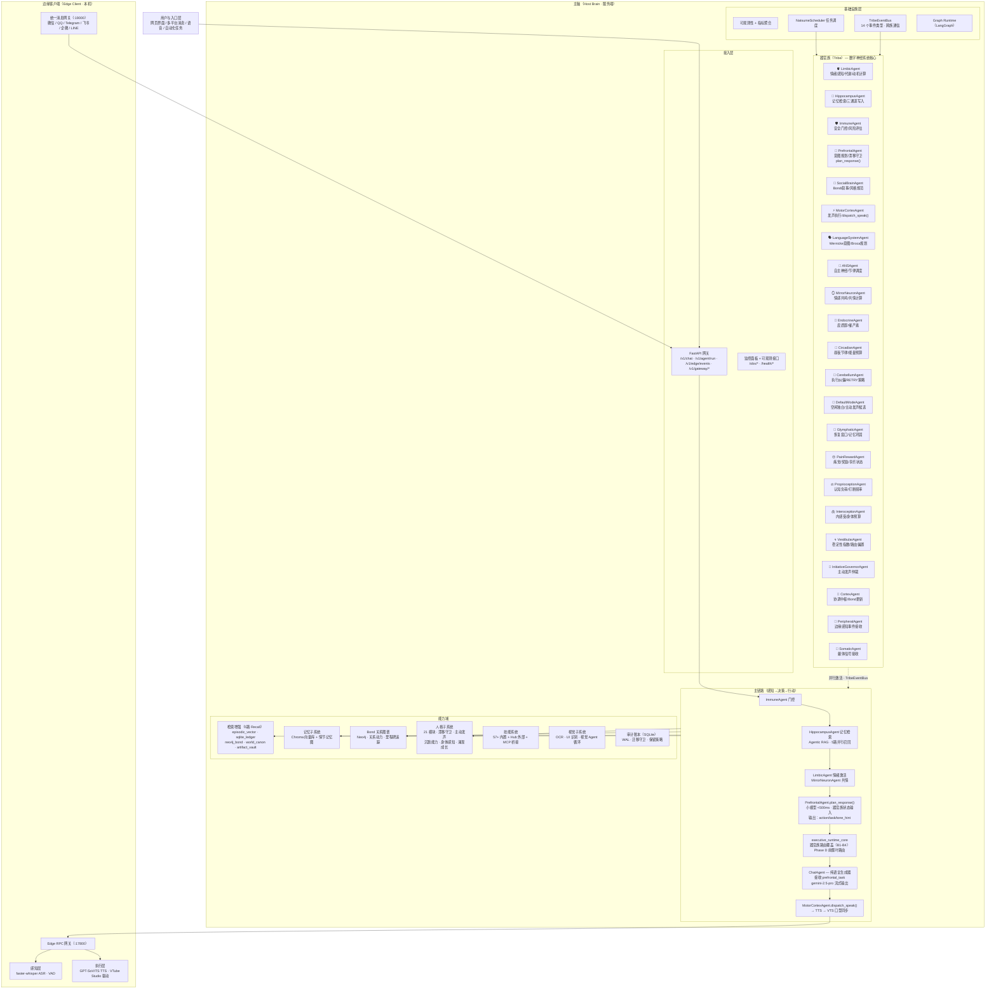

# Natsume AI — 夏目蓝

> **多智能体族数字生命体**——22 个器官族 Agent 协同运转的神经网络模拟系统。
> 不是一个被 Prompt 引导的 LLM，而是一个拥有持续情感、长期记忆、人格漂移守卫与主动意志的数字生命体。

---

## 目录

- [项目概述](#项目概述)
- [数字生命体架构](#数字生命体架构)
- [22 个器官族 Agent](#22-个器官族-agent)
- [感知-决策-行动主链路](#感知-决策-行动主链路)
- [Phase 演进路线图](#phase-演进路线图)
- [主要模块](#主要模块)
- [项目结构](#项目结构)
- [环境要求](#环境要求)
- [快速启动](#快速启动)
- [配置说明](#配置说明)
- [API 接口](#api-接口)
- [技能系统](#技能系统)
- [可观测性](#可观测性)
- [开发指南](#开发指南)

---

## 项目概述

Natsume AI 是一个以**多智能体族（Tribe）**为核心的数字生命体系统，核心角色为**夏目蓝**。

系统的根本设计哲学是：**把人体神经系统映射为软件架构**。每一次对话输出都是神经系统自然涌现的结果，而不是一个 LLM 被 Prompt 引导出来的结果。

```
传统 AI 助手：  用户消息 → LLM（总控制器）→ 输出
夏目蓝：        用户消息 → 22 个器官族并行激活 → 前额叶规划 → LLM（纯语言生成器）→ 输出
```

**核心能力：**

- 🧠 **22 个器官族 Agent**：情绪、记忆、人格、关系、生理节律、免疫、纠偏等完整神经网络模拟
- 🫀 **持续内心世界**：离线期间情绪自然漂移、孤独感积累、期待值变化，唤醒时状态注入
- 💭 **前额叶意图规划**（Phase D）：PrefrontalAgent 基于器官族完整状态产出"我要做什么"，LLM 退化为纯语言生成器
- 🌐 **多平台社交感知**：统一消息网关支持微信、QQ、Telegram、飞书、企微、LINE 六个平台
- 🎙️ **语音感知与发声**：Edge 本地 ASR（faster-whisper）+ GPT-SoVITS TTS + VTube Studio 虚拟形象驱动
- 👁️ **视觉感知**：屏幕 OCR、UI 识别、视觉 Agent 自动化操作
- ⚡ **技能执行**：57+ 内置技能，支持 Hub 外部技能安装，MCP 工具桥接
- 🧬 **长期记忆**：Chroma 向量库（情节记忆）+ Neo4j 图谱（关系记忆）+ SQLite 审计账本
- 🌱 **涌现成长**：InteractionPatternAnalyzer 分析对话模式，EmergentGrowthEngine 每周生成成长笔记，自然演化而非规则驱动

---

## 数字生命体架构

### 整体架构图



---

## 22 个器官族 Agent

器官族（Tribe）是夏目蓝数字生命体的神经系统核心，位于 `host_brain/tribe/`。

### 器官族全景

| # | Agent | 评级 | 核心职责 | 主要联动 |
|---|-------|------|---------|---------|
| 1 | **LimbicAgent** | A | 情绪感知/代谢/时间线/动机计算/沉默决策——整个系统的情绪核心 | Prompt 构建 8 个调用点，B-1 路由覆盖 |
| 2 | **SocialBrainAgent** | A | Bond 快照/向量/叙事/风格规范/共享记忆/里程碑追踪 | Bond 图谱，关系动力 |
| 3 | **PrefrontalAgent** | A | 人格漂移检测/成长反馈/自传体记忆门控/Bond 风格生成/涌现成长/**Phase D plan_response()** | executive_runtime_core，chat_agent |
| 4 | **ANSAgent** | A | 自主神经总枢纽——跨线程事件发布/节律调度/主动发声触发 | TribeEventBus，14 个事件类型 |
| 5 | **ImmuneAgent** | B | 正则规则安全扫描/Bond 自适应阈值/与 Governor 的 L3→L2 通道/**B-2 路由覆盖** | executive_runtime_core |
| 6 | **PainRewardAgent** | B | 痛觉/奖励记录/享乐状态衰减/持久化/压力信号输出 | LimbicAgent，EndocrineAgent |
| 7 | **HippocampusAgent** | A | 异步检索/三通道记忆写入/Prompt 行构建，记忆系统唯一入口 | Agentic RAG，5路召回 |
| 8 | **CortexAgent** | A | Supervisor 协调/Bond 更新/14 个事件订阅/对话生命周期事件发布 | TribeEventBus，所有族 |
| 9 | **PeripheralAgent** | C | Phase 6 骨架，接收情绪/免疫/平台事件写入快照，等待 edge_client | edge_client 感知层 |
| 10 | **MotorCortexAgent** | B | 主动发声动作规划/**dispatch_speak()** 统一发声入口/EdgeCommandPusher 下发/执行反馈接收 | TTS，VTS，InitiativeGovernor |
| 11 | **LanguageSystemAgent** | B | Wernicke 意图分类/Broca 回应规划/Bond-情绪风格映射 | PainRewardAgent，EndocrineAgent |
| 12 | **EndocrineAgent** | B | 皮质醇/催产素计算/Bond 激素缓冲/与 LimbicAgent 的情绪联动 | LimbicAgent，PainRewardAgent |
| 13 | **InitiativeGovernorAgent** | B | 主动发声仲裁：动机×准备度×连续性三维评分 ALLOW/DEFER/BLOCK | MotorCortexAgent，ANSAgent |
| 14 | **CircadianAgent** | B | 昼夜四相位划分/能量主动预算/驱动 Glymphatic/ANS/Endocrine | GlymphaticAgent，ANSAgent |
| 15 | **MirrorNeuronAgent** | B | 情感共鸣强度计算/valence+arousal 偏移/联动 LimbicAgent | LimbicAgent |
| 16 | **SomaticAgent** | C | Phase 6 骨架，接收 edge_client 躯体信号（心率/疲劳）写快照 | edge_client 躯体传感器 |
| 17 | **ProprioceptionAgent** | B | 认知负荷/打断频率/连续性指数，高负荷联动 Limbic/Interoception/**B-3 路由覆盖** | executive_runtime_core |
| 18 | **InteroceptionAgent** | B | 综合内感受指数/身体预算/恢复紧迫度，联动 Glymphatic/Limbic | GlymphaticAgent，LimbicAgent |
| 19 | **VestibularAgent** | B | 10 分钟窗口抖动指数/路由偏置 stable/unstable/critical | executive_runtime_core |
| 20 | **GlymphaticAgent** | B | 恢复窗口判定/记忆巩固评分/实际写入语义记忆/联动 Limbic/Interoception | HippocampusAgent，LimbicAgent |
| 21 | **CerebellumAgent** | B | 执行纠偏：RETRY/DEGRADE/SAFE_FALLBACK 策略，联动 Endocrine/PainReward | EndocrineAgent，PainRewardAgent |
| 22 | **DefaultModeAgent** | A | 调用 LLM 生成空闲内心独白，计算孤独/期待/连续性，评估主动发声候选资格 | InitiativeGovernorAgent，ANSAgent |

> **评级说明**：A（含 LLM/检索，7 个）· B（纯算法逻辑，13 个）· C（Phase 6 骨架，等待 edge_client 接入，2 个）

### TribeEventBus 事件总线

器官族之间通过 `TribeEventBus` 进行异步通信，CortexAgent 订阅 14 个事件类型：

```
EMOTION_UPDATED · BOND_UPDATED · MEMORY_WRITTEN · PROACTIVE_VOICE_TRIGGERED
MOTOR_SPEAK_DISPATCHED · IMMUNE_ALERT · PAIN_SIGNAL · REWARD_SIGNAL
INNER_WORLD_TICKED · CIRCADIAN_PHASE_CHANGED · GLYMPHATIC_RECOVERY_STARTED
INITIATIVE_EVALUATED · MIRROR_RESONANCE_COMPUTED · PREFRONTAL_PLAN_COMPLETED
```

---

## 感知-决策-行动主链路

### Phase D 完整链路（当前最新架构）

```
外界刺激（用户消息 / ASR 语音 / Gateway 社交消息）
    ↓
【感知层】ImmuneAgent 门控（危险吗？能通过吗？）
    ↓
【记忆层】HippocampusAgent 记忆检索
          Agentic RAG → 5路并行召回 → HybridFusion → Reranker
    ↓
【情感层】LimbicAgent 情绪激活 + MirrorNeuronAgent 共情
          同时：器官族并行激活（asyncio.gather，B1-B4）
    ↓
【前额叶】PrefrontalAgent.plan_response()（gemini-2.0-flash，<500ms）
          输入：motive_state + recall_summary + bond_stage
                immune_risk + drift_alert + emotion_tag
          输出：{ action, target, task, tone_hint, urgency }
    ↓
【路由层】executive_runtime_core
          器官族路由覆盖（B1-B4）+ Phase D 前额叶路由
          → prefrontal_task / tone_hint 注入 intent_draft
    ↓
【语言层】ChatAgent（纯语言生成器）
          接收【前额叶规划】context block
          LLM 只负责把 task 转成流畅自然语言
          gemini-2.5-pro 流式输出
    ↓
【执行层】MotorCortexAgent.dispatch_speak()
          → POST /v1/edge/speak → GPT-SoVITS TTS
          → VTube Studio 口型/表情同步
```

### 器官族路由覆盖（B1-B4）

在 `executive_runtime_core` 的 `_hard_rule_route()` 调用前，四路器官族状态**并行读取**（`asyncio.gather`），任一触发则覆盖路由：

| 层级 | 触发条件 | 覆盖效果 |
|------|---------|---------|
| **B-1** LimbicAgent | `withdraw > 0.80` | 强制 `chat`，优先情绪回应 |
| **B-2** ImmuneAgent | `risk=critical/high AND decision=BLOCK/REPORT` | 强制 `chat`，避免执行副作用 |
| **B-3** ProprioceptionAgent | `cognitive_load_index > 0.85` | 强制 `chat`，避免复杂执行链 |
| **B-4** PrefrontalAgent | `drift_alert=HIGH/CRITICAL` | 强制 `chat`，以真实自我回应 |

### 主动发声链路

```
NatsumeScheduler（定时）
    → inner_world_tick → LimbicAgent.tick_inner_world()
    → ANSAgent.emit_inner_world_ticked()
    → InitiativeGovernorAgent 门控（动机×准备度×连续性三维评分）
    → ALLOW → trigger_proactive_voice()
    → DefaultModeAgent 生成内心独白
    → emit PROACTIVE_VOICE_TRIGGERED
    → CortexAgent 订阅 → MotorCortexAgent.dispatch_speak()
    → TTS 发声 + VTS 动画
```

### Gateway 社交感知链路

```
平台消息（微信/QQ/飞书/企微/Telegram/LINE）
    → Edge Gateway（:19000）
    → 平台适配器（Normalizer → ChatRequest）
    → POST /v1/chat（render_target_lang="zh"）
    → 上述主链路（感知→决策→行动）
    → MotorCortexAgent.dispatch_speak()（本地发声 + VTS 动画）
    → humanize_sender（拟人化分段发送）
    → 平台回复 API
```

### 语音对话链路

```
麦克风 → faster-whisper ASR（VAD 分段）
    → Edge 事件上报（POST /v1/edge/events）
    → Host 主链路（source=ASR）
    → ChatAgent 生成回复（text_zh + text_ja）
    → MotorCortexAgent.dispatch_speak()
    → GPT-SoVITS TTS（text_ja）→ 音频播放
    → VTube Studio 口型/表情同步
```

---

## Phase 演进路线图

| Phase | 内容 | 状态 |
|-------|------|------|
| Phase XIV v4 | SceneRouter 删除，cortex_orchestrator 统一接管 | ✅ 完成 |
| Phase XV | DispatchAgent + ChatAgent 分离，职责清晰 | ✅ 完成 |
| Phase XVI | 离线内心世界状态机（孤独感/期待值/情绪漂移） | ✅ 完成 |
| Phase XVIII | 情绪驱动沉默引擎（NORMAL→MUTE 五级） | ✅ 完成 |
| Phase XIX | 涌现成长引擎（对话模式分析 + 每周成长笔记） | ✅ 完成 |
| **Phase A** | 打通三个发声桥（G1 chat→TTS · G2 Broca→TTS · G3 主动发声） | ✅ 完成 |
| **Phase B** | 器官族并行激活 + B1-B4 路由覆盖 | ✅ 完成 |
| **Phase C** | MotorCortexAgent.dispatch_speak() 统一发声入口 | ✅ 完成 |
| **Phase D** | PrefrontalAgent.plan_response() 前额叶真实推理接管 | ✅ 完成 |
| Phase E（规划中）| LimbicAgent 连续动态情绪物理模型 | ✅ 完成  |
| Phase F（规划中）| Gateway 完整感知-行动循环（VTS 感知动作 + 朋友圈发布） | ✅ 完成  |

---

## 主要模块

### 🖥️ 主脑（`host_brain/`）

#### 🧬 `tribe/` — 器官族（数字神经系统核心）

| 文件 | 器官族 | 职责 |
|------|--------|------|
| `limbic_agent.py` | LimbicAgent | 情绪感知/代谢/时间线/动机计算/沉默决策 |
| `prefrontal_agent.py` | PrefrontalAgent | 人格漂移检测/plan_response()/成长反馈/自传体记忆门控 |
| `hippocampus_agent.py` | HippocampusAgent | 异步检索/三通道记忆写入/Prompt 行构建 |
| `social_brain_agent.py` | SocialBrainAgent | Bond 快照/向量/叙事/风格规范/共享记忆 |
| `immune_agent.py` | ImmuneAgent | 正则规则安全扫描/Bond 自适应阈值/风险门控 |
| `motor_cortex_agent.py` | MotorCortexAgent | dispatch_speak()/EdgeCommandPusher/执行反馈 |
| `language_system_agent.py` | LanguageSystemAgent | Wernicke 意图分类/Broca 回应规划 |
| `ans_agent.py` | ANSAgent | 自主神经总枢纽/节律调度/主动发声触发 |
| `cortex_agent.py` | CortexAgent | Supervisor 协调/Bond 更新/14 个事件订阅 |
| `default_mode_agent.py` | DefaultModeAgent | 空闲内心独白/孤独期待计算/主动发声候选 |
| `mirror_neuron_agent.py` | MirrorNeuronAgent | 情感共鸣强度/valence+arousal 偏移 |
| `endocrine_agent.py` | EndocrineAgent | 皮质醇/催产素/Bond 激素缓冲 |
| `pain_reward_agent.py` | PainRewardAgent | 痛觉/奖励记录/享乐状态衰减 |
| `circadian_agent.py` | CircadianAgent | 昼夜四相位/能量预算/驱动 Glymphatic/ANS |
| `initiative_governor_agent.py` | InitiativeGovernorAgent | 主动发声仲裁 ALLOW/DEFER/BLOCK |
| `cerebellum_agent.py` | CerebellumAgent | 执行纠偏 RETRY/DEGRADE/SAFE_FALLBACK |
| `glymphatic_agent.py` | GlymphaticAgent | 恢复窗口/记忆巩固/语义记忆写入 |
| `proprioception_agent.py` | ProprioceptionAgent | 认知负荷/打断频率/连续性指数 |
| `interoception_agent.py` | InteroceptionAgent | 内感受指数/身体预算/恢复紧迫度 |
| `vestibular_agent.py` | VestibularAgent | 抖动指数/路由偏置 stable/unstable/critical |
| `peripheral_agent.py` | PeripheralAgent | 边缘感知事件接收（Phase 6 骨架） |
| `somatic_agent.py` | SomaticAgent | 躯体信号接收（Phase 6 骨架） |
| `event_bus.py` | TribeEventBus | 跨族异步通信总线 |
| `tribe_state.py` | TribeStateRegistry | 全局状态注册表 |
| `cortex_route_decider.py` | — | 双层意图分类（规则 <1ms + LLM 兜底） |

#### 🗂️ `app/` — 应用层

| 文件 | 职责 |
|------|------|
| `fastapi_app.py` | FastAPI 应用工厂，注册所有路由 |
| `main.py` | 启动入口，服务初始化 |
| `executive_runtime_core.py` | **执行运行时核心**——器官族路由覆盖（B1-B4）+ Phase D 前额叶路由 |
| `chat_agent.py` | **ChatAgent** — 纯语言生成器，接收 prefrontal_task，gemini-2.5-pro 流式输出 |
| `dispatch_agent.py` | **DispatchAgent** — 硬规则 + LLM 意图分类，三路分派 |
| `chat_context_builder.py` | 聊天上下文构建（recall/emotion/bond 注入） |
| `prompt_builder.py` | Prompt 构建管线（角色人设 + 风格蒸馏 + 双语） |
| `cortex_prompt_builder.py` | Cortex Orchestrator prompt 构建（复用完整管线） |
| `input_service_gateway.py` | Gateway 消息入站处理 |
| `input_routes.py` | 平台消息入站路由 |
| `chat_handler.py` | 统一聊天 SSE 生成器入口 |
| `top_agent.py` | TopAgent 入口（转交 DispatchAgent） |
| `obs_routes_stats_input_humanoid.py` | 拟人化输入统计可观测接口 |

#### 🌸 `persona/` — 人格子系统（21 模块）

| 模块 | 职责 |
|------|------|
| `persona_engine.py` | 人格引擎主入口 |
| `self_reflection.py` | 自我反思链（LLM 动态生成 + 模板降级） |
| `drift_detector.py` | 人格漂移检测（StyleFingerprint 时间演变） |
| `trait_drift_guard.py` | 人格漂移守卫 |
| `inner_world.py` | **Phase XVI** 离线内心世界状态机 |
| `emotional_silence.py` | **Phase XVIII** 情绪驱动沉默引擎（NORMAL→MUTE 五级） |
| `body_sense.py` | **v1.12** 身体感知模型（疲劳/困倦/孤独三维） |
| `interaction_pattern_analyzer.py` | **Phase XIX** 对话模式分析器 |
| `emergent_growth_engine.py` | **Phase XIX** 涌现成长引擎（每周成长笔记） |
| `proactive_voice.py` | 主动发声（定时/事件触发） |
| `bond_aware_style.py` | Bond 感知风格适配 |
| `expression_adapter.py` | 表达适配器（VTS/TTS 联动） |
| `evolution_orchestrator.py` | 进化编排器 |

#### 🔍 `retrieval/` — 检索增强子系统

| 文件 | 职责 |
|------|------|
| `recall_fusion.py` | 多路召回融合（5路并行） |
| `agentic_retrieval_loop.py` | Agentic 检索循环（Plan→Retrieve→Evaluate→Re-Retrieve） |
| `query_planner.py` | 查询规划器（意图分类 → Store 路由） |
| `embedding.py` | Embedding 推理（Qwen3-Embedding-0.6B） |
| `reranker.py` | Reranker 重排序（Qwen3-Reranker-0.6B） |
| `hybrid_fusion.py` | 混合融合（向量 0.7 + 全文 0.3） |
| `style_distiller.py` | 风格蒸馏（StyleCanon v5） |

#### 💞 `bond/` — 关系图谱

| 文件 | 职责 |
|------|------|
| `neo4j_client.py` | Neo4j 客户端 |
| `bond_dynamics.py` | 关系动力（分数计算） |
| `bond_stage_engine.py` | 关系阶段引擎（陌生人→亲密） |
| `bond_narrative.py` | 关系叙事生成 |
| `milestone_tracker.py` | 里程碑追踪 |

#### ⚡ `skills/` — 技能系统

| 目录/文件 | 职责 |
|-----------|------|
| `registry.py` | 技能注册表 |
| `loader.py` | 技能加载器（SkillLoader） |
| `mcp_skill_bridge.py` | MCP 工具桥接 |
| `hub/` | Hub 外部技能（安装/加载/解析） |
| `impl/inner_world_skill.py` | Phase XVI 离线内心世界 handler |
| `impl/silence_skill.py` | Phase XVIII 沉默能力 handler |
| `impl/body_sense_skill.py` | v1.12 身体感知 handler |
| `impl/emergent_growth_skill.py` | Phase XIX 涌现成长 handler |
| `impl/gaming_companion_executor.py` | gaming 陪玩识图 |

---

### 💻 边缘客户端（`edge_client/`）

#### 🚀 `runtime/` — 运行时装配

| 文件 | 职责 |
|------|------|
| `bootstrap.py` | 边缘运行时启动（服务装配 + 健康检查） |
| `voice_pipeline.py` | 语音管线（ASR→事件上报→TTS 闭环） |

#### 👂 `senses/` — 感知层

| 文件 | 职责 |
|------|------|
| `asr.py` | ASR 引擎（faster-whisper + VAD + 自动恢复） |

#### 🎬 `actuators/` — 执行层

| 文件 | 职责 |
|------|------|
| `tts_engine.py` | TTS 引擎（GPT-SoVITS） |
| `vts_driver.py` | VTube Studio 驱动（口型 + 表情 + 动作） |
| `desktop_controller.py` | 桌面控制器 |

#### 🌐 `gateway/` — 统一消息网关

| 文件/目录 | 职责 |
|-----------|------|
| `server.py` | Gateway HTTP 服务（:19000） |
| `router.py` | 消息路由 |
| `normalizer.py` | 消息标准化 |
| `humanize_sender.py` | 拟人化发送（模拟打字延迟 + 分段） |
| `adapters/wechat_adapter.py` | 微信适配器（UIAutomation + wxautox4） |
| `adapters/qq_adapter.py` | QQ 适配器（OneBot v11） |
| `adapters/telegram_adapter.py` | Telegram 适配器（Telethon MTProto） |
| `adapters/feishu_adapter.py` | 飞书适配器（Open API） |
| `adapters/wecom_adapter.py` | 企微适配器 |
| `adapters/line_adapter.py` | LINE 适配器（Messaging API） |

---

## 📁 项目结构

```
Natsume_Ai_repo/
├── host_brain/                  # 主脑（服务端）
│   ├── tribe/                   # ★ 器官族（22 个 Agent · 数字神经系统核心）
│   │   ├── limbic_agent.py      # 情绪核心（1747行，A级）
│   │   ├── prefrontal_agent.py  # 前额叶（plan_response · 漂移守卫）
│   │   ├── hippocampus_agent.py # 记忆门面（Agentic RAG）
│   │   ├── social_brain_agent.py # Bond/叙事/风格
│   │   ├── immune_agent.py      # 安全门控
│   │   ├── motor_cortex_agent.py # 统一发声入口（dispatch_speak）
│   │   ├── cortex_agent.py      # 协调中枢（14个事件订阅）
│   │   ├── ans_agent.py         # 自主神经总枢纽
│   │   ├── event_bus.py         # TribeEventBus
│   │   ├── tribe_state.py       # TribeStateRegistry
│   │   ├── cortex_route_decider.py  # 双层意图分类
│   │   └── [其余 14 个器官族 Agent]
│   ├── app/                     # 应用层（FastAPI + Agent + 路由）
│   │   ├── executive_runtime_core.py  # 执行运行时核心（B1-B4 + Phase D）
│   │   ├── chat_agent.py        # ChatAgent（纯语言生成器）
│   │   ├── dispatch_agent.py    # DispatchAgent（调度层）
│   │   ├── chat_context_builder.py  # 聊天上下文构建
│   │   ├── prompt_builder.py    # Prompt 构建管线
│   │   ├── cortex_prompt_builder.py # Cortex prompt 构建
│   │   ├── agents/              # Agent 合约 + ReAct 循环
│   │   ├── handlers/            # 子 Agent 处理器
│   │   ├── recall/              # RecallPack 组装
│   │   ├── memory/              # 应用层记忆
│   │   ├── vision/              # 视觉子系统
│   │   └── monitor_ui/          # 监控面板前端（React + Vite）
│   ├── persona/                 # 人格子系统（21 模块）
│   ├── memory/                  # 记忆子系统（Chroma + Canon）
│   ├── retrieval/               # 检索增强（Embedding + Reranker + 5路 Recall）
│   ├── bond/                    # 关系图谱（Neo4j）
│   ├── audit/                   # 审计账本（SQLite）
│   ├── governor/                # 治理与安全
│   ├── airlock/                 # 气闸隔离（PII + 沙箱）
│   ├── integrations/            # Graph Runtime（LangGraph）
│   ├── skills/                  # 技能系统（57+ 内置 + Hub）
│   ├── channels/                # 通道适配（Edge RPC + VTS + TTS）
│   ├── core/                    # 核心基础（服务容器 + 情感 + 模式）
│   ├── observability/           # 可观测性
│   ├── scheduler/               # NatsumeScheduler 任务调度器
│   └── canon/                   # Canon 素材（character/style/world）
│
├── edge_client/                 # 边缘客户端（本机）
│   ├── runtime/                 # 运行时装配
│   ├── senses/                  # 感知层（ASR）
│   ├── actuators/               # 执行层（TTS + VTS + 桌面）
│   ├── rpc/                     # RPC 层（事件上报 + 语音 + 资源门控）
│   ├── gateway/                 # 统一消息网关（6 平台适配器）
│   └── app/                     # Edge FastAPI 应用
│
├── prompts/                     # Prompt 模板
│   └── templates/
│       ├── executive.yaml       # 执行层模板（含 prefrontal_agent.plan_response.prompt）
│       ├── persona.yaml         # 人格模板
│       └── governance.yaml      # 治理模板
│
├── configs/                     # 配置文件
├── docs/                        # 文档
│   ├── 35_quality/GATEWAY_ARCH_REDESIGN.md  # 架构重设计方案（含 Phase D 记录）
│   └── 50_project/arch/         # 架构文档
├── tests/                       # 测试（unit / integration / e2e / contract）
├── tools/                       # 开发工具脚本
├── .env.example                 # 环境变量模板（含详细注释）
├── requirements.txt             # Python 依赖
└── README.md                    # 本文件
```

---

## 🔧 环境要求

### 🖥️ 服务端（Host Brain）

| 依赖 | 版本 | 用途 |
|------|------|------|
| Python | 3.11+ | 运行时 |
| FastAPI | ≥0.104 | HTTP 服务 |
| LangGraph | ≥1.0 | Graph Runtime |
| Pydantic | ≥2.0 | 数据验证 |
| ChromaDB | ≥1.4 | 向量库（情节记忆） |
| Neo4j | ≥6.1 | 关系图谱（Bond） |
| uvicorn | ≥0.24 | ASGI 服务器 |

**外部服务：**
- 🗄️ **ChromaDB** HTTP 服务（默认 `:18000`）
- 🕸️ **Neo4j** 图数据库（默认 `bolt://127.0.0.1:7687`）
- 🔑 **LLM API Key**：Gemini / OpenAI / DeepSeek（至少一个）

### 💻 边缘客户端（Edge Client）

| 依赖 | 用途 |
|------|------|
| faster-whisper | ASR 语音识别 |
| GPT-SoVITS | TTS 语音合成 |
| pyvts | VTube Studio API |
| CUDA GPU | ASR/TTS 推理加速（可降级到 CPU） |

**可选：**
- 💬 wxautox4（微信自动化）
- 🐧 NapCat/Lagrange.Core（QQ OneBot v11）
- ✈️ Telethon（Telegram MTProto）

---

## 🚀 快速启动

### 1️⃣ 安装依赖

```bash
pip install -r requirements.txt
```

### 2️⃣ 配置环境变量

```bash
cp .env.example .env
# 编辑 .env，填写 API Key 和必要配置
```

⚠️ 最小必填项：

```env
# LLM（至少一个）
GEMINI_API_KEY=your_key_here

# Agent 模型配置
HOST_CHAT_AGENT_MODEL_ID=gemini-2.5-pro        # ChatAgent（语言生成器）
HOST_DISPATCH_AGENT_MODEL_ID=gemini-2.5-flash  # DispatchAgent（意图分类）
HOST_SUBAGENT_MODEL_ID=gemini-2.5-flash        # 子 Agent

# 外部服务
CHROMA_ENDPOINT=http://127.0.0.1:18000
BOND_NEO4J_URI=bolt://127.0.0.1:7687

# Phase D 前额叶规划（可选，默认关）
PREFRONTAL_PLAN_ENABLED=false
```

### 3️⃣ 启动外部服务

```bash
# ChromaDB
chroma run --host 127.0.0.1 --port 18000

# Neo4j（可选，Bond 图谱）
# 参考 tools/install_neo4j.py
```

### 4️⃣ 启动主脑

```bash
python -m host_brain
# 或
python host_brain/app/main.py
```

主脑默认监听 `http://127.0.0.1:18080`

### 5️⃣ 启动边缘客户端（可选）

```bash
python -m edge_client
```

Edge RPC 默认监听 `http://127.0.0.1:17800`，消息网关默认 `:19000`

### 6️⃣ 健康检查

```bash
curl http://127.0.0.1:18080/health
```

---

## ⚙️ 配置说明

所有配置通过 `.env` 文件管理，详细注释见 [`.env.example`](.env.example)。

### 关键配置分组

| 分组 | 前缀 | 说明 |
|------|------|------|
| 主脑服务 | `HOST_APP_*` | 监听地址、端口、日志级别 |
| LLM 配置 | `HOST_LLM_*` / `HOST_*_AGENT_*` | Provider、模型 ID、超时 |
| 三套 Agent LLM | `HOST_CHAT_AGENT_*` / `HOST_DISPATCH_AGENT_*` / `HOST_SUBAGENT_*` | 专用 LLM 配置 |
| **Phase D 前额叶** | `PREFRONTAL_PLAN_ENABLED` | 启用前额叶意图规划（默认 false，灰度） |
| 限流 | `HOST_RATE_LIMIT_*` | 后端、窗口、最大请求数 |
| 检索 | `RETR_*` | Embedding、Reranker、5路 Recall 路由 |
| 情感系统 | `HOST_EMOTION_*` | 衰减速率、基线、持久化 |
| Bond 图谱 | `HOST_BOND_*` / `BOND_NEO4J_*` | 后端、Neo4j 连接 |
| 记忆 | `CHROMA_*` / `SEMANTIC_RECALL_*` | ChromaDB 连接、召回参数 |
| 消息网关 | `EDGE_GATEWAY_*` | 端口、平台列表 |
| 微信 | `EDGE_WECHAT_*` / `WECHAT_*` | Bridge 后端、UIA 配置 |
| QQ | `QQ_*` / `EDGE_QQ_*` | OneBot API、自动启动 |
| Telegram | `TELEGRAM_*` | API ID/Hash、代理 |
| 飞书 | `FEISHU_*` | App ID/Secret |
| 企微 | `WECOM_*` | Corp ID/Secret |
| LINE | `LINE_*` | Channel Token/Secret |
| Edge ASR | `EDGE_ASR_*` | 模型、设备、VAD 参数 |
| Edge TTS | `EDGE_TTS_*` | 模型路径、设备、语言 |
| Edge VTS | `EDGE_VTS_*` | VTube Studio 连接 |
| 审计 | `Natsume_AUDIT_DB` | SQLite 路径 |
| 可观测性 | `OBS_MODE` / `P8_*` | 观测模式、扩展指标 |

### 🎯 Phase D 前额叶规划配置

```env
# 启用 Phase D（LLM 退化为纯语言生成器，前额叶接管意图规划）
PREFRONTAL_PLAN_ENABLED=true

# 前额叶小模型（默认 gemini-2.0-flash，低延迟 <500ms）
# 在 executive.yaml 的 prefrontal_agent.plan_response.prompt 模板中配置
```

**Phase D 启用后的行为变化：**
- `PrefrontalAgent.plan_response()` 基于器官族完整状态产出 `{ action, task, tone_hint, urgency }`
- `executive_runtime_core` 用 plan_response 结果覆盖 `_hard_rule_route` 路由
- `chat_agent` 接收 `【前额叶规划】` context block，LLM 只负责语言化
- `cortex_route_decider` 跳过 LLM 兜底（`PREFRONTAL_PLAN_BYPASS`）

### 🔍 检索配置（5路 Recall）

```env
RETR_RECALL_ROUTES_JSON={
  "route_episodic":      {"store_id":"episodic_vector",  "top_k":8,  "score_weight":0.9},
  "route_sqlite_ledger": {"store_id":"sqlite_ledger",    "top_k":6,  "score_weight":1.0},
  "route_neo4j_bond":    {"store_id":"neo4j_bond",       "top_k":4,  "score_weight":0.95},
  "route_world_canon":   {"store_id":"world_canon",      "top_k":4,  "score_weight":0.8},
  "route_artifact_vault":{"store_id":"artifact_vault",   "top_k":4,  "score_weight":0.75}
}
```

---

## 🌐 API 接口

### 💬 聊天接口

```
POST /v1/chat
Content-Type: application/json

{
  "user_id": "user_001",
  "message": "你好",
  "session_id": "sess_001",
  "render_target_lang": "zh"
}
```

响应：SSE 流式输出

### 🤖 Agent 自动化

```
POST /v1/agent/run
```

### 📡 边缘事件接收

```
POST /v1/edge/events
```

### 🌐 Gateway 消息入站

```
POST /v1/gateway/{platform}/webhook
```

### 🏥 健康检查

```
GET /health
GET /health/detail
```

### 📊 可观测性

```
GET /obs/metrics          # 指标聚合
GET /obs/trace            # 链路追踪
GET /obs/stats            # 统计数据
GET /obs/platform         # 平台状态
GET /obs/sysmode          # 系统模式
```

### 💞 Bond 关系

```
GET  /v1/bond/{user_id}
POST /v1/bond/{user_id}/update
```

---

## ⚡ 技能系统

### 🗂️ 内置技能分类

| 分类 | 技能示例 |
|------|---------|
| 浏览器 | 网页搜索、截图、表单填写 |
| 桌面 | 窗口管理、截图、鼠标键盘控制 |
| 文件 | 读写、搜索、压缩 |
| Shell | 命令执行（沙箱隔离） |
| Web | HTTP 请求、API 调用 |
| 情感 | 情感状态查询/设置 |
| 记忆 | 记忆写入/查询 |
| 通知 | 桌面通知、提醒 |
| 调度 | 定时任务创建/管理 |
| 离线内心世界 | inner_world_tick / inner_world_awaken / inner_world_session_end |
| 沉默能力 | silence_tick / silence_conversation_start / silence_conversation_end |
| 身体感知 | body_sense_tick / body_sense_conversation_start / body_sense_conversation_end |
| 游戏陪玩 | gaming_companion_tick（gaming 模式下截图 + 多模态 LLM 识图） |
| 涌现成长 | emergent_growth_weekly（每周六 03:00 分析对话模式 + 生成成长笔记） |

### 📦 外部技能安装

```bash
# 从 ClawHub 安装
python -m host_brain skill install clawhub:author/skill-name

# 本地安装（包含 SKILL.md 的目录）
python -m host_brain skill install /path/to/skill
```

---

## 📊 可观测性

### 🖥️ 监控面板

访问 `http://127.0.0.1:18080/monitor`（需构建前端）

```bash
cd host_brain/app/monitor_ui
npm install && npm run build
```

### 🔬 诊断工具

```bash
python tools/diag.py                        # 综合诊断
python tools/_diag_chat.py                  # 聊天链路诊断
python tools/_diag_retrieval.py             # 检索链路诊断
python tools/_diag_llm.py                   # LLM 连通性诊断
python tools/diag_emotion_closed_loop.py    # 情感闭环诊断
python tools/diag_chat_ab.py                # 聊天 A/B 测试
python tools/check_audit.py                 # 审计账本检查
python tools/check_chroma.py               # ChromaDB 状态检查
```

### 器官族状态可观测性

每次对话后，`organ_route_meta` 写入 `intent_draft._organ_route_meta`，包含：

```json
{
  "immune_risk_level": "none",
  "immune_last_decision": "ALLOW",
  "cognitive_load_index": 0.42,
  "motive_withdraw": 0.12,
  "motive_care": 0.78,
  "prefrontal_drift_alert": "NONE",
  "prefrontal_drift_score": 0.031,
  "prefrontal_plan_action": "speak",
  "prefrontal_plan_source": "prefrontal_llm",
  "prefrontal_plan_latency_ms": 312,
  "organ_route_override": null,
  "organ_route_reason": null
}
```

---

## 👩‍💻 开发指南

### 🧪 运行测试

```bash
pytest tests/unit/          # 单元测试
pytest tests/integration/   # 集成测试
pytest tests/contract/      # 合约测试
pytest tests/               # 全部测试
```

### 🌸 人格 Canon 更新

- 角色人设：`host_brain/canon/character/character_profile.json`
- 风格 Canon：`host_brain/canon/style/`（中文 `natsume_ai_cn`，日文 `natsume_ai_ja`）
- 世界观 Canon：`host_brain/canon/world/`

### ➕ 添加新器官族 Agent

1. 在 `host_brain/tribe/` 创建 `xxx_agent.py`，继承 `TribeAgentDescriptor`
2. 在 `host_brain/tribe/__init__.py` 注册导出
3. 在 `host_brain/tribe/registry.py` 注册到 `HostTribeRegistry`
4. 在 `host_brain/tribe/event_bus.py` 添加需要订阅的事件类型
5. 在 `NatsumeScheduler` 中注册定时任务（如需要）

### ➕ 添加新技能

1. 在 `host_brain/skills/impl/` 创建技能实现文件
2. 在对应的 `*_registry.py` 注册技能
3. 技能需实现标准接口：`execute(context: SkillContext) -> SkillResult`

### 🔌 添加新平台适配器

1. 在 `edge_client/gateway/adapters/` 创建适配器（继承 `BaseAdapter`）
2. 在 `edge_client/gateway/bootstrap.py` 注册适配器
3. 在 `.env.example` 添加平台配置项

### 📐 代码规范

```bash
pre-commit run --all-files
```

---

## 📄 许可证

见 [LICENSE](LICENSE)
