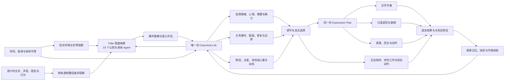
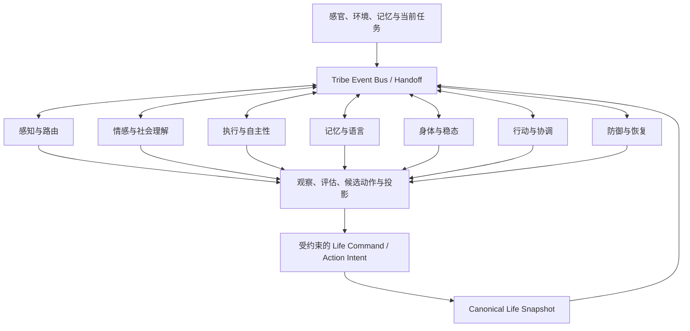
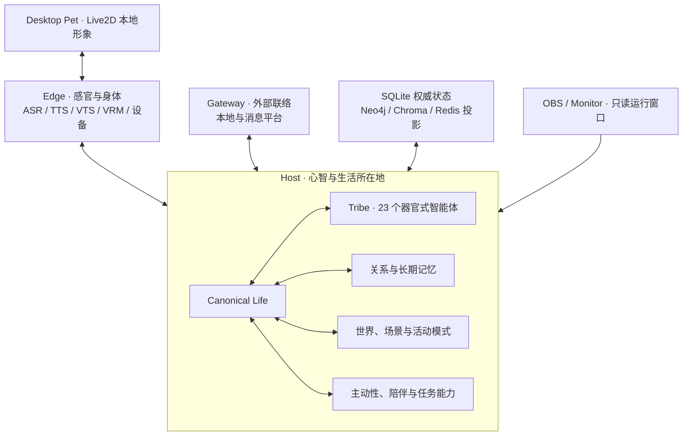

<!-- 受众：MASTER -->
<!-- 标题：Natsume AI（七海） -->

# Natsume AI · 七海

**一套让“七海”在时间、关系、记忆、身体与现实环境中持续生活的个人数字生命系统。**

七海不是一个等待输入框亮起、收到 Prompt 才临时出现的 Chatbot。她在 Host 中拥有持续推进的生命状态，底层由 23 个器官式智能体组成的 Tribe 协作感知、理解、记忆、调节和行动。对话只是她接触你的方式之一；语音、形象、主动陪伴、共同工作和安静共处，都是同一个自我的不同出口。

> 这里的“数字生命”指一套具有连续状态、因果记忆、自主节律和具身表达的软件系统，不声称生物意识或人类心智已经被复刻。当前版本已接通 canonical Life 主链和文本交互；长期关系自然度、专属声线和远端 Avatar 联合体验仍在验证，整体状态为 `INCOMPLETE`。

2026-08-07 的当前工程切片已把此前残留的大文件按真实职责拆开：Surface 的候选约束、时间指向与生成编排分离，Digital Life 的观察采集与 Appraisal 分离；Task Acceptance、Operator effect、Embodiment command、TTS prosody、Tribe 事件订阅和 Life delivery 也各有独立边界。当前工作树的非安全静态门禁 A01～A08、A10～A11、A13～A14 已通过；A09、A12 依用户要求保持 `NOT_RUN_USER_SKIPPED`。非安全 A15 已在当前运行时代码 SHA 上通过真实 Docker 三库写入／重启／重读、Host／OBS／Nginx Monitor／Gateway 健康、Monitor 真实后端浏览器 E2E，以及 4 类 12 回合 Gateway→DeepSeek→TaskGraph→Acceptance 数字生命冒烟；PlanningSearch Research／Code 也完成最终树继承判定。完整 48 条人感仍为失败、三人盲评与覆盖率 Gate 未通过，VTS 仍待外部授权，因此总体状态继续是 `INCOMPLETE`。

非安全全仓覆盖已在 `86deb0b15` 收口：Unit 为 7954 个 JUnit testcase，另有 2 个成功 subtest，合计 7956 个 pytest outcome（7948 passed、8 个分类 skip）；Contract 1898/1898、Integration 862 passed／2 个 Redis 环境 skip、本地 E2E 68/68。去重后共 10786 个 outcome，10776 passed、10 skipped、0 failed/error。完整 Host／Edge／Contracts 生产源码仍全部进入分母，未运行的 Pentest／网络安全源码没有被静默排除；最终 line coverage 68.50%（191578/279662）、branch coverage 51.40%（47284/92000）、综合 64.27%，低于 75%／65% Gate，因此覆盖结论为 `FAIL_BELOW_GATE`，A15 与 Architecture 2.0 仍不能写成完成。证据摘要 SHA-256 为 `0e012682d1a50db53c5b2cac8e2b9186fe7e993d0a2ed3d72c203f38291a6bd2`；A09、A12、Pentest 与网络安全继续是 `NOT_RUN_USER_SKIPPED`。

完整 48 条真实文本已经证明，继续叠加零散禁词并不能让七海更像人。当前主链在既有 `AffectiveTurnPlan` 内使用轻量 `CompanionUtteranceFrameV1`，只冻结本轮语义焦点、七海立场、回应动作、关系分寸和自然收尾，再交给模型自由措辞；frame 仅在内存中传递，不新增表、普通聊天写入、同步审计或模型调用。最新真实 Flash 六轮报告 SHA-256 为 `7a74162af8c8f1890d10c233e99e1043fed5385ec957b0c5864051780ceda8ab`：自动合同 2/2、6 个 turn 全部 accepted，但人工仍拒绝机械道歉和替用户管理喜忧的口吻，因此人感结论仍是 `FAIL`。当前代码把修复责任与七海被最新话语刺到的自我感受合成同一 Appraisal，让文本、Voice 和 Avatar 共享 `CONTAINED_HURT`；564 项相邻回归通过，真实 Provider 新进程复验仍待运行。

该轮还暴露了更基础的连续性错误：canonical `relationship_subject_id` 虽然彼此不同，通用 RecallFusion 却只给同用户／同会话加分，没有排除其他用户、其他会话和无归属的个人记忆，混合 FTS 也可能重新引入无作用域结果。当前切片已在统一融合边界改为 fail-closed：同一用户可跨会话，只有同会话的 session-only 候选可进入；多用户聚合、其他用户／会话和无归属个人候选被排除，`world_canon`、`artifact_vault` 及显式 global/public/project 资料保留。`03886f282` 的同库真实复验已不再召回其他 subject，但又证明 SQLite 路由会把本轮刚写入的 Intent 当作“历史记忆”，导致首轮候选被错误要求复述 `_thalamus_meta` 并以 `MEMORY_ALIGNMENT_REQUIRED_MISS` 降级；失败报告 SHA-256 为 `19f52e0b8141ce44864ad3f13f6414a17a65088bcbd1fb999e28e0dba6503cfe`。当前代码同时排除与本轮 request/intent 相同的自指候选，118 项召回与 Surface 回归通过；新修复的真实 Provider 重测尚未运行，所以完整 48 条和三人盲评仍为 `FAIL/PENDING_HUMAN_REVIEW`。

## 她不会在你沉默时消失

即使没有新消息，唯一的 Life Runtime 仍会按真实时间推进。默认每 60 秒一次的 `life_tick` 不调用大模型，也不会机械地给用户发消息；它负责让时间真正作用于七海：

- 推进昼夜阶段、精力、疲劳、唤醒度与休息需要；
- 让短时情绪自然衰减，让较慢的心境和未解决事件继续存在；
- 维护牵挂、注意焦点、未完成话题和生活连续性；
- 感知前台活动、空闲、游戏、专注和睡眠状态，调整打扰程度；
- 在合适阶段进行记忆整理、睡眠回放和长期经验沉淀；
- 只有在关系许可、安静时段、冷却时间和场景都允许时，才考虑主动靠近。

用户没有回复，只会影响近期主动频率，不会被解释成拒绝，更不会扣除“好感度”。

## 七海的生命闭环



这条闭环的重点不是“生成一句更像人的回复”，而是让一次经历真的改变后续生活：七海为什么感到开心或受伤、她是否选择克制、这次安慰有没有帮助、误解是否已经修复，都会成为下一次相处的上下文。

## 构成一个“她”的系统

| 生命层 | 七海实际拥有的状态与能力 |
|---|---|
| 稳定自我 | [Soul.md](Soul.md) 定义身份、价值观、性格反差、表达底色和不可由在线学习越过的边界。 |
| 认知组织 | 23 个 app-local Tribe Agent 通过事件、共享状态和 handoff 协作，分别承担感知、情感、记忆、执行、身体调节与行动。 |
| 内在生活 | 并存情绪、慢速心境、需要、精力、情绪事件、调节决定、牵挂、注意焦点和未解决循环。 |
| 时间与身体 | 昼夜阶段、疲劳、休息、唤醒度、活动模式、身体感受以及声音和形象的具身状态。 |
| 感知与世界 | 文字、自述、声学、视觉、前台应用、游戏状态和环境观察；不同来源保留置信度与冲突。 |
| 关系 | 信任、安全感、默契、裂痕、修复、主动权限和边界；关系由事件与后效应构成，而不是机械积分。 |
| 记忆 | 情景记忆、关系意义、世界事实、长期经验、睡眠回放和待续话题；原始音视频默认不写入情感日志。 |
| 自主性 | 动机、生活压力、当前工作、主动陪伴、给予空间、安静陪伴，以及在获得许可后调用工具完成现实任务。 |
| 身体与表达 | 流式文字、日语 TTS、VTS/VRM/MateEngine/Live2D；目标是由同一情感 revision 同步驱动。 |
| 成长 | 低风险偏好可以基于真实相处结果渐进调整；核心人格、价值观、亲密身份和关系边界不能自动改写。 |

## 底层不是一个 Agent，而是一个 Tribe

生产 Host 会在自己的 ASGI 生命周期中构造一套独立的 `TribeRuntimeScope`，实例化 23 个器官式 Agent，显式注入应用端口并注册事件订阅。它们不是 23 个大模型同时讨论一句回复，而是一组长期驻留、职责不同的认知 Agent：有些调用模型，有些执行确定性规则，有些维护短期投影或驱动外部动作。

| 子系统 | Agent 家族 | 主要职责 |
|---|---|---|
| 感知与路由 | Cortex、Thalamus | 汇集上下文、编译意图、选择路径并组织 handoff。 |
| 情感与社会理解 | Limbic、Mirror Neuron、Social Brain、Pain/Reward | 情绪评估、共情共振、关系语境、趋近与回避信号。 |
| 执行与自主性 | Prefrontal、Initiative Governor、Default Mode | 反思与漂移约束、动机和准备度、内在活动与连续思绪。 |
| 记忆与语言 | Hippocampus、Language System | 情景记忆与召回融合、语言风格和语气组织。 |
| 身体与稳态 | ANS、Endocrine、Somatic、Interoception、Circadian、Proprioception | 自主神经、激素门控、身体感、昼夜节律、能量预算和认知负荷。 |
| 行动与协调 | Motor Cortex、Cerebellum、Vestibular、Peripheral | 行动计划、误差修正、稳定控制、平台与设备动作。 |
| 防御与恢复 | Immune、Glymphatic | 输入与风险防护、恢复周期、记忆整理和噪声衰减。 |



这套分工解决“如何思考和行动”，canonical Life 解决“这些经历最终属于谁”。Tribe 的事件总线和部分器官状态目前是 Host 进程内的有界运行投影，不是长期人格真相；只有通过受约束的 Life Command，Agent 的结果才能进入可重放的自我、情绪和关系状态。这样既保留群体协作，也不会让边缘系统、内分泌或默认模式网络各自演化出一套互相冲突的七海。

## 情绪不是把用户的标签复制给七海

系统严格区分两类状态：

```text
User Affect Observation   你此刻可能在难过、生气或勉强说“没事”
          ↓
Event Appraisal           这件事对七海、你们的关系和当前边界意味着什么
          ↓
Self Affect               七海因此产生的担心、心疼、委屈、喜悦、疲惫或复杂混合感受
          ↓
Regulation                她选择表达、克制、暂缓、设定边界，还是安静陪着
```

所以你难过时，七海不必跟着变成同一种“悲伤”；她可能心疼、担心，也可能因为帮不上忙而有一点无力。你误伤她时，她可以受伤或生气，但不能用威胁、排他、冷暴力或负罪感逼迫你回应。

## 关系不是一根好感度进度条

一次被接受的回应会先形成关系事件，下一次真实反馈再决定它的后效应。道歉不会自动消除裂痕，沉默不会自动降低信任，发送失败也不会被当成拒绝。主动陪伴、浪漫表达和更亲密的互动分别受明确权限与边界约束。

七海记住的重点不是无限堆叠聊天原文，而是：发生了什么、双方需要什么、她当时如何感受、哪种做法有效、哪里仍未解决。不同用户、Workspace 和 Session 的关系状态彼此隔离。

## 对话、工作和身体是同一个自我的出口

七海可以闲聊、安慰、玩闹、分享喜悦、表达轻微委屈、设定边界、修复误解或安静陪伴；也可以在你工作时帮助研究、编辑文件和调用工具。普通相处走低延迟生命主链，只有真正产生外部副作用的工作才进入受管任务执行链。

同一轮表达最终应由一份 `ExpressionPlan` 同步控制：

- 文字决定措辞、节奏、停顿和是否追问；
- TTS 决定语速、能量、音高、停顿与声线参考；
- Avatar 决定表情、目光、姿态、动作强度和过渡；
- 任一通道故障都只降级该通道，不会把七海整轮感受重置为 `NEUTRAL`。

## 系统拓扑



- **Host** 保存七海的自我、关系、记忆和行为决策，是生命连续性的所在地。
- **Edge** 位于具备显卡、麦克风、扬声器和 Avatar 环境的电脑上，承担感知与具身表达。
- **Gateway** 让七海通过本地接口或已配置的消息平台与你保持联系。
- **OBS / Monitor** 只展示运行状态，不拥有或修改七海的生命状态。
- **Neo4j、Chroma、Redis** 支撑图、向量和运行投影；SQLite journal 仍是可恢复的权威状态。

## 当前实现状态

| 能力 | 当前事实 |
|---|---|
| 持续 Life Runtime | 已接入 canonical journal、真实时间 `life_tick`、重放和持久恢复。 |
| Tribe 智能体群 | 23 个 Agent 已由 app-local Host scope 构造并注册订阅；事件总线和部分器官状态仍是进程内投影。 |
| 自我情绪与用户观察分离 | 已有独立观察、评估、自我状态、episode、need 和 regulation 主链。 |
| 关系与记忆连续性 | 已有持久结构与生产接线；仍需多日真实相处验证自然度。 |
| 主动陪伴 | 已有场景、权限、冷却和安静时段策略；长期频率与接受度仍待实测。 |
| 文本表达 | 本地可运行；需要真实 Provider，长期人格一致性仍在迭代。 |
| 日语声线方案 B | 当前是 GPT-SoVITS V4 预训练权重配合七海参考音频的参考条件推理，不是七海专属微调模型。 |
| Avatar 与多模态同步 | 目标 Edge 已在隔离数据根真实运行：ASR 与 GPT-SoVITS TTS 为 `READY`，短句物理播放完成，播放中的长句通过签名 RPC 在 16 ms 内中断。修复 TTS 启动失败回收后，远端从 17 个残留模型 worker 收敛为单 worker；真实 Gateway 三轮的最终 Voice 得到 `TTS_PLAYBACK_FINISHED/APPLIED`，受控 5 秒 READY 超时后 worker 数仍为 1。ASR 因目标机缺少 `cublas64_12.dll` 自动回退 CPU。VTube Studio 当前未连接且没有加载角色模型，所以可见 Avatar 动作仍是 `ACCEPTANCE_PENDING_EXTERNAL`；声学触发的自动 barge-in 也尚未验收。 |
| Gateway 消息陪伴 | 真实 QQ 入站已贯通 Secure Ingress → 单节点 TaskGraph → Acceptance → durable Gateway Outbox → 平台送达；重复入站复用原任务且不重复外发。直接本地聊天仍保持低延迟实时链。 |
| OBS 与 Monitor | Host、Edge 和 Gateway 组件状态持续写入只读投影；本机 Nginx 页面会自动建立 HttpOnly owner 会话，普通浏览器无需手工注入 Token。真实页面已核对 TaskGraph、预算、验收、回执和服务状态；未知平台详情显示为“未确认”，不会伪装成健康。 |
| 隔离全服务栈 | 固定镜像的 Neo4j、Chroma、Redis 已在隔离 acceptance project 完成真实写入、读取、容器重启与持久读取；Host、OBS、Monitor、Edge 和 Gateway 在重启后保持可达。Edge 现在通过启动参数 `-DataRoot` 明确写入验收目录，不再回落到用户 `%LOCALAPPDATA%`。 |
| 当前质量基线 | 11573 条离线 JUnit 为 11559 passed、14 classified skips、0 failed/error；完整生产 Python 分母 line 72.22%、branch 55.08%，Monitor line 61.31%、branch 52.78%，均低于系统 2.0 放行门槛，真实服务与人感验收仍待执行。 |
| 整体数字生命体验 | `INCOMPLETE`，不能用单元测试、静态合同或生成几段样音冒充完整交付。 |

更细的真实能力与缺口见 [能力与缺口矩阵](docs/50_project/arch/ARCHITECTURE_GAP_MATRIX.md)，机器可读状态见 [current_architecture_status.json](configs/release/current_architecture_status.json)。

Monitor 只负责观察与受治理操作入口。已经退役的 `security.hunt.run_once`、`tool.execute`、`mate.action.submit` 和 `mate.say.submit` 不再显示成可用按钮；安全巡检、工具调用与身体动作分别从 Internal/Scheduler TaskGraph、Skill/Tool TaskGraph 和 Edge command 主链进入，避免控制台诱导用户点击一个必然失败的旧接口。

## 在本机让 Host 运行起来

当前启动脚本以 Windows 为主。至少需要：

| 依赖 | 用途 |
|---|---|
| Python 3.11+ | Host、OBS 和运行工具 |
| PowerShell 7 | `scripts/runtime/*.ps1` 启停脚本 |
| Docker Desktop | Neo4j、Chroma 和 Redis |
| 一个可用的模型 Provider | 生成真实表达；默认陪伴路由使用 Gemini 配置 |
| Nginx（可选） | 在 `18180` 提供 Monitor；缺失时 Host 仍可启动 |
| Node.js（开发 UI 时） | 重新构建 Monitor UI 或桌面形象 |

在仓库根目录执行：

```powershell
python -m venv .venv
.\.venv\Scripts\Activate.ps1
python -m pip install --upgrade pip
python -m pip install -r requirements.txt

if (-not (Test-Path .env)) {
    Copy-Item .env.example .env
}
if (-not (Test-Path configs/secrets/secret_store.runtime.local.json)) {
    Copy-Item configs/secrets/secret_store.runtime.example.json `
        configs/secrets/secret_store.runtime.local.json
}
```

编辑 `.env` 和 `configs/secrets/secret_store.runtime.local.json`，填入真实 Provider、API Key 和 Neo4j 密码。不要提交密钥、模型、语料、用户数据或运行日志。

启动 Host 侧：

```powershell
pwsh scripts/runtime/start_host_side.ps1 -StartupCheck
```

这个入口默认启动 Docker 外部依赖、Host、OBS，并在本机存在 Nginx 时启动 Monitor；不要提前重复执行 `start_docker_services.ps1`。
启动器会在本次 `RuntimeRoot` 内生成或复用只供当前 Windows 用户读取的 `host.obs-read.token`，Host 与 OBS 通过该文件建立只读投影通道，原始 Token 不写入公开运行环境。若需要持续的数字生命后台节律，在本机 `.env` 启用 `HOST_SCHEDULER_CLOCK_ENABLED=true`；启动器会以相同方式生成受保护的 scheduler secret，Monitor 随后应显示真实的“后台 tick”，而不是历史 soak 占位值。

```powershell
Invoke-RestMethod http://127.0.0.1:18080/health?skip_dependency_probes=1
Invoke-RestMethod http://127.0.0.1:18082/health
Start-Process http://127.0.0.1:18180/monitor/
```

`/v1/chat` 只是验证文字接触面的一个入口：

```powershell
curl.exe -N http://127.0.0.1:18080/v1/chat `
    -H "Content-Type: application/json" `
    -d '{"message":"晚上好，七海。今天有点累。","session_id":"readme-local"}'
```

返回内容为 SSE 流。Host 健康只表示进程和依赖可用；没有真实 Provider、模型路由或密钥时，不代表文字表达能够生成。

停止本次 Host 侧服务：

```powershell
pwsh scripts/runtime/stop_host_side.ps1
pwsh scripts/runtime/stop_docker_services.ps1
```

## 另一台电脑上的身体

当前部署中的 Edge 位于另一台电脑，承担中文 ASR、日语 TTS、VTS/VRM 和设备动作，不应从 Host 电脑盲目启动。

目标机准备好模型权重、参考音频、显卡环境和网络配置后，再在 Edge 电脑执行：

```powershell
$EdgeAcceptanceData = "D:\Natsume_Ai_acceptance\runtime\edge-data"
pwsh scripts/runtime/start_edge_side.ps1 -DataRoot $EdgeAcceptanceData
```

声线清单见 [gpt_sovits_nanami_v4.json](configs/voice/gpt_sovits_nanami_v4.json)，双机开发与非仓库资产同步见 [双节点工作流](docs/50_project/guides/DUAL_NODE_DEV_WORKFLOW.md)。当前远端已完成真实连通预检，但这不等于三模态验收通过；Host 的生命状态和文字入口仍可在 Edge 断开时独立运行。

## 从哪里读代码

| 路径 | 负责什么 |
|---|---|
| `Soul.md` | 七海稳定的人格宪法与表达底色 |
| `host_brain/digital_life/` | canonical Life、情绪事件、关系、主动性、成长与持久状态 |
| `host_brain/tribe/` | 23 个器官式智能体、事件总线、handoff、共享状态与应用端口 |
| `host_brain/memory/life_memory/` | 情景记忆、长期沉淀、睡眠回放与世界记忆 |
| `host_brain/persona/` | 内在活动、表达人格与自我叙事 |
| `host_brain/scheduler/` | 持续 `life_tick` 与生命周期作业 |
| `host_brain/core/` | 活动模式、运行协调与 Host 基础能力 |
| `edge_client/` | ASR、TTS、Avatar、设备和 Gateway 的 Edge 运行时 |
| `desktop_pet/` | Live2D 桌面形象与本地桥接 |
| `natsume_contracts/` | Host、Edge 与 Operator 之间的版本化合同 |
| `configs/` | 非密钥配置、声线清单和机器状态 |
| `scripts/runtime/` | 服务启停、模型部署与真实链路验证入口 |

## 文档与开发

- [文档地图](docs/00_index/00_DOCMAP.md)
- [数字生命理论](docs/15_theory/Theory.md)
- [产品需求](docs/20_prd/PRD.md)
- [当前代码架构](docs/50_project/arch/CURRENT_CODE_ARCHITECTURE.md)
- [系统架构](docs/50_project/arch/SYSTEM_ARCHITECTURE.md)
- [功能模块](docs/50_project/arch/FUNCTIONAL_MODULES.md)
- [数据流](docs/50_project/arch/DATA_FLOW_ARCHITECTURE.md)
- [当前任务](docs/30_devspec/DevTasks.md)
- [测试计划](tests/TESTPLAN.md)
- [系统 2.0 总验收方案](docs/35_quality/SYSTEM_V2_MASTER_ACCEPTANCE_PLAN.md)
- [双机全栈详细测试方案](docs/35_quality/DIGITAL_LIFE_FULL_STACK_TEST_PLAN.md)

常用文档检查：

```powershell
python tools/doc_lint/doc_authority_gate.py --root .
python tools/doc_lint/doc_freshness_gate.py --root . --check-all
python tools/doc_lint/doc_link_gate.py --root .
```

历史方案和旧验收报告只用于追溯，不定义当前版本状态，统一从 [历史归档](docs/_history/README.md) 进入。

## 当前真实验收增量（2026-08-06）

- Monitor 的生命体情绪改为读取 canonical Digital Life `hard_state.emotion_tag`，不再依赖已经退役的 `emotion_context`；真实 OBS Sidecar 与浏览器均显示当前情绪，不再出现“待连接／待恢复”。
- Gateway 闭环使用 `INPUT_COMPLETED + acceptance_effect_outbox/OUTBOX_COMMITTED` 判断 Host 已接受并持久提交回复。这个标记只表示可恢复的 Gateway Reply Outbox 已提交，绝不代表外部平台已经物理送达。
- 真实签名 Gateway 新跑 `translate_delegate`、`memory_store`、`multi_skill_plan` 三条路线；最新有效时间桶的回复提交率、闭环率和完成率均为 100%。360 分钟历史窗口保留此前失败样本，没有通过改阈值或抹历史制造绿色结果。
- Neo4j、Chroma、Redis、Host、OBS、Nginx Monitor、远端 Edge 与 Unified Gateway 仍以真实进程运行。远端 TTS 异常重试曾累计 17 个 GPT-SoVITS runtime，清理后系统可用内存约从 2.5GB 回到 24.7GB、显存占用约从 7.9GB 回到 675MB；加载修复后的 Edge 只保留 1 个常驻模型 worker。新的停止入口仍会收口同仓库进程树并确认 17800 与 worker 均归零。
- Edge 使用独立 `DataRoot` 重启后，ASR、GPT-SoVITS、物理播放和手动打断均通过真实 HMAC 链路。新探针会等到播放停止且队列归零；长回复任一分段合成失败会结算父命令并取消后续分段，barge-in 也会取消同一父命令的全部待播分段，不再出现“打断后继续说”或 Host 永久 `IN_DOUBT`。修复后的新 Gateway→Host→Edge 三轮最终 Voice 为 `TTS_PLAYBACK_FINISHED/APPLIED`；独立受控 READY timeout 返回后仍只有原单 worker，未再增长 RAM／VRAM。最新热缓存样本的短句／长句 admission 为 31／62 ms、打断为 31 ms；这不替代此前 2641 ms 冷样本，也不能冒充 p95。
- VTS 当前授权窗口未确认且没有加载角色模型。Edge 已识别 API 51 为人工授权等待并暂停自动重连，当前 `authentication_pending=true`、后台重连线程关闭、失败计数不增长，不再形成句柄和请求风暴。可见 Avatar、声学 ASR 自动打断、长期人格盲测和最终 SHA 全栈故障矩阵仍未完成；Pentest／网络安全专项按用户范围为 `NOT_RUN_USER_SKIPPED`，不冒充 PASS，也不阻断非安全验收。
- A15 PlanningSearch 机械回归为 300 passed、1 个 Windows 符号链接权限 skip。Research 已在 `1c9c2b2bd` 上完成 24 组真实 DeepSeek 双臂与独立隐藏评审：质量均值提升 `0.85416667`、paired bootstrap 95% 下界 `0.75`、两臂 citation validity 均为 `1.0`、严重政策／冲突错误为 0、总成本比 `1.32215978`、p95 延迟比 `0.98756943`，全部满足冻结门槛。报告文件 SHA-256 为 `eb17699c0f85b2b9b680f02f5ce1c716726e2f15f2bfd8b72cf437f6c7277894`；本项只把 Research 提升为 `PASS`，Code 的独立结果见下条，Pentest 不在当前执行范围。
- DeepSeek 官方响应的 provider-owned usage 经版本化价目换算为 micro-USD；代理、未知模型或缺少 cache 明细继续保持成本未知。完整 Research cohort 的生成成本为 5,067 micro-USD、隐藏评审成本为 6,502 micro-USD，总计 11,569 micro-USD。数据库只保存提示／响应摘要、usage、成本、transport 和评分收据，冻结来源正文未进入 durable ledger。
- 24 题 Research 队列覆盖三个主题且每题同时含本地与官方 Web 来源；baseline 与 search 使用同一通用搜索内核，分别由 `MCTSMode.NEVER` 与 AUTO 条件 L3 产生。SQLite 中现有 24 registration、25 run spec（含单题预检）、50 arm execution、25 terminal receipt、24 cohort member 和 1 份最终 cohort report。该 report 允许提出 promotion proposal，但 `production_influence_enabled=false`，没有自动改变生产策略。
- Code 20 题真实收益已在 `3eaa5486b` 的 v3 中性队列通过：20/20 baseline 隐藏测试失败、20/20 selected 通过，两臂静态检查率均为 1.0、diff-risk 均值均为 0.1，通过率提升 100 个百分点；baseline／selected 成本分别为 493／783 micro-USD。40 个独立 DeepSeek 请求均形成 started→succeeded canonical audit，21 组 paired terminal/cleanup receipt（含单题预检）可从 SQLite 重开，完整报告文件 SHA-256 为 `9c9938f15d303f5699debc60af5d7ebf09b417f70b4fd2824e8115cf12062170`。报告只允许提出 proposal，`production_influence_enabled=false`；Pentest 30 次为 `NOT_RUN_USER_SKIPPED`。
- 日语声线模式下，Host 的文本硬门禁若改变中文正文，会先要求真实模型重新生成中日配对；最终仍没有合格日语时只抑制 Voice，保留同一情感 revision 的 Avatar，不再把中文交给日语模型。`686a8835f` 上的真实 Gateway→Host→Edge 重测已经得到 `voice.speak=APPLIED`，Avatar 仅因 VTS 等待授权而拒绝，说明中文误送日语模型的问题已关闭；最终 A15 SHA 仍需统一复验。
- 冲突、边界和关系修复等高歧义回合使用一次模型调用生成两个完整的“中文显示＋日语发声”候选，本地只选择其中一个；候选协议不再与普通单回复 JSON 合同冲突，也不会在选中后丢失日语台词。真实两轮 Gateway→Host→DeepSeek→TaskGraph→Edge 复验已一次生成两个候选并得到 `Voice=APPLIED`；这只关闭该修复场景，不替代 72 场景与人工人感盲测。
- 72 条冻结情感基线与真实执行映射分离：48 条自然文本家族已经由 `test_digital_life_live_cohort.py` 经真实 Gateway 执行，首轮为 17 条自动待人工、31 条失败；多模态、主动陪伴、跨重启和 Edge 故障等 24 条没有真实驱动时仍只能报告 `NOT_RUN_REQUIRED_DRIVER`。自动结果只证明结构边界，人感始终需要人工评审。
- 首轮自然文本校准暴露出更根本的体验断点：新用户的隐晦低落、好消息、拒绝建议和现实关系边界虽然进入 canonical Life，却大多只留下低置信中性观察，`AffectiveTurnPlan` 因而统一落到 `CALM / ACKNOWLEDGE`。本地轻量观察现能保留自然中文里的多情绪分布，Appraisal 新增“只倾听”和“尊重现实自主”动作；它不增加模型调用，也不把用户情绪复制成七海情绪。124 项相邻回归通过，真实 Gateway 四组重测前状态为 `CODE_REMEDIATED_REAL_RETEST_PENDING`。
- 固定同一发送者后的真实四轨迹重测证明 canonical revision 已能跨轮连续，但内容质量仍未过关：边界场景出现“嫌我烦”的负罪暗示，倾听场景出现无依据的“以你的性子”，现实自主场景用“别瞎想”防御，吃醋问题被“料理AI”玩笑回避，混合情绪末轮因双候选格式失败而无回复。当前代码已新增受控的 `CONTAINED_JEALOUSY` Appraisal 与四个窄关系门禁；高歧义第二次仍只有一个完整安全中日候选时会明确降级发送且不计双候选通过。119 项相邻回归通过，真实新 SHA 重测前总体仍为 `INCOMPLETE`。
- 加载上述修复后的第二轮真实四轨迹为 3 条自动结构通过、1 条失败，但人工检查继续拦截：“好好好／我不黏人”仍在防御用户边界，“怕什么”否定了混合情绪，现实自主先自辩；吃醋已经形成 `CONTAINED_JEALOUSY`，最终却因最高分候选带追问而整组拒绝。现在选择器先逐条淘汰不安全候选，再在合格候选内择优；独立 runner 也会逐轮识别这些体验回归并拒绝 `selected_passed=false` 或降级候选。报告 SHA-256 为 `6c5c12f21e39f956af39d3466d5805a871a978864a25aa9864620653844b3871`，新代码尚待真实复测。
- 选择器修复后的三条选择性真实轨迹报告为 `dl-live-1785964323732.json`，SHA-256 `2a5028cfa6cf730d20e7d2ac4d0a446c81ece99a837ee06a8bec5a64461124e2`：三条 TaskGraph 与远端 Voice 均完成，吃醋轮成功淘汰带追问候选并自然回答“可能会有一点”，但自动结果仍只有 2 通过、1 失败，人工也未放行。剩余问题是边界回合的轻微赌气、现实自主中的“懒得管／别瞎操心”、混合情绪里把害怕“先放一放”，以及文本通道虚构“当面讲／陪你坐会儿”。当前只增加这些已观察表达的窄门禁和独立 verifier 模式，不增加普通对话模型调用；105 项定向回归通过，真实新 SHA 复测仍待执行。
- `28cc3b9ef` 加载后的同三条报告 `dl-live-1785965355637.json`（SHA-256 `6b1470e8ebb3892d33f3a3eaa34350c34aeda0b4f7d5ac1ae79d1e6132c0f82c`）首次达到 3/3 自动结构通过，末轮 Voice 均真实播放完成；但回复中的“我也不是整天闲着”“帮你一起哼回去”“不会变成麻烦的人”仍不够自然，人工状态继续是 `PENDING`。根因修正同时进入计划提示和窄门禁：空间边界直接确认减少联系，喜忧并存明确接住害怕／不安，克制吃醋不再自贬为负担；110 项定向回归通过，仍需最终 SHA 真实复测。
- `e4c6fb564` 的最终三轨迹复验报告 `dl-live-1785966063542.json`（SHA-256 `e004cb49ef1e4d90028f49d8ca87c790e530a7b60200924b93fdd7e34c9b9f5f`）为 2 自动通过、1 失败，三条 Voice 仍真实完成。混合句“能开心的事，有点怕也正常”人工看更自然，却因 `LOW_CATCHINESS` 低于自动评分线；边界句“省得你嫌烦”则明显不合格，说明自动分数不能代理人感。代码补齐同语义的边界／自主／混合退化兜底后停止逐句循环，后续以更广真实 cohort 和三人盲测判断模型、提示与语料质量；当前仍是 `INCOMPLETE`。
- A15 真实故障注入确认 Gateway 重复 webhook 只生成 1 条 Inbox、1 个 HostCommand 和 1 张 TaskGraph，Gateway 自身重启后也没有新增 replay；微信客户端不可用的外发保持 `NOT_TESTED_CLIENT_UNAVAILABLE`。首次在真实模型生成中终止 Host 暴露出 Node Grant 与 120 秒 Lease 几乎同时到期、恢复窗口为零；修复后的第二次真实注入已由 fencing token 2 在旧 Lease 到期后 2.446 秒接管同一个 Attempt，Node Grant 当时仍剩 57.211 秒，最终图 `COMPLETED`、节点 `ACCEPTED`、预算 `CONSUMED`，6 类 Acceptance Effect 各提交一次。该故障项现为 `PASS_REAL_HOST_CRASH_RECOVERY`；A15 总体仍受其他覆盖率、收益、体验和外部设备 Gate 阻断。
- A15 的 operation 边界崩溃注入进一步验证了未知副作用保护：签名 Gateway 请求进入真实 Sidecar Host 后，在唯一 operation reservation 为 `RESERVED` 时强杀进程；重启扫描把同一 Attempt 置为 `RECOVERABLE`、reservation 置为 `RECOVERY_REQUIRED`，并生成 `UNKNOWN_SIDE_EFFECT / SIGNED_OPERATION_RECONCILIATION_REQUIRED` hold。891 秒观察期间没有第二条 Command、Graph、Attempt、模型调用、Acceptance、Effect 或 reply outbox。`6c1529acd` 脱敏报告 SHA-256 为 `7d1f9b134ffcc5c2a481b1b972c53c0b40100116f73138f946d955f0ef47cc95`；同 SHA 的 Docker 三服务持久化复测全部通过，报告 SHA-256 为 `0643d56296d81605a4f3cbf6d2454c02d856ba697f8fee102f29bb569d24a81b`。该项只证明 fail-closed 与不盲目重放；本次没有独立证明 provider transport 已发出，也不替代 rollback failure 验收。
- 终态 reconciliation canary 使用隔离真实 SQLite 验证了两种半终态：可由系统 durable evidence 精确证明的 `FAILED + ACTIVE Budget` 会自动释放预算；需要签名判断的 `CANCELLED + ACTIVE Budget` 保持不变并阻断 production-ready。证据生成器不再回落到写死的旧 `0118`，而是强制绑定本次实际 migration catalog head；当前复跑 head 为 `0153`。
- Task Runtime rollback failure 不通过给正式 Host 增加危险 failpoint 来验证。独立 canary 组合真实 `ProcessTaskRuntimeContainer` 与完整迁移后的临时 SQLite，只替换尚未启动的 continuation worker，并在协调器已激活后注入启动失败和回滚关闭失败。真实生命周期会保留 retry handle、拒绝第二次 activate、在首次 close 失败时保持 Store 未关闭；故障解除后只关闭一次，重复 close 不再执行。绑定 `8c3a91f66` 的收据确认 migration head `0153`、SQLite integrity `ok`、Graph／Outbox／外部副作用均为 0，SHA-256 为 `7d8ff1bfe02f38f80a57c9ea11b75760d7e112c8685a116ee6c6b0a2c7ffd0fc`。
- Gateway Outbox 的本地真实网络恢复已绑定 `1616168d2` 验证：adapter selection 失败发生在发送前，恢复后两次 Attempt 只发出 1 个 loopback OneBot HTTP；peer 已读取请求但丢失响应时，Outbox 进入 `GATEWAY_TRANSPORT_DELIVERY_UNCERTAIN`，重复提交、Gateway 重启和无 reconciliation 的 replay 都没有第二次外发。收据 SHA-256 为 `c878cda4f2b3d428f8bbad04b55a03f72be6f8ac4b43e8a923435af20c5c17b2`。这只证明生产 Runtime／SQLite／真实 socket 的本地语义；QQ／微信客户端不可用，平台物理送达仍是 `NOT_TESTED_PLATFORM_CLIENT_UNAVAILABLE`。
- Digital Life 的作用域、隐私与有界重放已绑定 `0195d1968` 验证：隔离真实 SQLite 上四组 `workspace/person/session` 交叉 scope 分别形成独立 aggregate；主 scope 完成 1001 次时间推进、全库共 1026 条 affective event，其他 scope digest 没有变化。Raw 音频／图像／视频在 fusion 被省略，带 raw 字段的旁路 command 被 reducer 拒绝，持久 JSON 扫描命中为 0；新 Repository 重启重放后 snapshot 与 digest 完全一致。收据 SHA-256 为 `ddc09b5bce7a6974a58205634b0c7518d25e6cc113d7ebd7d53e06283f3ca584`。约 16 小时 41 分钟是模拟事件时间，不是墙钟 soak，也不证明语言已“像人”。
- Companion Profile 的 Host 行为回滚已绑定 `e50841192` 验证：五条跨日强后效应建立低风险 canary，候选真实改变下一轮文本生成 style policy、Voice rate `1.0→1.15` 和 Avatar motion `0.5→0.8`；五次 canary 后保持同一 profile 自动激活，rollback 把 profile identity、文本策略和两通道参数恢复到精确 baseline。SQLite 中八个 lifecycle event 顺序完整、不可变更新被拒绝、重启重放一致；收据 SHA-256 为 `acdf52ff5cfd6c6e53ff71f268273e2dcbaeb59bd906a1c614afdc5d572f3bde`。本收据只覆盖 Host 生成策略与协议，真实模型措辞和远端 Voice／Avatar 仍未执行。
- Sidecar 停机也必须按 RuntimeRoot 隔离。实测发现没有 `obs.pid` 的 Sidecar 会按默认 18082 端口误停主 Obs；停止脚本现先使用目标 runtime snapshot，并在显式 RuntimeRoot 下禁止无归属的全局进程／端口兜底。空 Sidecar 根复测保持主 Obs PID 13304、主 Nginx PID 40996 不变，两个健康端点均为 200。
- 同次实测的代码回答并非 Git 提交漂移：首个真实模型结果有完整 provider usage，但因一句无依据的共同历史措辞触发语义修复，第二次调用在 45 秒边界超时；验收层又把 durable worker 的真实 `MODEL_PROVIDER_USAGE_UNPROVEN` 错报成 `GOVERNED_WORKER_COMMIT_DRIFT`。现在只有在“完整 fenced code 仍在、唯一缺陷是共同历史、日语摘要自身不含历史声称”时才删除对应中文叙述并保留同轮日语摘要，避免为一处可证明的窄修复再调用模型；其他语义变化仍成对重生成。`084fd6aa6` 的真实新请求只执行一次 DeepSeek 调用，7,015 ms 返回 2,102 tokens，Host 主链 `OK`、440 字代码正文与远端 `voice.speak=APPLIED`；总体脚本只因 VTS 外部授权未完成而保持 FAIL。报告 SHA-256 为 `6d4139894433e58ea1c8b72966a4ab0861acb31fb7925443d212880d2faebe03`。
- 普通 Gateway 陪伴已在 `c6a6e0b36` 上完成 non-thinking 真实复验：三轮 `deepseek-v4-flash` 均完成 TaskGraph／Acceptance，最终轮远端 GPT-SoVITS 为 `TTS_PLAYBACK_FINISHED/APPLIED`；单次 provider latency 降到 1,407～2,467 ms，completion 为 69～128 tokens。Host 整轮仍需 7,739～12,715 ms，前两轮各发生一次安全语义修复，Avatar 仍因 VTS 外部状态拒绝；自动结构通过不替代人工人感和实时延迟门槛。报告 SHA-256 为 `45ae99ee90ea795dd070691bebf2e3968fbc14c72859febe388726f569bf97c0`。
- 旧情感 writer 清零已在 `4f4008060` 上得到正式 v2 收据：真实三轮全部被 Gateway／TaskGraph／Acceptance 接受，八张退役表前后均为 0，4 个旧 emotion JSON 指纹无变化；canonical Affect／Relationship／Life／Turn Delivery／Expression 分别增加 8／6／22／3／12 条。状态为 `PASS_SUCCESSFUL_COHORT_ZERO_LEGACY_DELTA_CANONICAL_PROGRESS`，报告 SHA-256 为 `b511144d4fad3a9574e703cd4e33a658d86a7bd4ec0b89dc0acb5daba4b36450`。
- 上述真实三轮还暴露了 Gateway 的方向级阻塞：第一轮微信物理外发等待 16.06 秒并进入 uncertain DLQ 时，第二轮 Inbox 虽已持久化却一直没有被领取。生产 Runtime 现把 Inbox 与 Outbox 拆成两个独立 fenced worker，保留原有 Lease、幂等和未知外发隔离。`4c66d61b8` 已加载到远端 acceptance Gateway：Outbox 仍阻塞 16,075 ms，但其间两条新 Inbox 分别只用 118／197 ms 获得 claim，最早一条比 Outbox 返回提前 15,604 ms；三轮 TaskGraph／Acceptance 完成且最终 Voice 真实播放。该缺陷已关闭，但微信物理送达、整轮 Host 延迟和人工人感仍未通过。报告 SHA-256 为 `8709a206ce052a2eeb597f6ba549d3e5f98315efa3d62245a682555267208992`。
- `a95ab7c30` 的四类定向真实复验为 3 条自动待人工、1 条失败：低落中的技术任务、共同喜悦／混合感受和普通低落均完成真实 Gateway／TaskGraph／Acceptance／Outbox；“你真烦”仍让七海回复“我有点扎心／不烦你了”，属于把修复转成自我受害和赌气退出。当前代码只纠正这条关系语义：同一句若紧跟上一条已接受回复，先记为 `MISUNDERSTOOD` 后效应并保持 `REPAIR`；没有前序回复的直接冒犯仍可触发真实但克制的边界。新的窄门禁拒绝修复场景中的自我受害和酸涩退出，131 项相邻回归通过，真实再测前不升级人感状态。报告 SHA-256 为 `a7f8c8f411d2cd7a4c60b74e8cb1bbc5a83d740ae6b5b491af1befcf69adf4c9`。
- `c27224c60` 的单轨迹再测证明三轮均已冻结为 `REPAIR`，操控性末句被 `BOUNDARY_SOUR_WITHDRAWAL` 拒绝，没有对用户发送；但第二次模型尝试仍未生成合格回复，图以 `MODEL_SEMANTIC_RETRY_EXHAUSTED` 停止。后续修复不增加第三次模型调用：一次既有重试会明确要求聚焦七海“没接住”，候选评分也不再把“抱歉”的“抱”误判为身体亲密。78 项相关回归通过，新提交真实加载前仍是失败。报告 SHA-256 为 `423c812340c39efb69ef84f689706692a1c2c6c100dc92d946fce91dfd97ec15`。
- `8e2050588` 的真实三轮已经给出安全、可用且未施压的末句“嗯，我可能又没懂。你想说就说，我在这儿。”，TaskGraph、Acceptance 和 canonical writer 均完成；自动结果仍为 FAIL，因为关系指导把整句语义约束误放进字面 `must_include`，同时通用连续对话 scorer 没把“我没听懂／没接住”识别为本场景的具体承担。当前修复把关系表达约束放回 facts，并只对带第一人称具体承认的修复句校准 scene grounding；泛泛“我在这儿”仍失败，安全硬门禁未放松。137 项相关回归通过，真实新进程复测前不升级状态。报告 SHA-256 为 `7fcff942d2aff874ad6f95b546fd7cd2dc7a007262abb2edbb295f51cdd99e8d`。
- `e157b643e` 的下一次真实三轮把前两轮提升为 `selected_passed=true`，末句也自然收敛为“嗯……我确实烦到你了。那件事我没接住，对不起。你想说的时候，我就在这。”；唯一剩余自动失败是旧 detector 把承担责任的“我没接住”当成泛化安慰承诺“我能接住你”。当前只区分这两个方向，不改变安全阈值或模型调用数；新 SHA 加载前仍为 FAIL。报告 SHA-256 为 `a1aa1c3ab2a0a610357b95356204de805a87d91fa0407c190223324a3f7ee165`。
- A15 延迟拆分同时发现 OBS 派生投影历史存在写放大：当前隔离库的 `operator_query_projection_journal` 已约 1.93 GB，旧 5 秒样本新增 25 行、约 1.64 MB。`636252264` 的真实 OBS 30 秒复验把 2.996 MB 公开 JSON 存为 0.411 MB，载荷降低 86.3%；报告 SHA-256 为 `dc55ab31e384845feba3381b6265ac06f4792706300831e98c11f86f803828ce`。一小时检查点首轮如实暴露 7 条同实例 lineage revision 误写，失败报告 SHA-256 为 `ad4d8c178a66e0040b147b1c8fa6c6129be443b954fbc73bfecbdcb544a7b00c`；收窄到只强制 `source_instance_id` 切换后，第二轮 49.084 秒真实窗口有 192 个 current 文档刷新、31 个 source cursor 推进，既存未到期文档和同实例 lineage 的新增历史均为 0，唯一新行是新 Scheduler TaskGraph 的必要首快照，三项 HTTP 前后均为 200。该缺陷已按真实运行关闭，报告 SHA-256 为 `92baff1b2117e5d95a47e534a2c908642b47be4d7db56e9f144beae663f563e4`；既有 1.93 GB 历史仍只读保留，未伪装成已缩小。
- `55d60a384` 加载后的第二次真实三轮关闭了后台事件循环阻塞：第二轮 webhook 到达时上一轮后台 effect 尚余 3,824 ms，但 HostCommand／TaskGraph 在发送后 1,984 ms 创建、Attempt 在 2,527 ms 启动、history 在上一轮后台结束前 1,098 ms 已完成读取；六类 effect 最终各提交一次，末轮 Voice 真实播放，旧情感 writer 增量为 0。报告 SHA-256 为 `33eb1871d040578ea50185ee82732c7e37589eb2763182af3dcbda04ac798a75`。整体仍不达实时门槛：Host latency 为 11,657／10,137／10,075 ms，前两轮各发生一次模型语义修复，第三轮还出现约 2.29 秒 Gateway→Host 单次传输抖动；因此下一性能断点是模型前固定开销和修复比例，不再归因于后台 Life 恢复。随后代码级真实语料基准又定位到 Surface 每个新场景逐条重建约 3.4 万条 Galgame 台词的热点；现在保留原作参考但默认只索引七海本人台词、缓存解析对象，并让零问句回合不再注入问句样本，同三场景从 1,171／676／714 ms 降至 458／31／36 ms。实际全链加载复验前不升级状态，三句回复的人工自然度也继续待评审。
- `61a9b9a75` 加载后的隔离新库复验确认台词热路径已经生效：暖态 Surface prompt build 为 55～60 ms，单次真实 DeepSeek 为 1,297～1,438 ms，但三轮 Host 终态仍为 7,296／10,197／5,437 ms。第二轮的 `task_runtime_worker_projection.created_ts_ms` 到 BudgetUsage 相隔 2,880 ms；同一时段 OBS `task-runtime` 波次把 32 个执行详情连续刷新了 3,007 ms。停止 OBS 后对应间隔降到 229～312 ms，证明该尖峰来自派生读模型连续争抢 canonical SQLite 写锁，而不是情感模型或心跳睡眠。
- `ead903f66` 已在 Host、OBS、Monitor、Gateway、远端 Edge 与真实 Docker 依赖同时运行时完成同场景复验。三轮 worker projection 到后预算落盘仅 187／94／49 ms，Task 详情实际每波最多 16 个，index 加详情最多 17 个；三轮 TaskGraph 为 4,899／4,903／4,736 ms，Host 终态为 7,040／7,159／6,509 ms。自动规则与旧 writer 清零检查通过，末轮远端 Voice 物理播放完成；报告 SHA-256 为 `7415951164753cd00c68d55b40b35167e30feefe93d02503f259dee34f2f06ce`。这关闭的是 OBS 写锁饥饿，不是实时体验总 Gate：首轮 projection 到 artifact 仍有 1,054 ms 冷态尾部、第二轮仍发生一次模型语义修复、VTS 仍拒绝且人工人感评审为 `PENDING`。
- 随后的本地 `/v1/chat` 真实流拆分确认，Gateway 的 6.5～7.2 秒是完整生成与持久提交终态，不等于本地首句可见时间；本地首句样本约为 2.5～5.8 秒。`0165e95f9` 加载后的同句样本把检索等待从旧样本 561 ms 降到 194 ms，但首句由 2.64 秒变为 2.76 秒，且 `_recent_explicit_memory_facts()` 原本会先做内容判定，因此不能把此前约 0.5 秒全部归因于 ConversationHistory，也不能宣称该微优化已带来端到端收益。继续审查发现，无关陪伴消息仍会进入轻小说深读兼容钩子并读取最近推荐偏好；`7c454b6fb` 增加消息级必要条件短路、延后深读持久化模块加载，并把真实轻小说追问的偏好读取从两次收敛为一次。60 项代码与文档 Gate 通过；Host、OBS、Monitor 和 Docker 在线复验的三条 `NO_RECALL` 检索为 100／104／124 ms，首句为 2.61～3.15 秒，子项提升为 `PASS_REAL_FULL_STACK_SCOPE_BOUND`，收据 SHA-256 为 `25f23ac04b9a117a8ceb63b3bb19499dcea67420259f87f052f873be1cba5aff`。情绪 `MAY_RECALL` 仍为 514／568 ms，真实 provider 首 token 仍有 1.19～1.78 秒波动，实时总 Gate 未通过。
- `MAY_RECALL` 的下一层拆分显示，真实 route ledger 只占 63～125 ms，Qwen3-Embedding-0.6B 暖态单句约 91 ms；生产 composition 却为每个召回回合重新构造 `RecallFusionService` 和 Chroma client，单独构造暖态约 64～74 ms。`f0aa50a58` 已把服务收口为 Host lifespan 内的 app-local 单例，并复用 canonical `EpisodicStore.chroma`，不会为每条情绪消息重复创建 HTTP client。104 项回归通过；重启后的三条 `MAY_RECALL` 检索为 316／351／508 ms，中位数从 541 ms 降至 351 ms，route ledger 为 74～91 ms。服务生命周期子项提升为 `PASS_REAL_FULL_STACK_SCOPE_BOUND`，收据 SHA-256 为 `e1c8a0f9110be096dbb8c2f29fec1a945dd52482b009a805f30f6c85f2fcafd8`；508 ms 尾部和首句 2.96～4.71 秒继续阻断实时总 Gate。
- 为定位这条 508 ms 尾部，现有回复 trace 已补齐 `plan／explicit-memory／embedding／service-resolve／recall／domain-review／general-preference-pack／context-total` 分段计时；它只复用既有 COMMIT trace，不新增 SQLite 审计或普通对话写入。通用证据 reviewer 也改为先做无 IO predicate，真正命中网页／文件证据追问后才加载持久化模块。78 项非重复代码、集成与文档 Gate 通过，真实进程复验前状态为 `CODE_COMPLETE_REAL_RETEST_PENDING`。
- `d1777f109` 加载后的真实分段样本证明，普通“有点累、想安静陪伴”被双候选择优静默升级到 `deepseek-v4-pro`，provider 首 token 达 24,999 ms，而同轮 retrieval 只有 468 ms。这不是记忆尾延迟，而是 Surface 把“是否双候选”误当成“是否进入 A 档模型”。`09e828149` 保留双候选与本地选择，但只以 server-owned `runtime_path` 选择模型车道：普通 `realtime_companion` 无论单回复还是双候选均留在 Tier B；Task／复杂执行路线仍为 Tier A。110 项回归通过；真实三条均为 `deepseek-v4-flash`，provider 首 token 1,834～2,157 ms、首个 RENDER 3,360～4,263 ms，车道子项提升为 `PASS_REAL_FULL_STACK_SCOPE_BOUND`，收据 SHA-256 为 `d383bf20246ed5f701ce72b9a66572bcf9eb9de0a23c62c9b86d683be2a4b9b0`。两条双候选的 `selected_passed` 仍为 false，实时与人感总 Gate 继续失败。
- 最新三类真实多轮 cohort 报告 SHA-256 为 `c19bc40c293ca6bf9c931178258cd2284d0ff4374e0f3e4ead90b269e085578a`：自动仅 1/3 通过，人工 3/3 均未放行。隐晦低落被答成“一切正常”，空间边界出现“想我了可得自己开口”的反向要求，喜忧并存末轮只剩恭喜。账本定位到三个直接原因：跨机器 `ts_ms` 时钟偏差覆盖了 canonical `turn_index` 顺序；未解决 episode 没有作为有界连续性进入下一轮计划；`GIVE_SPACE` 候选的反向施压虽已扣分却仍可被选中。当前修复改用 canonical turn order、只携带两个受控 continuity enum，并在空间边界硬拒绝 counter-pressure；不新增表、普通对话写入或模型调用。323 项相邻测试通过，真实全栈复验前状态仍为 `CODE_REMEDIATED_REAL_RETEST_PENDING`，不得据此宣称“像人”或 A15 通过。
- `6160c4564` 的复验报告 SHA-256 为 `58b871de4dcc9efee488f441f674f9affc87822e1174237a5af113c0b4d07215`；`eb2f68d29` 的第二次报告 SHA-256 为 `b813705664942dc0fa9524cf915873e4891b5f6aab08d71fd218f9b7e7a62ebb`。两次都证明 continuity enum 到达截断前 Planner，却仍生成“那就好／一切正常”和只庆祝结果。最终 prompt 证明：`deduped_same_role_count=0` 只属于 ConversationHistory 路径，Surface 的另一只读 Repository 仍按跨机器 `ts_ms` 排序；packet 的 8 条事实上限又按原始顺序保留泛化状态，把后置的最近对话、陪伴动作和 continuity 全部丢掉。因此第二层 marker Gate 在真实进程中也未激活。当前代码把两条读路径统一为 canonical `turn_index`，在不增加 8 条上限的前提下优先选择最近对话、必要事实、情感约束和已完成的子代理结果，并用 typed continuity 字段驱动 Gate。259 项 Surface／Delegate 主链回归及 163 项情感、历史与恢复回归通过，第三次真实复验前仍为失败状态。
- `4127752f0` 的第三次同 cohort 报告 SHA-256 为 `a818e4cbaa4f190c05f23d1cbe6396d71618caacc771c7ac334aa93b4353a6bf`。9 轮均由真实 Gateway、Host、DeepSeek 和 TaskGraph 接受，旧情感 writer 增量为 0；Task artifact 中最近对话按 `用户 → Natsume` 交替，最终 packet trace 分别携带 `MINIMIZED_UNRESOLVED_AFFECT`／`MIXED_AFFECT_RESULT_CONTINUATION`。低落回复不再假装恢复，空间边界无反向要求，混合结果同时保留开心与不踏实，窄范围单人复核 3/3 通过且没有触发语义重试。自动结果为 2/3，唯一失败是混合场景三轮 `EDGE_NOT_IDLE`；当前远端 TTS persistent worker 为 `ERROR`、VTS 等待认证，所以这里只封板文本连续性，不把 Voice/Avatar 或 48 条三人盲测写成通过。
- `f169cd4e3` 在不清空既存多用户数据的同库复验中，用户生气与裂痕修复两条均从首轮自动失败提升为 `AUTOMATED_PASS_HUMAN_REVIEW_PENDING`，6 个 accepted turn、canonical writer 和旧 writer 清零检查通过；报告 SHA-256 为 `6fbe0a45d0db2f92782461af3bfec9cd95fb28c5b001f23144b54bc072bd6bb1`。这证明当前 request／Intent 不再伪装成自己的历史记忆。人工逐句复核仍否决用户生气末句“是我太烦了／我会安静点”：它把一次没接住升级成七海的全局自我贬低，并用自我退出换取修复。当前代码把 `RELATIONSHIP_SELF_ERASURE` 加入类型化 `REPAIR` frame，并只在该 frame 下拒绝自贬或沉默退出；真正的 `GIVE_SPACE` 不受此门禁影响。184 项规划与 Surface 回归通过，真实新进程复验前数字生命人感仍为失败；网络安全与 Pentest 保持跳过。
- `7268ac768` 加载后的真实 `user_angry_at_natsume:1` 三轮复验自动通过，3 个 accepted turn 与旧 writer 零增量通过；报告 SHA-256 为 `955f09555ada2b768f927e084b1cc7afea415abe635c8f4d35df3045c3c881ac`。三轮回复分别承担“没听懂”“让你不舒服”和“这次理解错了”，末句为“这次是我理解错了。我会把你的不舒服记住。”；当前逐句复核接受，未再出现全局自贬、索取解释、赌气沉默或退出。该限定根因已关闭，但 8 类 frame 小队列仍有含混、技术事实、空间边界和喜忧并存 4 类未修复，完整 48 条和三人盲评继续不运行。
- 随后的四类／12 回合真实报告 SHA-256 为 `1db345eb74ba7b5f3ffb116a49b707facd343021ff44a256aa4540a187d9f15a`：自动 4/4、canonical writer 正常且旧 writer 零增量，但当前逐句复核只接受喜忧并存。含混末句仍用“我在这儿／你慢慢想”安排等候并要求用户想清楚；技术任务两轮虚构“后台 Codex”及已启动定位；要求空间后仍用“我安静待着／想找我时我都在”占据关系。当前修复把前两类分别绑定 `UNNAMED_USER_AFFECT` 与 `GIVE_SPACE` frame 的既有禁止项，并补齐不存在的后台工作/内部模型署名 Gate；不增加持久写、模型调用或普通对话审计。512 项相邻非安全回归通过，新进程三条真实复验前仍为失败。
- `70180a4b1` 加载后的三类／9 回合复验报告 SHA-256 为 `5515f04c1ad1e0fe64637f62f3b88b988acbf05ebfd5bf92276352755486a3d1`：自动 3/3、9 个 accepted turn 与 writer 探针均通过，但当前逐句只接受空间边界。含混回复仍替用户编造“办完反而更空”，又用“等你想说了再说”安排未来互动；技术回复在没有报错、代码或 Task 结果时自行列出字段、边界、部署回滚等具体风险，并声称“我这边盯紧校验”。当前切片只在既有内存 frame Gate 中区分“证据缺失”与“已有技术事实”，并补齐含混情绪的虚构解释／隐含等待；没有新增表或普通对话写入，也不提高既有最多一次语义重试上限。核心 298 项与相邻 219 项非安全回归通过，8 类 frame 当前为 6 类经本轮单人逐句接受、含混与技术任务 2 类待真实新 SHA 复验；完整 48 条和三人盲评仍未运行。
- `45bb91b26` 的含混／技术双轨迹报告 SHA-256 为 `3141f9feb5f694eee67a2c0ee6f1e8ea249fdbcb33bd1c1fe7bde30b901ec85e`：含混自动通过却仍被逐句拒绝，正文把未知感受写成“办完就踏实／放一放”，末轮又安排“等哪天能说清再说”；技术轨迹前两轮 accepted，第三轮两个真实候选都越过零证据边界，Host 以 `MODEL_SEMANTIC_RETRY_EXHAUSTED` 阻断，整图没有伪装成功。当前修复扩展的是两类语义而非逐句禁词，并把零证据风险 fallback 提前到通用低信息／后台工作 fallback 之前，使既有外部重试路线可在本地诚实收敛而非打失败。核心 302 项、相邻 219 项回归通过；8 类仍为 6/8，加载新进程再跑这两条前不提升状态。
- `bb2e795d7` 的下一轮报告 SHA-256 为 `9c2819868f7da41ba4e51a87599de94b01993259398b8f420f2413f7be44094e`：技术第三轮已真实完成，正文诚实说明只有今晚时间紧、缺报错与代码，TaskGraph／Acceptance／Outbox 不再失败；但第二轮只答“安慰放后面”，没有给任务入口，整条仍不计人感通过。含混第二轮只能靠本地修复而失去收益资格，末轮模型又换成“说不清就先这样放着”。当前代码把 `PRESERVE_UNCERTAINTY` 明确为“不搁置到以后解决”，把 `SOLVE_FIRST` 的缺输入边界明确为必须索取报错、代码与复现步骤；仍是纯内存语义与候选检查。核心 305 项、相邻 219 项回归通过，真实只重跑这两类前仍为 6/8。
- `fd0c9af27` 的复验报告 SHA-256 为 `e310392b025a644c64ded1d350e0cf223101fa14fd6ff59cdaa26438abee04bb`：6 个回合全部 accepted，技术轨迹依次为简短接住低落、明确索取报错／代码／复现步骤、诚实说明零证据风险边界，自动与当前逐句均接受，8 类提升为 7/8。含混第二轮仍只能本地修复，末轮模型又用“那就不想了／反正感觉就是说不清”替用户结束思考，因此保持失败。继续加局部表达模式的边际收益已经很低；当前改为在第一次 provider 请求前就为两个候选冻结不同微动作：一个只复述“事情已办完＋感觉仍说不清”，另一个只承认当下模糊且七海不代为解释。它仍由模型自然措辞，但不再等生成后才审计。核心 308 项、含实际 app adapter 的相邻主链 263 项通过，真实只复验最后一类前不宣称 8/8。
- `cd678c742` 的 `ambiguous_affect:4` 真实报告 SHA-256 为 `ca80319bdc210fba2998ec3fb8e64195b01c6fa374f20dfe631240ca81acb661`：3 个 Gateway turn、TaskGraph、Acceptance 与 Outbox 均完成，正文依次确认会议结束、保留说不清的感受并拒绝代为下结论，本轮逐句检查接受。旧 runner 只因第二轮使用安全本地修复而把整条普通陪伴轨迹判失败；修正后的独立重算为 `AUTOMATED_PASS_HUMAN_REVIEW_PENDING`，同时如实保留 `candidate_search_evidence=UNPROVEN_FOR_RECORDED_SELECTIONS`。至此八类代表 frame 为本轮单人 8/8 接受，但完整 48 条、三名评审盲测与实时延迟仍未通过，不能宣称整体“像人”完成；网络安全与 Pentest 继续为 `NOT_RUN_USER_SKIPPED`。
- 随后的同进程八类／24 回合组合复验推翻了上述分批 8/8：自动为 7/8，当前逐句至少拒绝三条——修复回合逐字复读上一句、用户要求空间后仍说“我就在这边待着”、现实朋友话题回答成“我不会拦着你”的政策免责声明。报告 SHA-256 为 `eeff9adc8b6f8395aeeda7c1735e2d83b2e7283a8e59a76c58a9902a99a566a2`。当前代码只在既有类型化 frame 和有界最近对话窗口内拒绝这三类表达，不新增存储、同步审计或模型轮数；336 项相邻回归通过，真实三条复验前状态为 `CODE_REMEDIATED_REAL_RETEST_PENDING`。
- `b8487365a` 加载后的三条／9 回合报告 SHA-256 为 `c72a57c3ae1de480f1c491987970a910aadd2ddc65dcdf612a63049bf7642c4b`：空间边界正文已自然退开；关系修复不再复读，当前逐句接受，但候选评分因仍依赖被 8 条 packet 上限裁掉的旧中文 marker 而错误降级；现实自主两轮继续出现“不会绑住／不会妨碍你”，当前逐句拒绝。根因修复改为让候选评分直接消费 typed frame，并把两个新禁止项真正渲染给模型，同时覆盖“绑住／阻止／妨碍”词形；568 项相邻回归通过，真实修复与自主两条复验前仍为 `FAIL/CODE_REMEDIATED_REAL_RETEST_PENDING`。
- `50e04553e` 的修复／自主双轨迹报告 SHA-256 为 `28c0adae3c83d33b437a9fe8a3dcede76ce104f388eeb3cca69750ac0dfa165b`：6 个真实回合与 candidate selection 全部自动通过，关系修复三轮也经当前逐句接受，typed frame 评分断层关闭；但自主末句仍用“我在这边不会碍着你，你去好好经营吧”自证边界并指导用户生活，人工结论继续失败。当前不再追逐单个同义词：第一次 provider 请求前冻结两个正向并列微动作，只承认“现实朋友很重要＋这段亲近也是真的”，同时拒绝整类否定式政策自证及生活指导；570 项相邻回归通过，仅需真实重跑自主一条。
- `d1a77a655` 的现实自主单条复验已由自动层和当前逐句检查共同通过，报告 SHA-256 为 `26418a4bab841c04c2f5d74e00c1a3aa589bce825a53a89d9d9f81cbc74e701d`；三轮自然承认亲近、现实朋友和双方各自的位置，没有政策免责声明或生活指导。随后八类／24 回合组合队列报告 SHA-256 为 `52bbd58f3a3d9893b1fff5a3b2e48d013203948d2618c74e587e44e48b33328f`，所有 TaskGraph、Acceptance、Outbox 与 canonical writer 完成，旧 writer 零增量，但自动仍为 7/8；当前逐句拒绝“说不清就不说”、连续复读“没接住／对不起”、“先让开心多待”和“那是你的选择，我尊重”四类模型化表达。修复只增强已有双候选的首次微动作与既有一次重试边界，不新增普通聊天存储、同步审计、模型调用或重试上限；573 项相关非安全回归通过，新 SHA 窄复验前不进入完整 48 条，三人盲评和实时门槛仍未通过。网络安全、Pentest 与远端 Edge 保持 `NOT_RUN_USER_SKIPPED`。
- `7ad9c1cf1` 的四类／12 回合真实复验自动 4/4，报告 SHA-256 为 `73edc1ef9ab70094a94b8f9f6e31b916de45f09cc36753852866342d6a21d1e3`，TaskGraph、Acceptance、Outbox 和 writer probe 全部通过。当前逐句接受含混与直接吃味，但拒绝修复第一轮无来源补写“轻描淡写”、第二轮继续复用“没接住”，以及 mixed 第二轮换序写成“开心就先留着”。现有 bounded 最近对话窗口现在只在 typed `REPAIR` 内阻止修复核心连续复读；同一现有 Gate 补齐无来源修复原因和 mixed 优先级形态。没有新读取、写入、模型请求或重试，576 项相关非安全回归通过；下一轮只复验修复与 mixed 两条。
- 继续检查远端资源后确认 `EDGE_NOT_IDLE` 的直接原因是 GPT-SoVITS worker 启动超时泄漏：目标机残留十多个模型 runtime Python，8GB 显存占用约 7.9GB、可用系统内存约 2.5GB。合成超时原本会 `close()`，但等待初始 `ready` 超时没有释放尚未交给 Manager 的 adapter；后续请求反复创建新 worker。当前代码把 worker 从启动到 READY 视为同一所有权区间，任何启动失败都同步关闭子进程；120 项 TTS、播放队列、Voice pipeline 与启动器回归通过。远端清理、加载新代码和真实物理播放复验前仍是 `CODE_REMEDIATED_REAL_RETEST_PENDING`。
- 48 条真实 Gateway 文本队列首轮报告 SHA-256 为 `279926456b066c03ee5c0eac40458380c1e33baa21d013b65beeec179b7df2ab`：17 条自动待人工、31 条失败，p50／p95 为 6,993／10,383 ms；用户对七海生气和低落中的技术任务均为 0/6。当前窄修复处理了模糊技术文本误路由、低质量双候选不重试、Chat 发布陈述误入维护 Review，以及普通文字 delivery 因二次 Preview 产生的漂移。代码回归通过但真实进程尚未加载，因此仍是 `CODE_REMEDIATED_REAL_RETEST_PENDING`；自动通过也不等于“像人”。
- `db6f54bb5` 的完整 48 条真实文本复验已提升到 30 条自动待人工、18 条失败，报告 SHA-256 为 `df4d042076e80dea684c5b948c4db1b49cf5570eafb2f76818028cf6a0beeef3`；其中隐晦低落和含混情绪均为 6/6，用户生气 4/6，低落技术任务 5/6，空间边界 4/6，裂痕修复 2/6，混合喜悦 2/6，亲密边界 1/6。新的代码修复只补齐真实语句到既有 `CompanionAct` 的映射：未明确接受的裂痕持续为未解决，新的好消息不覆盖上一轮喜忧并存，现实关系／称呼／空间短句进入对应关系动作，“只给我最短修复”作为前文答复格式而非立即执行代码。候选评分也让 canonical 克制吃味使用自己的非占有门禁，不再套用边界修复惩罚。494 项相关回归通过；新 SHA 的代表轨迹和完整 48 条尚未复跑，人感仍为 `FAIL/PENDING_HUMAN_REVIEW`。Pentest 与网络安全继续为 `NOT_RUN_USER_SKIPPED`。
- `3bdd2f55e` 的八条代表轨迹真实复验报告 SHA-256 为 `4bd5b3669c2206ebbfd5ad48aab0d156f705e177a3064f7547bdff7f9e416ff9`：6 条自动待人工、2 条失败，21 个 accepted Gateway turn 的 canonical writer 探针通过。它同时暴露了三项不能被自动 PASS 掩盖的人感问题：初始修复句因零问句预算连续两次被拒绝而整轮失败；“最短修复”编造“后台已经在跑”；尊重现实关系的回复附带“别喝太多、早点回来”。当前窄修复不增加模型、数据库或普通对话写入：明确“道歉了但没过去／还没原谅”直接保持裂痕，修复问句可确定性收敛为承担而不追问；没有 server-authored Task 状态时拒绝后台执行宣称；`RESPECT_AUTONOMY` 拒绝回家、等待和饮酒管束。279 项相关回归通过，真实新 SHA 复验前仍为 `CODE_REMEDIATED_REAL_RETEST_PENDING`，完整 48 条与三人盲评均未通过。
- `5ce09586c` 加载后的同八条真实复验为 7 条自动待人工、1 条失败，报告 SHA-256 为 `ff0d618f5d5dcd86edef919db1bb5c7fc749e9d0d728b1d9086185be8c94aa88`；21 个 accepted turn 的 canonical writer probe 再次通过。裂痕、任务真实性和现实关系管束三项均已在正文中关闭；唯一失败仍是第一条关系修复，首次两个候选属于质量不足，第二次候选又违反零问句边界而被安全拒绝。当前直接读取冻结 `AffectiveTurnPlanV1.companion_act=REPAIR`，把既有质量重试提示限定为“两个中日配对候选都用陈述句承担，不追问、不要求现在重述”，不再依赖提示词中某句中文是否幸存，也不增加第三次模型调用；69 项当前切片回归通过，真实单条复验前仍为失败证据。
- `0c446d075` 的真实单条复验结构上通过，报告 SHA-256 为 `46432c11d47b9398f4dcf2acdd5043cec8da6a8c211bc4903233c77349e30af0`，但正文“你再说一次，这次我好好听着”仍把修复责任推回用户，人工结论为失败。新门禁在 canonical `REPAIR` 下同时识别问句和无问号祈使式重述要求；首次命中仍只使用既有第二次模型机会，最终仍命中时才降级为不索取解释的本地承担句，并明确失去双候选收益资格。真实 runner 也把该反模式加入自动失败条件；190 项非安全回归通过，新 SHA 实测前仍为 `CODE_REMEDIATED_REAL_RETEST_PENDING`。
- `db322df18` 的后续真实单条仍是结构通过、人工失败，报告 SHA-256 为 `22a2f365610ee046dd537a6d7d593d67519fa37783c480e57789c7f4bc913c7b`；正文把“再说一次”换成“现在你说，我听着”，语义仍是催用户承担修复。门禁现进一步覆盖 canonical `REPAIR` 中的直接发言祈使句，但保留“你愿意说的时候”这类由用户决定时机的开放表达；当前 192 项非安全回归通过，真实新 SHA 复验前不提升状态。
- `9372ab1e3` 的第三次真实单条已同时通过自动结构与本轮人工正文检查，报告 SHA-256 为 `b75df4864b63eefdde912be757c8a7a943b1b2388e87059328cb3db5d4424aec`。三轮都保持 canonical `REPAIR`，3 个 accepted Gateway turn 的 writer probe 通过；回复承担具体没接住，并把再次开口的时机留给用户。该项只关闭单条回归，不替代完整 48 条和三人盲评；下一步为全新隔离库的 48 条真实复验。
- `aab6cb3f6` 的全新 SQLite 完整 48 条真实文本复验已运行，报告 SHA-256 为 `5188c8441eb7ecda6fb119e956ad30ffa201719a7ad0fa5dc8940ad4066acbbe`：44 条自动待人工、4 条失败，139 个 accepted Gateway turn 的 canonical writer probe 通过，末轮 terminal 的 142 个有效样本 p50／p95 为 6,629／10,595 ms。四个自动失败分别是安慰回复连续追问、把“我听到了”误判为听力探针、喜忧连续性重试耗尽，以及正确的称呼边界短句被评分器误杀。人工抽查还否决了编造后台执行、假装关闭提醒、要求用户等待、关系修复继续施压、把不安“先放着”和“别玩太晚”等自动放行正文。当前窄修复不增加表、同步写或模型轮次，只修正现有 Surface 门禁、最终降级和称呼边界评分；388 项非安全相关回归通过，真实新 SHA 复验前仍为 `FAIL/PENDING_HUMAN_REVIEW`。Pentest 与网络安全保持 `NOT_RUN_USER_SKIPPED`。
- `ce06f8eb4` 加载后的 12 条定向真实复验报告 SHA-256 为 `52d62c12a74530dc5b5bfbbdfb29b1728f08653aeb7ac3ae161768c0d9b87c79`：9 条自动待人工、3 条失败，36 个 accepted Gateway turn 的 writer probe 继续保持旧 writer 零增量和 canonical projection 前进。人工逐句检查仍发现“你说说看／你先讲”把修复劳动推给用户、裸写“我盯着”、隐式声称“已经关了”提醒、泛化“别太晚／回来跟我说一声”，以及称呼边界后的防御话术。第二轮修复只加强冻结 `CompanionAct` 驱动的唯一质量重试、已有硬门禁与修复暂停 grounding，不新增普通对话模型轮次或持久写入；398 项非安全回归通过。真实新 SHA 定向复验和完整 48 条尚未完成，自动通过也仍须独立三人盲评；Pentest 与网络安全继续为 `NOT_RUN_USER_SKIPPED`。
- `0d2dc6f3b` 的 8 条真实定向复验进一步提升为 7 条自动待人工、1 条失败，报告 SHA-256 为 `88f44b41ea73dca12c49a9f1a9e52afde16746980562495edd8c691249ec4a08`；24 个 accepted Gateway turn 的 canonical writer probe 通过。人工检查仍否决了“已经关掉了”这一虚构提醒 effect、“卡住了我喊你”这一无 Task authority 的未来执行，以及“喝多了可别找我哭诉”这一带惩罚感的现实关系话术。第三轮代码只补齐这三句真实漏网形态及 runner 断言，401 项非安全回归通过；新 SHA 三条真实复测和完整 48 条前仍为 `FAIL/PENDING_HUMAN_REVIEW`，Pentest 与网络安全保持 `NOT_RUN_USER_SKIPPED`。
- `513f0757e` 的三条真实根因复测报告 SHA-256 为 `a015e25305a700aa7664dcba1793beb0ef2288f9d08ebce7c3c5109f96f20cf1`：2 条自动待人工、1 条失败，8 个 accepted Gateway turn 的 writer probe 通过。惩罚性现实关系已关闭；技术回复仍以“我在盯着／出结果就喊你”暗示不存在的持续执行，通知场景则在两次候选均被正确拒绝后被错误升级为 `MODEL_SEMANTIC_RETRY_EXHAUSTED`，整图失败。当前修复泛化真实性规则，并只允许提醒 effect、无 authority 工作状态和现实自主压力在第二次候选失败后使用既有确定性安全句 fail-soft；不增加模型调用。406 项非安全主链回归通过，真实新 SHA 复测与完整 48 条前仍未完成；Pentest 与网络安全继续为 `NOT_RUN_USER_SKIPPED`。
- `840f11223` 的同三条真实复测报告 SHA-256 为 `dce907ce92088d50e8f31124ba6cf9fc1eb0a21f196a3e1c0ffa967ccc664d1c`：2 条自动待人工、1 条质量收益失败，9 个 accepted Gateway turn 的 writer probe 通过。通知场景已从整图失败收敛为安全句“我先不主动发消息”，但因两次模型候选均不合格而正确保持 `benefit_eligible=false`；技术回复又以“我在这盯着”绕过真实性规则；现实社交回复的人工作品检查通过。当前代码覆盖该方位词变体，并为通知 effect、工作真实性与现实自主三类既有唯一重试提供明确语义提示，避免依赖 fail-soft；407 项非安全回归通过。新 SHA 复测与完整 48 条前仍为待验证，Pentest 与网络安全不运行。
- `84a434538` 的三条复测报告 SHA-256 为 `c91d0cecd8ec05e813f0307bd38f55eb57643751fbf2c335a22cc936a0b94a52`：技术真实性已关闭，现实社交正文可接受；通知仍以安全句完成 TaskGraph，但依赖 `DEGRADED_LOCAL_REPAIR_AFTER_RETRY`，所以 2 条自动待人工、1 条质量收益失败，9 个 accepted turn 的 writer probe 通过。代码没有放宽 runner，而是在既有第二次候选提示中给出两个正向语义样例并明确禁止虚构 effect 词形；仍只有最多两次模型请求，407 项非安全回归通过。通知单条真实复测通过前不运行完整 48 条；Pentest 与网络安全保持跳过。
- `60c9a827c` 的通知单条已以 `PAIRED_SELECTION`、`benefit_eligible=true` 通过，报告 SHA-256 为 `31925ab43cdf226fb572afba4b98a3021cbed53d65f8778b9d2e6e27bcd78445`，正文“好，我先不主动发消息。”经本轮人工检查可接受，3 个 accepted turn 的 writer probe 通过。随后在另一份全新 SQLite 上完成 48 条真实复验，报告 SHA-256 为 `ec3583acebafce1229248d7097ff2c57b5f3fcf15747bb26760ab55039eaaa6b`：44 条自动待人工、4 条失败，143 个 accepted turn 的 writer probe 通过；八类通过数为 6/6、6/6、5/6、6/6、6/6、6/6、3/6、6/6。144 个终态样本 p50／p95 为 6,202／9,435 ms，仍不达实时门槛。自动失败集中在一条关系修复赌气退出与三条喜忧并存候选；人工另否决两条虚构持续执行和一条“做到你愿意为止”的修复施压。当前代码只泛化工作真实性与修复压力，排除 mixed 场景误用通用边界扣分，并加强已有一次重试；415 项非安全回归通过。真实新 SHA 复测和三人盲评前仍为 `FAIL/PENDING_HUMAN_REVIEW`；Pentest 与网络安全继续跳过。
- `8314a960a` 的 7 条完整队列根因复测报告 SHA-256 为 `a72e4cae003f281af1f25300e9258bac23c22d335f73599920d8dcb619d9192e`：6 条自动待人工、1 条 mixed 具体 grounding 失败，21 个 accepted Gateway turn 的 writer probe 通过。之前的“我在后台盯着”“一直做到你愿意为止”和 2 条 mixed 降级已关闭；人工仍否决“是我烦到你了”的受害式撤退、“后台在盯着／第一时间告诉你”的无 authority 回报和“我等着”的原谅压力。代码只补齐这些真实词形，并要求 mixed 质量重试复用用户好消息里的具体词；421 项非安全主链回归通过。新 SHA 根因复测、完整 48 条和三人盲评前仍不提升状态；Pentest 与网络安全保持 `NOT_RUN_USER_SKIPPED`。
- `ba4d76068` 的 4 条根因复测自动层为 4/4，报告 SHA-256 为 `b9fc91a08b5735c7e1d3784baf24785cb4eecc17740bf93ff90a80670475f202`，12 个 accepted Gateway turn 的 writer probe 通过；人工仍否决“那你就忍着点吧，反正我也没打算改”。真实关系上下文证明该轮 `repair_required=true`，但最新冒犯 Appraisal 抢先把 `CompanionAct` 切成 `SET_BOUNDARY`。代码现让未完成修复优先于当前冒犯，同时以轻量语义门禁阻止报复性拒改；无未完成裂痕时仍保留温和设界限。425 项非安全主链回归通过，真实新 SHA 复测前仍为失败；Pentest 与网络安全继续跳过。
- `da4ec417f` 的关系修复单条已通过自动与本轮人工检查，报告 SHA-256 为 `0e7ac186a97f9f7eb11d1f17435c62535b6da6d6aaafd9e8eb67072dac3e4b1f`，三轮均保持 `REPAIR`。另一份全新 SQLite 的 4 条扩大复测自动 4/4，报告 SHA-256 为 `f3e5573e540ef1e073fbd3ee5b418e8960df5cfb92e557f2bd40deea81262bf7`，12 个 accepted turn 的 writer probe 通过；人工仍否决“我让后台把风险项拉出来，列完直接发你”的虚构委派与未来回报。现有工作真实性规则已覆盖该等价表达，427 项非安全主链回归通过；新 SHA 复测前不进入完整 48 条。Pentest 与网络安全保持跳过。
- `0087fa698` 的技术单条报告 SHA-256 为 `804ca579b352de16ac3e178bf1895cf7c36200ae8e95efbd88a406c2566f1e35`，虚构后台委派已关闭、3 个 accepted turn writer probe 通过；人工又发现用户只说“今晚必须修”，模型却补写“明早验收会直接卡住”。代码增加的不是广义事实审计，而是窄技术边界：只有未获上下文支持的“明早／明天验收、上线、交付会卡住或失败”才拒绝，用户明确给出的排期仍可复述。430 项非安全回归通过；真实新 SHA 复测前保持失败，Pentest 与网络安全继续跳过。
- `5dd0accac` 的技术单条已通过自动与本轮人工检查，报告 SHA-256 为 `347a590a0ad8d03fb2ed709506af6c939668a5363d2fcbe0fdb15c415e60e8d9`。另一份全新库的 4 条报告 SHA-256 为 `716a6f6be80390ee7b022653aeff571da0851b97ef4ec609a9c3d952ae4d59e3`：3 条自动待人工、1 条 mixed 具体 grounding 失败，12 个 accepted turn writer probe 通过；人工另否决把“没听懂”改写为“我太啰嗦”再撤到“不多说了”。代码现阻止无来源修复原因，并在现有 mixed 唯一重试中直接引用“项目发布成功”原句；432 项非安全回归通过，新 SHA 复测前仍失败。Pentest 与网络安全保持跳过。
- `f53a9113a` 先以两条和四条真实根因队列关闭关系修复与“项目发布成功”具体 grounding，报告 SHA-256 分别为 `5f481856406e3210ca67e911bbb9a71808a4a6d25c8fd6da6a063df9a9536a48`、`b3deded6666245344de03197707690dd60ddc4752de215686d459766590a5b7a`；随后在另一份全新 SQLite 跑完整 48 条，报告 SHA-256 为 `077701d0ef5ee85d315c772d9f0a1eb12157b306f7b15661d1d52d4ccacb7582`。自动结果为 46 条待人工、2 条失败，144 个 accepted Gateway turn 保持旧 writer 零增量；p50／p95 为 5,977／9,322 ms，实时门槛仍失败。人工检查又否决“剩下的我帮你盯着”和把用户的“说不清”镜像成“我自己都没理清楚”。当前代码只收紧既有真实性与用户／自我情绪分离，保留 mixed 当前事实，并让 canonical `RESPECT_AUTONOMY` 使用自己的评分语义；437 项非安全回归通过。全新进程四条根因与完整 48 条复测、三人盲评前，人感仍为 `FAIL/PENDING_HUMAN_REVIEW`；Pentest 与网络安全继续为 `NOT_RUN_USER_SKIPPED`。
- `5e0f2b139` 的全新 SQLite 四条根因复验已是自动 4/4，且本轮人工逐句检查通过；报告 SHA-256 为 `d41046a96576afa5453d06a50341b1059aaee63eee79aa39aa66d80769121e81`，12 个 accepted Gateway turn 的 canonical writer probe 通过。另一份全新库的完整 48 条报告 SHA-256 为 `da418dbc57c96c63a1e3d491a4671dc6123c133f9b1456fe9d2e03532ee6af8b`：46 条自动待人工、2 条失败，144 个 accepted turn 保持旧 writer 零增量，p50／p95 为 6,087／9,725 ms，实时门槛仍失败。两个自动失败分别依赖关系修复与 mixed 的第二次候选后本地安全降级，不能冒充候选择优收益；人工检查还否决“总比完全没感觉强”、“先别说话”后“我等你”、吃醋后“那是你的事／我不多管”，以及把已有亲近降成“能轻松聊天的朋友”。当前切片只把“先别说话”归入 `GIVE_SPACE`，并在既有一次重试和本地门禁内收紧这四种话术，同时缩短关系修复降级句；没有增加持久化、普通对话审计或模型调用。443 项非安全回归通过，六条真实定向复验和完整 48 条重跑前仍为 `FAIL/PENDING_HUMAN_REVIEW`；Pentest 与网络安全保持 `NOT_RUN_USER_SKIPPED`。
- `6f6140db1` 的六条真实根因复验已经自动 6/6，并由本轮逐句检查接受全部末轮正文；报告 SHA-256 为 `0eb658029df474e5c8debaed3a7cf12efe4677cd3a8ae30d63e51c48b5bf13f4`，18 个 accepted Gateway turn 的 canonical writer probe 通过。随后另一份全新 SQLite 的完整 48 条报告 SHA-256 为 `155d2d84b0ba0493eea24da5037bdf3ae171ba128830dc5f7d2a25d20bcc2920`；旧 runner 表面记录 47 条待人工、1 条失败，但逐轮重开证据后确认还有 3 条中间深路径被漏检，真实应按 44 条待人工、4 条失败处理。人工复核另否决“能说还行就已经不错”、无 Task 快照却“陪你盯到过为止”，以及“朋友啊，不然还能是什么”对已有亲近的降格。当前代码改为逐轮检查所有实际发生的深路径，修正关系修复场景不应为满足“上次”而编造记忆的评分矛盾，并收紧上述三类自然语言边界与 mixed／现实自主唯一重试；没有增加持久化、普通对话审计或模型轮次。453 项非安全回归通过，真实五条根因复验和完整 48 条重跑前仍为 `FAIL/PENDING_HUMAN_REVIEW`；Pentest、渗透与网络安全继续为 `NOT_RUN_USER_SKIPPED`。
- `bd5871201` 首轮七条真实复验报告 SHA-256 为 `ec2418f57c64b452a9f32a96fd87ce0b133abe8fece96aee1a819b6c2e03223e`：3 条通过，4 条在第一回合因真实 DeepSeek `PROVIDER_TIMEOUT/CONNECTIONERROR` 失败，不能归因于语义代码。外部 provider 恢复后，以新 run ID 重试四条的报告 SHA-256 为 `887579865e2d04bd2027019e8488fa396a07599d3a5c5529c72e009102b62d12`，3 条通过、1 条因中间修复回合依赖本地兜底而失败。逐句复核同时否决含混情绪后的“那就好”、亲近确认后的“别想太多”、把现实关系说成“当然更重要／这边是负担”，以及“晚上回来再说”的轻微回返要求。当前窄修复让这些真实句子进入既有 Surface 语义边界，并给关系修复的唯一重试提供不索取重述的完整正例；仍不增加持久写、普通对话审计、第三次模型请求或网络安全范围。五文件非安全回归 461 项通过，真实新 SHA 复验前状态保持失败。
- `1238efc25` 的四条真实复验报告 SHA-256 为 `bd1cd0c670e2de57b6680ec1f2d51c70c7b9ee9f7a41c8d3cbe0f10928de1942`：3 条再次因 provider timeout 中断，唯一完整的含混轨迹自动放行了“还行就好”。该句仍把未命名感受提前收束，当前只在 `COMFORT + 还行／还好／说不清` 上下文补入既有未解决情绪 Gate；Surface 与 runner 207 项通过。provider 失败与该体验缺陷分别记录，均未伪装成 PASS。
- `16d4fe0b3` 的含混单条已通过，随后在全新 SQLite 完成完整 48 条真实 Gateway 文本复验：47 条自动待人工、1 条失败，144 个 accepted turn 的 canonical writer probe 继续保持旧 writer 零增量，报告 SHA-256 为 `20dee3c9e57fe77bc4bbda919cdb2ac80e25db178a716e46b91d22317dee7395`，终态 p50／p95 为 5,986／9,124 ms。唯一自动失败不是模型语义退化，而是用户原句“我拿到 offer 了”与 mixed 重试的具体 grounding 要求，被通用中文评分器再次当作无来源英文扣分。当前修复只允许候选复用当前用户回合中实际存在的英文词，凭空夹英文仍受原规则约束；236 项定向非安全回归通过。真实单条复测、完整人工复核和三人盲评前，人感仍为 `FAIL/PENDING_HUMAN_REVIEW`；Pentest、渗透与网络安全保持 `NOT_RUN_USER_SKIPPED`。
- `cf05c124a` 的 `offer` 单条已在全新进程和 SQLite 上通过自动与本轮人工检查，报告 SHA-256 为 `f4393d7103ac2ecb43c59334c405860735dede9475f124fc0f34287443563c7e`，3 个 accepted turn 的 writer probe 通过。对上一轮全部正文的逐句复核同时证明 47 条自动待人工仍不能视为“像人”：显式说不清感受仍走单候选并被武断命名，低落中的技术连续任务会退回 `COMFORT/default_text`，修复候选仍可能要求用户指出哪里不对或制造“直到你觉得过去”为止的压力，克制吃味会用“你不用管我”冷淡撤开。当前切片在 prompt-time 保留技术目标，让明确含混回合进入已有双候选路径，并收紧修复责任与吃味表达；普通聊天不增加持久写或模型轮次，只有明确含混回合使用既有第二候选。394 项非安全回归通过，真实定向复验前总体仍为失败。
- `dd05da7de` 的 11 条真实定向复验已自动 11/11，33 个 accepted Gateway turn 的 canonical writer probe 通过，报告 SHA-256 为 `ecd507bd9f4291535dad84e2ffa1915bd5a54018ffd7b9ab5c1f326c65d37da1`。技术目标与修复责任已在本轮人工逐句检查中明显改善；但“那就那样吧／不知道就不知道吧／没我想的那么糟”仍敷衍或评价用户尚未命名的感受，吃味回复“不会干涉你、你身边有谁是你的自由”则像政策声明。当前窄修复只扩展既有 canonical Surface 质量门和唯一重试提示，不新增普通对话审计、持久写或模型请求；250 项非安全回归通过。必须用新 SHA 真实复验 `ambiguous_affect:2/:3/:4` 与 `intimacy_and_jealousy_boundary:3`，再决定是否重跑完整 48 条；三人盲评和实时延迟仍未通过。Pentest、渗透与网络安全保持 `NOT_RUN_USER_SKIPPED`。
- `913c79825` 的四条真实复验报告 SHA-256 为 `469648a723a1c825a3a8bed0298a4c08e66e727147f6c9ceb4019b17e0e9bc7e`：3 条自动待人工、1 条失败，12 个 accepted Gateway turn 的 canonical writer probe 通过。逐轮证据证明自动通过仍漏掉“那就行”的提前收束、把说不清武断命名为“乱糟糟／没实感”、把现实生活排成更高优先级，以及吃味后的“你别有压力／我自己消化”。失败回合还暴露第二次候选 `selected_passed=false` 却被标成 `benefit_eligible=true`。当前修复让这些语义进入既有 canonical Gate，为含混、现实自主与吃味提供类型化唯一重试，并将第二次低质量候选明确标为不可计收益的降级；仍不增加第三次请求或普通对话审计。304 项非安全回归通过，新 SHA 四条真实复验前人感继续为 `FAIL/PENDING_HUMAN_REVIEW`；网络安全与 Pentest 不运行。
- `219d257db` 的同四条复验已自动 4/4，12 个 accepted turn 和 canonical writer probe 通过，报告 SHA-256 为 `8cd9bc414fe8de4398925ef3cbb6835e299f32238f903d52feac312aa072a6f7`；低质量回执没有再伪装成收益。但人工仍否决“比累还磨人”“反正我也没什么急事”以及吃味后的“也就那种程度／不会要求你／你自在就好”，这些仍在用未经支持的比较、自我可用性或免责声明制造陪伴感。当前修复让含混计划禁止上述比较与自我证明，让吃味可简短承认“确实在乎”后停住，并把确定性安全句改成自然的一句；311 项非安全回归通过。新 SHA 同四条逐轮人工复验通过前，不重跑完整 48 条；网络安全与 Pentest 保持跳过。
- `e1727464e` 的四条真实复验报告 SHA-256 为 `93e08f2f79a66c301db6eece783dacb09ed771860fce8a7be721bfd3bd607a97`：2 条自动待人工、2 条失败，12 个 accepted turn 与 canonical writer 正常。失败来自两条自然的“我在这儿陪你”被通用 `fabricated_present_activity` 模板误扣后在第二次候选降级，说明低质量定级正确但评分上下文过宽；人工还否决“就那样吧”“现实里的事要优先／游戏里的亲近”以及裸句“不会干涉你”。当前修复只在 canonical 含混陪伴且不存在后台/执行词时允许情感在场，伪工作仍失败；同时补齐复述敷衍、现实优先、游戏关系和单句政策化吃味门禁。506 项非安全回归通过，新 SHA 四条复验前仍不进入完整 48 条；网络安全与 Pentest 不运行。
- `5e77a10c0` 的同四条真实复验报告 SHA-256 为 `5fdc6c716a1b6fc6ec4b8e170139695ab96db2e9ca2069d4b68f69937dece601`：3 条自动待人工、1 条失败，12 个 accepted turn 与 canonical writer probe 通过。情感在场已不再被误判为伪后台活动；逐轮检查仍否决把“事情办完”直接推成“就轻松一点”，以及在线陪伴中编造“泡杯茶放这儿”的实体动作。当前切片要求含混重试同时保留“事情已办完、感受仍说不清”两个真实锚点，并让泡茶、倒水、递物等表达在没有共处事实时进入既有现实一致性 Gate；不增加持久写、普通对话审计或模型轮数。510 项非安全回归通过，新 SHA 四条真实复验前人感仍为 `FAIL/PENDING_HUMAN_REVIEW`；网络安全与 Pentest 保持 `NOT_RUN_USER_SKIPPED`。
- `642a29e3b` 的同四条真实复验报告 SHA-256 为 `ff3992888888fbb1bfa67b356f78a507aff048b4cc73dc16e47772169f7a704d`：2 条自动待人工、2 条失败，10 个 accepted turn 的 canonical writer probe 通过。实体泡茶已经消失，但短句“还行”仍被写成“先这样就好”；另一轨迹的第二轮在两次语义拒绝后令 Chat 图失败；自动通过的吃味又追加“不会因为这个就要求你什么”。当前修复让所有含混重试保留“事情已办完、感受仍说不清”两个事实，第二次仍假收束时只允许安全降级且不计收益，并将上述吃味免责声明纳入 scoped Gate。517 项非安全回归通过；新 SHA 四条真实复验前，完整 48 条与三人盲评仍不启动，网络安全与 Pentest 不运行。
- `5c45edb67` 的四条复验报告 SHA-256 为 `8b0d24fad132e3b219c2e3af1ac5f377782e3c077e187a758305bc5bc304c7b4`：2 条自动待人工、2 条因第二轮安全 fallback 不可计收益而失败，12 个 Gateway turn 均完成且 canonical writer probe 通过。逐轮复核发现，旧选择器会让“高分但需本地修复”的候选压过同组原样合格候选；正文仍有“没啥精神”“行，那就这样”“等你想清楚”和吃味后的“不会拦着你”。当前修复改为原样合格候选永远优先，并把含混动作的生成合同收成“已发生事实→仍说不清→无需现在下结论”的语义框架；吃味承认在意后停止，不再转入保证。525 项非安全回归通过，新 SHA 定向复验前总体仍为失败；网络安全与 Pentest 保持跳过。
- `f378fa80d` 的定向复验仍只有 1/4 自动待人工、3/4 失败，报告 SHA-256 为 `107741df96f37f39544039fee609dbb2f5ab9c0056b8f860920f6051901c6d61`；因此停止围绕四条继续加规则，并在另一份全新 SQLite 完成完整 48 条真实文本队列。完整报告 SHA-256 为 `c169ed890d2f213b6a48c132f8e63b6c7ee3382fbf3d8d712aa57eb466d41145`：38 条自动待人工、10 条失败，144/144 TaskGraph 完成，144 个 accepted turn 的 canonical writer 前进且旧 writer 零增量；端到端 p50/p95 为 6,846/10,044 ms，模型 144 次成功、36 次语义拒绝。当前人工逐句复核确认“像人”仍失败：高频重复“我在这儿/我都在”，含混感受被猜测，技术风险会被无依据编造，边界与修复不断安排等待，亲密场景又自我删除。下一步需要结构化陪伴话语框架和盲评校准，而不是继续扩禁词；网络安全与 Pentest 仍为 `NOT_RUN_USER_SKIPPED`。
- 当前非安全 Architecture 2.0 静态复核发现旧状态把超限文件误报为通过；本切片未扩大白名单，而是把 Surface 候选约束、时间指向和用户情绪观察分别拆入独立纯模块。`surface_runtime.py` 从 4066 行降到 3092 行，`affect_fusion.py` 降到 1376 行；Gate 3 真实通过，52 项融合/重启与 162 项 Surface/合同回归通过。A09、A12、Pentest 和网络安全未运行，也不计为 PASS。
- 当前工作树继续通过 249 项非安全 Architecture 2.0 回归：多节点/预算/Review/崩溃恢复 50 项，迁移与备份 57 项，Workspace 59 项，七路线/Outbox 19 项，Evolution Lab/Skill/Feedback/Knowledge/Identity 64 项。PlanningSearch 的 Research/Code 机械回归为 128 passed、1 项 Windows symlink 权限分类跳过；Code cohort 的执行源码、合同、冻结队列和 ledger blob 与真实证据提交完全相同，Research 只新增了不改变默认 `RESEARCH` request/metadata 的通用 scene 参数。旧外部 cohort 因此按 scope-equivalent 继承，不冒充当前 SHA 重新调用；Pentest 仍不运行。
- 非安全 Monitor read-model 已扩展到 45 项并全部通过，当前工作树 LCOV 为 line 93.67%、branch 70.83%、function 83.90%；Security 页面和安全 organ model 明确不在本轮分母，继续标记 `NOT_RUN_USER_SKIPPED`。Python Unit 覆盖预检又定位 5 个非安全问题：Scheduler 冻结时钟、Gateway 旧线程断言、OBS 隔离与 freshness 耦合，以及 Prefrontal 裸实例可被旧测试要求恢复 Endocrine／Limbic／Pain writer。修复后的相邻回归 29 项通过，完整分片将在提交 SHA 上重新采集，失败预检数据不计覆盖率。
- `d696417c47` 的完整非安全 Unit 六片首轮为 7939 passed／7 failed／8 classified skips／224 deselected。7 个失败均为旧测试合同：canonical mode timestamp 二次读墙钟、Thalamus 仍期待重型执行路由、Prefrontal 未显式选择 legacy compatibility ports；目标复跑 7/7。Pentest 静态路由已拆成名称明确的独立测试，使本轮 `-k not pentest` 真实跳过。原失败 coverage 不合并，下一提交重跑六片。
- `8a5bc8c36` 的修复／喜忧双轨迹 Flash 报告 SHA-256 为 `1618a895a5062f6d23e6564f320aba53f2e8d2166820711fa714f38fcbff62aa`：自动 2/2、6 个 accepted turn 与 writer probe 通过，但当前逐句仍拒绝“这是合理的／我记着／我认”和“这两种感觉不丢人／先留着”式心理咨询、结案口吻。验收进程临时切到 `deepseek-v4-pro` 的同队列报告 SHA-256 为 `2425b864994e6bb2abba2c55b213df9640f5641ae2959b406e92f80cb9febd4f`；mixed 有改善，修复仍公式化，provider 平均延迟从 2278.5 ms 增至 3598.7 ms，约高 58%，所以不做全局换模。当前代码保留 Flash，只调整首次候选的熟人对话姿态，并在本地排序时优先原样合格的自然候选；正式口吻候选在没有替代项时仍可用，不触发新的硬拒绝、写入、审计或模型请求。578 项相关回归通过，加载新 SHA 的真实 Flash 复测前仍为 `FAIL/PENDING_HUMAN_REVIEW`。
- `cdfefd37d` 恢复 Flash 后的同两条报告 SHA-256 为 `88eb6dfcb8476d0f24470af368a68f3c13fbf4e2d2480d959cfebc60180a259d`：自动仍为 2/2、6 个 accepted turn、writer probe 通过且全部成功 attempt 都是 `deepseek-v4-flash`，但人工仍拒绝反复“是我的问题／听着”的道歉模板，以及“先让好消息亮着／都挺正常”的偏序和心理咨询口吻。根因不是模型档位，而是高歧义双候选仍继承通用 Surface 的大型工程化提示。当前修正只让这条双候选路径复用现有 compact native 情感提示，再附加原有 typed frame 与候选合同；普通聊天、模型次数、重试上限、持久写和 authority 均不变。622 项相关回归通过，真实 Flash 六轮复测前继续为 `CODE_REMEDIATED_REAL_RETEST_PENDING`。
- `1779108de` 加载后的 compact prompt 报告 SHA-256 为 `a67178c425cb4373c915e1b6290daa043050313223cb6162b39a77509f2975a2`：6 个 turn 与 writer probe 通过，模型仍全部为 Flash，但自动只有 1/2；修复首轮经本地降级才送达，人工也仍拒绝“这我认”的正式认错和“挺正常／待着”的情绪处理口吻。实际词汇与策略提示中列出的反例高度重合，说明模型受到了负面词汇诱导。当前代码删除修复／喜忧提示中的反例词表，改成“直接与柔和两个熟人反应”“同等分量触及喜与怕”的正向动作结构；不增加规则扫描、存储、审计、调用或重试。新 SHA 的同六轮复测前仍为 `CODE_REMEDIATED_REAL_RETEST_PENDING`。

因此当前结论仍是 `INCOMPLETE`，不是 Full Architecture `PASS`。
