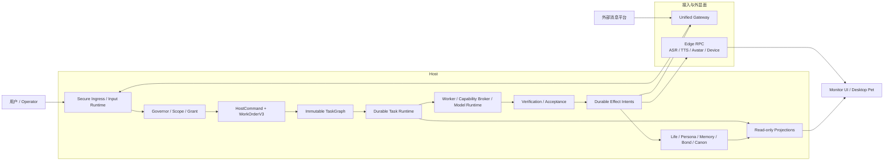

受众：PROJECT
标题：Natsume AI 工程总览与运行指南

# Natsume AI

Natsume AI 是一个本地优先、用户主权优先的个人数字生命系统。它把对话、人格表达、长期记忆、关系状态、主动行为、工具执行、设备能力和多平台消息接入放在同一套可审计运行时中，并要求所有真实动作都能回答四个问题：谁批准、执行了什么、依据什么验收、产生了什么副作用。

本仓库不是已经完成的“全自动进化 AI”。它已经具备较完整的 Host、Scheduler、Internal Agent、持久化、授权、任务、模型、Gateway、Edge 和观测基础设施，但可生产的 Durable DAG 并发/恢复、通用智能规划、受治理人格演化以及完整长期演化闭环仍在建设中。当前完成度必须以代码审计和机器状态为准，不能从历史 `PASS/DONE` 或目录数量推导。

## 当前状态

| 范围 | 当前结论 | 说明 |
|---|---|---|
| Host `chat/skill/delegate/plan` | `WIRED` | 四类 canonical route 已进入 Governed Runtime |
| Durable Task Runtime | `PARTIAL_B5C_DURABLE_CANCELLATION_SHADOW` | `PRODUCTION_OFF`。B5A/B5B 冻结显式结果 authority 并以 0091 单事务封口整图成功；0092～0099 已建立两阶段取消、跨进程 continuation、revisioned Outbox、Review continuation、grant uniqueness、append-only Effect 对账和历史 TaskGraph 终态对账 sidecar。0099 migration 只追加 immutable case/proof/supersession schema，不在迁移中改业务行；startup recovery 后才在显式 10,000 terminal Graph 上限内 inventory。仅 `FAILED + exact atomic failure bundle + 唯一 graph-scope ACTIVE/EXCEEDED Budget` 可在显式默认关闭的 system auto 下释放 Budget；`BLOCKED + failure` 与 legacy `CANCELLED + unsettled Budget` 必须 Ed25519 签名，child/missing/multi Budget、`COMPLETED` 不一致和结构歧义只 quarantine。Budget Store 已证明唯一 `BUDGET_EXCEEDED` winner；single-node canonical COMMITTED checkpoint 现在覆盖既有 accepted usage 以及“usage 尚未落盘”的精确崩溃窗，后者以持久时间上界补账且不重跑 worker；ACCEPTED 后 Effect 补写也有窄证据。但 general/multi-node/pre-operation recovery 仍未完成。Cancellation 与 Operation/Effect/terminal reconciliation 仍为默认关闭、未跑生产 canary，atomic、bounded 与 cancellation 均不得视为生产启用 |
| Scheduler | `WIRED` | 真实 occurrence 已贯通 V3、Budget、child grant、Review、Verification、Acceptance 与 Receipt |
| Internal Agent | `WIRED` | 外部 v2 仅作边界输入，进入 runtime 前编译为 V3；Budget、child grant、Review、Verification、Acceptance、Receipt 与 replay 已贯通 |
| Workspace 隔离 | `PARTIAL_W0_FAIL_CLOSED` | D0 scoped I/O/Verification 路径围栏保留；在 durable WorkspaceGrant 建立前，写能力 WorkOrder 仅可使用运行时自有 `temp_workspace`，`runtime_repo`/裸路径/git clone/自定义根全部拒绝。工具 authority 取 `run_mode ∩ allowed_actions − forbidden_actions`；虚假 shell 已移除，默认 subprocess Python 不再冒充隔离执行器。该熔断不是 durable owner、隔离 worktree 或 OS/tenant 边界 |
| 显式 Composition | `INCOMPLETE / D1_ROUTE_SCOPE_WIRED` | 两批已删除 6 个零消费者全局槽位、4 个死 accessor，并收掉第二批 7 个宽泛重导出；D1 又以 immutable `HostRoutePorts` 将 Canon/Tool/Bond HTTP 与对应 OBS command adapter 绑定到单个 app，删除三类模块 provider/setter 和 `process_services` fallback，多 Host app 交错构造/关闭互不污染。排除 6 个 lock 与 `application_ports` 后全局 container 仍有 53 个可变服务引用，Capability Forge/Scheduler/Review 等 locator 及 Host/Obs/Worker scopes 尚未完成 |
| Planning Search | `KERNEL_AVAILABLE / BENEFIT_UNPROVEN` | 公共搜索内核存在；Host 尚不生成竞争方案，跨领域真实收益未证明 |
| Persona 演化 | `CENTRAL_FENCE_WIRED` | legacy 直写已中央拒绝；proposal、Review、版本激活和 rollback 替代链尚未实现 |
| 长期演化 | `INCOMPLETE` | World/Scene/Identity 等有局部资产，Evolution Lab、Skill Compiler、Knowledge OS 等未形成完整生产闭环 |

权威入口：

- [当前代码事实](docs/50_project/arch/CURRENT_CODE_ARCHITECTURE.md)
- [系统架构总览](docs/50_project/arch/SYSTEM_ARCHITECTURE.md)
- [功能模块地图](docs/50_project/arch/FUNCTIONAL_MODULES.md)
- [关键数据流](docs/50_project/arch/DATA_FLOW_ARCHITECTURE.md)
- [目标架构](docs/50_project/arch/TARGET_ARCHITECTURE.md)
- [架构差距矩阵](docs/50_project/arch/ARCHITECTURE_GAP_MATRIX.md)
- [下一代正式执行合同](docs/30_devspec/NEXT_GENERATION_EVOLUTION_EXECUTION.md)
- [机器可读状态](configs/release/current_architecture_status.json)

## 系统全景



图中是生产主干的方向，不表示每条入口都已完全接线。Scheduler 与 Internal Agent 已接通；DAG 生产并发/恢复、全局 composition 和长期演化 pipeline 仍是明确缺口，详见差距矩阵。

## 运行面

| 运行面 | 启动入口 | 核心职责 | 主要边界 |
|---|---|---|---|
| Host Main | `python -m host_brain` | 对话入口、Governor、Task/Agent Runtime、Life、Memory、业务 API | 真实命令与长期状态的主要协调面 |
| Observability | `python -m host_brain.obs_main` | 只读运行投影、Trace、健康状态、Operator BFF | 不应成为业务事实 writer |
| Monitor UI | `host_brain/app/monitor_ui/` | Task、Review、健康、数字生命和运维视图 | 通过 Query/Operator API 读取和发命令 |
| Edge RPC | `python -m edge_client` | ASR、TTS、Avatar、桌面与设备 actuator | 物理副作用必须回传 receipt |
| Unified Gateway | Edge lifecycle 中的 `edge_client/gateway/bootstrap.py` | 平台 webhook、消息归一化、Host 回流与出站投递 | 平台适配器不拥有 Host 业务状态 |
| Desktop Pet | `desktop_pet/main.cjs` | Electron + Live2D 本地表现 | 只消费状态和动作，不裁决事实 |
| External Services | `scripts/runtime/docker-compose.external.yml` | Neo4j、Chroma、Redis | 可选依赖；不可用时按配置降级 |

Host 与 Edge 之间的共享数据结构位于 `natsume_contracts/`。该目录是跨进程版本化合同，不是重复实现或可删除的临时目录。

## 核心运行链

### Governed 请求

Host canonical 请求的目标 lineage 是：

```text
request
  → Secure Ingress
  → Governor decision + grant
  → HostCommand + WorkOrderV3 + BudgetPolicy
  → immutable TaskGraph revision
  → node Attempt + Lease + node-bound grant
  → worker / model / capability execution
  → Verification
  → Acceptance
  → durable effect intents
  → effect receipts and read-only projections
```

当前 `chat`、`skill`、`delegate`、`plan`、Scheduler 和 Internal Agent 进入这条主链。`task_progress`、`recent_turn` 只读取 durable projection；Executive 的生产入口、SkillDag 执行和内存任务 registry 已删除。Internal 的既有 Agent executor 只在 child grant 验证后接收由 V3 投影的兼容对象，不再拥有 admission authority。0096 后，Task-bound Review 的批准后一次性 resume、拒绝和到期会在原 Review 事务中排入 continuation；composition-owned worker 按 immutable HostCommand surface 回到原 Host/Internal/Scheduler runtime，POST continuation 不重跑 worker，PRE continuation 不制造伪 Attempt。

Review HTTP 决策使用独立的 server-owned `review.operator / review:decide` Secure Ingress policy；`internal:agent:execute` 不能越权审批，actor 必须等于认证 principal，Task-bound Review 只能由 Task Runtime 内部创建。Internal/Scheduler 的拒绝或到期结果使用 exact `review-decision://...` durable ref；升级前误写入的 POST pre-acceptance receipt 只能在 HostCommand、Graph revision、Review/node/version 与旧 receipt 全部匹配的单事务 CAS 中替换。生产 Operator credential 仍需部署配置，真实 canary 尚未运行。

Durable 启动门禁当前按 `migration → TaskStore 0093/0094/0095/0098/0099、Review 0096 与 grant uniqueness 0097 readiness → task_store.recover_startup → 0099 bounded terminal inventory → 可选且默认关闭的 exact system auto → 构造 publisher → 发布 recovery outbox → 启动 Outbox 后台 worker → 激活 Host/Internal/Scheduler runtime → 启动 cancellation 与 Review continuation workers` 执行；恢复步骤抛错会在路由开放前 fail closed。0099 readiness 不只看对象名：它从受信 migration 资产重建 canonical schema，严格比较 `sqlite_master` 中 3 张 table、4 个 index 与 10 个 trigger 的全部 SQL，再由 Python codec 复核 case/subject/proof 语义。Runtime 重入不会再静默修复 `BLOCKED/FAILED/CANCELLED/COMPLETED + 未结 Budget`；终态 Graph 在创建/激活新 Budget 前由 Runtime 快照与 Store 写事务双重拒绝。任一同 Graph/revision 的 inventoried 未决 current case 都是 graph-wide 写围栏：普通 TaskGraph transition、cancellation request 以及 Budget transition/consume/usage/retry 全部 fail closed，只有 0099 proof UoW 能显式 bypass。Inventory 一次覆盖支持的 10,000 Graph 窗口、跳过已冻结 case并继续推进；`FAILED/CANCELLED + PENDING/CONSUMED Budget`、child/missing/multi Budget、Graph/Node/Review/Attempt/Lease/parallel-after-state 漂移均只进入结构 quarantine。终态 classifier 对 0090 要求恰好一条 canonical decision，对 0091/0092 复用完整绑定、Attempt/Effect authority validator；exact Attempt failure bundle 还逐条复核四条 Outbox 的 canonical `payload_ref`。旧 case 只有在同事务冻结新 current case 后才能追加 supersession，且替代链最终仍必须落到 trusted proof；普通状态改写不能让旧 case 消失或通过生产门禁。ASGI 会把配置中的逻辑 owner 派生为每次容器构造唯一的 execution owner；process-shared `LocalGraphExecutionRegistry` 仍只是 quiescence 加速器。`HOST_TASK_GRAPH_CANCELLATION_OPERATOR_ENABLED`、Operation/Effect reconciliation 与 `HOST_TASK_TERMINAL_RECONCILIATION_OPERATOR_ENABLED` 均默认 `false`，`HOST_TASK_TERMINAL_RECONCILIATION_AUTO_ENABLED` 也默认 `false`。Auto 查询只取 `EXACT_REPAIRABLE` 并循环至空或明确返回 `TRUNCATED`；system proof 以 immutable case `created_ts_ms` 为稳定时间 authority，多进程对同 case 收敛为同一 proof。批处理发生部分已提交后必须在错误中明示 `side_effects_may_have_run=true`，不得伪报零写入。`task_terminal.reconcile` 只有在 Secure Ingress=`ENFORCE`、可执行 Operator Gateway 和 verification-only Ed25519 公钥环就绪时才能注册，Host 不加载私钥。Cancellation production gate 会在启用 cancellation 时阻断 current anomaly、缺少 proof/supersession closure 的 0099 case 和任何当前 quarantine，但不会阻断专门用于 remediation 的 terminal Operator 入口；不能因 schema/readiness 通过就宣称生产可开。

0093 已把 Task Runtime Outbox drain 从单进程锁升级为持久化跨进程权威：每次 claim 绑定 `owner + token + expiry + 单调递增 fencing token`，过期 claim 可由新 owner takeover。0095 又将投递 predecessor/head 身份扩展为 `aggregate_type + aggregate_id + graph_revision`：`TASK_GRAPH` 必须携带存在的正整数 revision；0098 只为 `GRAPH_CANCELLATION_EFFECT_RECONCILIATION` 增加同样的 revision，并要求 case ID、revisioned payload ref 与 immutable inventory 物理一致；其他 aggregate 保持 `NULL`。因此同一 graph ID 的不同 revision 独立保序，revision 内仍严格按 version/creation/id 投递。Publisher 每次只做 `claim 一条 → 幂等 append runtime event → 用 owner/token/fence/version 封口`；append 失败会释放 claim 并持久化 backoff 与错误，append 成功但 complete 丢失时则由幂等 event append 与过期 takeover 收敛。Composition 直接使用当次 boot/construction 的 `recovery_id::outbox` 作为唯一 publisher owner，并在启动发布后拉起可关闭的后台续投线程；线程根据 canonical backlog 中 aggregate head 的最早 available/claim-expiry 时间等待，并以有界轮询兜底，所以旧进程死亡时即使 claim 尚未到期，新进程也会在到期后自动接管。Publisher close 会与前台 publish 临界区线性化，必须等待已进入的发布，避免 close 返回后继续访问 Store。显式 drain 只有数据库 `total_pending=0` 才能返回 `DRAINED`，仍有活 claim、backoff 或被 predecessor 阻塞的消息时返回 `DEFERRED`。`list_pending_outbox` 保持完整 PENDING inventory，投递 eligibility 只属于 claim/backlog API；0093/0095/0098 readiness 是 Store 实例级状态，正常构造/显式 assert 验证后由热路径复用，只有显式诊断 `force_revalidate` 才重扫 schema/全表；逐条 claim/complete/release 只保留事务内 CAS、trigger 与记录校验。Event append/claim complete 已提交后，如果 backlog 诊断读取失败，只返回脱敏 `DEGRADED`，不会把已提交投递伪报为失败。Runtime Event 将 Graph aggregate key 投影为 `graph_id@revision`，Operator 也只读取同一 exact revision；进程内 asyncio/threading 锁仅作降噪，不再被当作跨进程 authority。

0095 对历史兼容同样不靠猜测：普通多 revision `TASK_GRAPH_CREATED` 通过 Graph Outbox evidence 中不可变且跨 replan revision 唯一的 HostCommand `command_id` 精确回填；ACTIVE 等非 attempt governed transition 则由 Migration Runner 注册的 deterministic `natsume_sha256_hex`，使用 revision-bound command ID 重算升级前五段 digest，并同时匹配原 `outbox_id + idempotency_key`。因此升级只增加 `graph_revision` 精确维度，不改变既有 Outbox ID/key，不会打断 response-loss replay；无法解析的自定义 producer 仍令整笔迁移回滚。`graph_revision` 物理形状固定为 `INTEGER / nullable / no default / non-PK`。新 Graph `payload_ref` 固定为 `taskstore://event/TASK_GRAPH/{graph_id}@{revision}/{version}`；旧 ref 只允许 durable codec/replay 兼容读取，新 insert/update trigger 拒绝。新 Runtime Event 使用 `graph_id@revision`，旧 journal 保持不可变并经 source Outbox revision 精确归属；unique partial `TASK_STORE_OUTBOX source_ref` 围栏保证一次 Outbox 只投影一个事件，升级前 append 成功但 complete 未确认的重投只有在 legacy event 可全字段重建时才返回原 journal。Operator 查询还要求 ReviewStore 按 canonical `task-node://.../<revision>/...` subject ref 过滤，避免同 graph ID 的不同 revision 混读。

PlanningRecovery 不在普通调度热路径扫描 Outbox：`read_scheduler_snapshot()` 默认 `include_graph_outboxes=false`，只有 failure recovery 显式设为 `true`，在同一只读事务取得 exact terminal Graph Outbox，并把它实际的 durable `payload_ref` 作为失败证据；这样 pre-0095 legacy ref 不会被合成为不存在的新 ref。仅未提供该可选扩展字段的旧版或替代 Store 实现才合成 revisioned fallback；生产 DurableTaskStore 提供 inventory 后，缺行、畸形或歧义都 fail closed。0100 已把此前止血升级为 append-only durable revision supersession：`admit_replan()` 在一个 `BEGIN IMMEDIATE` 中重新验证 same-root `FAILED` predecessor、精确 terminal evidence 及 Node/Attempt/Lease/Operation/Review/Budget/Effect/cancellation/0099 静止事实，原子写 revision+1 Graph/HostCommand/Outbox 和确定性 supersession；响应丢失只精确重放，插入后故障整笔回滚。共享 Store 围栏阻止旧 revision 再 claim/retry/写 Budget/推进节点或恢复 Review。当前安全子集仍拒绝 `BLOCKED`、全部历史 Review continuation 和全部 Acceptance Effect，且自动 failure-triggered replan/生产 canary 未完成，因此仍是 `PARTIAL_DURABLE_SUPERSESSION_SAFE_SUBSET`，不是完整自动重规划。Runtime Event 的 `created_ts_ms=0` 也保留为零；由于 current revisioned 与 legacy unrevisioned 两条历史 append 路径都可能用时钟替代零值，时间容差可对两种可重建 candidate 生效，但除时间外的全部字段仍必须严格精确。

`schedule_retry` 提交后若仅丢失响应，同一确定性调用会严格核对 Attempt、Node、Lease、Graph、Budget、BudgetUsage 及关联 Outbox 后返回原决定，不重复扣减 retry budget。普通或重试耗尽的 pre-reservation resolver failure 通过 `fail_running_attempt_bundle` 在一个事务内落 `Attempt FAILED`、`Node FAILED`、`Graph FAILED/BLOCKED`、`Lease RELEASED` 和四条 attempt/evidence-bound Outbox；一旦已有 operation reservation，该边界拒绝接管。Budget finalize 仍在该事务之外。

Budget 超额竞争使用一个 `BEGIN IMMEDIATE + CAS` authority：首个越界 usage 唯一推进 Reservation 到 `EXCEEDED` 并拥有唯一 `BUDGET_EXCEEDED` Outbox；持旧 ACTIVE version 的竞争者先得到 CAS conflict，刷新到 terminal version 后才允许以同 version 的 `ALREADY_EXCEEDED` usage 记录失败，并引用 winner Outbox，不能再次推进 Budget。Runtime 的 CAS 尝试下限随已批准的 `BudgetPolicy.limits.concurrency + 1` 扩展，不再固定为 4。8/16/32 线程、8 个跨进程写者、连续 8 次 CAS 冲突、重启重放、篡改与 settlement winner 选择均有测试，但这只证明 canonical Budget charge/terminal contention，不等于 program-wide Budget 覆盖或生产 canary。

reservation 建立后，Coordinator 启动 `DurableExecutionHeartbeat`，每轮先续 Lease、再续 Operation Reservation，并在流事件及最终结果前执行 checkpoint；任一心跳失败只返回 `RECOVERY_REQUIRED`，绝不 COMMIT。两类续租支持同参响应丢失后的精确重放。在线收紧会在写事务持锁后把已过期的 `RESERVED` 原子推进到 `RECOVERY_REQUIRED + Outbox`。单节点 canonical COMMITTED checkpoint 要求 exact COMMITTED Outbox/Attempt/历史 Lease/receipt digest、canonical WorkerProjection 和唯一 ACTIVE graph Budget。已有 accepted worker BudgetUsage 时只读核对；完全缺失且不存在任何同 Attempt/预算 worker usage 冲突时，先取得同 Attempt 更高 fence Lease，再以 `reservation.updated_ts_ms - attempt.started_ts_ms` 的正持久时间上界调用幂等 settlement。并发只有一个接管者，写入后响应丢失重放同一 usage，超限进入 `BUDGET_BLOCKED`，worker 始终不重跑。异名/拒绝/漂移 usage、零或非法时间、public projection、pre-operation crash 和多节点图仍 fail closed，不猜测未知副作用。

`TaskGraph.completion_policy` 是持久可选 v1 扩展：缺省保持 `LEGACY_NODE_TERMINAL_V1` 行为；`ATOMIC_GRAPH_SUCCESS_V1` 必须显式冻结，并同时指定 sink `result_node_id`。legacy 多 sink 图不得声明单一 result，不能靠最后完成或最后声明的节点隐式选结果。`PlanningGraphCompiler` 默认保持 legacy；只有调用方显式请求，或失败重规划继承前一 revision，才生成 atomic policy。

Coordinator 的 `atomic_graph_success_enabled` 与 `bounded_fanout_enabled` 是两个独立且默认 `false` 的进程能力开关，Host、Scheduler、Internal 三处生产 composition 均未开启。Application 在 `repository.admit` 前确认 atomic capability、node-grant service 与 parent grant；不具备能力的进程对 atomic 图 fail closed，不先写 admission。Coordinator 只接受覆盖 admitted Graph 全部节点的 exact grant map。atomic policy 即使顺序执行也由 outer 统一成功封口；terminal-leaf 实际有界并行还必须启用 bounded fan-out。child 只能提交 Attempt、Node、Lease、Reservation 以及 Budget usage/`EXCEEDED`，不能终结共享 Graph/Budget。

每次 governed 执行会在建立/消费 Budget、解析 worker 之前验证 `0090` parallel failure/review decision schema 与 `0092` graph-cancellation schema；启用 B5 terminal success 时还会验证 `0091` success decision schema，缺表或缺列直接 fail-fast。`ACTIVE` 多节点重入若仍发现 live Node、active/latest Attempt 或 `ACTIVE` Lease，会返回 `GOVERNED_EXECUTION_IN_PROGRESS`，不解析新 worker、不重复执行，也不抢占现有 owner authority。结算窗口若出现 ownership fence，或 CAS 后重读发现新的 active Node/Attempt/Lease，也映射为 `IN_PROGRESS`；没有任何 active ownership 事实的纯 CAS 漂移仍是 durable state conflict，不能被软化成“正在执行”。

正常的 node-local 非接受不再触发 fail-fast cancel。outer 会等待所有已启动 sibling 到达 durable node-local terminal。live 与 crash/re-entry 都从 durable Node、Attempt、Reservation 和 BudgetUsage 重建同一 canonical v2 payload/ref；outcomes 覆盖整个 admitted Graph 中所有具备 latest stable Attempt 的 durable terminal Node，不只当前 claimable batch，当前 batch 只决定裁决优先级与 selected node。`RETRY_PENDING` 可作为非 selected durable outcome，并可在重入时重建。Graph `FAILED/BLOCKED`、可选 Budget `RELEASED`、对应 Outbox 和 `0090` decision row 同事务提交，response-loss 只允许 exact replay。BUDGET selected 必须绑定唯一 `BUDGET_EXCEEDED` winner；`ALREADY_EXCEEDED` sibling 只能引用 winner authority，不能成为 terminal selected evidence。decision row 每次读取都校验自身 digest、Graph/Budget Outbox 与 Attempt lineage，BUDGET 另校验 usage；terminal replay 还校验 Graph target/version，并要求 selected outcome 的 Attempt 仍是该节点 current latest。测试覆盖跨批次 canonical digest 稳定、`RETRY_PENDING` 非 selected outcome、live/re-entry identity、response-loss 与 newer-Attempt replay rejection。

全节点 `ACCEPTED` 后，B5 outer 从每个节点已冻结的 durable worker projection 重算 canonical digest，并精确校验 command、request、graph/revision、node/attempt、route、target、receipt 与 node grant，只允许显式 `result_node_id` 对应投影生成整图 effect intents 和公开结果。`complete_parallel_graph_success()` 在一个 Store UoW 中原子提交 `Graph COMPLETED + Budget CONSUMED + Graph/Budget 两条 Outbox + 全图 durable effect intents + 0091 canonical success decision`。legacy 单节点若在 Node `ACCEPTED` 后、Graph/Effect 封口前断电，重启必须从 exact COMMITTED checkpoint、SUCCEEDED Attempt 与 canonical projection 重建，并通过共享 finalizer 原子提交 Graph 与 Effects；篡改或缺失检查点时 Graph 保持 ACTIVE，worker 不重跑。已完成图的 replay 只读并复核 authority，不重新编译 effects。

B5C 的取消 authority 是 graph revision 级、两阶段且 first-writer-wins。`task_graph.cancel` 已接入 Operator Command Gateway、同源 BFF 与 Task Runtime UI，命令必须带 exact `graph_id + graph_revision + reason_code`，并要求 `obs:write + task-runtime:cancel`。Gateway 认证后的 server-owned authority 会携带 durable audit/claim、request、principal、tenant、认证 body digest、action 与 scopes；同一个 `SecureIngressGraphCancellationAuthorityVerifier` 被注入 Host、Internal、Scheduler 三个运行时，重新读取已提交且尚未写入 terminal `claim_result_ref` 的 Secure Ingress audit/claim 并核对 canonical body 后，才签发以 `audit_ref` 为 `request_identity` 的取消 authority。Outcome 一旦封口，该 authority 不能被进程内复用为新的取消 bearer；公开 duplicate 只重放原 outcome。Application 不接受调用方自报 `request_id/request_identity/source`。第一阶段先在 0092 UoW 中写 canonical intent，把 Graph 推入 `BLOCKED`、节点/Attempt/Lease/Review/Token/operation/effect 写入取消或 reconciliation 状态；只有 intent 已持久化后才 cancel/join 本进程 child 与 heartbeat。本地 task registry 只是加速器，不是取消 authority；Outbox publisher 故障也不能阻止 durable intent 之后的本地 cancel/join。执行重入会发现 durable intent 并尝试 advance/finalize；待 active Attempt/Lease 消失、operation/effect/review 完成对账后，第二阶段才原子提交 Graph `CANCELLED`、Budget 释放/取消、Outbox 与 canonical cancellation decision。完整 reconciliation evidence 由 cancellation decision 的摘要绑定，operation reconciliation proof 在封口与终态 getter 中都必须重验结构、digest、key 与签名；终态 Outbox 只引用 decision、intent 与 request identity 这三个稳定 authority ref，不展开证据清单，避免证据规模突破 Outbox 上限。请求和封口的响应丢失只允许 `request_id + request_identity + source + reason_code` 全部一致的精确 replay，0091 success 与 0092 cancel 谁先提交，谁就成为终局 authority。

Operator 路由先按 immutable HostCommand surface 把 exact revision 送回 Host、Internal 或 Scheduler owner。若下游调用抛错，Gateway 不凭异常猜测结果：Runtime Group 会重读该 revision 的 durable cancellation intent；只有 intent 与本次 `request_id + audit_ref + OPERATOR + reason + graph/revision` 全部一致，才标记“可能已发生副作用”，没有 intent 则按明确未执行拒绝，读取失败或畸形事实则保守标为不确定。只有 cancellation handler 显式翻译成 OBS 封闭端口异常的确定性可被命令路由采信；任意依赖异常即使伪装同名字段也一律按可能已执行处理。UI 随后刷新 durable detail，不用按钮响应乐观宣称 Graph 已取消。

0094 新增的 `GraphCancellationContinuationWorker` 是 composition-owned 扫描与协调器，不是第二套取消状态机。它只 claim 仍为 `REQUESTED` 且尚无 0092 decision 的 intent，持久绑定 owner、不可猜 token、expiry、单调 fencing token、attempt 与 retry deadline；claim/heartbeat/defer/complete 都在取得 `BEGIN IMMEDIATE` 写锁后才采样时钟，不让等锁时间吞掉 lease 或用过期时间授权 CAS。处理期间 heartbeat，进程失联后由 expiry takeover。每次重入都从 `HostCommandRepository` 按 exact `graph_id + revision` 读取 command、work order、assignment 与 graph，重建 `AdmittedExecution(replayed=true)`，再调用既有 `GraphCancellationRuntime.continue_graph_cancellation()`。Runtime 未显式收到 `local_pending` 时必须先对共享 registry 执行 `cancel_and_join`；仍有本地 task 未静默时不得 advance/finalize，worker 只能 durable defer。只有 canonical 0092 intent 已 `FINALIZED` 且 decision 存在时才清理协调行；operation/effect/review 等事实仍未 reconciliation 时同样只 durable defer，不能伪造取消完成。0094 表只保存协调元数据，0092 intent/decision 仍是唯一业务真相。worker 停机先给有界 grace，再 cancel 并有界 join；如协程拒绝响应取消，容器 fail closed 且保持 Task/Command Store 打开，供后续重试停机，绝不在活 worker 下关库。

取消不会撤销已经验收的事实：`NODE` scope 且所属 Node 已 `ACCEPTED`、Attempt 已 `SUCCEEDED` 的 effect 继续按既有 delivery authority 派发/重试；未验收 NODE effect 与未完成 Graph 的 GRAPH effect 被 fence。`task_operation.reconcile` 只接受 exact signed `COMMIT/RELEASE`；0098 的 `task_effect.reconcile` exact 绑定 case/intent/effect/fence/Attempt/resolution/actor/Outbox/revision，PENDING proof 可进入新 decision evidence，FINALIZED correction 只作 trusted overlay。0099 另行冻结历史 Graph/Budget 终态 case/proof/supersession：migration 不修改 Graph/Budget，inventory 在 `recover_startup` 后运行；proof 与 Graph/Budget Outbox 在主 Store 同一事务校验并追加，supersession 只能把旧观察链接到新的 current case，不能直接授权业务突变。`TERMINAL_HEALTHY_CLOSURE` 只能在同 Graph/revision 已有历史未决且未 supersede case、而 current 完整 classifier 已返回 healthy 时冻结；它固定为 `SIGNED_REPAIR_REQUIRED + NONE`，只允许 `SIGNED_OPERATOR`，Graph/Budget/Outbox 零写入，snapshot 再漂移就继续追加 supersession replacement。system auto 只允许上文唯一 exact failure bundle 类别且显式 opt-in；其余可修复类别要求签名，`COMPLETED` 不一致和结构冲突不得自动修复。仓库没有外部部署 SQLite inventory、完整 active/retired/revoked 密钥生命周期或 canary 证据，因此只能证明机制，不证明任何部署已清理。

独立 Obs 与主 Host 的 terminal 查询都不会回退到可写 `DurableTaskStore`：仅当 `HOST_NLE_OPERATOR_VIEWS_ENABLED=true` 时，从 canonical DB path 显式构造 query-only repository，并以 SQLite `mode=ro + PRAGMA query_only=ON` 读取；authority 缺失即 503。两组 `candidates/cases/challenge` GET 都要求 `obs:task-runtime:read`。0099 terminal challenge 从 `request.state.operator_query_context.authority.principal_id` 绑定认证 actor；GET 必须提供 `attestation_ref/key_id/issued_ts_ms`，若认证 authority 自带 key ID则拒绝请求 key 漂移。它复用 runtime 权威 builder，把 current case/subject 和确定性 Graph/Budget Outbox 编进 Store 实际验证的 final canonical Ed25519 bytes，并返回配套 `command_request`；HTTP challenge → 真实签名 → Store round-trip 已通过。该成功只证明机制，不证明外部部署 key lifecycle 或 inventory remediation。

这仍是 `PARTIAL_B5C_DURABLE_CANCELLATION_SHADOW / PRODUCTION_OFF`，不是 Lane B 或完整架构完成。0099 关闭的是一组历史终态“静默修复”漏洞，不是通用恢复器；general/multi-node/pre-budget recovery 仍缺。外部 deployment inventory、Operator credential、完整 active/retired/revoked key lifecycle、remediation 与真实 canary 均未知，Review canary 也未完成，因此 NE-01 保持 `IN_PROGRESS`，生产 atomic/bounded/cancellation 必须关闭。

### Planning Search

`host_brain/planning_search/` 是领域无关、无真实副作用端口的搜索内核，提供候选扩展、排序、虚拟状态转换、reward 和 Conditional MCTS。它只能选择规划，不能直接执行工具。

当前 Host Plan 只把 Governor 已批准的步骤合法化并编译为图，并不会从目标生成多套竞争方案。Pentest 已接公共搜索 adapter，但 L3 仍处于未校准 shadow；Research/Code 只有模拟证据。因此不能把“存在 MCTS 类”写成“系统已经具备通用自主规划能力”。

### 状态与副作用

Task Acceptance 会原子登记 effect intent，随后由 durable dispatcher 分别应用对话、Memory、Life、Gateway、Edge 等副作用。正确语义是“验收后可恢复的最终一致”，不是“所有外部系统处在同一个数据库事务”。

详细流程和图见 [关键数据流](docs/50_project/arch/DATA_FLOW_ARCHITECTURE.md) 与 [架构图册](docs/50_project/arch/diagrams/00_INDEX.md)。

## 功能能力

| 能力域 | 对用户提供什么 | 主要实现 |
|---|---|---|
| 对话与最终表达 | 流式对话、人格化表达、媒体/语音响应 | `host_brain/agent_runtime/`、`host_brain/persona/`、`host_brain/surface_runtime/` |
| 治理与安全入口 | 身份、范围、规则裁决、授权 token、拒绝与审计 | `host_brain/secure_ingress/`、`host_brain/governor/` |
| 任务执行 | Durable DAG、Attempt、Lease、Budget、Review、验收与恢复 | `host_brain/orchestration/`、`host_brain/task_runtime/` |
| 模型运行 | Provider 路由、模型尝试、重试、用量与失败证据 | `host_brain/model_runtime/`、`host_brain/integrations/` |
| Capability / Skill | 内置能力目录、授权执行、签名接收与隔离 | `host_brain/capability_plane/`、`host_brain/skills/`、`host_brain/airlock/` |
| 记忆与知识素材 | 对话经历、语义/向量召回、Canon、来源证据 | `host_brain/memory/`、`host_brain/retrieval/`、`host_brain/canon/` |
| 数字生命 | Life 状态、情绪、关系、人格表达、主动性 | `host_brain/digital_life/`、`host_brain/persona/`、`host_brain/bond/`、`host_brain/tribe/` |
| 多平台与设备 | 平台消息、ASR/TTS、Avatar、桌面和设备动作 | `edge_client/gateway/`、`edge_client/actuators/`、`desktop_pet/` |
| 观测与运维 | 健康、Trace、任务投影、Review 定位、Operator 命令 | `host_brain/observability/`、`host_brain/app/obs_*`、Monitor UI |
| 安全实验室 | 有授权、受隔离、可审计的 Pentest 工作流 | `host_brain/pentest/`、`host_brain/security_immune/` |

模块职责、依赖方向、入口和已知限制见 [功能模块地图](docs/50_project/arch/FUNCTIONAL_MODULES.md)。

## 仓库结构

```text
Natsume_Ai/
├─ host_brain/                 Host、领域能力与后端运行时
│  ├─ app/                     ASGI、HTTP adapters、composition wiring、Monitor UI
│  ├─ orchestration/           Command、Plan 编译、Graph revision、node grant
│  ├─ task_runtime/            Durable 执行状态机
│  ├─ planning_search/         无副作用规划搜索内核
│  ├─ model_runtime/           模型路由与 ModelAttempt
│  ├─ digital_life/ persona/   Life 状态与最终表达
│  ├─ memory/ retrieval/       记忆写入、召回与上下文材料
│  ├─ capability_plane/ skills/ 能力治理与内置 Skill
│  └─ persistence/ audit/      Repository、SQLite、Migration、Journal
├─ edge_client/                Edge RPC、Gateway、平台与设备 adapters
├─ natsume_contracts/          Host/Edge 共享的运行时中立合同
├─ desktop_pet/                Electron + Live2D 桌面表现
├─ configs/                    可提交策略、发布与机器状态配置
├─ scripts/runtime/            本地运行、外部服务与验收脚本
├─ tests/                      unit / contract / integration / e2e / security
├─ tools/                      静态扫描、文档门禁和发布工具
├─ docs/                       产品、理论、架构、工程合同与历史证据
├─ runtime/                    本地可变数据，Git 忽略
└─ artifacts/                  临时验收产物，Git 忽略
```

顶层不承载通用 `data/`、`flows/`、`skills/`、`integrations/` 杂物目录。模块资产必须归属于明确 bounded context；可变数据进入 `runtime/`。

## 本地启动

### 1. 环境要求

- Python 3.11 或更高版本。
- Node.js `^20.19.0` 或 `>=22.12.0` 与 npm：Monitor UI 的 Vite 8 构建要求；Desktop Pet 和其他前端工具也使用该运行时。
- Docker：仅 Neo4j、Chroma、Redis 等外部服务需要。
- 真实模型、平台和设备能力需要各自密钥或本机依赖；缺失时应显式降级，不能伪装成功。

### 2. 安装

```powershell
python -m venv .venv
.\.venv\Scripts\Activate.ps1
python -m pip install --upgrade pip
python -m pip install -r requirements.txt
python -m pip install -e .\natsume_contracts -e .\edge_client -e ".\host_brain[dev]"
python -m pip install "pre-commit>=4,<5"
```

复制配置模板并只在本地 `.env` 中填写真实密钥：

```powershell
Copy-Item .env.example .env
```

建议将可变数据显式放入 `runtime/`：

```dotenv
NATSUME_DATA_DIR=runtime/data
NATSUME_AUDIT_DB=runtime/host/audit.sqlite3
```

`.env.core.example`、`.env.optional.example` 和 `.env.experimental.example` 分别解释核心、可选和实验配置；实际字段的最终解释以 `host_brain/app/settings/` 与 `edge_client/config.py` 为准。

### 3. 可选外部服务

```powershell
docker compose -f scripts/runtime/docker-compose.external.yml up -d
docker compose -f scripts/runtime/docker-compose.external.yml ps
```

该 Compose 只启动外部依赖，不会代替 Host、Obs、Edge 或前端进程。

### 4. 启动后端

```powershell
# Host，本文示例显式固定为 18080
python -m host_brain --host 127.0.0.1 --port 18080 --startup-check

# 独立 Observability，本文示例显式固定为 18082
python -m host_brain.obs_main --host 127.0.0.1 --port 18082

# Edge RPC，本文示例显式固定为 17800
python -m edge_client --host 127.0.0.1 --port 17800
```

Gateway 通常由 Edge lifecycle 按 `EDGE_GATEWAY_ENABLED` 与 `EDGE_GATEWAY_PLATFORMS` 装配，不应再单独复制一套业务状态。
省略这些 CLI 参数时，实际绑定地址取决于类型化设置、`.env` 和运行时环境文件；启动后应以进程日志和健康探测为准。

### 5. 启动前端

```powershell
# Monitor UI 开发服务
Set-Location host_brain/app/monitor_ui
npm ci
npm run dev
```

```powershell
# Desktop Pet
Set-Location desktop_pet
npm ci
npm start
```

### 6. 健康与接口

服务启动后，使用运行时 OpenAPI 和健康接口核对真实路由；不要依赖文档中的固定路由数量。常用入口：

- Host：`http://127.0.0.1:18080/docs`、`/health`、`/ready`。
- Observability：`http://127.0.0.1:18082/docs`、`/obs/*`。
- Edge：地址和端口由 `EDGE_RPC_HOST/EDGE_RPC_PORT` 决定。

## 开发与验证

按改动风险选择最小充分验证：

```powershell
# 单元或定向测试
python -m pytest -q tests/unit/<test_file>.py

# 稳定合同与集成测试
python -m pytest -q tests/contract tests/integration

# 全量 Python 测试
python -m pytest -q

# 架构与仓库静态门禁
python tools/static_scan/run_all.py --root .

# 文档权威、受众和新鲜度门禁
python tools/doc_lint/doc_audience_lint.py --root .
python tools/doc_lint/doc_authority_gate.py --root .
python tools/doc_lint/doc_freshness_gate.py --root . --check-all

# 当前暂存改动的提交前检查
python -m pre_commit run
```

PR/推送的 freshness workflow 会把 Git 变更集传入门禁：只要生产代码或工程工具发生变化，同一变更集内就必须包含 README、权威文档或机器架构状态之一；仅依赖旧文档的时间戳不能通过。架构语义变化仍应按 policy 的 source→doc 映射同步对应事实、数据流、图和追溯文档。

前端验证命令由各自 `package.json` 定义。Monitor UI 至少应运行 `npm run build`；涉及 Operator client、Task Runtime 页面或交互时再运行对应 lint、typecheck 和测试。

## 架构约束

1. 一个长期状态只能有一个权威 writer；Projection、Cache、UI 和模型输出不能反向成为事实。
2. 搜索、模拟、benchmark 和 counterfactual 路径不得持有真实工具或外部副作用端口。
3. worker 只执行冻结的 TaskGraph revision；失败重规划必须生成新 revision。
4. 所有模型与工具调用都必须关联 request、graph/node、attempt、grant 和 receipt。
5. Acceptance 之前不得提交不可逆副作用；Acceptance 之后通过 durable intent/outbox 投递。
6. 人格、策略、知识和 capability maturity 的自动变化只能生成 proposal，不能直接修改生产真相。
7. Host、Obs、Gateway、Edge 和 UI 通过版本化合同协作，不共享隐式全局状态。
8. 新功能必须进入现有 bounded context；禁止以顶层杂物目录或第二套 registry 绕过架构。

## 文档体系

| 想了解什么 | 阅读入口 |
|---|---|
| 产品为何存在、用户主权是什么 | [白皮书与宪法](docs/10_whitepaper/index.md) |
| 核心理论和概念模型 | [理论体系](docs/15_theory/index.md) |
| 系统现在如何组织 | [系统架构总览](docs/50_project/arch/SYSTEM_ARCHITECTURE.md) |
| 每个代码域负责什么 | [功能模块地图](docs/50_project/arch/FUNCTIONAL_MODULES.md) |
| 请求、状态和副作用如何流动 | [关键数据流](docs/50_project/arch/DATA_FLOW_ARCHITECTURE.md) |
| 当前哪些能力真的接通 | [当前代码事实](docs/50_project/arch/CURRENT_CODE_ARCHITECTURE.md) |
| 最终应演进到哪里 | [目标架构](docs/50_project/arch/TARGET_ARCHITECTURE.md) |
| 目标和代码还差什么 | [架构差距矩阵](docs/50_project/arch/ARCHITECTURE_GAP_MATRIX.md) |
| 接下来按什么顺序实施 | [正式执行合同](docs/30_devspec/NEXT_GENERATION_EVOLUTION_EXECUTION.md) |
| 需求如何映射到代码和测试 | [需求追溯矩阵](docs/60_trace/requirements_trace.md) |
| 历史计划为何不再是 authority | [历史程序目录](docs/_history/programs/2026-07/README.md) |

文档权威顺序是：生产代码与 machine status → Current → Target → Gap → Active Execution → PRD/DevSpec/Trace → 历史证据。历史 `DONE/PASS` 只对其固定提交、环境和声明范围成立。

## 提交约定

- 提交信息、PR 标题和 PR 正文统一使用中文。
- 不提交 `.env`、密钥、`runtime/`、`artifacts/`、模型文件或本地服务数据。
- 修改生产架构时同步更新 Current、Gap、机器状态、执行合同和相应数据流图。
- 删除或移动文档时同步更新目录索引与文档门禁策略。
