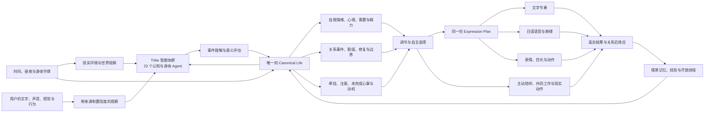
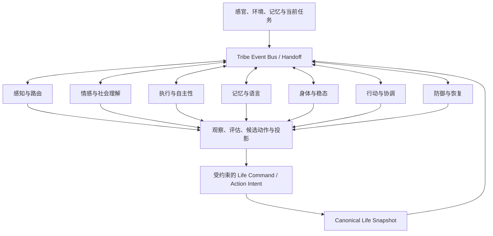
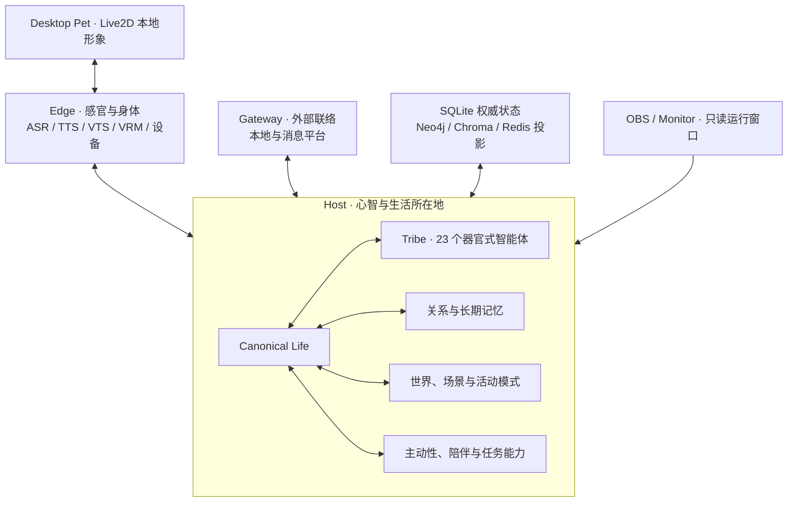

<!-- 受众：MASTER -->
<!-- 标题：Natsume AI（七海） -->

# Natsume AI · 七海

**一套让“七海”在时间、关系、记忆、身体与现实环境中持续生活的个人数字生命系统。**

七海不是一个等待输入框亮起、收到 Prompt 才临时出现的 Chatbot。她在 Host 中拥有持续推进的生命状态，底层由 23 个器官式智能体组成的 Tribe 协作感知、理解、记忆、调节和行动。对话只是她接触你的方式之一；语音、形象、主动陪伴、共同工作和安静共处，都是同一个自我的不同出口。

> 这里的“数字生命”指一套具有连续状态、因果记忆、自主节律和具身表达的软件系统，不声称生物意识或人类心智已经被复刻。当前版本已接通 canonical Life 主链和文本交互；长期关系自然度、专属声线和远端 Avatar 联合体验仍在验证，整体状态为 `INCOMPLETE`。

2026-08-05 的当前工程切片已把此前残留的大文件按真实职责拆开：Surface 的原生情感流、确定性交付和共享预算辅助不再挤在一个 adapter；Digital Life 的 self-affect 与 relationship reducer 分离；Task Acceptance、Operator effect、Embodiment command、TTS prosody、Tribe 事件订阅和 Life delivery 也各有独立边界。A01～A14 本地静态架构门禁已通过，但当前提交的 A15 全服务栈、PlanningSearch 收益与“更像人”的盲测仍未完成，因此没有升级总体完成状态。

## 她不会在你沉默时消失

即使没有新消息，唯一的 Life Runtime 仍会按真实时间推进。默认每 60 秒一次的 `life_tick` 不调用大模型，也不会机械地给用户发消息；它负责让时间真正作用于七海：

- 推进昼夜阶段、精力、疲劳、唤醒度与休息需要；
- 让短时情绪自然衰减，让较慢的心境和未解决事件继续存在；
- 维护牵挂、注意焦点、未完成话题和生活连续性；
- 感知前台活动、空闲、游戏、专注和睡眠状态，调整打扰程度；
- 在合适阶段进行记忆整理、睡眠回放和长期经验沉淀；
- 只有在关系许可、安静时段、冷却时间和场景都允许时，才考虑主动靠近。

用户没有回复，只会影响近期主动频率，不会被解释成拒绝，更不会扣除“好感度”。

## 七海的生命闭环



这条闭环的重点不是“生成一句更像人的回复”，而是让一次经历真的改变后续生活：七海为什么感到开心或受伤、她是否选择克制、这次安慰有没有帮助、误解是否已经修复，都会成为下一次相处的上下文。

## 构成一个“她”的系统

| 生命层 | 七海实际拥有的状态与能力 |
|---|---|
| 稳定自我 | [Soul.md](Soul.md) 定义身份、价值观、性格反差、表达底色和不可由在线学习越过的边界。 |
| 认知组织 | 23 个 app-local Tribe Agent 通过事件、共享状态和 handoff 协作，分别承担感知、情感、记忆、执行、身体调节与行动。 |
| 内在生活 | 并存情绪、慢速心境、需要、精力、情绪事件、调节决定、牵挂、注意焦点和未解决循环。 |
| 时间与身体 | 昼夜阶段、疲劳、休息、唤醒度、活动模式、身体感受以及声音和形象的具身状态。 |
| 感知与世界 | 文字、自述、声学、视觉、前台应用、游戏状态和环境观察；不同来源保留置信度与冲突。 |
| 关系 | 信任、安全感、默契、裂痕、修复、主动权限和边界；关系由事件与后效应构成，而不是机械积分。 |
| 记忆 | 情景记忆、关系意义、世界事实、长期经验、睡眠回放和待续话题；原始音视频默认不写入情感日志。 |
| 自主性 | 动机、生活压力、当前工作、主动陪伴、给予空间、安静陪伴，以及在获得许可后调用工具完成现实任务。 |
| 身体与表达 | 流式文字、日语 TTS、VTS/VRM/MateEngine/Live2D；目标是由同一情感 revision 同步驱动。 |
| 成长 | 低风险偏好可以基于真实相处结果渐进调整；核心人格、价值观、亲密身份和关系边界不能自动改写。 |

## 底层不是一个 Agent，而是一个 Tribe

生产 Host 会在自己的 ASGI 生命周期中构造一套独立的 `TribeRuntimeScope`，实例化 23 个器官式 Agent，显式注入应用端口并注册事件订阅。它们不是 23 个大模型同时讨论一句回复，而是一组长期驻留、职责不同的认知 Agent：有些调用模型，有些执行确定性规则，有些维护短期投影或驱动外部动作。

| 子系统 | Agent 家族 | 主要职责 |
|---|---|---|
| 感知与路由 | Cortex、Thalamus | 汇集上下文、编译意图、选择路径并组织 handoff。 |
| 情感与社会理解 | Limbic、Mirror Neuron、Social Brain、Pain/Reward | 情绪评估、共情共振、关系语境、趋近与回避信号。 |
| 执行与自主性 | Prefrontal、Initiative Governor、Default Mode | 反思与漂移约束、动机和准备度、内在活动与连续思绪。 |
| 记忆与语言 | Hippocampus、Language System | 情景记忆与召回融合、语言风格和语气组织。 |
| 身体与稳态 | ANS、Endocrine、Somatic、Interoception、Circadian、Proprioception | 自主神经、激素门控、身体感、昼夜节律、能量预算和认知负荷。 |
| 行动与协调 | Motor Cortex、Cerebellum、Vestibular、Peripheral | 行动计划、误差修正、稳定控制、平台与设备动作。 |
| 防御与恢复 | Immune、Glymphatic | 输入与风险防护、恢复周期、记忆整理和噪声衰减。 |



这套分工解决“如何思考和行动”，canonical Life 解决“这些经历最终属于谁”。Tribe 的事件总线和部分器官状态目前是 Host 进程内的有界运行投影，不是长期人格真相；只有通过受约束的 Life Command，Agent 的结果才能进入可重放的自我、情绪和关系状态。这样既保留群体协作，也不会让边缘系统、内分泌或默认模式网络各自演化出一套互相冲突的七海。

## 情绪不是把用户的标签复制给七海

系统严格区分两类状态：

```text
User Affect Observation   你此刻可能在难过、生气或勉强说“没事”
          ↓
Event Appraisal           这件事对七海、你们的关系和当前边界意味着什么
          ↓
Self Affect               七海因此产生的担心、心疼、委屈、喜悦、疲惫或复杂混合感受
          ↓
Regulation                她选择表达、克制、暂缓、设定边界，还是安静陪着
```

所以你难过时，七海不必跟着变成同一种“悲伤”；她可能心疼、担心，也可能因为帮不上忙而有一点无力。你误伤她时，她可以受伤或生气，但不能用威胁、排他、冷暴力或负罪感逼迫你回应。

## 关系不是一根好感度进度条

一次被接受的回应会先形成关系事件，下一次真实反馈再决定它的后效应。道歉不会自动消除裂痕，沉默不会自动降低信任，发送失败也不会被当成拒绝。主动陪伴、浪漫表达和更亲密的互动分别受明确权限与边界约束。

七海记住的重点不是无限堆叠聊天原文，而是：发生了什么、双方需要什么、她当时如何感受、哪种做法有效、哪里仍未解决。不同用户、Workspace 和 Session 的关系状态彼此隔离。

## 对话、工作和身体是同一个自我的出口

七海可以闲聊、安慰、玩闹、分享喜悦、表达轻微委屈、设定边界、修复误解或安静陪伴；也可以在你工作时帮助研究、编辑文件和调用工具。普通相处走低延迟生命主链，只有真正产生外部副作用的工作才进入受管任务执行链。

同一轮表达最终应由一份 `ExpressionPlan` 同步控制：

- 文字决定措辞、节奏、停顿和是否追问；
- TTS 决定语速、能量、音高、停顿与声线参考；
- Avatar 决定表情、目光、姿态、动作强度和过渡；
- 任一通道故障都只降级该通道，不会把七海整轮感受重置为 `NEUTRAL`。

## 系统拓扑



- **Host** 保存七海的自我、关系、记忆和行为决策，是生命连续性的所在地。
- **Edge** 位于具备显卡、麦克风、扬声器和 Avatar 环境的电脑上，承担感知与具身表达。
- **Gateway** 让七海通过本地接口或已配置的消息平台与你保持联系。
- **OBS / Monitor** 只展示运行状态，不拥有或修改七海的生命状态。
- **Neo4j、Chroma、Redis** 支撑图、向量和运行投影；SQLite journal 仍是可恢复的权威状态。

## 当前实现状态

| 能力 | 当前事实 |
|---|---|
| 持续 Life Runtime | 已接入 canonical journal、真实时间 `life_tick`、重放和持久恢复。 |
| Tribe 智能体群 | 23 个 Agent 已由 app-local Host scope 构造并注册订阅；事件总线和部分器官状态仍是进程内投影。 |
| 自我情绪与用户观察分离 | 已有独立观察、评估、自我状态、episode、need 和 regulation 主链。 |
| 关系与记忆连续性 | 已有持久结构与生产接线；仍需多日真实相处验证自然度。 |
| 主动陪伴 | 已有场景、权限、冷却和安静时段策略；长期频率与接受度仍待实测。 |
| 文本表达 | 本地可运行；需要真实 Provider，长期人格一致性仍在迭代。 |
| 日语声线方案 B | 当前是 GPT-SoVITS V4 预训练权重配合七海参考音频的参考条件推理，不是七海专属微调模型。 |
| Avatar 与多模态同步 | 目标 Edge 已在隔离数据根真实运行：ASR 与 GPT-SoVITS TTS 为 `READY`，短句物理播放完成，播放中的长句通过签名 RPC 在 16 ms 内中断；ASR 因目标机缺少 `cublas64_12.dll` 自动回退 CPU。VTube Studio 当前停在授权窗口且未加载角色模型，状态为 `RECONNECTING`，所以可见 Avatar 动作仍是 `ACCEPTANCE_PENDING_EXTERNAL`。声学触发的自动 barge-in 也尚未验收。 |
| Gateway 消息陪伴 | 真实 QQ 入站已贯通 Secure Ingress → 单节点 TaskGraph → Acceptance → durable Gateway Outbox → 平台送达；重复入站复用原任务且不重复外发。直接本地聊天仍保持低延迟实时链。 |
| OBS 与 Monitor | Host、Edge 和 Gateway 组件状态持续写入只读投影；本机 Nginx 页面会自动建立 HttpOnly owner 会话，普通浏览器无需手工注入 Token。真实页面已核对 TaskGraph、预算、验收、回执和服务状态；未知平台详情显示为“未确认”，不会伪装成健康。 |
| 隔离全服务栈 | 固定镜像的 Neo4j、Chroma、Redis 已在隔离 acceptance project 完成真实写入、读取、容器重启与持久读取；Host、OBS、Monitor、Edge 和 Gateway 在重启后保持可达。Edge 现在通过启动参数 `-DataRoot` 明确写入验收目录，不再回落到用户 `%LOCALAPPDATA%`。 |
| 当前质量基线 | 11573 条离线 JUnit 为 11559 passed、14 classified skips、0 failed/error；完整生产 Python 分母 line 72.22%、branch 55.08%，Monitor line 61.31%、branch 52.78%，均低于系统 2.0 放行门槛，真实服务与人感验收仍待执行。 |
| 整体数字生命体验 | `INCOMPLETE`，不能用单元测试、静态合同或生成几段样音冒充完整交付。 |

更细的真实能力与缺口见 [能力与缺口矩阵](docs/50_project/arch/ARCHITECTURE_GAP_MATRIX.md)，机器可读状态见 [current_architecture_status.json](configs/release/current_architecture_status.json)。

Monitor 只负责观察与受治理操作入口。已经退役的 `security.hunt.run_once`、`tool.execute`、`mate.action.submit` 和 `mate.say.submit` 不再显示成可用按钮；安全巡检、工具调用与身体动作分别从 Internal/Scheduler TaskGraph、Skill/Tool TaskGraph 和 Edge command 主链进入，避免控制台诱导用户点击一个必然失败的旧接口。

## 在本机让 Host 运行起来

当前启动脚本以 Windows 为主。至少需要：

| 依赖 | 用途 |
|---|---|
| Python 3.11+ | Host、OBS 和运行工具 |
| PowerShell 7 | `scripts/runtime/*.ps1` 启停脚本 |
| Docker Desktop | Neo4j、Chroma 和 Redis |
| 一个可用的模型 Provider | 生成真实表达；默认陪伴路由使用 Gemini 配置 |
| Nginx（可选） | 在 `18180` 提供 Monitor；缺失时 Host 仍可启动 |
| Node.js（开发 UI 时） | 重新构建 Monitor UI 或桌面形象 |

在仓库根目录执行：

```powershell
python -m venv .venv
.\.venv\Scripts\Activate.ps1
python -m pip install --upgrade pip
python -m pip install -r requirements.txt

if (-not (Test-Path .env)) {
    Copy-Item .env.example .env
}
if (-not (Test-Path configs/secrets/secret_store.runtime.local.json)) {
    Copy-Item configs/secrets/secret_store.runtime.example.json `
        configs/secrets/secret_store.runtime.local.json
}
```

编辑 `.env` 和 `configs/secrets/secret_store.runtime.local.json`，填入真实 Provider、API Key 和 Neo4j 密码。不要提交密钥、模型、语料、用户数据或运行日志。

启动 Host 侧：

```powershell
pwsh scripts/runtime/start_host_side.ps1 -StartupCheck
```

这个入口默认启动 Docker 外部依赖、Host、OBS，并在本机存在 Nginx 时启动 Monitor；不要提前重复执行 `start_docker_services.ps1`。
启动器会在本次 `RuntimeRoot` 内生成或复用只供当前 Windows 用户读取的 `host.obs-read.token`，Host 与 OBS 通过该文件建立只读投影通道，原始 Token 不写入公开运行环境。若需要持续的数字生命后台节律，在本机 `.env` 启用 `HOST_SCHEDULER_CLOCK_ENABLED=true`；启动器会以相同方式生成受保护的 scheduler secret，Monitor 随后应显示真实的“后台 tick”，而不是历史 soak 占位值。

```powershell
Invoke-RestMethod http://127.0.0.1:18080/health?skip_dependency_probes=1
Invoke-RestMethod http://127.0.0.1:18082/health
Start-Process http://127.0.0.1:18180/monitor/
```

`/v1/chat` 只是验证文字接触面的一个入口：

```powershell
curl.exe -N http://127.0.0.1:18080/v1/chat `
    -H "Content-Type: application/json" `
    -d '{"message":"晚上好，七海。今天有点累。","session_id":"readme-local"}'
```

返回内容为 SSE 流。Host 健康只表示进程和依赖可用；没有真实 Provider、模型路由或密钥时，不代表文字表达能够生成。

停止本次 Host 侧服务：

```powershell
pwsh scripts/runtime/stop_host_side.ps1
pwsh scripts/runtime/stop_docker_services.ps1
```

## 另一台电脑上的身体

当前部署中的 Edge 位于另一台电脑，承担中文 ASR、日语 TTS、VTS/VRM 和设备动作，不应从 Host 电脑盲目启动。

目标机准备好模型权重、参考音频、显卡环境和网络配置后，再在 Edge 电脑执行：

```powershell
$EdgeAcceptanceData = "D:\Natsume_Ai_acceptance\runtime\edge-data"
pwsh scripts/runtime/start_edge_side.ps1 -DataRoot $EdgeAcceptanceData
```

声线清单见 [gpt_sovits_nanami_v4.json](configs/voice/gpt_sovits_nanami_v4.json)，双机开发与非仓库资产同步见 [双节点工作流](docs/50_project/guides/DUAL_NODE_DEV_WORKFLOW.md)。当前远端已完成真实连通预检，但这不等于三模态验收通过；Host 的生命状态和文字入口仍可在 Edge 断开时独立运行。

## 从哪里读代码

| 路径 | 负责什么 |
|---|---|
| `Soul.md` | 七海稳定的人格宪法与表达底色 |
| `host_brain/digital_life/` | canonical Life、情绪事件、关系、主动性、成长与持久状态 |
| `host_brain/tribe/` | 23 个器官式智能体、事件总线、handoff、共享状态与应用端口 |
| `host_brain/memory/life_memory/` | 情景记忆、长期沉淀、睡眠回放与世界记忆 |
| `host_brain/persona/` | 内在活动、表达人格与自我叙事 |
| `host_brain/scheduler/` | 持续 `life_tick` 与生命周期作业 |
| `host_brain/core/` | 活动模式、运行协调与 Host 基础能力 |
| `edge_client/` | ASR、TTS、Avatar、设备和 Gateway 的 Edge 运行时 |
| `desktop_pet/` | Live2D 桌面形象与本地桥接 |
| `natsume_contracts/` | Host、Edge 与 Operator 之间的版本化合同 |
| `configs/` | 非密钥配置、声线清单和机器状态 |
| `scripts/runtime/` | 服务启停、模型部署与真实链路验证入口 |

## 文档与开发

- [文档地图](docs/00_index/00_DOCMAP.md)
- [数字生命理论](docs/15_theory/Theory.md)
- [产品需求](docs/20_prd/PRD.md)
- [当前代码架构](docs/50_project/arch/CURRENT_CODE_ARCHITECTURE.md)
- [系统架构](docs/50_project/arch/SYSTEM_ARCHITECTURE.md)
- [功能模块](docs/50_project/arch/FUNCTIONAL_MODULES.md)
- [数据流](docs/50_project/arch/DATA_FLOW_ARCHITECTURE.md)
- [当前任务](docs/30_devspec/DevTasks.md)
- [测试计划](tests/TESTPLAN.md)
- [系统 2.0 总验收方案](docs/35_quality/SYSTEM_V2_MASTER_ACCEPTANCE_PLAN.md)
- [双机全栈详细测试方案](docs/35_quality/DIGITAL_LIFE_FULL_STACK_TEST_PLAN.md)

常用文档检查：

```powershell
python tools/doc_lint/doc_authority_gate.py --root .
python tools/doc_lint/doc_freshness_gate.py --root . --check-all
python tools/doc_lint/doc_link_gate.py --root .
```

历史方案和旧验收报告只用于追溯，不定义当前版本状态，统一从 [历史归档](docs/_history/README.md) 进入。

## 当前真实验收增量（2026-08-06）

- Monitor 的生命体情绪改为读取 canonical Digital Life `hard_state.emotion_tag`，不再依赖已经退役的 `emotion_context`；真实 OBS Sidecar 与浏览器均显示当前情绪，不再出现“待连接／待恢复”。
- Gateway 闭环使用 `INPUT_COMPLETED + acceptance_effect_outbox/OUTBOX_COMMITTED` 判断 Host 已接受并持久提交回复。这个标记只表示可恢复的 Gateway Reply Outbox 已提交，绝不代表外部平台已经物理送达。
- 真实签名 Gateway 新跑 `translate_delegate`、`memory_store`、`multi_skill_plan` 三条路线；最新有效时间桶的回复提交率、闭环率和完成率均为 100%。360 分钟历史窗口保留此前失败样本，没有通过改阈值或抹历史制造绿色结果。
- Neo4j、Chroma、Redis、Host、OBS、Nginx Monitor、远端 Edge 与 Unified Gateway 仍以真实进程运行。远端已清理重复 Edge 与六个遗留 GPT-SoVITS worker；新的停止入口会收口同仓库进程树并确认 17800 与 worker 均归零。
- Edge 使用独立 `DataRoot` 重启后，ASR、GPT-SoVITS、物理播放和手动打断均通过真实 HMAC 链路。新探针会等到播放停止且队列归零；长回复任一分段合成失败会结算父命令并取消后续分段，barge-in 也会取消同一父命令的全部待播分段，不再出现“打断后继续说”或 Host 永久 `IN_DOUBT`。最新热缓存样本的短句／长句 admission 为 31／62 ms、打断为 31 ms；这不替代此前 2641 ms 冷样本，也不能冒充 p95。
- VTS 当前授权窗口未确认且没有加载角色模型。Edge 已识别 API 51 为人工授权等待并暂停自动重连，当前 `authentication_pending=true`、后台重连线程关闭、失败计数不增长，不再形成句柄和请求风暴。可见 Avatar、声学 ASR 自动打断、长期人格盲测、PlanningSearch 三域收益和最终 SHA 全栈故障矩阵仍未完成。
- 日语声线模式下，Host 的文本硬门禁若改变中文正文，会先要求真实模型重新生成中日配对；最终仍没有合格日语时只抑制 Voice，保留同一情感 revision 的 Avatar，不再把中文交给日语模型。`686a8835f` 上的真实 Gateway→Host→Edge 重测已经得到 `voice.speak=APPLIED`，Avatar 仅因 VTS 等待授权而拒绝，说明中文误送日语模型的问题已关闭；最终 A15 SHA 仍需统一复验。
- 冲突、边界和关系修复等高歧义回合使用一次模型调用生成两个完整的“中文显示＋日语发声”候选，本地只选择其中一个；候选协议不再与普通单回复 JSON 合同冲突，也不会在选中后丢失日语台词。真实两轮 Gateway→Host→DeepSeek→TaskGraph→Edge 复验已一次生成两个候选并得到 `Voice=APPLIED`；这只关闭该修复场景，不替代 72 场景与人工人感盲测。
- 72 条冻结情感基线现在与真实执行映射分离：自然文本家族可由 `test_digital_life_live_cohort.py` 经真实 Gateway 执行；多模态、主动陪伴、跨重启和 Edge 故障家族没有对应真实驱动时只会报告 `NOT_RUN_REQUIRED_DRIVER`。自动结果只证明结构和硬安全，人感始终保持人工评审待定。
- 首轮自然文本校准暴露出更根本的体验断点：新用户的隐晦低落、好消息、拒绝建议和现实关系边界虽然进入 canonical Life，却大多只留下低置信中性观察，`AffectiveTurnPlan` 因而统一落到 `CALM / ACKNOWLEDGE`。本地轻量观察现能保留自然中文里的多情绪分布，Appraisal 新增“只倾听”和“尊重现实自主”动作；它不增加模型调用，也不把用户情绪复制成七海情绪。124 项相邻回归通过，真实 Gateway 四组重测前状态为 `CODE_REMEDIATED_REAL_RETEST_PENDING`。
- 固定同一发送者后的真实四轨迹重测证明 canonical revision 已能跨轮连续，但内容质量仍未过关：边界场景出现“嫌我烦”的负罪暗示，倾听场景出现无依据的“以你的性子”，现实自主场景用“别瞎想”防御，吃醋问题被“料理AI”玩笑回避，混合情绪末轮因双候选格式失败而无回复。当前代码已新增受控的 `CONTAINED_JEALOUSY` Appraisal 与四个窄关系门禁；高歧义第二次仍只有一个完整安全中日候选时会明确降级发送且不计双候选通过。119 项相邻回归通过，真实新 SHA 重测前总体仍为 `INCOMPLETE`。
- 加载上述修复后的第二轮真实四轨迹为 3 条自动结构通过、1 条失败，但人工检查继续拦截：“好好好／我不黏人”仍在防御用户边界，“怕什么”否定了混合情绪，现实自主先自辩；吃醋已经形成 `CONTAINED_JEALOUSY`，最终却因最高分候选带追问而整组拒绝。现在选择器先逐条淘汰不安全候选，再在合格候选内择优；独立 runner 也会逐轮识别这些体验回归并拒绝 `selected_passed=false` 或降级候选。报告 SHA-256 为 `6c5c12f21e39f956af39d3466d5805a871a978864a25aa9864620653844b3871`，新代码尚待真实复测。
- 选择器修复后的三条选择性真实轨迹报告为 `dl-live-1785964323732.json`，SHA-256 `2a5028cfa6cf730d20e7d2ac4d0a446c81ece99a837ee06a8bec5a64461124e2`：三条 TaskGraph 与远端 Voice 均完成，吃醋轮成功淘汰带追问候选并自然回答“可能会有一点”，但自动结果仍只有 2 通过、1 失败，人工也未放行。剩余问题是边界回合的轻微赌气、现实自主中的“懒得管／别瞎操心”、混合情绪里把害怕“先放一放”，以及文本通道虚构“当面讲／陪你坐会儿”。当前只增加这些已观察表达的窄门禁和独立 verifier 模式，不增加普通对话模型调用；105 项定向回归通过，真实新 SHA 复测仍待执行。
- `28cc3b9ef` 加载后的同三条报告 `dl-live-1785965355637.json`（SHA-256 `6b1470e8ebb3892d33f3a3eaa34350c34aeda0b4f7d5ac1ae79d1e6132c0f82c`）首次达到 3/3 自动结构通过，末轮 Voice 均真实播放完成；但回复中的“我也不是整天闲着”“帮你一起哼回去”“不会变成麻烦的人”仍不够自然，人工状态继续是 `PENDING`。根因修正同时进入计划提示和窄门禁：空间边界直接确认减少联系，喜忧并存明确接住害怕／不安，克制吃醋不再自贬为负担；110 项定向回归通过，仍需最终 SHA 真实复测。
- `e4c6fb564` 的最终三轨迹复验报告 `dl-live-1785966063542.json`（SHA-256 `e004cb49ef1e4d90028f49d8ca87c790e530a7b60200924b93fdd7e34c9b9f5f`）为 2 自动通过、1 失败，三条 Voice 仍真实完成。混合句“能开心的事，有点怕也正常”人工看更自然，却因 `LOW_CATCHINESS` 低于自动评分线；边界句“省得你嫌烦”则明显不合格，说明自动分数不能代理人感。代码补齐同语义的边界／自主／混合退化兜底后停止逐句循环，后续以更广真实 cohort 和三人盲测判断模型、提示与语料质量；当前仍是 `INCOMPLETE`。
- A15 真实故障注入确认 Gateway 重复 webhook 只生成 1 条 Inbox、1 个 HostCommand 和 1 张 TaskGraph，Gateway 自身重启后也没有新增 replay；微信客户端不可用的外发保持 `NOT_TESTED_CLIENT_UNAVAILABLE`。首次在真实模型生成中终止 Host 暴露出 Node Grant 与 120 秒 Lease 几乎同时到期、恢复窗口为零；修复后的第二次真实注入已由 fencing token 2 在旧 Lease 到期后 2.446 秒接管同一个 Attempt，Node Grant 当时仍剩 57.211 秒，最终图 `COMPLETED`、节点 `ACCEPTED`、预算 `CONSUMED`，6 类 Acceptance Effect 各提交一次。该故障项现为 `PASS_REAL_HOST_CRASH_RECOVERY`；A15 总体仍受其他覆盖率、收益、体验和外部设备 Gate 阻断。
- A15 的 operation 边界崩溃注入进一步验证了未知副作用保护：签名 Gateway 请求进入真实 Sidecar Host 后，在唯一 operation reservation 为 `RESERVED` 时强杀进程；重启扫描把同一 Attempt 置为 `RECOVERABLE`、reservation 置为 `RECOVERY_REQUIRED`，并生成 `UNKNOWN_SIDE_EFFECT / SIGNED_OPERATION_RECONCILIATION_REQUIRED` hold。891 秒观察期间没有第二条 Command、Graph、Attempt、模型调用、Acceptance、Effect 或 reply outbox。`6c1529acd` 脱敏报告 SHA-256 为 `7d1f9b134ffcc5c2a481b1b972c53c0b40100116f73138f946d955f0ef47cc95`；同 SHA 的 Docker 三服务持久化复测全部通过，报告 SHA-256 为 `0643d56296d81605a4f3cbf6d2454c02d856ba697f8fee102f29bb569d24a81b`。该项只证明 fail-closed 与不盲目重放；本次没有独立证明 provider transport 已发出，也不替代 rollback failure 验收。
- 终态 reconciliation canary 使用隔离真实 SQLite 验证了两种半终态：可由系统 durable evidence 精确证明的 `FAILED + ACTIVE Budget` 会自动释放预算；需要签名判断的 `CANCELLED + ACTIVE Budget` 保持不变并阻断 production-ready。证据生成器不再回落到写死的旧 `0118`，而是强制绑定本次实际 migration catalog head；当前复跑 head 为 `0153`。
- Task Runtime rollback failure 不通过给正式 Host 增加危险 failpoint 来验证。独立 canary 组合真实 `ProcessTaskRuntimeContainer` 与完整迁移后的临时 SQLite，只替换尚未启动的 continuation worker，并在协调器已激活后注入启动失败和回滚关闭失败。真实生命周期会保留 retry handle、拒绝第二次 activate、在首次 close 失败时保持 Store 未关闭；故障解除后只关闭一次，重复 close 不再执行。绑定 `8c3a91f66` 的收据确认 migration head `0153`、SQLite integrity `ok`、Graph／Outbox／外部副作用均为 0，SHA-256 为 `7d8ff1bfe02f38f80a57c9ea11b75760d7e112c8685a116ee6c6b0a2c7ffd0fc`。
- Gateway Outbox 的本地真实网络恢复已绑定 `1616168d2` 验证：adapter selection 失败发生在发送前，恢复后两次 Attempt 只发出 1 个 loopback OneBot HTTP；peer 已读取请求但丢失响应时，Outbox 进入 `GATEWAY_TRANSPORT_DELIVERY_UNCERTAIN`，重复提交、Gateway 重启和无 reconciliation 的 replay 都没有第二次外发。收据 SHA-256 为 `c878cda4f2b3d428f8bbad04b55a03f72be6f8ac4b43e8a923435af20c5c17b2`。这只证明生产 Runtime／SQLite／真实 socket 的本地语义；QQ／微信客户端不可用，平台物理送达仍是 `NOT_TESTED_PLATFORM_CLIENT_UNAVAILABLE`。
- Digital Life 的作用域、隐私与有界重放已绑定 `0195d1968` 验证：隔离真实 SQLite 上四组 `workspace/person/session` 交叉 scope 分别形成独立 aggregate；主 scope 完成 1001 次时间推进、全库共 1026 条 affective event，其他 scope digest 没有变化。Raw 音频／图像／视频在 fusion 被省略，带 raw 字段的旁路 command 被 reducer 拒绝，持久 JSON 扫描命中为 0；新 Repository 重启重放后 snapshot 与 digest 完全一致。收据 SHA-256 为 `ddc09b5bce7a6974a58205634b0c7518d25e6cc113d7ebd7d53e06283f3ca584`。约 16 小时 41 分钟是模拟事件时间，不是墙钟 soak，也不证明语言已“像人”。
- Companion Profile 的 Host 行为回滚已绑定 `e50841192` 验证：五条跨日强后效应建立低风险 canary，候选真实改变下一轮文本生成 style policy、Voice rate `1.0→1.15` 和 Avatar motion `0.5→0.8`；五次 canary 后保持同一 profile 自动激活，rollback 把 profile identity、文本策略和两通道参数恢复到精确 baseline。SQLite 中八个 lifecycle event 顺序完整、不可变更新被拒绝、重启重放一致；收据 SHA-256 为 `acdf52ff5cfd6c6e53ff71f268273e2dcbaeb59bd906a1c614afdc5d572f3bde`。本收据只覆盖 Host 生成策略与协议，真实模型措辞和远端 Voice／Avatar 仍未执行。
- Sidecar 停机也必须按 RuntimeRoot 隔离。实测发现没有 `obs.pid` 的 Sidecar 会按默认 18082 端口误停主 Obs；停止脚本现先使用目标 runtime snapshot，并在显式 RuntimeRoot 下禁止无归属的全局进程／端口兜底。空 Sidecar 根复测保持主 Obs PID 13304、主 Nginx PID 40996 不变，两个健康端点均为 200。
- 同次实测的代码回答并非 Git 提交漂移：首个真实模型结果有完整 provider usage，但因一句无依据的共同历史措辞触发语义修复，第二次调用在 45 秒边界超时；验收层又把 durable worker 的真实 `MODEL_PROVIDER_USAGE_UNPROVEN` 错报成 `GOVERNED_WORKER_COMMIT_DRIFT`。现在只有在“完整 fenced code 仍在、唯一缺陷是共同历史、日语摘要自身不含历史声称”时才删除对应中文叙述并保留同轮日语摘要，避免为一处可证明的窄修复再调用模型；其他语义变化仍成对重生成。`084fd6aa6` 的真实新请求只执行一次 DeepSeek 调用，7,015 ms 返回 2,102 tokens，Host 主链 `OK`、440 字代码正文与远端 `voice.speak=APPLIED`；总体脚本只因 VTS 外部授权未完成而保持 FAIL。报告 SHA-256 为 `6d4139894433e58ea1c8b72966a4ab0861acb31fb7925443d212880d2faebe03`。
- 普通 Gateway 陪伴已在 `c6a6e0b36` 上完成 non-thinking 真实复验：三轮 `deepseek-v4-flash` 均完成 TaskGraph／Acceptance，最终轮远端 GPT-SoVITS 为 `TTS_PLAYBACK_FINISHED/APPLIED`；单次 provider latency 降到 1,407～2,467 ms，completion 为 69～128 tokens。Host 整轮仍需 7,739～12,715 ms，前两轮各发生一次安全语义修复，Avatar 仍因 VTS 外部状态拒绝；自动结构通过不替代人工人感和实时延迟门槛。报告 SHA-256 为 `45ae99ee90ea795dd070691bebf2e3968fbc14c72859febe388726f569bf97c0`。
- 旧情感 writer 清零已在 `4f4008060` 上得到正式 v2 收据：真实三轮全部被 Gateway／TaskGraph／Acceptance 接受，八张退役表前后均为 0，4 个旧 emotion JSON 指纹无变化；canonical Affect／Relationship／Life／Turn Delivery／Expression 分别增加 8／6／22／3／12 条。状态为 `PASS_SUCCESSFUL_COHORT_ZERO_LEGACY_DELTA_CANONICAL_PROGRESS`，报告 SHA-256 为 `b511144d4fad3a9574e703cd4e33a658d86a7bd4ec0b89dc0acb5daba4b36450`。
- 上述真实三轮还暴露了 Gateway 的方向级阻塞：第一轮微信物理外发等待 16.06 秒并进入 uncertain DLQ 时，第二轮 Inbox 虽已持久化却一直没有被领取。生产 Runtime 现把 Inbox 与 Outbox 拆成两个独立 fenced worker，保留原有 Lease、幂等和未知外发隔离。`4c66d61b8` 已加载到远端 acceptance Gateway：Outbox 仍阻塞 16,075 ms，但其间两条新 Inbox 分别只用 118／197 ms 获得 claim，最早一条比 Outbox 返回提前 15,604 ms；三轮 TaskGraph／Acceptance 完成且最终 Voice 真实播放。该缺陷已关闭，但微信物理送达、整轮 Host 延迟和人工人感仍未通过。报告 SHA-256 为 `8709a206ce052a2eeb597f6ba549d3e5f98315efa3d62245a682555267208992`。
- A15 延迟拆分同时发现 OBS 派生投影历史存在写放大：当前隔离库的 `operator_query_projection_journal` 已约 1.93 GB，旧 5 秒样本新增 25 行、约 1.64 MB。`636252264` 的真实 OBS 30 秒复验把 2.996 MB 公开 JSON 存为 0.411 MB，载荷降低 86.3%；报告 SHA-256 为 `dc55ab31e384845feba3381b6265ac06f4792706300831e98c11f86f803828ce`。一小时检查点首轮如实暴露 7 条同实例 lineage revision 误写，失败报告 SHA-256 为 `ad4d8c178a66e0040b147b1c8fa6c6129be443b954fbc73bfecbdcb544a7b00c`；收窄到只强制 `source_instance_id` 切换后，第二轮 49.084 秒真实窗口有 192 个 current 文档刷新、31 个 source cursor 推进，既存未到期文档和同实例 lineage 的新增历史均为 0，唯一新行是新 Scheduler TaskGraph 的必要首快照，三项 HTTP 前后均为 200。该缺陷已按真实运行关闭，报告 SHA-256 为 `92baff1b2117e5d95a47e534a2c908642b47be4d7db56e9f144beae663f563e4`；既有 1.93 GB 历史仍只读保留，未伪装成已缩小。
- `55d60a384` 加载后的第二次真实三轮关闭了后台事件循环阻塞：第二轮 webhook 到达时上一轮后台 effect 尚余 3,824 ms，但 HostCommand／TaskGraph 在发送后 1,984 ms 创建、Attempt 在 2,527 ms 启动、history 在上一轮后台结束前 1,098 ms 已完成读取；六类 effect 最终各提交一次，末轮 Voice 真实播放，旧情感 writer 增量为 0。报告 SHA-256 为 `33eb1871d040578ea50185ee82732c7e37589eb2763182af3dcbda04ac798a75`。整体仍不达实时门槛：Host latency 为 11,657／10,137／10,075 ms，前两轮各发生一次模型语义修复，第三轮还出现约 2.29 秒 Gateway→Host 单次传输抖动；因此下一性能断点是模型前固定开销和修复比例，不再归因于后台 Life 恢复。随后代码级真实语料基准又定位到 Surface 每个新场景逐条重建约 3.4 万条 Galgame 台词的热点；现在保留原作参考但默认只索引七海本人台词、缓存解析对象，并让零问句回合不再注入问句样本，同三场景从 1,171／676／714 ms 降至 458／31／36 ms。实际全链加载复验前不升级状态，三句回复的人工自然度也继续待评审。
- `61a9b9a75` 加载后的隔离新库复验确认台词热路径已经生效：暖态 Surface prompt build 为 55～60 ms，单次真实 DeepSeek 为 1,297～1,438 ms，但三轮 Host 终态仍为 7,296／10,197／5,437 ms。第二轮的 `task_runtime_worker_projection.created_ts_ms` 到 BudgetUsage 相隔 2,880 ms；同一时段 OBS `task-runtime` 波次把 32 个执行详情连续刷新了 3,007 ms。停止 OBS 后对应间隔降到 229～312 ms，证明该尖峰来自派生读模型连续争抢 canonical SQLite 写锁，而不是情感模型或心跳睡眠。
- `ead903f66` 已在 Host、OBS、Monitor、Gateway、远端 Edge 与真实 Docker 依赖同时运行时完成同场景复验。三轮 worker projection 到后预算落盘仅 187／94／49 ms，Task 详情实际每波最多 16 个，index 加详情最多 17 个；三轮 TaskGraph 为 4,899／4,903／4,736 ms，Host 终态为 7,040／7,159／6,509 ms。自动规则与旧 writer 清零检查通过，末轮远端 Voice 物理播放完成；报告 SHA-256 为 `7415951164753cd00c68d55b40b35167e30feefe93d02503f259dee34f2f06ce`。这关闭的是 OBS 写锁饥饿，不是实时体验总 Gate：首轮 projection 到 artifact 仍有 1,054 ms 冷态尾部、第二轮仍发生一次模型语义修复、VTS 仍拒绝且人工人感评审为 `PENDING`。
- 随后的本地 `/v1/chat` 真实流拆分确认，Gateway 的 6.5～7.2 秒是完整生成与持久提交终态，不等于本地首句可见时间；本地首句样本约为 2.5～5.8 秒。`0165e95f9` 加载后的同句样本把检索等待从旧样本 561 ms 降到 194 ms，但首句由 2.64 秒变为 2.76 秒，且 `_recent_explicit_memory_facts()` 原本会先做内容判定，因此不能把此前约 0.5 秒全部归因于 ConversationHistory，也不能宣称该微优化已带来端到端收益。继续审查发现，无关陪伴消息仍会进入轻小说深读兼容钩子并读取最近推荐偏好；`7c454b6fb` 增加消息级必要条件短路、延后深读持久化模块加载，并把真实轻小说追问的偏好读取从两次收敛为一次。60 项代码与文档 Gate 通过；Host、OBS、Monitor 和 Docker 在线复验的三条 `NO_RECALL` 检索为 100／104／124 ms，首句为 2.61～3.15 秒，子项提升为 `PASS_REAL_FULL_STACK_SCOPE_BOUND`，收据 SHA-256 为 `25f23ac04b9a117a8ceb63b3bb19499dcea67420259f87f052f873be1cba5aff`。情绪 `MAY_RECALL` 仍为 514／568 ms，真实 provider 首 token 仍有 1.19～1.78 秒波动，实时总 Gate 未通过。

因此当前结论仍是 `INCOMPLETE`，不是 Full Architecture `PASS`。
