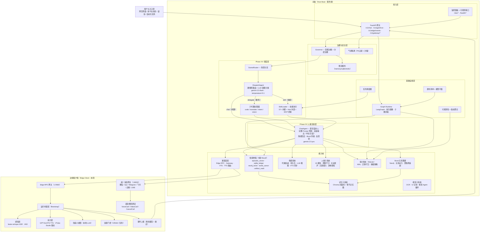

# Natsume AI — 夏目蓝

> 一个运行在本地的 AI 伴侣系统。主脑（Host Brain）部署在服务端，边缘客户端（Edge Client）运行在本机，通过 RPC 协议协同工作，支持语音对话、多平台消息、视觉感知与技能执行。

---

## 目录

- [项目概述](#项目概述)
- [系统架构](#系统架构)
- [核心链路（Phase XV）](#核心链路phase-xv)
- [主要模块](#主要模块)
- [项目结构](#项目结构)
- [环境要求](#环境要求)
- [快速启动](#快速启动)
- [配置说明](#配置说明)
- [API 接口](#api-接口)
- [技能系统](#技能系统)
- [可观测性](#可观测性)
- [开发指南](#开发指南)

---

## 项目概述

Natsume AI 是一个具备持续人格、情感状态与长期记忆的 AI 伴侣系统，核心角色为**夏目蓝**。

**主要能力：**

- 🌐 **多平台消息**：统一消息网关支持微信、QQ、Telegram、飞书、企微、LINE 六个平台
- 🎙️ **语音对话**：Edge 本地 ASR（faster-whisper）+ GPT-SoVITS TTS + VTube Studio 虚拟形象驱动
- 👁️ **视觉感知**：屏幕 OCR、UI 识别、视觉 Agent 自动化操作
- ⚡ **技能执行**：57+ 内置技能，支持 Hub 外部技能安装，MCP 工具桥接
- 🧠 **长期记忆**：Chroma 向量库（情节记忆）+ Neo4j 图谱（关系记忆）+ SQLite 审计账本
- 💫 **人格系统**：情感代谢、Bond 关系动力、人格漂移守卫、主动发声、自我反思、风格演变追踪
- 🌙 **Phase XVI 离线内心世界**：持续运行的内在时钟，离线期间孤独感/期待值积累、情绪自然漂移，唤醒时状态注入 prompt
- 🤫 **Phase XVIII 沉默能力**：情绪驱动的回复意愿分级（NORMAL→MUTE 五级），话题抗拒映射，意愿随时间自然恢复
- 🫀 **身体感知**：疲劳度/困倦度/孤独度三维近似具身感知，影响回复意愿与表达风格
- 🧠 **记忆人性化**：情绪染色、时间衰减、痛苦记忆压制，三层权重融合召回
- 🏗️ **Phase XV 架构**：DispatchAgent（调度）+ ChatAgent（人格渲染）分离，所有面向用户的输出必经 ChatAgent

---

## 🏛️ 系统架构



---

## 🔗 核心链路（Phase XV + Phase XVI）

### ⚙️ Phase XV 架构：DispatchAgent + ChatAgent 分离

Phase XV 将原 TopAgent 的三重职责（意图识别 + 闲聊 + 渲染）拆分为两个职责清晰的 Agent：

**🚦 DispatchAgent（调度层）** — 决定「做什么」，自己不生成任何用户可见文字：

| 路径 | 触发条件 | 延迟 |
|------|---------|------|
| `chat` | 短消息 / 追问 / 硬规则判定闲聊 | <1ms（无 LLM） |
| `delegate` | LLM 意图分类 → 需要子 Agent 处理 | ~1-2s（gemini-2.5-flash） |
| `skill` | 关键词匹配 → 技能执行 | <1ms（无 LLM） |

**🌸 ChatAgent（人格渲染层）** — 夏目蓝本人，所有面向用户的输出必经此 Agent：

- 🧩 走完整 Prompt 构建管线（角色人设 + 风格蒸馏 + 情感回应 + Bond 风格 + 反思链）
- 🈯 双语输出：文字通道中文（`text_zh`），TTS 语音通道日语（`text_ja`）
- 🛡️ 即使子 Agent 返回垃圾/JSON/降级文本，ChatAgent 都会用夏目蓝的语气重新组织
- 🔐 永远不泄漏内部元数据

### 💬 主聊天链路时序

```
/v1/chat
  → Governor（限流 + 安全检查）
  → SceneRouter.route_sse()
      ├── SCENE_CHAT → top_agent → DispatchAgent
      │     ├── [chat]     → ChatAgent（完整人格 prompt + LLM 流式）→ COMMIT
      │     ├── [delegate] → 子Agent（code/translate/intent/vision）→ ChatAgent → COMMIT
      │     └── [skill]    → SkillLoader.execute() → ChatAgent → COMMIT
      ├── SCENE_VISION_UI → chat_handler_vision
      └── 其他复杂场景   → chat_handler_complex → Graph Runtime
```

### 🌐 Gateway 通道链路

```
平台消息（微信/QQ/飞书/企微/Telegram/LINE）
  → Edge Gateway（:19000）
  → 平台适配器（Normalizer → ChatRequest）
  → POST /v1/chat（render_target_lang="zh"）
  → 上述主聊天链路
  → humanize_sender（拟人化分段发送）
  → 平台回复 API
```

### 🎙️ 语音对话链路

```
麦克风 → faster-whisper ASR（VAD 分段）
  → Edge 事件上报（POST /v1/edge/events）
  → Host 主聊天链路（source=ASR）
  → ChatAgent 生成回复（text_zh + text_ja）
  → Edge RPC post_speak（text_ja → GPT-SoVITS TTS）
  → 音频播放 + VTube Studio 口型/表情同步
```

---

## 📦 主要模块

### 🖥️ 主脑（`host_brain/`）

#### 🗂️ `app/` — 应用层

| 文件 | 职责 |
|------|------|
| `fastapi_app.py` | FastAPI 应用工厂，注册所有路由 |
| `main.py` | 启动入口，服务初始化 |
| `chat_handler.py` | 统一聊天 SSE 生成器入口 |
| `top_agent.py` | TopAgent 入口，转交 DispatchAgent |
| `dispatch_agent.py` | **DispatchAgent** — 硬规则 + LLM 意图分类，三路分派 |
| `chat_agent.py` | **ChatAgent** — 夏目蓝人格渲染，完整 Prompt 管线 |
| `chat_context_builder.py` | 聊天上下文构建（recall/emotion/bond 注入） |
| `prompt_builder.py` | Prompt 构建管线（角色人设 + 风格蒸馏 + 双语） |
| `chat_handler_vision.py` | 视觉场景聊天处理器 |
| `emotion_context.py` | 情感上下文组装 |
| `emotion_llm_inference.py` | 情感 LLM 推理 |
| `reply_form_decider.py` | 回复形式决策（文字/语音/混合） |
| `input_routes.py` | 平台消息入站路由（微信/Gateway） |
| `agent_routes.py` | Agent 自动化运行接口 |
| `bond_routes.py` | Bond 关系查询接口 |
| `canon_routes.py` | Canon 素材管理接口 |
| `tool_routes.py` | 工具调用接口 |
| `health_routes.py` | 健康检查接口 |
| `obs_routes*.py` | 可观测性接口（core/stats/platform/sysmode） |
| `system_handler.py` | 系统模式处理（focus/gaming/sleep） |
| `execution_profile.py` | 执行画像解析（CHAT_FAST/WORKFLOW_SUPERVISED/INTENT_EXEC） |
| `graph_config_builder.py` | Graph 配置构建器 |
| `dependencies.py` | FastAPI 依赖注入（服务单例） |
| `config.py` | 应用配置（从 .env 读取） |
| `provider_factory.py` | LLM Provider 工厂（openai/gemini/deepseek/codex/mock） |
| `intelligent_runtime.py` | 智能运行时（模式感知调度） |
| `vts_emotion_driver.py` | VTS 情感表情驱动 |

#### 🤖 `app/agents/` — Agent 合约层

| 文件 | 职责 |
|------|------|
| `agent_contract.py` | Agent 输入/输出合约（AgentArtifact） |
| `agent_registry.py` | Agent 注册表 |
| `react_loop.py` | ReAct 循环执行器 |
| `tool_registry.py` | 工具注册表（Agent 可用工具） |

#### 🔧 `app/handlers/` — 子 Agent 处理器

| 文件 | 职责 |
|------|------|
| `chat_agent_handler.py` | 聊天 Agent 处理器 |
| `code_agent_handler.py` | 代码 Agent 处理器 |
| `translate_agent_handler.py` | 翻译 Agent 处理器 |
| `intent_agent_handler.py` | 意图 Agent 处理器 |
| `intent_agent_entry_handler.py` | 意图 Agent 入口处理器 |
| `emotion_agent_handler.py` | 情感 Agent 处理器 |
| `judge_agent_handler.py` | 裁判 Agent 处理器 |
| `repair_agent_handler.py` | 🔧 **RepairAgent** — LLM 驱动的通用自愈修复器（浏览器后端快速路径 + LLM 规划器 + 安全门控） |
| `retrieval_agent_handler.py` | 检索 Agent 处理器 |
| `supervisor_dispatch_handler.py` | 监督分派处理器（WORKFLOW_SUPERVISED 模式） |

#### 🔍 `app/recall/` — 检索召回层

| 文件 | 职责 |
|------|------|
| `recall_pack_builder.py` | RecallPack 组装器（5路检索结果打包） |
| `semantic_recall.py` | 语义召回执行器 |

#### 🧩 `app/llm/` — LLM 路由

| 文件 | 职责 |
|------|------|
| `routing_matrix.py` | LLM 路由矩阵（provider 选择 + 降级策略） |

#### 💾 `app/memory/` — 应用层记忆

| 文件 | 职责 |
|------|------|
| `episodic_store.py` | 情节记忆存储 |
| `distillation_engine.py` | 记忆蒸馏引擎 |
| `memory_guard.py` | 记忆写入守卫 |
| `state_arbiter.py` | 状态仲裁器 |

#### 👁️ `app/vision/` — 视觉子系统（应用层）

| 文件 | 职责 |
|------|------|
| `agent_loop.py` | 视觉 Agent 循环 |
| `action_planner.py` | 视觉动作规划器 |
| `ui_assertion.py` | UI 断言（截图验证） |
| `clawdbot_protocol.py` | ClawdBot 协议适配 |
| `edge_rpc_client.py` | 视觉 Edge RPC 客户端 |

---

#### 🛡️ `governor/` — 治理与安全

| 文件 | 职责 |
|------|------|
| `decision.py` | 意图决策引擎（Governor 主逻辑） |
| `rules.py` | 规则门控 |
| `tokens.py` | Token 服务（消耗统计） |
| `rate_limit_store.py` | 限流存储（memory/sqlite/redis） |
| `tier_policy.py` | 分层策略 |

#### 🔒 `airlock/` — 气闸隔离

| 文件 | 职责 |
|------|------|
| `quarantine.py` | 隔离检查入口 |
| `pii_filter.py` | PII 过滤 |
| `image_filter.py` | 图片内容过滤 |
| `sandbox.py` | 代码沙箱（subprocess/docker） |
| `sanitizer.py` | 输出净化 |

#### 🌸 `persona/` — 人格子系统（17 模块）

| 模块 | 职责 |
|------|------|
| `persona_engine.py` | 人格引擎主入口 |
| `personality_traits.py` | 人格特质定义 |
| `self_model.py` | 自我模型（自我认知） |
| `self_reflection.py` | 自我反思链（LLM 动态生成 + 模板降级，支持 style_evolution 注入） |
| `emotion_persistence.py` | 情感持久化（跨会话） |
| `emotion_reactivity.py` | 情感反应性（刺激→情感映射） |
| `bond_aware_style.py` | Bond 感知风格适配 |
| `expression_adapter.py` | 表达适配器（VTS/TTS 联动） |
| `drift_detector.py` | 人格漂移检测（StyleFingerprint 时间演变 + `_compute_trend()` + `get_style_evolution_summary()`） |
| `trait_drift_guard.py` | 人格漂移守卫 |
| `persona_growth.py` | 人格成长记录 |
| `growth_feedback_collector.py` | 成长反馈收集 |
| `interaction_growth_analyzer.py` | 交互成长分析 |
| `evolution_desire_engine.py` | 进化欲望引擎（LLM 动态生成意愿文本 + 模板降级） |
| `evolution_orchestrator.py` | 进化编排器 |
| `proactive_voice.py` | 主动发声（定时/事件触发；接入 offline_state 快照感知等待时长；高孤独感深情模板） |
| `inner_world.py` | **Phase XVI** 离线内心世界状态机（InnerStateClock / OfflineEmotionDrift / LonelinessAccumulator / AnticipationTracker / OfflineStateSnapshot） |
| `emotional_silence.py` | **Phase XVIII** 情绪驱动沉默引擎（response_willingness / topic_resistance_map / NORMAL~MUTE 五级 / apply_body_sense_penalty） |
| `body_sense.py` | **v1.12** 身体感知模型（fatigue_level / drowsiness_level / loneliness_level 三维近似具身感知） |

#### 🧠 `memory/` — 记忆子系统

| 文件 | 职责 |
|------|------|
| `episodic.py` | 情节记忆（Chroma 向量库） |
| `chroma_client.py` | Chroma HTTP 客户端 |
| `long_term_distiller.py` | 长期记忆蒸馏 |
| `context_compressor.py` | 上下文压缩 |
| `canon_style_store.py` | 风格 Canon 存储 |
| `canon_world_store.py` | 世界观 Canon 存储 |
| `canon_vector_projection.py` | Canon 向量投影 |
| `episodic_memory_graph.py` | 情节记忆图（结构化关联） |
| `memory_worth_evaluator.py` | 记忆价值评估 |
| `persona_utterance_vector_projection.py` | 人格话语向量投影 |

#### 🔎 `retrieval/` — 检索增强子系统

| 文件 | 职责 |
|------|------|
| `recall_fusion.py` | 多路召回融合（5路） |
| `recall_fusion_stores.py` | 召回存储适配器 |
| `recall_fusion_config.py` | 召回融合配置 |
| `embedding.py` | Embedding 推理（Qwen3-Embedding-0.6B） |
| `reranker.py` | Reranker 重排序（Qwen3-Reranker-0.6B） |
| `pipeline.py` | 检索管线（embed → recall → rerank） |
| `orchestrator.py` | 检索编排器 |
| `style_distiller.py` | 风格蒸馏（StyleCanon v5） |
| `emotion_utterance_index.py` | 情感话语索引（EmotionTaggedUtteranceIndex） |
| `hybrid_fusion.py` | 混合融合（向量 + 全文） |
| `full_text_searcher.py` | 全文搜索 |
| `agentic_retrieval_loop.py` | Agentic 检索循环 |
| `query_planner.py` | 查询规划器 |
| `evidence_pack.py` | 证据包组装 |
| `adaptive_prompt_budget.py` | 自适应 Prompt 预算 |

#### 💞 `bond/` — 关系图谱

| 文件 | 职责 |
|------|------|
| `neo4j_client.py` | Neo4j 客户端 |
| `bond_dynamics.py` | 关系动力（分数计算） |
| `bond_stage_engine.py` | 关系阶段引擎（陌生人→亲密） |
| `bond_narrative.py` | 关系叙事生成 |
| `milestone_tracker.py` | 里程碑追踪 |
| `shared_memory_index.py` | 共享记忆索引 |

#### 📋 `audit/` — 审计账本

| 文件 | 职责 |
|------|------|
| `sqlite_ledger.py` | SQLite 审计账本主体 |
| `ledger_schema.py` | 账本 Schema 定义 |
| `ledger_wal_mixin.py` | WAL 写入混入 |
| `migration_runner.py` | 数据库迁移执行器 |
| `migration_guard.py` | 迁移守卫（版本检查） |
| `retention.py` | 数据保留策略 |

#### 🕸️ `integrations/` — 集成层（Graph Runtime）

| 文件 | 职责 |
|------|------|
| `graph_runtime.py` | Graph 运行时（LangGraph） |
| `graph_executor.py` | Graph 执行器（节点分派 + allowlist） |
| `graph_contract.py` | Graph 合约（节点 TypedDict） |
| `graph_config_builder.py` | Graph 配置构建 |
| `graph_streaming.py` | Graph 流式输出 |
| `graph_checkpoint.py` | Graph 检查点 |
| `graph_branch.py` | Graph 分支逻辑 |
| `graph_subgraph.py` | 子图封装 |
| `graph_evidence.py` | 图证据链路 |
| `llm_gateway.py` | LLM 网关（统一调用入口） |
| `llm_helpers.py` | LLM 辅助函数 |

#### ⚡ `skills/` — 技能系统

| 目录/文件 | 职责 |
|-----------|------|
| `registry.py` | 技能注册表 |
| `loader.py` | 技能加载器（SkillLoader） |
| `hot_loader.py` | 热加载（运行时更新） |
| `skill_composer.py` | 技能组合器 |
| `mcp_skill_bridge.py` | MCP 工具桥接 |
| `hub/` | Hub 外部技能（安装/加载/解析） |
| `impl/` | 内置技能实现（browser/desktop/file/shell/web/diary/dream/inner_world/...） |
| `builtin_registry.py` | 内置技能注册 |
| `browser_registry.py` | 浏览器技能注册 |
| `desktop_registry.py` | 桌面技能注册 |
| `emotion_registry.py` | 情感技能注册 |
| `file_registry.py` | 文件技能注册 |
| `memory_registry.py` | 记忆技能注册 |
| `notification_registry.py` | 通知技能注册 |
| `personality_registry.py` | 人格技能注册（inner_world_tick / silence_tick / body_sense_tick 等调度 handler） |
| `scheduler_registry.py` | 调度技能注册 |
| `shell_registry.py` | Shell 技能注册 |
| `system_registry.py` | 系统技能注册 |
| `web_registry.py` | Web 技能注册 |

#### 📡 `channels/` — 通道适配

| 文件 | 职责 |
|------|------|
| `edge_rpc_client.py` | Edge RPC 客户端（Host→Edge 调用） |
| `vts.py` | VTube Studio 通道 |
| `vts_mapping_store.py` | VTS 映射存储 |
| `tts_context_router.py` | TTS 上下文路由 |
| `wechat.py` | 微信通道适配 |
| `multimodal_processor.py` | 多模态处理器 |

#### 🔩 `core/` — 核心基础

| 文件 | 职责 |
|------|------|
| `services.py` | 服务容器（单例注册） |
| `errors.py` | 错误类型定义 |
| `emotion_timeline.py` | 情感时间线 |
| `emotion_constants.py` | 情感常量 |
| `metabolism.py` | 情感代谢（衰减 + 基线） |
| `mode_transition.py` | 系统模式切换（normal/focus/gaming/sleep） |
| `activity_monitor.py` | 活动监控（游戏检测 + 空闲检测） |
| `qa.py` | QA 合约（回复质量检查） |
| `prompt_context.py` | Prompt 上下文基础类型 |
| `predictive_state.py` | 预测状态 |
| `meta_learning_loop.py` | 元学习循环 |

---

### 💻 边缘客户端（`edge_client/`）

#### 🚀 `runtime/` — 运行时装配

| 文件 | 职责 |
|------|------|
| `bootstrap.py` | 边缘运行时启动（服务装配 + 健康检查） |
| `voice_pipeline.py` | 语音管线（ASR→事件上报→TTS 闭环） |
| `emotion_inference.py` | 边缘情感推理 |
| `health.py` | 边缘健康检查 |

#### 👂 `senses/` — 感知层

| 文件 | 职责 |
|------|------|
| `asr.py` | ASR 引擎（faster-whisper + VAD + 自动恢复） |

#### 🎬 `actuators/` — 执行层

| 文件 | 职责 |
|------|------|
| `tts_engine.py` | TTS 引擎（GPT-SoVITS） |
| `speech.py` | 语音播放控制 |
| `vts_driver.py` | VTube Studio 驱动（口型 + 表情 + 动作） |
| `desktop_controller.py` | 桌面控制器 |

#### 🔌 `rpc/` — RPC 层

| 文件 | 职责 |
|------|------|
| `event_reporter.py` | 事件上报（离线缓存 + 指数退避重试） |
| `voice.py` | 语音 RPC 接口 |
| `fallback_llm.py` | 兜底本地 LLM |
| `resource_gate.py` | 资源门控（VRAM + 队列） |
| `auth.py` | HMAC 鉴权 |

#### 🌐 `gateway/` — 统一消息网关

| 文件/目录 | 职责 |
|-----------|------|
| `bootstrap.py` | Gateway 启动装配 |
| `server.py` | Gateway HTTP 服务 |
| `router.py` | 消息路由 |
| `normalizer.py` | 消息标准化 |
| `humanize_sender.py` | 拟人化发送（模拟打字延迟 + 分段） |
| `outbound.py` | 出站消息发送 |
| `adapters/wechat_adapter.py` | 微信适配器（UIAutomation + wxautox4） |
| `adapters/qq_adapter.py` | QQ 适配器（OneBot v11） |
| `adapters/telegram_adapter.py` | Telegram 适配器（Telethon MTProto） |
| `adapters/feishu_adapter.py` | 飞书适配器（Open API） |
| `adapters/wecom_adapter.py` | 企微适配器 |
| `adapters/line_adapter.py` | LINE 适配器（Messaging API） |
| `media/` | 媒体处理（图片/语音/文件） |

---

## 📁 项目结构

```
Natsume_Ai_repo/
├── host_brain/                  # 主脑（服务端）
│   ├── app/                     # 应用层（FastAPI + Agent + 路由）
│   │   ├── dispatch_agent.py    # DispatchAgent — 调度层
│   │   ├── chat_agent.py        # ChatAgent — 人格渲染层
│   │   ├── top_agent.py         # TopAgent 入口（转交 DispatchAgent）
│   │   ├── chat_handler.py      # 统一聊天 SSE 入口
│   │   ├── prompt_builder.py    # Prompt 构建管线
│   │   ├── chat_context_builder.py  # 聊天上下文构建
│   │   ├── agents/              # Agent 合约 + ReAct 循环
│   │   ├── handlers/            # 子 Agent 处理器
│   │   ├── recall/              # RecallPack 组装
│   │   ├── llm/                 # LLM 路由矩阵
│   │   ├── memory/              # 应用层记忆
│   │   ├── vision/              # 视觉子系统
│   │   ├── graph/               # Graph 链类型定义
│   │   ├── schemas/             # 数据类型定义
│   │   ├── http_hooks.py        # 调度任务注册（inner_world_tick / silence_tick / body_sense_tick / gaming_companion_tick）
│   │   └── monitor_ui/          # 监控面板前端（React + Vite）
│   ├── persona/                 # 人格子系统（19 模块）
│   ├── memory/                  # 记忆子系统（Chroma + Canon）
│   ├── retrieval/               # 检索增强（Embedding + Reranker + 5路 Recall）
│   ├── bond/                    # 关系图谱（Neo4j）
│   ├── audit/                   # 审计账本（SQLite）
│   ├── governor/                # 治理与安全
│   ├── airlock/                 # 气闸隔离（PII + 沙箱）
│   ├── integrations/            # Graph Runtime（LangGraph）
│   ├── skills/                  # 技能系统（57+ 内置 + Hub）
│   │   ├── impl/inner_world_skill.py      # Phase XVI handler
│   │   ├── impl/silence_skill.py          # Phase XVIII handler
│   │   ├── impl/body_sense_skill.py       # v1.12 handler
│   │   └── impl/gaming_companion_executor.py  # gaming 陪玩识图
│   ├── channels/                # 通道适配（Edge RPC + VTS + TTS）
│   ├── core/                    # 核心基础（服务容器 + 情感 + 模式）
│   ├── observability/           # 可观测性
│   ├── scheduler/               # 任务调度器
│   ├── release/                 # 发布清单
│   ├── vision/                  # 视觉子系统（底层）
│   ├── reasoning/               # 推理模块
│   ├── lsp/                     # LSP 集成
│   ├── mcp/                     # MCP 工具注册
│   └── canon/                   # Canon 素材（character/style/world）
│
├── edge_client/                 # 边缘客户端（本机）
│   ├── runtime/                 # 运行时装配
│   ├── senses/                  # 感知层（ASR）
│   ├── actuators/               # 执行层（TTS + VTS + 桌面）
│   ├── rpc/                     # RPC 层（事件上报 + 语音 + 资源门控）
│   ├── gateway/                 # 统一消息网关（6 平台适配器）
│   └── app/                     # Edge FastAPI 应用
│
├── configs/                     # 配置文件
│   ├── model_plane/             # 模型平面配置
│   ├── release/                 # 发布配置
│   ├── deploy/                  # 部署配置
│   └── secrets/                 # 密钥配置（本地，不提交）
│
├── skills/                      # 外部技能目录（Hub 安装位置）
│   └── example-echo/            # 示例技能
│
├── prompts/                     # Prompt 模板
│   ├── CODEX_PROMPT.md
│   ├── PROJECT_PROMPT.md
│   └── llm_contract/            # LLM 合约 Prompt
│
├── runtime/                     # 运行时数据
│   └── style_canon/             # 风格 Canon 运行时文件
│
├── data/                        # 数据目录
│   └── evidence/                # 证据数据
│
├── docs/                        # 文档
│   ├── 00_index/                # 文档索引
│   ├── 10_whitepaper/           # 白皮书
│   ├── 20_prd/                  # 产品需求
│   ├── 30_devspec/              # 开发规范
│   ├── 40_agents/               # Agent 设计文档
│   ├── 50_project/              # 项目架构文档
│   └── 50_release/              # 发布记录
│
├── tests/                       # 测试
│   ├── unit/                    # 单元测试
│   ├── integration/             # 集成测试
│   ├── e2e/                     # 端到端测试
│   └── contract/                # 合约测试
│
├── tools/                       # 开发工具脚本
│   ├── diag.py                  # 综合诊断
│   ├── diag_chat_ab.py          # 聊天 A/B 测试
│   ├── diag_emotion_closed_loop.py  # 情感闭环诊断
│   ├── bench/                   # 性能基准测试
│   └── replay/                  # 回放工具
│
├── .env.example                 # 环境变量模板（含详细注释）
├── requirements.txt             # Python 依赖
└── README.md                    # 本文件
```

---

## 🔧 环境要求

### 🖥️ 服务端（Host Brain）

| 依赖 | 版本 | 用途 |
|------|------|------|
| Python | 3.11+ | 运行时 |
| FastAPI | ≥0.104 | HTTP 服务 |
| LangGraph | ≥1.0 | Graph Runtime |
| LangChain | ≥1.2 | LLM 集成 |
| Pydantic | ≥2.0 | 数据验证 |
| ChromaDB | ≥1.4 | 向量库 |
| Neo4j | ≥6.1 | 关系图谱 |
| uvicorn | ≥0.24 | ASGI 服务器 |
| psutil | ≥5.9 | 系统监控 |

**外部服务：**
- 🗄️ **ChromaDB** HTTP 服务（默认 `:18000`）
- 🕸️ **Neo4j** 图数据库（默认 `bolt://127.0.0.1:7687`）
- 🔑 **LLM API Key**：OpenAI / Gemini / DeepSeek（至少一个）

### 💻 边缘客户端（Edge Client）

| 依赖 | 用途 |
|------|------|
| faster-whisper | ASR 语音识别 |
| GPT-SoVITS | TTS 语音合成 |
| pyvts | VTube Studio API |
| CUDA GPU | ASR/TTS 推理加速（可降级到 CPU） |

**可选：**
- 💬 wxautox4（微信自动化，需购买激活码）
- 🐧 NapCat/Lagrange.Core（QQ OneBot v11）
- ✈️ Telethon（Telegram MTProto）

---

## 🚀 快速启动

### 1️⃣ 安装依赖

```bash
pip install -r requirements.txt
```

### 2️⃣ 配置环境变量

```bash
cp .env.example .env
# 编辑 .env，填写 API Key 和必要配置
```

⚠️ 最小必填项：

```env
# LLM（至少一个）
GEMINI_API_KEY=your_key_here
# 或
OPENAI_API_KEY=your_key_here

# Phase XV Agent 模型配置
HOST_CHAT_AGENT_MODEL_ID=gemini-2.5-pro
HOST_DISPATCH_AGENT_MODEL_ID=gemini-2.5-flash
HOST_SUBAGENT_MODEL_ID=gemini-2.5-flash

# 外部服务
CHROMA_ENDPOINT=http://127.0.0.1:18000
BOND_NEO4J_URI=bolt://127.0.0.1:7687
```

### 3️⃣ 启动外部服务

```bash
# ChromaDB
chroma run --host 127.0.0.1 --port 18000

# Neo4j（可选，Bond 图谱）
# 参考 tools/install_neo4j.py
```

### 4️⃣ 启动主脑

```bash
python -m host_brain
# 或
python host_brain/app/main.py
```

主脑默认监听 `http://127.0.0.1:18080`

### 5️⃣ 启动边缘客户端（可选）

```bash
python -m edge_client
```

Edge RPC 默认监听 `http://127.0.0.1:17800`，消息网关默认 `:19000`

### 6️⃣ 健康检查

```bash
curl http://127.0.0.1:18080/health
```

---

## ⚙️ 配置说明

所有配置通过 `.env` 文件管理，详细注释见 [`.env.example`](.env.example)。

### 关键配置分组

| 分组 | 前缀 | 说明 |
|------|------|------|
| 主脑服务 | `HOST_APP_*` | 监听地址、端口、日志级别 |
| LLM 配置 | `HOST_LLM_*` / `HOST_*_AGENT_*` | Provider、模型 ID、超时 |
| Phase XV Agent | `HOST_CHAT_AGENT_*` / `HOST_DISPATCH_AGENT_*` / `HOST_SUBAGENT_*` | 三套 Agent 专用 LLM |
| 限流 | `HOST_RATE_LIMIT_*` | 后端、窗口、最大请求数 |
| 检索 | `RETR_*` | Embedding、Reranker、5路 Recall 路由 |
| 情感系统 | `HOST_EMOTION_*` | 衰减速率、基线、持久化 |
| Bond 图谱 | `HOST_BOND_*` / `BOND_NEO4J_*` | 后端、Neo4j 连接 |
| 记忆 | `CHROMA_*` / `SEMANTIC_RECALL_*` | ChromaDB 连接、召回参数 |
| 系统模式 | `HOST_SYS_MODE` / `HOST_GAMING_*` | 运行模式、游戏检测 |
| 技能系统 | `HOST_SKILL_*` | Hub 开关、外部目录、MCP 桥 |
| **自愈修复** | `REPAIR_AGENT_LLM_*` | LLM 规划器开关、Provider、模型 ID |
| 消息网关 | `EDGE_GATEWAY_*` | 端口、平台列表 |
| 微信 | `EDGE_WECHAT_*` / `WECHAT_*` | Bridge 后端、UIA 配置 |
| QQ | `QQ_*` / `EDGE_QQ_*` | OneBot API、自动启动 |
| Telegram | `TELEGRAM_*` | API ID/Hash、代理 |
| 飞书 | `FEISHU_*` | App ID/Secret |
| 企微 | `WECOM_*` | Corp ID/Secret |
| LINE | `LINE_*` | Channel Token/Secret |
| Edge ASR | `EDGE_ASR_*` | 模型、设备、VAD 参数 |
| Edge TTS | `EDGE_TTS_*` | 模型路径、设备、语言 |
| Edge VTS | `EDGE_VTS_*` | VTube Studio 连接 |
| 沙箱 | `SANDBOX_*` | 隔离后端、超时、权限 |
| 审计 | `Natsume_AUDIT_DB` | SQLite 路径 |
| 可观测性 | `OBS_MODE` / `P8_*` | 观测模式、扩展指标 |

### 🤖 Phase XV 三套 Agent LLM 配置

```env
# ChatAgent — 追求「好」：高质量人格渲染
HOST_CHAT_AGENT_MODEL_ID=gemini-2.5-pro
HOST_CHAT_AGENT_TIMEOUT_MS=30000

# DispatchAgent — 追求「快」：低延迟意图分类
HOST_DISPATCH_AGENT_MODEL_ID=gemini-2.5-flash
HOST_DISPATCH_AGENT_TIMEOUT_MS=5000

# SubAgent — 追求「准」：技术准确
HOST_SUBAGENT_MODEL_ID=gemini-2.5-flash
HOST_SUBAGENT_TIMEOUT_MS=30000
```

### 🔧 RepairAgent 自愈配置

```env
# 是否启用 LLM 规划器（默认 true，false 时仅保留浏览器快速路径）
REPAIR_AGENT_LLM_ENABLED=true

# LLM 提供商（openai / gemini / deepseek，默认 gemini）
REPAIR_AGENT_LLM_PROVIDER=gemini

# 修复规划模型（默认 gemini-2.0-flash，轻量快速）
REPAIR_AGENT_LLM_MODEL_ID=gemini-2.0-flash
```

> **自愈流程**：技能/子 Agent 失败 → `_build_failure_recovery_plan()` 识别错误码 → 触发 `SELF_HEALING` SSE 事件 → **缓存命中检查**（5 分钟 TTL，相同错误跳过 LLM）→ RepairAgent 调用 LLM 生成修复计划 → 安全门控过滤危险命令 → **部分成功即允许重试** → `repair_agent_trace.can_retry` → **`SubAgentDispatcher` 正确读取 `can_retry` 作为 `success`**（而非 `final_answer` 是否非空）→ `recovery_ctx.success` 触发 `_retry_after_repair` → 返回结果

| 优化点 | 说明 |
|--------|------|
| 🗂️ **修复历史缓存** | 相同错误指纹在 5 分钟 TTL 内复用上次 LLM 结果，避免重复调用 |
| ✅ **部分成功策略** | 多步修复中只要有命令成功执行即视为修复有效，允许重试原任务 |
| 🔁 **`can_retry` 透传** | `repair_agent_trace` 新增 `can_retry` / `all_success` 字段 |
| 🔗 **闭环信号修复** | `SubAgentDispatcher` 对 `repair_agent` 专门从 `can_retry` 读取 `success`，而非 `bool(final_answer)`，确保重试判断准确 |

### 🔍 检索配置（5路 Recall）

```env
RETR_RECALL_ROUTES_JSON={
  "route_episodic":     {"store_id":"episodic_vector", "collection":"episodic", "top_k":8, "score_weight":0.9},
  "route_sqlite_ledger":{"store_id":"sqlite_ledger",   "top_k":6,  "score_weight":1.0},
  "route_neo4j_bond":   {"store_id":"neo4j_bond",      "top_k":4,  "score_weight":0.95},
  "route_world_canon":  {"store_id":"world_canon",     "collection":"canon", "top_k":4, "score_weight":0.8},
  "route_artifact_vault":{"store_id":"artifact_vault", "top_k":4,  "score_weight":0.75}
}
```

---

## 🌐 API 接口

### 💬 聊天接口

```
POST /v1/chat
Content-Type: application/json

{
  "user_id": "user_001",
  "message": "你好",
  "session_id": "sess_001",
  "render_target_lang": "zh"
}
```

响应：SSE 流式输出

### 🤖 Agent 自动化

```
POST /v1/agent/run
```

### 📡 边缘事件接收

```
POST /v1/edge/events
```

### 🌐 Gateway 消息入站

```
POST /v1/gateway/{platform}/webhook
```

### 🏥 健康检查

```
GET /health
GET /health/detail
```

### 📊 可观测性

```
GET /obs/metrics          # 指标聚合
GET /obs/trace            # 链路追踪
GET /obs/stats            # 统计数据
GET /obs/platform         # 平台状态
GET /obs/sysmode          # 系统模式
```

### 💞 Bond 关系

```
GET  /v1/bond/{user_id}
POST /v1/bond/{user_id}/update
```

### 📚 Canon 管理

```
GET  /v1/canon/style
GET  /v1/canon/world
POST /v1/canon/sync
```

---

## ⚡ 技能系统

### 🗂️ 内置技能分类

| 分类 | 技能示例 |
|------|---------|
| 浏览器 | 网页搜索、截图、表单填写 |
| 桌面 | 窗口管理、截图、鼠标键盘控制 |
| 文件 | 读写、搜索、压缩 |
| Shell | 命令执行（沙箱隔离） |
| Web | HTTP 请求、API 调用 |
| 情感 | 情感状态查询/设置 |
| 记忆 | 记忆写入/查询 |
| 通知 | 桌面通知、提醒 |
| 调度 | 定时任务创建/管理 |
| 系统 | 系统信息、进程管理 |
| IDE | 代码编辑器集成 |
| 日记 | 日记写入 |
| 梦境 | 梦境生成 |
| 主动发声 | 触发主动说话 |
| 专注模式 | 进入/退出专注模式 |
| 离线内心世界 | inner_world_tick / inner_world_awaken / inner_world_session_end |
| 沉默能力 | silence_tick / silence_conversation_start / silence_conversation_end |
| 身体感知 | body_sense_tick / body_sense_conversation_start / body_sense_conversation_end |
| 游戏陪玩 | gaming_companion_tick（gaming 模式下每 300s 截图 + 多模态 LLM 识图） |

### 📦 外部技能安装

```bash
# 从 ClawHub 安装
python -m host_brain skill install clawhub:author/skill-name

# 从 Skillshub 安装
python -m host_brain skill install skillshub:anthropics/skills/frontend-design

# 本地安装（包含 SKILL.md 的目录）
python -m host_brain skill install /path/to/skill
```

### 🛠️ 自定义技能

参考 `host_brain/skills/custom_providers/template_provider.py.example`

---

## 📊 可观测性

### 🖥️ 监控面板

访问 `http://127.0.0.1:18080/monitor`（需构建前端）

```bash
cd host_brain/app/monitor_ui
npm install
npm run build
```

### 📈 指标接口

```bash
# 综合指标
curl http://127.0.0.1:18080/obs/metrics

# 扩展指标（需开启 P8_EXTENDED_METRICS_ENABLED=true）
# 包含：subgraph_failure_metrics / local_loop_failure_metrics /
#       intent_budget_breach_metrics / graph_latency_metrics
```

### 🔬 诊断工具

```bash
# 综合诊断
python tools/diag.py

# 聊天链路诊断
python tools/_diag_chat.py

# 检索链路诊断
python tools/_diag_retrieval.py

# LLM 连通性诊断
python tools/_diag_llm.py

# 情感闭环诊断
python tools/diag_emotion_closed_loop.py

# 聊天 A/B 测试
python tools/diag_chat_ab.py

# 审计账本检查
python tools/check_audit.py

# ChromaDB 状态检查
python tools/check_chroma.py
```

### 🔭 LangSmith 链路追踪（可选）

```env
LANGSMITH_TRACING=true
LANGSMITH_API_KEY=your_key
LANGSMITH_PROJECT=natsume-ai
```

---

## 👩‍💻 开发指南

### 🧪 运行测试

```bash
# 单元测试
pytest tests/unit/

# 集成测试
pytest tests/integration/

# 合约测试
pytest tests/contract/

# 全部测试
pytest tests/
```

### 📐 代码规范

```bash
# pre-commit 检查
pre-commit run --all-files
```

### ➕ 添加新技能

1. 在 `host_brain/skills/impl/` 创建技能实现文件
2. 在对应的 `*_registry.py` 注册技能
3. 技能需实现标准接口：`execute(context: SkillContext) -> SkillResult`

### 🔌 添加新平台适配器

1. 在 `edge_client/gateway/adapters/` 创建适配器（继承 `BaseAdapter`）
2. 在 `edge_client/gateway/bootstrap.py` 注册适配器
3. 在 `.env.example` 添加平台配置项

### 🌸 人格 Canon 更新

- 角色人设：`host_brain/canon/character/character_profile.json`
- 风格 Canon：`host_brain/canon/style/`（中文 `natsume_ai_cn`，日文 `natsume_ai_ja`）
- 世界观 Canon：`host_brain/canon/world/`

---

## 📄 许可证

见 [LICENSE](LICENSE)
