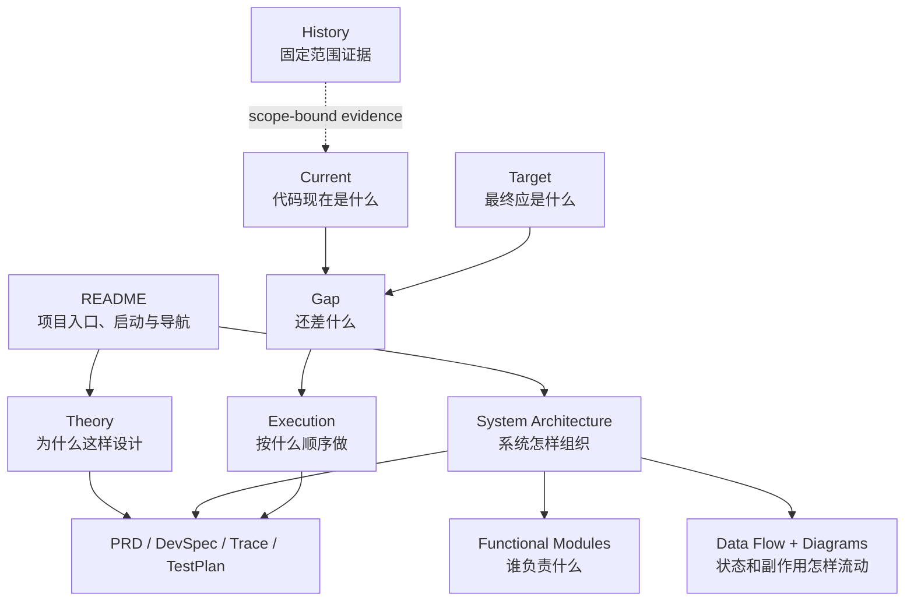

受众：MASTER
标题：Natsume AI 文档地图与权威顺序

# Natsume AI 文档地图与权威顺序

版本：v8.7
维护日期：2026-07-22
状态：`CURRENT_AUTHORITY_MAP`

## 1. 权威顺序

1. 生产代码、production composition、migration 和机器状态。
2. [当前代码事实](../50_project/arch/CURRENT_CODE_ARCHITECTURE.md)。
3. [稳定目标架构](../50_project/arch/TARGET_ARCHITECTURE.md)。
4. [当前架构差距](../50_project/arch/ARCHITECTURE_GAP_MATRIX.md)。
5. [唯一活动执行合同](../30_devspec/NEXT_GENERATION_EVOLUTION_EXECUTION.md)。
6. PRD、DevSpec、Trace 和 TestPlan。
7. 历史计划、固定 receipt 和审计快照。

README、理论、系统总览、模块地图和数据流负责解释系统，但不能覆盖上述状态 authority。历史 `DONE/PASS` 只对固定提交、环境和声明范围成立。

## 2. 文档信息架构

## 3. 按问题阅读

| 问题 | 文档 |
|---|---|
| 这是什么项目、如何运行？ | [README](../../README.md) |
| 为什么模型不能直接执行或修改人格？ | [核心理论](../15_theory/Theory.md) |
| Host、Obs、Gateway、Edge 如何协作？ | [系统架构](../50_project/arch/SYSTEM_ARCHITECTURE.md) |
| 某个功能由哪个包负责？ | [功能模块](../50_project/arch/FUNCTIONAL_MODULES.md) |
| 请求、Memory、Gateway、Edge、receipt 怎么流？ | [关键数据流](../50_project/arch/DATA_FLOW_ARCHITECTURE.md) |
| 想快速看图？ | [架构图册](../50_project/arch/diagrams/00_INDEX.md) |
| 前端如何查询和发 Operator 命令？ | [Monitor UI 架构](../50_project/arch/MONITOR_UI_ARCHITECTURE.md) |
| 服务如何部署、Docker 启动什么？ | [部署架构](../50_project/arch/DEPLOYMENT_ARCHITECTURE.md) |
| 哪些能力真的可用？ | [当前代码事实](../50_project/arch/CURRENT_CODE_ARCHITECTURE.md) |
| 为什么不能封板？ | [架构差距矩阵](../50_project/arch/ARCHITECTURE_GAP_MATRIX.md) |
| 下一阶段做什么？ | [正式执行合同](../30_devspec/NEXT_GENERATION_EVOLUTION_EXECUTION.md) |

## 4. 当前状态摘要

> 最新 locator 清点（2026-07-24）：具名 consumer `19`、具名 import `45`、全部 import-form consumer `22`，Container 为 `48/2/45`。每个 Host lifespan 现在拥有 `TribeRuntimeScope`，其负责 Tribe port bind/unbind、订阅、handoff 与 Obs reader；内部 Security Immune router 由同一 ASGI composition 的 `HostRoutePorts.security_immune_agent_provider` 构造，缺 provider 固定 `503`，不再请求期读取 locator。兼容 Tribe state/registry/agents 仍由 composition root 注入且仍为 process-global，因此共享 binding fence 只支持单活 Host、第二 scope 失败关闭，不是并发 multi-app 隔离或 Service Locator 清零。Cortex 其余准入前读路径、Conversation Experience 的正式 activation、对话提交和全局对象图仍是 `INCOMPLETE`，`REMOTE_CI=NOT_RUN_ACCOUNT_QUOTA`。

- Full Architecture：`INCOMPLETE`。
- 当前静态结构：独立 Gate 1–14=`PASS`、`failed_gates=[]`、`各 Gate issues=[]`；Acceptance 1262、ASGI 1389、Scheduler 2942，ASGI 仍低于 1400 行 Gate，focused 模块不转移 writer/lifespan/UoW authority。967行 Budget rejection Store 只拥有受约束的 internal/canonical C-boundary 写入；444行只读 exact terminal resolver供响应丢失、duplicate replay与reconciliation复用，93行纯 route helper绑定 HostCommand/TaskNode/WorkerProjection；Gate 3 `new_mixed_over_800=[]`，没有扩 allowlist。旧36文件265项只作历史。静态 PASS 不改变 Full Architecture=`INCOMPLETE` 或 NE-01=`PARTIAL / IN_PROGRESS`，`REMOTE_CI=NOT_RUN_ACCOUNT_QUOTA`。
- Host AgentRuntime：`PARTIAL_APP_LOCAL_PORT_CUTOVER`。Life authority 就绪后，Host lifespan scope 向 Input→Cortex、Life projection 与 conversation Acceptance 发布同一 immutable port bundle，并在 shutdown 撤销；model RouteCatalog、Bond stage engine、session topic/tactic stores、VTS ledger、TTS router/meta-learning 也由同一 bundle 显式供应。`TribeRuntimeScope` 进一步将 port binding、订阅、handoff 与 Obs reader 移出 process Container；production authority verifier 由 Tool/恢复组合根捕获同一 ledger provider，内部 Security Immune router 由 ASGI route port 捕获 agent provider，两者均不再执行期解析 locator；当前 locator 机械库存为 named19/45、all-form22、Container48/2/45。兼容 Tribe agents/bus 仍 process-global，scope 只能单活 fenced，不能作为底层实例隔离证据；Obs 手工 hunt 仍阻断。Direct Skill 仍是已切出的受治理 vertical slice；普通 Chat 全量、legacy Executive generic Delegate、Plan 多节点执行和其余路线不因本切片而视为 `WIRED`。
- Chat retrieval：`PARTIAL_HOST_SCOPED_READ_DEPENDENCIES`。普通 Cortex 检索只接受同一 AgentRuntime scope 提供的会话历史、偏好构造器与 recall factory；helper 不再回读 `process_services`。这不构成 Chat Acceptance、外部 delivery 或全局 locator 删除证据。
- Scheduler：`PARTIAL / DURABLE_CLOCK_OCCURRENCE_FENCE`；Internal Agent：`PARTIAL / INTERNAL_SEALED_CHECKPOINT_CONTINUATION`。受治理 Internal 单节点可在下一次 runtime activation 从 seal 后/WorkerProjection 前的密封检查点重开完整 lineage，重建唯一 projection 并继续 Verification、Acceptance、Effect、claim 与 clean/no-change promotion，Agent 不重跑。检查点 mutation 已由 composition-owned `InternalAgentCheckpointUnitOfWorkPort` 封口，WorkerProjection 只有一个物理 INSERT owner；A（projection/Operation）、B（Budget charge）、C（rejected terminal bundle）是三个 durable atomic UoW，不是整链单事务。response loss 只读重开，禁止二次 mutation。app-local 周期 worker 只做终态 sealed abandon/cleanup。周期 survivor continuation、crash-left unsealed partial cleanup、failure/cancel/budget claim closeout、general `settle_worker` crash bundle 仍缺；一般write、handle-level TOCTOU、OS/container isolation与legacy bridge也未完成，`REMOTE_CI=NOT_RUN_ACCOUNT_QUOTA`。
- 单节点 Operation 已 `COMMITTED` 后的 Budget settlement 双重响应丢失现采用不附加 lifecycle/finalization mutation 的 hold；BudgetUsage 只分为 `EXACT_ACCEPTED / EXACT_REJECTED / MISSING / CONFLICT`。Lease 到期后，更高 fence owner 可只读重开前两类或幂等补写 `MISSING`，`CONFLICT` 失败关闭，worker 不重跑。多节点/批次当前只保证安全 hold，settlement recovery 仍缺。
- Host HardState / governed Operator：`THREE_OF_37_VERTICAL_SLICES / NE01_IN_PROGRESS`。HardState 使用 migration 0115；仓库 migration head 已推进到 `0121_research_shadow_arm_operation.sql`。0118 继续封闭 visible turn、Preference 与 Life projection；0119 将签名终态修复的 exact command 与通用 TaskGraph 输入分离；0120 为 bounded fan-out 保留签名、持久化且与 build/migration/config 精确绑定的启用门禁；0121 只记录 NE-02 Research shadow 的外部双臂 reservation/claim/recovery journal。当前 `scheduler.task.trigger`、`sys_mode.switch`、`task_terminal.reconcile` 为 3/37，本地 SQLite governed integration 已通过，但真实 HTTP/network canary、波次集成、真实模型与 Docker 全栈仍未运行，`REMOTE_CI=NOT_RUN_ACCOUNT_QUOTA`。
- Durable DAG：`PARTIAL_B5C_DURABLE_CANCELLATION_SHADOW / PRODUCTION_OFF`。B5A/B5B 以显式 `result_node_id`、0091 和 canonical projection 冻结整图成功；B5C 已推进到 0098。Cancellation、Operation 签名对账与 Effect 签名对账均为 `WIRED_DEFAULT_OFF / CANARY_NOT_RUN`，开启 cancellation 时要求两类对账入口、Secure Ingress `ENFORCE`、可用 Gateway 和 verification-only Ed25519 公钥。0098 只追加 immutable case/proof sidecar：PENDING proof 可作为新 cancellation decision evidence；FINALIZED correction 只在 trusted read 验证 immutable legacy decision ref/payload digest，绝不改写旧 decision、fence 或 evidence。proof 的 case/intent/effect/fence/Attempt/resolution/actor/Outbox 与 `graph_revision` 均被签名和物理 trigger 绑定。生产门禁只阻断实际持久化且未修复/未隔离的 legacy inventory；仓库无 SQLite 资产不能证明外部生产数据已清理。Budget 高竞争、部署密钥/凭据、完整 key lifecycle 与真实 canary 仍缺，atomic、bounded 与 cancellation 均保持 OFF。
- PlanningSearch：内核可用；Code D16 有 dynamic pure-shadow catalog/compile，D17 有 `PRIVATE_BARE_WORKTREE_TRUSTED_PROCESS_ONLY` 的双 detached worktree 本地实验机械链，D18 有独立 0106 preregistration → paired evidence → `VERIFIED_CLEAN` → terminal receipt 的 append-only durable ledger。D19 仅为已预注册的冻结 `python -m pytest -q <repo-relative-test>` 在同一主机受信 worktree 子进程中强制 argv、测试次数和总验证时限，并把无路径命令回执嵌入 arm evidence；它不是模型/插件/网络/文件系统隔离、通用硬预算或 production influence。跨领域真实收益仍 `UNPROVEN`。
- Capability Planning authority：Research/Frontend 的 `CAPABILITY_SEARCH_V1` 候选上限必须同时满足 intent 请求和 Governor approved binding，effective risk 为二者最小值；冻结目录强制选择两项不同 Skill，再以 `skill → skill → chat` 编译图，grant ref 与步数进入 virtual-state lineage；缺失/畸形 binding risk 失败关闭。该本地定向证据不提升 NE-02 或收益状态。
- Persona 演化：`CENTRAL_FENCE_WIRED / PROPOSAL_PIPELINE_MISSING`。
- 长期演化程序：作为整体尚未实现。

机器状态：[current_architecture_status.json](../../configs/release/current_architecture_status.json)。摘要变化时必须先更新机器状态、Current 和 Gap，不能只改本地图。

- 受治理 Chat 与 Tribe scope：`SurfaceRuntimePorts` 在 Host lifespan 内由 AgentRuntime/Life authority 一次组装并经 Internal/Tool Runtime 注入 frozen Chat；ASGI 将同一 `InputRuntimeApplicationPorts` 交给普通 Chat、Gateway 与 ASR。它经 `TribeRuntimeAgentPorts` 取得 Thalamus/ANS，因此 `chat_handler`、输入归一化、startup 与 lifespan 不再直接读取全局 getter；缺端口失败关闭。与此同时，ASGI-owned `TribeRuntimeScope` 负责 bind/unbind、订阅与 handoff，删除旧 `ProcessTribeRuntime`。production authority verifier 也只从 Tool/恢复 composition 接收 ledger provider；内部 Security Immune router 只从 ASGI route ports 接收 agent provider，缺失返回 `503`。当前 AST inventory 为 `named19/45、all-form22、Container48/2/45`；兼容 agents/bus 仍是 process-bound，单活 fence 不是 app isolation。Chat acceptance、generic Delegate、七路线与 NE-01 仍未完成。

- Chat 检索依赖收口：`48 passed in 5.55s` 的 port/helper/lifecycle 定向集合与 `17 passed in 1.17s` 的相邻 Surface/read-route 单元集合均通过，二者可能重叠、不得相加。HTTP/波次集成和 NE-07 真实服务栈仍未运行。

## 5. 稳定合同

- [产品需求](../20_prd/PRD.md)：产品 WHAT、用户主权和验收边界。
- [工程合同](../30_devspec/DevSpec.md)：工程 MUST/MUST NOT。
- [执行任务](../30_devspec/DevTasks.md)：活动执行波的任务映射。
- [需求追溯](../60_trace/requirements_trace.md)：FR → code → test → execution wave。
- [测试计划](../../tests/TESTPLAN.md)：Gate 和测试层级。

## 6. 目录地图

| 目录 | 定位 |
|---|---|
| `10_whitepaper` | 产品宪法、用户主权和人格原则 |
| `15_theory` | 唯一核心理论总纲 |
| `20_prd` | 稳定产品需求，只写 WHAT |
| `30_devspec` | 稳定工程合同与唯一活动执行文档 |
| `35_quality` | 可复用质量规范与范围受限的旧审计 |
| `40_agents` | Codex 协作约束 |
| `45_testing` | 当前专项机器证据和实验报告 |
| `50_project` | 当前架构、部署和工程指南 |
| `50_release` | 固定提交的发布与回滚证据 |
| `60_trace` | 当前需求追溯、风险和故障记录 |
| `_history` | 历史快照，不作为 current authority |

## 7. 维护规则

1. 需求、理论、当前事实、目标、差距、执行状态和历史证据必须分文件维护。
2. 生产架构变化时按 [文档同步工作流](../50_project/guides/DOCUMENT_SYNC_WORKFLOW.md) 更新对应文档。
3. 新架构状态必须同步机器 JSON、Current、Gap、Execution 和 Trace。
4. 旧方案、完成报告和文件清单快照不得留在当前架构目录冒充现状。
5. 临时调查、命令日志和运行输出进入被忽略的 `artifacts/`，可变运行数据进入 `runtime/`。
6. 删除或移动文档时同步本地图、目录 index、链接和文档门禁策略。
