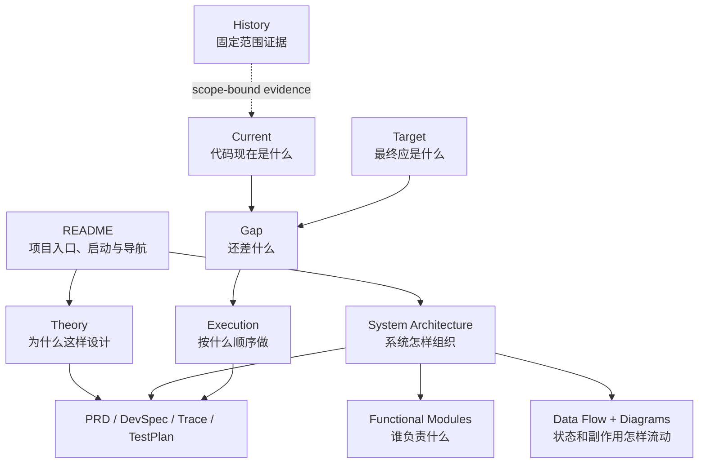

受众：MASTER
标题：Natsume AI 文档地图与权威顺序

# Natsume AI 文档地图与权威顺序

版本：v8.1
维护日期：2026-07-15
状态：`CURRENT_AUTHORITY_MAP`

## 1. 权威顺序

1. 生产代码、production composition、migration 和机器状态。
2. [当前代码事实](../50_project/arch/CURRENT_CODE_ARCHITECTURE.md)。
3. [稳定目标架构](../50_project/arch/TARGET_ARCHITECTURE.md)。
4. [当前架构差距](../50_project/arch/ARCHITECTURE_GAP_MATRIX.md)。
5. [唯一活动执行合同](../30_devspec/NEXT_GENERATION_EVOLUTION_EXECUTION.md)。
6. PRD、DevSpec、Trace 和 TestPlan。
7. 历史计划、固定 receipt 和审计快照。

README、理论、系统总览、模块地图和数据流负责解释系统，但不能覆盖上述状态 authority。历史 `DONE/PASS` 只对固定提交、环境和声明范围成立。

## 2. 文档信息架构

## 3. 按问题阅读

| 问题 | 文档 |
|---|---|
| 这是什么项目、如何运行？ | [README](../../README.md) |
| 为什么模型不能直接执行或修改人格？ | [核心理论](../15_theory/Theory.md) |
| Host、Obs、Gateway、Edge 如何协作？ | [系统架构](../50_project/arch/SYSTEM_ARCHITECTURE.md) |
| 某个功能由哪个包负责？ | [功能模块](../50_project/arch/FUNCTIONAL_MODULES.md) |
| 请求、Memory、Gateway、Edge、receipt 怎么流？ | [关键数据流](../50_project/arch/DATA_FLOW_ARCHITECTURE.md) |
| 想快速看图？ | [架构图册](../50_project/arch/diagrams/00_INDEX.md) |
| 前端如何查询和发 Operator 命令？ | [Monitor UI 架构](../50_project/arch/MONITOR_UI_ARCHITECTURE.md) |
| 服务如何部署、Docker 启动什么？ | [部署架构](../50_project/arch/DEPLOYMENT_ARCHITECTURE.md) |
| 哪些能力真的可用？ | [当前代码事实](../50_project/arch/CURRENT_CODE_ARCHITECTURE.md) |
| 为什么不能封板？ | [架构差距矩阵](../50_project/arch/ARCHITECTURE_GAP_MATRIX.md) |
| 下一阶段做什么？ | [正式执行合同](../30_devspec/NEXT_GENERATION_EVOLUTION_EXECUTION.md) |

## 4. 当前状态摘要

- Full Architecture：`INCOMPLETE`。
- Host `chat/skill/delegate/plan`：`WIRED`。
- Scheduler：`WIRED`；Internal Agent：`WIRED`（v2 仅为 executor 兼容边界）。
- Durable DAG：`PARTIAL_B4_CRASH_REENTRY_DECISION_JOURNAL`；默认关闭且 production OFF。live/re-entry outcomes 全量覆盖 admitted Graph durable terminal Nodes/latest stable Attempts（含非 selected `RETRY_PENDING`），并从 Reservation/BudgetUsage 重建同一 payload/ref exact replay；当前 batch 只定优先级/selected。ownership/CAS 后 active ownership 映射 `IN_PROGRESS`，纯 CAS为 conflict。selected Budget usage 与 row digest/Outbox/Attempt/usage fail-closed。multi-revision marker 扫描仍需 revisioned Outbox identity；其余边界不变。
- PlanningSearch：内核可用，跨领域真实收益 `UNPROVEN`。
- Persona 演化：`CENTRAL_FENCE_WIRED / PROPOSAL_PIPELINE_MISSING`。
- 长期演化程序：作为整体尚未实现。

机器状态：[current_architecture_status.json](../../configs/release/current_architecture_status.json)。摘要变化时必须先更新机器状态、Current 和 Gap，不能只改本地图。

## 5. 稳定合同

- [产品需求](../20_prd/PRD.md)：产品 WHAT、用户主权和验收边界。
- [工程合同](../30_devspec/DevSpec.md)：工程 MUST/MUST NOT。
- [执行任务](../30_devspec/DevTasks.md)：活动执行波的任务映射。
- [需求追溯](../60_trace/requirements_trace.md)：FR → code → test → execution wave。
- [测试计划](../../tests/TESTPLAN.md)：Gate 和测试层级。

## 6. 目录地图

| 目录 | 定位 |
|---|---|
| `10_whitepaper` | 产品宪法、用户主权和人格原则 |
| `15_theory` | 唯一核心理论总纲 |
| `20_prd` | 稳定产品需求，只写 WHAT |
| `30_devspec` | 稳定工程合同与唯一活动执行文档 |
| `35_quality` | 可复用质量规范与范围受限的旧审计 |
| `40_agents` | Codex 协作约束 |
| `45_testing` | 当前专项机器证据和实验报告 |
| `50_project` | 当前架构、部署和工程指南 |
| `50_release` | 固定提交的发布与回滚证据 |
| `60_trace` | 当前需求追溯、风险和故障记录 |
| `_history` | 历史快照，不作为 current authority |

## 7. 维护规则

1. 需求、理论、当前事实、目标、差距、执行状态和历史证据必须分文件维护。
2. 生产架构变化时按 [文档同步工作流](../50_project/guides/DOCUMENT_SYNC_WORKFLOW.md) 更新对应文档。
3. 新架构状态必须同步机器 JSON、Current、Gap、Execution 和 Trace。
4. 旧方案、完成报告和文件清单快照不得留在当前架构目录冒充现状。
5. 临时调查、命令日志和运行输出进入被忽略的 `artifacts/`，可变运行数据进入 `runtime/`。
6. 删除或移动文档时同步本地图、目录 index、链接和文档门禁策略。
