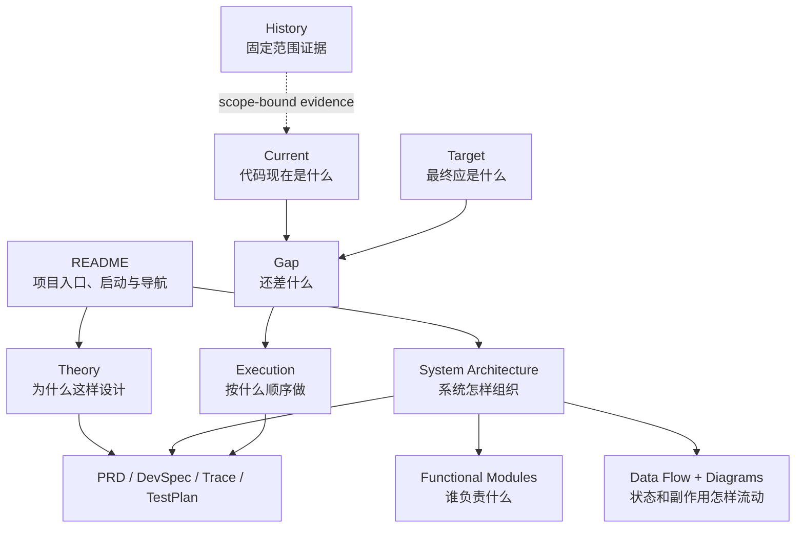

受众：MASTER
标题：Natsume AI 文档地图与权威顺序

# Natsume AI 文档地图与权威顺序

版本：v9.0
维护日期：2026-07-26
状态：`CURRENT_AUTHORITY_MAP`

## 1. 权威顺序

1. 生产代码、production composition、migration 和机器状态。
2. [当前代码事实](../50_project/arch/CURRENT_CODE_ARCHITECTURE.md)。
3. [稳定目标架构](../50_project/arch/TARGET_ARCHITECTURE.md)。
4. [当前架构差距](../50_project/arch/ARCHITECTURE_GAP_MATRIX.md)。
5. [唯一活动执行合同](../30_devspec/NEXT_GENERATION_EVOLUTION_EXECUTION.md)。
6. PRD、DevSpec、Trace 和 TestPlan。
7. 历史计划、固定 receipt 和审计快照。

README、理论、系统总览、模块地图和数据流负责解释系统，但不能覆盖上述状态 authority。历史 `DONE/PASS` 只对固定提交、环境和声明范围成立。

## 2. 文档信息架构

## 3. 按问题阅读

| 问题 | 文档 |
|---|---|
| 这是什么项目、如何运行？ | [README](../../README.md) |
| 为什么模型不能直接执行或修改人格？ | [核心理论](../15_theory/Theory.md) |
| Host、Obs、Gateway、Edge 如何协作？ | [系统架构](../50_project/arch/SYSTEM_ARCHITECTURE.md) |
| 某个功能由哪个包负责？ | [功能模块](../50_project/arch/FUNCTIONAL_MODULES.md) |
| 请求、Memory、Gateway、Edge、receipt 怎么流？ | [关键数据流](../50_project/arch/DATA_FLOW_ARCHITECTURE.md) |
| 想快速看图？ | [架构图册](../50_project/arch/diagrams/00_INDEX.md) |
| 前端如何查询和发 Operator 命令？ | [Monitor UI 架构](../50_project/arch/MONITOR_UI_ARCHITECTURE.md) |
| 服务如何部署、Docker 启动什么？ | [部署架构](../50_project/arch/DEPLOYMENT_ARCHITECTURE.md) |
| 哪些能力真的可用？ | [当前代码事实](../50_project/arch/CURRENT_CODE_ARCHITECTURE.md) |
| 为什么不能封板？ | [架构差距矩阵](../50_project/arch/ARCHITECTURE_GAP_MATRIX.md) |
| 下一阶段做什么？ | [正式执行合同](../30_devspec/NEXT_GENERATION_EVOLUTION_EXECUTION.md) |

## 4. 当前状态摘要

> 最新 locator 清点（2026-07-25）：生产具名 consumer/import、全部 import-form consumer、locator 模块、Container 字段/锁/引用均为 0。`process_service_container.py`、`process_services.py`、`process_environment.py` 与旧 wiring 已物理删除；ASGI/CLI 构造 fresh `ProcessApplicationPorts` 并显式传入 Host root。旧测试只通过 `tests/support/process_service_compat.py` 的 pytest-only bridge 运行，fresh 生产进程不会加载它。`HostAuthorityRuntimeOwner` 继续持有同一 epoch 的 canonical ledger、Episodic/LifeMemory、独立 Model 与 Capability 图。外部 Chroma/Neo4j namespace、Token/MCP durable restart、资源崩溃恢复、事务化 Chat 和完整 Worker/Obs Composition仍未闭环；`REMOTE_CI=NOT_RUN_ACCOUNT_QUOTA`。

- Full Architecture：`INCOMPLETE`。
- 当前静态结构：最新完整 Gate 1–14=`PASS`、`failed_gates=[]`；历史 `FAIL [1,3]` 已由中立合同分层和 Research shadow ledger 职责拆分关闭，不能继续当成现状，也不能把静态通过外推为运行时完成。当前 checkpoint reconciliation 新增 focused Store，不拥有独立连接/UoW，`task_repository.py` 仍低于既有 4600 行上限且没有扩大白名单。Full Architecture=`INCOMPLETE`、NE-01=`PARTIAL / IN_PROGRESS`，`REMOTE_CI=NOT_RUN_ACCOUNT_QUOTA`。
- Host AgentRuntime：`PARTIAL_APP_LOCAL_PORT_CUTOVER`。Life authority 就绪后，Host lifespan scope 向 Input→Cortex、Life projection 与 conversation Acceptance 发布同一 immutable port bundle，并在 shutdown 以 exact identity 撤销；Context、RouteCatalog、Bond、session stores、memory/state/governance/authority runtime、VTS、TTS/meta、Multimodal、heartbeat 与 startup 都显式供应。生产 locator 与 Tribe 无上下文 fallback 已物理清零，Tribe shared runtime 与 23-Agent catalog 由 Host scope fresh 持有；外部 Chroma/Neo4j namespace、资源崩溃恢复与易失 Tribe bus 仍未隔离。事务化 Chat commit、legacy Executive generic Delegate、Plan 多节点执行和其余路线不因本切片而视为 `WIRED`。
- Chat retrieval：`PARTIAL_HOST_SCOPED_READ_DEPENDENCIES`。普通 Cortex 检索只接受同一 AgentRuntime scope 提供的会话历史、偏好构造器与 recall factory；helper 不再回读 `process_services`。这不构成 Chat Acceptance、外部 delivery 或全局 locator 删除证据。
- Scheduler：`PARTIAL / DURABLE_CLOCK_OCCURRENCE_FENCE`；Internal Agent：`PARTIAL / INTERNAL_SEALED_CHECKPOINT_PERIODIC_CONTINUATION`。受治理 Internal 单节点可在首次 activation 和其后的 app-local survivor 周期中，从 seal 后/WorkerProjection 前的密封检查点重开完整 lineage，重建唯一 projection 并继续 Verification、Acceptance、Effect、claim 与 clean/no-change promotion，Agent 不重跑。Host 也在 mandatory boot scan 后周期重扫同一 exact durable admission；live Lease 只延后，到期后无需进程重启即可再次评估。检查点 mutation 已由 composition-owned `InternalAgentCheckpointUnitOfWorkPort` 封口，WorkerProjection 只有一个物理 INSERT owner；A（projection/Operation）、B（Budget charge）、C（rejected terminal bundle）是三个 durable atomic UoW，不是整链单事务。response loss 只读重开，禁止二次 mutation。crash-left unsealed partial cleanup、raw failure、其它 cancel/budget claim closeout、unknown effect 与 general `settle_worker` crash bundle 仍缺；一般write、handle-level TOCTOU、OS/container isolation与legacy bridge也未完成，`REMOTE_CI=NOT_RUN_ACCOUNT_QUOTA`。
- Operation 已 `COMMITTED` 后的 Budget settlement 双重响应丢失采用不附加 lifecycle/finalization mutation 的 hold；BudgetUsage 只分为 `EXACT_ACCEPTED / EXACT_REJECTED / MISSING / CONFLICT`。Lease 到期后，更高 fence owner 可只读重开前两类或幂等补写 `MISSING`，`CONFLICT` 失败关闭，worker 不重跑。共享 `EXCEEDED` 下 missing 只在同一快照证明唯一 sibling winner 时补写为 version-stable、共享 winner Outbox/dimensions 的 `ALREADY_EXCEEDED`；下一 owner 重开仍须复核该绑定，篡改零 Lease。真实 SQLite 已覆盖双 checkpoint 两种终态和 four-root bounded mixed settlement。`CONFLICT`、`RESERVED`、任意图形/规模、取消交叉、unknown effect 和一般多节点 recovery 仍缺。
- Governed Operator：`FIVE_OF_37_VERTICAL_SLICES / NE01_IN_PROGRESS`。仓库 migration head 已推进到 `0127_worker_projection_immutability.sql`。0126 将签名 Operation evidence 与通用 TaskGraph 物理分离；0127 禁止 canonical WorkerProjection UPDATE/DELETE。当前仍是 `scheduler.task.trigger`、`sys_mode.switch`、`task_terminal.reconcile`、窄化的 `edge.command.push` 与 `task_operation.reconcile` 5/37；checkpoint `COMMIT` 是第 5 条命令内的新动作，不虚增路线数。真实 SQLite 已证明 signed canonical projection、旧 Lease expiry、同一 Attempt、首次响应丢失 exact reopen、原图续跑和 worker 不重放；部署 key/HTTP/network canary、任意 external receipt、普通 RELEASE、general multi-node/batch、其余32个命令、真实模型与 Docker 全栈仍未运行，`REMOTE_CI=NOT_RUN_ACCOUNT_QUOTA`。
- Durable DAG：`PARTIAL_B5C_DURABLE_CANCELLATION_SHADOW / PRODUCTION_OFF`。B5A/B5B 以显式 `result_node_id`、0091 和 canonical projection 冻结整图成功；B5C 已推进到 0098。Cancellation、Operation 签名对账与 Effect 签名对账均为 `WIRED_DEFAULT_OFF / CANARY_NOT_RUN`，开启 cancellation 时要求两类对账入口、Secure Ingress `ENFORCE`、可用 Gateway 和 verification-only Ed25519 公钥。0098 只追加 immutable case/proof sidecar：PENDING proof 可作为新 cancellation decision evidence；FINALIZED correction 只在 trusted read 验证 immutable legacy decision ref/payload digest，绝不改写旧 decision、fence 或 evidence。proof 的 case/intent/effect/fence/Attempt/resolution/actor/Outbox 与 `graph_revision` 均被签名和物理 trigger 绑定。生产门禁只阻断实际持久化且未修复/未隔离的 legacy inventory；仓库无 SQLite 资产不能证明外部生产数据已清理。Budget 高竞争、部署密钥/凭据、完整 key lifecycle 与真实 canary 仍缺，atomic、bounded 与 cancellation 均保持 OFF。
- PlanningSearch：内核可用；Code D16 有 dynamic pure-shadow catalog/compile，D17 有 `PRIVATE_BARE_WORKTREE_TRUSTED_PROCESS_ONLY` 的双 detached worktree 本地实验机械链，D18 有独立 0106 preregistration → paired evidence → `VERIFIED_CLEAN` → terminal receipt 的 append-only durable ledger。D19 仅为已预注册的冻结 `python -m pytest -q <repo-relative-test>` 在同一主机受信 worktree 子进程中强制 argv、测试次数和总验证时限，并把无路径命令回执嵌入 arm evidence；它不是模型/插件/网络/文件系统隔离、通用硬预算或 production influence。跨领域真实收益仍 `UNPROVEN`。
- Capability Planning authority：Research/Frontend 的 `CAPABILITY_SEARCH_V1` 候选上限必须同时满足 intent 请求和 Governor approved binding，effective risk 为二者最小值；冻结目录强制选择两项不同 Skill，再以 `skill → skill → chat` 编译图，grant ref 与步数进入 virtual-state lineage；缺失/畸形 binding risk 失败关闭。该本地定向证据不提升 NE-02 或收益状态。
- Persona 演化：`CENTRAL_FENCE_WIRED / PROPOSAL_PIPELINE_MISSING`。
- 长期演化程序：作为整体尚未实现。

机器状态：[current_architecture_status.json](../../configs/release/current_architecture_status.json)。摘要变化时必须先更新机器状态、Current 和 Gap，不能只改本地图。

- 受治理 Chat 与 Tribe scope：`SurfaceRuntimePorts` 在 Host lifespan 内由 AgentRuntime/Life authority 一次组装并经 Internal/Tool Runtime 注入 frozen Chat；ASGI 将同一 `InputRuntimeApplicationPorts` 交给普通 Chat、Gateway 与 ASR。Authority、Bond、Memory/State 与 Governance runtime 缺失时稳定失败关闭，不再请求期解析 locator。生产 locator module/field/lock/ref=`0/0/0/0`；Input/Chat Agent ports 解析 exact Host-owned Tribe catalog。Tribe active binding 已改为 execution-local `ContextVar`：lifespan/background execution 与 HTTP request 显式激活 exact scope，两个重叠 scope 的 Agent/registry identity 已隔离，stale inherited context 失败关闭。23 个 Agent backing singleton/setter 与三类 shared runtime fallback 已归零，无 exact context 统一失败关闭；易失 bus、完整 Host multi-app canary 与外部 Chroma/Neo4j namespace 仍未收口，事务化 Chat acceptance、generic Delegate、七路线与 NE-01 仍未完成。

- Chat 检索依赖收口：`48 passed in 5.55s` 的 port/helper/lifecycle 定向集合与 `17 passed in 1.17s` 的相邻 Surface/read-route 单元集合均通过，二者可能重叠、不得相加。HTTP/波次集成和 NE-07 真实服务栈仍未运行。

## 5. 稳定合同

- [产品需求](../20_prd/PRD.md)：产品 WHAT、用户主权和验收边界。
- [工程合同](../30_devspec/DevSpec.md)：工程 MUST/MUST NOT。
- [执行任务](../30_devspec/DevTasks.md)：活动执行波的任务映射。
- [需求追溯](../60_trace/requirements_trace.md)：FR → code → test → execution wave。
- [测试计划](../../tests/TESTPLAN.md)：Gate 和测试层级。

## 6. 目录地图

| 目录 | 定位 |
|---|---|
| `10_whitepaper` | 产品宪法、用户主权和人格原则 |
| `15_theory` | 唯一核心理论总纲 |
| `20_prd` | 稳定产品需求，只写 WHAT |
| `30_devspec` | 稳定工程合同与唯一活动执行文档 |
| `35_quality` | 可复用质量规范与范围受限的旧审计 |
| `40_agents` | Codex 协作约束 |
| `45_testing` | 当前专项机器证据和实验报告 |
| `50_project` | 当前架构、部署和工程指南 |
| `50_release` | 固定提交的发布与回滚证据 |
| `60_trace` | 当前需求追溯、风险和故障记录 |
| `_history` | 历史快照，不作为 current authority |

## 7. 维护规则

1. 需求、理论、当前事实、目标、差距、执行状态和历史证据必须分文件维护。
2. 生产架构变化时按 [文档同步工作流](../50_project/guides/DOCUMENT_SYNC_WORKFLOW.md) 更新对应文档。
3. 新架构状态必须同步机器 JSON、Current、Gap、Execution 和 Trace。
4. 旧方案、完成报告和文件清单快照不得留在当前架构目录冒充现状。
5. 临时调查、命令日志和运行输出进入被忽略的 `artifacts/`，可变运行数据进入 `runtime/`。
6. 删除或移动文档时同步本地图、目录 index、链接和文档门禁策略。
