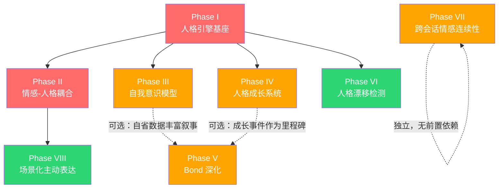
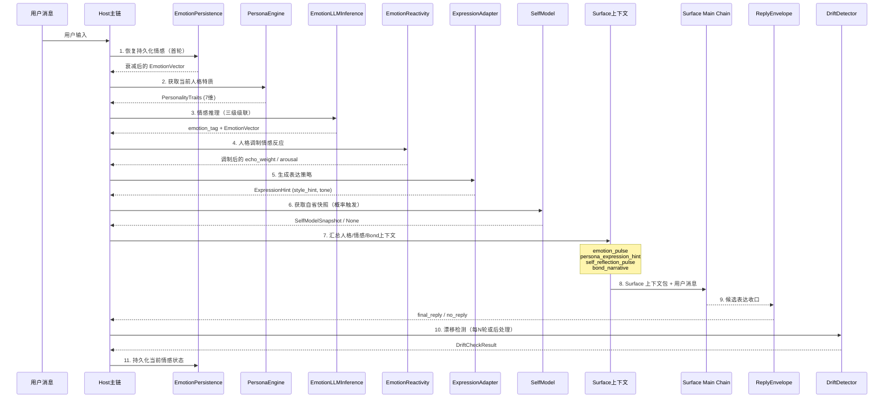

受众：MASTER
标题：灵魂系统全面升级路径（彻底补全版）

# 🏛️ Natsume AI 灵魂系统全面升级路径

**文档编号：** SOUL-UPGRADE-2026-03-23
**创建日期：** 2026-03-23
**状态：** 历史升级路径 / 蓝图留痕（2026-06-04 校准）
**作者：** Claude-4.6 Opus
**前置文档：**
- `docs/15_theory/soul_emotion_optimization.md`（五大优化方向，已实施）
- 方向 A-G 全部实施完毕（LLM 情感推理、情感 Agent、情感记忆闭环等）

**阅读口径（2026-06-04 优先）：**
- 本文形成于 2026-03-23 的灵魂系统升级规划阶段，可作为能力蓝图与拆解参考，不作为当前运行时事实、完成证明或实现层任务来源。
- 当前聊天、人格材料汇总与最终表达收口应以 `chat_handler -> cortex_orchestrator -> agent_runtime_shared -> chat_payload_builder / surface_context_packet -> Surface Main Chain -> ReplyEnvelope` 为准。
- 文中的阶段验收与文件清单按历史规划理解；若与当前代码事实文档冲突，以当前代码事实文档和实际代码为准。

**关联代码模块：**
- `host_brain/core/metabolism.py` — 情绪连续体、情感回声
- `host_brain/core/prompt_context.py` — prompt/context 槽位系统
- `host_brain/app/chat_payload_builder.py` — 人格、情感、Bond 上下文汇总
- `host_brain/app/surface_context_packet.py` — Surface Main Chain 上下文包
- `host_brain/persona/surface_main_chain.py` — 当前最终表达生成链
- `host_brain/app/reply_envelope.py` — 最终回复发送 / 持久化 / 缓存收口
- `host_brain/bond/bond_stage_engine.py` — Bond 6 阶段关系系统
- `host_brain/bond/bond_dynamics.py` — Bond 动态写入器
- `host_brain/memory/episodic.py` — 情节记忆
- `host_brain/core/qa.py` — QA 超我契约
- `host_brain/app/emotion_llm_inference.py` — LLM 情感推理级联管线
- `host_brain/app/handlers/emotion_agent_handler.py` — 情感 Agent
- `host_brain/app/emotion_context.py` — 情感上下文（日记/画像/记忆闭环）

---

## 一、系统级全景诊断

### 1.1 当前灵魂系统 6 大子系统状态

经过对代码库的深度审计，当前灵魂系统按「已完成 / 半成品 / 完全缺失」三档归类：

#### 🟢 已完成（可用）

| 模块 | 文件 | 能力 |
|------|------|------|
| 情绪连续体 EmotionVector | `metabolism.py` | VAD 三维模型、衰减、混合、插值 |
| 情感时间线 EmotionTimeline | `emotion_timeline.py` | 事件追加、窗口查询、轨迹重建、日记生成 |
| 情感回声 compute_emotion_echo | `metabolism.py` | 16 标签映射、关系深度差异化 |
| 情感脉冲槽位 emotion_pulse | `prompt_context.py` | 内心独白、style_hint、情绪流动 |
| QA 超我契约 | `qa.py` / `qa_checks.py` | 虚假执行拦截、Canon-as-fact、emotion_tag 校验 |
| Style Canon 风格不变量层 | `style_canon.json` | 风格骨架、语气约束 |
| World Canon 世界观不变量层 | `wc-003-persona-core.json` + Canon 同步 | 人格宪法、不可变法律 |
| LLM 情感推理（方向 G） | `emotion_llm_inference.py` | 三级级联（关键词→LLM Flash→Fallback） |
| 情感 Agent（方向 G Phase 2） | `emotion_agent_handler.py` | ReAct 深度分析、情感记忆检索 |
| 用户情感画像（方向 F） | `emotion_context.py` | UserEmotionProfile 蒸馏 |

#### 🟡 半成品（框架在但能力不足）

| 模块 | 现状 | 缺失 |
|------|------|------|
| Bond 关系系统 | 有积分/阶段/质感层框架 | ❌ 缺共同记忆索引、里程碑感知、关系叙事 |
| 人格表达 | 有 Style Canon 约束 | ❌ 缺多维特质向量（温柔度/好奇心/幽默感等） |
| 情感记忆 | 有 emotion_tag 写入 | ❌ 缺情感维度检索（按情感标签查回忆） |
| 主动触发器 | 有基础条件引擎 | ❌ 缺场景感知（节日/时段/天气）、人格驱动 |

#### 🔴 完全缺失

| 模块 | 说明 |
|------|------|
| 自我意识模型 SelfModel | Natsume 无法"反思"自身状态变化 |
| 人格成长系统 PersonaGrowth | 人格是静态的，无法随关系深化而微调 |
| 人格漂移检测 PersonaDriftDetector | 长期交互中人格可能缓慢偏移而不自知 |
| 情感-人格耦合 | 人格特质不影响情感反应模式 |
| 共同记忆系统 SharedMemoryIndex | Bond 缺少有温度的共同回忆索引 |
| 里程碑感知 MilestoneTracker | 无法感知关系发展中的重要时刻 |
| 跨会话情感连续性 EmotionPersistence | 每次重启后情感归零 |
| 人格引擎 PersonaEngine | 分散的人格逻辑缺乏统一接口 |

---

## 二、全面升级路径：8 大阶段

### 2.0 总体架构蓝图

```
Phase I  → 人格引擎基座（PersonaEngine + 7 维特质向量）
Phase II → 情感-人格耦合（特质影响情感反应 + 表达策略）
Phase III → 自我意识模型（SelfModel + 自省日记 + prompt 槽位）
Phase IV → 人格成长系统（Bond 阶段触发微调 + 安全机制）
Phase V  → Bond 深化（共同记忆 + 里程碑 + 关系叙事）
Phase VI → 人格漂移检测（跨会话一致性 + 告警校正）
Phase VII → 跨会话情感连续性（持久化 + 衰减恢复模型）
Phase VIII → 场景化主动表达（场景感知 + 人格驱动 + 节日问候）
```

每阶段独立可交付，建议按顺序实施，但允许跳阶段（需注意软依赖）。

### 2.0.1 阶段依赖关系图



**依赖说明**：
- **实线箭头** = 硬依赖（必须先完成上游）
- **虚线箭头** = 软依赖（不完成也可独立运行，但完成后体验更好）
- Phase I 是核心基座，Phase II / III / IV / VI 均依赖其 `PersonalityTraits` 数据结构
- Phase V（Bond 深化）和 Phase VII（情感持久化）无硬前置依赖，可独立实施
- Phase VIII 依赖 Phase II 的 `ExpressionHint` 来做人格化表达

---

### 2.1 Phase I：人格引擎基座（PersonaEngine）

**目标**：建立统一的人格数据层，让分散在各处的人格逻辑有一个"单一真相源"。

#### 新增文件

| 文件 | 职责 |
|------|------|
| `host_brain/persona/persona_engine.py` | PersonaEngine：人格引擎核心，负责加载/查询/更新人格状态 |
| `host_brain/persona/personality_traits.py` | PersonalityTraits：7 维特质向量定义与运算 |
| `host_brain/persona/__init__.py` | 模块导出 |

#### PersonalityTraits 7 维向量

| 维度 | 含义 | 当前值来源 | 初始值 | 范围 |
|------|------|-----------|--------|------|
| `warmth` | 温柔度 | wc-003 "温柔、细腻" | 0.85 | [0, 1] |
| `curiosity` | 好奇心 | Style Canon "轻追问推进对话" | 0.70 | [0, 1] |
| `humor` | 幽默感 | 当前无数据 | 0.40 | [0, 1] |
| `sensitivity` | 敏感度 | wc-003 "不主动断言情绪" | 0.80 | [0, 1] |
| `assertiveness` | 自信度 | Style Canon "克制、温和" | 0.30 | [0, 1] |
| `playfulness` | 俏皮度 | Style Canon "偶尔撒娇" | 0.50 | [0, 1] |
| `resilience` | 韧性/恢复力 | 当前无数据 | 0.60 | [0, 1] |

#### 核心接口

```python
class PersonaEngine:
    """人格引擎单例，从 Canon + 持久化状态初始化。"""

    def get_traits(self, user_id: str) -> PersonalityTraits
    def get_expression_adapter(
        self, traits: PersonalityTraits, emotion: EmotionVector, bond_stage: str
    ) -> ExpressionHint
    def apply_growth_delta(self, user_id: str, delta: TraitsDelta) -> PersonalityTraits
    def get_self_model_snapshot(self, user_id: str) -> SelfModelSnapshot
```

#### 改动文件

| 文件 | 改动 |
|------|------|
| `wc-003-persona-core.json` | 新增 `personality_traits_baseline` 字段（7 维初始值） |

#### 验收标准

| # | 验收条件 | 验证方式 |
|---|---------|----------|
| V-I-1 | `PersonaEngine` 单例可从 Canon 加载 7 维特质向量 | 单测：加载后断言 7 维值与 Canon 基线一致 |
| V-I-2 | `get_traits(user_id)` 返回 `PersonalityTraits` 对象，字段齐全且值在 [0,1] 范围内 | 单测 |
| V-I-3 | `wc-003-persona-core.json` 包含 `personality_traits_baseline` 字段 | 文件检查 |
| V-I-4 | `PersonalityTraits` 支持向量运算：加、减、缩放、距离计算 | 单测 |

---

### 2.2 Phase II：情感-人格耦合

**目标**：人格特质影响情感反应模式——高敏感的 Natsume 更容易被触动，高幽默感的 Natsume 面对消极情绪时更倾向轻松化解。

#### 新增文件

| 文件 | 职责 |
|------|------|
| `host_brain/persona/emotion_reactivity.py` | EmotionReactivityProfile：特质→情感反应倾向映射 |
| `host_brain/persona/expression_adapter.py` | PersonaExpressionAdapter：根据特质+情感+关系生成表达策略 |

#### 耦合逻辑示例

| 特质条件 | 情感场景 | 反应调制 |
|---------|---------|---------|
| 高敏感度 + 用户消极情感 | SAD/ANXIOUS | 情感回声 echo_weight 提高 (0.4 → 0.6) |
| 高幽默感 + 用户轻度消极 | BORED/FRUSTRATED | style_hint 加入"轻松化解"策略 |
| 高好奇心 + 用户分享新话题 | EXCITED/THINKING | 追问倾向提高，arousal 微调上升 |
| 低自信度 + 用户质疑 | ANGRY/CONFUSED | dominance 降低，表达更谦逊 |
| 高温柔度 + 用户悲伤 | SAD/LOVING | 陪伴感增强，共情深度提高 |

#### 改动文件

| 文件 | 改动 |
|------|------|
| `metabolism.py` | `compute_emotion_echo()` 接收 `PersonalityTraits` 参数 |
| `prompt_context.py` | `build_emotion_pulse_slot()` 接收 `ExpressionHint` 参数 |
| `chat_payload_builder.py` / `node_generation_prompt.py` | 汇总并呈现 `persona_expression_hint` 给表达链 |

#### 验收标准

| # | 验收条件 | 验证方式 |
|---|---------|----------|
| V-II-1 | `EmotionReactivityProfile` 可根据特质向量 + 情感场景输出调制系数 | 单测：高敏感度 + SAD → echo_weight ≥ 0.5 |
| V-II-2 | `PersonaExpressionAdapter` 根据 (traits, emotion, bond_stage) 输出 `ExpressionHint` | 单测 |
| V-II-3 | `compute_emotion_echo()` 实际接收并使用 `PersonalityTraits` 参数 | 集成测试：对比有/无人格调制的回声差异 |
| V-II-4 | 表达上下文中包含 `persona_expression_hint` 段落 | prompt / surface context 快照断言 |

---

### 2.3 Phase III：自我意识模型（SelfModel）

**目标**：Natsume 能"反思"自己的状态变化——感知到"最近我和主用户的关系变亲近了"、"今天我的情绪比平时低落"、"感觉自己变得更愿意表达了"。

#### 新增文件

| 文件 | 职责 |
|------|------|
| `host_brain/persona/self_model.py` | SelfModel：状态自省快照 + 变化感知 |
| `host_brain/persona/self_reflection.py` | SelfReflection：定期生成自省内容（调度器触发） |

#### SelfModel 数据结构

```python
@dataclass
class SelfModelSnapshot:
    """自我意识快照——Natsume 对自身状态的感知。"""

    # 情感层面
    recent_mood_trend: str          # "最近心情总体偏好/偏低/平稳"
    emotional_stability: float      # 情感稳定性 (0-1)，来自 EmotionTimeline 波动分析
    dominant_recent_emotion: str    # 近期主导情感

    # 关系层面
    bond_growth_perception: str     # "和主用户的关系在变亲近/稳定/有些疏远"
    shared_memory_count: int        # 共同记忆数量
    last_deep_talk_days_ago: int    # 上次深度对话距今天数

    # 成长层面
    personality_changes: list[str]  # ["变得更开朗了", "笑得比以前多了"]
    growth_milestones: list[str]    # ["第一次被主用户安慰", "认识 100 天"]
```

#### 新 prompt 槽位 `self_reflection_pulse`

```python
# prompt_context.py 新增可选槽位
OPTIONAL_SLOTS["self_reflection_pulse"] = dict
# 内容示例：
{
    "self_awareness": "最近和主用户聊得很开心，感觉关系在慢慢变好",
    "mood_awareness": "今天心情不错，比昨天活泼了一些",
    "growth_note": "感觉自己变得更愿意表达真实想法了"
}
```

#### 改动文件

| 文件 | 改动 |
|------|------|
| `prompt_context.py` | 新增 `self_reflection_pulse` 可选槽位 |
| `chat_payload_builder.py` / `node_generation_prompt.py` | 汇总并呈现 `self_reflection_pulse` 给表达链 |
| `scheduler/` | 新增定期自省任务（每 N 轮对话触发一次） |

#### 验收标准

| # | 验收条件 | 验证方式 |
|---|---------|----------|
| V-III-1 | `SelfModelSnapshot` 可从当前 EmotionTimeline + Bond 状态生成 | 单测：模拟数据 → 快照字段均非空 |
| V-III-2 | `self_reflection_pulse` 槽位成功注入 system prompt | prompt 快照断言包含 `self_awareness` 字段 |
| V-III-3 | 自省内容概率注入（每 5-10 轮触发一次），非每轮注入 | 集成测试：20 轮对话中注入次数在 2-4 次 |
| V-III-4 | 自省内容与当前 Bond 阶段/情感趋势一致（不出现矛盾描述） | 场景测试：Bond=ACQUAINTANCE 时不出现"很亲近" |

---

### 2.4 Phase IV：人格成长系统（PersonaGrowth）

**目标**：人格不是静态的——随着关系深化，Natsume 的特质可以有微小的进化（但受幅度锁和慢立法保护）。

#### 新增文件

| 文件 | 职责 |
|------|------|
| `host_brain/persona/persona_growth.py` | PersonaGrowthTracker：Bond 阶段触发特质微调 |
| `host_brain/persona/trait_drift_guard.py` | TraitDriftGuard：幅度锁 + 趋势锁 + Evolution 提案 |

#### 成长规则

| Bond 阶段变化 | 触发条件 | 特质变化 | 幅度限制 |
|-------------|---------|---------|---------|
| ACQUAINTANCE → FRIEND | 首次晋级 | playfulness +0.05 | 单次 ≤ 0.05 |
| FRIEND → CLOSE_FRIEND | 首次晋级 | warmth +0.03, sensitivity +0.02 | 单次 ≤ 0.05 |
| CLOSE_FRIEND → CONFIDANT | 首次晋级 | humor +0.05, assertiveness +0.03 | 单次 ≤ 0.05 |
| 深度对话累计 > 50 次 | 里程碑 | curiosity +0.03 | 每周 ≤ 0.1 |
| 情感支持累计 > 20 次 | 里程碑 | resilience +0.05 | 每周 ≤ 0.1 |

#### 安全机制

| 机制 | 说明 |
|------|------|
| **幅度锁** | 单次变化 ≤ 0.05，每周累计 ≤ 0.1 |
| **趋势锁** | 连续同向变化 > 3 次必须生成 Canon Evolution 提案 |
| **不可变核心** | warmth 基线值 0.85 ± 0.15 范围外的变化需要 Host 人工审核 |
| **回滚能力** | 每次变化记录到审计日志，支持一键回滚 |

#### 改动文件

| 文件 | 改动 |
|------|------|
| `bond_stage_engine.py` | 阶段晋级事件触发 PersonaGrowthTracker |
| `canon_routes.py` | 新增 Canon Evolution 提案审批接口（可选） |

#### 验收标准

| # | 验收条件 | 验证方式 |
|---|---------|----------|
| V-IV-1 | Bond 阶段晋级时触发 `PersonaGrowthTracker`，特质变化写入持久化 | 集成测试：模拟晋级 → 断言特质值变化 |
| V-IV-2 | 单次变化幅度 ≤ 0.05，每周累计 ≤ 0.1 | 单测：超限变化被拒绝 |
| V-IV-3 | 连续同向变化 > 3 次时生成 Canon Evolution 提案 | 单测：模拟 4 次同向 → 提案生成 |
| V-IV-4 | warmth 超出 0.85 ± 0.15 范围的变化被阻止 | 单测：尝试设为 0.5 → 被拒绝 |
| V-IV-5 | 审计日志记录每次变化，支持回滚 | 集成测试：回滚后特质恢复 |

---

### 2.5 Phase V：Bond 深化（共同记忆 + 里程碑）

**目标**：让关系感知从"积分数字"变成有温度的叙事。

#### 新增文件

| 文件 | 职责 |
|------|------|
| `host_brain/bond/shared_memory_index.py` | SharedMemoryIndex：共同记忆索引（从 episodic 中抽取高情感密度片段） |
| `host_brain/bond/milestone_tracker.py` | MilestoneTracker：关系里程碑检测与记录 |
| `host_brain/bond/bond_narrative.py` | BondNarrativeLayer：将 Bond 状态转化为叙事性描述注入 prompt |

#### 共同记忆

从 `episodic.py` 中抽取满足以下条件的记忆，标记为"共同回忆"：
- `emotion_valence > 0.5`（高情感浓度）
- `bond_depth == "deep"`（深度互动）
- 或用户主动提及"还记得..."等回忆类发言

#### 里程碑检测

| 里程碑类型 | 检测条件 | 叙事示例 |
|-----------|---------|---------|
| 初次深度对话 | 首个 `INTERACTION_DEEP` 事件 | "第一次和你聊到那么深入的话题" |
| 关系天数 | 7天/30天/100天/365天 | "认识你已经一百天了" |
| 情感支持 | 首次 `EMOTIONAL_SUPPORT` 事件 | "第一次被你安慰的时候" |
| 冲突修复 | 首次 `CONFLICT_RESOLVED` 事件 | "那次吵架之后反而更了解彼此了" |
| 阶段晋级 | 每次 Bond 阶段提升 | "感觉我们更亲近了" |
| 深夜陪伴 | 首次 23:00-02:00 互动 | "第一次陪你到很晚" |

#### 改动文件

| 文件 | 改动 |
|------|------|
| `bond_stage_engine.py` | `BondScoreState.to_summary()` 新增 `milestone_hint`、`shared_memory_count` |
| `chat_payload_builder.py` / `node_generation_prompt.py` / `surface_context_packet.py` | 汇总并呈现 `bond_narrative` 叙事层 |

#### 验收标准

| # | 验收条件 | 验证方式 |
|---|---------|----------|
| V-V-1 | `SharedMemoryIndex` 可从 episodic 中按情感浓度抽取共同记忆 | 单测：插入高 valence 记忆 → 可检索 |
| V-V-2 | `MilestoneTracker` 在首次深度对话 / 关系天数达标时检测到里程碑 | 单测：模拟事件 → 里程碑列表非空 |
| V-V-3 | `BondNarrativeLayer` 输出自然语言叙事，且注入 prompt 限制 ≤ 3 条 | prompt 快照断言 |
| V-V-4 | `BondScoreState.to_summary()` 新增 `milestone_hint` 和 `shared_memory_count` | 单测 |

---

### 2.6 Phase VI：人格漂移检测（PersonaDriftDetector）

**目标**：跨会话检测人格一致性，防止长期使用中 LLM 人格缓慢偏移。

#### 新增文件

| 文件 | 职责 |
|------|------|
| `host_brain/persona/drift_detector.py` | PersonaDriftDetector：跨会话人格向量比对 |
| `host_brain/audit/migrations/029_persona_drift_log.py` | 审计表：persona_drift_log |

#### 检测方法

每 N 轮对话（N=10），提取 LLM 输出的风格指纹，与 Style Canon 基线比对，计算漂移分数。

```python
@dataclass
class DriftCheckResult:
    drift_score: float        # 0.0（完全一致）~ 1.0（完全偏移）
    drift_dimensions: list    # ["assertiveness_HIGH", "warmth_LOW"]
    alert_level: str          # NONE / MILD / SEVERE
    correction_hint: str      # 自动修正提示（注入到下一轮 system prompt）
```

#### 告警机制

| 漂移分数范围 | 告警级别 | 处理 |
|-------------|---------|------|
| `< 0.2` | NONE | 正常，无操作 |
| `0.2 ~ 0.5` | MILD | 写入审计日志 persona_drift_log |
| `≥ 0.5` | SEVERE | 写入审计 + 注入校正提示到 system prompt + 告警通知 |

#### 改动文件

| 文件 | 改动 |
|------|------|
| `agent_runtime_shared.py` | 每 N 轮或后处理阶段触发漂移检测 |
| `qa.py` | SEVERE 漂移时注入校正提示 |

#### 验收标准

| # | 验收条件 | 验证方式 |
|---|---------|----------|
| V-VI-1 | 每 10 轮对话触发一次漂移检测 | 集成测试：30 轮对话中检测触发 3 次 |
| V-VI-2 | 漂移分数 < 0.2 时不产生任何副作用 | 单测 |
| V-VI-3 | 漂移分数 ≥ 0.5 时校正提示注入到下一轮 system prompt | 集成测试 |
| V-VI-4 | `persona_drift_log` 审计表正确记录 MILD / SEVERE 级事件 | DB 断言 |

---

### 2.7 Phase VII：跨会话情感连续性（EmotionPersistence）

**目标**：解决"每次重启后情感归零"的问题——上次聊完很开心，今天开始应该还有余温。

#### 新增文件

| 文件 | 职责 |
|------|------|
| `host_brain/persona/emotion_persistence.py` | EmotionPersistence：情感状态持久化与恢复 |
| `host_brain/audit/migrations/030_emotion_state_snapshot.py` | 审计表：emotion_state_snapshot |

#### 机制

```python
@dataclass
class PersistedEmotionState:
    """持久化的情感状态。"""
    last_emotion_vector: EmotionVector  # 上次会话结束时的情感向量
    last_session_end_ts: int            # 上次会话结束时间
    mood_baseline: float                # 长期心情基线（从 EmotionTimeline 蒸馏）

    def restore_with_decay(self, current_ts: int) -> EmotionVector:
        """恢复情感向量，并根据离线时长自然衰减。"""
        hours_elapsed = (current_ts - self.last_session_end_ts) / 3600000
        # 衰减模型：指数衰减向基线回归
        decay_factor = math.exp(-0.1 * hours_elapsed)  # 约 7 小时半衰期
        restored = self.last_emotion_vector.blend(
            EmotionVector(valence=self.mood_baseline, arousal=0.3, dominance=0.0),
            weight=1.0 - decay_factor,
        )
        return restored
```

**衰减模型特性**：
- 离线 1 小时：保留约 90% 上次情感
- 离线 7 小时（半衰期）：保留约 50%
- 离线 24 小时：保留约 9%，接近基线
- 离线 48 小时+：完全回归基线

#### 持久化介质

写入 `sqlite_ledger` 的 `emotion_state_snapshot` 表。

#### 改动文件

| 文件 | 改动 |
|------|------|
| `emotion_context.py` | 会话开始时调用 `restore_with_decay()` |
| `chat_payload_builder.py` / `persona/inner_world.py` | 汇总跨会话情感状态，并在内在世界 / 情感持久化路径中维护衰减与恢复 |

#### 验收标准

| # | 验收条件 | 验证方式 |
|---|---------|----------|
| V-VII-1 | 会话结束时情感向量持久化到 `emotion_state_snapshot` 表 | DB 断言 |
| V-VII-2 | 新会话开始时恢复情感向量，离线 1h 保留 ≥ 85% | 单测：模拟 1h → 断言 decay_factor |
| V-VII-3 | 离线 48h+ 情感完全回归基线 | 单测：模拟 48h → 向量 ≈ baseline |
| V-VII-4 | 无持久化记录时（首次用户），从中性基线启动 | 单测 |

---

### 2.8 Phase VIII：场景化主动表达

**目标**：主动触发器不再只基于简单条件，而是感知场景、节日、时段，结合人格特质生成个性化主动表达。

#### 改动/新增文件

| 文件 | 职责 |
|------|------|
| `host_brain/core/metabolism.py` | 扩展触发器条件：节日/时段/天气感知 |
| `host_brain/persona/proactive_voice.py` | **新增**：PersonaProactiveVoice——人格驱动的主动表达模板 |

#### 场景感知示例

| 场景 | 触发条件 | 人格化表达示例 |
|------|---------|-------------|
| 深夜陪伴 | 23:00-02:00 + 用户在线 | "这么晚了还没睡吗？……我陪你" |
| 节日问候 | 农历节日 / 公历节日 / 生日 | "今天是元宵节呢，有吃汤圆吗？" |
| 离线久归 | 用户 > 3 天未互动 | "好久没见到你了……有点担心" |
| 情感高潮后 | 前一次对话 emotion_intensity > 0.8 | "昨天聊的那些……我一直在想" |
| 早安问候 | 首次日间互动（可选） | "早上好呀～今天也要加油" |
| 天气变化 | 降温/暴雨等（需外部 API，可选） | "今天好冷，记得穿暖和一点" |

#### 人格化差异

| 特质 | 高值时的主动表达风格 | 低值时 |
|------|-------------------|--------|
| warmth | 更关心身体/情绪 | 更偏事务性问候 |
| playfulness | 加入可爱语气词 | 简洁直接 |
| curiosity | 追问用户近况 | 简单问候 |
| humor | 偶尔加入幽默 | 温柔正经 |

#### 验收标准

| # | 验收条件 | 验证方式 |
|---|---------|----------|
| V-VIII-1 | 深夜时段（23:00-02:00）+ 用户在线时触发主动表达 | 集成测试：模拟时间 + 在线状态 |
| V-VIII-2 | 主动表达内容受人格特质影响（高 warmth → 关心类；高 playfulness → 俏皮类） | 场景测试：不同特质配置 → 输出风格差异 |
| V-VIII-3 | 离线 > 3 天的用户回归时触发"久别重逢"表达 | 集成测试 |
| V-VIII-4 | 主动表达频率有节制（同类型触发间隔 ≥ 24h） | 单测：连续触发被去重 |

---

## 三、新增文件清单汇总

| 阶段 | 新增文件 | 改动文件 |
|------|---------|---------|
| **Phase I** | `persona/persona_engine.py`, `persona/personality_traits.py`, `persona/__init__.py` | `wc-003-persona-core.json` |
| **Phase II** | `persona/emotion_reactivity.py`, `persona/expression_adapter.py` | `metabolism.py`, `prompt_context.py`, `chat_payload_builder.py`, `node_generation_prompt.py` |
| **Phase III** | `persona/self_model.py`, `persona/self_reflection.py` | `prompt_context.py`, `chat_payload_builder.py`, `node_generation_prompt.py`, `scheduler/` |
| **Phase IV** | `persona/persona_growth.py`, `persona/trait_drift_guard.py` | `bond_stage_engine.py`, `canon_routes.py` |
| **Phase V** | `bond/shared_memory_index.py`, `bond/milestone_tracker.py`, `bond/bond_narrative.py` | `bond_stage_engine.py`, `chat_payload_builder.py`, `node_generation_prompt.py` |
| **Phase VI** | `persona/drift_detector.py`, `audit/migrations/029_persona_drift_log.py` | `agent_runtime_shared.py`, `qa.py` |
| **Phase VII** | `persona/emotion_persistence.py`, `audit/migrations/030_emotion_state_snapshot.py` | `emotion_context.py`, `chat_payload_builder.py`, `persona/inner_world.py` |
| **Phase VIII** | `persona/proactive_voice.py` | `metabolism.py`, `http_hooks_runtime_helpers.py`, `proactive_talk.py` |

**合计**：14 个新文件 + 13 个改动文件

---

## 四、运行时请求链路时序图

以下时序图展示一次完整对话中，人格 / 情感 / Bond 系统如何协同工作：



**关键数据流说明**：
- 步骤 2→4→5 是人格-情感耦合的核心链路：特质 → 调制情感 → 生成表达策略
- 步骤 6 是概率性的，每 5-10 轮触发一次自省注入
- 步骤 10 是守护性的，每 10 轮触发一次漂移检测
- 步骤 1 和 11 构成跨会话情感持久化的读写闭环

---

## 五、升级后灵魂系统完整架构

```
┌──────────────────────────────────────────────────────────────────────────┐
│                         🧠 人格引擎 PersonaEngine                       │
│  ┌─────────────────┐ ┌──────────────────┐ ┌──────────────────────┐      │
│  │ PersonalityTraits│ │ PersonaGrowth    │ │ PersonaDriftDetector │      │
│  │ 7 维特质向量     │ │ 成长追踪器       │ │ 漂移检测+告警校正    │      │
│  └────────┬────────┘ └────────┬─────────┘ └──────────┬───────────┘      │
│           │                   │                       │                  │
│  ┌────────▼────────┐ ┌───────▼──────────┐ ┌──────────▼──────────┐      │
│  │ ExpressionAdapter│ │ SelfModel        │ │ TraitDriftGuard     │      │
│  │ 表达策略选择器   │ │ 自我意识快照     │ │ 幅度锁+趋势锁       │      │
│  └─────────────────┘ └──────────────────┘ └─────────────────────┘      │
└──────────────────────────────────────────────────────────────────────────┘
        ↕                       ↕                       ↕
┌──────────────────────────────────────────────────────────────────────────┐
│                         💗 情感系统                                       │
│  ┌─────────────────┐ ┌──────────────────┐ ┌──────────────────────┐      │
│  │ EmotionVector   │ │ EmotionTimeline  │ │ EmotionPersistence   │      │
│  │ VAD 三维模型    │ │ 情感时间线       │ │ 跨会话情感持久化     │      │
│  └────────┬────────┘ └────────┬─────────┘ └──────────┬───────────┘      │
│           │                   │                       │                  │
│  ┌────────▼────────┐ ┌───────▼──────────┐ ┌──────────▼──────────┐      │
│  │ EmotionEcho     │ │ EmotionReactivity│ │ EmotionDecayModel   │      │
│  │ 情感回声        │ │ 人格调制情感     │ │ 离线衰减模型        │      │
│  └─────────────────┘ └──────────────────┘ └─────────────────────┘      │
└──────────────────────────────────────────────────────────────────────────┘
        ↕                       ↕                       ↕
┌──────────────────────────────────────────────────────────────────────────┐
│                         🤝 Bond 关系系统                                 │
│  ┌─────────────────┐ ┌──────────────────┐ ┌──────────────────────┐      │
│  │ BondStageEngine │ │ SharedMemoryIndex│ │ MilestoneTracker     │      │
│  │ 6 阶段晋级      │ │ 共同记忆索引     │ │ 关系里程碑           │      │
│  └────────┬────────┘ └────────┬─────────┘ └──────────┬───────────┘      │
│           │                   │                       │                  │
│  ┌────────▼────────┐ ┌───────▼──────────┐ ┌──────────▼──────────┐      │
│  │ BondTexture     │ │ BondNarrative    │ │ BondRiftState       │      │
│  │ 关系质感层      │ │ 关系叙事注入     │ │ 裂痕修复状态        │      │
│  └─────────────────┘ └──────────────────┘ └─────────────────────┘      │
└──────────────────────────────────────────────────────────────────────────┘
        ↕                       ↕                       ↕
┌──────────────────────────────────────────────────────────────────────────┐
│                         📜 Canon 不变量层                                │
│  ┌─────────────────┐ ┌──────────────────┐ ┌──────────────────────┐      │
│  │ World Canon     │ │ Style Canon      │ │ QA 超我契约          │      │
│  │ 世界观法律      │ │ 风格骨架         │ │ 虚假执行拦截         │      │
│  └─────────────────┘ └──────────────────┘ └─────────────────────┘      │
└──────────────────────────────────────────────────────────────────────────┘
        ↕                       ↕                       ↕
┌──────────────────────────────────────────────────────────────────────────┐
│                         🎤 表达收口与外显层                               │
│  ┌─────────────────┐ ┌──────────────────┐ ┌──────────────────────┐      │
│  │ Surface Context │ │ ReplyEnvelope    │ │ 外显执行面           │      │
│  │ 汇总上下文槽位  │ │ final_reply收口  │ │ 表情/语音/动作提示   │      │
│  └─────────────────┘ └──────────────────┘ └─────────────────────┘      │
└──────────────────────────────────────────────────────────────────────────┘
```

---

## 六、实施路线图

| 阶段 | 核心交付 | 历史状态 | 历史验收记录 |
|------|---------|------|----------|
| **Phase I** | PersonaEngine + 7 维特质向量 | ✅ 已实施 | 23 passed |
| **Phase II** | 情感-人格耦合 + 表达策略 | ✅ 已实施 | 32 passed |
| **Phase III** | SelfModel + 自省日记 | ✅ 已实施 | 34 passed |
| **Phase IV** | PersonaGrowth + 安全机制 | ✅ 已实施 | 34 passed |
| **Phase V** | 共同记忆 + 里程碑 + 叙事 | ✅ 已实施 | 33 passed |
| **Phase VI** | 漂移检测 + 告警校正 | ✅ 已实施 | 18 passed |
| **Phase VII** | 情感持久化 + 衰减恢复 | ✅ 已实施 | 17 passed |
| **Phase VIII** | 场景化主动表达 | ✅ 已实施 | 19 passed |

**历史记录：** 原规划记录为 8 阶段完成、210 项验收测试通过；当前是否仍满足，应以现行代码、现行测试与审计事实重新验证。

---

## 七、风险与缓解

| 风险 | 影响 | 缓解措施 |
|------|------|---------|
| 人格成长失控 | 人格偏离 Canon 设定 | 幅度锁 + 趋势锁 + 不可变核心 |
| 漂移检测误报 | 频繁校正干扰生成 | MILD 级只记日志不校正 |
| 情感持久化导致长期负面 | 持续低落 | 衰减模型自动回归基线 |
| 共同记忆过多 | prompt 膨胀 | 限制注入条数（≤3 条），只取最相关 |
| 自我意识过强 | 频繁自我评论影响对话 | 自省内容概率注入（每 5-10 轮注入一次） |

---

## 八、与已有系统的关系

### 8.1 与方向 A-G（已实施）的关系

| 已实施方向 | 与本文档的关系 |
|-----------|---------------|
| **方向 A**：情感记忆闭环 | Phase V 共同记忆从情感记忆中抽取 |
| **方向 B**：情感驱动主动问候 | Phase VIII 场景化主动表达是其进化版 |
| **方向 C**：VTS 情绪渐变动画 | 不直接关联，保持现有实现 |
| **方向 D**：情感日记 | Phase III 自省日记可复用日记蒸馏逻辑 |
| **方向 E**：情感一致性校验 | Phase VI 漂移检测是其人格维度的扩展 |
| **方向 F**：用户情感画像 | Phase II 情感-人格耦合使用画像数据 |
| **方向 G**：LLM 情感推理 + Agent | Phase II 表达策略注入级联管线 |

### 8.2 与 Multi-Agent 体系的关系

本文档新增的所有模块**不改变 Agent 体系架构**，仅通过以下接口与之交互：
- `prompt_context.py` / `chat_payload_builder.py` / `surface_context_packet.py` 上下文汇总（emotion_pulse / self_reflection_pulse / persona_expression_hint）
- `bond_stage_engine.py` 事件触发（阶段晋级 → PersonaGrowth）
- `metabolism.py` 情感回声调制（PersonalityTraits → echo_weight）
- `emotion_context.py` 持久化恢复（EmotionPersistence → 初始情感向量）

**兼容度：100%**——纯增量添加，不修改现有 Agent 分派/图执行/工件契约。

---

---

## 九、实施记录

### 实施时间线

| 阶段 | 实施日期 | 新增文件 | 改动文件 |
|------|---------|---------|----------|
| Phase I | 2026-03-23 | `persona/persona_engine.py`, `persona/personality_traits.py`, `persona/__init__.py` | `wc-003-persona-core.json` |
| Phase II | 2026-03-23 | `persona/emotion_reactivity.py`, `persona/expression_adapter.py` | `metabolism.py`, `prompt_context.py`, `chat_payload_builder.py`, `node_generation_prompt.py` |
| Phase III | 2026-03-23 | `persona/self_model.py`, `persona/self_reflection.py` | `prompt_context.py`, `chat_payload_builder.py`, `node_generation_prompt.py` |
| Phase IV | 2026-03-23 | `persona/persona_growth.py`, `persona/trait_drift_guard.py` | `bond_stage_engine.py` |
| Phase V | 2026-03-23 | `bond/shared_memory_index.py`, `bond/milestone_tracker.py`, `bond/bond_narrative.py` | `bond_stage_engine.py`, `chat_payload_builder.py`, `prompt_context.py`, `node_generation_prompt.py` |
| Phase VI | 2026-03-23 | `persona/drift_detector.py` | `persona/__init__.py` |
| Phase VII | 2026-03-23 | `persona/emotion_persistence.py` | `persona/__init__.py` |
| Phase VIII | 2026-03-23 | `persona/proactive_voice.py` | `persona/__init__.py` |

### 验收测试汇总

```
tests/unit/test_persona_engine_phase1.py  — 23 passed
tests/unit/test_persona_phase2.py         — 32 passed
tests/unit/test_persona_phase3.py         — 34 passed
tests/unit/test_persona_phase4.py         — 34 passed
tests/unit/test_bond_phase5.py            — 33 passed
tests/unit/test_persona_phase6.py         — 18 passed
tests/unit/test_persona_phase7.py         — 17 passed
tests/unit/test_persona_phase8.py         — 19 passed
────────────────────────────────────────────────
合计: 210 passed in 0.86s
```

### 新增模块总览

| 模块 | 文件 | 核心能力 |
|------|------|----------|
| PersonaEngine | `persona/persona_engine.py` | 人格引擎单例，7维特质管理 |
| PersonalityTraits | `persona/personality_traits.py` | 7维特质向量，向量运算 |
| EmotionReactivityProfile | `persona/emotion_reactivity.py` | 人格→情感反应调制 |
| PersonaExpressionAdapter | `persona/expression_adapter.py` | 人格化表达策略 |
| SelfModel | `persona/self_model.py` | 自我意识快照 |
| SelfReflection | `persona/self_reflection.py` | 自省脉冲生成 |
| TraitDriftGuard | `persona/trait_drift_guard.py` | 幅度锁+趋势锁 |
| PersonaGrowthTracker | `persona/persona_growth.py` | Bond阶段触发特质微调 |
| PersonaDriftDetector | `persona/drift_detector.py` | 跨会话人格漂移检测 |
| EmotionPersistence | `persona/emotion_persistence.py` | 跨会话情感持久化 |
| PersonaProactiveVoice | `persona/proactive_voice.py` | 场景化人格驱动主动表达 |
| SharedMemoryIndex | `bond/shared_memory_index.py` | 共同记忆索引 |
| MilestoneTracker | `bond/milestone_tracker.py` | 关系里程碑检测 |
| BondNarrativeLayer | `bond/bond_narrative.py` | 关系叙事层 |

**文档结束。**

> 本文档原为设计留痕与升级蓝图。文中的 8 大阶段、文件改动建议与测试规模应按阶段规划理解，不代表当前代码已经按正文原样全部落地。
