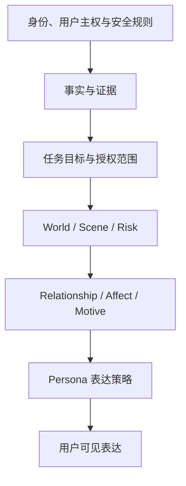
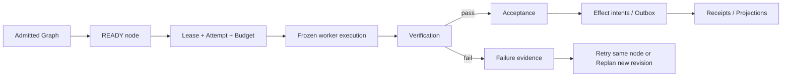

受众：MASTER
标题：Natsume AI 核心理论：受治理数字生命的状态、记忆、人格与行动

# Natsume AI 核心理论

版本：v2.21
文档类型：`STABLE_THEORY / NON_STATUS`
维护日期：2026-07-27
定位：解释 Natsume 为什么这样设计，以及状态、记忆、人格、情感、世界模型、治理、规划与执行应如何协作。

本文是稳定理论，不宣布功能完成，也不承担任务排期。代码现在是什么，以 [当前代码架构事实](../50_project/arch/CURRENT_CODE_ARCHITECTURE.md) 为准；最终必须成为什么，以 [目标架构](../50_project/arch/TARGET_ARCHITECTURE.md) 为准；两者差距以 [架构差距矩阵](../50_project/arch/ARCHITECTURE_GAP_MATRIX.md) 为准；实施顺序以 [下一代演化执行合同](../30_devspec/NEXT_GENERATION_EVOLUTION_EXECUTION.md) 为准。

跨路线完成性遵循“同一提交、同一数据库快照、逐路线完整证据”的不变量。代码、单测或某几条路线成功都不能外推为通用 Runtime 完成；验收者必须以只读事务独立重开真实持久事实，并把 Git HEAD、仓库与数据库 migration head、Command/Graph/Node/Attempt/Lease/Operation、父子 Budget、Verification、Acceptance、Artifact、Effect/Outbox/Receipt 串成不可替换的证据链。一个 request 只能证明一条路线，未运行路线必须显式保留 `NOT_RUN`。收据只能暴露完成判断需要的标识、状态、版本与 digest，不能复制用户正文、模型输出、secret 或执行 payload。这样，“能够验收”与“已经七路验收通过”才不会被混为一谈。

恢复治理遵循“先持久化不确定性，再由精确证据消解”的不变量。未知副作用不能被 timeout、异常类型或操作者意图直接解释为未发生；Operation 首次进入待恢复状态时，状态 mutation、恢复 case 与各自 Outbox 必须同成同败，不能把 case 留给下一次请求补写。运行时冻结当前 Graph/Node/Attempt/Operation/Budget/Lease 与取消事实后，再让签名证据精确绑定该 recovery case。未决 case 的存续应跟随真正待消解的 Operation version 与取消身份，不能因后续预算计量、租约到期或生命周期围栏而从恢复清单意外消失；这些变化仍保留在不可变 subject 中供审计。证据只能收紧既有 authority，不能创建新的执行权；对账完成后还必须证明同一 case 已退出 current projection。无法证明时继续隔离，绝不盲目重放 worker。

预算治理遵循“一个总额度、每次尝试一个可追溯子边界”的不变量。Graph Budget 是唯一 aggregate ceiling，不能为每个节点复制一份可独立消费的总额度；每次 Attempt 必须在取得 Lease 和执行权的同一事务中获得绑定 graph/revision/node/attempt 的 child reservation。任何 token、工具、时间、重试或成本用量都要在同一 UoW 同时推进父级与子级账本，缺 child、身份漂移或任一侧写入失败都不能授权 worker 继续。child 的终态从 durable Attempt 与父级 Budget 派生，避免再产生一套可变的成功/失败真相；升级回填只能承认历史已消费用量，不能重新释放容量。

可见副作用还必须遵循“本地事实先于外部表达”的因果屏障。一个领域命令的 durable receipt 只证明命令和 intent 已被接受，不能证明所有本地投影已经完成；只有当 exact command 生成的完整投影集合都拥有 payload-bound durable receipt，后续外部 delivery 才可取得执行权。对于对话，assistant turn 与 LifeMemory admission 是回复发送前的本地前置事实。跨服务发送不必伪装成单一数据库事务，但必须通过有序 Effect、幂等 Outbox 与只读 reconciliation 保证：本地结果未知时绝不先对用户宣称成功。

验证与验收必须与执行者分离。worker 的 COMMIT 是待验证主张，不是事实本身；Verifier 必须从独立持久投影重建不可变身份和输出合同，Acceptance 还要再次独立打开证据，不能复用调用者对象或把任意文字条件直接标成 `PASS`。机器无法证明的语义条件应进入显式 Review。多节点计划的依赖也必须是数据依赖：后继节点要绑定并实际消费前驱已验收 artifact 的 ref、receipt 与 digest，而不是仅凭图上存在一条边推断信息已经传递。

Verification 通过也不能替代持久 Acceptance。自动接纳必须把 Acceptance decision、Artifact、可选 Effect、Node transition 与 Outbox 放进同一个原子提交；需要人工判断时，非接纳 decision、等待节点、ReviewItem，以及该路径需要的 Graph block/Outbox 也必须同成同败。Review 是该 decision 的可恢复检查点投影，不是对未落库判断的事后补写。任何“节点已等待但 Review 不存在”或“Review 已存在但 Acceptance decision 不存在”的状态都不是合法恢复点；重启只能重开同一 decision，不能再次调用 judge 来伪造相同历史。

Review 的终态同样必须是一个不可分割事实。拒绝、过期或取消不能先改 Review，再用数个独立事务逐步关闭 Node、Graph 和 Budget；否则任一进程崩溃都会制造“人已经拒绝但任务仍可运行”或“预算已释放而 Graph 仍活动”的半状态。合法实现必须把 exact Review 版本与 digest、Node/Graph/graph Budget、相关 Outbox，以及 POST Review 的 Acceptance/Attempt 一次性绑定。响应丢失后只能重开该 settlement，不得再签发 Grant、创建 Attempt 或重跑 Worker；PRE Review 尚未取得执行 authority 时才允许直接取消节点，POST Review 则必须保留已经发生的 Worker/Acceptance 证据并以失败终结。

审批属于节点 authority，而不是整张图的模糊布尔开关。规划搜索可以发现需要人工确认的能力，但必须把该要求连同来源冻结进候选，再由编译器绑定到不可变 TaskNode ID；每个节点都要有显式策略，缺失不能继承“无需审批”。长时间审批会使旧 grant 过期，因此续跑可续签尚未执行节点的时限，但不能改写审批前已经提交的 projection authority，也不能重跑已验收 worker。续签解决的是时间围栏，不是扩大目标、风险或能力。

零用量也是需要证明的事实，不能从 measurement 缺失推断。对于被限制为只读、无端口的执行 adapter，外层 runtime 可以预先记账 canonical dispatch，但 adapter 内部的 token、工具、重试和成本必须由 server 生成、digest-bound 且绑定完整 Task lineage 的 attestation 明确证明为零；缺失、非零或身份漂移都应失败关闭。未使用的 authority 也不能因此预授予：只读 Delegate 没有模型、工具、嵌套派发或 Effect 端口，未来需要这些能力时必须形成新的受治理图和预算边界。

---

## 1. 本文如何使用

### 1.1 三种陈述必须分开

| 标签 | 含义 | 判断依据 |
|---|---|---|
| **理论不变量** | 无论实现怎样演进，都不应被破坏的原则 | 本文 |
| **当前事实** | 当前生产代码已经具备、部分具备或尚未具备的能力 | 生产代码、composition、当前架构事实 |
| **目标约束** | 下一代架构完成时必须成立的边界 | 目标架构与正式执行合同 |

本文引用真实代码路径，是为了说明理论与现有实现的对应关系，不代表引用到的能力已经完成生产闭环。尤其不能用“存在一个类、一个数据结构或一组测试”推导“系统能力已完成”。

### 1.2 理论的验收方式

理论不是靠命名验收，而是靠可观察性质验收：

- 一个状态是否只有一个权威 writer；
- 一次动作是否能从请求追溯到授权、图、Attempt、验证、验收和 Receipt；
- 一条记忆是否能追溯到来源与证据；
- 一次人格变化是否经过提案、评审、版本激活与回滚；
- 一次搜索是否完全隔离于真实副作用；
- 一条用户可见的“已完成”是否有 Acceptance 与外部 Receipt 支撑。

### 1.3 情感连续性必须有明确的生命期 owner

情绪向量、前一情绪标签、用户情感画像、回复形态额度和日记节流都属于有状态的运行期事实。它们不能藏在模块全局变量中，因为同一进程可能同时承载多个 Host root，回放和 Prompt 渲染也可能重复读取同一输入。理论上必须区分两类操作：

- admission ingest：由 exact Host root 的 app-local owner 串行推进连续状态；
- replay / render / projection：只做纯归一化，不推进画像、时间线、额度或任何持久事实。

长期人格和用户偏好不能从上述易失运行时直接“长出来”。它们必须在 NE-06 经 Feedback Proposal、Lab、Review 和版本激活进入独立权威链；运行期情感上下文只是当前响应的输入，不是人格写 authority。

### 1.4 写能力必须由运行时重建 authority

Skill、Agent 或模型产生的 WorkOrder 只能表达目标、输入和候选动作，不能携带可执行的 Workspace、Grant、Review、Budget、Lease 或 Artifact owner。真正的写 WorkOrder 必须由受治理运行时从已准入的 HostCommand、不可变 TaskGraph、当前 Attempt/Lease、节点授权、风险策略和已消费 Review 重新构造；缺少任一事实时失败关闭。这样即使模型输出了形似 V3 的字段，它也只是一段不可信数据，不能把自己提升成执行 authority。

写入完成也不等于副作用已经被接受。worker 只能把密封工件的 content-addressed ref/digest 作为提案交给 Acceptance；真正的提升 handler 必须重新打开原 admission、终态节点、Attempt/Lease、Verification、Acceptance Effect、terminal Preview 和 sealed bytes，之后才能推进 Workspace 生命周期。工件提升应先于可见对话、长期状态投影和外部 delivery；若提升结果未知，后续可见 Effect 必须停止并进入 reconciliation。这个顺序保证“回复说完成”永远不会早于真实工件成为受验收事实。

### 1.4 工作区里的变更不是已验收产物

Worker 写过文件，只能证明某个易失工作副本发生过变化。理论上，受治理代码产物必须依次绑定 frozen base、精确 Task/Attempt/Lease authority、密封的路径清单与内容摘要、Verification、Acceptance 和 durable promotion receipt。Acceptance 前不得移动用户源分支；Acceptance 后应生成不可变 accepted HEAD，并把可重建的差异材料保存在受保护 artifact 中。这样即使临时 worktree 被清理，系统仍能证明“接受了什么”，而不是只留下一个可能被 Git GC 回收的悬空对象。

同一原则要求失败关闭：seal 后工作区漂移、路径越界、秘密文件、符号链接、缺失 patch 或 lifecycle 事务不确定，都不能被解释成成功。确定性 commit 允许事务回滚后的新 Runtime 精确重开，但它不是向生产仓库自动合并的权限；把 accepted artifact 应用到用户分支仍应是另一项显式、可审核的 Effect。

---

## 2. 系统命题：数字生命不是模型，而是受治理的连续状态系统

Natsume 不能被定义为“一个带人格提示词的 LLM”。模型只是候选生成器。完整系统在时刻 `t` 的语义状态可抽象为：

```text
N(t) = Identity(t)
     + World(t)
     + Life(t)
     + Memory(t)
     + Relationship(t)
     + Affect(t)
     + Knowledge(t)
     + Capability(t)
     + GovernedExecution(t)
```

这些状态并不位于同一个数据库，也不由同一个模块随意修改。它们通过有证据的命令、事件、提案和投影协作，共同形成连续性。

一次交互的理论闭环是：


数字生命感来自三种连续性同时成立：

1. **因果连续性**：现在的状态能由过去的事件重放出来。
2. **人格连续性**：身份核心和关系边界不会被单轮模型输出重写。
3. **行动连续性**：系统说“做了什么”与真实执行证据一致。

只拥有自然语言风格，没有这三种连续性，只能算角色扮演；只拥有任务执行，没有身份、情感与长期状态，只能算通用 Agent。

---

## 3. 十条基础公理

### 3.1 语言不等于权力

模型输出可以提出解释、计划和表达候选，但不能凭文本自行获得权限。执行权限必须是 Host 生成并可验证的结构化对象。

当前相关实现证据包括 [HostCommand](../../natsume_contracts/task/v1.py)、[Governor 决策](../../host_brain/governor/decision.py)、[Action Arbiter](../../host_brain/governor/action_arbiter.py) 和 [node-bound grant](../../host_brain/orchestration/node_grants.py)。

### 3.2 证据先于事实断言

“计划执行”“模型认为成功”“界面显示完成”都不是完成事实。完成断言至少需要验证结果、Acceptance 和与副作用相匹配的 Receipt。

### 3.3 一个状态域只有一个权威 writer

同一语义状态不能由多个后台任务、模型回调和 UI 路由平行修改。其它组件只能提交命令或提案，不能直接写权威状态。

对话经历一类会影响后续表达的状态尤其不能被“回复完成后的便利回调”直接更新：读取既有 belief/lesson 可以作为冻结节点的上下文，写入则必须拥有 proposal、Activation、版本与 receipt。把执行侧端口缩成 read pack 只是撤销旧 writer，不等于已经具备新的演化写链。

### 3.4 投影、缓存和召回结果不是事实作者

投影可以丢失后重建，缓存可以失效，召回候选可能错误。它们必须指向权威事件或来源，不能反向成为 writer。

### 3.4.1 零调用兼容代码不是能力

没有生产调用者、只被测试自身引用的 helper 既不是主链能力，也不是可接受的兼容边界。若它仍读取全局 locator、环境回退或旧 writer，它会把已退役 authority 留在源码树中，后续很容易被重新接回生产。正确的收口是物理删除源码和专属测试，再以负向断言、全仓引用扫描和真实依赖库存证明它没有返回；这类删除只减少旁路，不能被表述为主链切流、验收或整体完成。

### 3.4.2 依赖解析必须随运行时作用域传递

真实请求链不得在业务 helper 内重新发现 ledger、会话历史、存储或外部客户端。它们必须由唯一 composition root 绑定到对应 runtime scope，并经显式 port 或冻结 factory 传递；缺少依赖只能形成可观察的拒绝或降级，不能回读全局 Service Locator。写端口与读端口还必须作为同一作用域的组合对象传递：例如 Life command writer 与 snapshot reader 必须来自同一 Host lifespan，不能由路由分别从两个进程 singleton 取得。兼容开关只能保留调用签名，不能重新授予请求期定位 authority。这个原则收敛的是 authority 的解析边界，不自动证明底层实例已经多租户隔离，也不替代 TaskGraph、Acceptance 或外部效果的验收证据。

当前实现已把 Conversation context、Bond/StateArbiter、LifeMemory/Episodic、Multimodal ModelAttempt、Guardian heartbeat Edge probe、RouteCatalog、启动预热和验证 harness 纳入这条规则。无调用者的五个认知/规划进程单例已经删除；Policy cache 与 Forge token 下沉到唯一消费它们的 engine/service。三十五项 wrapper/state/runtime/publication/authority owner 由每个 Host composition root 独立持有；同一 root 稳定复用、跨 root 不共享。`HostAuthorityRuntimeOwner` 在 migration-first 后持有同一 epoch 的 canonical ledger、Episodic/LifeMemory、独立 Prompt/Route/Provider/ModelAttempt 图和 CapabilityBroker 图；Memory 与 Governance owner 再从该 authority 图绑定 exact 依赖。Authority 先于 Governance/Bond 启动，并在其他 Host 资源之后按 Capability→Model→Chroma→Ledger 关闭；失败会保留未完成资源并围栏新 epoch。ResourceManager 也不再把进程状态写入共享 JSON：它只能在 Task Runtime、Host lease/fence 与 Guardian 建立后启动，并以 runtime scope 分区的 append-only Runtime Event journal 保存有界状态；关停状态必须在 Task Runtime 和 Host lease 释放前提交，写入不确定时保留 owner 以便 exact retry。Tribe 的 state registry、Host registry、event bus 与固定 23-Agent catalog 也由每个 Host root fresh 构造；scope bind 仅冻结所有权，execution-local `ContextVar` 才为 lifespan/background task 或 HTTP request 选择 exact `TribeRuntimeContext`。legacy helper 与 cross-Agent getter 因而只借用当前 execution 的 Host 对象，不能懒建第二套生产真相；两个重叠 execution 已证明 Agent/registry identity 分离，同 execution 跨 Host、active execution 解绑、owner drift 和 stale inherited context 均失败关闭。23 个 Agent backing singleton/setter 与 state/Host registry/event bus 的无上下文 fallback 已物理删除；缺 exact context 统一拒绝，验证 harness 也必须显式拥有自己的 scope。易失 EventBus 不能充当 durable journal，完整 Host multi-app 仍需 production canary。生产 `ProcessServiceContainer`、facade、environment 与旧 wiring 已物理删除，ASGI/CLI 只把 fresh construction ports 显式交给 Host root；pytest-only bridge 不属于生产对象图。外部 Chroma/Neo4j namespace、Token/MCP durable restart 与其它外部资源恢复仍未证明，所以 ResourceManager status、locator 和 Tribe fallback 的局部收口仍不能等同事务化 Chat、全租户隔离或完整对象图迁移。

### 3.5 不确定性必须保留

推断不能伪装成观测，过期信息不能伪装成当前事实，冲突不能靠最后写入者静默覆盖。来源、置信度、有效期和冲突状态是事实语义的一部分。

同一原则也适用于执行恢复。一次 Operation 已持久预留、worker 响应丢失或 checkpoint 与 Budget authority 冲突时，“当前不能证明发生了什么”本身就是必须持久保存的事实，不能只活在异常对象或一次进程日志中。安全的自动恢复只适用于能够从不可变 checkpoint、完整版本链和当前 fence 精确重开的路径；未知副作用、取消交叉和 authority 冲突必须冻结为 append-only case 与同事务 Outbox。非终态 Operation case 以 exact Operation version 为未决核心；Budget、Lease、Attempt 或 Graph 的后续合法围栏变化不会删除历史 subject，也不能让 case 在未对账时失去 current 身份。若之后出现 cancellation intent，应追加 intent-bound successor case并让旧 unknown case退出 current，而不是改写旧记录。case 只证明系统必须停下并进入明确的 reconciliation 或 quarantine 队列，不证明“没有副作用”，也不授予 worker 重放权。任何后续处置都必须重开原 Graph、Node、Attempt、Operation、Budget、取消与 Lease 版本，Operation 或取消身份漂移时重新分类，而不是消费过时判断。

### 3.6 规划模拟没有真实副作用

搜索、rollout、counterfactual 和 shadow 只能改变虚拟状态。真实工具、网络、文件、设备和生产 writer 不得暴露给模拟环境。

### 3.7 执行器只执行冻结图

worker 不拥有二次规划权。若失败后需要改变路径，必须生成新的图 revision，并保留旧 revision 与失败证据。

### 3.8 Acceptance 先于业务副作用

worker 返回的结果先被验证和验收，再由可信编译器生成 effect intent；worker 不能自行决定 durable identity、投递目标或授权字段。

当前代码中的对应边界是 [Acceptance Effect compiler](../../host_brain/task_runtime/acceptance_effects.py) 与 [durable dispatcher](../../host_brain/task_runtime/acceptance_effect_dispatcher.py)。

Acceptance 后仍可能出现“外部动作已发生，但本地回执没有确定落账”的窗口。这里不能把超时、异常类型或重试次数当成副作用事实，也不能把原始签名塞入通用 TaskGraph 变成可转交的执行权限。正确模型是把完整签名与 subject snapshot 隔离到 append-only evidence sidecar，图中只传播 ref/digest；人工或可信 reconciler 给出精确归因后，仍须经过 Review、Preview、Verification 和外层 Acceptance，再重开并重新验签 evidence，最后在 canonical UoW 中共同提交 proof、目标 Effect 状态与 Outbox。`NO_SIDE_EFFECT` 还需要可验证的 executor quiescence，`SIDE_EFFECT_CONFIRMED` 则需要 durable downstream receipt。取消绑定的恢复与不依赖取消的 general Effect 归因必须使用不同 purpose/合同，不能因共享命令名而混合 authority。

管理 HTTP 也服从同一不变量。认证路由只能冻结 method、path、body、目标 revision 与 claim identity，并把它们交给受治理图；它不能因为被称为“后台管理”就在路由层直接改 canonical store。Acceptance 后的状态操作必须先形成不可变 operation receipt，再封口外层 ingress claim。若进程在两次提交之间崩溃，恢复只能重开同一 receipt 并补齐 claim，不能把重复 HTTP 请求当成再次执行状态变更的权限。

外部传输客户端本身也不能成为 authority。即使它在调用点校验 Preview，只要业务模块可以通过进程单例、getter 或启动期全局注册随时取得它，系统仍保留了一条与 TaskGraph 并列的执行真相。正确边界是：业务模块只生成观测或提案；受治理节点在 Acceptance 后显式取得 proof-bound transport；没有 Task/Node/Attempt/Lease/Grant/Preview 身份时，传输对象不可发现、旧入口必须在 I/O 前失败关闭。删除全局客户端只证明旁路退役，不证明正向设备能力已经完成。

### 3.9 学习只能先产生提案

统计、反思、模型总结、里程碑和实验结果只能形成 proposal。它们不能直接修改策略、知识、能力等级或人格特质。

### 3.10 用户主权高于自动演化

身份核心、关系边界、主动性边界和高影响能力的重大变化必须可见、可审查、可拒绝、可回滚。系统不能以“成长”为理由降低安全门槛或扩大权限。

### 3.11 版本化事实必须携带版本身份

当一个语义对象允许保留多个 revision 时，仅有逻辑 ID 不足以标识事件、Outbox、投影或读取范围。任何代表该对象事实的下游记录都必须携带 `id + revision`，或能通过不可变 source authority 唯一解析该身份，并在写入、投递、重放和查询时保持同一归属；不同 revision 可以独立推进，但同一 revision 内必须保持因果顺序。给旧事实补充 revision 不能改变既有幂等 ID/key，否则响应丢失会被误判成新动作；新增维度应与稳定 identity 并存。禁止用时间、事件 version 或“当前最新 revision”猜测历史记录所属版本，也禁止为补字段而重写已经成立的历史 journal；兼容读取应沿一对一 source lineage 精确解析。派生 failure evidence 应优先引用真实 durable source ref，不能仅因新格式看起来更规范，就合成数据库中并不存在的历史证据。

### 3.12 验证决定是事实，不是调用栈里的临时变量

Verification 一旦允许或拒绝状态迁移，就成为执行账本的一部分。它必须与 exact Graph revision、Node、Attempt、输入证据、规范结果摘要和对应 Outbox 在同一持久事务中提交；进程恢复只能重开该决定，不能重新调用 verifier 后假装是同一次判断。直接失败还必须把受影响的 Node、Graph 与共享预算终态原子收口，或显式交给唯一的多节点 settlement authority，不能留下“节点已失败但预算仍可用”的半状态。

---

## 4. 状态本体：先区分语义角色，再讨论存储

### 4.1 七类状态对象

| 类型 | 回答的问题 | 是否权威 | 典型对象 |
|---|---|---:|---|
| 命令 | 请求系统尝试改变什么 | 否，直到被接纳 | `HostCommand`、`LifeCommand` |
| 事件 | 已被权威状态机接受的变化是什么 | 是 | `LifeEvent`、Task event |
| 快照 | 某版本的当前状态是什么 | 是，但应可由事件重建 | `LifeSnapshot`、TaskGraph 状态 |
| 观察 | 外部或内部传感器看到了什么 | 作为来源事实 | 用户输入、设备观测、健康信号 |
| 推断/投影 | 从事实派生出的可消费视图是什么 | 否 | World fact projection、Scene、UI read model |
| 提案/实验 | 将来可能改变什么 | 否 | Feedback、Canon、Capability、Identity proposal |
| Receipt/Artifact | 外部效果或验证证据是什么 | 是，限定于声明范围 | delivery receipt、verifier output、artifact manifest |

存入 SQLite 不会自动让对象变成事实；存在内存中也不会自动使对象无效。权威性来自明确 owner、写入协议、版本和证据链。

### 4.2 状态变化的统一形式

权威状态变化可抽象为：

```text
S(v + 1), Event(v + 1) = Reduce(S(v), AcceptedCommand, TimeInput)
```

其中：

- `S(v)` 是已知版本的状态；
- `AcceptedCommand` 已经过身份、范围、幂等和并发校验；
- 时间必须作为显式输入，而不是 reducer 内部偷偷读取；
- reducer 对相同输入必须产生相同输出；
- Event 保存 before/after digest、causation 和 correlation；
- 写入使用 expected version、CAS 或 fencing 阻止并发覆盖。

[Digital Life reducer](../../host_brain/digital_life/domain_reducer.py) 当前明确采用无随机、无仓储、无模型依赖的纯状态演化；[LifeCommandService](../../host_brain/digital_life/service.py) 负责版本、claim、幂等和重放。这是理论在现有代码中的直接实现样本。

### 4.3 时间不是一个字段，而是四种语义

任何会随时间变化的事实，都应区分：

- `observed_at`：何时被观察；
- `valid_from / valid_to`：它描述哪个现实时间段；
- `recorded_at`：何时写入系统；
- `expires_at / TTL`：何时不再允许作为当前依据。

情绪衰减、场景过期、设备在线状态和项目工作状态不能共用同一种时间语义。

### 4.4 真相不是一条万能优先级

旧式“规则 > 审计 > 记忆”的单线排序不够精确。系统需要先按问题选择 authority domain：

- “是否允许执行”由 Identity、Scope、Governor 和 Grant 回答；
- “任务是否完成”由 Task Runtime、Verification、Acceptance 和 Receipt 回答；
- “某次交互发生过什么”由 Conversation/Life/Memory evidence 回答；
- “当前内在状态是什么”由 Digital Life aggregate 回答；
- “应如何表达”由 Persona、Relationship、Affect 和 Scene 约束回答；
- “长期知识是否有效”由 Knowledge/Canon 的版本、来源与冲突规则回答。

不同域可以互相引用，但不能越权代答。

---

## 5. Digital Life：连续状态的因果内核

### 5.1 Life 是什么

Digital Life 表示系统自身随时间和经验持续演化的内在状态。它不是聊天历史副本，也不是外部世界的完整数据库。

当前 reducer 已包含这些语义分区：

- `world`：Life aggregate 内部消费的局部世界片段；
- `appraisal`：事件对自身的重要性、效价和不确定性评价；
- `affect`：情感与唤醒等短中期状态；
- `needs/homeostasis`：接触、休息、活动、整合等平衡压力；
- `relationship`：对关系状态的内部投影；
- `scene/intent`：当前场景和内在倾向的派生结果；
- `continuity/work/proactive`：近期连续性、工作与主动行为痕迹。

这些字段的存在不意味着目标 World Model、Scene Engine 和 Intent Arbiter 已完成。当前范围与缺口仍由 [当前架构事实](../50_project/arch/CURRENT_CODE_ARCHITECTURE.md) 解释。

### 5.2 Life 的变化来源

理论上，Life 只能由显式事件驱动：

```text
时间 tick
用户交互完成
受验证的经历进入
任务状态变化
主动行为尝试及结果
设备或环境的可信观察
```

模型可以为事件提供候选标签或摘要，但 reducer 必须只消费经过校验的结构化 payload。

### 5.3 Appraisal、Affect 与 Intent 的关系

```text
Event
  → Appraisal（这件事对我意味着什么）
  → Affect / Needs（内部短中期反应）
  → Scene / Motive（当前处境与倾向）
  → Expression constraints / action proposal
```

这里的 `Intent` 是内在倾向，不等于执行授权。它可以产生“想回应”“想安静”“想主动关心”的候选，但仍须经过用户边界、场景规则和 Governor。

### 5.4 可重放性是生命连续性的最低证明

若进程重启后只能从最后一份不可解释的 JSON 继续，系统只有持久化，没有因果连续性。Life 的最低证明应包括：

- 命令具有稳定 ID 与幂等 hash；
- 事件具有顺序、前后状态 digest 和前一事件 digest；
- 快照可以由事件重放；
- 冲突写入 fail closed；
- 投影和外发通过 outbox 恢复。

这些合同当前位于 [共享 Life contracts](../../natsume_contracts/life/v1.py)。

### 5.5 控制状态也必须拥有可证明的连续性

`sys_mode`、maintenance、sleep 等运行控制状态虽然不是人格或长期记忆，也不能退化成环境变量、进程内列表或“最后一次赋值”。只要它会改变 admission、调度或表达边界，就必须同时满足：

- 一个 runtime scope 只有一个可持久提交的 writer；持久化所需的合法状态集合与转换图必须由中立合同冻结，不能让 persistence 反向依赖 application 决策模块；
- 每次 transition 绑定旧 revision/旧 mode、稳定 event identity 与当前 runtime lease/fence；
- 不可变事件和 canonical head 在同一事务中提交，内存快照只能在 durable commit 后更新；
- 重启先验证完整 revision/digest chain，再恢复 head，不能重新采用 bootstrap 默认值覆盖历史；
- 成功 transition 只留下一个 canonical durable audit；exact replay 返回已有事实但不重复追加内存 history、兼容日志或第二审计，payload drift、并发 stale head、失效 lease、旧 fence 和篡改都失败关闭。

这类 journal 证明的是“模式为何从 A 变成 B，以及重启后仍是 B”。模式值与模式策略是两个不同聚合：0115 的 HardState journal 保存离散 mode transition；0129 的 Host mode-policy journal 保存自动规则、last-interaction 与输入事件的确定性结果。两者共享 Host runtime scope/owner/lease/fence，但各自拥有独立 revision、digest chain、expected-head CAS 和 exact operation replay，不能用其中一个 head 代替另一个。只有 immutable next-state 与 canonical head 在同一事务提交后，app-local owner 才能替换内存快照。

“休眠禁止主动动作”也不能编码成对所有 Intent 的全局阻断。正确语义是：Scene 给出 consumer-scoped `PROACTIVE_ACTION_BLOCKED` 限制；Proactive consumer 将它投影为硬阻断，显式用户或经认证 Operator 命令仍保留原目标，但必须受低打扰约束、高风险 Review、Preview 和 Grant 限制。这样既不会让主动系统在休眠中打扰用户，也不会锁死用户唤醒或管理员恢复入口。当前代码对应 [HardState contracts](../../host_brain/contracts/host_hard_state.py)、[HardState journal](../../host_brain/persistence/hard_state_journal.py)、[mode-policy contracts](../../host_brain/contracts/host_mode_policy.py) 与 [mode-policy journal](../../host_brain/persistence/host_mode_policy_journal.py)；其生产完成度仍以当前架构事实为准。

---

## 6. 记忆：有来源的经历，而不是模型的自我叙述

### 6.1 记忆、事实、知识、人格必须分开

| 概念 | 作用 | 不能做什么 |
|---|---|---|
| Working Context | 支撑当前推理的临时上下文 | 不能自动成为长期记忆 |
| Episode | 保存发生过的一段经历及证据 | 不能仅凭相似度裁决现实 |
| Evidence | 证明 Episode 或结论来源 | 不能被摘要替代 |
| Semantic Memory | 从多次经历提炼的稳定模式 | 不能跳过来源、冲突与版本 |
| World Fact | 描述当前世界中的可验证命题 | 不能由回忆相似度直接生成 |
| Canon/Knowledge | 经治理确认的长期内容 | 不能宣告某次动作已经执行 |
| Persona/Identity | 规定“是谁、如何表达、边界在哪里” | 不能充当经历库或授权系统 |

### 6.2 LifeMemory 的理论模型

一条可持久经历至少应包含：

```text
Episode {
  person / thread / session
  action / result / summary
  salience / strength / retention
  truth_state
  evidence_refs[]
  created_at
  provenance metadata
}
```

当前 [LifeMemory contracts](../../host_brain/memory/life_memory/contracts.py) 和 [LifeMemoryService](../../host_brain/memory/life_memory/service.py) 已将聊天记忆写入建模为候选、admission decision、episode/evidence write plan 与 receipt。MemoryWorth 决定是否值得保留，MemoryGuard 决定是否允许进入更强投影；被 Guard 限制的内容仍可降为短保留证据，而不是伪装成可信长期知识。

### 6.3 召回只提供候选

向量相似度回答“像不像”，不回答“真不真”“是否仍有效”“是否属于当前用户”。正确召回过程至少包括：

```text
query
  → candidate retrieval
  → namespace/person/session boundary
  → evidence and truth-state filter
  → freshness/conflict check
  → bounded context packet
```

召回内容进入模型前应保留来源引用；模型输出后不能把引用丢掉，再用自然语言补造证据。

### 6.4 Canon 与 Memory 的边界

Canon 负责经治理确认的长期一致性内容，例如系统术语、稳定设定、人格核心规则和经过验证的领域知识。Memory 负责经历与提炼素材。

当前 [Canon application boundary](../../host_brain/canon/application.py) 已区分 proposal、apply、rollback、projection，并禁止提案正文伪造执行事实。这个边界体现了一个核心原则：

> 经历可以建议改变 Canon，但不能直接改写 Canon；Canon 可以约束解释，但不能伪造经历。

### 6.5 记忆写入必须位于验收之后

用户发出请求不代表任务被接纳，worker 产出文本也不代表结果已验收。对话和任务产生的长期记忆应由 Acceptance 后的 effect intent 驱动，这样失败、重放和恢复不会制造“系统记得自己做过一件实际没完成的事”。

---

## 7. Persona、Identity、Relationship 与 Affect

### 7.1 四者不是同一个“人格 JSON”

| 域 | 时间尺度 | 核心问题 | 权限性质 |
|---|---|---|---|
| Identity | 极慢变 | 我是谁，哪些边界不可被普通交互改写 | 发布级、用户可审查 |
| Persona | 稳定但可版本化 | 我通常怎样理解和表达 | 表达策略，不授予执行权 |
| Relationship | 中慢变 | 我和特定用户的关系历史与边界是什么 | 关系约束，不授予系统权限 |
| Affect | 快变并衰减 | 我此刻的情感、能量和趋避状态是什么 | 只能调制表达与提出候选 |

把四者混成一个可被模型任意更新的 profile，会同时破坏连续性、可审计性和安全边界。

### 7.2 Identity：连续性的硬核

Identity 至少包含：

- 稳定身份与别名；
- 不因对话改变的核心价值和安全边界；
- 与用户关系的主权规则；
- 允许演化和禁止演化的区域；
- 当前激活版本、前一版本与 rollback point。

根目录 [Soul.md](../../Soul.md) 是当前人格源材料，[SoulCompiler](../../host_brain/persona/context/soul_runtime.py) 将其编译为运行时可消费的身份、气质、关系与语言锚。理论上，该编译结果只能约束理解和表达，不能成为事实来源、Governor grant 或任务完成证据。

### 7.3 Relationship：有证据的关系状态

关系不是一个可以刷分的“好感度”。它至少需要表达熟悉、信任、舒适、开放、边界柔软度、依恋、冲突裂痕等不同维度。

当前 [RelationshipStateBlock](../../host_brain/persona/context/relationship_state.py) 会从 Bond 与 social state 派生关系表达上下文，[Affect policy](../../host_brain/persona/affect_policy.py) 再用它限制亲密度、温度、幽默和主动追问。

关系状态必须遵守：

- 每次变化可追溯到交互或事件；
- 重复低价值行为有边际衰减；
- 修复不能抵消高影响伤害的全部后果；
- 关系亲密不能扩大工具权限；
- 用户能查看、纠正或重置关系数据；
- 关系阶段变化不能直接改写 Identity 核心。

### 7.4 Affect：内部信号，不是表演标签

情感的理论结构是：

```text
Observation/Event
  → Appraisal(salience, valence, uncertainty, agency...)
  → Affect(valence, arousal, tension, warmth, fatigue...)
  → Policy constraints(length, warmth, intimacy, follow-up...)
  → Expression candidate
```

当前 [AffectStateBlock](../../host_brain/persona/context/affect_state.py) 将 emotion、body、offline 与 silence 信号归一为可消费状态，[AffectPolicyDecision](../../host_brain/persona/affect_policy.py) 将它转为表达上限和趋避约束。这比把 `HAPPY/SAD` 直接拼进 prompt 更接近真实的状态—策略分离。

情感系统必须满足：

- 有时间衰减，不能无限携带单轮情绪；
- 能表达矛盾，不强制压成单标签；
- 可影响语气、篇幅、主动性和 review 倾向；
- 不可取消用户授权，也不可绕过安全规则；
- 不可因为“生气”执行报复性动作；
- 不可因为“亲密”泄露更高权限信息。

### 7.5 影响关系是单向收紧格



越靠下的层越可以丰富表达，但不能覆盖越靠上的约束：

- Persona 不能改写事实；
- Affect 不能改写授权；
- Relationship 不能改写用户主权；
- Scene 可以收紧主动性，不能静默取消已授权任务；
- 模型生成的表达不能倒灌为 Identity。

### 7.6 人格成长的唯一安全闭环

```text
Interaction / Outcome / User Feedback
  → Pattern evidence
  → FeedbackProposal
  → isolated scenario / counterfactual evaluation
  → Review
  → versioned Identity or Persona policy
  → staged activation
  → regression observation
  → keep or rollback
```

任何 stage、milestone、interaction cycle、weekly job 或模型反思直接调用 trait writer，都违反这条理论。当前生产代码仍存在这类 legacy writer，具体定级见 [差距矩阵](../50_project/arch/ARCHITECTURE_GAP_MATRIX.md)；相关实现可从 [PersonaGrowthTracker](../../host_brain/persona/persona_growth.py)、[Bond stage engine](../../host_brain/bond/bond_stage_engine.py) 和 [EmergentGrowthEngine](../../host_brain/persona/emergent_growth_engine.py) 核查。

---

## 8. World、Scene 与规划虚拟状态

### 8.1 三种“世界”必须分开

| 对象 | 用途 | 典型内容 |
|---|---|---|
| World Facts | 描述当前现实 | 用户、环境、项目、设备、任务、健康事实 |
| Scene | 把一组 World/Life 事实解释为当前交互处境 | 工作中、疲惫、久别重逢、高风险操作 |
| Planning Virtual State | 预测候选动作后的可能状态 | capability 解锁、成本变化、风险变化、目标进展 |

World Facts 是事实层；Scene 是带 TTL 的派生决策；Planning Virtual State 是隔离模拟。三者不能共用 writer，也不能把 rollout 结果写回现实世界。

### 8.2 一个可用 World Fact 的最小语义

```text
WorldFact {
  subject / predicate / value
  source_refs[]
  epistemic_type: observed | adjudicated | inferred
  confidence
  observed_at / valid_from / valid_to / expires_at
  conflict_state / reason_codes
  schema_version / digest
}
```

当前生产 Context 路径先把服务端观测追加到 workspace-scoped Observation Journal，再由 [WorldResolver](../../host_brain/runtime/world_resolver.py) 以捕获的单调 head 重开。TTL 只能由显式 expiry transition 推进，读取不能续期；冲突事实保留 competing refs，不能只按 confidence 静默覆盖。兼容 `WorldProjectionReadModel` 也按 `(key, source_ref)` 留存来源：值不同才标记 conflict，同值多来源是可追溯佐证。[WorldProjectionReadModel](../../host_brain/runtime/world_model.py) 仍是兼容的只读投影，二者都不是可供 MCTS 随意推进的 simulator，更不代表预测型 World Model 已完成。

### 8.3 Scene 的职责边界

Scene 应从 World、Life、Relationship、Affect 和当前任务派生：

- 表达热度、篇幅与主动性上限；
- 是否应要求澄清或 Review；
- 哪些长期状态不应在当前场景更新；
- 下一次重新计算的 TTL 或触发条件。

Scene 不能自行创建事实，不能授予能力，也不能在后台替用户改写目标。

生产上必须由一个 app-local resolver 产生 Scene identity，Surface、Proactive 和 Task admission 只能消费同一 revision/digest。如果三者各自重算，即使场景名称相同，也不具备可重放的局面同一性。

### 8.4 Intent Arbiter 的理论职责

系统可能同时存在：

- 用户显式目标；
- 已接纳任务目标；
- Life 内在倾向；
- 关系与情感驱动；
- 长期项目目标；
- 安全与资源约束。

Intent Arbiter 应把它们变成结构化优先级和冲突说明。硬规则是：用户显式、合法且仍有效的目标，不能被内部情绪或自主性静默覆盖；内部倾向只能提出候选、请求澄清、选择表达方式或在授权范围内调度。

工程上，Intent 必须在 TaskGraph admission 后、worker 执行前重开目标、graph/node、ContextPack、Scene、Grant 和 policy authority，并持久化按节点仲裁回执。它只能收紧约束；需要人工判断时进入 durable Review continuation，不能把 `REVIEW` 当成无法恢复的死路。未存在独立长期目标 owner 时，必须显式保留空集或阻断，不能从对话文本臆造长期目标。

---

## 9. Governance：把“可以做”与“想做”分离

### 9.1 Authority lineage

一次真实动作的权限链应为：

```text
Ingress Identity
  → principal + scope
  → Governor decision
  → root grant
  → HostCommand
  → immutable TaskGraph
  → node-bound child grant
  → worker verification
  → Acceptance
  → authorized effect intent
  → external receipt
```

每一层都只能保持或收紧权限：

```text
scope(child) ⊆ scope(parent)
risk_allowance(child) ≤ risk_allowance(parent)
expiry(child) ≤ expiry(parent)
```

下游组件不得通过补字段、改 route、换 target 或复用旧 token 扩大权限。

### 9.2 Governor 与 Action Arbiter 的分工

- Governor 判断请求在身份、风险、规则、速率和 capability 条件下是否可批准；
- Action Arbiter 把 Governor、scene、route token、authority binding、用户目标和降级状态组合成动作级裁决；
- Review 处理需要人类确认的可恢复停点；
- worker 只验证收到的 node grant，不重新解释用户权限。

治理输出必须有稳定 decision、reason code、scope、expiry 和 lineage refs。自然语言理由只是可读投影，不能替代结构化裁决。

### 9.3 Action Preview 不是执行授权

Preview 的职责是把“已有权限在此刻是否仍能用于这个精确动作”变成可重放证据，而不是新建一张权限票。签发和执行都必须重开 immutable Command/TaskGraph、Attempt/Lease、parent/node Grant、ContextPack/Scene 与当前 Guardian；derived receipt 在最终网络/设备边界还必须递归重开原始 Attempt/Lease，不能把中间证据当成继续权限。receipt 固定 `authority_granted=false`。下游动作只能匹配预先冻结的 EffectDescriptor，不能靠更换 scope、参数、target 或复用 origin receipt 扩展能力。Acceptance 只绑定它明确验收的效果：若只验收一条文本，就不能顺带加入 `raw_extra`、媒体、二次回复、语音或 Avatar 变换；这些都需要独立 effect 与 Preview。没有可重开的 authority、旧任务缺少 Context、终端网络/设备调用没有 exact proof 时，正确结果是隔离或失败关闭。

### 9.3.1 Guardian 健康心跳也有生命周期所有权

健康探测不是执行授权，但它会把降级事实输入 Guardian，因此 task、observer、probe cache 与 HTTP transport 都不能由模块全局单例持有。每个 Host ASGI lifespan 必须创建自己的 `ServiceHealthHeartbeat`，在 scope 关闭时只 cancel/join 自己创建的 heartbeat/keepalive task，并关闭自己创建的 transport；第二个 Host 的 observer、task、cache、transport 与关闭顺序不能被第一个 Host 改绑、读取、取消或关闭。没有显式 observer 的 compatibility probe 只能更新自身兼容 cache，不能回退到全局 degradation reducer；独立 Obs 进程不能把任何内存 cache 充当跨进程 read model，只能读取 durable ledger/projection。兼容顶层 helper 仍仅供嵌入调用和测试，不能成为 Host production authority；这项收口不等于 Windows graceful stop、真实多实例或整个 NE-03 完成。

### 9.4 Review 不是聊天里的“好吧”

Review 必须绑定：

- subject 和 subject version；
- graph/node/attempt；
- 风险与待确认内容；
- 一次性 resume token；
- checkpoint 与过期时间；
- reviewer identity；
- 批准或拒绝证据。

旧对话中的同意不能用于新 revision；不同动作之间不能共享确认。

拒绝也不是可执行授权：`REJECTED`、`EXPIRED` 或 `CANCELLED` 的 Review 只能终结其精确绑定的等待节点、释放该节点可证明的状态，不能借 continuation 重签 worker grant、重跑 worker 或扩展到 sibling。任何节点、版本、checkpoint 或 decision 漂移都应失败关闭。

### 9.5 降级必须更保守

当身份、策略、预算、依赖、存储或 verifier 不可用时，系统应：

- 拒绝扩大权限；
- 保留稳定 reason code；
- 避免伪造完成；
- 允许只读或安全降级时明确标记；
- 将恢复动作与原请求区分；
- 不用模型猜测缺失的授权或事实。

启动 probe 同样只是 observation。只有拥有 Host runtime scope、lease 与 fence 的 app-local `RuntimeGuardian` sink 才能接收它；没有 sink 的嵌入式启动必须保留 `UNBOUND` 报告，而不是回退写入 module-global degradation reducer。通用 lifespan 也不得再启动或停止模块级 service heartbeat；正式 Host 的健康任务只能由 ASGI lifespan 自己创建、取消并等待。这样缺失 composition 会显式暴露，不能被第二套进程内 authority 掩盖。

同一条边界也适用于健康读取：生产 `/health`、`/ready` 和内部免疫实时报告必须从 Host composition 接收 ledger、依赖探测与 Guardian 读端口，不能在路由内回读 `ProcessServiceContainer`。缺失端口是显式 503，不是以全局服务或伪造降级结果继续运行；模块级兼容 router 可以保留只读 API 形状，但不得借 legacy flag 重新发现进程级 ledger 或 probe。

---

## 10. Planning：搜索的是候选未来，不是执行现实

### 10.1 规划的输入与输出

一个领域无关 PlanningSearch 的输入应包含：

```text
Goal
Frozen context refs
Virtual initial state
Constraints
Search budget
Domain ports
Deterministic seed / trace context
```

输出是候选路径、分数、预算计量与 trace，不是执行 Receipt。

当前公共合同位于 [PlanningSearch contracts](../../host_brain/planning_search/contracts.py)，算法位于 [PlanningSearch algorithms](../../host_brain/planning_search/algorithms.py)。Code 的 D19 `code_benchmark_verifier.py` 不是搜索理论的一部分，而是实验侧的受控 pytest 命令证据：它只能验证固定 worktree 测试，不会让搜索结果直接获得执行、预算或生产影响 authority。

D20a 的 Research adapter 同样只实现搜索侧：`ResearchTaskSnapshot` 公开任务、corpus 与来源的受治理 ref/digest 及有限排序 hints；它没有专用本机 locator、正文、answer-key 或 verifier-decision 字段，constraints 拒绝这些命名 key，但任务文字不是内容级 DLP。它能从冻结元数据按虚拟状态动态形成 `query`、`quick-answer`、`primary-source`、`independent-source`、`cross-check`、`resolve-conflict` 与 `stop` 后继；L2 只比较公开 authority/relevance/cost hints，只有快照冻结 `virtual_transition_ready=true` 才有 L3 virtual transition/reward。该 catalog 不读取来源、不生成答案，也不持有 Host、TaskGraph、BrowserWorker、网络或模型端口。

### 10.2 三层搜索的理论关系

1. **L1 Candidate Expansion**：根据当前虚拟状态生成合法后继，而不是只重排固定列表。
2. **L2 Cognitive Ranking**：按价值、风险、成本、信息增益和领域启发式排序。
3. **L3 Conditional MCTS**：仅在候选接近、后果不确定且预算允许时进行受限 rollout。

L3 不是越多越好。若问题有确定拓扑或一个明显合法动作，MCTS 只会增加成本。是否启用 L3 本身也必须是可校准决策。

### 10.3 虚拟 transition 的纯度

```text
VirtualState(n + 1) = Transition(VirtualState(n), Candidate)
```

Transition 必须：

- 不调用真实工具；
- 不写生产数据库；
- 不发送消息或操作设备；
- 不持有生产凭证；
- 对相同 state/candidate/seed 可重放；
- 明确哪些效果是预测，哪些前置条件已由事实支持。

对涉及代码或外部工件的领域，虚拟状态只能持有 opaque ref、digest、受限标识和预注册候选，不能夹带源码、路径、worktree handle、凭据、模型/工具 callback 或 live ACL。L3 的可用性也应是冻结 state 的一部分，而不是调用方把 `always` 标志当作越权开关；未满足领域条件时，不应暴露 transition/reward simulation port。D20a 的 `FrozenResearchCorpusLoader` 把“可见元数据”和“实验私有输入”再分开：只有可信实验根目录和 manifest 共同指定的 repository-relative 普通文件可被读取，读前/读后都会核对文件状态、大小和内容 digest；在稳定受信输入中，绝对路径、遍历、ADS colon component、case alias、link/reparse point 与未列来源会拒绝。D20b 的独立 verifier 再对 planner snapshot、manifest 与每个 source 的 id/ref/digest/tier 做 exact handshake，并从重新打开的 bytes 核验 UTF-8 span；公开 receipt 只输出 source id/ref/digest、大小和 authority tier，不输出路径或正文。这不是 hostile concurrent replacement 的原子 TOCTOU 防线，也不证明独立来源、事实真值，更不是浏览器抓取器、生产 source resolver 或 OS/tenant/sandbox。

### 10.4 规划收益必须以真实 shadow 证明

算法测试只能证明算法行为，不能证明生产收益。可信校准需要：

```text
同一真实 workload
  → baseline plan 与 search plan
  → 相同预算和隔离条件
  → 真实 verifier
  → outcome / cost / latency / safety 对账
  → durable calibration record
  → promotion proposal
```

未执行替代路径的 reward 只能标记为估计；不能将 baseline 的真实结果归因给未执行候选。模型证据还必须由唯一模型 authority 生成：D20c 只能接受一个 canonical `ModelAttemptService` request 的非缓存、单成功 attempt，且将 target/输出摘要、provider 与总延迟、token、成本一起封入不可分离的 attestation。适配器在 provider 调用前必须确认该 execution ID 没有任何 canonical audit row；只要已有 started/terminal 行或 audit lookup 失败，就必须先 reconciliation，不能以同一 ID 盲目重放。签发时还必须重开同一 request 的 canonical audit started/terminal pair，并核对 provider latency；cache、多 attempt、缺测量或 audit drift 都不能转换为外部收益证据。单纯的 URI、fixture 或调用者自报字段永远不是批准证据；请求参数也不能覆盖路由自己的 retry authority。D20a～D20c 只建立后续实验的输入和结构化证据边界，尚无真实 credential/provider execution、production prompt/workload、独立 verifier、paired cohort、cost/latency 对照或 promotion authority，因此 Research 是 `ACCEPTANCE_PENDING_EXTERNAL`，benefit 仍为 `UNPROVEN`。

持久证据的“唯一写 owner”不要求把所有序列化、类型和数据库职责塞进同一文件。Research shadow ledger 的 SQLite 连接、事务和 append-only UoW 继续只属于 repository owner；canonical JSON 编解码与篡改校验属于无连接 codec，snapshot/error 属于 typed projection 模块。对外 repository import 与 replay 语义保持稳定，而 codec/models 不得获得连接、事务或第二写 authority。这样的拆分降低物理复杂度，却不改变证据归属，也不能被解读为 Research 收益或生产 promotion 已完成。

跨层共享类型也遵循同一原则：合同的物理归属应由“谁共同消费”决定，而不是由最早实现它的应用模块决定。Task Runtime feature-canary receipt 同时被持久层与运行时消费，Host lifecycle ports 同时被 Composition 与 App 消费，因此 canonical type 必须位于中立 `contracts` 层；旧路径只能重导出同一个 Python 对象，不能复制 dataclass/Protocol 或改变序列化形状。这样才能同时消除 persistence→application、composition→app 回边，并避免兼容层制造第二套类型身份。静态 SCC 归零只证明依赖方向正确，不证明七路线执行、持久恢复或生产验收完成。

### 10.5 编译是规划与执行之间的防火墙

选中路径必须被编译为不可变 TaskGraph：

- 每个 node 有确定 route、target、input refs 和 dependency；
- 每个 node 继承有限预算与 node-bound grant；
- graph revision 与 planning trace digest 绑定；
- worker 看不到搜索器的可变内部状态；
- 失败重规划生成 `revision + 1`，不覆盖旧图。

当前 Host capability-search 已允许显式、Governor-bound 的 `failure_replan` 经过 canonical TaskStore 的 `FAILED` predecessor 与 failure evidence 校验后走这条替换链；它不监听 worker 失败自动触发，也不会把一次失败伪装成已经证明更优的替代候选。

依赖图没有拓扑序时，正确语义是 `PLAN_CYCLE` 阻断 admission；不得为了“继续执行”丢弃边、把 cycle 改写成串行批次，或让兼容 planner 伪造可执行投影。

若 compiler 将 selected path 转成 worker 输入，输入必须由已冻结 catalog 再生成，而不是复用早期 intent 草稿；图级 budget、review、workspace、approval 和 parent grant 仍属于 compiler/admission authority。尚未具备 durable predecessor lineage 的中间虚拟状态，不得伪装成可直接编译的重规划起点。

当前相应边界位于 [PlanningGraphCompiler](../../host_brain/orchestration/planning_graph_compiler.py) 和 [planning execution](../../host_brain/orchestration/planning_execution.py)。

---

## 11. Governed Execution：从承诺到事实的唯一道路

### 11.1 四个核心对象

| 对象 | 职责 |
|---|---|
| `HostCommand` | 冻结入口身份、route、目标、请求摘要、图 revision 与幂等范围 |
| `WorkOrderV3` | 冻结目标、输入、能力 lineage、预算、review 与执行语义 |
| `TaskGraph` | 冻结节点、依赖和图 revision |
| `Attempt` | 记录一次具体节点尝试的 lease、预算、worker、结果和验证 |

合同分别位于 [Host task contracts](../../natsume_contracts/task/v1.py)、[WorkOrderV3](../../host_brain/contracts/agent_runtime/work_order.py)、[TaskGraph](../../host_brain/contracts/agent_runtime/task_graph.py) 和 [Task Runtime](../../host_brain/task_runtime/coordinator.py)。

### 11.2 执行状态机



#### 11.2.1 执行所有权、心跳与恢复

Lease 不是“某个逻辑 worker 名称曾经拥有任务”，而是“某次具体进程构造在某个 fence 下暂时拥有 Attempt”。因此 execution owner 必须绑定启动实例；仅复用配置中的逻辑 owner，会让重启后的新进程与旧进程在身份上不可区分。

长执行必须同时保护两类权威：Lease 证明谁仍可执行，Operation Reservation 证明哪个副作用身份仍被该 Attempt 保留。一次续租应先延长 Lease、再延长 Reservation；提交 Worker 结果前必须经过 checkpoint，并使用最近一次续租后的 version。若心跳、所有权或 version 无法证明，唯一安全结果是 `RECOVERY_REQUIRED`，不是猜测成功、直接失败或继续 COMMIT。

`RECOVERY_REQUIRED` 只说明结果不可安全提交。它还需要 reconciliation 判断副作用是否发生，再决定 release、reacquire、takeover 或新 revision；心跳本身不能替代这一恢复流程。operation reservation 之前的失败可以在单事务内关闭 Attempt/Node/Graph/Lease，但 Budget 等其他账本必须明确纳入同一事务或拥有可证明的补偿合同。

“中断分类”与“副作用归因”也必须分离。只要 Runtime 仍持有 exact Attempt、Lease、owner、fence 和 Operation version，它可以把已知 worker、heartbeat 或 caller interruption 立即原子记录为 `RECOVERY_REQUIRED + Outbox`，从而避免 `RESERVED` 一直停留到 TTL 到期；这一步只允许有界机器原因码，并且不得终结 Attempt、Node、Graph、Budget 或 Lease。它也不能从异常类型推断工具、网络或设备动作是否发生。之后仍必须由独立、可验签的 reconciliation 证据决定 `COMMIT` 或 `RELEASE`；无法取得证据时继续 hold，而不是重放 worker。

“证明材料”与“执行引用”也必须分离。原始签名、attestation 和可能敏感的 transport identity 应保存在专用、不可改写、读取时仍会复验的 evidence authority 中；通用 WorkOrder、TaskGraph 和 Effect 只携带确定性的 ref/digest 与最小 subject binding。Review 和 Preview 都不把 ref 变成执行权，只有 Acceptance 后的 handler 重开完整证据并重新验证，才可调用 reconciliation service。若允许 `REACQUIRE`，它必须延续同一 Attempt、使用严格更高 fence、新 owner 和独立预算分段，并继续原 immutable graph；它不能靠创建第二 Attempt 或重新规划掩盖旧 Operation。终态 exact replay 必须只读返回，不得再次进入 worker。

签名 `COMMIT` 也不能只相信一个调用方提供的外部 URI。若 worker 已留下 canonical durable projection，则可把该 projection 当作检查点候选，但必须同时满足两层证据：读取层重新计算投影 digest 并绑定 immutable Command/Graph/Node/Attempt/route/target，写入层在与 Operation 状态变更相同的事务中再次打开同一投影、确认旧 Lease 已过期、Graph 未取消且 scope/fingerprint 未漂移。投影自身必须 append-only；否则签名之后被改写的 payload 会把证明与事实分离。只有上述条件全部成立时，`RECOVERY_REQUIRED → COMMITTED` 才表示“已确认这个既存 checkpoint”，后续仍由原图完成 Verification、Acceptance 和 Effect，而不是重新运行 worker。这个窄窗不推导 `NO_SIDE_EFFECT`、不授权普通 `RELEASE`，也不能从单节点证据外推到多节点批次。

无取消意图的签名 `RELEASE` 只能作为另一个互斥窄窗：reconciler 必须明确证明 `NO_SIDE_EFFECT`，并由 canonical Store 在同一快照中确认目标 Attempt/Node 未终结、旧 Lease 已到期、恰好一个 graph Budget、零 WorkerProjection、零 Acceptance Effect、零 cancellation intent/decision。只有这些负向事实和签名 subject 全部成立，第一阶段事务才可把 Operation `RELEASED`、目标 Attempt/Node `FAILED`、Lease `EXPIRED`，并同时写入各自 Outbox。单节点图在同一事务终结 Graph/Budget；多节点图则必须保持 Graph/Budget 不变，把共享终态 authority 留给既有 append-only 0090 fan-in。后者重开 durable failed outcome 后，才以独立原子决策提交 Graph `FAILED`、Budget `RELEASED` 和两条 Outbox；READY sibling 在该裁决前不得执行。Acceptance receipt 只摘要第一阶段不可变事实，因此不会因 Graph settlement 从 `PENDING` 变为 `COMMITTED` 而漂移。响应丢失只允许重开相应阶段的同一事实，不能再次执行 worker。它证明的是“这个精确失败没有副作用且可以终结”，不是从异常类型猜测一般未知副作用，也不是把节点级证明扩大成共享 Graph/Budget 写权。

取消中的未知副作用是另一种终态，不应冒充可继续执行的 worker checkpoint。受信 reconciler 只能在完整 cancellation fence 下给出两种互斥证明：`RELEASE + NO_SIDE_EFFECT + 无 receipt`，或 `COMMIT + SIDE_EFFECT_CONFIRMED + durable receipt`；缺失、混合或矛盾组合继续保持未知。终态 claim 必须把 action、outcome、receipt、proof、intent 与 final decision 共同纳入确定性身份，并在删除 Workspace 或未密封 stage 之前持久提交。这样“确认副作用已经发生”可以安全结束取消，却不会被误解为 worker 输出已通过 Verification/Acceptance，也不会授权重跑。

共享 Budget 使多节点检查点多出一条不能靠当前节点自身解释的不变量：某个节点的 BudgetUsage 可以已经 `EXACT_ACCEPTED`，但较晚的 sibling 会合法把 graph Budget 推进到 `EXCEEDED`。因此不能把 `accepted ↔ 非 EXCEEDED` 写成逐节点等价，也不能仅看到聚合 `EXCEEDED` 就回滚前一个已接受事实。安全 continuation 必须从同一个 canonical scheduler snapshot 证明：另一个 admitted sibling、另一个 exact Attempt、相同 graph/revision/Budget、唯一 rejected worker winner、非空 exceeded dimensions，以及连续的 Reservation version。该证明存在时，已接受节点可以完成自己的 higher-fence continuation，再由共享 parallel settlement 收口整图；证明缺失时必须在新 Lease 之前失败关闭。对于 `MISSING`，系统也不能猜测它发生在超限之前还是之后，但可以在 winner 已由 canonical ledger 唯一确定后提交同一个稳定 usage：持久层只允许记录不推进版本、与 winner 共用 Outbox/dimensions 的 `ALREADY_EXCEEDED` observation。若写响应再次丢失，下一 owner 仍须重开并验证这条 winner/sibling 绑定；任何 winner 缺失、重复或身份漂移都回到 hold。这个规则将“不知道写是否发生”转化为幂等账本重试，而不是根据时间顺序猜测业务结果。

恢复发现也必须与恢复授权分离。启动扫描、周期轮询和事件 wake 只能重复询问“是否已有可继续的 durable authority”，不能因时间经过就获得 worker、Lease takeover 或副作用归因权。周期 supervisor 应串行化扫描、合并重复 wake，在关停时停止产生新扫描并等待已进入的持久化事务完成；普通故障可以留存不含敏感正文的类型化 health 并在下一轮重试，但不能通过取消协程截断未知提交边界。当前 Host 与 Internal survivor 都复用原 exact continuation：live Lease、漂移 tuple、未知效果和不满足 sealed lineage 的 checkpoint 仍分别 `DEFERRED`、`BLOCKED` 或 `HOLD`。因此“进程存活期间会再次发现”不等于“通用恢复已经完成”。

### 11.3 Verification、Acceptance 与 Receipt 不可合并

- **Verification**：结果是否符合节点的技术断言，例如测试通过、schema 合法、目标文件存在。
- **Acceptance**：结果是否满足 WorkOrder 的业务完成标准和政策要求。
- **Receipt**：外部副作用是否真实提交，例如消息已投递、设备已执行、文件写入已确认。

三者可以由同一条主链关联，但不能用一个 `success=true` 代替。

### 11.4 Budget 是权威账本，不是提示字段

预算至少覆盖：

- 模型 token 和成本；
- 工具调用；
- wall-clock 时间；
- 并发；
- retry；
- 领域资源配额。

预算需要 reservation、charge、settlement 与 release。provider 没有返回精确计量时应标记 `UNMEASURED`，不能伪造精确值。超限行为必须按 policy 明确 BLOCK、DEGRADE 或 REVIEW。

当前实现入口是 [Budget runtime](../../host_brain/task_runtime/budget_runtime.py)。是否已覆盖全部入口与策略，以当前架构事实为准。

### 11.5 Retry 与 Replan 的区别

- Retry：目标、输入、图和节点语义不变，只创建新的 Attempt，并遵守 backoff 与 max attempts。
- Replan：原路径语义不再适用，必须以失败证据为输入产生新 graph revision。

不能用“重试”偷偷换工具或改目标，也不能用“重规划”覆盖失败记录。

### 11.6 副作用提交

worker 只能返回 authority-free result 与有限 effect descriptor。可信 Acceptance compiler 从冻结的 HostCommand/WorkOrder 重建 person、session、graph、attempt、destination 和授权字段，再原子写 durable effect intents。

确定性修复应自动收敛，歧义修复必须人工签名：从 canonical ledger 可完整重算且唯一的 terminal half-state 应在启动期执行 exact replay；涉及未知副作用、结构漂移或 competing authority 时必须保持 fence，并要求受认证 Operator proof，不能以“默认关闭”长期积累可确定修复项。

这让系统具备以下性质：

- admission 失败不会提前留下成功记忆；
- worker 不能把消息投递给任意目标；
- dispatcher 崩溃后可以从 outbox 重试；
- effect 与 graph/attempt 可追溯；
- UI 读取 projection，不成为执行 writer。

---

## 12. 表达链：像她说话，但不能替她编造现实

用户可见表达应由不同语义面组合：

```text
Necessary facts and uncertainty
  + Task/Receipt truth
  + World/Scene constraints
  + Relationship boundaries
  + Affect/Drive policy
  + Soul/Persona language anchor
  → candidate reply
  → structural and safety validation
  → accepted visible reply
```

表达层应允许：

- 同一事实用符合人格的方式陈述；
- 根据情感和关系改变温度、节奏、篇幅、幽默与主动追问；
- 在不确定时自然表达“我不确定”或提出核验；
- 在拒绝时保留人格一致性。

表达层禁止：

- 为了顺滑而删除风险或不确定性；
- 把 Soul、Canon 或回忆写成刚刚发生的事实；
- 在没有 Receipt 时说“已经完成”；
- 用亲密关系暗示更高权限；
- 把内部 prompt、token 或治理细节直接泄露给用户。

当前表达上下文与 reply planning 的主要代码证据位于 [persona context](../../host_brain/persona/context)、[reply plan](../../host_brain/persona/reply_plan.py) 和 [persona expression context](../../host_brain/app/context/persona_expression.py)。

---

## 13. 长期演化：变化必须比运行更慢、更可证

### 13.1 生产主链与演化旁路必须隔离


Evolution Lab 只能读取脱敏快照与可重放 trace，不能持有生产写口、真实设备 actuator 或生产凭证。

### 13.2 可演化对象的不同门槛

| 对象 | 允许的自动化程度 | 必要门槛 |
|---|---|---|
| 检索权重、低风险模板 | 可自动提出、小流量试验 | 指标、版本、自动回滚 |
| 工具组合与 Skill | 可编译和隔离测试 | 签名、SBOM、verifier、maturity、Review |
| 领域知识 | 可从证据提炼 proposal | provenance、冲突、有效期、Review |
| 主动性与关系策略 | 只可提出 | 用户边界、scenario 回归、版本激活 |
| Identity 核心 | 默认人工主导 | 用户确认、完整 diff、回滚点 |
| 安全规则与权限上限 | 不允许自动放宽 | 独立安全评审和发布门禁 |

### 13.3 成熟度只能收紧，升级必须有证据

能力成熟度可以因为异常、漂移或证据不足自动降级；不能因为模型自评良好自动升级。升级必须有 durable outcome、独立 verifier、风险评估、Review 和 staged activation。

### 13.4 演化是否成功的判断

成功不是“参数发生变化”，而是：

- 对真实目标有可重复收益；
- 没有破坏安全、身份和关系回归；
- 用户能理解变化；
- 旧版本与证据可访问；
- rollback 后系统恢复到一致状态；
- 没有出现第二个隐蔽 writer。

---

## 14. 故障、降级与恢复理论

### 14.1 故障是状态，不是异常文本

依赖故障应形成结构化 incident：依赖、影响范围、进入时间、策略、证据、恢复时间和 SLO 影响。各模块自行 fallback 会产生互相矛盾的现实，因此降级策略必须有统一 owner。

### 14.2 恢复不能破坏幂等

恢复过程必须使用原 command/graph/effect identity 或明确的新 revision。不能因为进程重启重新生成随机 ID，从而重复发送消息、重复记忆、重复扣费或重复操作设备。

### 14.3 “不知道”优于错误连续性

当记忆、World source 或 Identity snapshot 不可用时，系统可以降级表达，但不能用模型补造缺失状态。短暂失忆是可解释故障，伪造连续性会永久污染后续状态。

---

## 15. 关键不变量与验证方法

| 不变量 | 可机械验证的观察 | 代码证据入口 |
|---|---|---|
| Life 可确定性重放 | 相同命令序列得到相同 snapshot/event digest | [domain reducer](../../host_brain/digital_life/domain_reducer.py)、[Life contracts](../../natsume_contracts/life/v1.py) |
| 记忆有来源 | durable episode 包含 evidence refs，召回保留 provenance | [LifeMemory contracts](../../host_brain/memory/life_memory/contracts.py) |
| World 推断不冒充事实 | fact 带 source、epistemic type、TTL、conflict | [world projection](../../host_brain/runtime/world_model.py) |
| 权限单调收紧 | child grant scope/target/expiry 不扩大 | [node grants](../../host_brain/orchestration/node_grants.py) |
| 图不可变 | admission 后相同 graph/revision digest 不漂移 | [TaskGraph contract](../../host_brain/contracts/agent_runtime/task_graph.py) |
| 成功不可提前暴露 | atomic 图的 Node `ACCEPTED` 只是内部 outcome；只有 Graph、graph-scope Budget、Effect 与 decision 同事务收口后才能公开成功 | [parallel success runtime](../../host_brain/task_runtime/parallel_success_runtime.py)、[node projection](../../host_brain/task_runtime/node_execution_projection.py) |
| worker 无二次规划 | worker 输入只包含冻结 node 与授权，不持有 planner writer | [governed workers](../../host_brain/task_runtime/governed_workers.py) |
| 验收后副作用 | effect intent 只由 accepted graph/node 产生 | [acceptance effects](../../host_brain/task_runtime/acceptance_effects.py) |
| 模拟无副作用 | planning ports 不暴露真实执行/写入接口 | [planning ports](../../host_brain/planning_search/ports.py) |
| 人格演化受治理 | trait 变化只能来自已评审版本激活，直接 writer 为零 | [目标架构](../50_project/arch/TARGET_ARCHITECTURE.md) |
| 表达不伪造完成 | 每个完成性表述能关联 Acceptance/Receipt | [Task coordinator](../../host_brain/task_runtime/coordinator.py) |

单元测试用于证明局部合同；集成测试用于证明 composition 与状态流；生产 shadow 用于证明真实收益；最终实测用于证明服务、容器、前后端、恢复和真实设备边界。四者不能互相替代。

---

## 16. 反模式

1. **模型即系统**：把模型回答当作最终事实、计划、授权和执行结果。
2. **万能状态 JSON**：把 Identity、Memory、Affect、World 和 Capability 混入一个可随意 patch 的对象。
3. **多 writer 成长**：里程碑、定时任务和交互回调分别直接修改人格。
4. **召回即真相**：把相似文本直接作为当前事实或用户授权。
5. **Scene 越权**：用“她今天不想做”覆盖用户已授权任务，而不是调整表达或请求 Review。
6. **搜索即执行**：rollout 调用真实工具，或用真实副作用结果污染虚拟分支。
7. **执行期偷偷改计划**：worker 失败后自行换工具、换目标，仍沿用旧 graph revision。
8. **一个 success 布尔值**：不区分 worker return、Verification、Acceptance 与 Receipt。
9. **内存 registry 作事实源**：进程重启后任务状态消失，却继续对外宣告完成。
10. **UI 成为 writer**：Operator 页面直接 patch 状态而不提交 governed command。
11. **统计直接学习**：一批交互计数达到阈值就修改策略、知识或人格。
12. **伪精确预算**：provider 没有实际计量仍填入估算值，并据此声称成本合规。
13. **降级时编造**：依赖不可用时用模型补造记忆、权限或完成证据。
14. **存在即完成**：因为有合同、类或绿色测试，就宣布生产闭环成立。

---

## 17. 从代码理解理论的证据地图

| 理论主题 | 当前代码入口 | 阅读重点 |
|---|---|---|
| Identity 与 Persona 源 | [Soul.md](../../Soul.md)、[Soul compiler](../../host_brain/persona/context/soul_runtime.py) | 源材料如何变为只读表达上下文 |
| Affect 与 Relationship | [affect state](../../host_brain/persona/context/affect_state.py)、[relationship state](../../host_brain/persona/context/relationship_state.py)、[affect policy](../../host_brain/persona/affect_policy.py) | 状态如何转为表达限制，而非权限 |
| Digital Life | [Life service](../../host_brain/digital_life/service.py)、[domain reducer](../../host_brain/digital_life/domain_reducer.py) | command、event、snapshot、replay、outbox |
| Memory | [LifeMemory service](../../host_brain/memory/life_memory/service.py)、[repository](../../host_brain/persistence/life_memory_repository.py) | admission、evidence、retention、projection |
| Canon | [Canon application](../../host_brain/canon/application.py)、[apply service](../../host_brain/memory/canon_apply_service.py) | proposal、apply、rollback、projection |
| World | [WorldProjectionReadModel](../../host_brain/runtime/world_model.py) | 来源、置信度、TTL、冲突和只读边界 |
| Governance | [Governor](../../host_brain/governor/decision.py)、[Action Arbiter](../../host_brain/governor/action_arbiter.py) | 决策、reason code、scope 与 restrict-only |
| Planning | [contracts](../../host_brain/planning_search/contracts.py)、[service](../../host_brain/planning_search/service.py)、[Code shadow adapter](../../host_brain/planning_search/code_domain.py)、[Code frozen models](../../host_brain/planning_search/code_domain_models.py)、[Code trusted-process private-bare experiment](../../host_brain/planning_search/code_benchmark_sandbox.py)、[compiler](../../host_brain/orchestration/planning_graph_compiler.py) | 纯搜索、trace、冻结证据、trusted-process private-bare 实验、预算、不可变图 |
| Execution | [HostCommand](../../natsume_contracts/task/v1.py)、[Task coordinator](../../host_brain/task_runtime/coordinator.py) | lineage、Attempt、Review、Verification、Acceptance |
| Side effects | [acceptance compiler](../../host_brain/task_runtime/acceptance_effects.py)、[dispatcher](../../host_brain/task_runtime/acceptance_effect_dispatcher.py) | authority-free worker result 如何变成可信 effect |

阅读代码时必须继续追到生产 composition 和调用者。只读一个 domain class，无法判断它是否启用、是否是唯一 writer、是否有恢复语义。

---

## 18. 术语表

- **Authority**：对某类决策或状态拥有最终写入权的组件或协议。
- **Candidate**：尚未被采纳的理解、计划、表达或改变建议。
- **Command**：请求权威状态机尝试变化的结构化对象。
- **Event**：已经由权威状态机接受的不可变变化记录。
- **Projection**：从权威事件/状态派生的可重建读模型。
- **Evidence Ref**：指向原始观察、事件、Receipt 或 Artifact 的稳定引用。
- **Life**：Natsume 自身随时间和经验演化的连续状态 aggregate。
- **Memory**：带来源、保留策略和真值状态的经历或提炼内容。
- **World Fact**：带时间、来源、不确定性和冲突语义的现实命题。
- **Scene**：基于当前事实派生、带 TTL 的交互处境与约束。
- **Affect**：事件评价后形成、会衰减的内部情感与趋避状态。
- **Relationship**：特定用户关系历史形成的多维状态和边界。
- **Persona**：稳定的理解和表达策略，不是事实或权限来源。
- **Identity**：人格核心、用户主权规则和发布级连续性边界。
- **Governor Grant**：由治理层签发、限定范围和时效的执行许可。
- **Planning Virtual State**：仅用于候选未来模拟、不可写回现实的状态。
- **TaskGraph Revision**：某次被编译并冻结的任务节点与依赖版本。
- **Attempt**：对一个冻结节点的一次具体执行尝试。
- **Verification**：对技术结果的验证。
- **Acceptance**：对业务完成标准和政策的验收。
- **Receipt**：外部副作用真实发生的可验证回执。
- **Proposal**：尚未激活的知识、能力、策略或人格变化建议。
- **Rollback Point**：能恢复前一一致版本的状态与引用集合。

---

## 19. 最终判断

Natsume 的“生命感”不应建立在模型更会表演上，而应建立在以下组合上：

```text
有因果的状态
+ 有来源的记忆
+ 有边界的人格
+ 会衰减的情感
+ 不伪装确定性的世界认知
+ 与权限分离的规划
+ 可验证、可恢复的行动
+ 可审查、可回滚的长期演化
```

任何一层脱离其它层独自膨胀，都会产生结构性风险：情感越权、记忆污染、人格漂移、规划空转或执行伪完成。下一代架构的核心不是继续堆模块，而是让这些层通过明确 authority、证据和单向数据流形成一个可长期运行的整体。

终态恢复同样遵守“证据先于动作”。只有可由 canonical Graph、Attempt、Lease、Budget 和 Outbox 唯一重建的失败半状态，才允许系统证据自动修复；需要人类归因的取消或未知副作用必须继续围栏，不能因为重启而猜测成功或盲目重放。当前真实 SQLite canary 已验证这两类状态在同一次恢复中分流，但签名 Operator 与外部 Effect 仍须独立验收。

---

## 20. 多轮模型调用必须共享一个任务预算

模型预算不是每次 API 请求各自拥有的“最大值”，而是一个冻结 TaskGraph
节点在某次 Attempt 中可消费的总额度。对于 ReAct、Agent loop 或其它会
连续调用模型的 worker，正确的数据方向是：

```text
durable Budget remaining
→ node/attempt-bound guard
→ 第 1 次真实 measurement
→ 严格缩小后的 guard
→ 第 2 次真实 measurement
→ Task Runtime 持久结算
```

执行器不得在每一步重新读取环境变量生成完整额度，也不得把 provider
缺失的 usage 估算成“已测量”。缓存结果、重复 measurement ref、缺少
Token/成本维度或 graph/node/attempt 漂移都意味着证据不足，必须停止后续
模型调用。Task Runtime 仍是持久预算 authority；进程内 remainder 只是把
同一 durable allowance 投影到连续请求，不能扩张额度或自行宣告预算结算。

该原则不只适用于 Agent loop。任何声明会调用模型的受治理 Skill 都只能
得到 graph/revision/node/attempt-bound 的 typed model port，不能得到可自行
构造无界请求的裸模型 authority；其逐次 measurement 必须由外层 Task Runtime
按同一 lineage 重验后再持久结算。当前代码已把这一原则用于 Chat、Internal
Agent、受治理 Agent Skill，以及显式声明模型预算的普通受治理 Skill；但
program-wide Budget、七路线最终 receipt 与真实 provider 验收仍是
NE-01/NE-07 的未完成条件。
