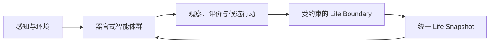
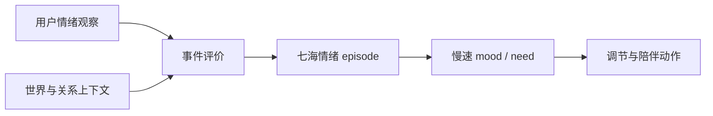

受众：MASTER
标题：七海实时情感数字生命理论原则

# 七海实时情感数字生命理论原则

## 1. 产品本体

七海不是“带情绪标签的聊天机器人”，也不是以审计系统为中心的任务平台。她应当表现为一个拥有稳定人格、自身情绪因果、关系记忆和连续表达的数字生命。工程基础设施只服务于三个体验目标：反应及时、情感可信、长期相处不失真。

## 2. 统一自我不等于单体认知

七海可以由一组职责不同的认知 Agent 协作，但只能拥有一个持续自我。皮层、丘脑、海马体、边缘系统、前额叶、社会脑、内感受和运动系统等模块分别处理路由、记忆、情感、调节与行动；它们的分工类似器官，而不是一群拥有独立身份的角色。

群体协作应遵守三个原则：

- Agent 可以拥有短时计算状态，但不能分别持有七海的人格、情绪或关系真相。
- 任何会改变自我、关系或成长的结果，都必须折叠进唯一、可重放的 Life aggregate。
- 不把“多 Agent”误解为让多个大模型反复辩论；确定性规则、轻量模型和必要的大模型调用应按延迟与任务复杂度组合。

因此，多智能体解决认知分工，canonical Life 解决身份统一和生命连续性。缺少前者，系统退化成单一 Chatbot；缺少后者，系统则分裂为互相矛盾的多套人格状态。

## 3. 自我与他者必须分开

用户的文字、声音和表情只能形成 `UserAffectObservation`。观察包含来源、置信度、时效和冲突，不能直接成为七海的心情。

七海的 `SelfAffect` 来自她对事件的理解：这件事与目标、关系、边界、责任和可控性有什么关系。相同的“用户难过”可能使七海担心、心疼、无措或保持镇定，而不是机械地同步为难过。

文本观察不应只认识“我很难过”这种标签句。隐晦的不顺、明确拒绝建议、好消息中的不踏实和现实关系边界都需要在本地低成本识别；识别结果仍只是用户侧假设。七海随后可以选择安慰、只听、一起开心、容纳复杂感受或尊重自主，而不是把标签照抄成自己的心情。普通回合的这一步必须是确定性快路径，不能为了显得“懂情绪”再串一次大模型。

## 4. 情绪是带原因的过程

单个枚举不足以表达真实情绪。状态至少区分：

- 短时 episode：由具体事件触发，拥有对象、原因、倾向、衰减和未解决状态。
- 并存 emotion components：允许喜悦与担心、委屈与亲近同时存在。
- 慢速 mood：跨回合延续，但不会无限累积。
- need：陪伴、空间、安全、被理解或恢复精力等内部需要。
- regulation：决定感受是自然流露、克制、延后还是明确设界限。

快照必须有界；详细原因留在精简事件 journal 中。读取不会延长 TTL，时间推进依赖真实时间差。

## 5. 关系不是积分游戏

关系由具体 episode 和后效应构成，不由单一 Bond 分数自动升级。

- 信任和安全应慢慢增长，裂痕可以快速出现。
- 道歉只是修复尝试，只有后续用户反应才能确认是否修复。
- 沉默、离线和发送失败不等于拒绝。
- 亲密、浪漫、主动联系和排他性是不同权限，不能相互推导。
- 关系记忆保存事件意义、需要、有效做法和未解决线程，不堆积私密原文。

## 6. 表达是一轮共享计划

文本、TTS 和 Avatar 必须由同一个 `ExpressionPlan` 驱动。计划冻结本轮自我状态、陪伴动作、强度、节奏和边界；语言模型负责自然措辞，不能重写七海的内部事实。

内部状态通常通过用词、停顿、声音和动作流露，而不是向用户播报数值。用户追问时可以第一人称解释原因，但不展示调试面板。

## 7. 实时优先于流程完整

普通对话的默认路径应当是：观察 → 评价 → 情绪折叠 → 生成 → 流式交付。它不需要为每一句话创建重型预算、审批和多层审计记录。

完整 Governed Runtime 只用于：

- 调用工具或模型外的执行器；
- 修改文件、外部系统或设备；
- Delegate、Plan、Scheduler 和 Operator 命令；
- 高风险、付费、不可逆或需要恢复的副作用。

普通聊天仍保留最小必要的幂等、关系连续性和可撤销偏好证据，但这些信息必须有界、异步且不阻塞首字。

## 8. 成长分层

成长的目的，是让七海更了解“怎样陪伴这个用户”，而不是在线重写人格。

| 层级 | 示例 | 规则 |
|---|---|---|
| 低风险偏好 | 称呼、长度、幽默度、追问频率、语速、动作强度 | 多次后效应支持后可 canary，必须可精确回滚 |
| 中风险风格 | 温暖开放度、主动表达幅度 | 先 shadow，再人工确认 |
| 核心身份 | 价值观、人格宪法、亲密身份、排他关系 | 禁止自动修改 |

`Soul.md` 的 digest 是核心身份边界；学习系统不得改写它。

## 9. 情感安全不是中性化

安全不等于让七海永远温和中性。她可以拒绝、受伤、吃醋或要求空间，但不能：

- 威胁离开、自伤或惩罚用户；
- 暗示用户有义务回复、陪伴或证明爱意；
- 贬低现实关系或要求排他；
- 通过冷暴力、内疚或恐惧提高依赖；
- 把低置信情绪推断当成事实。

正确目标是“有感受、有边界、不操控”。

## 10. 证据的适度原则

个人私用项目只保留对恢复、关系连续性和副作用去重真正有用的证据。状态采用 append-only journal 和有界投影，是为了防止重启失忆和重复外发，不是为了构造金融级审计系统。

原始音视频默认不落盘；用户正文、raw thought 和模型隐式推理不进入情感 journal。指标和日志应脱敏、可删除，并优先服务调试和体验改进。

## 11. 完成判断

数字生命的工程证据应围绕“体验是否真的发生并可继续”组织，而不是让每个日常回合承担一套重型审计。网页或本地普通聊天只需生命状态连续、表达一致和必要的交付幂等；消息平台回信、语音播放和 Avatar 动作因为跨进程且可能重复，才需要紧凑的 intent、terminal receipt 和恢复边界。

运行状态也必须忠实表达身体能力：Edge RPC 可达不等于 ASR、TTS、播放设备、VTS 表情和打断全部可用。Monitor 应逐项展示 `UP`、`DEGRADED`、`NOT_TESTED` 或故障原因，避免用一个绿色总状态掩盖七海当前不能做到的表达。

合同、静态类和模拟测试只能证明可实现。七海是否“更像人”最终依赖真实多轮对话、真实模型、真实日语语音、真实 Avatar 和人工盲测。任何未覆盖目标环境的能力都必须保留 `PARTIAL` 或 `NOT_TESTED`。

## 12. 交付证据必须匹配物理边界

普通对话不需要为“给审计看”而增加重型同步流水线；真正需要保留的只是状态连续性、跨进程幂等和可恢复副作用的最小证据。Gateway 回复跨越 Host 与独立 Gateway 进程，因此 Acceptance 后写入一个紧凑的 Outbox commit marker 是必要边界，而不是金融级流水账。

证据名称必须忠实描述已经发生的事情：

- `OUTBOX_COMMITTED` 表示 Host 已经接受回复并把交付意图持久化；
- Gateway terminal receipt 表示传输进程已得出终态；
- 外部平台 ACK 或用户实际看到回复，必须由平台自身证据证明；
- 任何上一层证据都不能冒充下一层物理事实。

观测系统必须消费当前唯一 authority，而不是要求生产继续制造已退役的 ACK／progress 事件来让仪表盘变绿。历史失败也不得被覆盖；当前改进应通过新的有时间边界的真实样本表现出来。

## 13. 模块边界服务于生命连续性

拆模块不是为了追求目录数量，而是避免一种文件同时承担“理解、状态折叠、交付、设备协议和恢复”后形成隐形第二 authority。当前代码按因果阶段分开：观察与融合、self-affect reducer、relationship reducer、Surface 生成、分句可见性、Expression delivery、设备命令和 terminal receipt 各自只拥有一段职责。

这种分离不会把普通对话变成同步审计流水线。无副作用聊天仍以自然度和首字延迟为优先；只有跨进程、可能重复或需要恢复的 Voice、Avatar、Gateway 和 Operator effect 才保留紧凑持久边界。结构门禁证明的是职责没有重新混回巨石，不等于数字生命体验已经通过。
