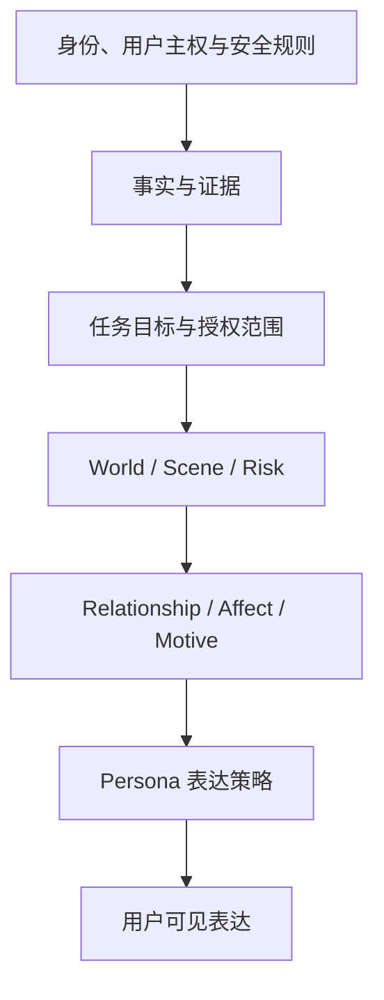
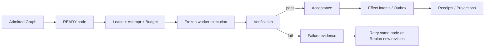

受众：MASTER
标题：Natsume AI 核心理论：受治理数字生命的状态、记忆、人格与行动

# Natsume AI 核心理论

版本：v2.2
文档类型：`STABLE_THEORY / NON_STATUS`
维护日期：2026-07-16
定位：解释 Natsume 为什么这样设计，以及状态、记忆、人格、情感、世界模型、治理、规划与执行应如何协作。

本文是稳定理论，不宣布功能完成，也不承担任务排期。代码现在是什么，以 [当前代码架构事实](../50_project/arch/CURRENT_CODE_ARCHITECTURE.md) 为准；最终必须成为什么，以 [目标架构](../50_project/arch/TARGET_ARCHITECTURE.md) 为准；两者差距以 [架构差距矩阵](../50_project/arch/ARCHITECTURE_GAP_MATRIX.md) 为准；实施顺序以 [下一代演化执行合同](../30_devspec/NEXT_GENERATION_EVOLUTION_EXECUTION.md) 为准。

---

## 1. 本文如何使用

### 1.1 三种陈述必须分开

| 标签 | 含义 | 判断依据 |
|---|---|---|
| **理论不变量** | 无论实现怎样演进，都不应被破坏的原则 | 本文 |
| **当前事实** | 当前生产代码已经具备、部分具备或尚未具备的能力 | 生产代码、composition、当前架构事实 |
| **目标约束** | 下一代架构完成时必须成立的边界 | 目标架构与正式执行合同 |

本文引用真实代码路径，是为了说明理论与现有实现的对应关系，不代表引用到的能力已经完成生产闭环。尤其不能用“存在一个类、一个数据结构或一组测试”推导“系统能力已完成”。

### 1.2 理论的验收方式

理论不是靠命名验收，而是靠可观察性质验收：

- 一个状态是否只有一个权威 writer；
- 一次动作是否能从请求追溯到授权、图、Attempt、验证、验收和 Receipt；
- 一条记忆是否能追溯到来源与证据；
- 一次人格变化是否经过提案、评审、版本激活与回滚；
- 一次搜索是否完全隔离于真实副作用；
- 一条用户可见的“已完成”是否有 Acceptance 与外部 Receipt 支撑。

---

## 2. 系统命题：数字生命不是模型，而是受治理的连续状态系统

Natsume 不能被定义为“一个带人格提示词的 LLM”。模型只是候选生成器。完整系统在时刻 `t` 的语义状态可抽象为：

```text
N(t) = Identity(t)
     + World(t)
     + Life(t)
     + Memory(t)
     + Relationship(t)
     + Affect(t)
     + Knowledge(t)
     + Capability(t)
     + GovernedExecution(t)
```

这些状态并不位于同一个数据库，也不由同一个模块随意修改。它们通过有证据的命令、事件、提案和投影协作，共同形成连续性。

一次交互的理论闭环是：


数字生命感来自三种连续性同时成立：

1. **因果连续性**：现在的状态能由过去的事件重放出来。
2. **人格连续性**：身份核心和关系边界不会被单轮模型输出重写。
3. **行动连续性**：系统说“做了什么”与真实执行证据一致。

只拥有自然语言风格，没有这三种连续性，只能算角色扮演；只拥有任务执行，没有身份、情感与长期状态，只能算通用 Agent。

---

## 3. 十条基础公理

### 3.1 语言不等于权力

模型输出可以提出解释、计划和表达候选，但不能凭文本自行获得权限。执行权限必须是 Host 生成并可验证的结构化对象。

当前相关实现证据包括 [HostCommand](../../natsume_contracts/task/v1.py)、[Governor 决策](../../host_brain/governor/decision.py)、[Action Arbiter](../../host_brain/governor/action_arbiter.py) 和 [node-bound grant](../../host_brain/orchestration/node_grants.py)。

### 3.2 证据先于事实断言

“计划执行”“模型认为成功”“界面显示完成”都不是完成事实。完成断言至少需要验证结果、Acceptance 和与副作用相匹配的 Receipt。

### 3.3 一个状态域只有一个权威 writer

同一语义状态不能由多个后台任务、模型回调和 UI 路由平行修改。其它组件只能提交命令或提案，不能直接写权威状态。

### 3.4 投影、缓存和召回结果不是事实作者

投影可以丢失后重建，缓存可以失效，召回候选可能错误。它们必须指向权威事件或来源，不能反向成为 writer。

### 3.5 不确定性必须保留

推断不能伪装成观测，过期信息不能伪装成当前事实，冲突不能靠最后写入者静默覆盖。来源、置信度、有效期和冲突状态是事实语义的一部分。

### 3.6 规划模拟没有真实副作用

搜索、rollout、counterfactual 和 shadow 只能改变虚拟状态。真实工具、网络、文件、设备和生产 writer 不得暴露给模拟环境。

### 3.7 执行器只执行冻结图

worker 不拥有二次规划权。若失败后需要改变路径，必须生成新的图 revision，并保留旧 revision 与失败证据。

### 3.8 Acceptance 先于业务副作用

worker 返回的结果先被验证和验收，再由可信编译器生成 effect intent；worker 不能自行决定 durable identity、投递目标或授权字段。

当前代码中的对应边界是 [Acceptance Effect compiler](../../host_brain/task_runtime/acceptance_effects.py) 与 [durable dispatcher](../../host_brain/task_runtime/acceptance_effect_dispatcher.py)。

### 3.9 学习只能先产生提案

统计、反思、模型总结、里程碑和实验结果只能形成 proposal。它们不能直接修改策略、知识、能力等级或人格特质。

### 3.10 用户主权高于自动演化

身份核心、关系边界、主动性边界和高影响能力的重大变化必须可见、可审查、可拒绝、可回滚。系统不能以“成长”为理由降低安全门槛或扩大权限。

### 3.11 版本化事实必须携带版本身份

当一个语义对象允许保留多个 revision 时，仅有逻辑 ID 不足以标识事件、Outbox、投影或读取范围。任何代表该对象事实的下游记录都必须携带 `id + revision`，或能通过不可变 source authority 唯一解析该身份，并在写入、投递、重放和查询时保持同一归属；不同 revision 可以独立推进，但同一 revision 内必须保持因果顺序。给旧事实补充 revision 不能改变既有幂等 ID/key，否则响应丢失会被误判成新动作；新增维度应与稳定 identity 并存。禁止用时间、事件 version 或“当前最新 revision”猜测历史记录所属版本，也禁止为补字段而重写已经成立的历史 journal；兼容读取应沿一对一 source lineage 精确解析。派生 failure evidence 应优先引用真实 durable source ref，不能仅因新格式看起来更规范，就合成数据库中并不存在的历史证据。

---

## 4. 状态本体：先区分语义角色，再讨论存储

### 4.1 七类状态对象

| 类型 | 回答的问题 | 是否权威 | 典型对象 |
|---|---|---:|---|
| 命令 | 请求系统尝试改变什么 | 否，直到被接纳 | `HostCommand`、`LifeCommand` |
| 事件 | 已被权威状态机接受的变化是什么 | 是 | `LifeEvent`、Task event |
| 快照 | 某版本的当前状态是什么 | 是，但应可由事件重建 | `LifeSnapshot`、TaskGraph 状态 |
| 观察 | 外部或内部传感器看到了什么 | 作为来源事实 | 用户输入、设备观测、健康信号 |
| 推断/投影 | 从事实派生出的可消费视图是什么 | 否 | World fact projection、Scene、UI read model |
| 提案/实验 | 将来可能改变什么 | 否 | Feedback、Canon、Capability、Identity proposal |
| Receipt/Artifact | 外部效果或验证证据是什么 | 是，限定于声明范围 | delivery receipt、verifier output、artifact manifest |

存入 SQLite 不会自动让对象变成事实；存在内存中也不会自动使对象无效。权威性来自明确 owner、写入协议、版本和证据链。

### 4.2 状态变化的统一形式

权威状态变化可抽象为：

```text
S(v + 1), Event(v + 1) = Reduce(S(v), AcceptedCommand, TimeInput)
```

其中：

- `S(v)` 是已知版本的状态；
- `AcceptedCommand` 已经过身份、范围、幂等和并发校验；
- 时间必须作为显式输入，而不是 reducer 内部偷偷读取；
- reducer 对相同输入必须产生相同输出；
- Event 保存 before/after digest、causation 和 correlation；
- 写入使用 expected version、CAS 或 fencing 阻止并发覆盖。

[Digital Life reducer](../../host_brain/digital_life/domain_reducer.py) 当前明确采用无随机、无仓储、无模型依赖的纯状态演化；[LifeCommandService](../../host_brain/digital_life/service.py) 负责版本、claim、幂等和重放。这是理论在现有代码中的直接实现样本。

### 4.3 时间不是一个字段，而是四种语义

任何会随时间变化的事实，都应区分：

- `observed_at`：何时被观察；
- `valid_from / valid_to`：它描述哪个现实时间段；
- `recorded_at`：何时写入系统；
- `expires_at / TTL`：何时不再允许作为当前依据。

情绪衰减、场景过期、设备在线状态和项目工作状态不能共用同一种时间语义。

### 4.4 真相不是一条万能优先级

旧式“规则 > 审计 > 记忆”的单线排序不够精确。系统需要先按问题选择 authority domain：

- “是否允许执行”由 Identity、Scope、Governor 和 Grant 回答；
- “任务是否完成”由 Task Runtime、Verification、Acceptance 和 Receipt 回答；
- “某次交互发生过什么”由 Conversation/Life/Memory evidence 回答；
- “当前内在状态是什么”由 Digital Life aggregate 回答；
- “应如何表达”由 Persona、Relationship、Affect 和 Scene 约束回答；
- “长期知识是否有效”由 Knowledge/Canon 的版本、来源与冲突规则回答。

不同域可以互相引用，但不能越权代答。

---

## 5. Digital Life：连续状态的因果内核

### 5.1 Life 是什么

Digital Life 表示系统自身随时间和经验持续演化的内在状态。它不是聊天历史副本，也不是外部世界的完整数据库。

当前 reducer 已包含这些语义分区：

- `world`：Life aggregate 内部消费的局部世界片段；
- `appraisal`：事件对自身的重要性、效价和不确定性评价；
- `affect`：情感与唤醒等短中期状态；
- `needs/homeostasis`：接触、休息、活动、整合等平衡压力；
- `relationship`：对关系状态的内部投影；
- `scene/intent`：当前场景和内在倾向的派生结果；
- `continuity/work/proactive`：近期连续性、工作与主动行为痕迹。

这些字段的存在不意味着目标 World Model、Scene Engine 和 Intent Arbiter 已完成。当前范围与缺口仍由 [当前架构事实](../50_project/arch/CURRENT_CODE_ARCHITECTURE.md) 解释。

### 5.2 Life 的变化来源

理论上，Life 只能由显式事件驱动：

```text
时间 tick
用户交互完成
受验证的经历进入
任务状态变化
主动行为尝试及结果
设备或环境的可信观察
```

模型可以为事件提供候选标签或摘要，但 reducer 必须只消费经过校验的结构化 payload。

### 5.3 Appraisal、Affect 与 Intent 的关系

```text
Event
  → Appraisal（这件事对我意味着什么）
  → Affect / Needs（内部短中期反应）
  → Scene / Motive（当前处境与倾向）
  → Expression constraints / action proposal
```

这里的 `Intent` 是内在倾向，不等于执行授权。它可以产生“想回应”“想安静”“想主动关心”的候选，但仍须经过用户边界、场景规则和 Governor。

### 5.4 可重放性是生命连续性的最低证明

若进程重启后只能从最后一份不可解释的 JSON 继续，系统只有持久化，没有因果连续性。Life 的最低证明应包括：

- 命令具有稳定 ID 与幂等 hash；
- 事件具有顺序、前后状态 digest 和前一事件 digest；
- 快照可以由事件重放；
- 冲突写入 fail closed；
- 投影和外发通过 outbox 恢复。

这些合同当前位于 [共享 Life contracts](../../natsume_contracts/life/v1.py)。

---

## 6. 记忆：有来源的经历，而不是模型的自我叙述

### 6.1 记忆、事实、知识、人格必须分开

| 概念 | 作用 | 不能做什么 |
|---|---|---|
| Working Context | 支撑当前推理的临时上下文 | 不能自动成为长期记忆 |
| Episode | 保存发生过的一段经历及证据 | 不能仅凭相似度裁决现实 |
| Evidence | 证明 Episode 或结论来源 | 不能被摘要替代 |
| Semantic Memory | 从多次经历提炼的稳定模式 | 不能跳过来源、冲突与版本 |
| World Fact | 描述当前世界中的可验证命题 | 不能由回忆相似度直接生成 |
| Canon/Knowledge | 经治理确认的长期内容 | 不能宣告某次动作已经执行 |
| Persona/Identity | 规定“是谁、如何表达、边界在哪里” | 不能充当经历库或授权系统 |

### 6.2 LifeMemory 的理论模型

一条可持久经历至少应包含：

```text
Episode {
  person / thread / session
  action / result / summary
  salience / strength / retention
  truth_state
  evidence_refs[]
  created_at
  provenance metadata
}
```

当前 [LifeMemory contracts](../../host_brain/memory/life_memory/contracts.py) 和 [LifeMemoryService](../../host_brain/memory/life_memory/service.py) 已将聊天记忆写入建模为候选、admission decision、episode/evidence write plan 与 receipt。MemoryWorth 决定是否值得保留，MemoryGuard 决定是否允许进入更强投影；被 Guard 限制的内容仍可降为短保留证据，而不是伪装成可信长期知识。

### 6.3 召回只提供候选

向量相似度回答“像不像”，不回答“真不真”“是否仍有效”“是否属于当前用户”。正确召回过程至少包括：

```text
query
  → candidate retrieval
  → namespace/person/session boundary
  → evidence and truth-state filter
  → freshness/conflict check
  → bounded context packet
```

召回内容进入模型前应保留来源引用；模型输出后不能把引用丢掉，再用自然语言补造证据。

### 6.4 Canon 与 Memory 的边界

Canon 负责经治理确认的长期一致性内容，例如系统术语、稳定设定、人格核心规则和经过验证的领域知识。Memory 负责经历与提炼素材。

当前 [Canon application boundary](../../host_brain/canon/application.py) 已区分 proposal、apply、rollback、projection，并禁止提案正文伪造执行事实。这个边界体现了一个核心原则：

> 经历可以建议改变 Canon，但不能直接改写 Canon；Canon 可以约束解释，但不能伪造经历。

### 6.5 记忆写入必须位于验收之后

用户发出请求不代表任务被接纳，worker 产出文本也不代表结果已验收。对话和任务产生的长期记忆应由 Acceptance 后的 effect intent 驱动，这样失败、重放和恢复不会制造“系统记得自己做过一件实际没完成的事”。

---

## 7. Persona、Identity、Relationship 与 Affect

### 7.1 四者不是同一个“人格 JSON”

| 域 | 时间尺度 | 核心问题 | 权限性质 |
|---|---|---|---|
| Identity | 极慢变 | 我是谁，哪些边界不可被普通交互改写 | 发布级、用户可审查 |
| Persona | 稳定但可版本化 | 我通常怎样理解和表达 | 表达策略，不授予执行权 |
| Relationship | 中慢变 | 我和特定用户的关系历史与边界是什么 | 关系约束，不授予系统权限 |
| Affect | 快变并衰减 | 我此刻的情感、能量和趋避状态是什么 | 只能调制表达与提出候选 |

把四者混成一个可被模型任意更新的 profile，会同时破坏连续性、可审计性和安全边界。

### 7.2 Identity：连续性的硬核

Identity 至少包含：

- 稳定身份与别名；
- 不因对话改变的核心价值和安全边界；
- 与用户关系的主权规则；
- 允许演化和禁止演化的区域；
- 当前激活版本、前一版本与 rollback point。

根目录 [Soul.md](../../Soul.md) 是当前人格源材料，[SoulCompiler](../../host_brain/persona/context/soul_runtime.py) 将其编译为运行时可消费的身份、气质、关系与语言锚。理论上，该编译结果只能约束理解和表达，不能成为事实来源、Governor grant 或任务完成证据。

### 7.3 Relationship：有证据的关系状态

关系不是一个可以刷分的“好感度”。它至少需要表达熟悉、信任、舒适、开放、边界柔软度、依恋、冲突裂痕等不同维度。

当前 [RelationshipStateBlock](../../host_brain/persona/context/relationship_state.py) 会从 Bond 与 social state 派生关系表达上下文，[Affect policy](../../host_brain/persona/affect_policy.py) 再用它限制亲密度、温度、幽默和主动追问。

关系状态必须遵守：

- 每次变化可追溯到交互或事件；
- 重复低价值行为有边际衰减；
- 修复不能抵消高影响伤害的全部后果；
- 关系亲密不能扩大工具权限；
- 用户能查看、纠正或重置关系数据；
- 关系阶段变化不能直接改写 Identity 核心。

### 7.4 Affect：内部信号，不是表演标签

情感的理论结构是：

```text
Observation/Event
  → Appraisal(salience, valence, uncertainty, agency...)
  → Affect(valence, arousal, tension, warmth, fatigue...)
  → Policy constraints(length, warmth, intimacy, follow-up...)
  → Expression candidate
```

当前 [AffectStateBlock](../../host_brain/persona/context/affect_state.py) 将 emotion、body、offline 与 silence 信号归一为可消费状态，[AffectPolicyDecision](../../host_brain/persona/affect_policy.py) 将它转为表达上限和趋避约束。这比把 `HAPPY/SAD` 直接拼进 prompt 更接近真实的状态—策略分离。

情感系统必须满足：

- 有时间衰减，不能无限携带单轮情绪；
- 能表达矛盾，不强制压成单标签；
- 可影响语气、篇幅、主动性和 review 倾向；
- 不可取消用户授权，也不可绕过安全规则；
- 不可因为“生气”执行报复性动作；
- 不可因为“亲密”泄露更高权限信息。

### 7.5 影响关系是单向收紧格



越靠下的层越可以丰富表达，但不能覆盖越靠上的约束：

- Persona 不能改写事实；
- Affect 不能改写授权；
- Relationship 不能改写用户主权；
- Scene 可以收紧主动性，不能静默取消已授权任务；
- 模型生成的表达不能倒灌为 Identity。

### 7.6 人格成长的唯一安全闭环

```text
Interaction / Outcome / User Feedback
  → Pattern evidence
  → FeedbackProposal
  → isolated scenario / counterfactual evaluation
  → Review
  → versioned Identity or Persona policy
  → staged activation
  → regression observation
  → keep or rollback
```

任何 stage、milestone、interaction cycle、weekly job 或模型反思直接调用 trait writer，都违反这条理论。当前生产代码仍存在这类 legacy writer，具体定级见 [差距矩阵](../50_project/arch/ARCHITECTURE_GAP_MATRIX.md)；相关实现可从 [PersonaGrowthTracker](../../host_brain/persona/persona_growth.py)、[Bond stage engine](../../host_brain/bond/bond_stage_engine.py) 和 [EmergentGrowthEngine](../../host_brain/persona/emergent_growth_engine.py) 核查。

---

## 8. World、Scene 与规划虚拟状态

### 8.1 三种“世界”必须分开

| 对象 | 用途 | 典型内容 |
|---|---|---|
| World Facts | 描述当前现实 | 用户、环境、项目、设备、任务、健康事实 |
| Scene | 把一组 World/Life 事实解释为当前交互处境 | 工作中、疲惫、久别重逢、高风险操作 |
| Planning Virtual State | 预测候选动作后的可能状态 | capability 解锁、成本变化、风险变化、目标进展 |

World Facts 是事实层；Scene 是带 TTL 的派生决策；Planning Virtual State 是隔离模拟。三者不能共用 writer，也不能把 rollout 结果写回现实世界。

### 8.2 一个可用 World Fact 的最小语义

```text
WorldFact {
  subject / predicate / value
  source_refs[]
  epistemic_type: observed | adjudicated | inferred
  confidence
  observed_at / valid_from / valid_to / expires_at
  conflict_state / reason_codes
  schema_version / digest
}
```

当前 [WorldProjectionReadModel](../../host_brain/runtime/world_model.py) 已按来源、置信度、TTL、冲突和推断类型输出只读 facts，并明确 `write_api_available=false`。它是现实投影的基础资产，不是完整目标 World Model，也不是可供 MCTS 随意推进的 simulator。

### 8.3 Scene 的职责边界

Scene 应从 World、Life、Relationship、Affect 和当前任务派生：

- 表达热度、篇幅与主动性上限；
- 是否应要求澄清或 Review；
- 哪些长期状态不应在当前场景更新；
- 下一次重新计算的 TTL 或触发条件。

Scene 不能自行创建事实，不能授予能力，也不能在后台替用户改写目标。

### 8.4 Intent Arbiter 的理论职责

系统可能同时存在：

- 用户显式目标；
- 已接纳任务目标；
- Life 内在倾向；
- 关系与情感驱动；
- 长期项目目标；
- 安全与资源约束。

Intent Arbiter 应把它们变成结构化优先级和冲突说明。硬规则是：用户显式、合法且仍有效的目标，不能被内部情绪或自主性静默覆盖；内部倾向只能提出候选、请求澄清、选择表达方式或在授权范围内调度。

---

## 9. Governance：把“可以做”与“想做”分离

### 9.1 Authority lineage

一次真实动作的权限链应为：

```text
Ingress Identity
  → principal + scope
  → Governor decision
  → root grant
  → HostCommand
  → immutable TaskGraph
  → node-bound child grant
  → worker verification
  → Acceptance
  → authorized effect intent
  → external receipt
```

每一层都只能保持或收紧权限：

```text
scope(child) ⊆ scope(parent)
risk_allowance(child) ≤ risk_allowance(parent)
expiry(child) ≤ expiry(parent)
```

下游组件不得通过补字段、改 route、换 target 或复用旧 token 扩大权限。

### 9.2 Governor 与 Action Arbiter 的分工

- Governor 判断请求在身份、风险、规则、速率和 capability 条件下是否可批准；
- Action Arbiter 把 Governor、scene、route token、authority binding、用户目标和降级状态组合成动作级裁决；
- Review 处理需要人类确认的可恢复停点；
- worker 只验证收到的 node grant，不重新解释用户权限。

治理输出必须有稳定 decision、reason code、scope、expiry 和 lineage refs。自然语言理由只是可读投影，不能替代结构化裁决。

### 9.3 Review 不是聊天里的“好吧”

Review 必须绑定：

- subject 和 subject version；
- graph/node/attempt；
- 风险与待确认内容；
- 一次性 resume token；
- checkpoint 与过期时间；
- reviewer identity；
- 批准或拒绝证据。

旧对话中的同意不能用于新 revision；不同动作之间不能共享确认。

### 9.4 降级必须更保守

当身份、策略、预算、依赖、存储或 verifier 不可用时，系统应：

- 拒绝扩大权限；
- 保留稳定 reason code；
- 避免伪造完成；
- 允许只读或安全降级时明确标记；
- 将恢复动作与原请求区分；
- 不用模型猜测缺失的授权或事实。

---

## 10. Planning：搜索的是候选未来，不是执行现实

### 10.1 规划的输入与输出

一个领域无关 PlanningSearch 的输入应包含：

```text
Goal
Frozen context refs
Virtual initial state
Constraints
Search budget
Domain ports
Deterministic seed / trace context
```

输出是候选路径、分数、预算计量与 trace，不是执行 Receipt。

当前公共合同位于 [PlanningSearch contracts](../../host_brain/planning_search/contracts.py)，算法位于 [PlanningSearch algorithms](../../host_brain/planning_search/algorithms.py)。

### 10.2 三层搜索的理论关系

1. **L1 Candidate Expansion**：根据当前虚拟状态生成合法后继，而不是只重排固定列表。
2. **L2 Cognitive Ranking**：按价值、风险、成本、信息增益和领域启发式排序。
3. **L3 Conditional MCTS**：仅在候选接近、后果不确定且预算允许时进行受限 rollout。

L3 不是越多越好。若问题有确定拓扑或一个明显合法动作，MCTS 只会增加成本。是否启用 L3 本身也必须是可校准决策。

### 10.3 虚拟 transition 的纯度

```text
VirtualState(n + 1) = Transition(VirtualState(n), Candidate)
```

Transition 必须：

- 不调用真实工具；
- 不写生产数据库；
- 不发送消息或操作设备；
- 不持有生产凭证；
- 对相同 state/candidate/seed 可重放；
- 明确哪些效果是预测，哪些前置条件已由事实支持。

### 10.4 规划收益必须以真实 shadow 证明

算法测试只能证明算法行为，不能证明生产收益。可信校准需要：

```text
同一真实 workload
  → baseline plan 与 search plan
  → 相同预算和隔离条件
  → 真实 verifier
  → outcome / cost / latency / safety 对账
  → durable calibration record
  → promotion proposal
```

未执行替代路径的 reward 只能标记为估计；不能将 baseline 的真实结果归因给未执行候选。

### 10.5 编译是规划与执行之间的防火墙

选中路径必须被编译为不可变 TaskGraph：

- 每个 node 有确定 route、target、input refs 和 dependency；
- 每个 node 继承有限预算与 node-bound grant；
- graph revision 与 planning trace digest 绑定；
- worker 看不到搜索器的可变内部状态；
- 失败重规划生成 `revision + 1`，不覆盖旧图。

当前相应边界位于 [PlanningGraphCompiler](../../host_brain/orchestration/planning_graph_compiler.py) 和 [planning execution](../../host_brain/orchestration/planning_execution.py)。

---

## 11. Governed Execution：从承诺到事实的唯一道路

### 11.1 四个核心对象

| 对象 | 职责 |
|---|---|
| `HostCommand` | 冻结入口身份、route、目标、请求摘要、图 revision 与幂等范围 |
| `WorkOrderV3` | 冻结目标、输入、能力 lineage、预算、review 与执行语义 |
| `TaskGraph` | 冻结节点、依赖和图 revision |
| `Attempt` | 记录一次具体节点尝试的 lease、预算、worker、结果和验证 |

合同分别位于 [Host task contracts](../../natsume_contracts/task/v1.py)、[WorkOrderV3](../../host_brain/contracts/agent_runtime/work_order.py)、[TaskGraph](../../host_brain/contracts/agent_runtime/task_graph.py) 和 [Task Runtime](../../host_brain/task_runtime/coordinator.py)。

### 11.2 执行状态机



#### 11.2.1 执行所有权、心跳与恢复

Lease 不是“某个逻辑 worker 名称曾经拥有任务”，而是“某次具体进程构造在某个 fence 下暂时拥有 Attempt”。因此 execution owner 必须绑定启动实例；仅复用配置中的逻辑 owner，会让重启后的新进程与旧进程在身份上不可区分。

长执行必须同时保护两类权威：Lease 证明谁仍可执行，Operation Reservation 证明哪个副作用身份仍被该 Attempt 保留。一次续租应先延长 Lease、再延长 Reservation；提交 Worker 结果前必须经过 checkpoint，并使用最近一次续租后的 version。若心跳、所有权或 version 无法证明，唯一安全结果是 `RECOVERY_REQUIRED`，不是猜测成功、直接失败或继续 COMMIT。

`RECOVERY_REQUIRED` 只说明结果不可安全提交。它还需要 reconciliation 判断副作用是否发生，再决定 release、reacquire、takeover 或新 revision；心跳本身不能替代这一恢复流程。operation reservation 之前的失败可以在单事务内关闭 Attempt/Node/Graph/Lease，但 Budget 等其他账本必须明确纳入同一事务或拥有可证明的补偿合同。

### 11.3 Verification、Acceptance 与 Receipt 不可合并

- **Verification**：结果是否符合节点的技术断言，例如测试通过、schema 合法、目标文件存在。
- **Acceptance**：结果是否满足 WorkOrder 的业务完成标准和政策要求。
- **Receipt**：外部副作用是否真实提交，例如消息已投递、设备已执行、文件写入已确认。

三者可以由同一条主链关联，但不能用一个 `success=true` 代替。

### 11.4 Budget 是权威账本，不是提示字段

预算至少覆盖：

- 模型 token 和成本；
- 工具调用；
- wall-clock 时间；
- 并发；
- retry；
- 领域资源配额。

预算需要 reservation、charge、settlement 与 release。provider 没有返回精确计量时应标记 `UNMEASURED`，不能伪造精确值。超限行为必须按 policy 明确 BLOCK、DEGRADE 或 REVIEW。

当前实现入口是 [Budget runtime](../../host_brain/task_runtime/budget_runtime.py)。是否已覆盖全部入口与策略，以当前架构事实为准。

### 11.5 Retry 与 Replan 的区别

- Retry：目标、输入、图和节点语义不变，只创建新的 Attempt，并遵守 backoff 与 max attempts。
- Replan：原路径语义不再适用，必须以失败证据为输入产生新 graph revision。

不能用“重试”偷偷换工具或改目标，也不能用“重规划”覆盖失败记录。

### 11.6 副作用提交

worker 只能返回 authority-free result 与有限 effect descriptor。可信 Acceptance compiler 从冻结的 HostCommand/WorkOrder 重建 person、session、graph、attempt、destination 和授权字段，再原子写 durable effect intents。

这让系统具备以下性质：

- admission 失败不会提前留下成功记忆；
- worker 不能把消息投递给任意目标；
- dispatcher 崩溃后可以从 outbox 重试；
- effect 与 graph/attempt 可追溯；
- UI 读取 projection，不成为执行 writer。

---

## 12. 表达链：像她说话，但不能替她编造现实

用户可见表达应由不同语义面组合：

```text
Necessary facts and uncertainty
  + Task/Receipt truth
  + World/Scene constraints
  + Relationship boundaries
  + Affect/Drive policy
  + Soul/Persona language anchor
  → candidate reply
  → structural and safety validation
  → accepted visible reply
```

表达层应允许：

- 同一事实用符合人格的方式陈述；
- 根据情感和关系改变温度、节奏、篇幅、幽默与主动追问；
- 在不确定时自然表达“我不确定”或提出核验；
- 在拒绝时保留人格一致性。

表达层禁止：

- 为了顺滑而删除风险或不确定性；
- 把 Soul、Canon 或回忆写成刚刚发生的事实；
- 在没有 Receipt 时说“已经完成”；
- 用亲密关系暗示更高权限；
- 把内部 prompt、token 或治理细节直接泄露给用户。

当前表达上下文与 reply planning 的主要代码证据位于 [persona context](../../host_brain/persona/context)、[reply plan](../../host_brain/persona/reply_plan.py) 和 [persona expression context](../../host_brain/app/context/persona_expression.py)。

---

## 13. 长期演化：变化必须比运行更慢、更可证

### 13.1 生产主链与演化旁路必须隔离


Evolution Lab 只能读取脱敏快照与可重放 trace，不能持有生产写口、真实设备 actuator 或生产凭证。

### 13.2 可演化对象的不同门槛

| 对象 | 允许的自动化程度 | 必要门槛 |
|---|---|---|
| 检索权重、低风险模板 | 可自动提出、小流量试验 | 指标、版本、自动回滚 |
| 工具组合与 Skill | 可编译和隔离测试 | 签名、SBOM、verifier、maturity、Review |
| 领域知识 | 可从证据提炼 proposal | provenance、冲突、有效期、Review |
| 主动性与关系策略 | 只可提出 | 用户边界、scenario 回归、版本激活 |
| Identity 核心 | 默认人工主导 | 用户确认、完整 diff、回滚点 |
| 安全规则与权限上限 | 不允许自动放宽 | 独立安全评审和发布门禁 |

### 13.3 成熟度只能收紧，升级必须有证据

能力成熟度可以因为异常、漂移或证据不足自动降级；不能因为模型自评良好自动升级。升级必须有 durable outcome、独立 verifier、风险评估、Review 和 staged activation。

### 13.4 演化是否成功的判断

成功不是“参数发生变化”，而是：

- 对真实目标有可重复收益；
- 没有破坏安全、身份和关系回归；
- 用户能理解变化；
- 旧版本与证据可访问；
- rollback 后系统恢复到一致状态；
- 没有出现第二个隐蔽 writer。

---

## 14. 故障、降级与恢复理论

### 14.1 故障是状态，不是异常文本

依赖故障应形成结构化 incident：依赖、影响范围、进入时间、策略、证据、恢复时间和 SLO 影响。各模块自行 fallback 会产生互相矛盾的现实，因此降级策略必须有统一 owner。

### 14.2 恢复不能破坏幂等

恢复过程必须使用原 command/graph/effect identity 或明确的新 revision。不能因为进程重启重新生成随机 ID，从而重复发送消息、重复记忆、重复扣费或重复操作设备。

### 14.3 “不知道”优于错误连续性

当记忆、World source 或 Identity snapshot 不可用时，系统可以降级表达，但不能用模型补造缺失状态。短暂失忆是可解释故障，伪造连续性会永久污染后续状态。

---

## 15. 关键不变量与验证方法

| 不变量 | 可机械验证的观察 | 代码证据入口 |
|---|---|---|
| Life 可确定性重放 | 相同命令序列得到相同 snapshot/event digest | [domain reducer](../../host_brain/digital_life/domain_reducer.py)、[Life contracts](../../natsume_contracts/life/v1.py) |
| 记忆有来源 | durable episode 包含 evidence refs，召回保留 provenance | [LifeMemory contracts](../../host_brain/memory/life_memory/contracts.py) |
| World 推断不冒充事实 | fact 带 source、epistemic type、TTL、conflict | [world projection](../../host_brain/runtime/world_model.py) |
| 权限单调收紧 | child grant scope/target/expiry 不扩大 | [node grants](../../host_brain/orchestration/node_grants.py) |
| 图不可变 | admission 后相同 graph/revision digest 不漂移 | [TaskGraph contract](../../host_brain/contracts/agent_runtime/task_graph.py) |
| worker 无二次规划 | worker 输入只包含冻结 node 与授权，不持有 planner writer | [governed workers](../../host_brain/task_runtime/governed_workers.py) |
| 验收后副作用 | effect intent 只由 accepted graph/node 产生 | [acceptance effects](../../host_brain/task_runtime/acceptance_effects.py) |
| 模拟无副作用 | planning ports 不暴露真实执行/写入接口 | [planning ports](../../host_brain/planning_search/ports.py) |
| 人格演化受治理 | trait 变化只能来自已评审版本激活，直接 writer 为零 | [目标架构](../50_project/arch/TARGET_ARCHITECTURE.md) |
| 表达不伪造完成 | 每个完成性表述能关联 Acceptance/Receipt | [Task coordinator](../../host_brain/task_runtime/coordinator.py) |

单元测试用于证明局部合同；集成测试用于证明 composition 与状态流；生产 shadow 用于证明真实收益；最终实测用于证明服务、容器、前后端、恢复和真实设备边界。四者不能互相替代。

---

## 16. 反模式

1. **模型即系统**：把模型回答当作最终事实、计划、授权和执行结果。
2. **万能状态 JSON**：把 Identity、Memory、Affect、World 和 Capability 混入一个可随意 patch 的对象。
3. **多 writer 成长**：里程碑、定时任务和交互回调分别直接修改人格。
4. **召回即真相**：把相似文本直接作为当前事实或用户授权。
5. **Scene 越权**：用“她今天不想做”覆盖用户已授权任务，而不是调整表达或请求 Review。
6. **搜索即执行**：rollout 调用真实工具，或用真实副作用结果污染虚拟分支。
7. **执行期偷偷改计划**：worker 失败后自行换工具、换目标，仍沿用旧 graph revision。
8. **一个 success 布尔值**：不区分 worker return、Verification、Acceptance 与 Receipt。
9. **内存 registry 作事实源**：进程重启后任务状态消失，却继续对外宣告完成。
10. **UI 成为 writer**：Operator 页面直接 patch 状态而不提交 governed command。
11. **统计直接学习**：一批交互计数达到阈值就修改策略、知识或人格。
12. **伪精确预算**：provider 没有实际计量仍填入估算值，并据此声称成本合规。
13. **降级时编造**：依赖不可用时用模型补造记忆、权限或完成证据。
14. **存在即完成**：因为有合同、类或绿色测试，就宣布生产闭环成立。

---

## 17. 从代码理解理论的证据地图

| 理论主题 | 当前代码入口 | 阅读重点 |
|---|---|---|
| Identity 与 Persona 源 | [Soul.md](../../Soul.md)、[Soul compiler](../../host_brain/persona/context/soul_runtime.py) | 源材料如何变为只读表达上下文 |
| Affect 与 Relationship | [affect state](../../host_brain/persona/context/affect_state.py)、[relationship state](../../host_brain/persona/context/relationship_state.py)、[affect policy](../../host_brain/persona/affect_policy.py) | 状态如何转为表达限制，而非权限 |
| Digital Life | [Life service](../../host_brain/digital_life/service.py)、[domain reducer](../../host_brain/digital_life/domain_reducer.py) | command、event、snapshot、replay、outbox |
| Memory | [LifeMemory service](../../host_brain/memory/life_memory/service.py)、[repository](../../host_brain/persistence/life_memory_repository.py) | admission、evidence、retention、projection |
| Canon | [Canon application](../../host_brain/canon/application.py)、[apply service](../../host_brain/memory/canon_apply_service.py) | proposal、apply、rollback、projection |
| World | [WorldProjectionReadModel](../../host_brain/runtime/world_model.py) | 来源、置信度、TTL、冲突和只读边界 |
| Governance | [Governor](../../host_brain/governor/decision.py)、[Action Arbiter](../../host_brain/governor/action_arbiter.py) | 决策、reason code、scope 与 restrict-only |
| Planning | [contracts](../../host_brain/planning_search/contracts.py)、[service](../../host_brain/planning_search/service.py)、[compiler](../../host_brain/orchestration/planning_graph_compiler.py) | 纯搜索、trace、预算、不可变图 |
| Execution | [HostCommand](../../natsume_contracts/task/v1.py)、[Task coordinator](../../host_brain/task_runtime/coordinator.py) | lineage、Attempt、Review、Verification、Acceptance |
| Side effects | [acceptance compiler](../../host_brain/task_runtime/acceptance_effects.py)、[dispatcher](../../host_brain/task_runtime/acceptance_effect_dispatcher.py) | authority-free worker result 如何变成可信 effect |

阅读代码时必须继续追到生产 composition 和调用者。只读一个 domain class，无法判断它是否启用、是否是唯一 writer、是否有恢复语义。

---

## 18. 术语表

- **Authority**：对某类决策或状态拥有最终写入权的组件或协议。
- **Candidate**：尚未被采纳的理解、计划、表达或改变建议。
- **Command**：请求权威状态机尝试变化的结构化对象。
- **Event**：已经由权威状态机接受的不可变变化记录。
- **Projection**：从权威事件/状态派生的可重建读模型。
- **Evidence Ref**：指向原始观察、事件、Receipt 或 Artifact 的稳定引用。
- **Life**：Natsume 自身随时间和经验演化的连续状态 aggregate。
- **Memory**：带来源、保留策略和真值状态的经历或提炼内容。
- **World Fact**：带时间、来源、不确定性和冲突语义的现实命题。
- **Scene**：基于当前事实派生、带 TTL 的交互处境与约束。
- **Affect**：事件评价后形成、会衰减的内部情感与趋避状态。
- **Relationship**：特定用户关系历史形成的多维状态和边界。
- **Persona**：稳定的理解和表达策略，不是事实或权限来源。
- **Identity**：人格核心、用户主权规则和发布级连续性边界。
- **Governor Grant**：由治理层签发、限定范围和时效的执行许可。
- **Planning Virtual State**：仅用于候选未来模拟、不可写回现实的状态。
- **TaskGraph Revision**：某次被编译并冻结的任务节点与依赖版本。
- **Attempt**：对一个冻结节点的一次具体执行尝试。
- **Verification**：对技术结果的验证。
- **Acceptance**：对业务完成标准和政策的验收。
- **Receipt**：外部副作用真实发生的可验证回执。
- **Proposal**：尚未激活的知识、能力、策略或人格变化建议。
- **Rollback Point**：能恢复前一一致版本的状态与引用集合。

---

## 19. 最终判断

Natsume 的“生命感”不应建立在模型更会表演上，而应建立在以下组合上：

```text
有因果的状态
+ 有来源的记忆
+ 有边界的人格
+ 会衰减的情感
+ 不伪装确定性的世界认知
+ 与权限分离的规划
+ 可验证、可恢复的行动
+ 可审查、可回滚的长期演化
```

任何一层脱离其它层独自膨胀，都会产生结构性风险：情感越权、记忆污染、人格漂移、规划空转或执行伪完成。下一代架构的核心不是继续堆模块，而是让这些层通过明确 authority、证据和单向数据流形成一个可长期运行的整体。
