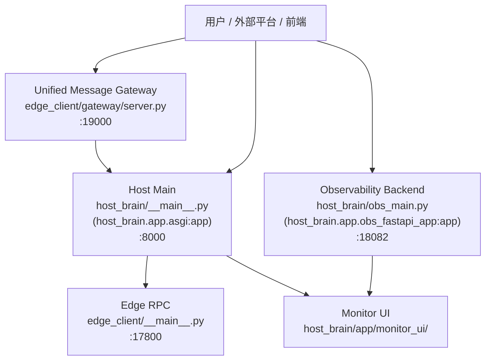
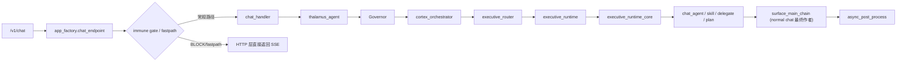
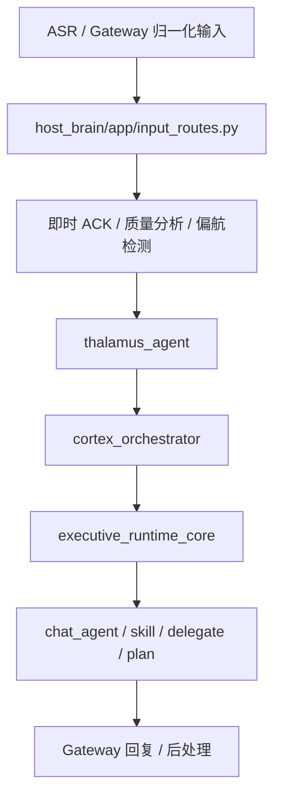
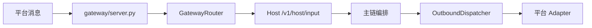

受众：MASTER
标题：Natsume AI 整体架构全景文档

版本：v3.0
日期：2026-05-30
定位：以当前代码为锚点，对系统的运行面、主链、Edge/Gateway/Observability 关系做高层总览。本文偏“整体理解”，细节以 `docs/50_project/arch/` 下的代码事实文档为准。

# Natsume AI 整体架构全景文档

## 一、当前整体架构

当前系统已经从“单一 Host + 附属 Edge”演进为 5 个协同运行面：

1. Host Main
2. Observability Backend
3. Edge RPC
4. Unified Message Gateway
5. Monitor UI



这意味着当前架构不应该再被理解成：

- “只有一个主 FastAPI”
- “监控只是 Host 的附属接口”
- “Gateway 只是旧 chat 主链里的一个场景分支”

## 二、Host Main 的角色

Host Main 负责所有真正的业务执行主权：

- `/v1/chat`
- `/v1/host/input`
- `/v1/edge/events`
- tools / canon / bond / scheduler / prompt-config
- monitor 静态资源托管

当前主权边界可以概括为：

```text
输入进入 Host
  -> intent 编译
  -> Governor / immune gate
  -> cortex_orchestrator
  -> executive_runtime_core
  -> chat / skill / delegate / plan
  -> post process
```

Host 仍然是：

- 最终路由裁决点
- 记忆与 Bond 副写主点
- 审计与 trace 主写入点
- Edge 能力调用发起方

## 三、聊天主链的当前形态

当前聊天主链已经不再是旧的 `SceneRouter -> top_agent -> dispatch_agent` 结构，而是：



这个变化背后的含义是：

- `/v1/chat` 的 HTTP 首跳由 `host_brain/app/asgi.py` + `host_brain/app/app_factory.py` 退示的 `chat_endpoint` 接住，再委托给 `chat_routes.handle_v1_chat_route` 与 `chat_handler.handle_chat`；`chat_handler.py` 是进入主编排前的薄层
- `cortex_orchestrator` 是聊天编排中段收口点
- `executive_runtime_core.py` 是当前真正的执行与路由核心
- `chat_agent.py` 是人格渲染路由者；**normal chat 的最终文本作者是 `host_brain/persona/surface_main_chain.py` (SurfaceMainChain)**，旧 `prompt_builder` 链路仅作为辅助 facts / state 提供者

## 四、外部输入与平台消息链

当前 ASR 与 Gateway 归一化输入通过 `/v1/host/input` 回到主链；其他 Edge 运行时事件通过 `/v1/edge/events` 上报：



这条链现在有两个重要特征：

1. Gateway 消息不再通过旧的 `SCENE_GATEWAY -> SceneRouter` 结构进入主链。
2. `input_routes.py` 本身已经承担了 ACK、进度推送、重对齐通知等网关控制逻辑，不再只是一个“转发壳”。

补充：播放状态、资源门控、inline waiters 等 Edge 运行时事件当前走 `POST /v1/edge/events`，而不是 `POST /v1/host/input`。

## 五、Edge 的角色

Edge 现在并不只是“语音播放端”，而是本地执行与感知中枢。

当前 Edge RPC 的主要能力面包括：

- `speak`
- `barge_in`
- `vts`
- `screenshot`
- `automate`
- `visual_locate`
- `proactive_push / proactive_messages`
- `fallback/*`
- `wx/*`

因此，Edge 当前架构更接近：

```text
Edge = 语音执行 + 桌面自动化 + 视觉定位 + 本地桥接查询 + 事件回传
```

而不是单纯的：

```text
Edge = TTS/VTS 附件服务
```

## 六、Unified Message Gateway 的位置

Gateway 当前已是独立运行面，平台适配器包括：

- wechat
- qq
- feishu
- wecom
- telegram
- line

其高层架构是：



因此，Gateway 当前更像“平台输入/输出总线”，而不是旧图里的一个场景分支。

## 七、Observability 与 Monitor UI

Observability 当前已经从“Host 主进程里的附属接口”升级为独立后端：

- `host_brain/app/obs_fastapi_app.py`
- routes: `/obs/*` + `/api/ui/*`
- warm cache: runtime snapshot / trace feed / insights summary / digital life overview / life body

Monitor UI 当前也不再只是“指标页集合”，而是围绕数字生命体形成了 4 组信息架构：

1. 数字生命体
2. 运营
3. 器官级观测
4. 外周执行

这说明前端侧架构目标已经从：

- “调试控制台”

演进为：

- “数字生命驾驶舱”

## 八、Tribe 系统在架构中的位置

Tribe 层当前最重要的不是“有多少个模块”，而是它如何影响主链：

- `thalamus_agent.py`：意图编译入口
- `immune_agent.py`：风险门控
- `limbic_agent.py`：动机态与情绪路由影响
- `proprioception_agent.py`：认知负荷影响
- `prefrontal_agent.py`：漂移告警与可选 planning
- `registry.py`：当前 tribe family 注册

当前必须明确的一点是：

- `registry.py` 里已经是 `23` 个 family spec
- 旧文档里“22 个器官族”的说法，不再代表当前代码

## 九、当前架构与历史架构的关键差异

当前已经不适合继续沿用的历史口径：

| 历史口径 | 当前状态 |
|---|---|
| `top_agent.py` 是主链中心 | 文件已不存在 |
| `dispatch_agent.py` 是主调度器 | 文件已不存在 |
| `chat_handler_complex.py` 承担复杂场景 | 文件已不存在 |
| `graph/main_chain.py` 是主编排入口 | 文件已不存在 |
| `SceneRouter.route_sse()` 是当前场景分流器 | 当前主链不再使用该结构 |

因此，任何新的架构说明如果仍以这些名词描述“当前系统”，都会把人带偏。

## 十、推荐阅读顺序

如果目标是理解整体架构，建议顺序：

1. `README.md`
2. 本文
3. `docs/50_project/arch/CURRENT_CODE_ARCHITECTURE.md`
4. `docs/50_project/arch/dataflow_report.md`
5. `docs/50_project/arch/CORE_MODULES_DETAILED_REFERENCE.md`
6. `docs/50_project/arch/DIGITAL_LIFE_BODY_FRONTEND_ARCHITECTURE_20260419.md`
