受众：MASTER
标题：Natsume AI 整体架构全景文档

# Natsume AI 整体架构全景文档

> 生成时间：2026-03-10 | 最后更新：2026-03-19（代码重构后文档同步）

---

## 一、双端总体架构

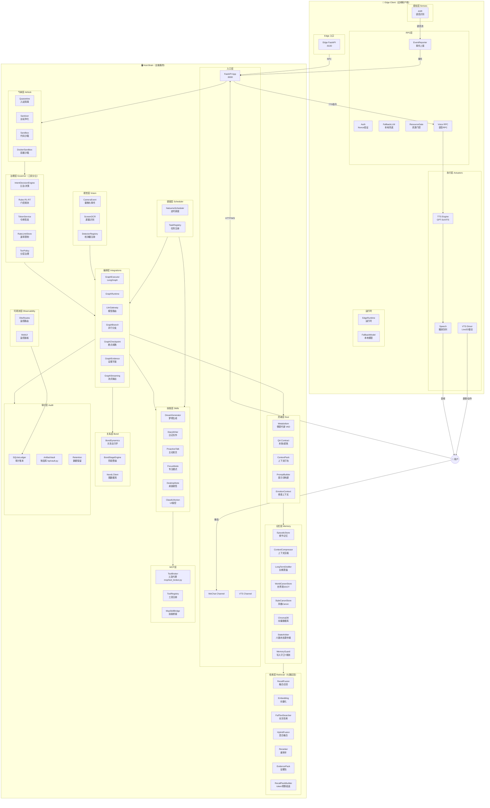

---

## 二、Host 端详细模块说明

### 1. 入口层（Entry）

| 文件 | 职责 |
|------|------|
| `app/fastapi_app.py` | FastAPI 主应用，挂载所有路由，管理生命周期 |
| `app/main.py` | 启动入口，初始化所有服务依赖 |
| `channels/wechat.py` | 微信消息接入适配器 |
| `channels/vts.py` | VTS（Live2D）消息通道 |

---

### 2. 气闸层（Airlock）

```
用户输入 → Quarantine（入站隔离）→ 业务处理 → Sanitizer（出站净化）→ 用户输出
                                        ↓
                              Sandbox（代码执行沙箱）
                              DockerSandbox（容器隔离）
```

| 文件 | 职责 |
|------|------|
| `airlock/quarantine.py` | 入站内容隔离检查，拦截危险输入 |
| `airlock/sanitizer.py` | 出站内容净化，防止信息泄露 |
| `airlock/sandbox.py` | 代码执行沙箱（进程隔离） |
| `airlock/docker_sandbox.py` | Docker 容器级沙箱 |

---

### 3. 治理层 Governor（三权分立）

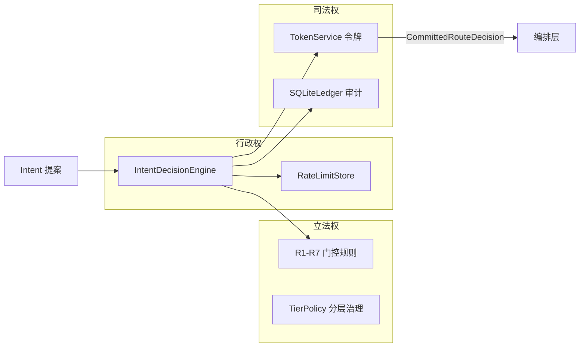

**R1-R7 门控规则：**

| 规则 | 说明 |
|------|------|
| R1 | 意图解析合法性 |
| R2 | 序列号防重放 |
| R3 | 过期检测（5分钟窗口） |
| R4 | 速率限制 |
| R5 | 系统模式检查（normal/focus/gaming/maintenance/locked） |
| R6 | 令牌签名验证 |
| R7 | 分层治理策略（M42） |

---

### 4. Agent 编排层（Integrations / LangGraph）

> **P15 重构说明**：所有复杂场景统一走 `PROFILE_WORKFLOW_SUPERVISED` 图，入口为 `supervisor_dispatch → agent_dispatch → judge_agent → chat_render_node`。旧的 `core_reasoner_primary → scene_router_post_core → workbench_*` 长链已废弃。

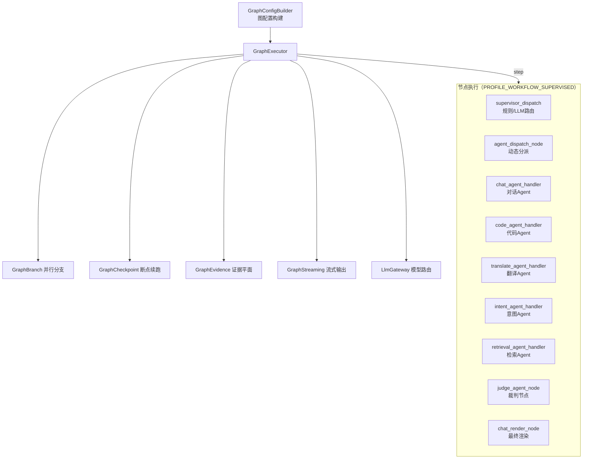

**场景路由（SceneRouter）：**

| 场景 | 触发条件 | execution_profile | 节点序列 |
|------|----------|------|------|
| `SCENE_CHAT` | 普通对话 | `PROFILE_CHAT_FAST` | `chat_direct_ja → chat_render_node` |
| `SCENE_EXEC_INTENT` | 执行意图关键词 | `PROFILE_INTENT_EXEC` | `intent_agent_entry → safety_verifier → judge_agent → chat_render_node` |
| `SCENE_WORK_CODE` | 代码关键词 | `PROFILE_WORKFLOW_SUPERVISED` | `supervisor_dispatch → agent_dispatch → [judge_agent] → chat_render_node` |
| `SCENE_WORK_TRANSLATE` | 翻译关键词 | `PROFILE_WORKFLOW_SUPERVISED` | `supervisor_dispatch → agent_dispatch → [judge_agent] → chat_render_node` |
| `SCENE_VISION_UI` | 截图/界面关键词 | — | 视觉处理节点 |

---

### 5. 模型路由（LlmGateway）

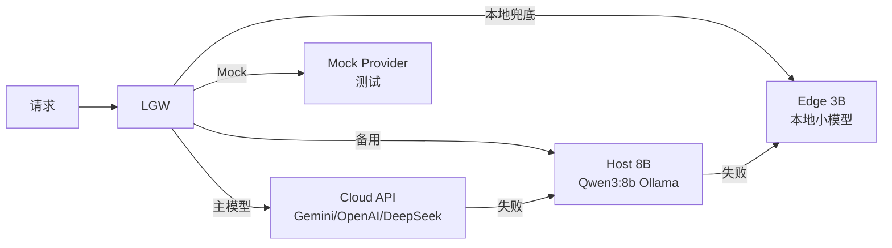

**路由决策：**

| 路由 | 说明 |
|------|------|
| `host_8b` | 本地 Ollama（`http://127.0.0.1:11434/v1`，Qwen3:8b） |
| `cloud` | 云端 API（Gemini Primary → Gemini Retry → OpenAI → DeepSeek） |
| `edge_3b` | Edge 端本地小模型 |
| `skills` | 技能专用路由 |

> `adjust_gen_params_for_emotion`：根据 VAD 情绪向量动态调整 `temperature`、`top_p` 等生成参数。

---

### 6. 上下文压缩（ContextCompressor）

| 策略 | 说明 |
|------|------|
| `sliding_window` | 保留最近 N 轮，直接截断 |
| `summary` | 调用 LLM 生成历史摘要，不可用时降级 |
| `hybrid` | 保留最近 6 轮 + LLM 摘要历史轮次 |

压缩前自动写入 `COMPRESS_BEFORE_SAVE` 审计事件，确保可追溯。

---

### 7. 七路召回（RecallFusion）

```mermaid
graph TD
    Q[用户查询] --> EMB[Embedding 向量化]
    EMB --> R1[Route 1: sqlite_ledger<br/>SQLite 审计日志]
    EMB --> R2[Route 2: neo4j_bond<br/>Neo4j 关系图]
    EMB --> R3[Route 3: episodic_vector<br/>ChromaDB 情节向量]
    EMB --> R4[Route 4: style_canon<br/>风格 Canon 向量]
    EMB --> R5[Route 5: world_canon<br/>世界观 Canon 向量]
    EMB --> R6[Route 6: artifact_vault<br/>制品库向量]
    EMB --> R7[Route 7: persona_utterance<br/>人格话语向量]
    R1 & R2 & R3 & R4 & R5 & R6 & R7 --> HF[HybridFusion<br/>混合融合]
    HF --> RR[Reranker<br/>Qwen3-Reranker-0.6B]
    RR --> EP[EvidencePack<br/>证据包]
    EP --> RPB[RecallPackBuilder<br/>token预算截断+冲突检测<br/>总上限2700 tokens]
    RPB --> ARB[StateArbiter<br/>六路状态源仲裁]
    ARB --> CTX[ContextPack 注入]
```

**混合检索权重：** 向量检索 70% + 全文检索（FTS5）30%

**时效加分机制：**

| 时间窗口 | 加分 |
|----------|------|
| 同 Session 命中 | +0.25 |
| 5 分钟内 | +0.20 |
| 1 小时内 | +0.10 |
| 1 天内 | +0.05 |

---

## 三、数字生命灵魂人格实现

### 1. 情感层（VAD 三维模型）

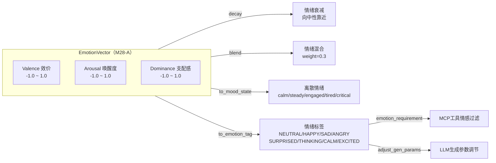

**情感标注在记忆中的体现（EpisodicRecord）：**

| 字段 | 说明 |
|------|------|
| `emotion_tag` | 离散情绪标签 |
| `emotion_valence` | 效价值 |
| `emotion_arousal` | 唤醒度值 |

---

### 2. 本我 / 自我 / 超我（QA Contract）

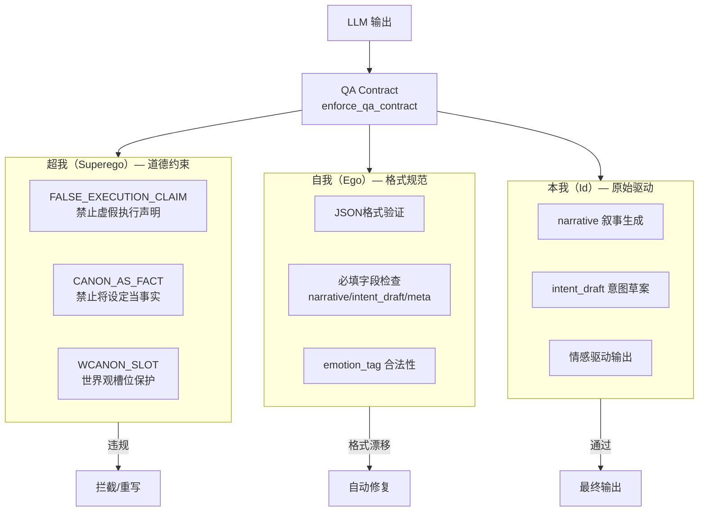

---

### 3. 梦境系统（DreamGenerator）

```
触发条件：sys_mode == "sleep" 或 idle == True
    ↓
读取当日 EpisodicStore（top_k=20）
    ↓
LLM 生成梦境叙事（task="dream_generation"）
    ↓
写入 EpisodicStore（category="dream", evidence_level="NARRATIVE_ONLY"）
```

- 无素材时跳过（`SCHED_NO_CONTENT`）
- LLM 不可用时降级返回 `STATUS_DEGRADED`
- 梦境内容带 SHA-256 哈希存档

---

### 4. 遗忘系统（LongTermDistiller）

```
定时触发（NatsumeScheduler）
    ↓
从 EpisodicStore 召回 top-k 记忆
    ↓
MemoryDistillationEngine 生成语义记忆（6大主题）
    ↓
生成 World Canon pending 提案（最多5个/周期）
    ↓
等待人工/自动审核 → 写入 WorldCanonStore SSOT
```

**6大蒸馏主题：**

1. 用户日常习惯与偏好
2. 重要事件与里程碑
3. 情感状态与心理变化
4. 用户目标与计划
5. 关系与社交互动
6. 情感关系史（M28-J）

> **幂等保护：** 相同 `source_hash` 不重复生成提案

---

### 5. 日记系统（DiaryWriter）

```
每日定时触发
    ↓
读取当日 AuditLog（对话记录）+ EpisodicStore
    ↓
无实质对话 → 跳过（不伪造）
    ↓
LLM 生成日记叙事（task="diary_generation"）
    ↓
双写：① 本地文件（diary/YYYY-MM-DD.md）
      ② EpisodicStore（category="diary"）
    ↓
提取 drift_suggestion → 提交 Canon Evolution 提案（慢立法）
```

---

### 6. 慢立法（World Canon Evolution）

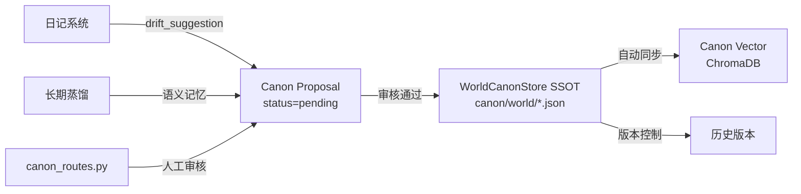

**World Canon 文档：**

| 文件 | 内容 |
|------|------|
| `wc-001-system-terms.json` | 系统术语 |
| `wc-002-architecture-invariants.json` | 架构不变量 |
| `wc-003-persona-core.json` | 人格核心 |

> **防护机制：** 禁止写入"已执行/执行完成/已保存"等完成性表述（`WORLD_EXECUTION_FACT_TOKENS`）

---

### 7. Bond 关系系统

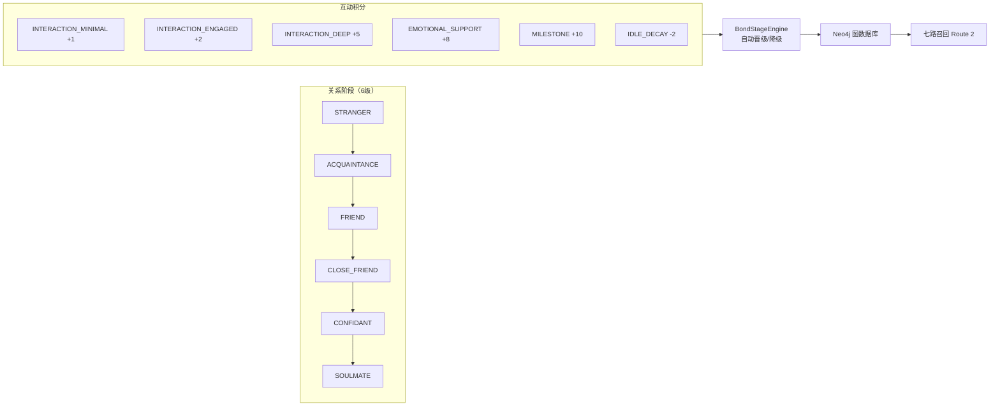

**晋级阈值：**

| 阶段 | 所需积分 |
|------|----------|
| STRANGER | 0 |
| ACQUAINTANCE | 10 |
| FRIEND | 30 |
| CLOSE_FRIEND | 70 |
| CONFIDANT | 150 |
| SOULMATE | 300 |

---

## 四、MCP 与 Skill 整合

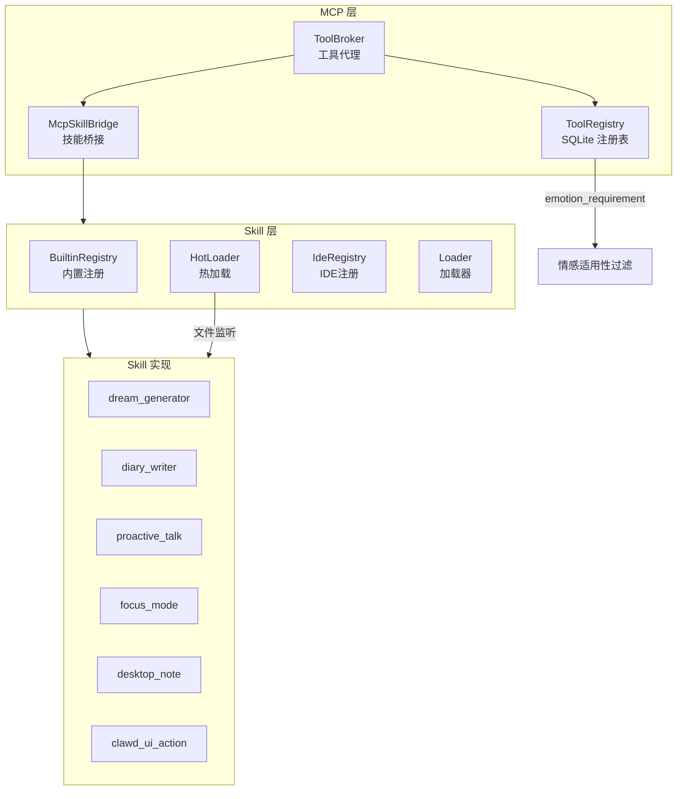

**ToolMeta 字段：**

| 字段 | 说明 |
|------|------|
| `access_level` | PUBLIC / INTERNAL / RESTRICTED |
| `risk_level` | LOW / MEDIUM / HIGH |
| `reversible` | 是否可撤销 |
| `emotion_requirement` | 情感适用性（M28-N） |

---

## 五、ClawdBot 实现

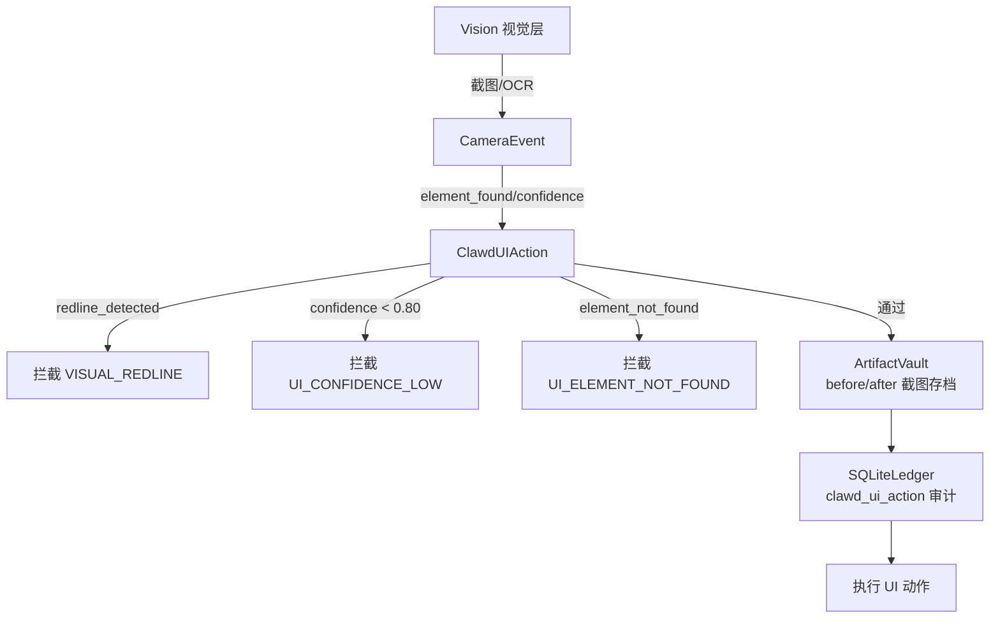

**安全门控：**

1. `redline_detected`：红线场景直接拦截
2. `element_found`：目标元素必须存在
3. `confidence ≥ 0.80`：置信度门槛
4. 执行前后截图双存 ArtifactVault，全程可审计

---

## 六、Edge 端详细架构

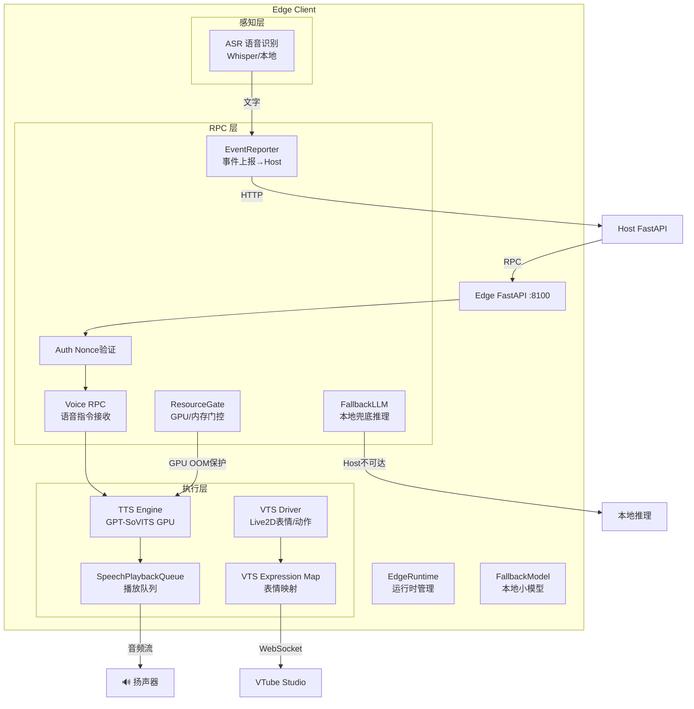

**TTS 引擎状态机：**

```
UNLOADED → LOADING → READY → SYNTHESIZING → ERROR/SHUTDOWN
```

**Edge 端服务列表：**

| 服务 | 端口/协议 | 说明 |
|------|-----------|------|
| Edge FastAPI | :8100 HTTP | RPC 网关 |
| ASR | 本地进程 | Whisper 语音识别 |
| TTS Engine | GPU 进程 | GPT-SoVITS 语音合成 |
| VTS Driver | WebSocket | Live2D 表情驱动 |
| EventReporter | HTTP→Host | 事件上报 |
| FallbackLLM | 本地推理 | Host 不可达时兜底 |

---

## 七、调度系统（NatsumeScheduler）

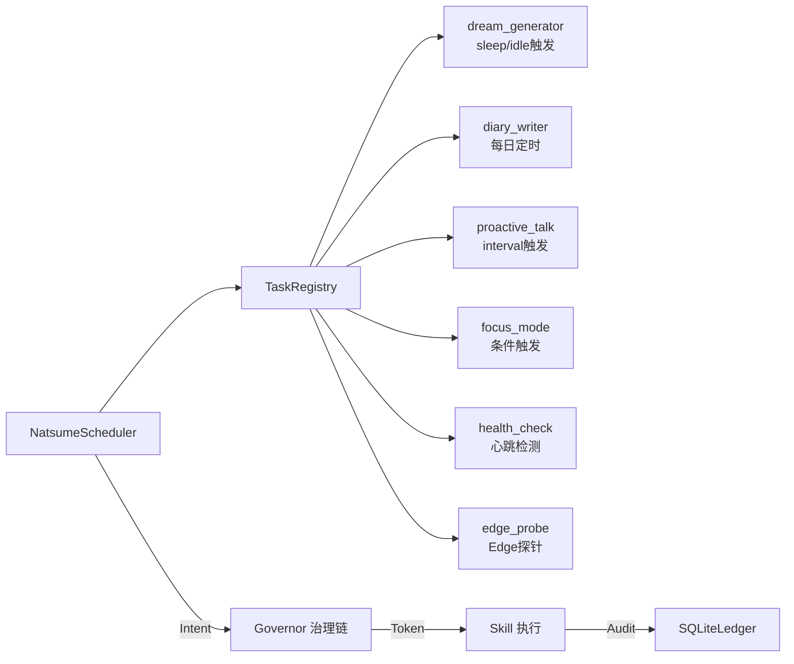

**触发模式：** `cron` / `interval` / `once`

> 调度器生成的 Intent 与用户请求享有相同治理权重（`proposer_node_id = "scheduler"`）

---

## 八、审计链（SQLiteLedger）

**20+ 张审计表（Migration 0001-0040）：**

| 表 | 内容 |
|----|------|
| `triptych` | 三联审计（请求/响应/错误） |
| `canon_schema` | Canon 变更记录 |
| `memory_ops` | 记忆操作日志 |
| `vault_schema` | 制品库操作 |
| `airlock_schema` | 气闸拦截记录 |
| `channel_io_schema` | 通道 I/O |
| `clawd_ui_schema` | ClawdBot UI 操作 |
| `voice_event_schema` | 语音事件 |
| `retrieval_event_schema` | 检索事件 |
| `vision_event_schema` | 视觉事件 |
| `bond_update_schema` | 关系更新 |
| `scheduler_event_schema` | 调度事件 |
| `world_canon_doc` | 世界观文档 |
| `canon_proposal_log` | Canon 提案日志 |
| `llm_call_log` | LLM 调用日志 |
| `llm_route_log` | 模型路由日志 |
| `subgraph_trace` | 子图追踪 |
| `episodic_fts5` | 情节记忆全文索引 |

---

## 九、整体数据流

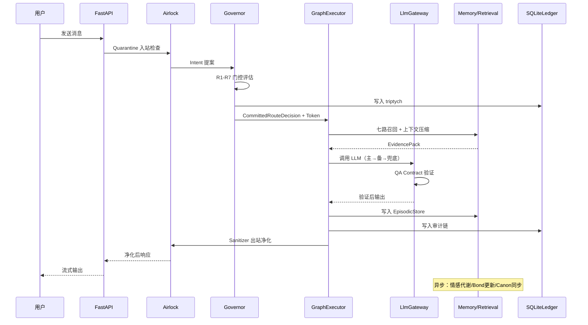

---

## 十、技术栈总览

| 层次 | 技术 |
|------|------|
| Web 框架 | FastAPI + Uvicorn |
| Agent 编排 | LangGraph + LangChain |
| 向量数据库 | ChromaDB |
| 图数据库 | Neo4j |
| 关系数据库 | SQLite（审计账本） |
| 嵌入模型 | Qwen3-Embedding-0.6B |
| 重排序模型 | Qwen3-Reranker-0.6B |
| TTS | GPT-SoVITS（GPU） |
| ASR | Whisper（本地） |
| Live2D | VTube Studio（WebSocket） |
| 本地 LLM | Ollama（Qwen3:8b） |
| 云端 LLM | Gemini / OpenAI / DeepSeek |
| 容器沙箱 | Docker |
