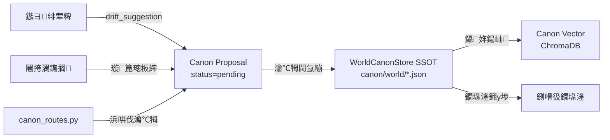
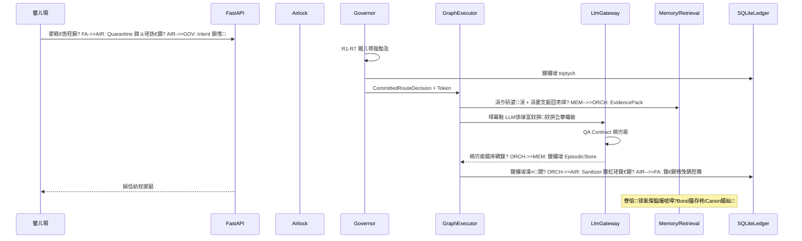

# Natsume AI 鏁翠綋鏋舵瀯鍏ㄦ櫙鏂囨。

> 鐢熸垚鏃堕棿锛?026-03-10

---

## 涓€銆佸弻绔€讳綋鏋舵瀯

```mermaid
graph TB
    subgraph HOST["馃枼锔?Host Brain锛堜富鑴戞湇鍔★級"]
        direction TB
        subgraph ENTRY["鍏ュ彛灞?]
            FA[FastAPI App<br/>:8000]
            WC[WeChat Channel]
            VTS_H[VTS Channel]
        end
        subgraph AIRLOCK["姘旈椄灞?Airlock"]
            QUA[Quarantine<br/>鍏ョ珯闅旂]
            SAN[Sanitizer<br/>鍑虹珯鍑€鍖朷
            SBX[Sandbox<br/>浠ｇ爜娌欑]
            DSBX[DockerSandbox<br/>瀹瑰櫒娌欑]
        end
        subgraph GOV["娌荤悊灞?Governor锛堜笁鏉冨垎绔嬶級"]
            IDE[IntentDecisionEngine<br/>绔嬫硶/鍐崇瓥]
            RULES[Rules R1-R7<br/>闂ㄦ帶瑙勫垯]
            TOK[TokenService<br/>浠ょ墝绛惧彂]
            RATE[RateLimitStore<br/>閫熺巼闄愬埗]
            TIER[TierPolicy<br/>鍒嗗眰娌荤悊]
        end
        subgraph ORCH["缂栨帓灞?Integrations"]
            GE[GraphExecutor<br/>LangGraph]
            GR[GraphRuntime]
            LGW[LlmGateway<br/>妯″瀷璺敱]
            GBR[GraphBranch<br/>骞惰鍒嗘敮]
            GCK[GraphCheckpoint<br/>鏂偣缁窇]
            GEV[GraphEvidence<br/>璇佹嵁骞抽潰]
            GST[GraphStreaming<br/>娴佸紡杈撳嚭]
        end
        subgraph SOUL["鐏甸瓊灞?Soul"]
            META[Metabolism<br/>鎯呮劅浠ｈ阿 VAD]
            QA[QA Contract<br/>鏈垜/瓒呮垜]
            CTX[PromptContext<br/>涓婁笅鏂囨墦鍖匽
            PB[PromptBuilder<br/>鎻愮ず璇嶆瀯寤篯
            EMO[EmotionContext<br/>鎯呮劅涓婁笅鏂嘳
        end
        subgraph MEM["璁板繂灞?Memory"]
            EPI[EpisodicStore<br/>鎯呰妭璁板繂]
            CTX_C[ContextCompressor<br/>涓婁笅鏂囧帇缂
            DIST[LongTermDistiller<br/>闀挎湡钂搁]
            CANO[WorldCanonStore<br/>涓栫晫瑙係SOT]
            STYLE[StyleCanonStore<br/>椋庢牸Canon]
            CHROMA[ChromaDB<br/>鍚戦噺鏁版嵁搴揮
        end
        subgraph RETR["妫€绱㈠眰 Retrieval锛堜竷璺彫鍥烇級"]
            RF[RecallFusion<br/>铻嶅悎鍙洖]
            EMB[Embedding<br/>鍚戦噺鍖朷
            FTS[FullTextSearcher<br/>鍏ㄦ枃妫€绱
            HF[HybridFusion<br/>娣峰悎铻嶅悎]
            RR[Reranker<br/>閲嶆帓搴廬
            EP[EvidencePack<br/>璇佹嵁鍖匽
        end
        subgraph BOND["鍏崇郴灞?Bond"]
            BD[BondDynamics<br/>鍏崇郴鍔ㄥ姏瀛
            BSE[BondStageEngine<br/>闃舵鏅嬬骇]
            NEO[Neo4j Client<br/>鍥炬暟鎹簱]
        end
        subgraph SCHED["璋冨害灞?Scheduler"]
            NS[NatsumeScheduler<br/>瀹氭椂璋冨害]
            TR[TaskRegistry<br/>浠诲姟娉ㄥ唽]
        end
        subgraph SKILLS["鎶€鑳藉眰 Skills"]
            DG[DreamGenerator<br/>姊﹀鐢熸垚]
            DW[DiaryWriter<br/>鏃ヨ鍐欎綔]
            PT[ProactiveTalk<br/>涓诲姩鍙戣█]
            FM[FocusMode<br/>涓撴敞妯″紡]
            DN[DesktopNote<br/>妗岄潰渚跨]
            CUA[ClawdUIAction<br/>UI鎿嶆帶]
        end
        subgraph MCP_L["MCP灞?]
            TB[ToolBroker<br/>宸ュ叿浠ｇ悊]
            TREG[ToolRegistry<br/>宸ュ叿娉ㄥ唽]
            MSB[McpSkillBridge<br/>鎶€鑳芥ˉ鎺
        end
        subgraph AUDIT["瀹¤灞?Audit"]
            LED[SQLiteLedger<br/>瀹¤璐︽湰]
            VAULT[ArtifactVault<br/>鍒跺搧搴揮
            RET[Retention<br/>鏁版嵁淇濈暀]
        end
        subgraph VIS["瑙嗚灞?Vision"]
            CAM[CameraEvent<br/>鎽勫儚澶翠簨浠禲
            OCR[ScreenOCR<br/>灞忓箷璇嗗埆]
            DET[DetectorRegistry<br/>妫€娴嬪櫒娉ㄥ唽]
        end
        subgraph OBS["鍙娴嬪眰 Observability"]
            OBR[ObsRoutes<br/>鐩戞帶璺敱]
            WUI[WebUI<br/>鐩戞帶闈㈡澘]
        end
    end

    subgraph EDGE["馃摫 Edge Client锛堣竟缂樺鎴风锛?]
        direction TB
        subgraph EDGE_APP["Edge 鍏ュ彛"]
            EFA[Edge FastAPI<br/>:8100]
        end
        subgraph EDGE_SENSE["鎰熺煡灞?Senses"]
            ASR[ASR<br/>璇煶璇嗗埆]
        end
        subgraph EDGE_ACT["鎵ц灞?Actuators"]
            TTS[TTS Engine<br/>GPT-SoVITS]
            SPE[Speech<br/>鎾斁闃熷垪]
            VTS_E[VTS Driver<br/>Live2D椹卞姩]
        end
        subgraph EDGE_RPC["RPC灞?]
            AUTH[Auth<br/>Nonce楠岃瘉]
            ER[EventReporter<br/>浜嬩欢涓婃姤]
            FLM[FallbackLLM<br/>鏈湴鍏滃簳]
            RG[ResourceGate<br/>璧勬簮闂ㄦ帶]
            VC[Voice RPC<br/>璇煶RPC]
        end
        subgraph EDGE_RT["杩愯鏃?]
            ERT[EdgeRuntime<br/>杩愯鏃禲
            FBM[FallbackModel<br/>鏈湴妯″瀷]
        end
    end

    USER((馃懁 鐢ㄦ埛)) -->|HTTP/WS| FA
    USER -->|寰俊| WC
    EDGE_APP -->|RPC| FA
    FA --> AIRLOCK
    AIRLOCK --> GOV
    GOV --> ORCH
    ORCH --> SOUL
    SOUL --> MEM
    MEM --> RETR
    ORCH --> BOND
    ORCH --> SKILLS
    SKILLS --> MCP_L
    ORCH --> AUDIT
    VIS --> ORCH
    SCHED --> SKILLS
    SCHED --> ORCH
    OBS --> LED
    ASR -->|璇煶娴亅 ER
    ER -->|浜嬩欢| FA
    FA -->|TTS鎸囦护| VC
    VC --> TTS
    TTS --> SPE
    SPE -->|闊抽| USER
    VTS_E -->|琛ㄦ儏/鍔ㄤ綔| USER
```

---

## 浜屻€丠ost 绔缁嗘ā鍧楄鏄?
### 1. 鍏ュ彛灞傦紙Entry锛?
| 鏂囦欢 | 鑱岃矗 |
|------|------|
| `app/fastapi_app.py` | FastAPI 涓诲簲鐢紝鎸傝浇鎵€鏈夎矾鐢憋紝绠＄悊鐢熷懡鍛ㄦ湡 |
| `app/main.py` | 鍚姩鍏ュ彛锛屽垵濮嬪寲鎵€鏈夋湇鍔′緷璧?|
| `channels/wechat.py` | 寰俊娑堟伅鎺ュ叆閫傞厤鍣?|
| `channels/vts.py` | VTS锛圠ive2D锛夋秷鎭€氶亾 |

---

### 2. 姘旈椄灞傦紙Airlock锛?
```
鐢ㄦ埛杈撳叆 鈫?Quarantine锛堝叆绔欓殧绂伙級鈫?涓氬姟澶勭悊 鈫?Sanitizer锛堝嚭绔欏噣鍖栵級鈫?鐢ㄦ埛杈撳嚭
                                        鈫?                              Sandbox锛堜唬鐮佹墽琛屾矙绠憋級
                              DockerSandbox锛堝鍣ㄩ殧绂伙級
```

| 鏂囦欢 | 鑱岃矗 |
|------|------|
| `airlock/quarantine.py` | 鍏ョ珯鍐呭闅旂妫€鏌ワ紝鎷︽埅鍗遍櫓杈撳叆 |
| `airlock/sanitizer.py` | 鍑虹珯鍐呭鍑€鍖栵紝闃叉淇℃伅娉勯湶 |
| `airlock/sandbox.py` | 浠ｇ爜鎵ц娌欑锛堣繘绋嬮殧绂伙級 |
| `airlock/docker_sandbox.py` | Docker 瀹瑰櫒绾ф矙绠?|

---

### 3. 娌荤悊灞?Governor锛堜笁鏉冨垎绔嬶級

```mermaid
graph LR
    INTENT[Intent 鎻愭] --> IDE
    subgraph 绔嬫硶鏉?        RULES[R1-R7 闂ㄦ帶瑙勫垯]
        TIER[TierPolicy 鍒嗗眰娌荤悊]
    end
    subgraph 琛屾斂鏉?        IDE[IntentDecisionEngine]
        RATE[RateLimitStore]
    end
    subgraph 鍙告硶鏉?        TOK[TokenService 浠ょ墝]
        LED2[SQLiteLedger 瀹¤]
    end
    IDE --> RULES
    IDE --> RATE
    IDE --> TOK
    IDE --> LED2
    TOK -->|CommittedRouteDecision| ORCH2[缂栨帓灞俔
```

**R1-R7 闂ㄦ帶瑙勫垯锛?*

| 瑙勫垯 | 璇存槑 |
|------|------|
| R1 | 鎰忓浘瑙ｆ瀽鍚堟硶鎬?|
| R2 | 搴忓垪鍙烽槻閲嶆斁 |
| R3 | 杩囨湡妫€娴嬶紙5鍒嗛挓绐楀彛锛?|
| R4 | 閫熺巼闄愬埗 |
| R5 | 绯荤粺妯″紡妫€鏌ワ紙normal/focus/gaming/maintenance/locked锛?|
| R6 | 浠ょ墝绛惧悕楠岃瘉 |
| R7 | 鍒嗗眰娌荤悊绛栫暐锛圡42锛?|

---

### 4. Agent 缂栨帓灞傦紙Integrations / LangGraph锛?
```mermaid
graph TD
    GCB[GraphConfigBuilder<br/>鍥鹃厤缃瀯寤篯 --> GE
    GE[GraphExecutor] --> |step| NODE
    subgraph NODE["鑺傜偣鎵ц"]
        N1[chat_direct_ja<br/>鐩存帴瀵硅瘽]
        N2[core_reasoner_primary<br/>鏍稿績鎺ㄧ悊]
        N3[core_reasoner_secondary<br/>浜岀骇鎺ㄧ悊]
        N4[planner_constraints<br/>绾︽潫瑙勫垝]
        N5[tool_planner<br/>宸ュ叿瑙勫垝]
        N6[safety_verifier<br/>瀹夊叏楠岃瘉]
        N7[consistency_verifier<br/>涓€鑷存€ч獙璇乚
        N8[renderer_ja_c_style<br/>鏃ユ枃娓叉煋]
        N9[workbench_translate<br/>缈昏瘧宸ヤ綔鍙癩
        N10[workbench_code_assist<br/>浠ｇ爜杈呭姪]
    end
    GE --> GBR[GraphBranch 骞惰鍒嗘敮]
    GE --> GCK[GraphCheckpoint 鏂偣缁窇]
    GE --> GEV[GraphEvidence 璇佹嵁骞抽潰]
    GE --> GST[GraphStreaming 娴佸紡杈撳嚭]
    GE --> LGW[LlmGateway 妯″瀷璺敱]
```

**鍦烘櫙璺敱锛圫ceneRouter锛夛細**

| 鍦烘櫙 | 瑙﹀彂鏉′欢 | 璺敱鐩爣 |
|------|----------|----------|
| `SCENE_CHAT` | 鏅€氬璇?| `chat_direct_ja` / `core_reasoner_primary` |
| `SCENE_EXEC_INTENT` | 鎵ц鎰忓浘鍏抽敭璇?| `tool_planner` |
| `SCENE_WORK_CODE` | 浠ｇ爜鍏抽敭璇?| `workbench_code_assist` |
| `SCENE_WORK_TRANSLATE` | 缈昏瘧鍏抽敭璇?| `workbench_translate` |
| `SCENE_VISION_UI` | 鎴浘/鐣岄潰鍏抽敭璇?| 瑙嗚澶勭悊鑺傜偣 |

---

### 5. 妯″瀷璺敱锛圠lmGateway锛?
```mermaid
graph LR
    REQ[璇锋眰] --> LGW
    LGW -->|涓绘ā鍨媩 CLOUD[Cloud API<br/>Gemini/OpenAI/DeepSeek]
    LGW -->|澶囩敤| HOST8B[Host 8B<br/>Qwen3:8b Ollama]
    LGW -->|鏈湴鍏滃簳| EDGE3B[Edge 3B<br/>鏈湴灏忔ā鍨媇
    LGW -->|Mock| MOCK[Mock Provider<br/>娴嬭瘯]
    CLOUD -->|澶辫触| HOST8B
    HOST8B -->|澶辫触| EDGE3B
```

**璺敱鍐崇瓥锛?*

| 璺敱 | 璇存槑 |
|------|------|
| `host_8b` | 鏈湴 Ollama锛坄http://127.0.0.1:11434/v1`锛孮wen3:8b锛?|
| `cloud` | 浜戠 API锛圙emini Primary 鈫?Gemini Retry 鈫?OpenAI 鈫?DeepSeek锛?|
| `edge_3b` | Edge 绔湰鍦板皬妯″瀷 |
| `skills` | 鎶€鑳戒笓鐢ㄨ矾鐢?|

> `adjust_gen_params_for_emotion`锛氭牴鎹?VAD 鎯呯华鍚戦噺鍔ㄦ€佽皟鏁?`temperature`銆乣top_p` 绛夌敓鎴愬弬鏁般€?
---

### 6. 涓婁笅鏂囧帇缂╋紙ContextCompressor锛?
| 绛栫暐 | 璇存槑 |
|------|------|
| `sliding_window` | 淇濈暀鏈€杩?N 杞紝鐩存帴鎴柇 |
| `summary` | 璋冪敤 LLM 鐢熸垚鍘嗗彶鎽樿锛屼笉鍙敤鏃堕檷绾?|
| `hybrid` | 淇濈暀鏈€杩?6 杞?+ LLM 鎽樿鍘嗗彶杞 |

鍘嬬缉鍓嶈嚜鍔ㄥ啓鍏?`COMPRESS_BEFORE_SAVE` 瀹¤浜嬩欢锛岀‘淇濆彲杩芥函銆?
---

### 7. 涓冭矾鍙洖锛圧ecallFusion锛?
```mermaid
graph TD
    Q[鐢ㄦ埛鏌ヨ] --> EMB[Embedding 鍚戦噺鍖朷
    EMB --> R1[Route 1: sqlite_ledger<br/>SQLite 瀹¤鏃ュ織]
    EMB --> R2[Route 2: neo4j_bond<br/>Neo4j 鍏崇郴鍥綸
    EMB --> R3[Route 3: episodic_vector<br/>ChromaDB 鎯呰妭鍚戦噺]
    EMB --> R4[Route 4: style_canon<br/>椋庢牸 Canon 鍚戦噺]
    EMB --> R5[Route 5: world_canon<br/>涓栫晫瑙?Canon 鍚戦噺]
    EMB --> R6[Route 6: artifact_vault<br/>鍒跺搧搴撳悜閲廬
    EMB --> R7[Route 7: persona_utterance<br/>浜烘牸璇濊鍚戦噺]
    R1 & R2 & R3 & R4 & R5 & R6 & R7 --> HF[HybridFusion<br/>娣峰悎铻嶅悎]
    HF --> RR[Reranker<br/>Qwen3-Reranker-0.6B]
    RR --> EP[EvidencePack<br/>璇佹嵁鍖匽
    EP --> CTX[PromptContext 娉ㄥ叆]
```

**娣峰悎妫€绱㈡潈閲嶏細** 鍚戦噺妫€绱?70% + 鍏ㄦ枃妫€绱紙FTS5锛?0%

**鏃舵晥鍔犲垎鏈哄埗锛?*

| 鏃堕棿绐楀彛 | 鍔犲垎 |
|----------|------|
| 鍚?Session 鍛戒腑 | +0.25 |
| 5 鍒嗛挓鍐?| +0.20 |
| 1 灏忔椂鍐?| +0.10 |
| 1 澶╁唴 | +0.05 |

---

## 涓夈€佹暟瀛楃敓鍛界伒榄備汉鏍煎疄鐜?
### 1. 鎯呮劅灞傦紙VAD 涓夌淮妯″瀷锛?
```mermaid
graph LR
    subgraph VAD["EmotionVector锛圡28-A锛?]
        V[Valence 鏁堜环<br/>-1.0 ~ 1.0]
        A[Arousal 鍞ら啋搴?br/>-1.0 ~ 1.0]
        D[Dominance 鏀厤鎰?br/>-1.0 ~ 1.0]
    end
    VAD -->|decay| DECAY[鎯呯华琛板噺<br/>鍚戜腑鎬ч潬杩慮
    VAD -->|blend| BLEND[鎯呯华娣峰悎<br/>weight=0.3]
    VAD -->|to_mood_state| MOOD[绂绘暎鎯呯华<br/>calm/steady/engaged/tired/critical]
    VAD -->|to_emotion_tag| TAG[鎯呯华鏍囩<br/>NEUTRAL/HAPPY/SAD/ANGRY<br/>SURPRISED/THINKING/CALM/EXCITED]
    TAG -->|emotion_requirement| MCP_FILTER[MCP宸ュ叿鎯呮劅杩囨护]
    TAG -->|adjust_gen_params| LLM_PARAM[LLM鐢熸垚鍙傛暟璋冭妭]
```

**鎯呮劅鏍囨敞鍦ㄨ蹇嗕腑鐨勪綋鐜帮紙EpisodicRecord锛夛細**

| 瀛楁 | 璇存槑 |
|------|------|
| `emotion_tag` | 绂绘暎鎯呯华鏍囩 |
| `emotion_valence` | 鏁堜环鍊?|
| `emotion_arousal` | 鍞ら啋搴﹀€?|

---

### 2. 鏈垜 / 鑷垜 / 瓒呮垜锛圦A Contract锛?
```mermaid
graph TD
    LLM_OUT[LLM 杈撳嚭] --> QA[QA Contract<br/>enforce_qa_contract]
    subgraph 瓒呮垜["瓒呮垜锛圫uperego锛夆€?閬撳痉绾︽潫"]
        FEC[FALSE_EXECUTION_CLAIM<br/>绂佹铏氬亣鎵ц澹版槑]
        CAF[CANON_AS_FACT<br/>绂佹灏嗚瀹氬綋浜嬪疄]
        WCANON[WCANON_SLOT<br/>涓栫晫瑙傛Ы浣嶄繚鎶
    end
    subgraph 鑷垜["鑷垜锛圗go锛夆€?鏍煎紡瑙勮寖"]
        FMT[JSON鏍煎紡楠岃瘉]
        REQ[蹇呭～瀛楁妫€鏌?br/>narrative/intent_draft/meta]
        EMO_V[emotion_tag 鍚堟硶鎬
    end
    subgraph 鏈垜["鏈垜锛圛d锛夆€?鍘熷椹卞姩"]
        NAR[narrative 鍙欎簨鐢熸垚]
        INT[intent_draft 鎰忓浘鑽夋]
        EMO_D[鎯呮劅椹卞姩杈撳嚭]
    end
    QA --> 瓒呮垜
    QA --> 鑷垜
    QA --> 鏈垜
    瓒呮垜 -->|杩濊| BLOCK[鎷︽埅/閲嶅啓]
    鑷垜 -->|鏍煎紡婕傜Щ| REWRITE[鑷姩淇]
    鏈垜 -->|閫氳繃| OUTPUT[鏈€缁堣緭鍑篯
```

---

### 3. 姊﹀绯荤粺锛圖reamGenerator锛?
```
瑙﹀彂鏉′欢锛歴ys_mode == "sleep" 鎴?idle == True
    鈫?璇诲彇褰撴棩 EpisodicStore锛坱op_k=20锛?    鈫?LLM 鐢熸垚姊﹀鍙欎簨锛坱ask="dream_generation"锛?    鈫?鍐欏叆 EpisodicStore锛坈ategory="dream", evidence_level="NARRATIVE_ONLY"锛?```

- 鏃犵礌鏉愭椂璺宠繃锛坄SCHED_NO_CONTENT`锛?- LLM 涓嶅彲鐢ㄦ椂闄嶇骇杩斿洖 `STATUS_DEGRADED`
- 姊﹀鍐呭甯?SHA-256 鍝堝笇瀛樻。

---

### 4. 閬楀繕绯荤粺锛圠ongTermDistiller锛?
```
瀹氭椂瑙﹀彂锛圢atsumeScheduler锛?    鈫?浠?EpisodicStore 鍙洖 top-k 璁板繂
    鈫?MemoryDistillationEngine 鐢熸垚璇箟璁板繂锛?澶т富棰橈級
    鈫?鐢熸垚 World Canon pending 鎻愭锛堟渶澶?涓?鍛ㄦ湡锛?    鈫?绛夊緟浜哄伐/鑷姩瀹℃牳 鈫?鍐欏叆 WorldCanonStore SSOT
```

**6澶ц捀棣忎富棰橈細**

1. 鐢ㄦ埛鏃ュ父涔犳儻涓庡亸濂?2. 閲嶈浜嬩欢涓庨噷绋嬬
3. 鎯呮劅鐘舵€佷笌蹇冪悊鍙樺寲
4. 鐢ㄦ埛鐩爣涓庤鍒?5. 鍏崇郴涓庣ぞ浜や簰鍔?6. 鎯呮劅鍏崇郴鍙诧紙M28-J锛?
> **骞傜瓑淇濇姢锛?* 鐩稿悓 `source_hash` 涓嶉噸澶嶇敓鎴愭彁妗?
---

### 5. 鏃ヨ绯荤粺锛圖iaryWriter锛?
```
姣忔棩瀹氭椂瑙﹀彂
    鈫?璇诲彇褰撴棩 AuditLog锛堝璇濊褰曪級+ EpisodicStore
    鈫?鏃犲疄璐ㄥ璇?鈫?璺宠繃锛堜笉浼€狅級
    鈫?LLM 鐢熸垚鏃ヨ鍙欎簨锛坱ask="diary_generation"锛?    鈫?鍙屽啓锛氣憼 鏈湴鏂囦欢锛坉iary/YYYY-MM-DD.md锛?      鈶?EpisodicStore锛坈ategory="diary"锛?    鈫?鎻愬彇 drift_suggestion 鈫?鎻愪氦 Canon Evolution 鎻愭锛堟參绔嬫硶锛?```

---

### 6. 鎱㈢珛娉曪紙World Canon Evolution锛?


**World Canon 鏂囨。锛?*

| 鏂囦欢 | 鍐呭 |
|------|------|
| `wc-001-system-terms.json` | 绯荤粺鏈 |
| `wc-002-architecture-invariants.json` | 鏋舵瀯涓嶅彉閲?|
| `wc-003-persona-core.json` | 浜烘牸鏍稿績 |

> **闃叉姢鏈哄埗锛?* 绂佹鍐欏叆"宸叉墽琛?鎵ц瀹屾垚/宸蹭繚瀛?绛夊畬鎴愭€ц〃杩帮紙`WORLD_EXECUTION_FACT_TOKENS`锛?
---

### 7. Bond 鍏崇郴绯荤粺

```mermaid
graph LR
    subgraph 闃舵["鍏崇郴闃舵锛?绾э級"]
        S1[STRANGER] --> S2[ACQUAINTANCE]
        S2 --> S3[FRIEND]
        S3 --> S4[CLOSE_FRIEND]
        S4 --> S5[CONFIDANT]
        S5 --> S6[SOULMATE]
    end
    subgraph 绉垎["浜掑姩绉垎"]
        I1[INTERACTION_MINIMAL +1]
        I2[INTERACTION_ENGAGED +2]
        I3[INTERACTION_DEEP +5]
        I4[EMOTIONAL_SUPPORT +8]
        I5[MILESTONE +10]
        I6[IDLE_DECAY -2]
    end
    绉垎 --> BSE[BondStageEngine<br/>鑷姩鏅嬬骇/闄嶇骇]
    BSE --> NEO[Neo4j 鍥炬暟鎹簱]
    NEO --> RETR_B[涓冭矾鍙洖 Route 2]
```

**鏅嬬骇闃堝€硷細**

| 闃舵 | 鎵€闇€绉垎 |
|------|----------|
| STRANGER | 0 |
| ACQUAINTANCE | 10 |
| FRIEND | 30 |
| CLOSE_FRIEND | 70 |
| CONFIDANT | 150 |
| SOULMATE | 300 |

---

## 鍥涖€丮CP 涓?Skill 鏁村悎

```mermaid
graph TD
    subgraph MCP["MCP 灞?]
        TB[ToolBroker<br/>宸ュ叿浠ｇ悊]
        TREG[ToolRegistry<br/>SQLite 娉ㄥ唽琛╙
        MSB[McpSkillBridge<br/>鎶€鑳芥ˉ鎺
    end
    subgraph SKILL["Skill 灞?]
        HL[HotLoader<br/>鐑姞杞絔
        BR[BuiltinRegistry<br/>鍐呯疆娉ㄥ唽]
        IR[IdeRegistry<br/>IDE娉ㄥ唽]
        LDR[Loader<br/>鍔犺浇鍣╙
    end
    subgraph IMPL["Skill 瀹炵幇"]
        DG2[dream_generator]
        DW2[diary_writer]
        PT2[proactive_talk]
        FM2[focus_mode]
        DN2[desktop_note]
        CUA2[clawd_ui_action]
    end
    TB --> TREG
    TB --> MSB
    MSB --> SKILL
    SKILL --> IMPL
    HL -->|鏂囦欢鐩戝惉| IMPL
    TREG -->|emotion_requirement| EMO_FILTER[鎯呮劅閫傜敤鎬ц繃婊
```

**ToolMeta 瀛楁锛?*

| 瀛楁 | 璇存槑 |
|------|------|
| `access_level` | PUBLIC / INTERNAL / RESTRICTED |
| `risk_level` | LOW / MEDIUM / HIGH |
| `reversible` | 鏄惁鍙挙閿€ |
| `emotion_requirement` | 鎯呮劅閫傜敤鎬э紙M28-N锛?|

---

## 浜斻€丆lawdBot 瀹炵幇

```mermaid
graph TD
    VIS2[Vision 瑙嗚灞俔 -->|鎴浘/OCR| CAM2[CameraEvent]
    CAM2 -->|element_found/confidence| CUA3[ClawdUIAction]
    CUA3 -->|redline_detected| BLOCK2[鎷︽埅 VISUAL_REDLINE]
    CUA3 -->|confidence < 0.80| BLOCK3[鎷︽埅 UI_CONFIDENCE_LOW]
    CUA3 -->|element_not_found| BLOCK4[鎷︽埅 UI_ELEMENT_NOT_FOUND]
    CUA3 -->|閫氳繃| VAULT2[ArtifactVault<br/>before/after 鎴浘瀛樻。]
    VAULT2 --> LED3[SQLiteLedger<br/>clawd_ui_action 瀹¤]
    LED3 --> EXEC[鎵ц UI 鍔ㄤ綔]
```

**瀹夊叏闂ㄦ帶锛?*

1. `redline_detected`锛氱孩绾垮満鏅洿鎺ユ嫤鎴?2. `element_found`锛氱洰鏍囧厓绱犲繀椤诲瓨鍦?3. `confidence 鈮?0.80`锛氱疆淇″害闂ㄦ
4. 鎵ц鍓嶅悗鎴浘鍙屽瓨 ArtifactVault锛屽叏绋嬪彲瀹¤

---

## 鍏€丒dge 绔缁嗘灦鏋?
```mermaid
graph TB
    subgraph EDGE2["Edge Client"]
        EFA2[Edge FastAPI :8100]
        subgraph SENSE["鎰熺煡灞?]
            ASR2[ASR 璇煶璇嗗埆<br/>Whisper/鏈湴]
        end
        subgraph ACT["鎵ц灞?]
            TTS2[TTS Engine<br/>GPT-SoVITS GPU]
            SPQ[SpeechPlaybackQueue<br/>鎾斁闃熷垪]
            VTD[VTS Driver<br/>Live2D琛ㄦ儏/鍔ㄤ綔]
            VEM[VTS Expression Map<br/>琛ㄦ儏鏄犲皠]
        end
        subgraph RPC2["RPC 灞?]
            AUTH2[Auth Nonce楠岃瘉]
            ER2[EventReporter<br/>浜嬩欢涓婃姤鈫扝ost]
            FLM2[FallbackLLM<br/>鏈湴鍏滃簳鎺ㄧ悊]
            RG2[ResourceGate<br/>GPU/鍐呭瓨闂ㄦ帶]
            VC2[Voice RPC<br/>璇煶鎸囦护鎺ユ敹]
        end
        ERT2[EdgeRuntime<br/>杩愯鏃剁鐞哴
        FBM2[FallbackModel<br/>鏈湴灏忔ā鍨媇
    end
    HOST_FA[Host FastAPI] -->|RPC| EFA2
    EFA2 --> AUTH2
    AUTH2 --> VC2
    VC2 --> TTS2
    TTS2 --> SPQ
    SPQ -->|闊抽娴亅 SPEAKER[馃攰 鎵０鍣╙
    ASR2 -->|鏂囧瓧| ER2
    ER2 -->|HTTP| HOST_FA
    VTD --> VEM
    VEM -->|WebSocket| VTUBE[VTube Studio]
    RG2 -->|GPU OOM淇濇姢| TTS2
    FLM2 -->|Host涓嶅彲杈緗 LOCAL[鏈湴鎺ㄧ悊]
```

**TTS 寮曟搸鐘舵€佹満锛?*

```
UNLOADED 鈫?LOADING 鈫?READY 鈫?SYNTHESIZING 鈫?ERROR/SHUTDOWN
```

**Edge 绔湇鍔″垪琛細**

| 鏈嶅姟 | 绔彛/鍗忚 | 璇存槑 |
|------|-----------|------|
| Edge FastAPI | :8100 HTTP | RPC 缃戝叧 |
| ASR | 鏈湴杩涚▼ | Whisper 璇煶璇嗗埆 |
| TTS Engine | GPU 杩涚▼ | GPT-SoVITS 璇煶鍚堟垚 |
| VTS Driver | WebSocket | Live2D 琛ㄦ儏椹卞姩 |
| EventReporter | HTTP鈫扝ost | 浜嬩欢涓婃姤 |
| FallbackLLM | 鏈湴鎺ㄧ悊 | Host 涓嶅彲杈炬椂鍏滃簳 |

---

## 涓冦€佽皟搴︾郴缁燂紙NatsumeScheduler锛?
```mermaid
graph LR
    NS2[NatsumeScheduler] --> TR2[TaskRegistry]
    TR2 --> T1[dream_generator<br/>sleep/idle瑙﹀彂]
    TR2 --> T2[diary_writer<br/>姣忔棩瀹氭椂]
    TR2 --> T3[proactive_talk<br/>interval瑙﹀彂]
    TR2 --> T4[focus_mode<br/>鏉′欢瑙﹀彂]
    TR2 --> T5[health_check<br/>蹇冭烦妫€娴媇
    TR2 --> T6[edge_probe<br/>Edge鎺㈤拡]
    NS2 -->|Intent| GOV2[Governor 娌荤悊閾綸
    GOV2 -->|Token| SKILL2[Skill 鎵ц]
    SKILL2 -->|Audit| LED4[SQLiteLedger]
```

**瑙﹀彂妯″紡锛?* `cron` / `interval` / `once`

> 璋冨害鍣ㄧ敓鎴愮殑 Intent 涓庣敤鎴疯姹備韩鏈夌浉鍚屾不鐞嗘潈閲嶏紙`proposer_node_id = "scheduler"`锛?
---

## 鍏€佸璁￠摼锛圫QLiteLedger锛?
**20+ 寮犲璁¤〃锛圡igration 0001-0040锛夛細**

| 琛?| 鍐呭 |
|----|------|
| `triptych` | 涓夎仈瀹¤锛堣姹?鍝嶅簲/閿欒锛?|
| `canon_schema` | Canon 鍙樻洿璁板綍 |
| `memory_ops` | 璁板繂鎿嶄綔鏃ュ織 |
| `vault_schema` | 鍒跺搧搴撴搷浣?|
| `airlock_schema` | 姘旈椄鎷︽埅璁板綍 |
| `channel_io_schema` | 閫氶亾 I/O |
| `clawd_ui_schema` | ClawdBot UI 鎿嶄綔 |
| `voice_event_schema` | 璇煶浜嬩欢 |
| `retrieval_event_schema` | 妫€绱簨浠?|
| `vision_event_schema` | 瑙嗚浜嬩欢 |
| `bond_update_schema` | 鍏崇郴鏇存柊 |
| `scheduler_event_schema` | 璋冨害浜嬩欢 |
| `world_canon_doc` | 涓栫晫瑙傛枃妗?|
| `canon_proposal_log` | Canon 鎻愭鏃ュ織 |
| `llm_call_log` | LLM 璋冪敤鏃ュ織 |
| `llm_route_log` | 妯″瀷璺敱鏃ュ織 |
| `subgraph_trace` | 瀛愬浘杩借釜 |
| `episodic_fts5` | 鎯呰妭璁板繂鍏ㄦ枃绱㈠紩 |

---

## 涔濄€佹暣浣撴暟鎹祦



---

## 鍗併€佹妧鏈爤鎬昏

| 灞傛 | 鎶€鏈?|
|------|------|
| Web 妗嗘灦 | FastAPI + Uvicorn |
| Agent 缂栨帓 | LangGraph + LangChain |
| 鍚戦噺鏁版嵁搴?| ChromaDB |
| 鍥炬暟鎹簱 | Neo4j |
| 鍏崇郴鏁版嵁搴?| SQLite锛堝璁¤处鏈級 |
| 宓屽叆妯″瀷 | Qwen3-Embedding-0.6B |
| 閲嶆帓搴忔ā鍨?| Qwen3-Reranker-0.6B |
| TTS | GPT-SoVITS锛圙PU锛?|
| ASR | Whisper锛堟湰鍦帮級 |
| Live2D | VTube Studio锛圵ebSocket锛?|
| 鏈湴 LLM | Ollama锛圦wen3:8b锛?|
| 浜戠 LLM | Gemini / OpenAI / DeepSeek |
| 瀹瑰櫒娌欑 | Docker |

