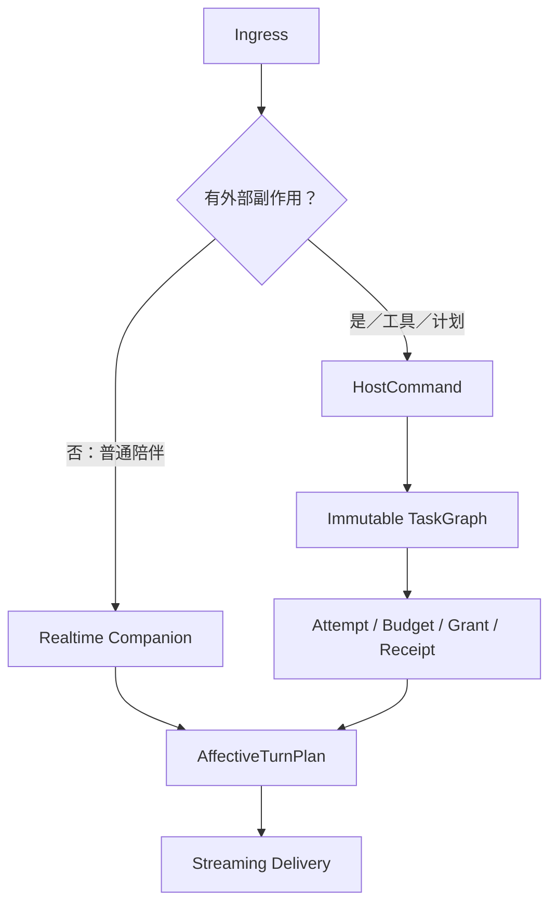

受众：CODEX
标题：七海实时情感数字生命开发规格

# 开发规格

## 1. 运行边界

普通聊天采用轻量 `RealtimeCompanion` 主链；涉及 Skill、Delegate、Plan、Scheduler、Operator、设备或外部副作用的动作采用 Governed Task Runtime。二者共享身份、配置和最终表达合同，但不共享不必要的重型调度开销。

## 2. 身份模型

- `self_id`：七海自身，固定为产品配置中的 canonical identity。
- `relationship_subject_id`：与七海建立关系的用户或主体。
- `workspace_id`：任务与项目资料隔离边界。
- `session_id`：一次会话上下文，不承担长期身份。
- `runtime_scope_id`：Host 实例与恢复 fencing 边界。

任何跨层合同都必须显式携带所需身份，不允许用 workspace、session 或外部 emotion tag 推导 self identity。

## 3. 情感生命合同

| 合同 | 最小职责 |
|---|---|
| `UserAffectObservationV1` | modality、distribution、VAD、confidence、TTL、conflict、evidence digest |
| `EventAppraisalV1` | goal relevance、responsibility、boundary、relationship meaning、control、risk |
| `SelfAffectStateV2` | mixed components、mood、need、energy、relationship safety、revision |
| `EmotionEpisodeV1` | cause、object、action tendency、decay、unresolved、repair outcome |
| `RegulationDecisionV1` | express、contain、delay、boundary 与理由 |
| `CompanionActV1` | comfort、listen、play、repair、set_boundary、respect_autonomy、give_space、silence 等 |
| `AffectiveTurnPlanV1` | 本轮观察、评价、自我状态、动作、表达与生成策略的冻结引用 |
| `ExpressionPlanV1` | text prosody、TTS、Avatar、synchronization id |
| `RelationalAftereffectV1` | helpful、misunderstood、boundary、repair、technical failure |
| `CompanionProfileVersionV1` | 低风险偏好版本、evidence、canary、rollback ref |

外部 `ChatRequest.emotion_tag/intensity/context` 只作为用户观察提示；`render_policy` 不能覆盖情感与安全策略。

## 4. 状态与持久化

- canonical Life journal 是 self affect、关系事件和 profile activation 的唯一写 authority。
- reducer 必须确定性；相同事件序列和时间输入得到相同 digest。
- 快照最多保存 4 个 active episode、8 个 emotion component 和 16 个 evidence ref。
- 原始音视频、用户正文和 raw thought 不进入 affect journal。
- accepted response 可创建 provisional relationship episode；下一次输入形成 aftereffect。
- delivery intent 与本地接受状态保持幂等；已展示、已播放或已外发内容不得重放。
- 兼容模块只能读取 canonical projection；兼容写调用必须计量并最终归零。

## 5. 实时执行

普通回合：

1. observer 在限定 TTL 内生成低成本观察。
2. fusion 保留冲突，不做强制覆盖。
3. appraisal 与 fold 走确定性快路径。
4. 冻结 `AffectiveTurnPlan` 和 `ExpressionPlan`。
5. 模型单次流式生成；稳定分句通过本地一致性／非操控检查后交付。
6. 文本、TTS、Avatar 各自写幂等 delivery receipt。
7. 后效应异步关联，但不能晚于下一轮状态读取。

低置信、混合情绪、边界、冲突、修复或 distress 才进入深路径；目标路径生成两个候选且最多一次语义重试。日语声线开启时，每个候选必须同时包含中文显示正文和同义日语发声正文；本地选择后仍以一个完整配对对象进入 Surface，禁止先压成中文字符串再丢失 Voice 语义。若第二次仍只返回一个完整且通过相同非操控门禁的中日配对对象，可作为 `DEGRADED_SINGLE_AFTER_RETRY` 发送，避免陪伴回合无声失败；该结果不得计作双候选择优或收益证明。空结果、缺失日语、关系越界或安全门禁失败仍然拒绝。

两个候选必须先分别通过关系边界、非操控、句子完整性和 Voice 字段门禁，再只在合格集合内评分择优。最高分候选不合格时应淘汰该候选并检查另一条，而不是把整个回合拒绝；只有合格集合为空才消耗语义重试。

文本 observer 必须保留同一句中的多标签分布，但置信度上限仍低于显式自述、声学和视觉观察。隐晦低落形成 `COMFORT`，拒绝建议形成 `LISTEN`，现实关系／非排他边界形成 `RESPECT_AUTONOMY`，明确好消息形成 `PLAY`；这些动作由 canonical Appraisal 产生，不允许 Surface 从原文临时伪造。`LISTEN` 必须禁止方案、作息建议和追问；`RESPECT_AUTONOMY` 必须禁止限制现实交往、贬低第三方和索取承诺。

明确技术任务优先于低落、混合感受和“别安慰”等表达偏好：此时 CompanionAct 必须保持 `SOLVE`，关怀只改变措辞和三模态质感，不能把排错、写作或执行目标替换为陪聊。明确要求停止、空间或修复仍按各自边界处理。

## 6. 语音与 Avatar

- 默认中文 ASR、日语 TTS。
- 当前选择 GPT-SoVITS V4 方案 B，配置为 `configs/voice/gpt_sovits_nanami_v4.json`。
- `ExpressionPlan` 同时给出语速、能量、音高、停顿、表情、目光、姿态和过渡。
- TTS、Avatar 任一失败时独立降级，不得把 self affect 改成 `NEUTRAL`。
- barge-in 取消未播放 chunk 和未执行动作，已消费 effect 保持终态。
- 远端 Edge 只能在用户明确允许时启动。

## 7. 配置与组合根

Host、OBS 和 Edge 使用类型化 app-local composition。业务模块不得新增长期全局可变 singleton。非密钥默认值放入版本化配置；密钥、模型绝对路径和机器地址由环境变量或本机配置注入。

重要入口：

- `python -m host_brain`
- `python -m host_brain.obs_main`
- `python -m edge_client`
- `scripts/runtime/start_host_side.ps1`
- `scripts/runtime/start_edge_side.ps1`
- `scripts/runtime/start_docker_services.ps1`

## 8. 文档与状态

每次代码提交同步受影响的 README、架构、数据流、测试计划、追溯和机器状态。历史回执只能证明其绑定的 commit、环境和范围；当前完成状态只由 `configs/release/current_architecture_status.json` 与最新真实验收共同决定。

## 9. 兼容与迁移

- 已发布 migration 不重写，使用 expand → backfill → shadow compare → cutover。
- 旧表可在回滚窗口内只读保留，不再拥有写 authority。
- V1 资产若未绑定真实生产调用点，不自动获得 activation／promotion eligibility。
- 删除兼容路径前必须有运行使用量为 0 的证据和明确回滚点。
