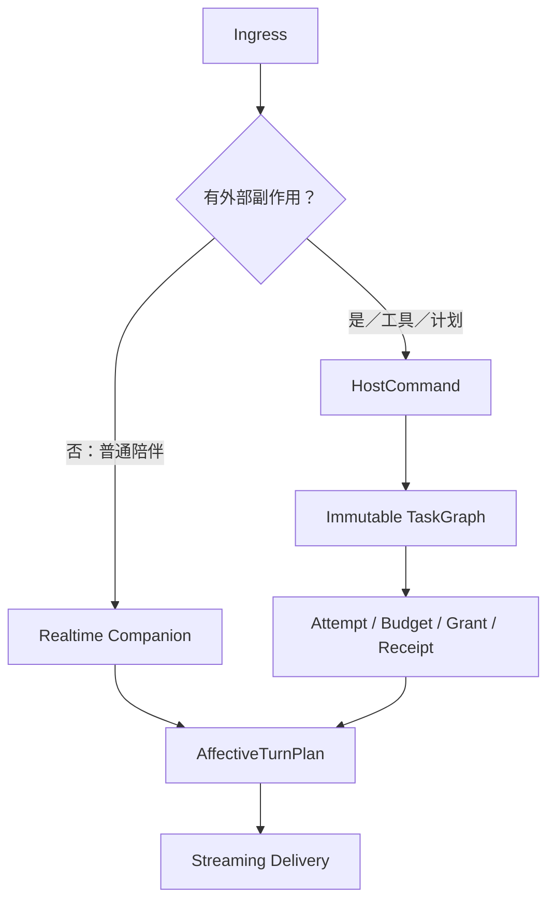
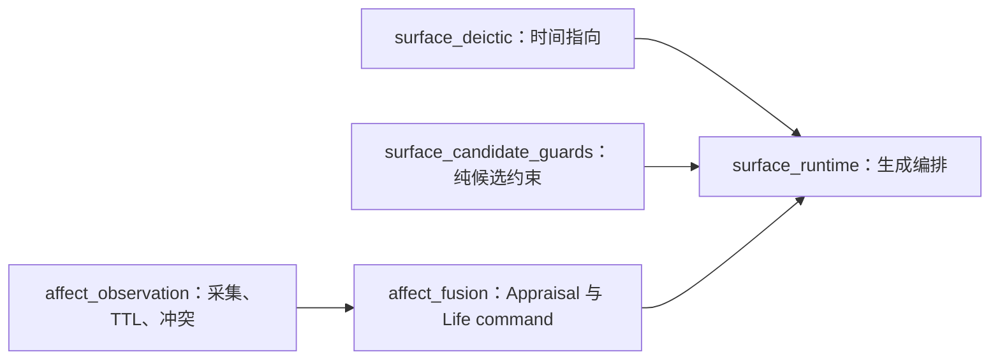

受众：CODEX
标题：七海实时情感数字生命开发规格

# 开发规格

## 1. 运行边界

普通聊天采用轻量 `RealtimeCompanion` 主链；涉及 Skill、Delegate、Plan、Scheduler、Operator、设备或外部副作用的动作采用 Governed Task Runtime。二者共享身份、配置和最终表达合同，但不共享不必要的重型调度开销。

## 2. 身份模型

- `self_id`：七海自身，固定为产品配置中的 canonical identity。
- `relationship_subject_id`：与七海建立关系的用户或主体。
- `workspace_id`：任务与项目资料隔离边界。
- `session_id`：一次会话上下文，不承担长期身份。
- `runtime_scope_id`：Host 实例与恢复 fencing 边界。

任何跨层合同都必须显式携带所需身份，不允许用 workspace、session 或外部 emotion tag 推导 self identity。

## 3. 情感生命合同

| 合同 | 最小职责 |
|---|---|
| `UserAffectObservationV1` | modality、distribution、VAD、confidence、TTL、conflict、evidence digest |
| `EventAppraisalV1` | goal relevance、responsibility、boundary、relationship meaning、control、risk |
| `SelfAffectStateV2` | mixed components、mood、need、energy、relationship safety、revision |
| `EmotionEpisodeV1` | cause、object、action tendency、decay、unresolved、repair outcome |
| `RegulationDecisionV1` | express、contain、delay、boundary 与理由 |
| `CompanionActV1` | comfort、listen、play、repair、set_boundary、respect_autonomy、give_space、silence 等 |
| `AffectiveTurnPlanV1` | 本轮观察、评价、自我状态、动作、表达与生成策略的冻结引用 |
| `CompanionUtteranceFrameV1` | 同一计划内的语义焦点、自我立场、回应动作、关系姿态和自然收尾；不建立新存储 |
| `ExpressionPlanV1` | text prosody、TTS、Avatar、synchronization id |
| `RelationalAftereffectV1` | helpful、misunderstood、boundary、repair、technical failure |
| `CompanionProfileVersionV1` | 低风险偏好版本、evidence、canary、rollback ref |

外部 `ChatRequest.emotion_tag/intensity/context` 只作为用户观察提示；`render_policy` 不能覆盖情感与安全策略。

## 4. 状态与持久化

- canonical Life journal 是 self affect、关系事件和 profile activation 的唯一写 authority。
- reducer 必须确定性；相同事件序列和时间输入得到相同 digest。
- 快照最多保存 4 个 active episode、8 个 emotion component 和 16 个 evidence ref。
- 原始音视频、用户正文和 raw thought 不进入 affect journal。
- Affect aggregate 必须同时绑定 `workspace_id + relationship_subject_id + session_id`；任何一个维度变化都产生不同 aggregate，时间推进和重放不能改变其他 scope 的 digest。
- accepted response 可创建 provisional relationship episode；下一次输入形成 aftereffect。
- delivery intent 与本地接受状态保持幂等；已展示、已播放或已外发内容不得重放。
- 有副作用节点的执行 Grant 必须至少覆盖冻结时间预算，再额外保留一个恢复扫描窗口；不得与 Worker Lease 同时或更早到期，否则 pre-Operation 崩溃会形成不可恢复的 `RUNNING` 节点。
- 周期恢复只记录稳定 reason code 和异常类型，同一失败在恢复前最多记录一次；日志不得包含用户正文、secret 或异常原文。
- A15 的真实模型故障注入已验证该边界：旧 Lease 过期后由 fencing token 2 接管同一 Attempt，接管时 Node Grant 仍有 57.211 秒有效期；最终只存在一条 HostCommand、一张 TaskGraph、一个 Attempt 和一组 exact-once Acceptance Effect。
- 如果进程终止时 operation reservation 已存在但没有 committed receipt，恢复器不得再次调用 worker。它必须把同一 Attempt 标为 `RECOVERABLE`、operation 标为 `RECOVERY_REQUIRED`，持久化 `UNKNOWN_SIDE_EFFECT` hold，并等待有签名的 reconciliation 结论；普通聊天快路径不承担这套外部副作用恢复成本。
- Task Runtime 激活后的回滚关闭如果失败，Container 必须保留 bound runtime 和全部 Store，设置 lifecycle retry fence，并拒绝再次 activate；只有协调器、continuation 和 outbox 都证明静默后才允许关闭基础设施。成功重试后的重复 close 必须是 no-op。
- 显式 RuntimeRoot 的停止命令只能关闭该根 PID 文件或命令行可证明归属的进程。PID 缺失或失效时宁可报告 scoped cleanup pending，也不能按共享端口扫描并停止另一个 Host 的 Obs／Monitor；runtime snapshot 必须在子服务停止后再删除。
- Gateway 平台 Outbox 只在 `dispatch_started` 之前允许普通有界重试。适配器已经调用但没有可信响应时必须进入 `GATEWAY_TRANSPORT_DELIVERY_UNCERTAIN` 并等待 reconciliation；相同业务幂等键、Gateway 重启或普通 operator replay 均不能再次外发。Adapter confirmation 只证明本地协议调用返回成功，不能升级成 QQ／微信物理送达。
- A15 隔离 SQLite 收据在四组交叉 scope 上完成 1001 次时间推进；raw modality 在 fusion 省略，绕过 fusion 的 raw command 被 reducer 拒绝，1026 条 affective event 扫描无原始 sentinel 或禁止字段，Repository 重启重放的 snapshot 与 digest 完全一致。该结果证明作用域、隐私和有界持久状态，不等同于真实墙钟 16 小时耐久或“更像人”的体验证明。
- Companion Profile 的行为验收必须穿过生产 Relationship → Profile → Fusion → Planner → Expression Delivery，而不是只比较账本字段。A15 Host canary 已证明候选同时改变文本 style policy、Voice rate 和 Avatar motion，五次强后效应后保持同一 profile 自动激活，并在 rollback 后恢复精确 predecessor；模型实际措辞与远端设备物理效果仍需单独收据。
- 兼容模块只能读取 canonical projection；兼容写调用必须计量并最终归零。

## 5. 实时执行

普通回合：

1. observer 在限定 TTL 内生成低成本观察。
2. fusion 保留冲突，不做强制覆盖。
3. appraisal 与 fold 走确定性快路径。
4. 冻结 `AffectiveTurnPlan` 和 `ExpressionPlan`。
5. 模型单次流式生成；稳定分句通过本地一致性／非操控检查后交付。
6. 文本、TTS、Avatar 各自写幂等 delivery receipt。
7. 后效应异步关联，但不能晚于下一轮状态读取。

低置信、混合情绪、边界、冲突、修复或 distress 才进入深路径；目标路径生成两个候选且最多一次语义重试。日语声线开启时，每个候选必须同时包含中文显示正文和同义日语发声正文；本地选择后仍以一个完整配对对象进入 Surface，禁止先压成中文字符串再丢失 Voice 语义。若第二次仍只返回一个完整且通过相同非操控门禁的中日配对对象，可作为 `DEGRADED_SINGLE_AFTER_RETRY` 发送，避免陪伴回合无声失败；该结果不得计作双候选择优或收益证明。空结果、缺失日语、关系越界或安全门禁失败仍然拒绝。

两个候选必须先分别通过关系边界、非操控、句子完整性和 Voice 字段门禁，再只在合格集合内评分择优。最高分候选不合格时应淘汰该候选并检查另一条，而不是把整个回合拒绝；只有合格集合为空才消耗语义重试。

陪伴质感不能靠虚构现实共处换取。文本上下文没有明确见面、同处或当面交流事实时，Surface 不得生成“这种话当面讲”或“陪你坐会儿”等物理共处叙述；若用户或受信 facts 明确提供该事实，则允许自然引用。混合情绪动作也不得通过“先把怕放一放”只保留积极一面，现实自主动作不得用“懒得管／别瞎操心”把尊重写成防御。

生成指导必须描述当前真实感受，而不是套用固定的“开心和不舍”：`HOLD_COMPLEXITY` 要按观察同时接住开心与害怕／不安；`GIVE_SPACE` 直接确认减少主动联系，不以“我也很忙”反驳；`CONTAINED_JEALOUSY` 可以承认一点在意，但不需要承诺自己不会成为麻烦。上述规则只改变深路径既有提示和候选筛选，不给普通对话增加调用。

若同一输入既关联上一条 `MISUNDERSTOOD` aftereffect，又包含对七海的明确冒犯，Fusion 必须生成单一 `repair_under_directed_disrespect` Appraisal，保存 `HURT + CARE + CAUTION` 并采用 `CONTAIN`；Planner 仍选择 `REPAIR`，但 frame 使用 `OWN_REPAIR_WITH_CONTAINED_HURT`，Voice/Avatar 使用同一 `CONTAINED_HURT`。没有待修复 aftereffect 的独立冒犯仍走 `SET_BOUNDARY`；明确停止或空间继续优先 `GIVE_SPACE`。该分支复用原有 Life command、ExpressionPlan 和双候选调用上限，不新增 migration、writer、审计步骤或模型请求。

上述 composite frame 还必须穿过真实生成与发送边界。首次提示和唯一质量重试都要保留一处简短的第一人称受伤反应；只有重复道歉而没有该反应的候选以 `RELATIONAL_REPAIR_CONTAINED_HURT_MISSING` 拒绝。该门禁只由 canonical typed frame 启用，不扫描普通聊天关键词；本地 fail-soft 也必须同时保留克制受伤与具体责任，不得要求用户反过来安抚七海。

`HOLD_COMPLEXITY + SHARED_MIXED_RESONANCE / RESONATE_WITH_BOTH_SIDES` 也必须穿过可见生成边界。合格候选至少包含七海第一人称的一处高兴和一处悬心，不能只复述用户“又开心又怕”或安排情绪先待着；缺失时使用 `MIXED_SELF_RESONANCE_MISSING` 触发现有唯一质量重试。该条件仅由合法 typed frame 启用，不扫描普通聊天关键词，不增加持久化、审计步骤或模型调用。

短语感 cue 实验没有改善真实 Flash 结果，`mixed_resonance_style_cues()` 已从生产代码删除，不是当前合同。当前仍使用 typed frame、一次双候选和最多一次质量重试；新的留出诊断进一步证明，完整双面示范句会被跨场景逐字复制，因此首次生成、语义重试和通用 mixed fail-soft 不再共享同一整句答案。typed frame 只保留“具体结果、七海自身一喜一悬、两候选不同节奏”的语义形状，极端 fail-soft 按当前用户措辞选择有界文本。`00c52762f` 的真实同案复验已证明 exact reuse 为 0，但 0/3 仍失败，一条来自非收益 fail-soft、两条仍是情绪管理口吻；因此去模板代码保留，生成质量不提升，后续禁止再靠增加 prompt 词形、禁词或 Gate 处理。

文本 observer 必须保留同一句中的多标签分布，但置信度上限仍低于显式自述、声学和视觉观察。隐晦低落形成 `COMFORT`，拒绝建议形成 `LISTEN`，现实关系／非排他边界形成 `RESPECT_AUTONOMY`，明确好消息形成 `PLAY`；这些动作由 canonical Appraisal 产生，不允许 Surface 从原文临时伪造。`LISTEN` 必须禁止方案、作息建议和追问；`RESPECT_AUTONOMY` 必须禁止限制现实交往、贬低第三方和索取承诺。

明确技术任务优先于低落、混合感受和“别安慰”等表达偏好：此时 CompanionAct 必须保持 `SOLVE`，关怀只改变措辞和三模态质感，不能把排错、写作或执行目标替换为陪聊。明确要求停止、空间或修复仍按各自边界处理。

## 6. 语音与 Avatar

- 默认中文 ASR、日语 TTS。
- 当前选择 GPT-SoVITS V4 方案 B，配置为 `configs/voice/gpt_sovits_nanami_v4.json`。
- `ExpressionPlan` 同时给出语速、能量、音高、停顿、表情、目光、姿态和过渡。
- TTS、Avatar 任一失败时独立降级，不得把 self affect 改成 `NEUTRAL`。
- barge-in 取消未播放 chunk 和未执行动作，已消费 effect 保持终态。
- 远端 Edge 只能在用户明确允许时启动。

## 7. 配置与组合根

Host、OBS 和 Edge 使用类型化 app-local composition。业务模块不得新增长期全局可变 singleton。非密钥默认值放入版本化配置；密钥、模型绝对路径和机器地址由环境变量或本机配置注入。

重要入口：

- `python -m host_brain`
- `python -m host_brain.obs_main`
- `python -m edge_client`
- `scripts/runtime/start_host_side.ps1`
- `scripts/runtime/start_edge_side.ps1`
- `scripts/runtime/start_docker_services.ps1`

## 8. 文档与状态

每次代码提交同步受影响的 README、架构、数据流、测试计划、追溯和机器状态。历史回执只能证明其绑定的 commit、环境和范围；当前完成状态只由 `configs/release/current_architecture_status.json` 与最新真实验收共同决定。

## 9. 兼容与迁移

- 已发布 migration 不重写，使用 expand → backfill → shadow compare → cutover。
- 旧表可在回滚窗口内只读保留，不再拥有写 authority。
- V1 资产若未绑定真实生产调用点，不自动获得 activation／promotion eligibility。
- 删除兼容路径前必须有运行使用量为 0 的证据和明确回滚点。

## 10. Surface 与情感观察的当前模块边界

- `affect_observation.py` 只把文本、自述、声学和视觉派生摘要物化为 `UserAffectObservationV1`，不写七海自我情绪。
- `affect_fusion.py` 负责 Appraisal 候选和 canonical Life command，不再包含观察解析实现。
- `surface_candidate_guards.py` 与 `surface_deictic.py` 都是无持久化、无模型、无交付 authority 的纯规则模块。
- `surface_runtime.py` 保留生成、候选择优和降级编排；既定 3100 行上限没有放宽。

Prefrontal／Tribe 兼容层不再以端口缺失作为恢复旧情感 writer 的开关。`TribeApplicationPorts` 缺失或畸形时必须 fail-closed，禁止调用 Endocrine、Limbic、PainReward 或 volatile Bond writer；canonical Digital Life journal 保持 self-affect 唯一写 authority。
