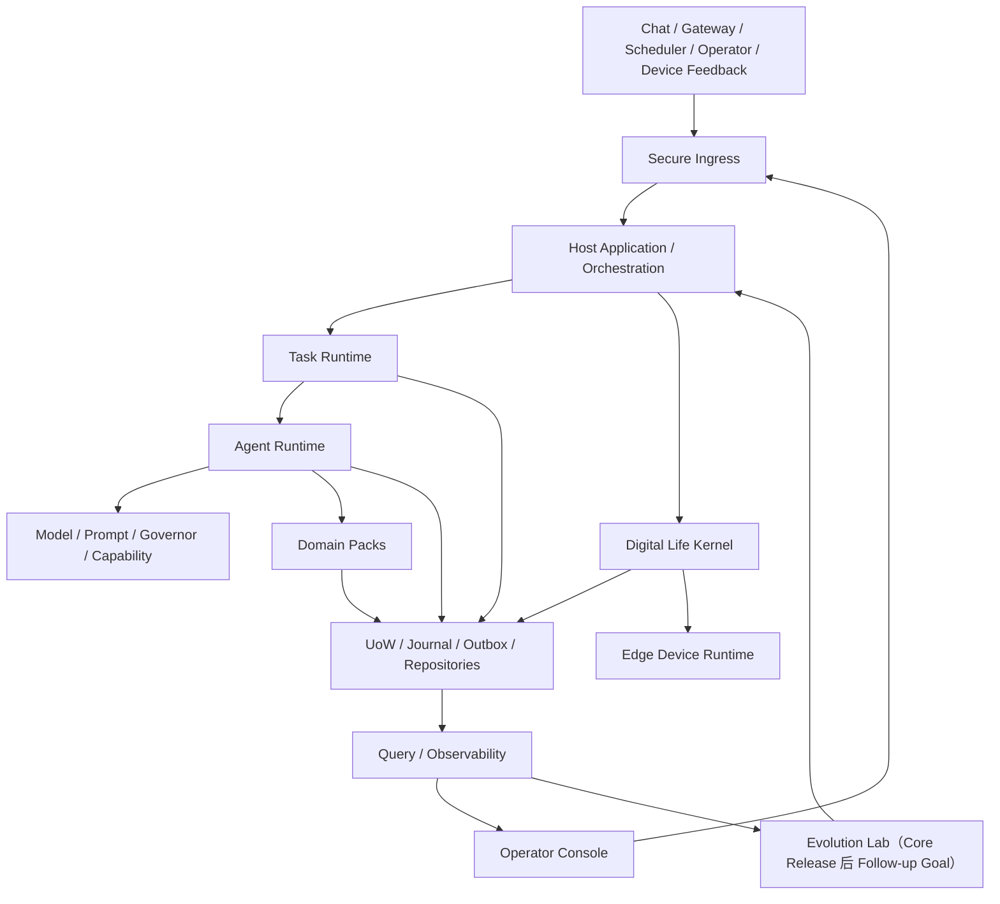
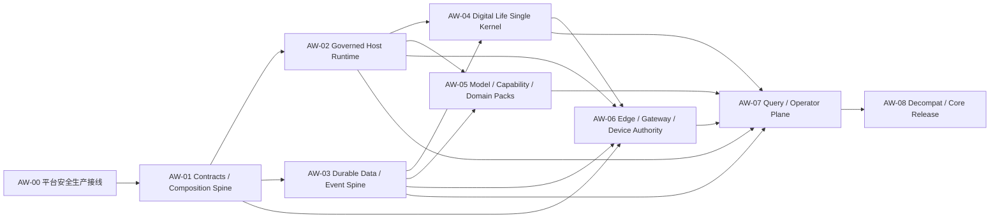

受众：CODEX
标题：Natsume AI V1 完整架构重构执行合同（Architecture Waves v2）

# Natsume AI V1 完整架构重构执行合同（Architecture Waves v2）

版本：v2.3
日期：2026-07-15
状态：`CORE_INFRASTRUCTURE_PASS__FULL_ARCHITECTURE_INCOMPLETE`
文档类型：DevSpec / Master Execution Contract
当前代码基线：`origin/dev@31114f7ba9985e99fc82187aeb99b939bbf426ab`（PR #46 merge）；Core Infrastructure Release 验收历史为 22/22 stages `PASS`，但 Universal Governed Runtime、原生多节点 TaskGraph 与 Generic Planning Search 未完成，因此该结果不得再解释为 Full Architecture Program Acceptance。
目标蓝图：`docs/50_project/arch/NATSUME_AI_V1_FULL_ARCHITECTURE_TARGET_20260710.md`
上游参考：`C:/Users/34145/Downloads/Natsume_AI_V1_高级能力拓展重构计划_新增长期演化能力.md`

本文从 v2.0 起成为完整重构的唯一执行合同。v1.0 的 `TASK-0461～TASK-0622` 保留为历史需求、测试和实现线索，不再作为调度单元、提交单元、批准 Gate 或完成度计数。任何旧任务卡、Seal 文档、WIP owner、MASTER handoff 或逐任务证据要求与本文冲突时，以本文为准。

代码事实优先于计划假设。执行者可以直接修订受影响的代码和计划，不需要为普通仓库改动等待额外确认；只有本文第 8 节定义的真实高风险阻断条件才允许停止。

## 2026-07-14 封板纠错（覆盖本文后续历史性 DONE 表述）

PR #46 完成了大量持久化、迁移、Journal/Outbox、ModelAttempt、Capability、Digital Life、Gateway、Edge 与 Operator Projection 地基，但把已实现 vertical slice 的自洽验收错误外推成了完整架构完成。本文 v2.1 中所有 `CORE_RELEASE_DONE`、`AW-00～AW-08 DONE`、`Final Architecture Gate PASS` 和“后续只进入 Evolution Follow-up”的结论，自本节起只作为历史记录，不再具有完整程序封板效力。

重新定级如下：

| 能力面 | 2026-07-14 代码事实结论 |
|---|---|
| Durable Infrastructure / Model / Capability / Life / Gateway / Edge | `PASS`（Core Infrastructure） |
| Universal Governed Runtime | `INCOMPLETE`：生产 `GovernedHostRuntime.supports()` 仅接受 direct skill |
| Native Multi-node TaskGraph | `NOT_IMPLEMENTED`：Host admission、repository 与 coordinator 强制单节点 |
| Durable Budget Enforcement | `NOT_WIRED`：合同存在，canonical runtime 无预算预留/消费/释放闭环 |
| Review / Resume Runtime | `NOT_WIRED`：ReviewStore 未进入普通 Task 状态机 composition |
| Generic Planning Search | `NOT_IMPLEMENTED`：L1/L2/L3 仍为 Pentest 领域实现，未形成公共 Runtime |
| Immutable search path / graph revision replan | `NOT_IMPLEMENTED` |
| Transactional Chat Commit | `INCOMPLETE`：user turn 可先于 Task admission 写入，post-process 仍有异步旁路 |
| Legacy execution truths | `STILL_PRESENT`：Executive SkillDag 与内存 RuntimeTaskRegistry 仍拥有执行状态 |
| Full Architecture Program Acceptance | `INVALID / REOPENED` |

恢复后的唯一执行入口为 `NATSUME_AI_UNIVERSAL_GOVERNED_PLANNING_EXECUTION_20260714.md`。完成判据必须按 chat、skill、delegate、plan 四条生产路线逐条证明 `HostCommand → immutable TaskGraph revision → node Attempt/Lease/Budget/Review → Verification → Acceptance → Receipt`，不得再用单条 direct-skill vertical slice 或基础设施 Gate 代替范围覆盖。

截至 2026-07-15，本轮已完成 Universal Runtime、multi-node TaskGraph、Budget/Review、Generic Planning Search、revision replan、Acceptance Outbox 与 canonical task truth 的代码切流，并完成 Docker、前后端、真实 provider 及 chat/skill/delegate/plan 四路线实测；最新机器事实以 `configs/release/universal_governed_runtime_coverage.json` 和 `docs/45_testing/test_reports/gr06_universal_governed_runtime_live_acceptance_20260715.json` 为准。该目标程序可以定级为 `LIVE_ROUTE_MATRIX_PASS`。但全局 `ProcessServiceContainer` / service locator 尚未移除，原 Final Architecture Gate 1～15 也未在本轮被重新完整证明，因此本文总状态仍不得改回 `FULL_ARCHITECTURE_DONE`。

---

## 0. v2 执行裁决

旧计划没有产生与投入相称的架构变化，根因不是单个任务太难，而是执行制度错误：

- 162 个任务把同一条架构主链切成大量微型控制点；
- 每个控制点重复建立 fixture、证据目录、独立复审、Seal 和提交；
- “新增安全组件但不接生产 composition”也能消耗完整任务成本；
- 人工的 protected WIP、handoff 和 MASTER 批准阻断了当前仓库内本可直接完成的接线；
- 测试通过数、文档数量和任务状态替代了 production cutover、旧代码删除和 authority 收敛。

截至 v2 决策点，旧 goal 已消耗约 15,070,824 tokens 和 107,809 秒，但目标架构的核心目录仍大多为空：`host_brain/kernel`、`orchestration`、`task_runtime`、`digital_life`、`persistence`、`domain_packs`、`model_plane`、`capability_plane` 均未形成生产主链。这个结果不再接受。

v2 强制执行以下裁决：

1. 以 9 个端到端 Architecture Wave 代替 162 个微任务。
2. 以生产入口切换、旧 authority 删除、依赖方向和唯一写模型为完成度，不以测试数量或文档数量为完成度。
3. 普通工作片只做定向 unit/contract/static；每个架构波只做一次集成波；全部架构波完成后统一做一次完整实测和发布验收。
4. 一个架构波允许 3 个不重叠工作流并行，由一个 integration owner 统一接线、测试和提交。
5. 不保护未知或遗留 WIP。与当前架构波无关的 tracked/untracked 源码可直接还原或删除；运行数据库、模型、secret 和用户数据不作为源码 WIP，只在明确迁移或清理任务中处理。
6. 不再创建逐任务 evidence 目录、逐任务 Seal、逐任务状态同步或重复独立审计。
7. 缺少 live/prod/硬件环境只形成最终验收欠项，不阻塞可以在本地继续完成的架构代码。

---

## 1. 目标与完成定义

本次重构不是“建立一套新目录”，而是把真实生产路径收敛到以下拓扑：

程序只有在以下结果同时成立时才完成：

- production chat、host input、gateway、scheduler 和 operator command 进入同一 Secure Ingress 与 Host Application；
- 规划、授权、执行、验证、审查和回放引用同一 `graph_id/revision`；
- composition 是唯一装配根，业务包不再依赖进程全局 service locator；
- Task、Authorization、Runtime Event、Life、Memory、Canon、Capability、Embodiment 各只有一个 writer/authority；
- `host_brain/app` 只剩接口适配和有删除期限的 facade，不再拥有 domain、repository、provider 或 lifecycle 真相；
- Edge 可独立安装，只依赖共享 contracts，物理输出 authority 唯一；
- Obs/Query 只读，所有写动作重新进入 Secure Ingress；
- 外部 Skill/Provider 不在 Host 进程热导入，供应链与执行 sandbox 成立；
- projection 可重建，副作用有 durable outbox、幂等、lease 和 receipt；
- 旧 runtime、writer、scheduler、facade、inline DDL、私有连接和重复模型入口已删除；
- 一次最终完整测试、真实隔离环境 smoke、迁移/恢复和 rollback 验收通过。

---

## 2. 当前代码事实基线

以下数字是 2026-07-12 在当前执行分支上的可重复基线，用来衡量架构变化，不作为静态文档承诺：

| 指标 | 当前值 | 目标 |
|---|---:|---:|
| `natsume_contracts` Python 文件 | 4 | 覆盖跨运行面稳定合同并被真实调用 |
| `host_brain/composition` Python 文件 | 4；Host security 与 legacy shutdown 已进入显式 composition | 成为唯一装配与生命周期根 |
| `kernel/orchestration/task_runtime/digital_life/persistence/domain_packs/model_plane/capability_plane` Python 文件 | 0 | 各自形成生产职责边界，不以文件数冒充完成 |
| 非 `app` 模块反向导入 `host_brain.app` | 81 个模块 / 约 210 条边 | 最终为 0；每个结构波单调下降 |
| `app/dependencies.py` 单例/全局状态 | 约 57 处；AW-01 security slice 已脱离 | 最终删除 service locator |
| `ServiceCatalogStartupCoordinator` production 调用点 | 1（Mate HTTP/UDP 真实 listener） | 后续波次接管 Host/Edge 其余 listener |
| Canonical assignment 是否决定真实 executor | 是；Chat/Input/Internal Agent/Scheduler 已共用 governed 主链 | 保持唯一真实调度决定 |
| Edge 直接导入 `host_brain` 的文件 | 21 | AW-06 后为 0 |
| Host 直接访问私有 `._conn` 的文件 | 0（audit/persistence adapter 内部除外） | 保持为 0 |
| Host 含 inline `CREATE TABLE` 的 Python 文件 | 0（migration/audit/persistence 与外部 DSL 除外） | 保持 production runtime 为 0 |
| Host 直接读取环境变量的 Python 文件 | 208；AW-01 新增点仅在 composition 快照边界 | 最终只允许 composition/settings 与批准的 process adapter |
| `surface_main_chain_adapter.py` | 4468 行 | 混合职责归零；保留文件仅作薄 facade |
| `agent_runtime_shared.py` | 3845 行 | 混合职责归零；主链迁出 |
| `production_executor.py` | 4251 行 | 通用 runtime 与领域流程彻底分离 |
| `app/dependencies.py` | 1191 行 | 可变全局和 service locator 归零 |

每个波结束时只更新这些架构指标和实际 production path。新增目录、类或测试本身不计为进展。

---

## 3. Architecture Wave DAG

AW-02 与 AW-03 在合同冻结后可并行；AW-06 的 Edge 内部 foundation 可在 AW-01 后启动，但 production cutover 和 DONE 必须等待 AW-02 Host command、AW-03 durable transport 与 AW-04 embodiment contract 稳定。AW-04、AW-05、AW-06 可在不重叠文件范围内并行。并行不允许多个工作流同时拥有同一源码文件、migration 编号或 production route。

### AW-00：平台安全能力生产接线

状态：`DONE`（production composition/routes、provider import closure、Bridge HMAC/owner cutover 已提交；定向验证与单次 integration wave 通过，P0/P1 review 清零）

目标：把已经实现但停留在隔离层的 M48-B 安全能力接入真实 Host/Edge/Bridge 生命周期，结束“组件存在、生产绕过”的状态。

核心落点：

- `host_brain/app/asgi.py`、`router_registry.py`、`platform_security_runtime.py`；
- Obs command、Pentest secure run、signed provider intake；
- `host_brain/service_catalog`、MateEngine/WeChat/Gateway producers 与 Bridge；
- shared bridge authentication contract 与 startup ownership。

必须完成：

- production app 在 post-fork lifecycle 构造、发布、drain 并关闭安全 composition；
- Obs、Pentest 和 signed intake 使用真实 app-state provider，缺依赖稳定 fail closed；
- 外部 provider dynamic import 关闭，signed intake 最多进入 quarantine/STAGED；
- Mate/WeChat/Gateway 使用同一 canonical HMAC，默认关闭且绝不 unsigned fallback；
- 18770 只有显式选举的 owner；startup 不杀死、不接管 incumbent process；
- 删除旧 WIP，修正被新安全默认值淘汰的旧测试，执行一次聚焦集成波并提交。

退出指标：上述真实 route/lifecycle 均可从 production app 构造；安全入口没有匿名或 unsigned 路径；AW-00 相关 unit/contract/static 与一次 integration wave 通过。

### AW-01：Contracts、Kernel、Composition 与依赖脊柱

状态：`DONE`（Host security 生产 route 已改为显式 provider/container，删除旧 `platform_security_runtime.py`；shutdown 从 `http_hooks.py` 抽为显式 callback lifecycle；composition→app 禁边已生效；Mate HTTP/UDP 已用 Service Catalog `ENFORCE` 预绑定同一 socket 切流）

目标：建立全仓唯一的 contracts、clock/result primitives、typed settings、container、lifecycle、feature flags 和 service catalog，使后续迁移不再向 `app` 添加新真相。

核心落点：`natsume_contracts`、`host_brain/kernel`、`host_brain/composition`、`host_brain/ports`、`asgi.py`、`app_factory.py`、`dependencies.py`、architecture guard。

生产切换：ASGI/worker/query runtime 只从 composition root 构造；选择一条真实 vertical slice 移除 legacy global getter 和散落 env parsing。

删除目标：被迁移 slice 的 module globals、重复 lifecycle hook、重复 settings alias 和反向 import；禁止新增业务层 `os.getenv`、`get_*` service locator 和 composition 反向依赖。

退出指标：干净进程可从一个 config snapshot 构造、readiness、degradation、逆序 shutdown；部分启动失败无 orphan；import guard 阻止新增非法边；至少一条 production slice 完全不依赖 legacy globals。

完成事实：三条 security route 在每个 worker lifespan 内构造、发布、降级并逆序关闭，请求期不再查询旧 module global/app-state runtime；`http_hooks.py` 净减少混合 shutdown 职责；Mate candidate 只在 reservation consume 后接收原 TCP/UDP socket，不接管、不关闭 incumbent，匿名 `/health` 稳定 401。Host 定向验证、Mate/Catalog 定向验证与真实 listener integration 通过，两条独立 P0/P1 review 均清零。

### AW-02：Governed Host Command、Task 与 Agent 主链

状态：`DONE`（Host chat/input、Internal Agent 与 Scheduler 已全部切入同一 governed Task Runtime；旧 scheduler/worker/provider authority 已删除）

目标：把 chat、host input、gateway/scheduler work 收敛为 Secure Ingress → Application → Task Runtime → Agent Runtime → governed side effect 的唯一新请求链。

核心落点：`host_brain/orchestration`、`task_runtime`、`agent_runtime`、conversation/work services、scheduler、tool execution、routes 与现有主链巨石。

生产切换：先切 `/v1/chat` 与 `/v1/host/input` 的一个完整 golden path，再扩到 scheduler/gateway；每个请求只分配一个 executor 和同一 graph revision。

删除目标：Executive 二次 planning、并行 scheduler authority、进程内 attempt/review 真相、route 直连 provider/repository、`agent_runtime_shared` 和 `executive_runtime_core` 中已迁移职责。

退出指标：真实请求的 principal、grant、graph revision、attempt、verification、acceptance 和 side-effect receipt 可串联；重启/retry 不重复副作用；失败 verification 不可能 committed。

完成事实：`/v1/chat`、`/v1/host/input`、Internal Agent 与 Scheduler 统一经过 Secure Ingress、Governor、HostCommand、TaskGraph、canonical assignment、verification/acceptance 和不可变 receipt；Scheduler definition revision/occurrence/result 已进入 0065 durable store，Clock 只生产 occurrence，不直接执行 handler，pending recovery、frozen revision、claim-completion crash gap 与有界 shutdown 已覆盖。两套旧 `NatsumeScheduler`/`HostTaskScheduler`、DigitalLife 私有 scheduler、scheduler skill unsigned loopback、notification APScheduler/JSON writer 已删除；未知 worker 在写 definition 前拒绝。合并定向验证 70 passed，附加 route/performance 回归 12 passed。

### AW-03：Durable Data、Event、Memory 与 Canon 脊柱

状态：`DONE`（0066～0078 migration、Task/Event/Life/Memory/Canon 单写持久脊柱与生产切流完成；业务层 SQLite authority 清零；无 P0/P1）

目标：统一 migration catalog、UoW、repository、journal/outbox/inbox、projection worker、Memory/Knowledge/Canon 写边界。

核心落点：`host_brain/persistence`、`eventing`、`memory`、`canon`、`audit/sqlite_ledger.py`、migration runner。

生产切换：先迁移 AW-02 使用的 Task/Runtime Event，再迁移 Life/Memory/Canon；关键状态与 outbox 同事务提交。

删除目标：production inline DDL、业务层私有 `._conn`、无 owner SQLite connection、内存 EventBus 真相、平行 Memory/Canon writer。

退出指标：空库/旧库 migration、crash recovery、outbox replay、projection rebuild、backup/restore 在一次波次集成中通过；production runtime inline DDL 和业务层私有连接为 0。

完成事实：Task/Scheduler、Runtime Event、Life、Memory/Preference/Experience、Canon、Secure Ingress、VTS/MCP、Rate Limit、Graph Evidence、Bond、NVD、Response Feedback、Gateway/Supply Chain/Pentest 等真实生产读写已迁入 typed persistence repository；0066～0078 成为中央 migration catalog，0067/0071 由 checksum-bound runner transaction envelope 原子执行，0072 draft 只可经 0075 完整 schema postcondition 修复，且保留已落库 checksum。Runtime Event journal/outbox/inbox/projection、Task projection/lease/fencing、Canon command/apply、Life runtime 与 context memory 具备 replay/rebuild/crash recovery；启动 Canon 强制复用 canonical migration-first ledger，SQLite backup 以 read-only source 完成校验、离线恢复和 catalog digest 绑定。旧 task/review/gateway/supply/pentest/secure-ingress 实现已降为惰性兼容 facade，业务层私有连接、SQLite 执行和内联 DDL 由全仓静态 contract 锁定为 0。

验收事实：AW-03 集成波首轮 278 passed、1 个陈旧静态 import 断言失败；断言按真实 production repository 边界修正后该唯一失败节点通过，未重复运行其余 278 个未变化用例。空库/旧库 migration、atomic failure rollback、0072/0075 repair、scheduler/runtime-event crash recovery、outbox replay、projection rebuild、backup/restore、Host production cutover、Memory/Canon/Life UoW 与全仓 persistence boundary 均已覆盖；编译、`git diff --check`、migration checksum 核验通过。

### AW-04：Digital Life 单内核

状态：`DONE`（LifeCommand/Event/Reducer/Projection/Outbox/Receipt 单事务脊柱、单 SchedulerClock 与生产读写切流已完成；两轮 P0/P1 审查问题清零）

目标：把 LifeContinuity、LifeOrgans、Tribe、InnerWorld、DigitalLifeSupervisor、Proactive 与 Surface 中的状态推进收敛到一个 event/reducer coordinator 和一个 clock。

核心落点：`host_brain/digital_life`、persona、runtime/life_*、tribe、bond、proactive、surface adapter。

生产切换：真实对话输入与时间事件写入 LifeEventJournal；World/Appraisal/Affect/Homeostasis/Relationship/Scene/Intent 由 reducer/projection 推导；Surface build 纯读；主动消息和具身动作只写 outbox。

删除目标：读路径推进 Life、第二时钟、Tribe/InnerWorld 直接写长期状态、多套 proactive sender、无 receipt 具身写口。

退出指标：同一 event replay 得到相同 state；preview/retry/replay 零写入；长期字段单 writer；主动/具身动作都有 grant、outbox 和 receipt。

完成事实：新增 immutable `LifeCommand`、event journal、snapshot/projection、projection intent、typed delivery outbox/authorization/receipt 与 per-person fenced aggregate lease；World/Appraisal/Affect/Homeostasis/Relationship/Scene/Intent 由纯 reducer 确定性推导，replay/rebuild/preview 不写入且延迟事件不会回拨长期时间。Surface/Input/GET 均改为 snapshot 纯读，真实对话只提交一次 foreground command；SchedulerClock 成为唯一 activation/evolution/dispatch 时钟，旧 Life loop、重复 proactive/inner-world/body/emotion schedule、Surface fire-and-forget 与直发 VTS/Mate/Gateway 路径退役。外部 HTTP 只接受 semantic intent，服务端重建 authority/time；每次物理输出发送前复核 durable Governor grant，成功状态与 immutable receipt 同事务写入。Tribe JSON 与 OfflineInnerWorld 持久化默认关闭，`DigitalLifeSupervisor` 已移至 validation harness；Memory/InnerWorld/MemoryEventStore 生产 experience 入口直连 canonical command service，legacy runtime 仅保留无生产 import 的兼容 facade。

验收事实：AW-04 单次 integration wave 首轮 `212 passed`，4 个失败均为 AW-02 已切流后仍断言 retired progress fastpath、异步旁路与旧 settings/request-id 约定的陈旧单测；只修正该文件后 `15 passed`，未重复运行其余 201 个未变化节点。封板审查随后发现并修复 grant scope P0 与 lease/digest 两项 P1：真实 `IntentDecisionEngine → SQLiteLedger → require_bound`、普通 APPROVE 越权及 person/action/target/payload mismatch 等 grant 节点 `24 passed`，新增 untrusted principal 回归 `8 passed`；single-claim/fence/digest 新增节点 `3 passed`、Projection/Delivery 定向回归 `11 passed`。最终复审再关闭 transport-time binding/expiry 与慢 handler heartbeat 两项 P1：transport/grant `19 passed`，scheduler person/principal 双身份链 `21 passed`，heartbeat 新增节点 `2 passed`、dispatcher 定向 `6 passed`。此前 grant/并发切片 `52 passed`、experience ingress 切片 `10 passed`、validation supervisor `11 passed`；targeted compile、静态 production-import 禁边、`git diff --check` 与 0079 checksum `f2cc0b206b0d23c68e9bac97bde164039ecad16f61441f1f32b3c16115b573ca` 均通过。

### AW-05：Model、Prompt、Governor、Capability 与 Domain Packs

状态：`DONE`（模型调用、Prompt、Skill/MCP/Tool、Capability、Domain Pack 已统一到受治理的单一运行时；生产调用点、持久化授权与审计切流完成）

目标：统一模型尝试、prompt 注册、授权、Tool/Capability Broker，并把领域流程从通用 executor 抽成受治理 Domain Pack。

核心落点：`host_brain/model_plane`、`capability_plane`、`governor`、`domain_packs`、skills/tools/MCP/provider、`production_executor.py`。

生产切换：所有新 model/tool/skill/MCP/agent 调用进入唯一 broker 和 attempt service；首批迁移 Pentest、Media/Translation、Research/Browser 三类 Pack。

删除目标：散落模型路由/重试、业务模块私有 provider、热导入外部 Python、重复风险尺度、Domain Pack 自带 scheduler/governor/event bus。

退出指标：每个调用有 route decision、budget、attempt、grant、evidence；Pack 可独立启停/升级/回滚但不能取得平台 writer；通用 executor 不再包含领域流程。

完成事实：建立唯一 `PromptRegistry → ModelAttemptService → RoutePolicy → ProviderAdapter` 调用链和 secret-free `ServerRouteCatalog`，Surface/Thalamus/Agent/SubAgent/Vision/Tribe/Pentest/Life/Reflection 等生产调用点不再私建 provider、自选模型或持有业务重试；`model_attempt_log` 持久化 route/attempt/prompt digest/adapter/timing/result digest。Skill/Tool/MCP 统一进入 durable `CapabilityBroker`，跨进程 claim/receipt/late-outcome、per-capability 隔离执行池和 receipt secret sanitizer 已落地；Skill authority 精确绑定 HostCommand、WorkOrder、graph/revision、node/attempt、lease/fence 与 Governor grant，MCP 写调用消费 canonical TokenService token。Pentest、Research/Browser、Media/Translation 已抽为声明式 Domain Pack，通用 executor 只编排 worker/postprocess/delivery/recovery；用户可见 delivery 自身也是具备稳定 request/delivery id 和 durable receipt 的 Domain capability。Plan 不再把顶层 `exec_intent` token 复用于子技能，每个节点签发并消费独立 durable child grant。

验收事实：AW-05 unit/contract 汇合波 `226 passed`，最终 P1 sanitizer/authority/迁移定向回归分别 `55 passed`、`40 passed`；单次 integration wave 中此前通过的 MCP/Pentest/Internal-Agent 节点未重复执行，失败节点按四类共享根因修正后联合 `21 passed`。最终 `compileall`、生产 bypass 静态扫描、migration-only 新库、`git diff --check` 均通过。

### AW-06：Edge、Gateway 与 Device Authority

状态：`DONE`（Edge contracts-only 独立包、Service Catalog、EmbodimentCommand 设备单 authority、durable lease/fence/receipt/reconnect 已完成 production cutover）

目标：让 Edge 成为 contracts-only 的独立发布单元，并成为 Voice/Avatar/Desktop/Hardware 物理输出的唯一 authority。

核心落点：`edge_client` composition/application/ports/adapters、gateway、voice、embodiment、device registry、Bridge contracts。

生产切换：Host 只发送版本化 `EmbodimentCommand`；Edge 负责 session/lease/reconnect/degradation/receipt；Gateway 使用 durable transport。

删除目标：Edge 对 `host_brain.*` 实现导入、Host 对 Edge 私有配置导入、重复设备 owner、未签名 Bridge、直接物理副作用。

退出指标：Edge 在无 Host 包环境可安装并跑合同测试；21 个 Host import 文件归零；断连/reconnect 不重复动作；每个设备命令有唯一 owner 和 receipt。

完成事实：新增可独立安装的 `natsume_contracts.edge.v1` 与 `edge_client` 发布边界，原 21 个 Edge→Host 实现导入归零；Host→Edge 显式实现导入也归零，Host startup/health 只消费版本化 Service Catalog/Health Query，不再读取或回显 Edge 私有配置。Voice/VTS/Mate/Desktop/Clipboard 的生产副作用统一由 Host `EmbodimentCommand` port 提交，Edge 持有唯一 actuator/driver；Host 的 socket/urlopen、DesktopController/pyperclip/本地截图写盘及旧 device transport 已删除。Edge endpoint 使用 SQLite durable session lease、fencing、command claim、receipt/digest；Host 握手并续租后绑定 command，过期 lease、旧 fence、幂等冲突和崩溃遗留 `DISPATCHING` 均 fail-closed/`IN_DOUBT`，reconnect 不重放物理动作。Capability Broker 只在 durable Skill authority 验证后注入不可伪造的只读 command authority snapshot，caller 同名字段被剥离。

验收事实：AW-06 A～E 定向 unit/contract/static 覆盖独立包、设备切流、transport、desktop authority、service catalog 与 architecture guard；关键汇合切片分别 `72 passed`、`39 passed`、`25 passed`、`24 passed`。单次 integration wave `20 passed / 1 failed`，唯一失败为已删除 Edge→SQLiteLedger 依赖后的陈旧 allowlist及 AW-03 Canon trusted-site 行号漂移；精确删除/更新 9 个清单项且全仓 boundary scan `violations=[]` 后，仅重跑该失败节点 `1 passed`。最终显式 Host→Edge=0、Edge→Host=0，剩余 7 项仅为动态加载风险基线；standalone package、`compileall`、`git diff --check` 均通过。

### AW-07：Query/Observability 与 Operator Plane

状态：`DONE`（durable projection/query gateway、默认拒绝的 Operator 权限与隐私边界、generated command client/BFF 已完成 production cutover）

目标：Obs 只读，统一 versioned read model、projection、trace、metrics、replay，并让 Operator Console 只使用生成 client 和受治理 command。

核心落点：`host_brain/observability`、query API、projection workers、Operator/Monitor UI、OpenAPI registry。

生产切换：Task/Life/Memory/Pack/Model/Device 状态只从 projection 查询；UI 写动作回 Secure Ingress。

删除目标：Obs mutation、Query 绕写、UI 直查业务 store、重复 DTO、未授权私密正文、重复 method/path handler。

退出指标：projection 可从 journal 重建并对账；read model 带 version/cursor/freshness/degraded state；generated client drift 会使 CI 失败；权限、a11y 和一条端到端操作路径通过。

完成事实：迁移 `0082_operator_query_projection.sql` 建立了 versioned projection、不可变 source journal、rebuild/reconcile、leader lease/fence 与 cursor CAS；Task/Trace/Session/Health/Device/Life/Memory/Pack/Model/进程状态及原 41 个统计 GET 均切为 `QueryProjectionStore` 只读，decorated GET 对 canonical ledger、live probe、writer-capable service 和文件 warm-miss builder 的调用归零。Projection daemon 是 Obs lifecycle 唯一刷新 owner，旧 warm hook 不再创建线程；重建失败保持 last-good，同 cursor 异 digest、cursor 回退和丢 lease 均 fail-closed。`OperatorQueryGateway` 在 handler、SSE 和 WebSocket source 前完成 principal/scope 校验，operator namespace 默认拒绝，公共面仅保留明确 health/metrics/summary；统一 serializer 在写 journal/document 与返回响应前去除 snake_case、camelCase、secret alias、正文和 private reasoning，并只保留引用摘要。UI mutation 的手写 URL、浏览器 proof/signer 与 placeholder command 已删除，generated OpenAPI client 通过同源 HttpOnly session、CSRF 校验的 Host BFF，由服务端 HMAC 进入同一 `SecureObsCommandIngress` 和 durable receipt；104 个 FastAPI method/path owner 唯一，23 个重复 DTO 收敛到单一模块。

验收事实：各切片定向 unit/contract/static 已覆盖 projection spine、lease/CAS/rebuild、domain/process projections、query privacy/auth transport、command gateway、generated-client drift 与 GET 副作用边界；汇合 contract wave `164 passed / 3 failed`，三个失败分别为测试间 receipt 全局状态与旧 trace endpoint 直查 ledger，修复后仅失败节点 `3 passed`。单次 integration wave 使用隔离迁移数据库通过 `10 passed`；最终 P0/P1 复审为 `P0=0`、两类 P1（残余 live GET 与 camelCase 脱敏绕过）完成修复后受影响验证 `60 passed`。UI Node tests、TypeScript check、client drift gate 和 production build 均通过。

### AW-08：兼容层退役与 Core Release

状态：`DONE`

目标：在单一生产架构成立后删除全部旧 authority，完成核心架构的唯一完整验收和可回滚发布。Evolution Lab、Skill Compiler、Counterfactual、Knowledge OS 与 Identity Migration 的新增能力移到 Core Release 之后的独立 Follow-up Goal，不能反向阻塞核心架构封板。

核心落点：compatibility registry、legacy app/facade、release tooling、quality matrix。

生产切换：兼容 facade usage=0 后删除；冻结 active contracts/schema/config/assets，生成 ReleaseManifest。

删除目标：旧 writer/runtime/scheduler/facade/re-export/flag/dead fallback、重复目录和过期生成资产。

代码完成事实（2026-07-13）：

- production composition 已成为 Executive、Lifecycle、Surface、Agent、Input、Digital Life、Tool 与具身 outbox 的唯一装配入口；Input Runtime 使用 `frozen/slots` typed ports，由 ASGI 每个 application 只构造一次，runtime→`host_brain.app` / `host_brain.composition` 反向依赖为 0。
- Pentest attack handler、进程内 RUNS/event bus、zombie recovery、通用 ReAct 注册和旧 `/v1/pentest/runs*` writer 已物理退休；应用 Agent 只生成只读 Domain Pack / SecureRun handoff，实际效果只能经 durable principal、Governor token、Lab capability 与 receipt 约束的服务器端执行面。
- ToolCatalog/ToolBroker 只由 process composition 构造并一次性 seed；HTTP route 不再构造或补种 service。Digital Life 旧 application provider、旧 runtime shutdown 命名链、旧 writer/runtime/scheduler/facade、生成脚本和过期验证资产均已删除。
- Core 收口提交为 `1,061 files changed / 47,869 insertions / 94,908 deletions`，其中删除文件 `277` 个，production/tool 路径删除 `194` 个；compatibility registry 为 `active=0 / usage=0`，retired path remaining 为 0。
- Slice / readiness 证据：Pentest `93 passed` 与 autonomous planner `56 passed`；Input explicit-port contract `5 passed`、ASGI `142` routes；最终精确回归 `16 passed`。全仓 collect-only 首次只发现 4 个陈旧 import，相关 12 个节点修复后 `12 collected`；`compileall`、`git diff --check` 和目标层 reverse-dependency audit（violations=[]）通过。
- Final Architecture 静态 Gate 1～14 独立评估全部 `PASS`；隔离临时数据库 ASGI lifecycle smoke 为 `142 routes / health=200 / required routes missing=[]`。全仓历史业务域仍存在一个 27-package SCC，不冒充“全仓无环”；Gate 1 约束的目标层双向依赖与 Edge→Host 实现导入均为 0。
- Program Acceptance 已完成：唯一 run id `aw08-core-final-20260713` 的最终提交为 `d59f1e4b38ef2289bd741e90666927d9f3d19505`，22/22 stage `PASS`，每个 `stage_source_commit` 均绑定该提交；`resume_count=5`、`automatic_retry_count=0`，所有失败尝试和日志均保留在同一 run 目录，未把失败手工改写为通过。
- 最终离线全量为 `8264 passed / 8 skipped / 126 deselected / 0 failed / 0 errors`（23 分钟内完成）；Final Architecture 静态 Gate 1～14 全部 `PASS`。前序 fail-fast 尝试暴露并修复了测试账本所有权与 settings cache 污染、Windows `npm.cmd` 启动、Async Life lease heartbeat 的 event-loop/shared-executor 饥饿，以及 Obs standalone composition/world-root 缺口。
- 真实发布验证全部通过：generated client drift、TypeScript、Operator/read-model tests、Monitor production build 与无 stub 浏览器交互；Edge standalone；migration asset `68`、latest `0083`、backup/restore integrity=`ok`；Obs 同库冷启动 `2` 次、migration head `83`、database integrity=`ok`；rollback drill；security `355 passed / 2 environment skips`；performance `37 passed`。
- 最终签名回执：`docs/50_release/core/runs/aw08-core-final-20260713/acceptance_receipt.json`；根回执：`docs/50_release/core/ACCEPTANCE_RECEIPT.json`。Core Release Manifest、SBOM 与 Rollback Matrix 已冻结，核心架构不再保持 `CODE_COMPLETE` 或 `PROGRAM_ACCEPTANCE` 中间状态。

状态流：`IN_PROGRESS → CODE_COMPLETE → PROGRAM_ACCEPTANCE → DONE`。代码删除、manifest 和本地构建完成后进入 `CODE_COMPLETE`；随后只运行一次完整离线套件、真实隔离环境 smoke、迁移/恢复、性能/安全和 rollback drill。通过第 9 节 Final Architecture Gate 后才进入 `DONE`。只有外部环境尚不可用时使用 `ACCEPTANCE_PENDING_EXTERNAL`，不得保持代码波 `IN_PROGRESS` 或重复已通过的本地全量验证。

---

## 4. 工作拆分与并行合同

### 4.1 有效工作片

一个有效工作片必须同时满足：

- 改变 production call path、authority、依赖方向、持久边界或删除旧实现中的至少一项；
- 有明确文件 owner，通常覆盖一个端到端职责而不是一个测试函数；
- 能用定向 unit/contract/static 证明，不要求独立 Seal；
- 可在同一架构波中与其他工作片汇合。

纯文档、纯 evidence、纯测试数量扩充、重复审计、只新建未接线类，不得单独作为架构工作片。

每个 Architecture Wave 必须至少完成“一项真实 production cutover + 两项架构改善”。可计数的改善仅包括：authority 收敛为 1、旧 call site/legacy path 归零或删除、forbidden import/SCC 下降、composition 接管 lifecycle、巨石职责/LOC 下降、重复合同/config 合并、inline DDL/private connection 清除。只增加 adapter、shadow module、fixture 或报告时，Wave 必须保持 `IN_PROGRESS`。

### 4.2 并行方式

- 默认使用 1 个 integration owner + 最多 3 个并行工作流。
- 工作流按文件、schema、route 和 authority 分区；发生交叉时立即合并 owner，不建立 handoff bureaucracy。
- 子工作流完成后只返回 production diff、接口、风险和定向测试结果；不生成长篇交付文档。
- integration owner 统一处理 public interface、composition、迁移编号、测试和 commit。
- 一个波只安排一次独立代码审查，审查只处理 P0/P1；P2/P3 进入下一波正常清理，不能反复阻塞。

### 4.3 效率护栏

- 分析必须服务于当前波的具体代码决策；连续分析没有形成 production diff 或稳定根因时，立即缩小切片并实施。
- 工作片目标为 30～90 分钟内形成可编译 production diff 与定向结果；超过 60 分钟仍没有二者之一时，立即拆分、终止或换 owner。
- 任一方案消耗约 100k tokens 或 2 小时仍未改善 production cutover、authority、依赖、删除量等任何架构指标时，判定方案失效并重新收窄切面。
- 正常架构波中实现与生产切流应占至少 65% 的资源；测试、评审和文档合计不应长期超过 35%。
- 同一未变化边界不得重复运行同一测试波、重复建立 fixture 或重复请多个 agent 审计。
- 一个波的文档工作只允许开始时修正合同、结束时更新 board/metrics；中间不写逐任务报告。
- 测试代码不得长期显著超过对应 production 变化；复杂安全不变量例外，但必须复用共享 fixture/contract。
- AW-02～AW-07 触碰任何 production 文件时，必须同步把该文件的散落 env 读取迁到 typed settings，并消除其对 `host_brain.app` 的反向依赖；每波更新 207/81 基线。AW-08 只允许删除 usage 已为 0 的兼容层，不接收集中搬运横切债务。
- 发现旧计划与代码冲突时直接修订计划并继续，不以“文档未批准”为停止条件。

---

## 5. 验证合同

| 层级 | 触发时机 | 允许范围 | 结果处理 |
|---|---|---|---|
| Slice Check | 每个工作片 | 相关 unit/contract/static/compile | 首次通过后不重复；失败只重跑失败节点 |
| Wave Integration | 每个 AW 汇合完成后一次 | 触及模块的 integration + 一条 golden/smoke + 必要 recovery | 修复真实失败，最后再跑一次受影响 wave |
| Program Acceptance | AW-08 `CODE_COMPLETE` 后一次 | 全量离线、真实隔离环境、migration/restore、security/performance/UI/device/rollback | PASS 后 AW-08 DONE；缺外部环境则 `ACCEPTANCE_PENDING_EXTERNAL` |

强制规则：

1. 小改动不运行全仓测试；大改动也不在每个子工作流重复集成测试。
2. Slice Check 目标 wall time 不超过 5 分钟；超时优先缩小到受影响节点，而不是等待宽泛套件。
3. 全量测试在所有架构波完成前只因仓库级破坏性风险显著增加而例外运行，必须说明原因。
4. fixture 代表合同，不复制 production 实现；测试不得以 monkeypatch 掩盖真实 composition 未接线。
5. 测试数不是 KPI。重要的是生产入口是否切换、旧路径是否不可达、失败语义是否稳定。
6. live device、远程 provider 或生产凭据不可用时使用严格隔离 fake 完成代码波；真实 smoke 统一留到 Program Acceptance。

---

## 6. 提交、文档与仓库策略

- 每个架构波使用 1～3 个有完整语义的 commit：通常为 foundation/cutover/removal；禁止每个微任务单独提交。
- 提交前只 stage 当前波文件；不把运行 DB、secret、模型、cache、generated runtime data 纳入 Git。
- 与当前波无关的遗留 tracked WIP 直接 `git restore`；无明确价值的 untracked 源码直接删除，不保留 protected WIP。
- 当前分支上的 AW-00 改动是新版计划接管的有效架构工作，不再等待旧 owner handoff。
- 每个波只更新本文件的状态、基线指标和重要例外；不新建 `evidence/task*`、Seal 或重复测试报告。
- 默认不 push 远端；本地 commit 是波次检查点，远端发布需用户另行明确授权。

---

## 7. 切流与回滚

迁移顺序固定为：characterize 当前行为 → 提取 contract/port → 新实现接入真实 composition → shadow compare（无副作用）→ 切一个 production vertical slice → drain 旧 owner → 删除旧 path。

- 同一请求、长期字段或物理设备在任何时刻只有一个 authority。
- Shadow 禁止真实副作用、生产写入、token 消费、设备动作和对外消息。
- 双写只允许同一 UoW 的 transactional outbox 驱动，并必须有 reconciliation；普通迁移不使用双写。
- 旧 facade 只在当前 wave 的回滚窗口保留，不再强制两个虚构发布窗口；wave integration 和一次 rollback drill 通过、usage=0 后即可删除。
- 回滚优先切 route/flag 到旧 owner，保留新 journal/evidence 只读；禁止破坏性回滚已扩展 schema。

---

## 8. 允许停止的条件

只有以下情况允许将执行标为 BLOCKED：

1. 继续会导致不可恢复的数据丢失、schema 损坏或生产 secret 泄漏；
2. 同一高风险副作用存在无法判定的双 authority，且无法通过本地 fail-closed 隔离；
3. 需要真实生产账号、外部发送、付费资源或物理设备动作，且该动作不可用安全 fake 替代；
4. 工作树或依赖基线已损坏到无法可靠识别当前代码，且清理/重建失败；
5. 同一阻断根因经过至少三轮安全替代方案仍无进展。

以下情况明确不是阻断：旧任务状态、MASTER Seal、WIP owner、handoff、文档未同步、缺少非最终 live 演练、定向测试失败、工作量大或需要重构多个文件。它们应被直接处理或记录为最终验收欠项。

---

## 9. Final Architecture Gate

AW-08 只有在以下全部成立时才完成：

1. 目标层之间双向 package dependency 为 0；Edge 对 `host_brain.*` 实现导入为 0。
2. composition 是唯一装配根；`host_brain/app` 不拥有业务真相。
3. 所有大于 1500 行的 production 混合职责文件已拆分；大于 800 行的新混合职责文件为 0。
4. 同一 action 只有一个 AuthorizationGrant、Task/Attempt lineage 和 SideEffectReceipt。
5. Verification FAIL/ERROR/required-NOT_RUN 不可能进入 committed success。
6. 每个长期字段一个 writer；projection 可重建并对账。
7. Surface build 零写入；主动行为和具身动作全部经 durable outbox。
8. Memory/Canon/Knowledge namespace 和 promotion 边界成立；普通聊天不能检索 Pentest 私有知识。
9. Host/Obs/Gateway/Bridge 写入口具备 principal、scope、signature/token、rate、idempotency 和 audit。
10. production inline DDL 与业务层私有连接为 0；空库、旧库、backup/restore 通过。
11. Model/Prompt/Capability/Tool/Governor 各只有一个 production service；外部 bundle 具备签名、SBOM、quarantine、sandbox 和 rollback。
12. Edge 独立安装；物理输出 authority 唯一且所有动作有 receipt。
13. Obs/Query 无写路径；UI 使用 versioned generated client 且不泄漏私密内容。
14. compatibility facade、旧 writer/runtime/scheduler/flag 和 dead fallback usage=0 并已删除。
15. 完整离线套件、golden/replay/chaos/security/performance、真实隔离 smoke、identity regression、migration/restore 和 rollback drill 一次通过。

历史结果（2026-07-13，已撤销完整架构效力）：当时记录为 Gate 1～15 `PASS`、AW-08 `DONE`。2026-07-14 代码事实复核证明该结论只覆盖 Core Infrastructure 与选定 vertical slices，不能作为 Full Architecture Program Acceptance；当前必须以本文开头的纠错结论和 Universal Governed Planning Runtime 独立验收为准。

任何失败都必须对应真实代码、数据或环境缺口。不得用新增文档、任务编号或批准状态替代 Gate。

---

## 10. 旧任务迁移

| 历史范围 | v2 处理 | 新执行归属 |
|---|---|---|
| TASK-0461～0496 | 保留已实现代码和测试；取消逐任务 Seal/hand-off；所有未完成生产接线合并 | AW-00 |
| TASK-0497～0510 | 取消为独立调度单元 | AW-01 |
| TASK-0511～0524 | 合并为真实 Host 主链切换 | AW-02 |
| TASK-0539～0552 | 调整到 Host/Life 之前建立持久脊柱 | AW-03 |
| TASK-0525～0538 | 合并为 Digital Life 单内核 | AW-04 |
| TASK-0553～0580 | 合并 Model/Governor/Capability 与 Pack 抽取，避免先建多套平台 | AW-05 |
| TASK-0581～0594 | 合并为 Edge 独立发布和设备 authority | AW-06 |
| TASK-0595～0608 | 合并为只读 Query 与 typed Operator | AW-07 |
| TASK-0609～0619 | 新能力不再阻塞核心架构；在 Core Release 后另建 Follow-up Goal | DEFERRED_EVOLUTION_FOLLOWUP |
| TASK-0620～0622 | 合并旧架构删除、完整质量矩阵与核心发布 | AW-08 |

旧任务的 DONE/PROGRAMMED/BLOCKED 状态在 2026-07-12 冻结，仅作历史审计；以后不再同步，也不决定执行顺序。需求编号和已有测试可复用，但必须服务于所属 Architecture Wave。

---

## 11. PR #46 历史 Core Infrastructure 执行板（非当前 Full Architecture 验收）

| Wave | 状态 | 下一可验证结果 |
|---|---|---|
| AW-00 | `DONE` | production security composition/routes、Bridge/Service Catalog 单 owner 与认证探针已切流；无 P0/P1 |
| AW-01 | `DONE` | Host security 显式 container/lifecycle、composition 禁边、Mate 真实 socket-activation 已切流；无 P0/P1 |
| AW-02 | `DONE` | chat/host input/Internal Agent/Scheduler 共用 governed Task/Agent 主链，canonical assignment 决定真实 executor |
| AW-03 | `DONE` | migration/UoW/journal/outbox、Memory/Canon 单写脊柱已切流；业务 SQLite authority 为 0；无 P0/P1 |
| AW-04 | `DONE` | LifeCommand/Event/Reducer/Projection/Outbox/Receipt 单脊柱、SchedulerClock 单时钟与 execution-time grant/lease fencing 已切流；无 P0/P1 |
| AW-05 | `DONE` | ModelAttempt/Prompt/Route、Capability Broker、durable Skill/MCP authority 与三类 Domain Pack 已完成 production cutover；无 P0/P1 |
| AW-06 | `DONE` | Edge/Host 显式实现导入归零，设备单 authority、durable lease/fence/receipt 与 reconnect no-replay 已切流；无 P0/P1 |
| AW-07 | `DONE` | durable projection/lease/fence/rebuild、Query auth/privacy、generated BFF command client 已切流；无 P0/P1 |
| AW-08 | `HISTORICAL_CORE_RELEASE_DONE` | 当时的 22/22 stages 仅证明 Core Infrastructure 与选定切片；`Full Architecture DONE` 解释已撤销 |

PR #46 的 Follow-up 清单只列出 workspace isolation、Skill Compiler、benchmark/scenario/counterfactual、feedback proposal、Knowledge OS 与 Identity Migration，遗漏了原始目标中的通用三层 Planning Search。该遗漏已由 `NATSUME_AI_UNIVERSAL_GOVERNED_PLANNING_EXECUTION_20260714.md` 恢复，并于 2026-07-15 完成独立的代码、聚合测试和四路线 live 验收。

当前结论分为两层：Universal Governed Planning Runtime 为 `PASS`；Full Architecture 为 `INCOMPLETE`。后者至少仍缺 `composition_without_global_service_locator`，不得再用历史 Core Release 回执、测试总数或本轮路线 PASS 代替 Gate 1～15 的重新证明。
