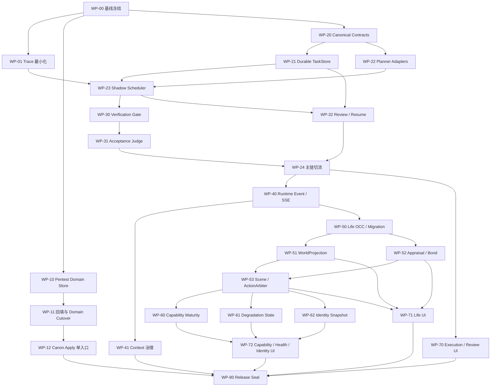

受众：CODEX
标题：Natsume AI V1 长期演化能力重构正式执行文档（M48）

# Natsume AI V1 长期演化能力重构正式执行文档（M48）

版本：v1.1
日期：2026-07-10
状态：`READY_FOR_EXECUTION`（TASK-0461～TASK-0475 已 `DONE`；其余任务按依赖 Gate 推进）
文档类型：DevTasks / Execution Contract
任务编号：`TASK-0461`～`TASK-0486`
逻辑工作包：`LTE-WP-00`～`LTE-WP-80`
代码基线：`dev@1ec8be1a8a20397627855aa946c0ff8aaaa87b72`
代码基线日期：2026-07-04
工作区状态：dirty；现有未提交业务代码和运行数据不属于本执行文档交付范围。
架构依据：`docs/50_project/arch/NATSUME_AI_V1_LONG_TERM_EVOLUTION_REFACTOR_PLAN_20260710.md`
完整目标蓝图：`docs/50_project/arch/NATSUME_AI_V1_FULL_ARCHITECTURE_TARGET_20260710.md`
完整程序执行：`docs/30_devspec/NATSUME_AI_V1_FULL_ARCHITECTURE_REFACTOR_MASTER_EXECUTION_20260710.md`
上游参考：`C:/Users/34145/Downloads/Natsume_AI_V1_高级能力拓展重构计划_新增长期演化能力.md`
维护责任：MASTER 负责范围与切流批准；CODEX 负责按任务卡实施、验证和交付证据。

本文是完整架构程序的 **M48-A 安全地基**详细实现入口，不代表完整架构重构范围。架构依据用于解释“为什么”，本文定义 TASK-0461～0486“按什么顺序改哪些代码、如何验收、何时停止”；跨 M48-B～M57 的范围、依赖、切流、退役和最终 Gate 以完整程序执行文档为准。代码事实变化时先暂停对应任务并修订相应执行文档，不得用文档覆盖代码现实。

---

## 1. 执行目标与完成定义

M48 的目标不是新建第二套 Runtime 或 Life Core，而是把当前分叉能力收敛为一条可持久、可验证、可审批、可回放、可安全升级的主链。

M48 完成必须同时满足：

1. Pentest 和其他 Domain 不再直接写 Persona、Bond、LifeMemory 或 WorldCanon；Canon 只有一个受治理 Apply 入口。
2. 一个复杂任务只规划一次并持久化同一 `graph_id/revision`；依赖、重试、取消和恢复由同一调度器执行。
3. 新任务使用 durable TaskStore；状态迁移具备 CAS、attempt ownership、lease、heartbeat、启动恢复、稳定幂等预留和可对账预算。
4. required verification 的 `FAIL/ERROR/NOT_RUN` 均不能进入 `ACCEPTED`。
5. 执行前审批与执行后验收审查使用不同状态；重启、过期、重复 resume 和 token 串用均 fail closed。
6. durable trace 不含 raw thought、secret、cookie 或未授权私密记忆正文；关键事件可由 cursor 补发和去重。
7. Digital Life 多写入无 silent overwrite；WorldProjection 只读；Appraisal/Bond/Scene/Arbiter 不创建平行状态真源。
8. Capability maturity 只能收紧权限；运行故障可进入和退出降级态；人格差异在发布前可审查。
9. 现有 Monitor UI 能查看 TaskGraph、Review、Trace、World/Scene、Capability/Health/Identity read model。
10. 稳定测试、迁移演练、切流演练和回滚演练通过，并生成 M48 Seal Result。

按工作包逐项相加，单人串行预估为 **58～97 个有效开发日**。估算不包含外部硬件、线上依赖或人工审批等待时间；允许并行的工作包只可在文件范围不重叠且不共享迁移状态时并行。

---

## 2. 冻结的执行决策

以下决策在 M48 内不得被实现者自行放宽：

1. `SkillDagPlan` 只作为契约种子。现有 `retry_limit`、`retry_backoff_ms` 和 `idempotency_key` 尚无完整运行时消费者，不能宣称已具备可靠重试或幂等。
2. 普通复杂任务主链必须停止二次规划。Planner 输出的同一 TaskGraph revision 必须直接进入持久化和调度，禁止只把原计划附在结果 payload 中。
3. Durable TaskStore 必须先于 canonical scheduler 切流；Verification、Judge、Review/Resume 必须先于主链切流。
4. raw thought 清理先于新增持久事件和 TaskStore payload 扩张。
5. Pentest 迁移采用“历史回填 → shadow read → final delta → domain-only write/read”，禁止继续对 WorldCanon 双写。
6. `proposal_id` 不等于审批。WorldCanon 写入必须由 `CanonApplyService` 校验绑定 token、subject、版本和一次性消费。
7. 新调度器 shadow 阶段不能执行真实副作用；对比的是调度决策，不是同时运行两套 Worker。
8. 新旧执行器不能接管彼此的存量任务。切流只影响新任务；旧任务由创建它的执行器 drain 或安全取消。
9. 所有数据库迁移 expand-only；代码回滚通过读写开关完成，不执行破坏性 down migration。
10. 当前 `integrations.graph_contract.GraphState` 继续是执行控制态，不扩成任务、记忆、关系和知识共用的超级图。
11. 不新增 `host_brain/life/` 平行根包；复用 `runtime/`、`persona/`、`bond/`、`memory/` 和 `tribe/` 的现有职责。
12. Pentest Swarm/MCTS 在第二个非 Pentest 场景证明收益前，不提升为公共 Runtime 依赖。
13. M48 新增 SQLite schema 统一进入现有 `host_brain/audit/migrations` catalog，避免多个组件复用同一 `schema_migrations(migration_id)` 产生编号冲突；若未来拆独立数据库，必须先引入 scoped migration metadata。

---

## 3. 规范状态机与核心契约

### 3.1 TaskNode 状态机

```text
CREATED → BLOCKED | READY

执行前审批：
READY → WAITING_APPROVAL → READY | CANCELLED

执行与验收：
READY → LEASED → RUNNING → EXECUTED → VERIFYING
VERIFYING → VERIFIED | VERIFICATION_FAILED
VERIFIED → ACCEPTED | WAITING_ACCEPTANCE_REVIEW
WAITING_ACCEPTANCE_REVIEW → ACCEPTED | FAILED | RETRY_PENDING | CANCELLED

失败与恢复：
RUNNING → FAILED | RETRY_PENDING
RETRY_PENDING → READY
CREATED/BLOCKED/READY/LEASED/RUNNING → CANCEL_REQUESTED → CANCELLED
```

禁止 `VERIFIED → WAITING_REVIEW → READY` 的统一恢复路径。执行前审批恢复到尚未执行的 `READY`；执行后审查恢复只能继续验收、重试或取消，不能无条件重放已经产生的副作用。

### 3.2 WorkOrder v3

在现有 `AgentWorkOrder` 上兼容增加：

```text
schema_version
root_work_order_id / parent_work_order_id
task_graph_id / task_node_id / graph_revision
attempt
capability_requirements / risk_level
input_refs / output_contract
budget_policy
business_idempotency_scope / operation_fingerprint
status_version
approval_ref / review_ref
```

迁移期 `from_mapping()` 必须接受 v2；业务调用者不得自行拼另一种 ChildWorkOrder 字典。

### 3.3 TaskGraph、Attempt 与幂等

```text
TaskGraph: graph_id, root_work_order_id, revision, planner_ref, status, created_at
TaskNode: node_id, dependencies, route, input_refs, output_contract,
          retry_policy, risk_level, acceptance_criteria, status, status_version
TaskAttempt: attempt_id, node_id, attempt_no, owner_id, lease_until,
             heartbeat_at, started_at, finished_at, result_ref, usage_ref
IdempotencyReservation: scope, operation_fingerprint, reservation_status,
                        attempt_id, lease_id, owner_id, fencing_token, expires_at,
                        receipt_ref, recovery_reason, reconciler_actor,
                        attestation_ref/digest/key/signature/action/outcome/version
BudgetReservation: budget_id, scope, token/tool/time/concurrency/retry/cost limits,
                   reserved, consumed, status, status_version
```

幂等唯一键必须稳定表达业务副作用，不能只由会随重规划变化的 `plan_id/node_id` 组成。预算预留和消费必须原子记录，超限只能阻断、降级或进入 Review，不能由模型自行扩容。循环依赖必须在计划校验时进入 `BLOCKED/PLAN_CYCLE`，不得忽略依赖后串行执行。

### 3.4 Verification 与 Acceptance

`VerificationResult.status` 只允许：

```text
PASS | FAIL | ERROR | NOT_RUN
```

当 WorkOrder 声明 verification required 时，仅 `PASS` 可进入 `VERIFIED`。命令验证必须通过受控 provider、allowlist、timeout 和 sandbox/workspace policy；不得在策略对象中直接裸调用任意 `subprocess.run()`。

Acceptance Judge 必须逐项关联 `acceptance_criteria → evidence_ref → verdict`。LLM Critic 只能生成候选意见，不能覆盖确定性测试结果或 Governor 裁决。

### 3.5 Review Item

```text
review_id, review_type, subject_ref, subject_version
requester, reason, risk_level, side_effects
evidence_refs, diff_ref, checkpoint_id
status, expires_at, decision_actor, token_ref
resume_phase, resume_count, resume_result_ref
```

`review_type` 至少区分 `PRE_EXECUTION_APPROVAL` 与 `POST_EXECUTION_ACCEPTANCE`。有效 token 必须绑定 subject、version、actor、expiry 和一次性消费；重复 resume 返回稳定拒绝码，不能再次执行副作用。

### 3.6 Runtime Event

```text
event_id, schema_version, event_type, ts_ms
trace_id, span_id, parent_span_id
request_id, work_order_id, task_graph_id, task_node_id, attempt_id
actor_type, actor_id
payload_ref, evidence_refs, redaction_level
sequence_no, cursor
```

关键事件先与状态迁移在同一事务写入 outbox，再广播到 SSE/EventBus。EventBus 仅做通知，不作为恢复真源。

---

## 4. 工作包依赖与安全并行



允许的安全并行：

- WP-01、WP-10 和 WP-20 可在 WP-00 完成后并行，但不得修改相同文件。
- Pentest 隔离 lane 与 Task Runtime lane 可并行，直到 WP-80 汇合。
- WP-60、WP-61、WP-62 可在各自 schema 已冻结后并行。
- WP-70、WP-71、WP-72 只能消费 versioned read model，不能反向修改后端契约。

---

## 5. 切流开关

M48 统一使用以下迁移开关；新增同义开关需要先修订本文：

| 开关 | 值 | 初始值 | 用途 |
|---|---|---|---|
| `HOST_TASK_RUNTIME_MODE` | `legacy\|shadow\|canonical` | `legacy` | canonical scheduler 决策对比与主链切流 |
| `HOST_PENTEST_KNOWLEDGE_MODE` | `canon_read\|shadow\|domain` | `canon_read` | Pentest 领域知识迁移 |
| `HOST_RUNTIME_EVENT_REPLAY_ENABLED` | boolean | `false` | durable cursor 与 SSE 补发 |
| `HOST_LIFE_PROJECTION_ENABLED` | boolean | `false` | World/Scene/Appraisal read model |
| `HOST_NLE_OPERATOR_VIEWS_ENABLED` | boolean | `false` | Monitor UI 新视图 |

开关关闭必须恢复旧读路径或隐藏新视图，但不能删除已经产生的 durable 数据，也不能绕过更严格的安全门禁。

---

## 6. 全局停止与回滚条件

出现任一情况立即停止对应 lane 的切流：

1. 同一业务副作用执行两次，或依赖未满足的节点开始执行。
2. TaskStore CAS、attempt、lease 或 legacy/new 对账出现不可解释差异。
3. Pentest 迁移的条目数、源 hash、标准化内容或检索样本不一致。
4. `FAIL/ERROR/required-NOT_RUN` 仍可进入 `ACCEPTED`。
5. token 主体或版本不匹配仍被消费，Review 重启后丢失，或 resume 可重复执行。
6. durable event/UI 出现 raw thought、secret、cookie 或未授权私密记忆正文。
7. Life OCC 出现 silent overwrite，或 WorldProjection 反写事实来源。
8. Capability maturity 自动升级执行权限，或降级恢复未留下 transition event。
9. Persona/Bond/Memory 迁移发生不可解释语义漂移。

回滚原则：

- 只回滚代码与读取开关；数据库采用 expand-only，不破坏性删除表、列或历史事件。
- 高风险入口保持 `BLOCKED`，不得回退成无审批执行。
- 新 Task Runtime 故障时只将新任务路由回 legacy；已由 canonical 创建的任务由 canonical 安全完成或取消。
- Pentest cutover 故障时 domain store 保留，旧 Canon 仅可只读；不得恢复 Domain→Canon 直接写入。
- Life OCC 故障时回到单写者模式，不能恢复无条件多写。

---

## 7. 固定验证命令与当前基线

### 7.1 PowerShell 初始化

```powershell
Set-Location D:\Natsume_Ai

$Python = if (Test-Path .\.venv\Scripts\python.exe) {
    ".\.venv\Scripts\python.exe"
} else {
    "python"
}

$env:PYTHONPATH = (Get-Location).Path
$env:PYTHONUTF8 = "1"
$env:PYTHONDONTWRITEBYTECODE = "1"
$env:HOST_BACKGROUND_TASKS_ENABLED = "false"
$env:HOST_CODEX_IMMUNE_AUTODISPATCH_ENABLED = "false"
$env:HOST_CODEX_IMMUNE_SCHEDULER_ENABLED = "false"
$env:HOST_CODEX_IMMUNE_MONITOR_ENABLED = "false"
$env:HOST_BOND_BACKEND = "memory"
$env:HOST_BOND_SQLITE_PATH = ""

function Assert-ExitCode([string]$Step) {
    if ($LASTEXITCODE -ne 0) {
        throw "$Step failed, exit code: $LASTEXITCODE"
    }
}
```

### 7.2 定向运行时回归

```powershell
& $Python -m pytest -q `
    tests/unit/test_skill_dag_planner.py `
    tests/unit/test_executive_runtime_core_complex_planning.py `
    tests/unit/test_sub_agent_protocol_context.py `
    tests/unit/test_checkpoint_executor_integration.py `
    tests/unit/test_codex_runtime_executor.py
Assert-ExitCode "targeted backend tests"
```

冻结基线：`34 passed`，0 failed。

### 7.3 架构边界回归

```powershell
& $Python -m pytest -q `
    tests/unit/test_edge_tribe_event_boundary_guard.py `
    tests/unit/test_inner_world_coupling_boundary_guard.py `
    tests/unit/test_motive_policy_coupling_boundary_guard.py `
    tests/unit/test_offline_continuity_coupling_boundary_guard.py `
    tests/contract/test_bond_static_scan_contract.py `
    tests/contract/test_bond_ssot_contract.py `
    tests/contract/test_repo_size_guard.py
Assert-ExitCode "architecture boundary tests"

& $Python tools/static_scan/run_all.py --root .
Assert-ExitCode "static architecture scan"
```

冻结基线：边界测试 `14 passed`；静态扫描 0 violations。现有 static scan 只覆盖 Bond single-writer 和 no-rule-degrade，WP-00 必须补 NLE 边界规则。

### 7.4 测试收集与稳定 PR 范围

```powershell
& $Python -m pytest --collect-only -q -p no:cacheprovider
Assert-ExitCode "full pytest collection"

$StableMarkers = "not e2e and not hw and not prod_env and not runtime_probe and not docker and not ci_unstable"

& $Python -m pytest tests/unit tests/contract tests/integration `
    --collect-only -q -p no:cacheprovider `
    -m $StableMarkers
Assert-ExitCode "stable test collection"

& $Python -m pytest tests/unit `
    -q `
    -m $StableMarkers `
    --maxfail=1
Assert-ExitCode "stable unit tests"

& $Python -m pytest tests/contract tests/integration `
    -q `
    -m $StableMarkers `
    --maxfail=1
Assert-ExitCode "stable contract and integration tests"
```

冻结基线：全量 `6881 collected`；稳定范围 `6449 collected`（unit 5228，contract/integration 1221）；均为 0 collection errors。测试数量变化必须有任务说明，不能以删测试维持绿色。

稳定 PR 门禁沿用 `.github/workflows/delivery-gates.yml` 的 marker 排除口径；全量 pytest 是 manual/nightly 报告项，不能把环境型失败混入普通 PR 判定。

### 7.5 文档门禁

```powershell
& $Python tools/doc_lint/doc_audience_lint.py `
    --root . `
    --path docs/30_devspec/NATSUME_AI_V1_LONG_TERM_EVOLUTION_EXECUTION_20260710.md `
    --path docs/60_trace/requirements_trace.md
Assert-ExitCode "NLE document audience gate"

& $Python tools/doc_lint/doc_freshness_gate.py `
    --root . `
    --changed-file docs/30_devspec/NATSUME_AI_V1_LONG_TERM_EVOLUTION_EXECUTION_20260710.md `
    --changed-file docs/60_trace/requirements_trace.md
Assert-ExitCode "NLE document freshness gate"

& $Python tools/doc_lint/delivery_gate.py `
    --root . `
    --checks static_scan,doc_gate `
    --doc-path docs/30_devspec/NATSUME_AI_V1_LONG_TERM_EVOLUTION_EXECUTION_20260710.md
Assert-ExitCode "NLE delivery gate"
```

禁止用全仓 audience lint 作为本任务基线；仓库外临时目录存在历史失败。`.pre-commit-config.yaml` 中旧的 `tools/doc_audience_lint.py` 路径由 WP-00 修正为真实入口 `tools/doc_lint/doc_audience_lint.py`。

当前 freshness gate 对已跟踪文档优先读取最后一次 Git 提交时间，因此“新执行文档已写入、requirements trace 尚未提交”的工作树会暂时返回 `DOC_FRESHNESS_STALE`。严格 freshness 是同步提交后的 Gate；WP-00 需同时决定并固化未提交 tracked docs 的正确时间戳语义，禁止通过长期放宽 `max_age_days` 掩盖问题。

### 7.6 Monitor UI

```powershell
Push-Location host_brain/app/monitor_ui

npm ci
Assert-ExitCode "Monitor UI npm ci"

npm run build
Assert-ExitCode "Monitor UI build"

npm exec -- playwright test
Assert-ExitCode "Monitor UI E2E"

Pop-Location
```

当前发现基线：93 个 Playwright tests（routes 65，interactions 28）。Vite build 会清空并重建 `host_brain/app/static/monitor`；只有 WP-70～WP-72 可把生成资产纳入变更。E2E 大量使用 API mock，不能替代 Host/Obs 真实集成测试。

当前 `package.json` 没有 lint、typecheck、frontend unit 或 coverage script。WP-70 负责冻结并接入至少 lint、typecheck 和 read-model 单测口径；WP-80 还必须包含 Host/Obs 真实 read-model 集成检查，不能只用 Playwright mock 作为封板证据。

---

## 8. 工作包总表

| TASK | WP / 逻辑 PR | 工作包 | 依赖 | 预估 | 风险 | 状态 |
|---|---|---|---|---:|---|---|
| TASK-0461 | WP-00 / PR-001 | 基线冻结与边界门禁 | 无 | 2–3 日 | 中 | DONE |
| TASK-0462 | WP-01 / PR-002 | Trace 数据最小化 | WP-00 | 1–2 日 | 高 | DONE |
| TASK-0463 | WP-10 / PR-003 | Pentest Domain Store | WP-00 | 2–3 日 | 高 | DONE |
| TASK-0464 | WP-11 / PR-004 | 回填与 Domain-only 切换 | WP-10 | 2–4 日 | 高 | DONE |
| TASK-0465 | WP-12 / PR-005 | Canon Apply 唯一入口 | WP-11 | 2–3 日 | 高 | DONE |
| TASK-0466 | WP-20 / PR-006 | Canonical Contracts | WP-00 | 2–3 日 | 中 | DONE |
| TASK-0467 | WP-21 / PR-007 | Durable TaskStore | WP-20 | 4–6 日 | 高 | DONE |
| TASK-0468 | WP-22 / PR-008 | Planner Adapters | WP-20 | 2–3 日 | 高 | DONE |
| TASK-0469 | WP-23 / PR-009 | Shadow Scheduler | WP-01/21/22 | 4–6 日 | 高 | DONE |
| TASK-0470 | WP-30 / PR-010 | Verification Gate | WP-23 | 3–4 日 | 高 | DONE |
| TASK-0471 | WP-31 / PR-011 | Acceptance Judge | WP-30 | 2–3 日 | 高 | DONE |
| TASK-0472 | WP-32 / PR-012 | Review / Resume | WP-21/23 | 3–5 日 | 高 | DONE |
| TASK-0473 | WP-24 / PR-013 | Canonical 主链切流 | WP-31/32 | 2–4 日 | 极高 | DONE |
| TASK-0474 | WP-40 / PR-014 | Runtime Event / SSE Replay | WP-24 | 3–5 日 | 高 | DONE |
| TASK-0475 | WP-41 / PR-015 | Context 引用与预算治理 | WP-40 | 2–3 日 | 中 | DONE |
| TASK-0476 | WP-50 / PR-016 | Life OCC 与 schema migration | WP-40 | 2–4 日 | 高 | PLANNED |
| TASK-0477 | WP-51 / PR-017 | WorldProjection | WP-50 | 2–4 日 | 中 | PLANNED |
| TASK-0478 | WP-52 / PR-018 | Appraisal / Bond 收敛 | WP-50 | 2–4 日 | 高 | PLANNED |
| TASK-0479 | WP-53 / PR-019 | Scene / ActionArbiter | WP-51/52 | 2–4 日 | 高 | PLANNED |
| TASK-0480 | WP-60 / PR-020 | Capability Maturity | WP-53 | 2–3 日 | 高 | PLANNED |
| TASK-0481 | WP-61 / PR-021 | Degradation State | WP-53 | 2–3 日 | 中 | PLANNED |
| TASK-0482 | WP-62 / PR-022 | Identity Snapshot | WP-53 | 2–3 日 | 高 | PLANNED |
| TASK-0483 | WP-70 / PR-023 | Execution / Review UI | WP-24/40 | 2–4 日 | 中 | PLANNED |
| TASK-0484 | WP-71 / PR-024 | Life UI | WP-51/52/53 | 2–4 日 | 中 | PLANNED |
| TASK-0485 | WP-72 / PR-025 | Capability / Health / Identity UI | WP-60/61/62 | 2–4 日 | 中 | PLANNED |
| TASK-0486 | WP-80 / PR-026 | Release Seal 与回滚演练 | 全部 | 2–3 日 | 高 | PLANNED |

逻辑 PR 编号用于文档和审计，不预占 GitHub 实际 PR 号。每个 TASK 独立交付；出现必要的跨任务修改时，先修订任务边界，不在同一 PR 私自夹带后续工作包。

---

## 9. 正式任务卡

### TASK-0461 / LTE-WP-00：冻结基线与架构边界门禁

- 状态：`DONE`（2026-07-10；MASTER 已确认 baseline manifest，并授权按完整 Goal 自动推进）
- 目标：形成可复现的 M48 基线，区分现有用户改动、活跃调用路径、死代码和生成数据，并把关键禁止依赖变成静态门禁。
- 代码事实：当前工作区 dirty；现有 static scan 仅覆盖 Bond SSOT 与 no-rule-degrade；`.pre-commit-config.yaml` 指向不存在的文档 lint 路径。
- 前置任务：无。
- In Scope：新增 NLE inventory/allowlist、依赖边界扫描和契约测试；修复 `candidate_scoring.py:1097` 无效转义警告、pre-commit lint 路径，以及 freshness gate 对未提交 tracked docs 的时间戳判定。
- Out of Scope：运行时逻辑、数据库 schema、主链切流。
- 主要路径：`tools/static_scan/`、`tests/unit/*boundary_guard*`、`tests/contract/`、`.pre-commit-config.yaml`、`host_brain/persona/surface/candidate_scoring.py`。
- 输出：基线 manifest、活跃/失效路径清单、禁止依赖规则、稳定验证报告模板。
- 验收：T-NLE-01；34 个定向测试、14 个边界测试、0 collection errors、static scan 0 violations。
- 关联需求/测试：FR-NLE-001～005；T-NLE-01。
- 停止条件：扫描必须靠大范围 allowlist 才能通过，或无法区分用户未提交改动与 M48 改动。
- 回滚：仅移除新增扫描与测试；不得改动用户现有业务文件。
- 审批：无切流审批；基线 manifest 需 MASTER 确认后进入 WP-01/WP-10/WP-20。

### TASK-0462 / LTE-WP-01：Trace 数据最小化

- 状态：`DONE`（2026-07-10；T-NLE-12、公开输出兼容与泄漏负例验收通过）
- 目标：在新增持久层前停止 durable/propagated raw thought，统一改为可公开的 `decision_summary`、input/evidence refs 与 payload hash。
- 代码事实：`agent_runtime/agent_executor.py` 和 `app/agents/react_loop.py` 会把原始 `thought` 写入可传播结构。
- 前置任务：TASK-0461。
- In Scope：输出 allowlist、集中脱敏、历史字段兼容读取、UI/API 禁止透出原文。
- Out of Scope：Runtime Event 新表、SSE cursor、完整 Trace UI。
- 主要路径：`host_brain/agent_runtime/agent_executor.py`、`host_brain/app/agents/react_loop.py`、相关 result/trace adapters 与测试。
- 输出：redacted trace contract、历史迁移策略、泄漏检测 fixture。
- 验收：T-NLE-12；新增记录 raw thought 数量为 0；secret/cookie/private memory fixtures 全部拒绝或引用化。
- 关联需求/测试：FR-NLE-003；T-NLE-12。
- 停止条件：任何现有消费者只能依赖原始 thought 才能工作。
- 回滚：保留兼容读取但不恢复新写入；发现泄漏立即关闭事件/UI 发布。
- 审批：涉及历史数据清理时需 MASTER 审批；本任务默认只停止新增泄漏。

### TASK-0463 / LTE-WP-10：建立 Pentest 领域知识 Store

- 状态：`DONE`（2026-07-10；T-NLE-02、中央 0050 migration 与只读 shadow 验收通过）
- 目标：提供 Pentest 自有知识接口、schema 和只读 shadow adapter，不切换现有调用者。
- 代码事实：Pentest 至少 9 个模块引用 WorldCanon；`campaign_memory.py` 存在失效导入/签名并吞异常，不能视为可靠迁移源。
- 前置任务：TASK-0461。
- In Scope：`PentestKnowledgeStore`、标准化条目、source hash、检索接口和 central audit migration；领域所有权由 service/API 边界保证，不在 M48 新建第二套 migration catalog。
- Out of Scope：删除 Canon 文件、切换 active writer、修改 Pentest 执行策略。
- 主要路径：`host_brain/pentest/knowledge_store.py`（新）、`host_brain/pentest/agent/knowledge.py`、`host_brain/audit/migrations/<next>_pentest_knowledge.sql`、测试。
- 输出：domain store、shadow read 对比、迁移 manifest schema。
- 验收：T-NLE-02；同一输入序列化/hash 稳定；store 重启可读；shadow 不改变线上返回。
- 关联需求/测试：FR-NLE-001；T-NLE-02。
- 停止条件：schema 不能表达现有成功链、pitfall、reflection 或 evidence refs。
- 回滚：关闭 shadow；保留 expand-only 表和数据。
- 审批：无切流审批。

### TASK-0464 / LTE-WP-11：Pentest 回填与 Domain-only 切换

- 状态：`DONE`（2026-07-10；87 scanned / 83 eligible、83/83、stable final-delta、receipt gate、domain-only 与 promotion candidate 验收通过；部署目标需独立 receipt）
- 目标：完成历史回填、shadow 对账和 final delta 后，让 Pentest 只写/只读 domain store，并将 Canon 更新降为 promotion candidate。
- 代码事实：`autonomous_kernel.py` 会把成功攻击链直接 upsert 到 Canon；不能使用持续双写作为迁移方案。
- 前置任务：TASK-0463。
- In Scope：迁移工具、manifest、hash/计数/检索样本对账；修复或移除失效 `campaign_memory` 路径；逐一切换活跃调用者。
- Out of Scope：删除旧 `canon/world/pentest-*` 文件、通用 Knowledge OS、Pentest 算法重写。
- 主要路径：`scripts/pentest/migrate_pentest_canon_knowledge.py`（新）、`host_brain/pentest/autonomous_kernel.py`、`agent/evolution_core.py`、`agent/knowledge.py`、`experience_retriever.py`、ingester 模块。
- 输出：可重复迁移、domain-only mode、promotion candidate event。
- 验收：T-NLE-02；源/目标计数、hash 和检索样本完全对账；Domain mode 下 WorldCanon 写入为 0。
- 关联需求/测试：FR-NLE-001；T-NLE-02。
- 停止条件：任一内容或 evidence ref 无法对账，或 shadow 检索关键样本漂移。
- 回滚：回到 `shadow` 读取；旧 Canon 保持只读，不恢复直接写。
- 审批：本线程 MASTER blanket execution authorization 已覆盖切流确认；验证报告与迁移 manifest 已冻结。

### TASK-0465 / LTE-WP-12：CanonApplyService 唯一写入口

- 状态：`DONE`（2026-07-10；Ed25519 审批证明、durable once-only token/journal、per-target fence/lease/recovery、raw writer fail-closed 与 T-NLE-03 验收通过）
- 目标：让 WorldCanon 写入必须经过受治理 Apply Service；禁止调用者自行构造 `proposal_id` 伪装审批。
- 代码事实：当前 `WorldCanonStore.upsert_document()` 先写文件再记录 `APPLIED`，`proposal_id` 本身不提供授权证明。
- 前置任务：TASK-0464。
- In Scope：content-free Apply command、subject/version/hash/target/base/actor-session/trace-evidence 精确绑定、Ed25519 MASTER/GOVERNOR approval attestation、一次性 durable token burn、audit journal、direct-import/file-write scan。
- Out of Scope：重写 Canon 检索和 Persona Canon。
- 主要路径：`host_brain/memory/canon_apply_service.py`（新）、`host_brain/memory/canon_world_store.py`、`host_brain/governor/tokens.py`、`tools/static_scan/`。
- 输出：唯一 apply API；中央 `0053_canon_apply.sql` 与纯只读 exact-readiness（runtime/issuer inline DDL 为 0）；`PREPARED/APPLIED/FAILED/RECOVERY_REQUIRED` journal；同目标 active fence、owner lease、全 payload/command/token/attestation 不变量重验与 crash recovery；稳定拒绝码；离线私钥 issuer/runtime 公钥 verifier；仅临时根测试入口。
- 验收：T-NLE-03；无 token、伪造/未知 authority、精确到期、串用、subject/session/version/payload/base 漂移、replay 均拒绝；并发同 token/同 target 只有一个赢家；replace/delete 崩溃可恢复；除 service 两个精确 permit primitive 外 direct Store/Canon file writer 为 0，Chroma `.upsert()` 不误报。
- 安全边界：当前闭集由生产源码 static scan 与同解释器 identity permit 共同约束，不等同进程级隔离；Host 进程内任意代码执行不在该 capability 的隔离承诺内，独立 Canon writer 进程、OS ACL 与 IPC capability 下沉由后续架构任务实施。
- 关联需求/测试：FR-NLE-001；T-NLE-03。
- 停止条件：任何生产写路径无法携带可验证 subject/version/token。
- 回滚：关闭 promotion/approve apply 与离线 issuer，但保留 0053 append-only journal、raw writer fail-closed 和 static scan；不得恢复 Pentest/Store 直写。
- 审批：高风险 Canon Apply 保持逐项 MASTER Review。

### TASK-0466 / LTE-WP-20：冻结 Canonical Contracts

- 状态：`DONE`（2026-07-10；T-NLE-04、schema snapshot 与 v2/v3 双向兼容验收通过）
- 目标：以纯契约和 adapter 方式落地 WorkOrder v3、TaskGraph、TaskEvent、VerificationResult、ReviewItem；不改变主链执行。
- 代码事实：现有 `SkillDagPlan`、`PlanGraph`、`AgentWorkOrder` 与 governed Graph 各有部分语义，但没有统一 revision/lineage。
- 前置任务：TASK-0461。
- In Scope：versioned dataclass/schema、v2 adapter、SubAgentSpec/Request adapter contract、Budget policy/reservation contract、序列化、状态枚举、稳定 reason codes。
- Out of Scope：TaskStore、scheduler、主链开关。
- 主要路径：`host_brain/agent_runtime/work_order.py`、`host_brain/agent_runtime/task_graph.py`（新）、`verification_policy.py`、`review_policy.py`、`app/skill_dag_planner.py` compatibility re-export。
- 输出：canonical contract package 与 schema snapshots。
- 验收：T-NLE-04；v2 payload round-trip；未知版本 fail closed；状态机非法迁移被拒绝。
- 关联需求/测试：FR-NLE-002；FR-NLE-003；T-NLE-04。
- 停止条件：需要删除现有 v2 字段或破坏公开 API 才能实现。
- 回滚：移除新 adapter/re-export；保留 v2 原实现。
- 审批：schema freeze 需架构审阅。

### TASK-0467 / LTE-WP-21：Durable TaskStore、Attempt、Lease 与 Outbox

- 状态：`DONE`（2026-07-10；T-NLE-06 含可信时钟、lease-fenced Ed25519 reconciliation、cancel/wait recovery、strict durable read 与 legacy-authoritative shadow 对账验收通过，未切 durable read authority）
- 目标：把内存 JobRegistry 升级为具备 CAS、attempt ownership、worker lease、heartbeat、取消和启动恢复的 durable store。
- 代码事实：当前 `AgentJobRegistry` 仅内存；仅增加 SQLite 表不足以保证恢复和副作用幂等。
- 前置任务：TASK-0466。
- In Scope：TaskGraph/Node/Attempt/Lease/IdempotencyReservation/BudgetReservation/Outbox 表与事务 API；legacy dual-write、shadow read 和对账。
- Out of Scope：canonical scheduler 切流、SSE adapter。
- 主要路径：`host_brain/agent_runtime/task_store.py`（新）、`job_registry.py`、`host_brain/audit/migrations/0052_task_runtime.sql`、forward-only `0054_task_runtime_recovery.sql`、启动恢复测试。
- 输出：durable store、可信 clock CAS transitions、lease reclaim、business idempotency reservation、Ed25519 outcome attestation recovery、Budget reservation/usage、强绑定 transactional outbox。
- 验收：T-NLE-06；重启恢复、竞争 CAS、caller 不可回拨 lease 时间；terminal attempt 同事务关闭 lease，startup/direct cancel 清理 orphan active lease；expiry/cancel reservation 先进入 `RECOVERY_REQUIRED`；COMMIT 必须有绑定 `COMMIT + SIDE_EFFECT_CONFIRMED + receipt` 的 authority signature，RELEASE/REACQUIRE 分别绑定自身 action + `NO_SIDE_EFFECT`，且仅 REACQUIRE 要求新 active lease/fence；未知 key、假 receipt、篡改、旧 version、action substitution、跨 reservation/replay 拒绝；取消原子 fence worker，未澄清 reservation 阻止 node 终态；0052 全 receipt 值域无损迁移且 runtime 不泄漏 raw；重复 fingerprint 始终一行；outbox 精确绑定 event/aggregate/attempt/payload/trusted availability/durable evidence；durable JSON 递归拒绝 duplicate keys 与 NaN/±Infinity 并在损坏时 fail closed，同时冻结 v1 public parser 兼容语义不变；legacy shadow 拒绝乱序/同时间冲突；预算可对账。
- 关联需求/测试：FR-NLE-002；T-NLE-06。
- 停止条件：legacy/new 对账存在不可解释差异，或状态与 outbox 不能同事务提交。
- 回滚：保持 shadow-only，旧 JobRegistry 继续读；不删除新表。
- 审批：从 shadow read 切为 durable read 前需 MASTER 确认对账报告。

### TASK-0468 / LTE-WP-22：统一 Planner 输出同一 Graph Revision

- 状态：`DONE`（2026-07-10；same-revision adapters、dependency refs、Child WorkOrder request、shadow-only 与 T-NLE-05 通过）
- 目标：PlanningAgent、SkillDag 和 PlanGraph 只生成/适配一个 canonical graph revision，停止普通复杂任务二次规划，并让 SubAgentRequest 由 Child WorkOrder lineage 构造。
- 代码事实：`executive_runtime_core` 调用 `run_plan_graph()` 时未传原 plan；`PlanGraph` 虽保存 depends_on，却把所有子任务并发 Send 且 dependency_context 为空。
- 前置任务：TASK-0466。
- In Scope：planner adapters、graph validation、dependency refs、revision lineage、cycle rejection、SubAgent registry view 与 Child WorkOrder request adapter。
- Out of Scope：真实 Worker 调度和主链切换。
- 主要路径：`host_brain/app/skill_dag_planner.py`、`host_brain/app/plan_graph.py`、`host_brain/app/executive_runtime_core.py`、`host_brain/app/sub_agent_protocol.py`、新 adapter/tests。
- 输出：同一 plan/revision 的持久化输入和 shadow comparison payload。
- 验收：T-NLE-05；顺序/并行/混合 DAG 保持依赖；循环进入 `PLAN_CYCLE`；不得产生第二 graph id。
- 关联需求/测试：FR-NLE-002；T-NLE-05。
- 停止条件：任一入口只能靠二次规划获得必要上下文。
- 回滚：保留 adapter 和测试，关闭 canonical planner 输出。
- 审批：无切流审批。

### TASK-0469 / LTE-WP-23：Canonical Scheduler Shadow

- 状态：`DONE`（2026-07-11；0056 runtime_event_timeline、durable cursor/backfill、TaskStore outbox publisher、Tribe/reference adapters、内部 JSON/SSE replay、dedupe key 与敏感字段 fail-closed gate 验收通过；replay 默认关闭，需 `HOST_RUNTIME_EVENT_REPLAY_ENABLED=true`）
- 目标：实现 READY 选择、依赖阻断、retry/backoff、取消和恢复，但 shadow 阶段禁止真实副作用。
- 代码事实：现有 retry/idempotency 字段缺少完整 runtime consumer；旧依赖感知执行器已不可达。
- 前置任务：TASK-0462、TASK-0467、TASK-0468。
- In Scope：scheduler state machine、lease acquisition、retry classifier、budget enforcement、dependency artifact refs、shadow decision diff。
- Out of Scope：主链真实 Worker 切换、Verification/Review 实际门禁。
- 主要路径：`host_brain/agent_runtime/task_scheduler.py`（新）、`task_store.py`、`executor.py` shadow adapter、tests。
- 输出：dry-run scheduler、decision diff、恢复扫描和取消协议。
- 验收：T-NLE-07；未满足依赖启动数为 0；shadow 无外部副作用；retry 次数/backoff/attempt 可回放。
- 关联需求/测试：FR-NLE-002；T-NLE-07。
- 停止条件：shadow 与 legacy 对可比任务的依赖顺序存在无法解释差异。
- 回滚：`HOST_TASK_RUNTIME_MODE=legacy`；保留 shadow 数据供分析。
- 审批：进入 shadow 需要运行时 owner 确认；不需要外部副作用批准。

### TASK-0470 / LTE-WP-30：Verification Provider 与 Fail-Closed Gate

- 状态：`DONE`
- 目标：将 Verification 从附属报告升级为状态门禁，并为命令验证增加 allowlist、timeout、workspace policy 和结构化错误。
- 完成事实：`VerificationPolicy` 已改为 fail-closed allowlist runner；`VerificationResult` 严格 schema 化；`DurableTaskStore.transition_node(... VERIFIED/VERIFICATION_FAILED ...)` 必须携带绑定 graph/node/work_order 的验证结果和 outbox evidence refs；Executor 对 `verification_plan.required=true` 的非 PASS 结果统一返回 `BLOCKED`。
- 前置任务：TASK-0469。
- In Scope：provider contract、`PASS/FAIL/ERROR/NOT_RUN`、安全 runner、required verification gate。
- Out of Scope：Acceptance Judge、人工 Review UI。
- 主要路径：`host_brain/agent_runtime/verification_policy.py`、`executor.py`、sandbox/tool policy adapters、tests。
- 输出：VerificationResult、evidence refs、状态迁移和稳定 reason codes。
- 验收：T-NLE-08 已通过；required `FAIL/ERROR/NOT_RUN → VERIFIED/ACCEPTED` 数量为 0；超时、禁止命令和 workspace escape 均结构化失败。
- 关联需求/测试：FR-NLE-003；T-NLE-08。
- 停止条件：任一验证命令可逃逸 workspace/allowlist，或验证异常被当作通过。
- 回滚：关闭新任务执行；不能回退为验证失败仍接受。
- 审批：无外部切流审批；安全策略变更需 review。

### TASK-0471 / LTE-WP-31：Acceptance Criteria 与 Judge

- 状态：`DONE`
- 目标：逐项判定 acceptance criteria，将确定性证据、Critic 候选与最终 Judge 决策分层。
- 完成事实：新增 `AcceptanceJudgement` / criterion verdict 合同、deterministic evaluator、Critic candidate 分层和 final decision；Executor 对有 acceptance criteria 的结果写入 `acceptance`；`DurableTaskStore.transition_node(... ACCEPTED ...)` 必须携带 `ACCEPT` judgement、PASS criteria、graph/node/work_order 绑定与 outbox evidence refs。
- 前置任务：TASK-0470。
- In Scope：criteria schema、deterministic evaluators、evidence matrix、Judge verdict。
- Out of Scope：新增自由行动 LLM Agent、ReviewStore。
- 主要路径：`host_brain/agent_runtime/generic_evidence_reviewer.py`、`result_contract.py`、`executor.py`、tests。
- 输出：criterion-level verdict 与 `ACCEPT|RETRY|SPLIT|REVIEW|FAIL` 决策。
- 验收：T-NLE-09 已通过；每条 verdict 有 evidence ref；确定性 FAIL 不可被 LLM/critic candidate 改为 ACCEPT。
- 关联需求/测试：FR-NLE-003；T-NLE-09。
- 停止条件：Judge 无法区分“执行成功”和“符合验收”。
- 回滚：回到 deterministic verification-only 并阻止自动 ACCEPT；不放宽门禁。
- 审批：Judge policy freeze 需架构审阅。

### TASK-0472 / LTE-WP-32：Durable Review、Token 与一次性 Resume

- 状态：`DONE`（2026-07-11；0055 ReviewStore migration、durable ReviewStore、绑定 resume token、一次性 PRE/POST resume API 与 T-NLE-10 验收通过；未切 Worker 主链）
- 目标：将布尔 `review_required` 升级为可重启、可过期、带绑定 token 的 ReviewStore，并正确恢复执行前或执行后阶段。
- 代码事实：当前 ReviewPolicy 只返回布尔；payload `confirmed=true` 可被当作写确认。
- 前置任务：TASK-0467、TASK-0469。
- In Scope：ReviewStore、TokenService 绑定、checkpoint mapping、approve/reject/expire、idempotent resume API。
- Out of Scope：完整 Review UI、主链切流。
- 主要路径：`host_brain/agent_runtime/review_store.py`（新）、`review_policy.py`、`workspace_policy.py`、`host_brain/governor/tokens.py`、checkpoint adapter、API/tests。
- 输出：PRE/POST 两类 Review、一次性 resume、稳定拒绝码。
- 验收：T-NLE-10；重启后 Review 可查；过期/串用/重复 resume 全部拒绝；POST resume 不重放副作用。
- 关联需求/测试：FR-NLE-003；T-NLE-10。
- 停止条件：Review 状态和 checkpoint 无法原子关联，或 token 不能绑定 subject version。
- 回滚：关闭高风险新入口并保留 ReviewStore；不得用 `confirmed=true` 绕过。
- 审批：API 启用前需安全审阅。

### TASK-0473 / LTE-WP-24：Canonical Runtime 主链切流

- 状态：`DONE`（2026-07-11；runtime mode router、new-task assignment、canary owner gate、kill switch、legacy drain report、cross-executor resume guard 与 T-NLE-11 验收通过；生产默认仍为 legacy/0% canary）
- 目标：只对新任务启用 canonical scheduler；存量 legacy 任务 drain，禁止跨执行器 resume。
- 代码事实：在 TaskStore、Verification、Judge、Review 完成前切流会扩大“执行完成但未接受”漏洞。
- 前置任务：TASK-0471、TASK-0472。
- In Scope：mode router、new-task assignment、legacy drain、canary metrics、kill switch。
- Out of Scope：Runtime Event 全域 adapter、Life 能力、UI 重写。
- 主要路径：`host_brain/app/executive_runtime_core.py`、`host_brain/agent_runtime/executor.py`、`task_scheduler.py`、startup/health adapters、tests。
- 输出：`legacy|shadow|canonical` 模式、canary、drain report。
- 验收：T-NLE-11；重复副作用为 0；跨执行器 resume 为 0；canary 可回退；旧任务终态可对账。
- 关联需求/测试：FR-NLE-002；FR-NLE-003；T-NLE-11。
- 停止条件：任一双执行、依赖越过、无效 token 消费或任务归属不明。
- 回滚：只把新任务路由回 legacy；canonical 已建任务安全完成或取消。
- 审批：每次 `shadow → canonical` 比例提升均需 MASTER 批准。

### TASK-0474 / LTE-WP-40：Runtime Event、Transactional Outbox 与 SSE Replay

- 状态：`DONE`（2026-07-11；AgentContextEnvelope v2、context refs 授权、token budget/actual estimate、truncation reason、pollution fail-closed、dispatcher 安全审计摘要与 runtime event 安全投影通过）
- 目标：把 Task/Review/Verification/Graph/Pentest/BioOps 关键事件接入 durable cursor，并提供至少一次投递和客户端去重。
- 代码事实：Tribe EventBus 是内存环形缓冲，队列满可丢事件；不能作为恢复真源。
- 前置任务：TASK-0473。
- In Scope：outbox publisher、event adapters、cursor API、SSE replay、retention/redaction policy。
- Out of Scope：一次性替换所有领域事件、完整 Trace UI。
- 主要路径：`host_brain/integrations/runtime_events.py`（新或扩展 Evidence Plane）、`graph_evidence.py`、SSE routes、EventBus adapter、tests。
- 输出：versioned event timeline、cursor/backfill、dedupe key。
- 验收：T-NLE-12；关键事件持久完整率 100%；重连无缺失、重复事件不重复改变状态；敏感字段为 0。
- 关联需求/测试：FR-NLE-003；T-NLE-12。
- 停止条件：outbox 与状态事务不一致，或任何事件泄漏禁止字段。
- 回滚：停止 publisher/UI，保留事件表供清理与审计。
- 审批：retention 与历史清理需 MASTER 批准。

### TASK-0475 / LTE-WP-41：Context 引用授权与 Token 预算

- 状态：`PLANNED`
- 目标：在现有 `AgentContextEnvelope` 上增加 tokenizer 预算、source refs、授权 profile、截断和污染审计。
- 代码事实：现有 bounded context、角色 profile、敏感键脱敏已存在，不需要新建第二套 Context Pack。
- 前置任务：TASK-0474。
- In Scope：模型 tokenizer 估算、ref authorization、actual token、truncation reason、forbidden refs、pollution detection。
- Out of Scope：重写 prompt 系统或向所有 Worker 注入全局记忆。
- 主要路径：`host_brain/app/sub_agent_context.py`、`sub_agent_protocol.py`、Runtime Event adapter、tests。
- 输出：versioned ContextEnvelope 与审计摘要。
- 验收：T-NLE-13；越权 ref 全部拒绝；token 预算可复现；敏感正文不进入事件/UI。
- 关联需求/测试：FR-NLE-003；T-NLE-13。
- 停止条件：授权模型无法区分 task-local 和 global/private context。
- 回滚：回到现有 bounded envelope，并禁用新增 context 来源。
- 审批：无切流审批。

### TASK-0476 / LTE-WP-50：Digital Life OCC 与 Schema Migration

- 状态：`PLANNED`
- 目标：将 `digital_life_state` 的无条件 upsert 改为 expected-version CAS，并把 inline schema 迁入受控 migration catalog。
- 代码事实：`life_continuity.py` 已有 versioned snapshot/event/outbox，但保存没有 `WHERE version=base_version`。
- 前置任务：TASK-0474。
- In Scope：central audit migration、expected_version command、conflict result、single-writer fallback、并发/重启测试。
- Out of Scope：WorldProjection、Appraisal、Scene、人格自动迁移。
- 主要路径：`host_brain/runtime/life_continuity.py`、`host_brain/audit/migrations/<next>_life_occ.sql`、command adapter、tests。
- 输出：LifeStateCommandService 或薄 command facade、OCC conflict event。
- 验收：T-NLE-14；20 个并发更新无 silent overwrite；旧数据完整；migration 幂等。
- 关联需求/测试：FR-NLE-004；T-NLE-14。
- 停止条件：任何版本丢失、不可解释覆盖或 migration 对账失败。
- 回滚：退回单写者模式；保留 schema 扩展，不恢复无条件多写。
- 审批：迁移生产副本前需备份与 dry-run 报告批准。

### TASK-0477 / LTE-WP-51：只读 WorldProjection

- 状态：`PLANNED`
- 目标：从现有 Life、environment、work events、active task、StateArbiter、Canon refs 和 health 构建可过期只读投影。
- 代码事实：现有 StateArbiter 解决事实来源优先级，不是动作意图仲裁；WorldProjection 不能成为新真源。
- 前置任务：TASK-0476。
- In Scope：fact source、confidence、observed/expires、epistemic type、conflict state、只读 API。
- Out of Scope：反写来源、自动写长期记忆、Knowledge OS。
- 主要路径：`host_brain/runtime/world_model.py`（新）、Life/environment/state adapters、API/tests。
- 输出：WorldSnapshot read model 与来源解释。
- 验收：T-NLE-15；每条推断有低置信/短 TTL；过期与冲突可见；写 API 不存在。
- 关联需求/测试：FR-NLE-004；T-NLE-15。
- 停止条件：任一 projection 可直接提升为 Canon/Memory 或覆盖源状态。
- 回滚：关闭 `HOST_LIFE_PROJECTION_ENABLED`；来源状态不受影响。
- 审批：无写入审批。

### TASK-0478 / LTE-WP-52：Appraisal 与 Bond 单写路径收敛

- 状态：`PLANNED`
- 目标：建立 `event → appraisal → affect/drive → episode/expression` 证据链，并让 Bond score/stage 成为兼容投影而非唯一事实。
- 代码事实：`EmotionalProactiveEpisode` 已有 felt reason/evidence/aftereffect；Bond 已有质感、裂痕/修复和 SocialBrain 多维向量。
- 前置任务：TASK-0476。
- In Scope：AppraisalRecord adapter、BondProjection、现有 BondDynamics 单写命令、rift/repair/boundary 兼容测试。
- Out of Scope：替换 VAD/inner weather、创建平行 BondState、自动改变关系权限。
- 主要路径：`host_brain/persona/appraisal_adapter.py`（新）、`emotional_proactive.py`、`host_brain/bond/bond_projection.py`（新）、`bond_dynamics.py`、`tribe/social_brain_agent.py`、tests。
- 输出：可回放 Appraisal 与只读 BondProjection。
- 验收：T-NLE-16；Appraisal 引用链完整；Bond 只有受治理写路径；裂痕/修复/边界语义迁移不丢失。
- 关联需求/测试：FR-NLE-004；T-NLE-16。
- 停止条件：score/stage 变化可绕过 evidence/command 直接修改权限。
- 回滚：关闭 adapter/projection；保留现有 BondDynamics SSOT。
- 审批：任何关系权限语义变化必须 MASTER Review；本任务默认不改变权限。

### TASK-0479 / LTE-WP-53：ScenePolicy 与 ActionArbiter

- 状态：`PLANNED`
- 目标：抽取现有场景判断为可过期 SceneDecision，并新增只会收紧动作/主动性的 ActionArbiter。
- 代码事实：`proactive_voice.py`、Surface task mode 和 scene awareness 已有真实场景；Governor 保持最终否决权。
- 前置任务：TASK-0477、TASK-0478。
- In Scope：SceneDecision adapter、任务/权限/关系/主动性冲突、action preview/dry-run、Runtime Event。
- Out of Scope：用情绪改写用户显式目标、给成熟能力自动提权。
- 主要路径：`host_brain/persona/scene_policy.py`（新）、`proactive_voice.py`、`host_brain/governor/action_arbiter.py`（新）、`action_preview.py`（新）、tests。
- 输出：可解释 Scene/Arbiter decision 与 preview。
- 验收：T-NLE-17；场景实际影响 Surface/proactive；高风险只能收紧 Governor；用户显式意图优先。
- 关联需求/测试：FR-NLE-004；T-NLE-17。
- 停止条件：Arbiter 可放宽 token/scope/risk，或推断情绪覆盖用户任务。
- 回滚：关闭 projection/arbiter；Governor 原门禁继续生效。
- 审批：主动行为策略变化需 owner review。

### TASK-0480 / LTE-WP-60：Federated Capability Maturity

- 状态：`PLANNED`
- 目标：在现有 SkillMeta、ToolMeta、Pentest ToolDescriptor 和 Agent mode 上建立 federated scorecard，不立即重写各 registry。
- 代码事实：当前风险量表分散且尺度不同；成熟度不能成为提权捷径。
- 前置任务：TASK-0479。
- In Scope：risk adapters、CapabilityScorecard、评测 evidence、自动降级、人工升级候选。
- Out of Scope：技能编译器、自动策略升级、统一删除原 registry。
- 主要路径：`host_brain/skills/capability_scorecard.py`（新）、registry adapters、Governor policy adapter、tests。
- 输出：canonical risk 1–5、转换依据、L0–L5 read model。
- 验收：T-NLE-18；自动只能降级；升级需要评测证据和 Review；高风险静态上限不可放宽。
- 关联需求/测试：FR-NLE-005；T-NLE-18。
- 停止条件：成熟度使原本需审批的动作无审批执行。
- 回滚：Governor 忽略 scorecard；保留静态风险和降级记录。
- 审批：每次升级需要 MASTER 批准。

### TASK-0481 / LTE-WP-61：统一 DegradationState

- 状态：`PLANNED`
- 目标：扩展现有 startup/health/heartbeat/resource manager，形成进入、恢复、证据和影响能力统一状态机。
- 代码事实：长期守护底座已经存在，不需要新建平行 runtime_guardian。
- 前置任务：TASK-0479。
- In Scope：degradation transition、恢复事件、模型/Memory/VTS/TTS/SSE/Domain fault injection。
- Out of Scope：自动修复 Persona/Memory/Policy。
- 主要路径：`host_brain/app/startup.py`、`health_routes.py`、`observability/service_health_heartbeat.py`、`core/resource_manager.py`、tests。
- 输出：DegradationState read model、transition events、故障注入矩阵。
- 验收：T-NLE-19；核心依赖可进入/退出降级；恢复有证据；高风险能力故障自动收紧。
- 关联需求/测试：FR-NLE-005；T-NLE-19。
- 停止条件：降级时仍开放受影响高风险能力，或恢复没有健康证据。
- 回滚：保持能力禁用；不自动恢复等级。
- 审批：故障演练涉及外部服务时需运行窗口批准。

### TASK-0482 / LTE-WP-62：Release Identity Snapshot

- 状态：`PLANNED`
- 目标：复用 SelfModel、漂移检测、启动快照与 release manifest 生成可比较、可审查的人格连续性快照。
- 代码事实：身份相关组件已存在；V1 只做 snapshot/diff/review，不做自动人格迁移。
- 前置任务：TASK-0479。
- In Scope：Soul/Canon hash、SelfModel、Bond 摘要、memory refs、主动边界、style fingerprint、diff/review。
- Out of Scope：自动改人格、复制私密记忆正文、跨设备身份迁移。
- 主要路径：`host_brain/persona/self_model.py`、`drift_detector.py`、`app/startup_snapshot.py`、release manifest、tests。
- 输出：IdentitySnapshot、diff 和 Review candidate。
- 验收：T-NLE-20；重大差异发布前可见；快照不含私密正文；可回滚到前一 release ref。
- 关联需求/测试：FR-NLE-005；T-NLE-20。
- 停止条件：hash/ref 无法定位来源，或 diff 需要泄漏私密内容才可解释。
- 回滚：禁用新快照发布门禁；不自动修改人格数据。
- 审批：重大差异必须 MASTER Review。

### TASK-0483 / LTE-WP-70：Execution、Trace 与 Review UI

- 状态：`PLANNED`
- 目标：在现有 Monitor UI 扩展 TaskGraph、attempt、budget、verification、review、resume 和 cursor timeline。
- 代码事实：Monitor UI 已有 Execution/Agent Loop、Trace、Operations 等页面，不需要重写 Operator Console。
- 前置任务：TASK-0473、TASK-0474。
- In Scope：versioned read model、DAG 状态、Review approve/reject/expired、Trace replay，以及 lint/typecheck/read-model unit 工程门禁。
- Out of Scope：前端直接写数据库、显示 raw thought、改变后端状态机。
- 主要路径：`host_brain/app/monitor_ui/src/` 对应现有页面、Obs read routes、E2E tests、静态构建资产。
- 输出：Execution/Review 增量视图与 route/interaction tests。
- 验收：T-NLE-21；一个复杂任务可从计划回放到终态；Review UI 正确处理 approve/reject/expired；lint/typecheck/read-model unit 通过；93 个既有 E2E 不回归。
- 关联需求/测试：FR-NLE-003；FR-NLE-005；T-NLE-21。
- 停止条件：UI 需要消费未版本化内部表，或能绕过 token 直接恢复。
- 回滚：关闭 `HOST_NLE_OPERATOR_VIEWS_ENABLED`；保留后端 read model。
- 审批：生成静态资产进入提交范围前确认 diff 仅来自预期 build。

### TASK-0484 / LTE-WP-71：Life World、Appraisal、Bond 与 Scene UI

- 状态：`PLANNED`
- 目标：在 Cockpit/Life 页面展示 World source/confidence/TTL/conflict、Appraisal evidence、Bond projection 和 Scene/Arbiter decision。
- 代码事实：现有 Life/Cockpit 页面可扩展；推断状态不能被 UI 呈现为确定事实。
- 前置任务：TASK-0477、TASK-0478、TASK-0479。
- In Scope：只读 cards/timeline、事实与推断视觉区分、过期/冲突标记、proactive dry-run。
- Out of Scope：UI 直接修改 Bond/Persona/Memory。
- 主要路径：Monitor UI Life/Cockpit 页面、read routes、E2E tests。
- 输出：Life evolution read views。
- 验收：T-NLE-22；来源/置信/TTL 可见；推断与事实不混淆；dry-run 可解释为什么现在和最终裁决。
- 关联需求/测试：FR-NLE-004；FR-NLE-005；T-NLE-22。
- 停止条件：UI 隐藏来源/过期或允许未审批写入 Life Core。
- 回滚：隐藏新页面/section；不影响 Life 后端。
- 审批：无写入审批。

### TASK-0485 / LTE-WP-72：Capability、Health 与 Identity UI

- 状态：`PLANNED`
- 目标：在现有 Skills/Operations/Security Lab 页面显示 maturity、static risk、degradation、identity diff 和 Pentest 隔离状态。
- 代码事实：现有 Skills、Health、Security Lab 页面已经存在；Pentest 高风险路由必须明确 Lab 边界。
- 前置任务：TASK-0480、TASK-0481、TASK-0482。
- In Scope：read model、升级候选 Review 链接、降级原因、恢复证据、identity diff、domain isolation status，以及 Pentest 高风险路由的 Lab-only 可见性/禁用态。
- Out of Scope：UI 自动升级 maturity、自动接受人格变更。
- 主要路径：Monitor UI Skills/Operations/Security Lab 页面、Obs routes、E2E tests。
- 输出：Capability/Health/Identity 视图。
- 验收：T-NLE-23；自动升级操作不存在；高风险失败降级可见；身份重大差异必须跳转 Review；非 Lab 模式不暴露可执行 Pentest 高风险入口。
- 关联需求/测试：FR-NLE-005；T-NLE-23。
- 停止条件：UI 通过普通 mutation 绕过 Review，或泄漏私密 identity/memory 正文。
- 回滚：隐藏新视图；后端门禁继续生效。
- 审批：任何升级/身份确认仍由 MASTER 执行。

### TASK-0486 / LTE-WP-80：M48 Release Seal 与回滚演练

- 状态：`PLANNED`
- 目标：完成全链验收、迁移对账、故障注入、canary/drain/rollback 演练并生成 Seal Result。
- 代码事实：全量 pytest 在 CI 中是 report-only；正式封板以稳定测试、专项测试和可解释的环境型报告共同判定。
- 前置任务：TASK-0461～TASK-0485 全部完成。
- In Scope：稳定 suite、NLE tests、Monitor build/E2E、migration dry-run、restart/resume、SSE reconnect、fault injection、identity review、rollback drill。
- Out of Scope：V1.x 技能编译、经验自动回流、通用 MCTS、反事实实验室和 Knowledge OS。
- 主要路径：`docs/50_release/` seal/rollback 资产、`docs/35_quality/audits/` 验证报告、测试与运行脚本。
- 输出：M48 Seal Result、release manifest、rollback matrix、已知限制与 V1.x backlog。
- 验收：T-NLE-24；M48 十项完成定义全部有证据；所有硬 Gate 通过；外部依赖失败已分类而非静默忽略。
- 关联需求/测试：FR-NLE-001～005；T-NLE-24。
- 停止条件：任一全局停止条件触发，或缺少可执行回滚路径。
- 回滚：按已演练的 mode/feature flag 回退；保留 expand-only 数据和审计证据。
- 审批：最终 `SEALED` 只能由 MASTER 明确批准。

---

## 10. 测试编号映射

| 测试编号 | 核心断言 |
|---|---|
| T-NLE-01 | 基线可复现；禁止依赖可静态检测；现有用户改动不被纳入 M48 |
| T-NLE-02 | Pentest 回填、hash、检索样本对账；domain mode 无 WorldCanon 读写 |
| T-NLE-03 | Canon Apply signed authority + token/subject/version/hash/target/base/session/evidence/expiry/once 绑定；per-target fence/lease/crash recovery；direct Store/Canon file write 为 0 |
| T-NLE-04 | WorkOrder v2/v3 兼容；TaskGraph/Review/Verification schema 与非法迁移拒绝 |
| T-NLE-05 | 只规划一次；同一 graph revision；依赖有效；Child WorkOrder lineage；cycle fail closed |
| T-NLE-06 | TaskStore CAS/attempt/lease/heartbeat/cancel-wait recovery；可信 clock、Ed25519 outcome attestation、旧 fence/replay 拒绝、strict durable read、legacy 时序、budget/outbox 原子性 |
| T-NLE-07 | Shadow scheduler 无副作用；READY/依赖/retry/cancel/recovery 决策可回放 |
| T-NLE-08 | Verification required 时 FAIL/ERROR/NOT_RUN 均不得 ACCEPT |
| T-NLE-09 | Acceptance criteria 逐项 evidence；确定性 FAIL 不可被 LLM 覆盖 |
| T-NLE-10 | PRE/POST Review 分态；重启、过期、串用、重复 resume fail closed |
| T-NLE-11 | 新任务 canonical 切流、legacy drain、canary 回滚和跨执行器隔离 |
| T-NLE-12 | durable event/redaction/cursor/reconnect/dedupe；禁止字段为 0 |
| T-NLE-13 | Context refs 授权、token 预算、截断与污染检测 |
| T-NLE-14 | Life schema migration 幂等；20 并发写无 silent overwrite |
| T-NLE-15 | WorldProjection 只读；source/confidence/TTL/conflict/epistemic type 完整 |
| T-NLE-16 | Appraisal 引用链与 Bond 单写；rift/repair/boundary 语义不丢失 |
| T-NLE-17 | Scene 实际影响表达/主动性；ActionArbiter 只能收紧 Governor |
| T-NLE-18 | Capability risk adapter 稳定；自动降级、人工升级、无提权 |
| T-NLE-19 | DegradationState 进入/恢复/证据/影响能力与故障注入 |
| T-NLE-20 | IdentitySnapshot 可比较、可审查、无私密正文、可回滚 |
| T-NLE-21 | Execution/Trace/Review UI read model 与交互 E2E |
| T-NLE-22 | Life UI 正确区分事实/推断/过期/冲突并展示 dry-run 证据 |
| T-NLE-23 | Capability/Health/Identity/Security Lab UI 不提供越权写入口 |
| T-NLE-24 | 全链封板、迁移、重启、故障、切流和回滚演练 |

---

## 11. 每个 TASK 的交付格式

每完成一个任务，交付必须包含：

1. 任务状态：`PLANNED → IN_PROGRESS → DONE`，或明确 `BLOCKED/ROLLED_BACK`。
2. 行为变化摘要，不以“新增了几个文件”代替。
3. 实际变更文件清单，并区分源码、migration、测试、生成资产和文档。
4. 对应 T-NLE 编号、实际命令、通过/失败/跳过数量和 wall time。
5. 数据迁移或 shadow 对账结果，包含计数/hash/diff/replay refs。
6. Feature flag 当前值、canary 比例、旧任务 drain 状态。
7. 风险、已知限制、回滚步骤和是否实际演练。
8. commit/PR 证据；未提交、未推送或未开 PR 时必须如实写明。

任务完成报告进入 `docs/35_quality/audits/`；发布封板与回滚材料进入 `docs/50_release/`。禁止仅修改本文状态而没有代码、测试和审计证据。

---

## 12. V1.x / V2 明确延后

以下能力不属于 M48，不得在执行中顺手加入：

- 从 Markdown/历史轨迹自动生成并发布 Skill 的完整技能编译器。
- 自动吸收经验并直接修改策略、人格、关系或长期记忆。
- 通用 MCTS、通用 GraphMerger 或把 Pentest Swarm 直接升级为公共 Runtime。
- 完整反事实分析、场景实验室、跨设备世界模型。
- 通用个人 Knowledge OS 与自主知识维护。
- 自动人格迁移和完整跨版本人格重写。

这些能力只能在 M48 Seal 后以新的 PRD/DevSpec/DevTasks 进入 V1.x/V2。

---

## 13. 首个执行动作

初始开工入口只有 `TASK-0461 / LTE-WP-00`；其 baseline manifest Gate 已于 2026-07-10 满足。当前 TASK-0461～TASK-0466 已完成，TASK-0467、TASK-0468 已按依赖解锁；其余任务仍须等待各自前置 Gate。
