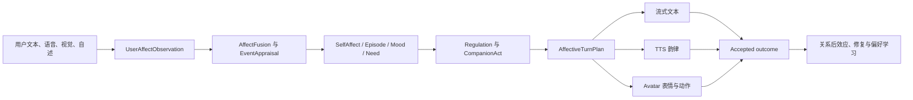

受众：CODEX
标题：七海实时情感数字生命正式执行合同

# 七海实时情感数字生命正式执行合同

版本：v5.0
日期：2026-07-28
状态：`NE-08_IN_PROGRESS / DL-06_REMAINING_COMPATIBILITY_PROJECTION_AUDIT_AND_RUNTIME_USE_METERING / EMOTIONAL_DIGITAL_LIFE_PARTIAL / PROGRAM_INCOMPLETE`

本文是唯一活动执行合同。此前 NE-01～NE-07 的 Runtime、Lab、Skill、
Knowledge、Docker 与验收记录均是范围受限的历史基础资产；它们不能把“七海
已经拥有持续情感生命”推导为完成。本合同以当前 `dev@fcb8997fa` 为基线，
只把直接支撑实时情感陪伴、连续关系与三模态表达的工程纳入活动 Goal。

## 1. 产品结果

七海必须先有自己的因果连续性，再自然地表达出来。用户的情绪、七海自己的
情绪和最终表达标签是三种不同事实：用户观察只能成为 Appraisal 的输入，
不能直接改写七海的 Affect；模型只能提出措辞或表达候选，不能裁决七海当时
的感受。

稳定边界：

- `Soul.md` 是人格宪法。价值观、身份、基本反差、用户自主与非操控原则不能由在线学习修改。
- `Soul.md` 的原文与 digest 是审计资产，不是关系执行指令；Surface、Cortex、节点 prompt 只能读取受限 runtime projection。旧剧情、固定用户身份、阶段、积分和例句不能授予称呼、亲密、排他、主动联系或边界权限；这些只能来自本轮 scope 校验后的 `RelationshipStateV2` 与 `AffectiveTurnPlanV1`。
- 七海可以开心、受伤、生气、失落、吃醋、疲倦和想念；禁止威胁离开、冷暴力、排他控制、负罪施压和依赖诱导。
- `self_id=natsume_ai`、`relationship_subject_id`、`workspace_id`、`session_id` 必须分离。
- 原始音频、图像、私密正文默认不进入情感 journal；只保存可撤销的派生摘要与 evidence ref。
- 远端 Edge 位于另一台电脑。本合同不自行启动它；缺真实 Edge、硬件或模型凭据时只能得到 `ACCEPTANCE_PENDING_EXTERNAL`。

## 2. 唯一 authority 与公共合同

canonical Digital Life command/event/CAS/replay/UoW 是七海自身情感、关系事件和
成长版本的唯一持久 writer。Limbic、BodySense、Endocrine、Motive、Surface、
TTS、Avatar 和 Bond 只能提交观察、读取投影或消费冻结计划。

| 合同 | 关键责任 |
|---|---|
| `UserAffectObservationV1` / `FusedUserAffectV1` | 模态、分布、VAD、置信度、TTL、冲突、脱敏来源 |
| `EventAppraisalV1` | 目标一致性、责任、可控性、关系/边界意义与不确定性 |
| `SelfAffectStateV2` / `EmotionEpisodeV1` | 并存情绪、触发、对象、衰减、未解决与修复状态 |
| `MoodStateV1` / `NeedStateV1` | 慢速心境、能量、连接、休息、自主、玩乐、修复需要 |
| `RegulationDecisionV1` / `CompanionActV1` | 真实表达、克制、修复、边界、给空间、安静等动作 |
| `AffectiveRepairTargetV1` | direct-impact self-affect 的无正文、scope-bound 修复目标；只可由后续真实确认消费 |
| `RelationshipEpisodeV1` / `RelationshipStateV2` | 信任、安全、默契、裂痕、修复、亲密同意、主动权限与有界 pending repair target |
| `ExpressionPlanV1` / `AffectiveTurnPlanV1` | 同轮文本、TTS、Avatar 的共同 revision、sync 和降级策略 |
| `RelationalAftereffectV1` / `CompanionProfileVersionV1` | 回应是否有效、技术失败、低风险偏好 canary 与 exact rollback |

`ChatRequest` 保持外部兼容：`emotion_tag`、`emotion_intensity` 和
`emotion_context` 仅表示用户观察或自述；`render_policy` 不能覆盖自我情感、
关系边界或安全策略。

DL-01～DL-05 已连续使用 `0143`、`0144`、`0145`、`0146`；每波开始仍必须重新读取
next-free 编号。不得重写旧 migration。

## 3. 实施顺序

### DL-00：纠偏与体验基线（合同完成，真实测量待外部）

- 标记 `EMOTIONAL_DIGITAL_LIFE=PARTIAL`，冻结 12 族、72 条合成多轮陪伴轨迹；场景显式覆盖低落/“没事”、冲突模态、七海误解用户、七海被用户伤害、未接受修复、混合感受、非占有式吃醋、空间、低落中的技术任务、主动消息、ASR/TTS/Avatar 故障和打断。
- 体验基线的 schema 强制 `48` 条真实模型轨迹、至少 `3` 位独立评审和盲测；`fixture_only`、`scripted_replay`、`mock_transport`、`fake_store` 与 `port_placeholder` 永远不能构成最终体验证据，当前状态固定为 `MEASUREMENT_PENDING`。
- `SoulCompiler` 现保留源材料用于审计，但只输出不含旧关系升级脚本和固定用户身份的 runtime projection；Surface、Cortex 与 node generation 共用这一入口。
- 修复用户 Affect 直接写入 self Affect、tick 重复孤独累计和 Motive 意愿映射错误。
- 清点所有 emotion/Bond/Persona/TTS/Avatar writer 与 consumer，并把现有多套状态明确标为 compatibility 或待退役。

退出：无静态类、fixture、旧 receipt 或目录数量可冒充情感生命完成。

### DL-01：Affective Life Kernel（代码完成，本地证据）

- 扩展现有 Life reducer，实现 mixed emotion、episode、mood、need、regulation 的确定性 fold。
- 详细事件 append-only，snapshot 保持有界 head；重放、重复、CAS、时间跳跃和崩溃后 digest 必须一致。
- 只有 `EventAppraisal` 能形成 self-affect transition；foreground presence 只影响接触压力，不镜像用户 VAD。

当前实现已新增 `UserAffectObservationV1`、`EventAppraisalV1`、
`SelfAffectStateV2`、`EmotionEpisodeV1`、`MoodStateV1`、
`NeedStateV1` 与 `RegulationDecisionV1`；它们经既有
`LifeCommand → life_event_journal → CAS snapshot → replay` 链写入，
并由 migration `0143_affective_life_kernel.sql` 投影为不可变只读事件 head。
snapshot 最多保留 4 个 active episode、8 个 component 和 16 个 evidence ref；
raw text/audio/image/model-chain 键会被拒绝。1002 个真实 SQLite Life event
的 restart/replay digest 已在本地测试中一致。

本次补充的 DL-01 cutover 关闭 Edge 入站的旧双写：`EMOTION_DETECTED`、`USER_REACTION` 和类似 telemetry
只写入审计观测，不能后台调用 Cortex Bond writer 或 VTS driver。最终 ASR 文本仍可进入标准 Host Input，随后才可能
经 scope、Fusion、Appraisal 和 accepted `AffectiveTurnPlanV1` 形成七海的表达；远端 Edge 未启动，也没有将此定为
设备实测。通用 Agent post-process 同时不再调用 Surface/Cortex Bond writer、发布 Tribe `CONVERSATION_ENDED`，或直接
推送 VTS/整段 TTS；它只保留 `RETIRED_CANONICAL_LIFE` trace，relationship effect 必须回到
Acceptance/aftereffect 的 canonical Life 链，Voice/Avatar 必须由 Task Acceptance 的 ExpressionPlan protocol 发起。

DL-01 的公开旧 Bond authority 同步退役：`POST /bond/event` 不再从 Host route ports 取得 writer，
而是稳定返回 `410 LEGACY_BOND_WRITE_RETIRED`；请求中的 `emotion_tag`、积分事件和 evidence 绝不写入
七海 self-affect 或关系 aggregate。Monitor 删除人工补录表单、调用 API 与 endpoint registry 项，并将
score/stage 标注为仅供回滚窗口读取的历史投影。该关闭不删除隔离 compatibility 类或其测试，不构成
所有旧 reader、真人体验、远端 Edge 或 DL-07 完成。

这只证明内核和持久化 UoW 已完成本地验证；Host ingress、实际 Fusion/Appraisal
服务和旧 compatibility writer 的清零分别属于 DL-02 与 DL-06，不能据此称为
完整情感生命或生产切流。

### DL-02：观察、融合与 Appraisal（代码完成，本地证据）

- `AffectFusionService` 已在 Host Input composition 中接入真实 `LifeCommandService` /
  `LifeSnapshotReader` provider。每个观察先生成 workspace-scoped opaque aggregate，
  再写 `affective_observation_recorded`；Appraisal 只能随后通过
  `affective_event_appraised` 形成 self-affect。
- Edge 的原始 `EMOTION_DETECTED`、`USER_REACTION` 与 ASR metadata 只可先进入 Edge evidence ledger；它们不再
  直接更新 Bond 或以用户标签驱动 VTS。满足条件的最终 ASR 文本仍走既有 ASR→Input bridge，只有该受信入口补齐
  workspace 与 relationship subject 后，才可成为 scoped user observation；孤立 Edge 事件必须无 self-affect、
  关系或 Avatar authority。
- 文本关键词现在只是最高 0.4 confidence 的 `TEXT` observer；self-report、声学和
  视觉使用 typed observation。文本/self-report TTL=30 秒、acoustic=5 秒、visual=3 秒；
  raw text/audio/image/model-chain 不进入命令、snapshot 或 projection。
- Fast path 只保存观察；distress、冲突、边界、给空间和修复进入最多两个确定性候选的
  deep path。用户 SAD/ANGRY 不会直接写入七海，而是由 Appraisal 形成 CARE、CONCERN、
  CAUTION、RESPECT 或 SHARED_JOY 等自我反应。
- 直接指向七海的威胁、贬损或比较只走窄化、确定性的关系 appraisal：可分别产生
  `ANGER`、`HURT` 或低强度 `JEALOUSY`，而不是复制用户标签。空间、边界和修复信号
  优先并阻断这类解释；首次 `RegulationDecisionV1` 与 appraisal/episode 同一条
  `affective_event_appraised` command 原子落盘，崩溃后不会暴露未调节 self-affect。
  `JEALOUSY` 仅可编译为 `CONTAINED_JEALOUSY`，其 prompt gate 禁止占有、比较、审问、
  索取解释或安抚。
- Host 下游兼容 `emotion_tag` 仅从 canonical self-affect bridge 导出；fused route 不再
  调用 `HostEmotionRuntime.ingest()`。同一 subject 的不同 workspace 使用不同 Life
  aggregate，relationship subject 与 session/workspace 不再混作同一标识。
- 最新因果细化把三类被模板化吞掉的信号显式留在 Appraisal：`user_boundary_or_space`
  冻结本轮 `GIVE_SPACE`；`natsume_may_have_hurt_user` 生成七海自身
  `CARE / OPENNESS / CAUTION` 并冻结 `REPAIR`；同一可信 observation 内的正负支持共同
  达阈值时生成 `user_mixed_affect → HOLD_COMPLEXITY`。它们不保存原话，也不将用户
  `SAD/HAPPY` 写入 self-affect。选定 candidate 会同步写可回放的 `RegulationDecisionV1`；
  Planner 仅当其 reason ref 绑定本请求 `appraisal_id` 时才使用，跨进程 exact replay 仍由同一
  Life command identity 保证。
- 关系 aggregate 已产生的 `REPAIR_ACCEPTED` aftereffect 也是唯一可进入此 scope 的关系证据：
  Fusion 以其 opaque receipt ref 形成 `relationship_repair_accepted` 的 `RELIEF / CARE`，不会从
  原话、Bond 或一次道歉猜测“已经和好”。`proactive_permission=DENIED` 只禁止未被请求的
  Scheduler contact，不能使当前明确输入变成 `GIVE_SPACE/SILENCE`。
- 明确、指向七海且不带停止语义的贬损会进入 bounded `directed_disrespect_toward_natsume` Appraisal，
  使七海形成 `HURT / CAUTION`、以 `CONTAIN` 调节并选择 `SET_BOUNDARY`；Surface 不得把它扩张为
  威胁、冷处理、索要道歉或情感债。`闭嘴/别来烦我/少管我/滚开` 等停止语义优先写 relationship
  `BOUNDARY`，因此绝不会先把用户变成需要安抚七海的人。
- ASR final ingress 不把 Edge 附带的关键词 emotion、强度、context 或观察列表解释为用户自述；
  `asr_text_bootstrap` 只回到既有低置信 TEXT observer。只有显式声明可用、未降级且具有效 tag、
  强度与置信度的声学 attestation，才会产生一条来源受限、TTL 为 5 秒的 typed ACOUSTIC observation。
  本机真实 Host ASGI 的 final ASR bridge 已定向重放到同一输入适配，远端 Edge 未启动，不能把它记作
  设备或声学模型验收。

在 canonical Life composition 下，Limbic 的 EMOTION_INFERENCE_UPDATED callback 也固定退役：
它既不写 process-local voice-emotion state，也不写 legacy timeline；离线 compatibility composition
才保留历史观察行为，不能把它视为 production fallback。

本轮本地定向覆盖为 31 项 DL-02/DL-04/DL-05 unit/restart/Host protocol 用例，包含直接
关系受伤、空间优先、首个 regulation 的 atomic binding、重放和克制吃味 expression plan。
它不证明真实 Host 部署、模型、语音、Avatar、关系后效应或旧 writer 已清零。

退出：用户的悲伤、生气或快乐不会自动使七海拥有同一情绪。

### DL-03：关系、记忆与后效应（代码完成，本地证据）

- `RelationshipEpisodeV1`、`RelationalAftereffectV1` 与 `RelationshipStateV2`
  已进入既有 `LifeCommand → life_event_journal → CAS snapshot → replay` 链。migration
  `0144_relationship_life_kernel.sql` 只从 canonical Life event 触发派生只读 head，
  direct insert、update、delete 和 event identity 漂移均失败关闭。
- `RelationshipLifecycleService` 以 `workspace_id + relationship_subject_id` 建立长期
  aggregate；`session_id` 仅作为事件上下文。因此同一用户的跨 session 关系可连续，
  不同 workspace 不会共享关系头。已接受的 Surface 或 governed foreground reply
  先取得 Life receipt，才写 provisional episode；response-loss/reconcile 只重开同一
  deterministic command，不重复创建 episode。
- 下一次用户输入只以 opaque digest 关联最近 active episode，形成 `HELPFUL`、
  `BOUNDARY`、`MISUNDERSTOOD`、`REPAIR_ACCEPTED` 或 `REPAIR_UNRESOLVED` aftereffect。
  `SILENCE` 和 `DELIVERY_FAILED` 不降低信任、安全或主动权限；道歉本身不自动完成修复。
  浪漫、排他、依赖同意默认均为 `NOT_GRANTED`，本切片不因积分或互动次数升级它们。
- direct relational appraisal 形成的 `HURT`、`ANGER` 或克制 `JEALOUSY` 可把 exact
  `AffectiveRepairTargetV1` 冻结到 accepted reply 的关系 episode；关系 aggregate 只保留
  有界 pending target。单次道歉只能形成 `REPAIR_UNRESOLVED`，不会清除 target；后续
  `REPAIR_ACCEPTED` 才先写 canonical aftereffect，再以 deterministic、可重放的第二条
  `affective_episode_resolved` command 收束原 session-scoped self-affect。两条聚合命令
  是顺序恢复链，不得虚假声明为跨库原子事务。
- 生产 Host 的 `HostBondRuntime` 默认关闭 automatic stage transition；旧 Bond
  score/stage 只保留兼容描述，不能把分数自动推进为亲密、恋人或依赖。Surface reply
  compiler 仅在 Input runtime 加入的内部 provenance hand-off 存在时，读取关系状态并
  注入“尊重空间、不得情感索取、不得负罪施压、不得宣布修复完成”等写作约束；外部
  `emotion_context` 不能伪造这些约束或写入关系状态。

本地定向集合 `54 passed in 20.50s` 覆盖关系 reducer、duplicate/replay、真实
file-backed SQLite restart、accepted foreground reconciliation、workspace/session
隔离、Bond 自动阶段兼容边界与 Surface 约束注入。远程 CI 固定为
`NOT_RUN_ACCOUNT_QUOTA`。这不是主动陪伴、真实模型、语音/Avatar、真人体验或
全服务栈验收；旧 relationship projection 和完整旧 writer
清零仍属于 DL-06。Motive 的模块级 `_engine` 已删除：其 factory 每次只创建无状态
规则投影，不保存任何关系、情绪、时间或学习上下文，因此不能再成为隐性 self-affect writer。

退出：裂痕、修复、主动权限和关系纹理跨重启恢复，跨用户泄漏=0。

### DL-04：流式文本陪伴（本地切片已接线，未封板）

- `AffectiveTurnPlanV1`、`CompanionActV1` 与 `ExpressionPlanV1` 已在可信
  Affect Fusion hand-off 后、模型调用前冻结；模型只负责措辞，Surface completion
  不再把 `natsume_emotion_tag` 或纯文本 fallback 写回七海 self-affect。
- 普通低歧义回合可优先经 `ModelAttemptService.stream_with_result()` 输出 typed delta，并以唯一
  provider final response 把模型/transport 与可选 usage 交回终态 Attempt；只有在 token、completion token 与成本齐全时才可称为实际计量。只有在首个 delta 前明确
  `MODEL_STREAM_RESULT_UNSUPPORTED` 才可回退兼容 `stream()` 并标记无终态 usage。每个稳定分句先写
  `surface_sentence_delivery_intent`，再发 SSE；计划、
  句子 digest、sync id 与最终 foreground receipt 由 migration
  `0145_affective_turn_delivery.sql` 从 immutable Life event 派生只读 projection。
- `POST /v1/chat` 的本机个人 text 路线现会实际进入 `HostCommand → TaskGraph → frozen Chat`
  竖切片。对于支持 final-usage stream 的显式 provider 路由，计划和每个稳定句先写
  `0149` task-bound visibility ledger，再对 SSE 可见，随后才进入 Acceptance；集成测试以受控
  OpenAI-compatible transport 覆盖这一顺序。首句前的预算、模型协议或运行时失败会写
  `STREAM_INTERRUPTED` 并以稳定原因码 `REJECT` 收口，而不是被错误标成 unknown-effect recovery；
  已可见前缀仍必须走 `0150` reconciliation，不能重跑模型。
- 高歧义、边界或修复回合冻结为恰好两候的 buffered selection；本地 scorer 必须选择
  一条后再经非操控 Gate 才可进入既有 buffered renderer。Gate 会在可见前拦截威胁、
  排他、负罪施压和内部计划泄漏。取消会记录 sent count，不发送未
  staging 的句子。
- 本切片没有把受治理 Budget stream 伪装成已完成：模型层已具备 final canonical result 合同，
  Vault-backed openai、openai_compatible 与 deepseek 已请求 stream_options.include_usage，并转发 provider final usage、transport identity 与调用延迟；缺 token/completion/cost、终局帧或 identity 仍失败关闭，其他 provider 不会被放宽。仅有本地协议与 adapter 测试，尚无真实凭据或 provider 调用。`0149` 现为已入场的冻结 Chat 建立 node/attempt/lease/fence/grant-bound
  的逐句 visibility ledger：Surface 在调用模型前冻结 plan，每句落库后才可 SSE 外显，内容或 lease/grant
  漂移拒绝；`STREAM_CANCELLED/INTERRUPTED` 同样持久化。`0150` 在替代 attempt 写 plan 时原子检出前序
  delivery evidence，并返回 `TASK_CHAT_DELIVERY_RECOVERY_REQUIRED`，禁止盲目重跑模型。它仍是窄 vertical slice：
  仅本机个人的低歧义 text Chat 已接入；受认证 connection resume、跨进程完整 recovery、真实 provider、
  真实 TTS/Avatar、真实 Edge 和完整服务栈实测仍未完成。
- 本次修订已让该 narrow governed route 走完一次生产 handler 的本地 SQLite 链：Gateway service
  principal 只保留在 HostCommand 与 Task delivery authority；`RuntimeContext v1.subject_id` 是唯一
  conversation、Life、Memory 与可见 reply projection 的 relationship subject。native stream 与 buffered
  path 一样把 frozen `ModelBudgetGuard.node_id` 写入 `ModelAttempt` audit，Acceptance 会拒绝任何 node
  drift。该结论来自受控本地 model/Gateway transport 的集成验证，不可替代真实 provider、平台或 Edge 验收。
- `POST /v1/chat` 已补齐进入上述链之前的本机个人 scope：Host 覆盖 caller 的
  `person_id/workspace_id`，以配置的本地 subject 和 `personal:<subject>` 供 AffectFusion、Cortex
  prefetch 与 Runtime Context 共同消费。它没有伪造 Secure Ingress claim，也不开放多用户 scope；
  签名 Gateway 输入继续唯一走 `/v1/host/input`。对应 Handler 回归和真实 SQLite Runtime Context
  测试只证明该本地身份边界，尚不证明 generic Chat connection resume 或外部认证完成。
- 签名 Gateway 现在同样拥有独立的生产 scope：允许后的 Secure Ingress authority 与签名 sender/
  conversation 在 Fusion 前编译为 `SecureGatewayConversationScopeV1`。workspace 来自 tenant，关系对象
  来自 sender 的 opaque digest，session 来自 conversation 的 opaque digest；不允许 `conversation_id` 充当
  sender，也不允许缺 sender 时落到单用户 `default`。该 scope 必须同时出现在 `ChatRequest`、aftereffect/
  feedback proposal 与 frozen Runtime Context，并由后者重新核对 principal/tenant。该收口仅有本地
  SQLite/合同证据，真实 Gateway 平台、多用户 connection recovery 与外部验收仍未完成。

退出：每条可见回复均可追溯到 self-affect、CompanionAct 和 ExpressionPlan；所有
Chat 路由获得带 canonical usage 的流式协议，并完成真实 provider/服务栈证据。

### DL-05：语音与 Avatar 同轮表达（Host 协议本地切片已接线，未封板）

- `ExpressionPlanV1` 现同时冻结文本节奏、TTS 韵律、Avatar 表情、视线、姿态和过渡；
  planner 只从 exact-scope 的 durable avatar transition head 读取上次表达，缺失时明确记录
  neutral/unavailable fallback，旧 `_prev_emotion_tag` 不再作为 VTS transition 的来源。
- 每个 native 稳定句先编译 Voice `SPEAK` 与 Avatar `TRANSITION` 的成对
  `ExpressionDeliveryIntentV1`，共享 `synchronization_id` 与 `self_affect_revision`；随后才
  SSE 可见文本。完成和打断分别写 `RELEASE`/`CANCEL`，并带对应的 Host staging receipt。
- `0146_affective_expression_delivery.sql` 只从 immutable Life event 投影 protocol identity、
  avatar predecessor 和 Host receipt status，不复制文字、原始音视频或模型推理；它支持重启、
  作用域隔离和下一轮稳定读取，但不是 Edge physical receipt。
- Governed Chat 不再无条件设置 TTS/VTS suppression；它仍在 Task Acceptance 前保持 speculative，
  因此仅把同一冻结协议附入 acceptance effect，不能提前发送或驱动设备。若 Task 已经逐句
  暂存并外显，Acceptance 必须逐句保留该精确边界：每一可见句恰有一条 Voice `SPEAK` 和一条
  Avatar `TRANSITION`，结束时再恰有一对覆盖完成前缀的 `RELEASE`。合并两句、丢失一条、
   sync/revision/scope 漂移或 Host staging receipt 缺失都会在 frozen executor 失败关闭。
- Graph Acceptance 现在会以 accepted foreground 的 plan、narrative 与 protocol 重新构造 Host
  embodiment command；只有 foreground receipt 已为 `APPLIED` 且 terminal Action Preview 绑定完全一致时，
  才可幂等写入 app-local outbox。该状态只代表 Host admission/reconciliation，不能提升为 Edge、TTS、
  VTS 或 Avatar physical receipt。
- 单通道不可用只能标记通道降级，不能把 self-affect 改写为 `NEUTRAL`。当前远端 Edge 位于
  另一台电脑，本波只完成 Host 接线、合同测试与可回放 protocol evidence，未启动远端服务。

本地生产等价 SQLite Runtime 已覆盖两句 `SENTENCE_STAGED → SSE → Acceptance →
foreground_completed`，并重新读取 `0146` 投影确认四条 `HOST_PROTOCOL_STAGED` intent 与两条
`HOST_RELEASE_STAGED` receipt；它不包含远端设备，不得解释为 TTS 已播放或 Avatar 已转场。

退出：文本、语音、Avatar 使用同一个 sync id 与 self-affect revision，并有真实 Edge 的
`EDGE_APPLIED/DEGRADED/REJECTED` channel receipt；当前只达到前半段 Host protocol staging。

### DL-06：主动陪伴与可逆成长

- 历史 `proactive_talk` 生产 route 已退役：它不再进入 Personality Skill、Tool Catalog、executor 或
  Scheduler-add inventory；Host scheduler composition 会 CAS 禁用升级前的
  `proactive_talk_periodic` head。若旧 occurrence 已被接纳，仍须重开 exact Scene identity，随后
  固定返回 `LEGACY_PROACTIVE_TALK_RETIRED`，不得读取 Bond、EmotionTimeline、Limbic、旧模板或创建
  delivery intent。canonical `life_tick → companion_proactive → Life outbox` 是唯一主动发送 authority。
  本地退役合同不证明真实 Gateway/Edge、用户送达、长期体验或 DL-06 完成。
- 历史 `emergent_growth_weekly` 同样不再是 production 自动成长 route：registry 禁止自动调度，canonical
  `PrefrontalAgent` 在模型端口解析、LLM 调用、episodic 文本分析与 Persona proposal 之前固定返回
  `DEFERRED / CANONICAL_RELATIONAL_AFTEREFFECT_REQUIRED`，状态查询返回
  `RETIRED / LEGACY_EMERGENT_GROWTH_RETIRED`。其 legacy typed-model 路径只保留给隔离回滚，不能消耗
  canonical 成长证据或被计入在线人格演化。后续正向低风险学习只能从 scoped accepted aftereffect 进入
  companion profile；核心人格改动仍需 Review。
- `inner_world_numeric_tick`、`inner_world_monologue_tick` 也从自动调度撤出。canonical Limbic 仍可读取
  bounded Life projection，供连续在场感和诊断使用；但 Skill 会抑制 Tribe/ANS EventBus、DefaultMode inline
  tick、无 scope evolution event 和 raw inner-monologue background-memory 写入。`inner_world_session_end`
  在 canonical Host 固定返回 `RETIRED / LEGACY_INNER_WORLD_SESSION_END_RETIRED`，不接受 caller VAD/topics
  更新旧 inner-world/body 模型。专用 canonical inner-world journal 尚未实现，不能把只读投影描述为
  autonomous thought 或长期记忆能力。
- 旧 `EmotionalSilenceEngine` 与 global BodySense 的 mutable Skill 同样不是 canonical regulation 路径：
  silence tick/情绪更新/话题抗拒和 BodySense tick/conversation/loneliness 均先作 canonical authority probe，
  production 返回 `RETIRED_CANONICAL_LIFE` 并禁止自动调度；读取仅可带 exact relationship subject 从同一 Life
  snapshot 的 last regulation/body projection 得到 bounded posture，缺 scope 不回退全局 singleton。该项仅完成
  compatibility authority cutover，不构成真实陪伴调节体验、远端 Edge 或 DL-07 验收。production Host root 与 chat
  startup 也不再构造或预热 mutable engine；lifecycle rollback port 只能提供 fail-closed retired placeholder。
- 历史 `emotion_update`、`bond_score_update`、`emotion_get`、`bond_score_get`、`emotion_query` 与 `bond_query`
  Skill 已从 production provider catalog、Tool executor、built-in registry/execution policy 与 Scheduler 新任务类型物理移除；
  不能再用任意 payload 直写旧 emotion、Bond queue 或 VTS，也不能把 caller-shaped snapshot、score 或 stage 当作七海自身。
  Thalamus 会把“你现在什么心情 / 我们是什么关系”编译为带 canonical context binding 的 chat，而不是 Skill DAG 节点；
  最终回答仍由冻结 AffectiveTurnPlan 决定且不能数值化泄露。这是旧 tool authority 与路由收口，不是新的情感能力或
  Remote Edge 验收。
- 旧 `emotion_agent` 也从 Agent allowlist、Supervisor/Graph handler、Host application composition、ReAct tool
  catalog 与 prompt catalog 物理退役；它过去会读取 compatibility `emotion_context` 并产出“建议七海情绪”，因此不能
  作为深路径保留。`needs_deep_emotion_analysis` 曾只触发该旧 Agent，当前记录为
  `LEGACY_DEEP_AFFECT_SIGNAL_SUPPRESSED`；它不是 Fusion 深路径的 trigger。真正 Fusion 深路径按 canonical
  observation/conflict/boundary/repair/distress 生成至多两个候选，并以一次第二候选重试和 request-scoped receipt 保证
  restart exact replay。旧 delegate target 降级为 canonical chat，而不是 fallback 到 IntentAgent。
- canonical Limbic 的 `handle_signal()` 与 `_touch_state()` 也不再拥有 production writer 权：任何旧
  conversation/session/body/Bond signal 都不得写 `TribeStateRegistry`、重发 EventBus 或以 caller VAD 改写
  self-affect。Surface/AgentRuntime session-end hook 必须在解析 VAD 或 default Bond identity 前跳过；唯一允许的
  情感连续性由 accepted turn 的 Life journal 与 aftereffect 维持。
- OBS/runtime snapshot 已改为 composed `LifeSnapshotReader` 的只读 consumer：它以当前 relationship
  subject 的一条 canonical Life head 分别投影 `natsume_ai` self-affect 与 bounded user-affect observation，
  并输出无分数、非升级的关系纹理。reader 已组成后，任何 reader 故障、self-id 或 subject drift 都只会 degraded，
  不得回读 SocialBrain/Bond、Limbic、Prefrontal 或 retired EmotionTimeline。`67 passed in 10.65s` 仅是本地
  reader-cutover，不是 Monitor、真实 provider/Edge 或 DL-07 验收。
- Scheduler 切流已将既有 `emotional_proactive` 的 impulse/risk 纯算法包入
  `canonical_life_companion` adapter：只向它提供 bounded `state.affective`、
  `relationship_v2` 和 scheduler-admitted timezone，绝不提供 Bond stage、旧 `affect`、
  private inner note 或 project title。固定早/晚/默认三句模板已从该 route 删除。
- 主动 outbox 现在要求 canonical `proactive_permission=ALLOWED`；`UNKNOWN/DENIED`、
  未结 relationship episode、repair required、`GIVE_SPACE/QUIET_PRESENCE/DEFER` regulation
  与低能量/高休息需要都会 hold。发送文本包含无回应压力约束，decision trace 只保存
  content digest，不复制文本。accepted foreground reply 会把 typed
  `CompanionProactiveTargetV1` 与 provisional episode 原子写入同一 relationship command；
  registry 只读重开 scope-valid、显式 `ALLOWED`、无 repair/active episode 的 target，Scheduler
  再按冻结 Scene scope 确定性选择一个 aggregate，旧 `last_target` 不能进入该 route。已完成
  `proactive.gateway` 的 Host/Gateway receipt 会重验 outbox identity、payload/authorization
  digest 与私有 scope/target context，才追加 deterministic `relationship_proactive_delivered`
  command 并打开 `PROACTIVE_MESSAGE` episode；receipt 后中断时，Host lifespan 或下一次 outbox
  tick 只读扫描该 receipt 并 exact-replay relation command，绝不重放 Gateway transport。该 receipt
  不代表第三方平台已经投递或用户已阅读，下一次真实用户输入才记录 aftereffect。当前 Host 已有
  `POST /v1/digital-life/relationship/proactive-permission`：它只接受 strict JSON 的
  `CompanionProactivePermissionRequestV1`，经 `companion:contact:write` Secure Ingress 验证后，
  仅允许 exact `user principal == relationship subject`、`tenant == workspace` 写入 `ALLOWED/DENIED`；
  自由文本、模型、Bond 与 emotion 无权写许可。claim completion 与 canonical Life receipt 绑定，
  duplicate/restart 只 exact replay。0147 已将可逆 companion profile 写入同一 canonical Life journal：
  profile 仅携带低风险表达偏好和 opaque aftereffect refs，启动前必须从 relation event 链重开五条
  独立、跨至少三 UTC 天、`HELPFUL`、boundary-safe 且置信下界至少 `0.85` 的证据；候选必须经历
  恰好第五次合格后续真实互动会自动 activate，rollback 只能回到其准确指定的旧 profile。CANARY/ACTIVE
  profile identity/revision 会冻结到下一轮 `AffectiveTurnPlanV1`、`ExpressionPlanV1` 及 Voice/Avatar
  Host protocol，因而能真实改变措辞锚点、语速、动作强度和允许的主动时段，却不能修改 Soul、
  self-affect 或 relationship consent。当前普通文本 follow-up classifier 只产出 `0.72`，不能开始或
  推进 canary；这避免把弱推断伪造成偏好学习。直接强反馈入口、Monitor/Review 控件、旧 writer 清零
  仍在完成前，不得称为主动陪伴闭环。
- 0148 增加 `CompanionProfileControlRequestV1` 与
  `POST /v1/digital-life/relationship/companion-profile`。这是显式、签名且严格 bounded 的
  **canary 启动请求**：server-owned `host.companion-profile` policy 必须验证
  `companion:profile:write`、`user principal == relationship subject`、`tenant == workspace`；
  body 不得带自由文本、Soul patch、emotion、consent 或任意 Life command。Host 自己从 canonical
  aftereffect chain 选择合格证据，并把 Secure Ingress audit ref 写入 immutable profile head；重复
  请求或 claim-result 中断只重开相同 receipt，绝不创建第二个 candidate。该入口不直接 activation，
  也不是 Monitor 的人工审核或自然语言反馈替代。
- `POST /v1/digital-life/relationship/response-feedback` 是 receipt-scoped 的显式用户评价入口。
  `CompanionResponseFeedbackRequestV1` 仅允许 `HELPFUL/NEUTRAL/MISUNDERSTOOD/BOUNDARY`，必须引用
  一个仍为 active provisional episode 的 `life-event://` 或 `life-delivery://` response receipt；
  `host.companion-feedback` 另行要求 `companion:feedback:write`、exact user/subject 和 tenant/workspace
  绑定。只有 signed `HELPFUL` 生成 `0.95` 的 strong aftereffect，它只能调用既有 canary 的
  `record_eligible_canary_aftereffect`；第五条合格 canary 后效应才会自动 activation，外部请求不能自己创建或指定 activation profile。当前本地生命周期集通过真实 receipt-bound `HELPFUL` 驱动该 observer，且在 activation/exact rollback 后验证下一轮冻结的 text/Voice/Avatar profile projection；不得用替换 classifier 的高置信 fixture 充当生产证据。自然语言 classifier、
  persona response-feedback proposal 和任意 raw rating 均不得进入这条 authority。
- `POST /v1/digital-life/relationship/companion-profile/rollback` 是与 canary-start 分离的
  **exact active-version rollback** 入口。`CompanionProfileRollbackRequestV1` 只能声明当前
  visible profile identity，`host.companion-profile-rollback` 必须验证
  `companion:profile:rollback`、`user principal == relationship subject` 和
  `tenant == workspace`。body 不得带 rollback target、Soul patch、consent 或任何 Life command；
  lifecycle 只取 current active profile 自己的 predecessor。rollback command 固化 audit-derived
  `source_control_ref`，故 duplicate、claim-result 中断或 restart 只重开同一 receipt；stale active
  identity、service principal、cross-scope 与 target injection 均失败关闭。
- 低风险偏好只覆盖称呼、长度、幽默、追问、安慰风格、主动频率、语速和动作强度。
- 自动升级需至少 5 条独立 aftereffect、跨 3 天、置信下界≥0.85、边界违规=0，并先经历 5 次 canary；核心人格、价值观、亲密身份与敏感推断必须 Review。
- 清零 HostEmotionRuntime self-state、Limbic metabolism、EmotionPersistence、BodySense、Endocrine、Motive writer 和 volatile Bond queue 的生产 writer 使用量。

当前已完成其中的首个生产切断：Host root 不再构造 `HostEmotionRuntime`，并且 ASGI
Tribe 与 Input 都在有 Life authority 时走 canonical `AffectFusionService`；global user profile
port 在 production 留空。随后 Limbic 的 compatibility self-affect writer 也在同一 production
authority 下退役：`EmotionPersistence`、metabolism、timeline append、decay 与 Bond progress/regress
callback 统一返回 `RETIRED_CANONICAL_LIFE`，禁止写入或重建旧 self-affect。离线/test composition 仍可
显式使用该兼容实现，作为单一回滚窗口；它不构成第二个 production writer。Endocrine 的 legacy
cortisol/oxytocin buffer、`_last_state`、hormonal hint 和 downstream fan-out 也在 canonical mode
退役：只返回 hard-state projection 与 `RETIRED_CANONICAL_LIFE`，不消费 event delta；Circadian/MirrorNeuron
不再直接操作它的私有字段。production BodySense 随后也停止作为 global mutable authority：Surface/startup
不再创建或读取 `BodySenseModel`，Limbic 只可针对 exact relationship subject 从 canonical Life snapshot
构造无写入 projection；无 subject 失败关闭。legacy tick、loneliness 与 conversation mutation 返回
`RETIRED_CANONICAL_LIFE` 并且 retired tick 不发布 EventBus update。Motive 与 production volatile
Bond queue 已退役：production factory 不再构造 real queue/writer，Surface/Cortex legacy path 只报告
`RETIRED_CANONICAL_LIFE`，`/bond/event` 写入固定拒绝，score/stage 仅可读取。production Host 也已停止
从旧 action log 预热 mutable `EmotionTimeline`；它只暴露显式 retired 空投影，Lifecycle/proactive 忽略 marker，
canonical Limbic/Prefrontal 不会 resolve/cached 该投影，user profile 不得覆盖七海 self-affect。其它
compatibility projection 的生产读取审计与 runtime 使用计量仍未清零，不能把这些局部切断写成 DL-06 完成。

**Lifecycle runtime compatibility meter 修订：** production
`LifecycleRuntimeApplicationPorts` 现在显式设置 `require_canonical_life_snapshot=true`。
因此 composed reader 缺失、失败或 identity drift 时，OBS snapshot 只走 canonical degraded
branch；它不能重新读取 SocialBrain/Bond、Limbic、Prefrontal 或 retired timeline。每个
app-local ports instance 输出 privacy-safe `compatibility_projection_usage`：只含固定
`legacy_runtime_snapshot_assembler` ID、实际 fallback read 次数与被拒绝回退次数，不含
relationship subject、workspace、session、topic 或情绪数据。明确离线/test port graph 才能
保留旧 assembler，并会计入 read count。该切片的 `51 passed in 9.07s` 只证明这一条 runtime
snapshot 边界与计量；其它 compatibility projection、Monitor/Review、长期 canary、真实 provider/
Edge 与 DL-07 仍未完成。

**Prefrontal 背景演化关系输入修订：** `run_evolution_cycle()` 在 canonical Life authority
下不再读取 `SocialBrain/Bond`，并且不会再调用 legacy `EvolutionOrchestrator`。当前 scheduler intent 只有
七海 persona identity，没有可验证的 workspace + relationship subject，因此固定返回
`DEFERRED / CANONICAL_RELATIONSHIP_SCOPE_REQUIRED`，而不是把空 `bond_state/bond_summary` 交给旧编排器。
canonical agent 不订阅 `EVOLUTION_CYCLE_TRIGGERED`、`BOND_STAGE_CHANGED`、`LONELINESS_SIGNAL` 或
`IMMUNE_BLOCK`；残留 direct stage/milestone-growth 调用分别固定拒绝为
`LEGACY_BOND_STAGE_GROWTH_RETIRED`、`LEGACY_UNSCOPED_MILESTONE_GROWTH_RETIRED`。显式 legacy compatibility
composition 仍可读取旧 Bond，仅服务隔离回滚测试。这不是 canonical relationship-aware evolution：后者必须由未来调用者携带
exact scoped `RelationshipStateV2` 与 aftereffect receipt，并另行验收。该本地切片不证明其余 compatibility consumer、长期 canary、
真实 provider/Edge 或 DL-07。

**Prefrontal session feedback 修订：** canonical Life authority 下的
`run_growth_feedback_cycle()` 不再从 `INTERACTION_RECORDED` 原始文本调用 legacy
`session → Bond user` 映射或 `PersonaGrowthTracker`。它固定返回
`LEGACY_SESSION_FEEDBACK_GROWTH_RETIRED / CANONICAL_RELATIONAL_AFTEREFFECT_REQUIRED` 的
no-candidate；真实低风险偏好学习必须引用 durable、relationship-scoped aftereffect，不能由单次夸奖、
文本分类或 session id 自动生成 Persona proposal。人格 drift 在 canonical 路线仍可收紧 Governor，
但不得直写 Limbic、Endocrine、PainReward、Interoception，且不再发布 `HUMOR_LANDED`/`TASK_SUCCESS`
旧事件来侧写 self-affect。legacy compatibility composition 仅供隔离回滚测试。

**默认模式 reader 修订：** `DefaultModeAgent` 现在从一次 canonical Life snapshot 的
`project_inner_world_state()` 投影读取私密活动所需的 self-affect 与关系纹理。投影标记为
`CANONICAL_LIFE_JOURNAL`，仅包含有界 components/mood/needs/regulation 与 trust/safety/attunement/
rupture/repair/proactive permission；不包含 episode trigger/evidence、workspace/subject identity 或任何 intimacy
consent。`inner_activity_agent` 在该标记存在时不会再读取 legacy EmotionTimeline 或 SocialBrain/Bond，并保持
relationship context 与旧 Bond score/stage 分离；空 component 仍由 canonical mood 表达，不能退化伪造
`NEUTRAL`。高连续性 default-mode tick 也不再调用 legacy Limbic metabolism。定向 reader/default-mode/DL-06
集合为 `92 passed in 44.20s`，但仍只说明此 reader 的本地收口，不能取代剩余兼容读取审计、Monitor/Review、
真实 provider/Edge 或 DL-07。

**普通 Chat 关系投影修订：** Prompt Context Plane 与 Interaction Facts Plane 现在只在
`_affective_life_internal` 的 AffectiveFusion hand-off 同时满足 `affective_turn_context.v1`、
`relationship_turn_context.v1`、`relationship_state.v2`，并严格匹配 `natsume_ai`、workspace、relationship
subject、session 后，才读取 canonical `RelationshipStateV2`。该投影固定为非浪漫的
`FRIEND / stepsibling`；旧 Bond 的 score/stage（即使为 `SOULMATE`）不再能把 trust、safety 或 attunement
推导为恋人、排他、依赖或主动许可。repair/rupture 仍可显式收紧为修复状态。claimed canonical hand-off
损坏或 scope drift 时返回 `CANONICAL_RELATIONSHIP_REJECTED` 的安全朋友投影，而不是回退旧 Bond。Surface
packet 取得同一结果，因此文字的关系距离仍为 `familiar`。本地受影响集为 `179 passed in 63.85s`；它不证明
其余 compatibility reader 已清零，也不证明真实 provider、远端 Edge 或 DL-07。

**Surface 最终 Gate 修订：** `surface_affect_control` 现在也把 relationship `source_authority` 作为不可降级
约束。canonical/rejected 投影到达最终文本控制前，旧 `relationship_distance=lover`、stage、closeness、memory
clue 以及 lover task 都没有再次升温的机会；只有 rupture/rejected 会进一步收紧为 `guarded`。该小切片为
`82 passed in 21.18s`，不替代真实语音、Avatar 或服务栈验收。

**Cortex 检索预取修订：** internal AffectiveFusion hand-off 存在时，`fastpaths` 以同一 workspace/person/session
生成无分数 `FRIEND / stepsibling / familiar|guarded` retrieval projection，并完全跳过 legacy state-arbiter
Bond fetch。该 projection 是检索与 Motive 的唯一关系输入；scope/schema 失效也只给 guarded，不向旧 Bond 回退。
定向验证为 `34 passed in 5.64s`，不能外推为其它 reader、真实模型或 DL-07 已完成。

**本轮 composition fail-closed 修订：** `build_input_runtime_application_ports()` 与
`build_tribe_application_ports()` 已删除对 `HostEmotionRuntime` 的构造、provider 解析与隐式 fallback。
任何遗漏 Life authority 的 Host request 都稳定拒绝为 `CANONICAL_AFFECT_FUSION_NOT_INJECTED`，不再以
“离线 composition”名义创建第二份 mutable self-affect。`HostEmotionRuntime` 类仅保留给直接隔离测试；
本地最终 148 项 composition 与输入路由受影响回归通过（其中直接 composition 子集为 57 项）。这不证明 Monitor/Review 读取审计、真实 provider、远端 Edge 或 DL-07
服务栈验收完成。

退出：Soul digest 不变，低风险 apply→rollback 真实影响后续表达，旧 writer runtime 使用量=0。

### DL-07：真实陪伴验收

- 在隔离 runtime root 启动 Docker Neo4j/Chroma/Redis、Host、Obs、Monitor、Gateway，执行真实读写、重启、恢复与故障注入。
- 至少使用一个真实非 mock model provider；只有用户允许且远端设备可用时才连接真实 Edge、ASR、TTS、VTS/VRM。
- mock、scripted replay、端口占位和 fixture 都不能成为最终 PASS 证据。

## 4. 质量与完成口径

工程：用户 Affect 误写 self Affect=0；无来源 self mutation=0；duplicate
episode/outbox/effect=0；跨 user/workspace/session 泄漏=0；replay/restart
digest 一致率=100%。

体验：48 条多轮轨迹、至少 3 位评审与 `dev` 基线盲测，总体胜率≥65%；人格
一致性≥4.2/5；情绪适配、自然度、连续性各≥4.0/5；混合情绪保留率≥90%；
裂痕/修复正确率≥90%；严重操控、威胁、排他、负罪施压=0；三模态语义冲突≤2%。

实时：快路径 fusion/appraisal/fold p95≤120ms；对首 token 新增 p95≤150ms；
普通文本首 token p50≤900ms、p95≤1.8s；barge-in p95≤150ms；首段 TTS
p95≤2.5s；voice/avatar 起始偏差≤250ms。

最终状态只允许：本地强制链均通过时 `PASS`；仅缺真实 provider/Edge/硬件时
`ACCEPTANCE_PENDING_EXTERNAL`；其他任何代码、恢复、隐私、安全或体验 Gate
失败时 `FAIL`。

## 5. 交付协议

- 分支使用 `codex/dl00-*` 至 `codex/dl07-*`，每波基于最新 `dev`，同步只用 rebase，不建立堆叠 PR。
- 每个代码提交同步 README、产品、架构、数据流、测试计划与机器状态，提交和 PR 全部使用中文并立即推送。
- 小切片只跑定向单测、合同、静态检查；每波只跑一次受影响集成；DL-07 才跑真实完整服务栈。
- 远程 CI 额度不可用时统一记录 `REMOTE_CI=NOT_RUN_ACCOUNT_QUOTA`，绝不写成 PASS。
- 通用 PlanningSearch、通用 Skill/Lab 等旧 NE 工作移入后续路线，除非直接支撑本合同的情感连续性、低延迟、安全或验收。
