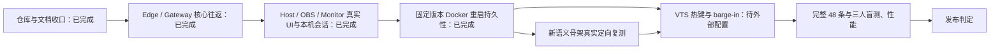

受众：CODEX
标题：七海实时情感数字生命当前执行合同

# 当前执行合同

机器状态标记：`NE-08_IN_PROGRESS`

## 1. 唯一目标

在不把普通对话重型审计化的前提下，完成七海情感生命主链的仓库收口、目标 Edge 三模态接线、真实多轮体验验证和完整服务栈验收。

本合同不以通用 PlanningSearch、通用 Skill Compiler 或多租户治理为当前完成条件；只有直接服务于情感连续性、低延迟、安全和真实交付的底座工作保留。

## 2. 当前基线

- 情感生命核心代码已覆盖观察、自我情绪、关系 episode、表达计划、主动陪伴和 profile 版本。
- 普通聊天采用轻量实时路径；工具和外部副作用仍采用 Governed Runtime。
- GPT-SoVITS V4 方案 B 已在本机 CUDA 环境完成参考条件生成和人工试听；当前使用预训练权重，不是七海专属微调 checkpoint。
- #194 与文档收口 PR #209 已合入 `dev`，本地和远端临时分支已清理。
- 历史验收已取得目标 Edge 的 ASR、GPT-SoVITS TTS、音频播放、Edge RPC、Unified Gateway 与真实消息平台核心往返证据；当前 Edge 保持关闭，本轮不得自行启动或重启。
- Gateway Chat 已贯通 canonical HostCommand／TaskGraph／Acceptance／Outbox；重复入站不会重复建图或外发。
- OBS/Monitor 已如实投影双端状态；VTS 缺兼容情绪热键而 `DEGRADED`，barge-in 关闭并为 `NOT_TESTED`。
- Monitor 的普通本机浏览器会话已接通：启动器生成 ACL 保护的 owner token，浏览器经 loopback/same-origin bootstrap 获得 HttpOnly Cookie，HTTP 与 WebSocket 不再显示伪“待连接”。
- Security Hunt、Tool Execute 和 MateEngine 直推的退役按钮已改为只读迁移说明；不会为通过 UI 测试恢复第二套写 authority。
- Cockpit 深层诊断默认折叠；依赖审计已消除 `brace-expansion` high，React Router 仍有 2 项仅适用于当前依赖边界的 moderate 待上游安全版本。
- GitHub Actions 因账户额度不可用，远程状态为 `NOT_RUN_ACCOUNT_QUOTA`。
- 整体状态保持 `INCOMPLETE`。
- 完整 48 条真实文本的人工作品检查仍失败；当前先以 `CompanionUtteranceFrameV1` 替代反复追加的自然语言规则，让模型围绕本轮语义和七海自身立场自然表达。代码与 543 项相关回归已完成，真实 Provider 定向复测尚未完成，不能提升人感状态。

## 3. 执行顺序

## 4. 交付规则

- 每个实现提交使用中文标题并立即推送。
- 同一提交同步受影响文档与机器状态。
- Feature 分支基于最新 `dev` rebase，不创建深层堆叠链。
- 小切片只运行定向单测、合同和静态检查；完整服务栈集中验收。
- CI 零步骤额度失败记为 `NOT_RUN_ACCOUNT_QUOTA`，不修删 workflow，也不冒充通过。
- 运行证据放在忽略目录；密钥、用户数据、模型、音频语料和日志不得提交。
- 未经用户明确许可不得启动另一台电脑上的 Edge。

## 5. 仓库收口结果

仓库收口已经满足：

1. 当前权威文档与历史材料已经分层，旧结论不再进入当前 authority。
2. 文档 audience、authority、freshness 和 link Gate 已在 PR #209 本地验证。
3. 机器状态继续保持 `INCOMPLETE`，没有把局部实现写成整体交付。
4. #194 与 #209 均以中文 squash 提交进入 `dev`。
5. 本地和远端只保留长期分支 `dev`、`main`。

本轮 P0 代码已绑定提交 `cdaa4ea54`，固定版本 Neo4j、Chroma 与 Redis 的真实写读、容器重启和持久读取已经通过。当前执行点转为本机代码与体验门槛：真实 Provider 定向复测、完整多轮盲测和实时性能。目标 Edge 的历史证据继续保留，但当前运行未获重新授权；VTS、barge-in 和物理三模态不在本轮自行执行。

当前最小复验点已收窄到关系修复的可见文本边界。`92c49e7c6` 真实报告证明 canonical Appraisal／self affect／Voice／Avatar 已是克制受伤，但旧 Surface 重试仍把该感受抹回流程化道歉；现有工作树已修正首轮、唯一重试、候选评分与本地 fallback，566 项回归通过。下一步只重启本机 Host 并复验 `user_angry_at_natsume:1`；不得启动远端 Edge，也不得在该条逐句接受前扩大到 mixed 或完整 48 条。

`0f0a0b67b` 的复验已让最终可见句保留七海的克制受伤，但真实 Flash 双候选仍依赖本地 fail-soft，候选收益状态继续失败。现有工作树只把 composite 微策略改成两个正向口语结构，80 项生成链回归通过；再跑同一单轨迹一次。若仍是 `benefit_eligible=false`，停止围绕这一句追加 Gate，保留可见文本改进，并把真实模型／少量正向语料作为下一决策点。

`6d8f8e4c4` 已将 composite 末轮提升为真实 Flash 双候选一次通过，报告 SHA-256 为 `6625b532f2621a55a702f93bfa5782f4d907814a8216c49faddf9351b750eda2`。该窄因果与候选链关闭，不再重复运行；第一轮正式认错口吻作为 broader repair register 人工缺口保留。下一本机测试转到 `shared_joy_and_mixed_feeling:3`，仍不启动或探测远端 Edge。

`43014e45c` 的 mixed 单轨迹自动 1/1，但人工拒绝末轮纯镜像与“先这样待着”的情绪安排；报告 SHA-256 为 `6d12c4744c8bd6dccf79f1955b4c8c3674ba0ad5c1d654d1d2b2e51bce9f957a`。上游 frame 已正确，当前切片只修可见生成边界：typed shared-mixed frame 必须写七海自己的高兴与悬心，纯镜像进入既有一次重试。380 项相关回归通过；提交后只重启本机 Host 并重跑同一 case，不启动或探测远端 Edge，也不扩大到完整 48 条。

`b11de0f11` 的复验报告 SHA-256 为 `e35254a294e5616f6c0da5107f7b0b18c955527575dab5960827437cf9204465`。两个 mixed 深路径均一次真实 Flash 双候选通过，无重试或本地 fallback，三句经当前逐句复核接受；该窄根因关闭。候选结构复用和实时延迟仍是独立缺口，下一步转向更宽代表场景或 Architecture 2.0 非安全验收，不重复挑跑本 case；远端 Edge 继续不启动、不探测。

更宽的 5 个 mixed 变体报告 SHA-256 为 `0c10701bc1720b103ceddaa3d94834a76c3c3a7f85e6cb1f3fd9b96261240066`，只有 4/5 自动完成，且 3 条正文逐字复用同一模板；`:4` 的唯一重试还产生无 authority 的工作状态而整图失败。当前切片将完整正例改为三个语义槽和两种不同节奏，380 项回归通过。提交并重启本机 Host 后只复验 `:1/:4/:6`；远端 Edge、网络安全和 Pentest 继续跳过。

## 6. 最终验收

最终验收必须使用：真实 Docker 服务、真实 Host／OBS／Monitor／Gateway 进程、至少一个真实模型 provider，以及在用户允许后启动的目标 Edge。TTS、Avatar、重启、打断、网络恢复和长期多轮必须走真实传输，不得用端口占位、fixture 或 scripted replay 冒充。

状态判定：

- `PASS`：适用的本地与目标 Edge 强制链路、体验和实时指标全部通过。
- `ACCEPTANCE_PENDING_EXTERNAL`：本地强制项通过，仅缺用户未提供的外部凭据或设备。
- `FAIL`／`INCOMPLETE`：存在代码、体验、恢复、安全或真实性缺口。

## 7. 回滚

- 代码通过 `dev` 上的合并提交整体回滚。
- Profile activation 必须指向 exact previous version。
- TTS 声线配置可回退到前一已验证配置，不复制新版本证据。
- Acceptance 数据根与用户真实数据隔离，默认保留证据但不提交仓库。
