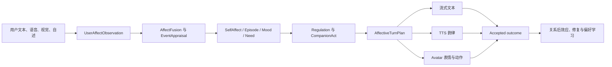

受众：CODEX
标题：七海实时情感数字生命正式执行合同

# 七海实时情感数字生命正式执行合同

版本：v4.6
日期：2026-07-28
状态：`NE-08_IN_PROGRESS / DL-06_CANONICAL_TARGET_REGISTRY_SLICE / EMOTIONAL_DIGITAL_LIFE_PARTIAL / PROGRAM_INCOMPLETE`

本文是唯一活动执行合同。此前 NE-01～NE-07 的 Runtime、Lab、Skill、
Knowledge、Docker 与验收记录均是范围受限的历史基础资产；它们不能把“七海
已经拥有持续情感生命”推导为完成。本合同以当前 `dev@fcb8997fa` 为基线，
只把直接支撑实时情感陪伴、连续关系与三模态表达的工程纳入活动 Goal。

## 1. 产品结果

七海必须先有自己的因果连续性，再自然地表达出来。用户的情绪、七海自己的
情绪和最终表达标签是三种不同事实：用户观察只能成为 Appraisal 的输入，
不能直接改写七海的 Affect；模型只能提出措辞或表达候选，不能裁决七海当时
的感受。

稳定边界：

- `Soul.md` 是人格宪法。价值观、身份、基本反差、用户自主与非操控原则不能由在线学习修改。
- 七海可以开心、受伤、生气、失落、吃醋、疲倦和想念；禁止威胁离开、冷暴力、排他控制、负罪施压和依赖诱导。
- `self_id=natsume_ai`、`relationship_subject_id`、`workspace_id`、`session_id` 必须分离。
- 原始音频、图像、私密正文默认不进入情感 journal；只保存可撤销的派生摘要与 evidence ref。
- 远端 Edge 位于另一台电脑。本合同不自行启动它；缺真实 Edge、硬件或模型凭据时只能得到 `ACCEPTANCE_PENDING_EXTERNAL`。

## 2. 唯一 authority 与公共合同

canonical Digital Life command/event/CAS/replay/UoW 是七海自身情感、关系事件和
成长版本的唯一持久 writer。Limbic、BodySense、Endocrine、Motive、Surface、
TTS、Avatar 和 Bond 只能提交观察、读取投影或消费冻结计划。

| 合同 | 关键责任 |
|---|---|
| `UserAffectObservationV1` / `FusedUserAffectV1` | 模态、分布、VAD、置信度、TTL、冲突、脱敏来源 |
| `EventAppraisalV1` | 目标一致性、责任、可控性、关系/边界意义与不确定性 |
| `SelfAffectStateV2` / `EmotionEpisodeV1` | 并存情绪、触发、对象、衰减、未解决与修复状态 |
| `MoodStateV1` / `NeedStateV1` | 慢速心境、能量、连接、休息、自主、玩乐、修复需要 |
| `RegulationDecisionV1` / `CompanionActV1` | 真实表达、克制、修复、边界、给空间、安静等动作 |
| `RelationshipEpisodeV1` / `RelationshipStateV2` | 信任、安全、默契、裂痕、修复、亲密同意与主动权限 |
| `ExpressionPlanV1` / `AffectiveTurnPlanV1` | 同轮文本、TTS、Avatar 的共同 revision、sync 和降级策略 |
| `RelationalAftereffectV1` / `CompanionProfileVersionV1` | 回应是否有效、技术失败、低风险偏好 canary 与 exact rollback |

`ChatRequest` 保持外部兼容：`emotion_tag`、`emotion_intensity` 和
`emotion_context` 仅表示用户观察或自述；`render_policy` 不能覆盖自我情感、
关系边界或安全策略。

DL-01～DL-05 已连续使用 `0143`、`0144`、`0145`、`0146`；每波开始仍必须重新读取
next-free 编号。不得重写旧 migration。

## 3. 实施顺序

### DL-00：纠偏与体验基线（本地完成）

- 标记 `EMOTIONAL_DIGITAL_LIFE=PARTIAL`，冻结 72 条合成多轮陪伴轨迹；当前只定义评估样本，不将其记作真人体验证据。
- 修复用户 Affect 直接写入 self Affect、tick 重复孤独累计和 Motive 意愿映射错误。
- 清点所有 emotion/Bond/Persona/TTS/Avatar writer 与 consumer，并把现有多套状态明确标为 compatibility 或待退役。

退出：无静态类、fixture、旧 receipt 或目录数量可冒充情感生命完成。

### DL-01：Affective Life Kernel（代码完成，本地证据）

- 扩展现有 Life reducer，实现 mixed emotion、episode、mood、need、regulation 的确定性 fold。
- 详细事件 append-only，snapshot 保持有界 head；重放、重复、CAS、时间跳跃和崩溃后 digest 必须一致。
- 只有 `EventAppraisal` 能形成 self-affect transition；foreground presence 只影响接触压力，不镜像用户 VAD。

当前实现已新增 `UserAffectObservationV1`、`EventAppraisalV1`、
`SelfAffectStateV2`、`EmotionEpisodeV1`、`MoodStateV1`、
`NeedStateV1` 与 `RegulationDecisionV1`；它们经既有
`LifeCommand → life_event_journal → CAS snapshot → replay` 链写入，
并由 migration `0143_affective_life_kernel.sql` 投影为不可变只读事件 head。
snapshot 最多保留 4 个 active episode、8 个 component 和 16 个 evidence ref；
raw text/audio/image/model-chain 键会被拒绝。1002 个真实 SQLite Life event
的 restart/replay digest 已在本地测试中一致。

这只证明内核和持久化 UoW 已完成本地验证；Host ingress、实际 Fusion/Appraisal
服务和旧 compatibility writer 的清零分别属于 DL-02 与 DL-06，不能据此称为
完整情感生命或生产切流。

### DL-02：观察、融合与 Appraisal（代码完成，本地证据）

- `AffectFusionService` 已在 Host Input composition 中接入真实 `LifeCommandService` /
  `LifeSnapshotReader` provider。每个观察先生成 workspace-scoped opaque aggregate，
  再写 `affective_observation_recorded`；Appraisal 只能随后通过
  `affective_event_appraised` 形成 self-affect。
- 文本关键词现在只是最高 0.4 confidence 的 `TEXT` observer；self-report、声学和
  视觉使用 typed observation。文本/self-report TTL=30 秒、acoustic=5 秒、visual=3 秒；
  raw text/audio/image/model-chain 不进入命令、snapshot 或 projection。
- Fast path 只保存观察；distress、冲突、边界、给空间和修复进入最多两个确定性候选的
  deep path。用户 SAD/ANGRY 不会直接写入七海，而是由 Appraisal 形成 CARE、CONCERN、
  CAUTION、RESPECT 或 SHARED_JOY 等自我反应。
- Host 下游兼容 `emotion_tag` 仅从 canonical self-affect bridge 导出；fused route 不再
  调用 `HostEmotionRuntime.ingest()`。同一 subject 的不同 workspace 使用不同 Life
  aggregate，relationship subject 与 session/workspace 不再混作同一标识。

本地覆盖包含 9 项 DL-02 unit/restart 集成和 73 项受影响 Host/聊天/内核回归。它不
证明真实 Host 部署、模型、语音、Avatar、关系后效应或旧 writer 已清零。

退出：用户的悲伤、生气或快乐不会自动使七海拥有同一情绪。

### DL-03：关系、记忆与后效应（代码完成，本地证据）

- `RelationshipEpisodeV1`、`RelationalAftereffectV1` 与 `RelationshipStateV2`
  已进入既有 `LifeCommand → life_event_journal → CAS snapshot → replay` 链。migration
  `0144_relationship_life_kernel.sql` 只从 canonical Life event 触发派生只读 head，
  direct insert、update、delete 和 event identity 漂移均失败关闭。
- `RelationshipLifecycleService` 以 `workspace_id + relationship_subject_id` 建立长期
  aggregate；`session_id` 仅作为事件上下文。因此同一用户的跨 session 关系可连续，
  不同 workspace 不会共享关系头。已接受的 Surface 或 governed foreground reply
  先取得 Life receipt，才写 provisional episode；response-loss/reconcile 只重开同一
  deterministic command，不重复创建 episode。
- 下一次用户输入只以 opaque digest 关联最近 active episode，形成 `HELPFUL`、
  `BOUNDARY`、`MISUNDERSTOOD`、`REPAIR_ACCEPTED` 或 `REPAIR_UNRESOLVED` aftereffect。
  `SILENCE` 和 `DELIVERY_FAILED` 不降低信任、安全或主动权限；道歉本身不自动完成修复。
  浪漫、排他、依赖同意默认均为 `NOT_GRANTED`，本切片不因积分或互动次数升级它们。
- 生产 Host 的 `HostBondRuntime` 默认关闭 automatic stage transition；旧 Bond
  score/stage 只保留兼容描述，不能把分数自动推进为亲密、恋人或依赖。Surface reply
  compiler 仅在 Input runtime 加入的内部 provenance hand-off 存在时，读取关系状态并
  注入“尊重空间、不得情感索取、不得负罪施压、不得宣布修复完成”等写作约束；外部
  `emotion_context` 不能伪造这些约束或写入关系状态。

本地定向集合 `54 passed in 20.50s` 覆盖关系 reducer、duplicate/replay、真实
file-backed SQLite restart、accepted foreground reconciliation、workspace/session
隔离、Bond 自动阶段兼容边界与 Surface 约束注入。远程 CI 固定为
`NOT_RUN_ACCOUNT_QUOTA`。这不是主动陪伴、真实模型、语音/Avatar、真人体验或
全服务栈验收；volatile Bond queue、旧 relationship projection 和完整旧 writer
清零仍属于 DL-06。

退出：裂痕、修复、主动权限和关系纹理跨重启恢复，跨用户泄漏=0。

### DL-04：流式文本陪伴（本地切片已接线，未封板）

- `AffectiveTurnPlanV1`、`CompanionActV1` 与 `ExpressionPlanV1` 已在可信
  Affect Fusion hand-off 后、模型调用前冻结；模型只负责措辞，Surface completion
  不再把 `natsume_emotion_tag` 或纯文本 fallback 写回七海 self-affect。
- 普通低歧义回合可经 `ModelAttemptService.stream()` 和真实 Vault provider stream
  逐句输出。每个稳定分句先写 `surface_sentence_delivery_intent`，再发 SSE；计划、
  句子 digest、sync id 与最终 foreground receipt 由 migration
  `0145_affective_turn_delivery.sql` 从 immutable Life event 派生只读 projection。
- 高歧义、边界或修复回合冻结为恰好两候的 buffered selection；本地 scorer 必须选择
  一条后再经非操控 Gate 才可进入既有 buffered renderer。Gate 会在可见前拦截威胁、
  排他、负罪施压和内部计划泄漏。取消会记录 sent count，不发送未
  staging 的句子。
- 本切片没有把受治理 Budget stream 伪装成已完成：当前 provider stream 尚不能返回
  final canonical usage，带 node-bound guard 的请求仍走 usage-safe buffered path。
  connection resume、TTS/Avatar、真实 Edge 和完整 Chat 路由实测仍未完成。

退出：每条可见回复均可追溯到 self-affect、CompanionAct 和 ExpressionPlan；所有
Chat 路由获得带 canonical usage 的流式协议，并完成真实 provider/服务栈证据。

### DL-05：语音与 Avatar 同轮表达（Host 协议本地切片已接线，未封板）

- `ExpressionPlanV1` 现同时冻结文本节奏、TTS 韵律、Avatar 表情、视线、姿态和过渡；
  planner 只从 exact-scope 的 durable avatar transition head 读取上次表达，缺失时明确记录
  neutral/unavailable fallback，旧 `_prev_emotion_tag` 不再作为 VTS transition 的来源。
- 每个 native 稳定句先编译 Voice `SPEAK` 与 Avatar `TRANSITION` 的成对
  `ExpressionDeliveryIntentV1`，共享 `synchronization_id` 与 `self_affect_revision`；随后才
  SSE 可见文本。完成和打断分别写 `RELEASE`/`CANCEL`，并带对应的 Host staging receipt。
- `0146_affective_expression_delivery.sql` 只从 immutable Life event 投影 protocol identity、
  avatar predecessor 和 Host receipt status，不复制文字、原始音视频或模型推理；它支持重启、
  作用域隔离和下一轮稳定读取，但不是 Edge physical receipt。
- Governed Chat 不再无条件设置 TTS/VTS suppression；它仍在 Task Acceptance 前保持 speculative，
  因此仅把同一冻结协议附入 acceptance effect，不能提前发送或驱动设备。
- 单通道不可用只能标记通道降级，不能把 self-affect 改写为 `NEUTRAL`。当前远端 Edge 位于
  另一台电脑，本波只完成 Host 接线、合同测试与可回放 protocol evidence，未启动远端服务。

退出：文本、语音、Avatar 使用同一个 sync id 与 self-affect revision，并有真实 Edge 的
`EDGE_APPLIED/DEGRADED/REJECTED` channel receipt；当前只达到前半段 Host protocol staging。

### DL-06：主动陪伴与可逆成长

- Scheduler 切流已将既有 `emotional_proactive` 的 impulse/risk 纯算法包入
  `canonical_life_companion` adapter：只向它提供 bounded `state.affective`、
  `relationship_v2` 和 scheduler-admitted timezone，绝不提供 Bond stage、旧 `affect`、
  private inner note 或 project title。固定早/晚/默认三句模板已从该 route 删除。
- 主动 outbox 现在要求 canonical `proactive_permission=ALLOWED`；`UNKNOWN/DENIED`、
  未结 relationship episode、repair required、`GIVE_SPACE/QUIET_PRESENCE/DEFER` regulation
  与低能量/高休息需要都会 hold。发送文本包含无回应压力约束，decision trace 只保存
  content digest，不复制文本。accepted foreground reply 会把 typed
  `CompanionProactiveTargetV1` 与 provisional episode 原子写入同一 relationship command；
  registry 只读重开 scope-valid、显式 `ALLOWED`、无 repair/active episode 的 target，Scheduler
  再按冻结 Scene scope 确定性选择一个 aggregate，旧 `last_target` 不能进入该 route。
  delivery-success→episode reconciliation、restart reconciliation 和后续 aftereffect 仍在完成前，
  不得称为主动陪伴闭环。
- 低风险偏好只覆盖称呼、长度、幽默、追问、安慰风格、主动频率、语速和动作强度。
- 自动升级需至少 5 条独立 aftereffect、跨 3 天、置信下界≥0.85、边界违规=0，并先经历 5 次 canary；核心人格、价值观、亲密身份与敏感推断必须 Review。
- 清零 HostEmotionRuntime self-state、Limbic metabolism、EmotionPersistence、BodySense、Endocrine、Motive writer 和 volatile Bond queue 的生产 writer 使用量。

退出：Soul digest 不变，低风险 apply→rollback 真实影响后续表达，旧 writer runtime 使用量=0。

### DL-07：真实陪伴验收

- 在隔离 runtime root 启动 Docker Neo4j/Chroma/Redis、Host、Obs、Monitor、Gateway，执行真实读写、重启、恢复与故障注入。
- 至少使用一个真实非 mock model provider；只有用户允许且远端设备可用时才连接真实 Edge、ASR、TTS、VTS/VRM。
- mock、scripted replay、端口占位和 fixture 都不能成为最终 PASS 证据。

## 4. 质量与完成口径

工程：用户 Affect 误写 self Affect=0；无来源 self mutation=0；duplicate
episode/outbox/effect=0；跨 user/workspace/session 泄漏=0；replay/restart
digest 一致率=100%。

体验：48 条多轮轨迹、至少 3 位评审与 `dev` 基线盲测，总体胜率≥65%；人格
一致性≥4.2/5；情绪适配、自然度、连续性各≥4.0/5；混合情绪保留率≥90%；
裂痕/修复正确率≥90%；严重操控、威胁、排他、负罪施压=0；三模态语义冲突≤2%。

实时：快路径 fusion/appraisal/fold p95≤120ms；对首 token 新增 p95≤150ms；
普通文本首 token p50≤900ms、p95≤1.8s；barge-in p95≤150ms；首段 TTS
p95≤2.5s；voice/avatar 起始偏差≤250ms。

最终状态只允许：本地强制链均通过时 `PASS`；仅缺真实 provider/Edge/硬件时
`ACCEPTANCE_PENDING_EXTERNAL`；其他任何代码、恢复、隐私、安全或体验 Gate
失败时 `FAIL`。

## 5. 交付协议

- 分支使用 `codex/dl00-*` 至 `codex/dl07-*`，每波基于最新 `dev`，同步只用 rebase，不建立堆叠 PR。
- 每个代码提交同步 README、产品、架构、数据流、测试计划与机器状态，提交和 PR 全部使用中文并立即推送。
- 小切片只跑定向单测、合同、静态检查；每波只跑一次受影响集成；DL-07 才跑真实完整服务栈。
- 远程 CI 额度不可用时统一记录 `REMOTE_CI=NOT_RUN_ACCOUNT_QUOTA`，绝不写成 PASS。
- 通用 PlanningSearch、通用 Skill/Lab 等旧 NE 工作移入后续路线，除非直接支撑本合同的情感连续性、低延迟、安全或验收。
