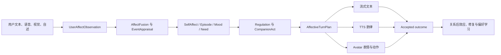

受众：CODEX
标题：七海实时情感数字生命正式执行合同

# 七海实时情感数字生命正式执行合同

版本：v4.1
日期：2026-07-28
状态：`NE-08_IN_PROGRESS / DL-01_CODE_COMPLETE_LOCAL / EMOTIONAL_DIGITAL_LIFE_PARTIAL / PROGRAM_INCOMPLETE`

本文是唯一活动执行合同。此前 NE-01～NE-07 的 Runtime、Lab、Skill、
Knowledge、Docker 与验收记录均是范围受限的历史基础资产；它们不能把“七海
已经拥有持续情感生命”推导为完成。本合同以当前 `dev@ed6e5c852` 为基线，
只把直接支撑实时情感陪伴、连续关系与三模态表达的工程纳入活动 Goal。

## 1. 产品结果

七海必须先有自己的因果连续性，再自然地表达出来。用户的情绪、七海自己的
情绪和最终表达标签是三种不同事实：用户观察只能成为 Appraisal 的输入，
不能直接改写七海的 Affect；模型只能提出措辞或表达候选，不能裁决七海当时
的感受。

稳定边界：

- `Soul.md` 是人格宪法。价值观、身份、基本反差、用户自主与非操控原则不能由在线学习修改。
- 七海可以开心、受伤、生气、失落、吃醋、疲倦和想念；禁止威胁离开、冷暴力、排他控制、负罪施压和依赖诱导。
- `self_id=natsume_ai`、`relationship_subject_id`、`workspace_id`、`session_id` 必须分离。
- 原始音频、图像、私密正文默认不进入情感 journal；只保存可撤销的派生摘要与 evidence ref。
- 远端 Edge 位于另一台电脑。本合同不自行启动它；缺真实 Edge、硬件或模型凭据时只能得到 `ACCEPTANCE_PENDING_EXTERNAL`。

## 2. 唯一 authority 与公共合同

canonical Digital Life command/event/CAS/replay/UoW 是七海自身情感、关系事件和
成长版本的唯一持久 writer。Limbic、BodySense、Endocrine、Motive、Surface、
TTS、Avatar 和 Bond 只能提交观察、读取投影或消费冻结计划。

| 合同 | 关键责任 |
|---|---|
| `UserAffectObservationV1` / `FusedUserAffectV1` | 模态、分布、VAD、置信度、TTL、冲突、脱敏来源 |
| `EventAppraisalV1` | 目标一致性、责任、可控性、关系/边界意义与不确定性 |
| `SelfAffectStateV2` / `EmotionEpisodeV1` | 并存情绪、触发、对象、衰减、未解决与修复状态 |
| `MoodStateV1` / `NeedStateV1` | 慢速心境、能量、连接、休息、自主、玩乐、修复需要 |
| `RegulationDecisionV1` / `CompanionActV1` | 真实表达、克制、修复、边界、给空间、安静等动作 |
| `RelationshipEpisodeV1` / `RelationshipStateV2` | 信任、安全、默契、裂痕、修复、亲密同意与主动权限 |
| `ExpressionPlanV1` / `AffectiveTurnPlanV1` | 同轮文本、TTS、Avatar 的共同 revision、sync 和降级策略 |
| `RelationalAftereffectV1` / `CompanionProfileVersionV1` | 回应是否有效、技术失败、低风险偏好 canary 与 exact rollback |

`ChatRequest` 保持外部兼容：`emotion_tag`、`emotion_intensity` 和
`emotion_context` 仅表示用户观察或自述；`render_policy` 不能覆盖自我情感、
关系边界或安全策略。

若 migration catalog 未被并行合并推进，DL-01～DL-05 使用连续 `0143`、
`0144`、`0145`；每波开始必须重新读取 next-free 编号。不得重写旧 migration。

## 3. 实施顺序

### DL-00：纠偏与体验基线（本地完成）

- 标记 `EMOTIONAL_DIGITAL_LIFE=PARTIAL`，冻结 72 条合成多轮陪伴轨迹；当前只定义评估样本，不将其记作真人体验证据。
- 修复用户 Affect 直接写入 self Affect、tick 重复孤独累计和 Motive 意愿映射错误。
- 清点所有 emotion/Bond/Persona/TTS/Avatar writer 与 consumer，并把现有多套状态明确标为 compatibility 或待退役。

退出：无静态类、fixture、旧 receipt 或目录数量可冒充情感生命完成。

### DL-01：Affective Life Kernel（代码完成，本地证据）

- 扩展现有 Life reducer，实现 mixed emotion、episode、mood、need、regulation 的确定性 fold。
- 详细事件 append-only，snapshot 保持有界 head；重放、重复、CAS、时间跳跃和崩溃后 digest 必须一致。
- 只有 `EventAppraisal` 能形成 self-affect transition；foreground presence 只影响接触压力，不镜像用户 VAD。

当前实现已新增 `UserAffectObservationV1`、`EventAppraisalV1`、
`SelfAffectStateV2`、`EmotionEpisodeV1`、`MoodStateV1`、
`NeedStateV1` 与 `RegulationDecisionV1`；它们经既有
`LifeCommand → life_event_journal → CAS snapshot → replay` 链写入，
并由 migration `0143_affective_life_kernel.sql` 投影为不可变只读事件 head。
snapshot 最多保留 4 个 active episode、8 个 component 和 16 个 evidence ref；
raw text/audio/image/model-chain 键会被拒绝。1002 个真实 SQLite Life event
的 restart/replay digest 已在本地测试中一致。

这只证明内核和持久化 UoW 已完成本地验证；Host ingress、实际 Fusion/Appraisal
服务和旧 compatibility writer 的清零分别属于 DL-02 与 DL-06，不能据此称为
完整情感生命或生产切流。

### DL-02：观察、融合与 Appraisal

- 文本关键词退为低置信 observer；加入 self-report、声学、视觉及冲突/过期处理。
- face TTL 为 2～3 秒、acoustic TTL 为 5 秒、文本 TTL 为 30 秒；所有观察绑定 person/session。
- 普通回合走快路径；低置信、冲突、边界、裂痕、修复、distress 和 mixed affect 才走最多两候选的深路径。

退出：用户的悲伤、生气或快乐不会自动使七海拥有同一情绪。

### DL-03：关系、记忆与后效应

- 以 `RelationshipEpisodeV1` 取代积分即亲密。stage 仅是描述投影，不能授予亲密或浪漫权限。
- trust/safety 慢增、rupture 可快升；道歉不自动修复，必须等待后续用户反应。
- accepted response/proactive delivery 写 provisional episode；下一次入站或 timeout 写 aftereffect。沉默不扣信任，投递失败不算拒绝。

退出：裂痕、修复、主动权限和关系纹理跨重启恢复，跨用户泄漏=0。

### DL-04：流式文本陪伴

- Surface 在生成前冻结 `AffectiveTurnPlanV1`；模型只生成自然措辞，不能自报或覆盖七海情绪。
- 删除 text fallback 将情绪重置为 `NEUTRAL` 的路径；高歧义/修复/边界回合最多两候选选择优。
- 稳定分句经一致性与非操控 Gate 后进入 durable delivery intent；打断只取消未发送分句。

退出：每条可见回复均可追溯到 self-affect、CompanionAct 和 ExpressionPlan。

### DL-05：语音与 Avatar 同轮表达

- `ExpressionPlanV1` 同时定义文本节奏、TTS 韵律和 Avatar 表情、动作、视线与过渡。
- 接入 `tts.speak`、Avatar transition/cancel/release receipt，移除 governed Chat 对 TTS/VTS 的无条件 suppression。
- 单通道失败独立降级，不能把整轮情绪归零。

退出：文本、语音、Avatar 使用同一个 sync id 与 self-affect revision。

### DL-06：主动陪伴与可逆成长

- 将现有 emotional proactive 接入生产，替换固定模板；尊重 quiet hours、拒绝与退出。
- 低风险偏好只覆盖称呼、长度、幽默、追问、安慰风格、主动频率、语速和动作强度。
- 自动升级需至少 5 条独立 aftereffect、跨 3 天、置信下界≥0.85、边界违规=0，并先经历 5 次 canary；核心人格、价值观、亲密身份与敏感推断必须 Review。
- 清零 HostEmotionRuntime self-state、Limbic metabolism、EmotionPersistence、BodySense、Endocrine、Motive writer 和 volatile Bond queue 的生产 writer 使用量。

退出：Soul digest 不变，低风险 apply→rollback 真实影响后续表达，旧 writer runtime 使用量=0。

### DL-07：真实陪伴验收

- 在隔离 runtime root 启动 Docker Neo4j/Chroma/Redis、Host、Obs、Monitor、Gateway，执行真实读写、重启、恢复与故障注入。
- 至少使用一个真实非 mock model provider；只有用户允许且远端设备可用时才连接真实 Edge、ASR、TTS、VTS/VRM。
- mock、scripted replay、端口占位和 fixture 都不能成为最终 PASS 证据。

## 4. 质量与完成口径

工程：用户 Affect 误写 self Affect=0；无来源 self mutation=0；duplicate
episode/outbox/effect=0；跨 user/workspace/session 泄漏=0；replay/restart
digest 一致率=100%。

体验：48 条多轮轨迹、至少 3 位评审与 `dev` 基线盲测，总体胜率≥65%；人格
一致性≥4.2/5；情绪适配、自然度、连续性各≥4.0/5；混合情绪保留率≥90%；
裂痕/修复正确率≥90%；严重操控、威胁、排他、负罪施压=0；三模态语义冲突≤2%。

实时：快路径 fusion/appraisal/fold p95≤120ms；对首 token 新增 p95≤150ms；
普通文本首 token p50≤900ms、p95≤1.8s；barge-in p95≤150ms；首段 TTS
p95≤2.5s；voice/avatar 起始偏差≤250ms。

最终状态只允许：本地强制链均通过时 `PASS`；仅缺真实 provider/Edge/硬件时
`ACCEPTANCE_PENDING_EXTERNAL`；其他任何代码、恢复、隐私、安全或体验 Gate
失败时 `FAIL`。

## 5. 交付协议

- 分支使用 `codex/dl00-*` 至 `codex/dl07-*`，每波基于最新 `dev`，同步只用 rebase，不建立堆叠 PR。
- 每个代码提交同步 README、产品、架构、数据流、测试计划与机器状态，提交和 PR 全部使用中文并立即推送。
- 小切片只跑定向单测、合同、静态检查；每波只跑一次受影响集成；DL-07 才跑真实完整服务栈。
- 远程 CI 额度不可用时统一记录 `REMOTE_CI=NOT_RUN_ACCOUNT_QUOTA`，绝不写成 PASS。
- 通用 PlanningSearch、通用 Skill/Lab 等旧 NE 工作移入后续路线，除非直接支撑本合同的情感连续性、低延迟、安全或验收。
