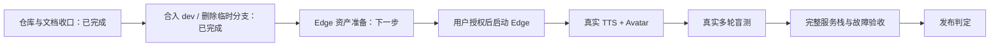

受众：CODEX
标题：七海实时情感数字生命当前执行合同

# 当前执行合同

机器状态标记：`NE-08_IN_PROGRESS`

## 1. 唯一目标

在不把普通对话重型审计化的前提下，完成七海情感生命主链的仓库收口、目标 Edge 三模态接线、真实多轮体验验证和完整服务栈验收。

本合同不以通用 PlanningSearch、通用 Skill Compiler 或多租户治理为当前完成条件；只有直接服务于情感连续性、低延迟、安全和真实交付的底座工作保留。

## 2. 当前基线

- 情感生命核心代码已覆盖观察、自我情绪、关系 episode、表达计划、主动陪伴和 profile 版本。
- 普通聊天采用轻量实时路径；工具和外部副作用仍采用 Governed Runtime。
- GPT-SoVITS V4 方案 B 已在本机 CUDA 环境完成参考条件生成和人工试听；当前使用预训练权重，不是七海专属微调 checkpoint。
- #194 与文档收口 PR #209 已合入 `dev`，本地和远端临时分支已清理。
- 远端 Edge 尚未启动，VTS/VRM 和真实三模态未验收。
- GitHub Actions 因账户额度不可用，远程状态为 `NOT_RUN_ACCOUNT_QUOTA`。
- 整体状态保持 `INCOMPLETE`。

## 3. 执行顺序

## 4. 交付规则

- 每个实现提交使用中文标题并立即推送。
- 同一提交同步受影响文档与机器状态。
- Feature 分支基于最新 `dev` rebase，不创建深层堆叠链。
- 小切片只运行定向单测、合同和静态检查；完整服务栈集中验收。
- CI 零步骤额度失败记为 `NOT_RUN_ACCOUNT_QUOTA`，不修删 workflow，也不冒充通过。
- 运行证据放在忽略目录；密钥、用户数据、模型、音频语料和日志不得提交。
- 未经用户明确许可不得启动另一台电脑上的 Edge。

## 5. 仓库收口结果

仓库收口已经满足：

1. 当前权威文档与历史材料已经分层，旧结论不再进入当前 authority。
2. 文档 audience、authority、freshness 和 link Gate 已在 PR #209 本地验证。
3. 机器状态继续保持 `INCOMPLETE`，没有把局部实现写成整体交付。
4. #194 与 #209 均以中文 squash 提交进入 `dev`。
5. 本地和远端只保留长期分支 `dev`、`main`。

当前执行点已经移动到 Edge 资产准备；未经用户授权仍不得启动目标 Edge。

## 6. 最终验收

最终验收必须使用：真实 Docker 服务、真实 Host／OBS／Monitor／Gateway 进程、至少一个真实模型 provider，以及在用户允许后启动的目标 Edge。TTS、Avatar、重启、打断、网络恢复和长期多轮必须走真实传输，不得用端口占位、fixture 或 scripted replay 冒充。

状态判定：

- `PASS`：适用的本地与目标 Edge 强制链路、体验和实时指标全部通过。
- `ACCEPTANCE_PENDING_EXTERNAL`：本地强制项通过，仅缺用户未提供的外部凭据或设备。
- `FAIL`／`INCOMPLETE`：存在代码、体验、恢复、安全或真实性缺口。

## 7. 回滚

- 代码通过 `dev` 上的合并提交整体回滚。
- Profile activation 必须指向 exact previous version。
- TTS 声线配置可回退到前一已验证配置，不复制新版本证据。
- Acceptance 数据根与用户真实数据隔离，默认保留证据但不提交仓库。
