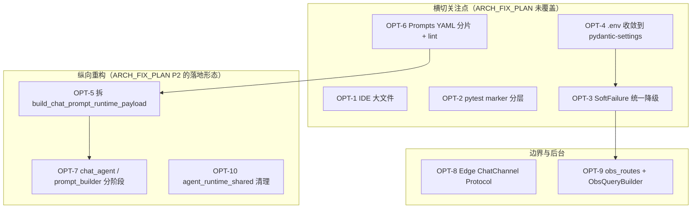

# 项目优化方案（OPTIMIZATION-PLAN）

**文档编号**：OPTIMIZATION-PLAN-20260420
**日期**：2026-04-20
**版本**：v1.1
**状态**：实施中（In Progress）
**受众**：核心开发团队、SRE、Prompt 作者
**上游依赖**：[ARCH_FIX_PLAN.md](./ARCH_FIX_PLAN.md) v1.3（P2 未执行 12 项）

---

## 实施进度（Implementation Progress）

最后更新：2026-04-20

| 编号 | 标题 | 优先级 | 工作量 | 状态 | 完成时间 |
|------|------|:------:|:------:|:----:|:--------:|
| OPT-1 | 清理 IDE 大文件 + `.gitignore` | S0 | 0.5d | ✅ 已完成 | 2026-04-20 |
| OPT-2 | `pytest.ini` 规范化 + marker 分层 | S0 | 1d | ✅ 已完成 | 2026-04-20 |
| OPT-3 | 统一 `SoftFailure` 降级 + 观测指标 | S1 | 3d | ✅ 已完成（基础设施） | 2026-04-20 |
| OPT-4 | `.env` 分层 + `pydantic-settings` 收敛 | S1 | 5d | 🔄 进行中 | — |
| OPT-5 | 拆分 God Function `build_chat_prompt_runtime_payload` | S2 | 3d | ⏸ 待启动 | — |
| OPT-6 | Prompts YAML 分片 + 变量 lint | S2 | 3d | ⏸ 待启动 | — |
| OPT-7 | `prompt_builder.py` / `chat_agent.py` 按阶段拆分 | S2 | 4d | ⏸ 待启动 | — |
| OPT-8 | Edge `ChatChannel` Protocol 统一 | S3 | 5d | ⏸ 待启动 | — |
| OPT-9 | `obs_routes_*` 二次规范化 + `ObsQueryBuilder` | S3 | 5d | ⏸ 待启动 | — |
| OPT-10 | `agent_runtime_shared.py` 垃圾桶清理 + 命名 lint | S3 | 3d | ⏸ 待启动 | — |

### 已完成项汇总

**OPT-1（2026-04-20）**
- `.gitignore` 新增 JetBrains 个人状态文件规则（含 `CopilotChatHistory.xml` / `CopilotChatTabs.xml` / `workspace.xml` / `shelf/` / `dataSources.local.xml`）
- 从 Git index 移除 86 MB `CopilotChatHistory.xml` 及其他 IDE 个人态文件
- 新 clone 仓库不再携带 80+ MB IDE 缓存

**OPT-2（2026-04-20）**
- [pytest.ini](../../pytest.ini) 扩展：`testpaths` / `asyncio_mode=auto` / `xfail_strict` / `strict-markers` / 8 个分层 marker
- [tests/conftest.py](../../tests/conftest.py) 新增 `pytest_collection_modifyitems` 钩子，按文件名规则自动打 marker（`_hw` / `_prod_env` / `/e2e/` 等）
- CI 现可通过 `pytest -m "unit"` 只跑快速流水线，重测试归入 nightly

**OPT-3（2026-04-20，基础设施阶段）**
- 新增 [host_brain/core/errors.py](../../host_brain/core/errors.py) 的 `soft_fail` 上下文管理器（含 stage 标签、fallback 回填、观测指标、OTel span 事件）
- 新增 [host_brain/observability/soft_fail_metrics.py](../../host_brain/observability/soft_fail_metrics.py) 计数器（`context_soft_failure_total{stage, exc_type}`）
- 新增 [tests/contract/test_soft_fail_contract.py](../../tests/contract/test_soft_fail_contract.py) 25 个契约测试，全部通过
- **后续**：业务路径 4 个 Batch（chat_context_builder / agent_runtime_shared / chat_agent / capability_forge）的替换可在 OPT-5、OPT-7、OPT-10 落地时顺带完成，避免重复接触相同文件

---

## 0. 背景

本方案基于 2026-04-20 对仓库的一次全量审查。审查确认：

- [ARCH_FIX_PLAN.md](./ARCH_FIX_PLAN.md) 中 P0/P1/P3（共 14 项）已全部闭环；
- P2（12 项，27 人日）仍未启动；
- ARCH_FIX_PLAN **未覆盖** 的四个横切关注点（配置 / Prompt 资产 / 异常降级 / 测试基础设施）
  已积累到影响工程效率的程度。

本方案在不与 ARCH_FIX_PLAN 重复的前提下，**补齐这四个横切问题**，
并对 ARCH_FIX_PLAN 的 P2 项目中"落地形态不清晰"的部分（P2-2 / P2-10 / P2-12）
给出**可执行的二级拆解**。

---

## 1. 优先级与问题全景

### 1.1 优先级分类（本方案）

| 优先级 | 定义 | 问题数 | 工作量 |
|--------|------|--------|--------|
| **S0** | ROI 极高、半天内可落地、对全员立刻生效 | 2 | 1.5d |
| **S1** | 生产稳定性/可观测性基建，不做会持续出血 | 2 | 6d |
| **S2** | 补齐 ARCH_FIX_PLAN 的 P2 真实落地形态 | 3 | 10d |
| **S3** | 跨平台扩展性、后台接口规范 | 3 | 15d |
| **合计** | | **10** | **32.5d** |

### 1.2 问题索引

| 编号 | 标题 | 优先级 |
|------|------|--------|
| [OPT-1](#5-opt-1清理-ide-大文件--gitignore) | 清理 IDE 大文件 + `.gitignore` | S0 |
| [OPT-2](#6-opt-2pytestini-规范化--marker-分层) | `pytest.ini` 规范化 + marker 分层 | S0 |
| [OPT-3](#7-opt-3统一-softfailure-降级--观测指标) | 统一 `SoftFailure` 降级 + 观测指标 | S1 |
| [OPT-4](#8-opt-4env-分层--pydantic-settings-收敛) | `.env` 分层 + `pydantic-settings` 收敛 | S1 |
| [OPT-5](#9-opt-5拆分-god-functionbuild_chat_prompt_runtime_payload) | 拆分 God Function `build_chat_prompt_runtime_payload` | S2 |
| [OPT-6](#10-opt-6prompts-yaml-分片--变量-lint) | Prompts YAML 分片 + 变量 lint | S2 |
| [OPT-7](#11-opt-7prompt_builderpy--chat_agentpy-按阶段拆分) | `prompt_builder.py` / `chat_agent.py` 按阶段拆分 | S2 |
| [OPT-8](#12-opt-8edge-channel-protocol-统一) | Edge `ChatChannel` Protocol 统一 | S3 |
| [OPT-9](#13-opt-9obs_routes-群二次规范化--obsquerybuilder) | `obs_routes_*` 二次规范化 + `ObsQueryBuilder` | S3 |
| [OPT-10](#14-opt-10agent_runtime_sharedpy-垃圾桶清理) | `agent_runtime_shared.py` 垃圾桶清理 | S3 |

---

## 2. 设计原则

本方案遵循以下硬约束，任何偏离都必须在 PR 里显式说明：

1. **小步快跑**：每项 S0/S1 必须在 1 个 PR 内合入，不允许跨周悬挂。
2. **可回滚**：所有涉及运行时行为变更的改动必须带 feature flag（沿用 `.env` 或 `metabolism` 开关）。
3. **可观测**：任何新的降级/兜底路径必须同时落指标，禁止"静默修复"。
4. **测试先行**：涉及核心链路（chat / prompt / executive）的重构，先写 golden snapshot 测试，再动代码。
5. **不重复 ARCH_FIX_PLAN**：本方案不重写 P2 的拆分清单，只在 OPT-5/7 中给出
   "怎么拆才算真的拆完"的二级规范。

---

## 3. 问题全景图



---

## 4. 执行顺序

```
✅ 第一阶段（S0，半天～一天，立刻执行）：
  ├── OPT-1：.gitignore 清 IDE 大文件
  └── OPT-2：pytest.ini 规范化 + marker 分层

🔲 第二阶段（S1，本 Sprint 必做）：
  ├── OPT-4：.env 分层（OPT-3 的前置）
  └── OPT-3：SoftFailure 统一降级 + 观测指标

🔲 第三阶段（S2，下个 Sprint）：
  ├── OPT-6：Prompts YAML 分片（OPT-5 的前置）
  ├── OPT-5：拆 build_chat_prompt_runtime_payload
  └── OPT-7：chat_agent / prompt_builder 分阶段重构

🔲 第四阶段（S3，规划中）：
  ├── OPT-8：Edge ChatChannel Protocol
  ├── OPT-9：obs_routes 二次规范化
  └── OPT-10：agent_runtime_shared 清理
```

---

## 5. OPT-1：清理 IDE 大文件 + `.gitignore`

**优先级**：S0 ｜ **工作量**：0.5d

### 根因

`.idea/CopilotChatHistory.xml` 被误纳入版本控制，单文件 **86 MB**。
带来的直接成本：

- 新同事 `git clone` 多拉 80+ MB；
- Git `status`/`diff` 在该文件上几乎必然卡顿；
- GitHub 仓库 size 被污染，未来若仓库对外/开源将很尴尬。

`.idea/CopilotChatTabs.xml`、`.idea/workspace.xml` 也是 IDE 个人态，
不应跟随版本。

### 修复方案

1. 修改 `.gitignore`，补入：
   ```gitignore
   # JetBrains IDE 个人状态（禁止入库）
   .idea/CopilotChatHistory.xml
   .idea/CopilotChatTabs.xml
   .idea/workspace.xml
   .idea/shelf/
   .idea/dataSources.local.xml
   ```
2. 将这些文件从 index 中移除（保留本地）：
   ```bash
   git rm --cached .idea/CopilotChatHistory.xml
   git rm --cached .idea/CopilotChatTabs.xml
   git rm --cached .idea/workspace.xml
   git rm -r --cached .idea/shelf
   ```
3. **历史清理（可选、需评估）**：使用 `git filter-repo --path .idea/CopilotChatHistory.xml --invert-paths`
   清除历史中的大文件。**必须** 所有开发者同步重新 clone；如果项目即将开源，必做。

### 涉及文件

- [.gitignore](../../.gitignore)
- `.idea/*`（仅从 index 移除）

### 验收

- `git ls-files | grep -iE 'copilotchathistory|copilotchattabs'` 返回空；
- 新 clone 仓库时未携带 80+ MB 的 IDE 缓存；
- `.gitignore` 对 `.idea/workspace.xml` 的本地修改不再触发 `git status` 显示。

---

## 6. OPT-2：`pytest.ini` 规范化 + marker 分层

**优先级**：S0 ｜ **工作量**：1d

### 根因

当前 [pytest.ini](../../pytest.ini) 仅有 6 行 `filterwarnings`，缺少：

- `testpaths`（pytest 需要全仓扫描，启动慢）
- `asyncio_mode`（大量 async 测试依赖手动 `pytest.mark.asyncio`）
- `markers`（`tests/contract`、`tests/e2e`、带 `_prod_env` / `_hw` 后缀的测试混跑）
- `addopts = --strict-markers --strict-config`（拼错 marker 不报错）

实际后果：

- CI 只能"全跑或全不跑"，PR 每次等全量；
- 带 `_hw` 后缀的测试（需要真实 ASR/TTS/VTS）在 CI 里要么 skip 要么 fail，没有清晰的分层；
- 新人加 `@pytest.mark.slow` 拼成 `@pytest.mark.slwo` 不会报错，失效 marker 长期存在。

### 修复方案

1. **[pytest.ini](../../pytest.ini) 扩展为**：
   ```ini
   [pytest]
   testpaths = tests
   asyncio_mode = auto
   xfail_strict = true
   addopts = -ra --strict-markers --strict-config --showlocals
   filterwarnings =
       ignore:builtin type SwigPyPacked has no __module__ attribute:DeprecationWarning
       ignore:builtin type SwigPyObject has no __module__ attribute:DeprecationWarning
       ignore:builtin type swigvarlink has no __module__ attribute:DeprecationWarning
   markers =
       unit: 纯函数单元测试（默认跑）
       contract: 跨模块契约测试（PR 必跑）
       integration: 集成测试（PR 必跑，不依赖外部硬件）
       e2e: 端到端测试（nightly 跑）
       hw: 需要真实硬件（ASR/TTS/VTS/摄像头），本地或 nightly 跑
       docker: 需要 Docker runtime
       prod_env: 需要线上依赖（Neo4j/Chroma/Redis），nightly 跑
       slow: 耗时 > 5 秒
   ```
2. **CI workflow 分层**（[.github/workflows/](../../.github/workflows/)）：
   - `pr-fast`：`pytest -m "unit or contract or integration" --ignore=tests/e2e`
   - `pr-slow`：`pytest -m "slow"`（nightly + 手动触发）
   - `nightly`：`pytest -m "hw or docker or prod_env or e2e"`
3. **一次性批量打标**：对 `tests/contract/*_hw_contract.py`、`*_prod_env.py`
   以文件名规则自动添加 marker（可写在 `conftest.py` 的 `pytest_collection_modifyitems` 钩子中）：
   ```python
   # tests/conftest.py
   def pytest_collection_modifyitems(config, items):
       for item in items:
           path = str(item.fspath)
           if "_hw_contract.py" in path or "_hw.py" in path:
               item.add_marker(pytest.mark.hw)
           if "_prod_env" in path:
               item.add_marker(pytest.mark.prod_env)
           if path.endswith("tests/e2e/") or "/e2e/" in path:
               item.add_marker(pytest.mark.e2e)
   ```

### 涉及文件

- [pytest.ini](../../pytest.ini)
- [tests/conftest.py](../../tests/conftest.py)
- `.github/workflows/*.yml`

### 验收

- `pytest --collect-only -m "unit"` 只收集单测；
- PR 流水线时间从 X 分钟降低到 X × 0.5 以内（以当前 baseline 对比）；
- 拼错 marker（例如 `@pytest.mark.slwo`）时 `pytest` 直接报 `ERROR: unknown pytest.mark.slwo`。

---

## 7. OPT-3：统一 `SoftFailure` 降级 + 观测指标

**优先级**：S1 ｜ **工作量**：3d ｜ **前置**：OPT-4 建议先完成

### 根因

全仓共发现 **50+ 处** `except Exception:` 的裸捕获，其中业务链路上至少 30+ 处位于：

- [chat_context_builder.py](../../host_brain/app/chat_context_builder.py)（13 处）
- [agent_runtime_shared.py](../../host_brain/app/agent_runtime_shared.py)（9 处）
- [capability_forge.py](../../host_brain/app/capability_forge.py)（8 处）
- [chat_agent.py](../../host_brain/app/chat_agent.py)（6 处）

**具体伤害**：

- 记忆召回/情感上下文/人格提示 的某一步骤失败时 **静默返回 `{}` 或 `None`**；
- 问题表现：某次对话"没认出用户生日""没引用昨天的对话"——运维面板 **没有任何异常指标**，无法回溯；
- 这是 **人设漂移、回答质量跳水** 最难定位的源头，但当前完全不可观测。

### 修复方案

#### 7.1 新增 `SoftFailure` 上下文管理器

在 [host_brain/core/errors.py](../../host_brain/core/errors.py) 中新增：

```python
from contextlib import contextmanager
from typing import TypeVar, Generic, Iterator

T = TypeVar("T")

@contextmanager
def soft_fail(
    stage: str,
    *,
    fallback: T,
    expected_exc: tuple[type[BaseException], ...] = (Exception,),
    logger_name: str = "host_brain.soft_fail",
) -> Iterator[list[T]]:
    """
    统一的"非致命降级"上下文管理器。

    使用方式：
        with soft_fail("memory_recall", fallback={}) as box:
            box[0] = do_memory_recall(...)
        result = box[0]

    行为：
        - 捕获 expected_exc 后返回 fallback，并：
          1) logger.warning，带 stage 标签
          2) obs 计数 context_soft_failure_total{stage=<stage>}
          3) OpenTelemetry span 事件（如有活跃 span）
        - 致命异常（MemoryError/SystemExit/KeyboardInterrupt）不吞
    """
    import logging
    logger = logging.getLogger(logger_name)
    box: list[T] = [fallback]
    try:
        yield box
    except expected_exc as exc:
        box[0] = fallback
        logger.warning("soft_fail stage=%s exc=%r", stage, exc, exc_info=True)
        _emit_soft_fail_metric(stage=stage, exc_type=type(exc).__name__)
        _emit_soft_fail_span_event(stage=stage, exc=exc)
```

#### 7.2 观测指标接入

在 [host_brain/observability/](../../host_brain/observability/) 新增或扩展：

- Counter：`context_soft_failure_total{stage, exc_type}`
- 报表：`obs/ui` 新增"近 24 小时 SoftFailure Top N"，与 `chat_session_total` 联动
- 告警：若某 stage 的 SoftFailure/总调用 比例 > 5%，触发告警（接入 [P7_HUMANOID_LOOP_ALERTING](./audits/SKILL_FIRST_EXECUTION_LOG_20260413_STAGE7H_HUMANOID_LOOP_ALERTING.md) 已有管线）

#### 7.3 分批替换现有 `except Exception`

**严格区分两类场景**，不要全量替换：

| 场景 | 处理 |
|------|------|
| **环境变量解析兜底**（如 `_parse_int_env`） | **保留** `except Exception: return default`，这是合理的 defensive 解析 |
| **optional import 防护**（`try: from X import Y / except Exception: Y = None`） | **保留**，属于 feature detection |
| **业务路径的中间结果失败**（chat_context_builder 业务段） | **改为 `soft_fail`**，必须带 stage 标签 |
| **异常信息有诊断价值但代码却 `pass`** | **改为 `soft_fail`**，并补 fallback |

按文件分批：

- Batch A：`chat_context_builder.py` 业务段（第 668、1916、2149、2172 行等）
- Batch B：`agent_runtime_shared.py` 9 处
- Batch C：`chat_agent.py` 6 处
- Batch D：`capability_forge.py` 8 处

每 Batch 一个 PR，附 `obs` 截图证明新指标生效。

### 涉及文件

- 新增：[host_brain/core/errors.py](../../host_brain/core/errors.py) 中的 `soft_fail`
- 新增：[host_brain/observability/](../../host_brain/observability/) 中的 metric helper
- 修改：[chat_context_builder.py](../../host_brain/app/chat_context_builder.py)、[agent_runtime_shared.py](../../host_brain/app/agent_runtime_shared.py)、
  [chat_agent.py](../../host_brain/app/chat_agent.py)、[capability_forge.py](../../host_brain/app/capability_forge.py)

### 验收

- 任意故意注入记忆召回失败后，obs 面板 1 分钟内可看到 `stage=memory_recall` 的 SoftFailure 计数；
- 新增契约测试 `tests/contract/test_soft_fail_contract.py`，断言异常被捕获 + 指标上升 + span 有事件；
- 业务路径新增 `except Exception: pass` 在 lint 阶段被禁止（见 OPT-10 附带的 lint 规则）。

---

## 8. OPT-4：`.env` 分层 + `pydantic-settings` 收敛

**优先级**：S1 ｜ **工作量**：3~5d

### 根因

- [.env.example](../../.env.example) 单文件 **52.92 KB**，估算 **500~1000 条** 环境变量；
- [host_brain/app/config.py](../../host_brain/app/config.py) 26 KB、
  [edge_client/config.py](../../edge_client/config.py) 28 KB 几乎全是 `os.getenv()` + 手写 `_parse_int_env` / `_parse_float_env`；
- 新同事部署时根本无法判断**必需最小集合**是什么；
- 任一环境变量拼错，运行时不提示，只会走 default 值，问题被静默掩盖。

### 修复方案

#### 8.1 分层 `.env`

拆分为三层，根目录保留一个聚合 `.env.example` 指向这三份：

```
.env.core.example          # MVP 起步必需（10~20 个）
.env.optional.example      # 可选第三方集成（微信/QQ/Telegram 等）
.env.experimental.example  # feature flag（新器官族灰度开关）
```

每个文件顶部必须有**字段表**：

```dotenv
# ─────────────────────────────────────────────────────
# Natsume AI — Core Settings（必需）
# 字段：NATSUME_DATA_DIR
#   类型：path
#   默认：./data
#   说明：持久化数据根目录（SQLite/Chroma/Neo4j 数据）
# ─────────────────────────────────────────────────────
NATSUME_DATA_DIR=./data
```

#### 8.2 引入 `pydantic-settings`

项目已依赖 pydantic>=2，新增 `pydantic-settings` 到 [requirements.txt](../../requirements.txt)。

按域划分 Settings：

```python
# host_brain/app/settings/__init__.py
class CoreSettings(BaseSettings):
    model_config = SettingsConfigDict(env_prefix="NATSUME_", env_file=".env")
    data_dir: Path = Path("./data")
    log_level: Literal["DEBUG", "INFO", "WARN", "ERROR"] = "INFO"

class LLMSettings(BaseSettings):
    model_config = SettingsConfigDict(env_prefix="NATSUME_LLM_", env_file=".env")
    provider: Literal["gemini", "openai", "anthropic"] = "gemini"
    timeout_seconds: int = Field(default=35, ge=1, le=600)

class TribeSettings(BaseSettings):
    model_config = SettingsConfigDict(env_prefix="NATSUME_TRIBE_", env_file=".env")
    ...
```

调用方：

```python
from host_brain.app.settings import get_llm_settings
llm_cfg = get_llm_settings()  # 单例，lru_cache
```

#### 8.3 消除散点 `os.getenv`

**分批替换**（不要一次性改，容易出风险）：

- Batch 1：`host_brain/app/config.py` 内部替换（约 40+ 处 getenv）
- Batch 2：`host_brain/llm/*`（LLM 相关）
- Batch 3：`host_brain/observability/*`
- Batch 4：`edge_client/config.py`
- Batch 5：其它散点（tribe / integrations）

#### 8.4 启动自检

为 Settings 类自动生成 JSON Schema，在 [host_brain/app/health_routes.py](../../host_brain/app/health_routes.py)
提供 `/health/env-readiness` 页面展示：
- ✅ 已设置 / ⚠️ 用默认值 / ❌ 必填未设置（启动失败）

### 涉及文件

- [.env.example](../../.env.example)（拆分）
- 新增：`host_brain/app/settings/`
- 修改：[host_brain/app/config.py](../../host_brain/app/config.py)、
  [edge_client/config.py](../../edge_client/config.py)
- [requirements.txt](../../requirements.txt)
- 新增：[tests/contract/test_settings_contract.py](../../tests/contract/)

### 验收

- 新同事按 `.env.core.example` 填 10~20 个字段即可启动最小可用的 host_brain；
- `os.getenv(` 全仓剩余数从 X → 个位数（仅剩 settings 内部使用）；
- `/health/env-readiness` 页面能看到每个 Settings 字段来源（env / default）；
- CI 增加一条：若新增 `os.getenv(` 在 `host_brain/` 业务目录下，PR 报错。

---

## 9. OPT-5：拆分 God Function `build_chat_prompt_runtime_payload`

**优先级**：S2 ｜ **工作量**：3d ｜ **前置**：OPT-6 部分前置

### 根因

[chat_context_builder.py](../../host_brain/app/chat_context_builder.py) 第 **1994~3073** 行是一个连续近
**1080 行** 的函数 `build_chat_prompt_runtime_payload`。具体问题：

- 局部变量估计 **50+ 个**，相互存在隐式依赖（后段使用前段生成的中间 dict）；
- 无法对"仅情绪段""仅记忆段"做单元测试，只能对最终 payload 做 snapshot；
- 新增一个上下文字段（如"最近心率信号"）需要通读 1000 行找正确插入点；
- 是 [ARCH_FIX_PLAN.md P2-2](./ARCH_FIX_PLAN.md) 能否真正完成的决定性因素——
  拆文件不拆这个函数等于换皮。

### 修复方案

引入 **`PromptPayloadBuilder` 流水线**，每个阶段是一个 ≤120 行的纯函数：

```python
# host_brain/app/chat_payload_builder.py
@dataclass
class PromptPayloadContext:
    """所有 stage 都能访问的只读输入上下文。"""
    session_id: str
    user_text: str
    tribe_snapshot: TribeSnapshot
    retrieval_result: RetrievalResult
    bond_state: BondState
    # ...

class PromptPayloadBuilder:
    def __init__(self, ctx: PromptPayloadContext) -> None:
        self._ctx = ctx
        self._payload: dict[str, Any] = {}
        self._trace: list[str] = []  # 阶段执行痕迹

    def with_runtime_mode(self) -> "PromptPayloadBuilder":
        with soft_fail("runtime_mode", fallback={}):
            self._payload["runtime_mode"] = _build_runtime_mode_flags(self._ctx.prompt_context)
        self._trace.append("runtime_mode")
        return self

    def with_memory_persona(self) -> "PromptPayloadBuilder":
        with soft_fail("memory_persona", fallback={"items": []}):
            self._payload["memory_persona"] = _build_memory_persona_signal(
                self._ctx.retrieval_result.rows
            )
        self._trace.append("memory_persona")
        return self

    # ...with_emotion / with_bond / with_retrieval / with_style / with_tribe_supervisor ...

    def build(self) -> ChatPromptPayload:
        return ChatPromptPayload(data=self._payload, trace=self._trace)
```

**规则**：

1. 每个 `.with_*` **必须** 用 `soft_fail`（OPT-3）包裹；
2. 每个 `.with_*` **必须** 在 `tests/unit/test_chat_payload_builder_<stage>.py` 中有独立测试；
3. 各 `.with_*` 之间**只能**通过 `self._payload` 读前面阶段结果，不能出现跨阶段局部变量；
4. 旧函数保留签名作为 **薄 adapter**，内部转调 Builder，保证调用方零感知；
5. 合并后旧函数体应为 ≤50 行（只剩 `.with_x().with_y().build()`）。

#### 拆分映射表

| 原函数段（行号估算） | 新 stage |
|--------------------|----------|
| 2000~2150 runtime mode flags | `with_runtime_mode` |
| 2150~2300 memory persona | `with_memory_persona` |
| 2300~2500 emotion + mirror + endocrine | `with_emotion` |
| 2500~2650 bond snapshot | `with_bond` |
| 2650~2850 retrieval rows | `with_retrieval` |
| 2850~2950 style bindings | `with_style` |
| 2950~3073 tribe supervisor context | `with_tribe_supervisor` |

### 涉及文件

- 新增：`host_brain/app/chat_payload_builder.py`
- 修改：[chat_context_builder.py](../../host_brain/app/chat_context_builder.py)
  （`build_chat_prompt_runtime_payload` 改为 adapter）
- 新增：`tests/unit/test_chat_payload_builder_*.py`

### 验收

- `build_chat_prompt_runtime_payload` 函数体 ≤50 行；
- 每个 `.with_*` 有独立单测，覆盖率 > 85%；
- 旧契约测试 `test_prompt_context_contract.py` 全部通过（行为一致）；
- 引入新上下文字段的改动（开发者自测）只需修改 1 个 stage + 1 个测试。

---

## 10. OPT-6：Prompts YAML 分片 + 变量 lint

**优先级**：S2 ｜ **工作量**：2~3d

### 根因

[ARCH_FIX_PLAN.md P2-4](./ARCH_FIX_PLAN.md) 要求将 `prompt_template_defs.py` 272KB 迁到 YAML。
**迁移完成了**，但目录现状是：

```
prompts/templates/chat.yaml        98 KB   ← 单文件 ~3000 行
prompts/templates/persona.yaml     64 KB
prompts/templates/agents.yaml      16 KB
prompts/templates/executive.yaml   26 KB
```

带来的问题：

- Prompt 作者每次改一行就跟别人 merge 冲突；
- 模板加载是全量 parse，冷启动开销；
- `{variable}` 占位符拼错运行时才发现，**这是 LLM 应用最常见也最难发现的 bug**。

### 修复方案

#### 10.1 按 "Agent × 用途 × 语言" 分片

目录规范：

```
prompts/templates/
  chat/
    zh/
      greeting.yaml
      memory_recall_hint.yaml
      emotion_reward_tone.yaml
      retrieval_row_format.yaml
      ...
    en/
      ...
  persona/
    zh/
      core_identity.yaml
      drift_guard.yaml
      ...
  executive/
    zh/
      intent_classify.yaml
      plan_decompose.yaml
      ...
  agents/
    zh/
      prefrontal.yaml
      hippocampus.yaml
      ...
  governance/
    refusal_templates.yaml
```

单文件 ≤10KB、≤300 行。命名即 key 命名空间：
`chat/zh/greeting.yaml` 中的 `warm_welcome` → 完整 key `chat.zh.greeting.warm_welcome`。

#### 10.2 加载器改造

[prompt_template_store.py](../../host_brain/app/prompt_template_store.py) 增加 glob 递归加载：

```python
def load_all_templates(root: Path) -> dict[str, dict[str, Any]]:
    registry: dict[str, dict[str, Any]] = {}
    for yaml_path in root.rglob("*.yaml"):
        namespace = _path_to_namespace(yaml_path.relative_to(root))  # chat.zh.greeting
        data = yaml.safe_load(yaml_path.read_text(encoding="utf-8")) or {}
        for local_key, template in data.items():
            full_key = f"{namespace}.{local_key}"
            if full_key in registry:
                raise ValueError(f"duplicate template key: {full_key}")
            registry[full_key] = template
    return registry
```

#### 10.3 Prompt 变量 Lint（本方案最核心）

新增脚本 [scripts/lint_prompts.py](../../scripts/lint_prompts.py)：

1. **变量提取**：扫描所有 YAML 模板，用正则抓出所有 `{var}` 占位符；
2. **渲染点扫描**：grep 全仓中 `render_template(key=..., **vars)` / `format_map(...)` 的调用；
3. **交叉比对**：
   - 模板声明了 `{user_name}` 但调用方没传 → FAIL
   - 调用方传了 `user_nam` 但模板只有 `user_name` → FAIL
   - 模板 `{a}{b}` 渲染后空字符串（可选警告）
4. **CI Gate**：
   - 接入 `.github/workflows/`
   - 同时接入 [tests/contract/test_ci_gate_contract.py](../../tests/contract/test_ci_gate_contract.py)

#### 10.4 分片迁移策略

不要一次性拆 98KB：

- Week 1：chat.yaml → `chat/zh/*.yaml`（含 golden snapshot 校验，迁前迁后 render 结果完全一致）
- Week 2：persona.yaml → `persona/zh/*.yaml`
- Week 3：executive.yaml / agents.yaml

### 涉及文件

- 目录重组：[prompts/templates/](../../prompts/templates/)
- 修改：[host_brain/app/prompt_template_store.py](../../host_brain/app/prompt_template_store.py)
- 新增：[scripts/lint_prompts.py](../../scripts/lint_prompts.py)
- [tests/contract/test_ci_gate_contract.py](../../tests/contract/test_ci_gate_contract.py)

### 验收

- `chat.yaml` 拆成 ≥8 个 ≤10KB 的子文件；
- 故意拼错一个 `{user_name}` → `{user_nam}`，CI 在 30 秒内红；
- 冷启动 prompt 加载时长（P50）维持原有水平或更好（glob + 单文件 parse 通常更快）；
- golden snapshot 测试 `tests/contract/test_prompt_render_snapshot.py`
  迁移前后 100% 一致。

---

## 11. OPT-7：`prompt_builder.py` / `chat_agent.py` 按阶段拆分

**优先级**：S2 ｜ **工作量**：4d

### 根因

对应 [ARCH_FIX_PLAN P2-10](./ARCH_FIX_PLAN.md)（prompt_builder.py 2090 行）
和 [P2-12](./ARCH_FIX_PLAN.md)（chat_agent.py 1928 行）。

ARCH_FIX_PLAN 已给出拆分清单，本方案**只补充两个易被忽视的点**：

### 修复方案（补充二级规范）

#### 11.1 拆分后必须同时重构 `__init__` 导出

拆分后，旧模块的 `from host_brain.app.prompt_builder import build_xxx_prompt`
调用路径必须保留至少 **1 个版本周期**，通过 re-export 兼容：

```python
# host_brain/app/prompt_builder.py（变成薄 facade）
from host_brain.app.prompt_builder_chat import build_chat_prompt  # noqa: F401
from host_brain.app.prompt_builder_executive import build_executive_prompt  # noqa: F401

__all__ = ["build_chat_prompt", "build_executive_prompt", ...]
```

并在 CHANGELOG 中标记 deprecation，下个版本真正删除。

#### 11.2 chat_agent.py 拆分后**必须**接入 OPT-3 SoftFailure

当前 [chat_agent.py](../../host_brain/app/chat_agent.py) 有 6 处 `except Exception`（第 520、1456、1484、2114、2156、2257 行），拆到 `chat_agent_preprocessor.py` / `chat_agent_postprocessor.py` 时**一律替换为 `soft_fail`**，
否则拆出去的新文件仍带着老毛病。

#### 11.3 验收增强

- 拆分后 `chat_agent.py` ≤400 行，仅保留主流程协调器；
- `prompt_builder.py` ≤200 行，仅保留 facade；
- 所有旧 import 路径通过 `tests/unit/test_public_api_stability.py` 保护（import 能成功）。

### 涉及文件

详见 [ARCH_FIX_PLAN P2-10 / P2-12](./ARCH_FIX_PLAN.md)。

---

## 12. OPT-8：Edge `ChatChannel` Protocol 统一

**优先级**：S3 ｜ **工作量**：5d

### 根因

项目支持六个社交平台（微信/QQ/Telegram/飞书/企微/LINE），
但当前在 [edge_client/channels/](../../edge_client/channels/) 与
[host_brain/channels/](../../host_brain/channels/) 之间：

- 各平台能力声明散落（是否支持图片、语音、长文本）；
- `MotorCortexAgent.dispatch_speak()` 在调用前常常需要 `if platform == "wechat" ...`
  这类硬编码分支；
- 新增平台需要在 >5 个文件里挖分支。

### 修复方案

#### 12.1 定义 `ChatChannel` Protocol

```python
# edge_client/channels/base.py
from typing import Protocol, runtime_checkable

@dataclass(frozen=True)
class ChannelCapabilities:
    supports_voice: bool
    supports_image: bool
    supports_file: bool
    supports_markdown: bool
    max_text_length: int
    max_voice_seconds: int
    platform_id: str  # "wechat" | "qq" | ...

@runtime_checkable
class ChatChannel(Protocol):
    def capabilities(self) -> ChannelCapabilities: ...
    async def inbound(self) -> AsyncIterator[InboundEvent]: ...
    async def outbound(self, response: OutboundResponse) -> None: ...
    async def health(self) -> ChannelHealth: ...
```

#### 12.2 `MotorCortexAgent` 改为能力自适应

```python
async def dispatch_speak(self, resp: OutboundResponse, channel: ChatChannel) -> None:
    caps = channel.capabilities()
    if resp.has_voice and not caps.supports_voice:
        resp = resp.degrade_voice_to_text()
    if len(resp.text) > caps.max_text_length:
        resp = resp.chunk_text(caps.max_text_length)
    await channel.outbound(resp)
```

#### 12.3 分平台改造顺序

先改 2 个代表：

1. WeChat（最重，有 bridge）
2. Telegram（最轻，纯 HTTP）

跑通后依次迁移剩余 4 个。

### 涉及文件

- 新增：[edge_client/channels/base.py](../../edge_client/channels/)
- 修改：`edge_client/channels/wechat_*`、`telegram_*`、…
- 修改：[host_brain/tribe/motor_cortex_agent.py](../../host_brain/tribe/motor_cortex_agent.py)

### 验收

- `grep -rn 'if.*platform.*==.*"wechat"' host_brain/ edge_client/` 归零；
- 新增一个虚拟平台（例如 Discord）只需实现 `ChatChannel` 一个类 + 注册，不触碰 host_brain；
- 每个平台新增单测 `test_<platform>_channel_capabilities.py`。

---

## 13. OPT-9：`obs_routes_*` 群二次规范化 + `ObsQueryBuilder`

**优先级**：S3 ｜ **工作量**：5d

### 根因

[ARCH_FIX_PLAN P2-1/P2-7/P2-8/P2-9](./ARCH_FIX_PLAN.md) 已经做过一次拆分，
但拆完后单文件仍有：

- `obs_routes_core.py` 127 KB
- `obs_routes_stats_input_humanoid.py` 87 KB
- `obs_routes_stats_capability_skill.py` 47 KB

追溯原因：**每个 route 都在重复写 SQL 拼装 + 聚合 + DTO 映射**，
没有抽 QueryBuilder。

### 修复方案

#### 13.1 抽象 `ObsQueryBuilder`

```python
# host_brain/observability/query_builder.py
class ObsQueryBuilder:
    def __init__(self, ledger: SqliteLedger): ...
    def filter_time_range(self, start: datetime, end: datetime) -> "ObsQueryBuilder": ...
    def filter_session(self, session_id: str | None) -> "ObsQueryBuilder": ...
    def filter_tribe(self, tribe_name: str | None) -> "ObsQueryBuilder": ...
    def group_by(self, *fields: str) -> "ObsQueryBuilder": ...
    def aggregate(self, **aggregations: AggFunc) -> "ObsQueryBuilder": ...
    def execute(self) -> list[dict[str, Any]]: ...
```

#### 13.2 把每个 route 的业务逻辑改为 ≤30 行

路由函数仅做：
1. 参数解析（FastAPI 自动）
2. 调 QueryBuilder
3. DTO 映射

#### 13.3 Named Query 模板

在 [host_brain/observability/queries/](../../host_brain/observability/) 下放 YAML：

```yaml
# queries/session_summary.yaml
name: session_summary
sql: |
  SELECT session_id, COUNT(*) AS n, AVG(latency_ms) AS avg_latency
  FROM chat_events
  WHERE ts BETWEEN :start AND :end
  GROUP BY session_id
params:
  start: datetime
  end: datetime
```

调用：`ledger.run_named_query("session_summary", start=..., end=...)`。

### 涉及文件

- 新增：`host_brain/observability/query_builder.py`、`queries/*.yaml`
- 修改：`host_brain/app/obs_routes_*.py` 全部

### 验收

- 单个 `obs_routes_*.py` ≤20 KB；
- `grep -rn 'SELECT.*FROM' host_brain/app/obs_routes_` 应接近 0（SQL 全部迁到 queries/）；
- 新增一个统计端点 ≤30 行。

---

## 14. OPT-10：`agent_runtime_shared.py` 垃圾桶清理

**优先级**：S3 ｜ **工作量**：3d（对应 [ARCH_FIX_PLAN P2-3](./ARCH_FIX_PLAN.md)）

### 根因

[agent_runtime_shared.py](../../host_brain/app/agent_runtime_shared.py) 106 KB，
命名为 "shared" 但实际包含大量非共享业务逻辑，是历史多次重构的"垃圾桶文件"。
新增 9 处 `except Exception:` 裸捕获也堆在这里。

### 修复方案

遵循 [ARCH_FIX_PLAN P2-3](./ARCH_FIX_PLAN.md)，
**补充一条本方案新增的硬约束**：

> 📌 **"shared" 命名 lint 规则**
>
> 任何文件名含 `_shared` / `_common` / `_utils` 的 Python 模块若超过 500 行，
> CI 必须 fail。防止垃圾桶反复出现。

写入 [tests/contract/test_ci_gate_contract.py](../../tests/contract/test_ci_gate_contract.py)：

```python
def test_no_fat_shared_module():
    limit = 500
    offenders = []
    for path in Path("host_brain").rglob("*_shared.py"):
        lines = path.read_text(encoding="utf-8").count("\n")
        if lines > limit:
            offenders.append(f"{path}: {lines} lines")
    assert not offenders, (
        f"'shared' 模块不得超过 {limit} 行，请按职责拆分：\n" + "\n".join(offenders)
    )
```

---

## 15. 不做的事（Non-goals）

| 决策 | 理由 |
|------|------|
| 不重写 `prompt_template_defs.py` 为代码生成 | OPT-6 的 YAML 分片已足够，引入代码生成反而增加维护成本 |
| 不引入 Prometheus/OTel Collector | 当前 obs 栈稳定，贸然迁移 ROI 低；OPT-3 只在现有管线加 metric |
| 不拆 `tests/integration/test_host_milestone_trial_run.py`（54 KB） | 它是集成回归的 golden run，拆分会降低保护能力 |
| 不把 `edge_client` 与 `host_brain` 合并 | 职责正交（接入 vs 执行），已由 [ARCH_FIX_PLAN §8](./ARCH_FIX_PLAN.md) 明确 |
| 不引入新的 LLM Provider 抽象层 | 现有 [provider_factory.py](../../host_brain/app/provider_factory.py) 足够，过度抽象增加心智负担 |

---

## 16. 工作量与 ROI 对照

| 编号 | 工作量 | ROI 级别 | 全员受益 | 立刻生效 |
|------|:------:|:--------:|:--------:|:--------:|
| OPT-1 | 0.5d | ⭐⭐⭐⭐⭐ | ✅ | ✅ |
| OPT-2 | 1d   | ⭐⭐⭐⭐⭐ | ✅ | ✅ |
| OPT-3 | 3d   | ⭐⭐⭐⭐⭐ | ✅（SRE/Prompt 作者） | ⚠️ 需 1 周观察 |
| OPT-4 | 5d   | ⭐⭐⭐⭐  | ✅ | ⚠️ 分批 |
| OPT-5 | 3d   | ⭐⭐⭐⭐  | 开发 | ❌ |
| OPT-6 | 3d   | ⭐⭐⭐⭐  | Prompt 作者 | ✅（lint 立刻生效） |
| OPT-7 | 4d   | ⭐⭐⭐    | 开发 | ❌ |
| OPT-8 | 5d   | ⭐⭐⭐    | 开发 | ❌ |
| OPT-9 | 5d   | ⭐⭐     | 前端/SRE | ❌ |
| OPT-10 | 3d  | ⭐⭐     | 开发 | ❌ |
| **合计** | **32.5d** | | | |

---

## 17. 验收总览（Acceptance Summary）

一键自检脚本 `scripts/verify_optimization_20260420.sh`（本方案合入后落地）：

```bash
#!/usr/bin/env bash
set -e

echo "[OPT-1] .idea/CopilotChatHistory.xml 不应在 index"
! git ls-files | grep -q "CopilotChatHistory.xml"

echo "[OPT-2] pytest markers 严格"
pytest --collect-only -m "unit" > /dev/null

echo "[OPT-3] soft_fail 可导入"
python -c "from host_brain.core.errors import soft_fail"

echo "[OPT-4] os.getenv 散点受控"
count=$(grep -rn 'os.getenv(' host_brain/ | grep -v 'settings/' | wc -l)
[ "$count" -lt 10 ] || { echo "os.getenv 散点超过 10 处: $count"; exit 1; }

echo "[OPT-5] God function 已拆"
lines=$(awk '/^def build_chat_prompt_runtime_payload/,/^def /' \
  host_brain/app/chat_context_builder.py | wc -l)
[ "$lines" -lt 80 ] || { echo "build_chat_prompt_runtime_payload 仍过长: $lines"; exit 1; }

echo "[OPT-6] prompt lint"
python scripts/lint_prompts.py

echo "[OPT-10] no fat shared module"
python -m pytest tests/contract/test_ci_gate_contract.py::test_no_fat_shared_module -q

echo "ALL OPTIMIZATIONS VERIFIED ✅"
```

---

## 18. 参考文档

- [ARCH_FIX_PLAN.md](./ARCH_FIX_PLAN.md) v1.3（P0/P1/P3 全部完成，P2 待执行）
- [GATEWAY_ARCH_REDESIGN.md](./GATEWAY_ARCH_REDESIGN.md)（OPT-8 的上游设计）
- [ORGAN_TRIBE_UPGRADE_PLAN.md](./ORGAN_TRIBE_UPGRADE_PLAN.md)
- [SELF_BUILT_MECHANISM_FIX_PLAN.md](./SELF_BUILT_MECHANISM_FIX_PLAN.md)
- [audits/SKILL_FIRST_EXECUTION_LOG_20260413_STAGE7H_HUMANOID_LOOP_ALERTING.md](./audits/SKILL_FIRST_EXECUTION_LOG_20260413_STAGE7H_HUMANOID_LOOP_ALERTING.md)（OPT-3 告警管线复用）

---

*文档版本：v1.0 | 最后更新：2026-04-20 | 状态：Draft，待评审*
