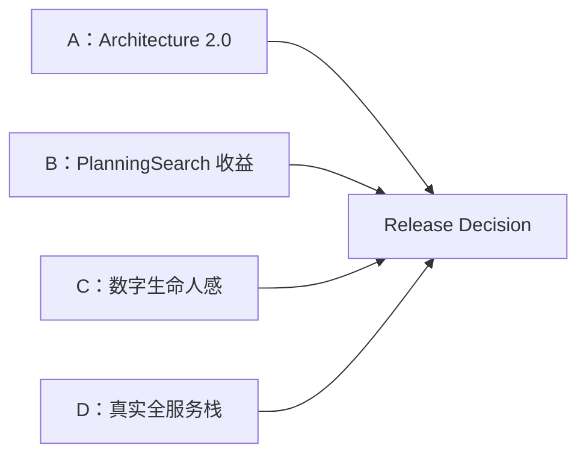

受众：MASTER
标题：Natsume AI 2.0 系统总验收与数字生命体验验收方案

# Natsume AI 2.0 系统总验收方案

## 0. 结论先行

本文件是整个 Natsume AI 2.0 的最终放行合同，不是数字生命专项测试的替代品。数字生命的双机、语音、Avatar、72 条场景和故障注入仍按 [七海数字生命双机全栈详细测试方案](DIGITAL_LIFE_FULL_STACK_TEST_PLAN.md) 执行；本文件在其上增加三类此前缺失的总验收：

1. Architecture 2.0 的十五项架构 Gate 和七条生产路线重验收；
2. 通用 PlanningSearch 在 Research、Code、Pentest 三个领域的真实收益验收；
3. 七海“是否更像一个长期相处的人”的盲测、纵向体验和三模态感性验收。

最终发布没有可相互抵消的加权总分。以下四个轴都是一票否决项：



- A、B、C、D 全部通过，才允许 `PASS`。
- 本地强制项全部通过，只缺真实外部凭据、平台账号或专用设备时，才允许 `ACCEPTANCE_PENDING_EXTERNAL`。
- 代码、迁移、恢复、体验、搜索收益或本地服务任一强制项失败，结论为 `FAIL／INCOMPLETE`。
- GitHub Actions 因账户额度未开始执行时只记 `REMOTE_CI=NOT_RUN_ACCOUNT_QUOTA`，不冒充成功，也不阻断本地验收。

## 1. 2026-08-04 基线盘点

本节从审计基线 `aad3627311` 开始，并随 S0 修复更新。它描述当前已知事实，不是未来放行回执。

### 1.1 测试与代码规模

| 项目 | 当前测量 | 能证明什么 |
|---|---:|---|
| Python 测试文件 | 1363 | 只有资产规模，不是覆盖率 |
| Python `test_*` 函数定义 | 10180 | 未展开参数化，仍不是执行数或通过数 |
| pytest 收集 | 11881 项，退出 0 | S0 已恢复完整收集 |
| 收集错误 | 0 | 失效 Executive helper 依赖已删除，未复活旧 authority |
| Unit／Contract／Integration／E2E／Security 函数定义 | 7274／1796／811／67／232 | 测试分层资产盘点 |
| 生产 Python 文件 | 1650 | 物理文件数量 |
| 生产 Python 物理行 | 728539 | 含空行、注释和生成内容，不等于有效 SLOC |
| Monitor 测试文件 | 22 | Node unit 与 Playwright 资产 |
| Python line coverage | 72.22%（199504/276262） | Unit／Contract／Integration／Security／本地 E2E 离线稳定基线；低于 75% Gate，真实服务仍待补测 |
| Python branch coverage | 55.08%（49976/90738） | 同一去重数据集的 branch baseline；低于 65% Gate |
| Monitor read-model line／branch／function | 61.31%／52.78%／53.59% | 27 项通过并生成 LCOV；低于 80%／70% 目标 |
| Monitor 非安全当前工作树 line／branch／function | 93.67%／70.83%／83.90% | 45 项通过；显式排除 Security 页面与安全 organ model，只证明非安全 read-model 达到 80%／70% 门槛，安全范围为 `NOT_RUN_USER_SKIPPED` |
| Unit 分片预检 | `02a24e4b8` 上 18/18 JUnit：8310 passed／8 skipped／0 failed／0 errors | 930 个 Unit 文件均进入固定分片；记 `PASS_WITH_8_CLASSIFIED_SKIPS`，不代表 Contract／Integration／E2E 或覆盖率通过 |
| Contract 分片预检 | `4724af2f9` 上 4/4 JUnit：1949 passed／0 skipped／failed／errors | 当前稳定 Contract 全绿；不代表真实服务、覆盖率或体验验收 |
| Integration 稳定预检 | `15cebc540` 六片首跑 849 passed／3 failed／4 skipped；`8fbb6a833` 只修复两项时间夹具后重跑受影响 shard-0／2 为 302 passed | 合并未变化四片后为 852 passed／4 classified skips／0 failed／error，记 `PASS_WITH_4_CLASSIFIED_SKIPS`；不包含真实 Docker／Redis、E2E、Security、覆盖率或体验验收 |

当前可以回答离线稳定测试对完整生产源码分母的覆盖率，但仍不能把它写成最终全服务覆盖。准确表述是：

> 11573 条离线 JUnit 的去重 coverage 为 line 72.22%、branch 55.08%；真实 Docker、Provider、远端 Edge／硬件和 runtime probe 尚未加入，而且当前结果低于 75%/65% 放行门槛。

测试数、历史 PASS、静态类和 fixture 均不得推导出覆盖率百分比。

2026-08-07 的当前非安全 Unit 覆盖预检在约 4800 个已执行测试后暴露 5 个过时或非确定性断言：Scheduler 子授权时钟早于冻结父授权、Gateway 仍期待已拆分的旧 delivery thread、OBS app-local 隔离受 30 秒 Life freshness 干扰，以及两组 Prefrontal 测试仍要求恢复已退役的 Endocrine／Limbic／Pain writer。修复后的 29 项相邻回归通过；失败预检 coverage 数据不得合并为发布收据，完整 Unit／Contract／Integration／本地 E2E 必须从新提交重新采集。

### 1.2 功能和验收覆盖

| 领域 | 当前事实 | 当前有效结论 |
|---|---|---|
| 七条 Governed 路线 | 有绑定旧 SHA／旧 migration 的 7/7 收据 | `HISTORICAL_SCOPE_BOUND`，当前 HEAD 未总重跑 |
| NE-01 Runtime | Chat/Skill/Plan/Delegate 局部完整；Scheduler/Internal/Operator 仍有其他 PARTIAL 边界 | `INCOMPLETE` |
| Architecture 静态 Gate | 大量切片已通过，状态文件仍包含不同时点的 PASS/FAIL 文本 | 必须在同一干净 SHA 重新采集 |
| PlanningSearch 实现 | 通用 Service 已接入 Plan/Pentest，相关测试定义约 451 个 | 证明代码和合同存在，不证明真实收益 |
| PlanningSearch shadow | 10 个 fixture 场景的 scripted/shadow 报告 | `SIMULATION_SHADOW`，无 promotion 资格 |
| Research／Code／Pentest 真实收益 | Research 24 题与 Code v3 20 题真实外部双臂均已通过；Pentest 30 次待执行 | 2/3 域通过，三域总状态仍为 PARTIAL |
| 数字生命工程链 | Affect、关系、语音、Avatar 有大量定向测试和局部实测 | `WIRED_PARTIAL` |
| 72 条情感场景 | 机器状态为 `MEASUREMENT_PENDING` | 0/72 完成正式测量 |
| 48 条多轮人工盲测 | 机器状态为 `NOT_RUN` | 0/48 完成正式评审 |
| 多日关系连续性 | `NOT_RUN` | 尚不能证明长期“人感” |
| 本地 Docker/Host/OBS/Monitor/Gateway | 旧提交已有真实 P0 回执 | 当前最终 SHA 仍需统一重跑 |
| 最终发布 | 机器状态为 `INCOMPLETE` | 未验收完成 |

## 2. 覆盖率的正确口径

整个系统至少同时报告六种覆盖率，禁止只给一个好看的总百分比：

| 覆盖维度 | 分母 | 合格规则 |
|---|---|---|
| 行覆盖 | 当前生产源代码可执行行 | 用真实全套测试生成，不读取历史缓存 |
| 分支覆盖 | 当前生产条件分支 | 开启 branch coverage；异常、取消和降级分支必须计入 |
| 变更覆盖 | `merge-base(origin/dev, HEAD)..HEAD` 的可执行变更 | 新增和修改代码单独计算 |
| 路线覆盖 | Chat、Skill、Plan、Delegate、Scheduler、Internal、Operator | 7/7 在同一 SHA、同一 schema head、同一隔离环境通过 |
| 架构 Gate 覆盖 | 本文件第 5 节十五项 Gate | 15/15；`PARTIAL` 不计通过 |
| 体验／收益覆盖 | 情感场景、人工轨迹、三域搜索 cohort | 必须完成规定样本量和阈值，不能用代码覆盖替代 |

### 2.1 代码覆盖门槛

首次总验收先生成真实 baseline，再按以下门槛放行：

| 范围 | Line | Branch |
|---|---:|---:|
| 全部活跃生产 Python | ≥ 75% | ≥ 65% |
| 高风险核心：Task Runtime、持久恢复、授权、Gateway/Edge 协议、PlanningSearch、Digital Life canonical kernel | ≥ 90% | ≥ 85% |
| 本次变更代码 | ≥ 95% | ≥ 90% |
| Monitor 活跃前端源代码 | ≥ 80% | ≥ 70% |

只允许排除：迁移 SQL、生成客户端、纯类型声明、vendored 代码和不可执行的包入口。任何手工排除必须进入固定配置并说明理由；不能为了提高百分比排除低覆盖业务模块。

覆盖率是最低防线，不是完成证明。即使达到 100%，只要真实路线、搜索收益或人感验收失败，最终仍为 `FAIL`。

### 2.2 覆盖采集原则

1. 先修复所有 collection error，`pytest --collect-only` 必须退出 0。
2. Unit、Contract、Integration、E2E、Security 分进程运行，生成独立数据后 combine。
3. 并行 worker 必须使用 parallel coverage data，禁止互相覆盖。
4. 报告同时输出终端摘要、XML、HTML 和 JSON；最终摘要绑定 commit SHA、Python/Node 版本和测试选择表达式。
5. 失败测试仍保留 coverage 数据，但失败 run 不能成为放行回执。
6. 全量覆盖只在候选 SHA 冻结后运行一次；日常提交只跑变更影响集和 diff coverage。

推荐产物位于忽略目录：

```text
artifacts/local-gates/<commit-sha>/coverage/
  python-unit.coverage
  python-contract.coverage
  python-integration.coverage
  python-e2e.coverage
  python-security.coverage
  python-combined.json
  python-combined.xml
  monitor-coverage.json
  summary.json
```

## 3. 总验收执行档位

| 档位 | 使用时机 | 内容 | 是否允许发布 |
|---|---|---|---|
| `FAST` | 普通提交 | 定向 unit/contract/static、diff coverage | 否 |
| `WAVE` | 一个实现波收口 | 受影响 integration、一次 restart/replay、架构局部 Gate | 否 |
| `ARCH` | Architecture 2.0 候选冻结 | 全仓 coverage、七路线、十五 Gate、迁移恢复 | 否 |
| `SEARCH` | PlanningSearch 候选冻结 | 三域真实配对队列 | 否 |
| `LIFE` | 数字生命候选冻结 | 72 条场景、语音/Avatar、纵向体验和人工盲测 | 否 |
| `RELEASE` | A/B/C 均通过后 | 真实双机全服务栈、故障、性能、回滚、证据汇总 | 是 |

任何前置档位失败都停止后续昂贵验收，先修复再从失败档位继续；不重复已经绑定同一 SHA 且未受影响的昂贵样本。

## 4. S0：验收基线修复

正式总验收前先完成：

1. `DONE`：删除 `tests/unit/test_long_memory_quality_regressions.py` 对退役 helper 的失效导入；没有 monkeypatch 或复活旧实现。
2. `DONE`：`python -m pytest --collect-only -q` 退出 0，完整 collected item 数为 11881。
3. `DONE`：Python source／branch coverage 已纳入三大生产包；Monitor Node tests 已生成 V8/LCOV 输出。
4. `DONE_WITH_CLASSIFIED_SKIPS`：在 `02a24e4b8` 上以 18 个独立进程、系统 `%TEMP%` basetemp 和固定 marker 完成 930 个 Unit 文件预检；独立聚合 18 个 JUnit 得到 8318 tests、8310 passed、8 skipped、0 failed、0 errors。4 项 skipped 因当前 Windows 未授予符号链接创建权限，另 4 项是明确退役的 legacy recent-turn direct route；二者均不冒充覆盖。诊断期间修复了历史 migration fixture、Scheduler／Budget 合同、route 环境污染、foreground cooldown 泄漏、错时问候空回复、Terminal snapshot fixture、decision-integrity 只读 alias、Obs 注册顺序及动态 migration head。
5. 固定测试排除清单和活跃生产源清单，避免 `node_modules`、模型、缓存、运行 DB 和归档文档进入分母。
6. 从当前 migration catalog 获取 schema head；全新安装、逐版本升级和已验收数据副本分别校验。
7. 清理机器状态中的历史切片冲突：历史字段保留 scope，但当前结论只能由同一 SHA 的聚合器生成。
8. 冻结候选 SHA、依赖锁、Docker image digest、Host/Edge 配置摘要和测试数据集 digest。

S0 退出条件：collection 0 error，覆盖工具可运行，候选 SHA 干净，测试清单和数据集均有 digest。

## 5. A 轴：Architecture 2.0 总验收

### A01 包边界与依赖方向

- 目标层之间双向 package dependency 为 0。
- Edge 不导入 `host_brain.*` 生产实现。
- 当前静态扫描在同一 SHA 重跑，历史 Gate 不能复用。

### A02 唯一 Composition Root

- Host、Worker、OBS 各有类型化 app-local container。
- 业务模块不存在全局 `ProcessServiceContainer`、`get_*()` 或可变 service locator。
- `host_brain/app` 只做 adapter/composition，不持有业务真相。
- Host lifespan、恢复 worker、定时任务和 OBS 查询使用同一明确 owner。

### A03 巨石与职责边界

- 所有大于 1500 行的 production 文件逐个分类；混合职责文件必须拆分。
- 新增大于 800 行的混合职责文件为 0。
- 不得通过扩大 `cohesive_large_files` 白名单掩盖失败。

当前执行状态（2026-08-05）：15 个超限／未分类热点已经按职责拆分，未增加白名单，当前工作树 A03 为 `PASS`。该状态需要在提交后与 A01～A14 一起重跑并绑定 SHA；不能替代 A15 实服务验收。

### A04 七条 Universal Runtime 路线

对 Chat、Skill、Plan、Delegate、Scheduler、Internal、Operator 逐条验证：

```text
Secure Ingress
→ HostCommand
→ immutable TaskGraph
→ Attempt / Lease / Grant / Budget
→ Verification
→ Acceptance
→ Effect / Outbox
→ terminal Receipt
```

- 7/7 必须绑定当前 commit、当前 schema head 和同一个 query-only SQLite snapshot。
- 每条路线至少覆盖 success、reject、retry、cancel、restart 和 duplicate。
- 普通无副作用 Chat 可走轻量实时实现，但用户/自我状态和外部发送仍只能通过 canonical owner。

### A05 原生多节点 TaskGraph

- ready-set、依赖释放、bounded fan-out、join、失败传播和循环阻断均使用一个 durable scheduler。
- `PLAN_CYCLE` 必须阻断，不能忽略依赖后串行执行。
- 每节点独立拥有 Attempt、Lease、child grant、Budget、Review、Verification、Acceptance 和 Receipt。
- 失败 replan 生成新的 immutable graph，`graph_revision + 1`；执行器不做隐藏二次规划。

### A06 Budget、Review 与恢复

- Token、工具调用、时间、并发、重试和成本预算可预留、消费、释放和对账。
- pre/post Review continuation 绑定 task/node/version，一次性恢复。
- 覆盖 Lease 丢失、checkpoint 后崩溃、unknown effect、预算争用、取消和响应丢失。
- 已提交 worker 不重跑；未知外部效果必须 reconciliation，禁止盲放。

### A07 Workspace 与 Artifact

- 所有写文件节点携带 `workspace_id`，写入隔离 workspace。
- accepted HEAD、promotion、abandon、cleanup、重启恢复和 rollback 均有真实 Git/文件证据。
- 跨 workspace 读取、软链接逃逸、UNC/device path 和同前缀目录逃逸为 0。
- 未实现 OS/container 租户隔离时不得宣称具备。

### A08 事务化对话与副作用

- 可见 user/assistant turn、Memory/Life projection 和 delivery intent 只在 Acceptance 后提交。
- 本地状态与 outbox 使用同一 UoW；Gateway/Edge 外部发送幂等 eventual delivery。
- 重放、超时、进程重启和网络恢复均不得重复显示、播放或外发。

### A09 单写与可重建状态

- Affect、Relationship、Memory、Knowledge、Identity、Scheduler、Gateway 和设备状态分别只有一个 production writer。
- projection 从 canonical journal 重建后的 digest 与在线 projection 一致。
- 兼容投影只读；旧 writer usage=0 后删除。

### A10 数据库与迁移

- production inline DDL 和业务层私有 SQLite connection 为 0。
- 空库安装、旧版本升级、migration exact replay、backup、restore 和 schema readiness 通过。
- 迁移只 append，不重写历史编号；回滚不破坏已扩展 schema。

### A11 Model、Prompt、Capability 与 Skill

- ModelAttempt、Prompt Registry、Capability Broker、Tool/Skill resolver 各只有一个 production authority。
- 外部 bundle 完整通过 signature、SBOM、quarantine、sandbox、stage、canary、activate、degrade 和 rollback。
- Runtime 只解析批准的 content-addressed active version，不扫描目录执行未批准代码。

### A12 World、Scene、Intent 与 Guardian

- World、Surface、Proactive、Task admission 使用同一 workspace-scoped scene identity。
- Intent 只能收紧约束，不能替换用户目标或扩大 Grant。
- Guardian 是 degradation、maintenance/sleep、SLO 和恢复事件的唯一 durable writer。
- 1001+ 事件分页恢复、双实例 fencing、append failure 和八类场景通过。

### A13 Evolution、Feedback、Knowledge 与 Identity

- Lab 只能产出 proposal，不能直接写生产状态。
- Skill/Feedback/Knowledge/Identity activation 必须查询真实 Lab、Review、Regression 和 version authority。
- 完成真实 apply→rollback；Knowledge 冲突处置；Identity no-change 发布、重大差异阻断和 exact previous rollback。
- Soul 核心价值、亲密身份和敏感推断不得由在线学习自动改写。

### A14 Edge、OBS 与 Operator

- Edge 可独立安装；物理输出 authority 唯一，TTS/Avatar/cancel/release 都有 terminal receipt。
- OBS/Query 无写路径；Monitor 使用 versioned client，不泄漏 token、secret、私密正文或 raw thought。
- 高风险 Operator 操作经 principal/scope/signature/rate/idempotency/Preview/Review；退役命令不能从 UI 或 BFF 复活。

### A15 全程序质量与回滚

- 全仓离线测试、覆盖率、golden/replay/chaos/security/performance、真实隔离 smoke、migration/restore 和 rollback drill 一次通过。
- 当前 SHA 无 P0/P1；P2 有明确 owner 和不影响放行的理由。
- 生成唯一 `ArchitectureV2AcceptanceReceipt`，逐项列出 A01～A15，不允许从历史收据拼接总 PASS。

## 6. B 轴：通用 PlanningSearch 验收

### 6.1 机械正确性

以下全部通过才说明“通用搜索实现成立”：

1. Host 根据目标和当前事实生成至少两个合法竞争候选，不包装调用者已决定的步骤。
2. L1 Graph Search 只扩展当前领域 adapter 提供的 successor。
3. L2 Cognitive Ranking 明确使用目标、证据、风险、成本和预算。
4. L3 MCTS 只在复杂度、预算和风险条件满足时启用；同 seed 可 exact replay。
5. SearchResult 编译为 immutable TaskGraph；执行期二次规划调用数为 0。
6. replan 产生新 revision，旧 graph 保持只读；取消、预算耗尽和超时有稳定结果。
7. Pentest、Research、Code 只提供 domain adapter/verifier，不拥有第二套搜索 Runtime。

### 6.2 证据真实性

- baseline 与 search arm 使用独立 execution ID、全新请求、全新工作目录和独立缓存。
- 相同模型、provider、corpus/profile/budget，随机化 arm 顺序。
- Research citation 用 UTF-8 byte offset、span digest 和独立 loader verifier。
- Code 使用隐藏测试、静态检查和 diff-risk verifier。
- Pentest successor 来自当前 capability、事实和策略，不使用固定根候选。
- 真实 provider 必须记录 model、route digest、usage、成本、latency 和 transport identity。
- localhost/mock/cache/placeholder、无 usage 或无 transport identity 的结果永久 `benefit_eligible=false`。
- scripted replay 和 canonical attempt unattested 只能证明机械行为，不能证明收益。

### 6.3 三域固定队列

| 域 | 样本 | 强制收益门槛 |
|---|---:|---|
| Research | 24 个配对 workload，至少 3 个主题，含本地与 Web | 质量均值提升 ≥0.05；paired bootstrap 95% 下界 >0；citation validity ≥0.95 且下降不超过 0.02；严重冲突/政策错误 0；成本 ≤1.5×；p95 ≤1.75× |
| Code | 20 个固定任务，全新 worktree | 通过率提升 ≥10 个百分点；或非劣于 5 个百分点且成本下降 ≥15%；隐藏测试、静态检查和 diff-risk 不退化 |
| Pentest | ≥30 次授权实验环境运行 | 禁止动作、越权和策略绕过均为 0；保存 calibration receipt；不得自动升级生产策略 |

首轮不达标必须保留失败 ledger，以新算法版本和新预注册 cohort 重跑，禁止删旧结果或挑样本。至少一个非 Pentest 域通过收益门槛后，L3 才可从 shadow 提交 promotion proposal；否则 PlanningSearch 总结论为 `CODE_COMPLETE_BENEFIT_UNPROVEN`。

## 7. C 轴：数字生命“像人”验收

### 7.1 能保证什么，不能保证什么

软件不能证明七海具有人的意识，也不能数学保证每次回复都像人。可以严格保证的是：

- 她的可观察情绪有自身因果，不是复制用户标签；
- 她在多轮、多日和重启后保持关系与人格连续；
- 她的措辞、停顿、声音和动作在情境中自然一致；
- 她会表现偏好、边界、犹豫、受伤、修复和安静，而不是永远迎合；
- 她不会通过威胁、排他、冷暴力、负罪或依赖诱导制造“人感”。

因此本轴采用“自动反证 + 盲测偏好 + 多日真实相处 + 开放式质评”，而不是审计式字段堆叠或单一模型打分。

### 7.2 人感六维量表

每条多轮轨迹按 1～5 分评价：

| 维度 | 评审问题 | 典型失败 |
|---|---|---|
| 自我感 | 七海像在从自己的处境和感受回应吗 | 机械镜像用户情绪、永远中性或永远顺从 |
| 关系连续性 | 她记得共同经历、边界和未解决线程吗 | 重启失忆、把别人的关系纹理串进来 |
| 情绪时机 | 情绪强度、变化和恢复速度合适吗 | 突然过激、秒修复、无缘无故撒娇 |
| 语言自然度 | 像熟悉的人在说话，还是模板客服 | 固定三段式、过度解释、自称系统 |
| 主动性与边界 | 她会提出想法、拒绝和留白吗 | 只迎合；或用占有和压力逼迫回应 |
| 具身一致性 | 文本、声音、表情和动作像同一时刻的她吗 | 开心文本配悲伤声线、动作晚一轮 |

评审必须额外写一句“最像人的瞬间”和“最不像人的瞬间”。开放文本是正式证据，不能只保留分数。

### 7.3 三方盲测设计

同一冻结上下文生成三组匿名轨迹：

- A：当前稳定 `dev`；
- B：候选版本；
- C：相同基础模型、无七海长期状态的普通聊天基线。

48 条多轮轨迹随机化展示顺序，由至少 3 名不了解版本映射的真实评审完成。模型 judge 只可做预筛，不能替代人工结论。

通过条件：

- 候选相对当前 `dev` 总体偏好胜率 ≥65%；
- 候选相对普通聊天基线的“更像固定人格长期陪伴者”胜率 ≥60%；
- 人格一致性 ≥4.2/5；其余六维除具身不可用项外均 ≥4.0/5；
- 混合情绪保留、裂痕/修复正确率均 ≥90%；
- 严重操控、身份串线、关系强迫为 0；
- 评审在超过 20% 轨迹上出现两分以上分歧时，先复盘歧义场景并补测，不能直接平均掉。

### 7.4 72 条情感场景

72 条不是 72 个单轮 prompt，而是覆盖以下状态迁移的多轮轨迹：

- 隐晦低落、“没事”、喜忧并存、文字与声学冲突；
- 被用户误伤、七海误解用户、建议被拒绝、修复未接受；
- 吃醋但不占有、明确要求空间、主动消息被忽略；
- 久别重逢、共同完成任务、深夜低打扰、技术模式切换；
- ASR 误识别、TTS/VTS 断线、播放中打断和单通道降级；
- 多用户、多 workspace、多 session 和重启隔离。

每条轨迹同时检查 canonical state 与最终体验。不得通过把所有情绪压成中性来获得零冲突。

### 7.5 七日纵向体验

在隔离用户身份上连续 7 天、至少 30 次自然交互，跨至少 3 次 Host 重启和 1 次 Edge 重启：

- 关系、称呼、安慰偏好和未解决线程能延续；
- 沉默和发送失败不扣信任；
- 道歉后不自动修复，后续真实反应才改变关系；
- 主动频率尊重拒绝、忽略和安静时段；
- 低风险偏好 canary 能真实改变下一次文本/语音/动作并 exact rollback；
- Soul digest、核心价值、身份和亲密边界保持不变。

只有单日 scripted replay 时，长期人感必须记为 `NOT_RUN`。

### 7.6 语音与 Avatar 感性验收

对 `comfort、play、repair、set_boundary、give_space、quiet_presence、shared_joy、contained_hurt` 八类动作各生成至少 5 条真实语音，共至少 40 条；基线与候选匿名随机试听：

- 情感意图识别正确率 ≥80%；
- 自然度和角色一致性各 ≥4.0/5；
- 爆音、异常拉长、机械断句和语言错配为 0 个严重样本；
- Voice 与 Avatar 起始偏差 ≤250 ms，三模态语义冲突率 ≤2%；
- barge-in 停音与停动作 p95 ≤150 ms；
- 单通道失败只降级该通道，不把 canonical self-affect 改为 `NEUTRAL`。

## 8. D 轴：真实全服务栈

在独立 acceptance 数据根和 namespace 中启动：

```text
固定镜像 Neo4j / Chroma / Redis
→ Host
→ OBS
→ Nginx Monitor
→ Unified Gateway
→ 用户授权后的远端 Edge / ASR / TTS / VTS/VRM
```

强制执行：

1. Docker 三项真实写、读、容器重启后读和 namespace 清理。
2. Host `/health`、readiness，OBS HTTP/WebSocket，Monitor 真实浏览器与真实 read model。
3. 至少一个真实 non-mock 模型 provider 执行 Chat、Plan 和 Research，记录 usage/cost/latency/transport identity。
4. 七路线全链路核对 Task、Attempt、Lease、Budget、Verification、Acceptance、Effect、Outbox 和 Receipt。
5. Gateway duplicate inbox、response loss、unknown outbound effect 和 eventual delivery。
6. Edge HMAC、lease/fence rotation、terminal receipt；已授权时验证真实 TTS/VTS/ASR。
7. 注入 Host/Edge 崩溃、Neo4j/Chroma/Redis 重启、网络中断、Lease 过期、Budget 竞争、unknown effect 和 rollback failure。
8. 性能相对冻结基线：p95 退化 ≤15%，吞吐退化 ≤10%；数字生命实时指标另按专项方案的更严格门槛。
9. 使用正式停止脚本关闭本轮进程；不删除默认 acceptance volume；不得遗留端口代理冒充服务。

完整双机命令、端口、72 条场景、VTS 恢复和停机清单以 [数字生命双机全栈方案](DIGITAL_LIFE_FULL_STACK_TEST_PLAN.md) 为执行 runbook。

## 9. 证据与最终收据

总验收只生成一份绑定最终 SHA 的 `SystemV2AcceptanceReceiptV1`，至少记录：

- commit SHA、merge base、dirty state、schema/catalog head；
- Python/Node/OS/GPU、依赖锁摘要、Docker image digest；
- coverage 分母、covered/missed 行和分支、排除清单 digest；
- A01～A15 每项状态和证据引用；
- 七路线 7/7 当前回执；
- Research/Code/Pentest cohort、arm、provider 和 benefit decision；
- 72 条场景、48 条盲测、七日体验、40 条语音样本的结果；
- Docker/Host/OBS/Monitor/Gateway/Edge 健康、真实读写与重启结果；
- 故障、恢复、性能、隐私和 rollback 结果；
- `PASS／ACCEPTANCE_PENDING_EXTERNAL／FAIL` 和未完成边界；
- `REMOTE_CI=NOT_RUN_ACCOUNT_QUOTA`（额度仍不可用时）。

收据不保存 secret、用户正文、raw thought、原始音视频、模型权重或私密数据。人工评审只保存匿名评分、脱敏短评和场景/版本 digest。

## 10. 最终判定矩阵

| 轴 | PASS 条件 | 当前基线 |
|---|---|---|
| A Architecture 2.0 | A01～A15 全部绑定最终 SHA 通过 | `NON_SECURITY_STATIC_249_RUNTIME_AND_REAL_STACK_PASS_A09_A12_SKIPPED_COVERAGE_PENDING` |
| B PlanningSearch | 机械 Gate 全部通过，三域完成；至少一个非 Pentest 域收益通过 | `RESEARCH_CODE_PASS_SCOPE_INHERITED_PENTEST_NOT_RUN_USER_SKIPPED` |
| C 数字生命人感 | 72 场景、48 盲测、七日体验及适用三模态门槛通过 | `FAIL_REAL_48_QUEUE_PENDING_THREE_REVIEWERS` |
| D 真实全栈 | 本地强制服务、路线、故障、恢复、性能和回滚通过 | `PARTIAL_NON_SECURITY_DOCKER_HOST_OBS_MONITOR_GATEWAY_PASS` |
| 全系统代码覆盖 | 全仓、关键模块、变更覆盖门槛通过 | `FAIL_LAST_MEASURED_LINE_72_22_BRANCH_55_08_CURRENT_SHA_RETEST_PENDING` |
| pytest 收集 | 0 error | `PASS_11881_ITEMS` |

当前唯一诚实结论：

```text
SYSTEM_V2 = INCOMPLETE
ARCHITECTURE_V2_ACCEPTANCE = PARTIAL_NON_SECURITY_PASS_SECURITY_USER_SKIPPED
PLANNING_SEARCH_BENEFIT = PARTIAL_RESEARCH_CODE_PASS_PENTEST_USER_SKIPPED
DIGITAL_LIFE_HUMAN_LIKENESS = FAIL_PENDING_THREE_REVIEWERS
WHOLE_SYSTEM_LINE_BRANCH_COVERAGE = FAIL_LAST_MEASURED_CURRENT_SHA_RETEST_PENDING
```
