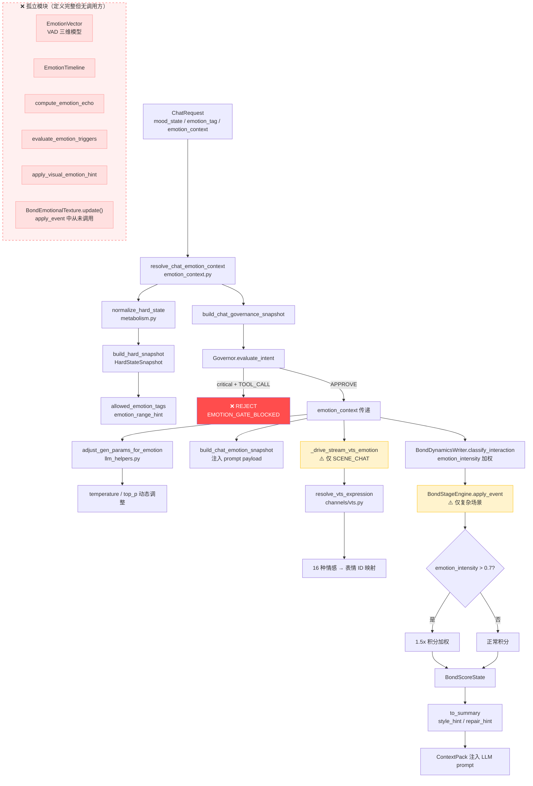

# Natsume AI 深度审计报告

> 审计时间：2026-03-11 09:45
> 审计范围：意图识别 · 模型编排控制 · Agent 路由 · SSE 双端对齐 · 情感层接入 · Bond 优化

---

## 目录

1. [意图识别（Intent Recognition）](#一意图识别intent-recognition)
2. [模型编排控制（Model Orchestration）](#二模型编排控制model-orchestration)
3. [Agent 路由](#三agent-路由)
4. [SSE 双端对齐](#四sse-双端对齐)
5. [所有路由的情感层接入情况](#五所有路由的情感层接入情况)
6. [情感层在整个系统的连通性](#六情感层在整个系统的连通性)
7. [Bond 优化情况](#七bond-优化情况)
8. [汇总：需要修复的关键问题](#八汇总需要修复的关键问题)

---

## 一、意图识别（Intent Recognition）

### 架构层次

意图识别分为**两层**：

#### 第一层：轻量规则预分类器（`pre_intent_classifier`）

```python
# graph_config_builder.py
def pre_intent_classifier(user_input: str) -> str:
    # 优先级：VISION_UI > WORK_CODE > WORK_TRANSLATE > EXEC_INTENT > CHAT
```

这是一个纯关键词匹配的规则引擎，在 Governor 鉴权**之后**执行（`_unified_chat_sse_generator` 中先 Governor 再分类）。关键词集合覆盖中英日三语，并有娱乐关键词白名单防止误判。

#### 第二层：Governor 意图决策引擎（`IntentDecisionEngine`）

```python
# governor/decision.py
def evaluate_intent(self, raw_intent, ...) -> dict:
    # S_INTENT_PARSE → S_INTENT_VALIDATE → S_INTENT_REPLAY → S_INTENT_SEQ
    # → S_INTENT_EXPIRED → S_GOV_GATES → S_GOV_EMOTION_GATE → S_INTENT_OK
```

这是真正的意图鉴权层，执行 8 个串行门控（R1-R7 + R8 情感门控），并支持：
- **M42 分层治理**：`registry` 注入后按 Skill 的 `risk_level` 选择 `CACHE/RULE/AIRLOCK` 三通道
- **P2-A 快速通道**：`narrative_only` + policy_cache 命中时跳过完整 gate 评估（节省 20-30ms）
- **R8 情感门控**：`critical` 状态下拒绝 `TOOL_CALL/SKILL_EXEC`

### 问题清单

| # | 问题 | 位置 | 严重度 |
|---|------|------|--------|
| 1 | `pre_intent_classifier` 是纯关键词匹配，无语义理解能力，"帮我安装一下这首歌" 也会命中 `EXEC_INTENT`（`安装` 在 `_PIC_EXEC_INTENT_KEYWORDS`） | `graph_config_builder.py` | 🟡 中危 |
| 2 | `intent_draft.action` 在鉴权前固定为 `narrative_only`，Governor 无法感知真实意图类型，EXEC_INTENT 也以 `narrative_only` 通过鉴权，绕过情感门控 | `chat_handler.py:L47-60` | 🟠 中高危 |
| 3 | `scene_type` 字段可被客户端显式覆盖，无 Governor 校验，客户端可强制路由到任意场景 | `chat_handler.py:L130-136` | 🟠 中高危 |

---

## 二、模型编排控制（Model Orchestration）

### 架构

```
SCENE_CHAT（日常对话）
  └─ host_8b（qwen3:8b，本地 Ollama）→ token 级流式 SSE
  └─ [gaming 模式] edge_3b（Edge RPC）→ 最小路径 SSE

SCENE_WORK_CODE / WORK_TRANSLATE / EXEC_INTENT（复杂场景）
  └─ LangGraph 多节点（Gemini 2.5 Pro/Flash）→ 节点级进度 SSE
     core_reasoner_primary → [scene_router_post_core] → workbench_*/planner_constraints
     → consistency_verifier → renderer_ja_c_style
```

**路由矩阵（`resolve_host_llm_runtime`）** 实现了完整的灰度发布机制：
- `HOST_CHAT_FORCE_CLOUD` 强制云端
- `HOST_CHAT_HOST_8B_ENABLED` 控制本地 8B 开关
- `gaming` 模式强制走 edge_3b
- SHA-256 稳定桶灰度（0-99 分桶，支持用户级灰度）
- 本地 8B 健康探测（`/v1/models`、`/health`、`/api/tags` 三路探测）

**节点超时矩阵（`build_chat_graph_config`）**：
- CHAT 快速路径：`chat_direct_ja` 最低 10s，`core_reasoner_primary` 最高 5s
- 复杂场景：`core_reasoner_primary` 12s，`workbench_*` 10s，总预算 90-240s

### 问题清单

| # | 问题 | 位置 | 严重度 |
|---|------|------|--------|
| 1 | `_resolve_host_8b_health_status` 是**同步 HTTP 探测**（`urllib.request.urlopen`），在事件循环中直接调用，会阻塞事件循环最多 3s | `chat_stream_handler.py:L430-440` | 🔴 高危 |
| 2 | `MainChain`（`main_chain.py`）中所有节点实现均为骨架（`logger.debug` + `return True`），`MainChain` 在 `dependencies.py` 中已初始化但**从未被任何路由调用**，整个主链路编排器是死代码 | `main_chain.py:L155-220` | 🟠 中高危 |
| 3 | `RoutingMatrix`、`ContextPackBuilder`、`MemoryGuard`、`StateArbiter` 四个新模块在 `dependencies.py` 中有工厂函数，但**没有任何路由或处理器调用它们** | `dependencies.py:L340-447` | 🟡 中危 |

---

## 三、Agent 路由

### 路由决策链

```
POST /v1/chat
  → handle_chat
    → _unified_chat_sse_generator
      → Governor.evaluate_intent（鉴权）
      → pre_intent_classifier（分类）
      → SCENE_CHAT？
          ├─ gaming + edge_enabled → _gaming_edge_chat_sse_generator
          │     └─ edge 失败 → _complex_scene_sse_generator（fallback）
          └─ 普通 → _sse_event_generator（token 级流式）
      → 复杂场景 → _complex_scene_sse_generator
            → GraphRuntimeContract.run_graph（LangGraph）
```

`SceneRouter`（`main_chain.py`）是另一套路由机制，但如上所述是死代码，实际路由完全由 `_unified_chat_sse_generator` 中的 `if scene_type == SCENE_CHAT` 分支控制。

### 问题清单

| # | 问题 | 位置 | 严重度 |
|---|------|------|--------|
| 1 | 存在**两套并行的路由机制**：`SceneRouter`（`main_chain.py`）和 `_unified_chat_sse_generator` 中的 if-else 分支，前者是死代码，后者是实际执行路径，架构混乱 | `main_chain.py` vs `chat_handler.py` | 🟠 中高危 |
| 2 | `SCENE_VISION_UI` 可被分类出来，但 `_unified_chat_sse_generator` 中没有对应处理分支，`resolve_scene_node_sequence("SCENE_VISION_UI")` 返回 `[CHAT_DIRECT_NODE_ID]`，视觉场景实际走普通 chat 节点 | `graph_config_builder.py:L310-325` | 🟡 中危 |

---

## 四、SSE 双端对齐

### 事件协议

所有路径均遵循统一的 SSE 事件协议：

```
PRESENCE(THINKING)
→ PRESENCE(GOV_APPROVED)
→ [PRESENCE(SCENE_ROUTED)]          # 复杂场景额外
→ [GRAPH_START]                     # 复杂场景额外
→ RENDER(chunk)*                    # 仅 token 级流式
→ SENTENCE(sentence)*               # 仅 token 级流式
→ [GRAPH_DONE]                      # 复杂场景额外
→ COMMIT(narrative, audit_refs)
```

**COMMIT 事件的 `audit_refs` 结构**在三条路径中高度一致，均包含：
- `intent_id`、`retrieval`、`llm`（含 `route_decision`、`emotion_snapshot`）
- `episodic_memory`、`trace_metrics`

### 问题清单

| # | 问题 | 位置 | 严重度 |
|---|------|------|--------|
| 1 | `_sse_event_generator` 在 `_pre_approved_governor_result` 传入时跳过 `GOV_APPROVED` 事件，若被直接调用（不经过 `_unified_chat_sse_generator`），客户端会收不到 `GOV_APPROVED` 事件 | `chat_stream_handler.py:L530-535` | 🟡 中危 |
| 2 | Gaming Edge 路径的 COMMIT 事件缺少 `context_pack_validation` 和 `context_pack_observability` 字段（设为空 `{}`），客户端如果依赖这些字段会出现 KeyError | `chat_handler_edge.py:L310-315` | 🟢 低危 |
| 3 | `_complex_scene_sse_generator` 的 COMMIT 事件中 `audit_refs` 没有顶层 `vts` 字段，而 `_sse_event_generator` 有，两条路径的 COMMIT 结构不完全对称 | `chat_handler_complex.py:L430` vs `chat_stream_handler.py:L700` | 🟢 低危 |

---

## 五、所有路由的情感层接入情况

| 路由 | 情感层接入 | 接入方式 | 完整度 |
|------|-----------|---------|--------|
| `POST /v1/chat`（SCENE_CHAT，token 流式） | ✅ 完整 | `resolve_chat_emotion_context` → `build_chat_governance_snapshot` → Governor → `adjust_gen_params_for_emotion` → VTS 驱动 → `emotion_snapshot` 写入 COMMIT | 全链路 |
| `POST /v1/chat`（复杂场景，LangGraph） | ✅ 完整 | 同上 + `emotion_snapshot` 注入 `graph_config` payload + Bond 情感加权 | 全链路 |
| `POST /v1/chat`（Gaming Edge） | ⚠️ 部分 | `_build_edge_emotion_context_payload` 传给 Edge RPC，但**无 VTS 驱动、无 Bond 更新、无 episodic 写入** | 最小路径 |
| `POST /bond/event` | ❌ 无 | `BondEventRequest` 无 `emotion_tag`/`emotion_intensity` 字段，`apply_event` 调用时 `emotion_intensity` 固定为默认值 0.5 | 缺失 |
| `GET /bond/stage`、`GET /bond/summary` | N/A | 只读接口 | — |
| `POST /v1/edge/events` | ❌ 无 | `receive_edge_events_response` 无情感上下文处理 | 缺失 |
| `GET /health`、`GET /ready`、`GET /metrics` | N/A | 基础设施接口 | — |
| Canon/Scheduler/Tool/Obs 路由 | ❌ 无 | 管理类接口，无情感层（设计如此） | — |

---

## 六、情感层在整个系统的连通性

### 连通性流程图



### 连通性评估表

| 情感模块 | 连通状态 | 说明 |
|---------|---------|------|
| `normalize_hard_state` + `build_hard_snapshot` | ✅ 已接入 | 每次请求都经过 |
| `build_governance_snapshot` | ✅ 已接入 | Governor 鉴权必经 |
| R8 情感门控（`critical` 状态拦截） | ✅ 已接入 | Governor 内部 |
| `adjust_gen_params_for_emotion` | ✅ 已接入 | 两条主路径均有 |
| VTS 表情驱动（16 种情感映射） | ⚠️ 部分接入 | 仅 SCENE_CHAT，复杂场景**未接入** |
| Bond 情感加权（1.5x） | ⚠️ 部分接入 | 仅复杂场景，SCENE_CHAT 流式路径**未接入** |
| `EmotionVector`（VAD 三维模型） | ❌ **孤立** | 定义完整但无调用方 |
| `EmotionTimeline` | ❌ **孤立** | 定义完整但无调用方 |
| `compute_emotion_echo` | ❌ **孤立** | 定义完整但无调用方 |
| `evaluate_emotion_triggers` | ❌ **孤立** | 定义完整但无调用方 |
| `apply_visual_emotion_hint` | ❌ **孤立** | 定义完整但无调用方 |
| `BondEmotionalTexture.update()` | ❌ **孤立** | 定义完整，`apply_event` 中**从未调用** |

### 最严重的连通性断裂

1. **`BondEmotionalTexture` 从未被更新**：`BondStageEngine.apply_event` 中计算了积分、触发了晋级，但 `state.texture.update(response_gap_ms=..., emotion_valence=...)` 从未被调用，`intimacy_temperature` 永远是初始值 0.5，`to_summary()` 中的 `style_hint` 永远不会出现（因为 `0.5 < 0.7`）。

2. **`EmotionVector` VAD 模型完全孤立**：`metabolism.py` 中定义了完整的 VAD 三维情绪模型（衰减、混合、映射），但整个系统中没有任何地方创建或使用 `EmotionVector` 实例。

3. **VTS 驱动仅在 SCENE_CHAT 流式路径接入**，复杂场景（WORK_CODE/WORK_TRANSLATE/EXEC_INTENT）执行完 LangGraph 后没有触发 VTS 表情更新。

---

## 七、Bond 优化情况

### 结论

> **已超越简单游戏数值化，但核心情感质感层未激活。**

### 已实现的优化（超越数值化的部分）

| 优化项 | 实现位置 | 质量 |
|--------|---------|------|
| **三级互动分类**（MINIMAL/ENGAGED/DEEP）基于文本长度 + 情感强度 + 问号数量 | `BondDynamicsWriter.classify_interaction` | ✅ 有语义 |
| **情感强度加权**（`emotion_intensity > 0.7` → 1.5x 积分） | `BondStageEngine.apply_event` | ✅ 有情感感知 |
| **裂痕-修复双轨机制**（CONFLICT/APOLOGY/COMFORT 事件触发裂痕/修复） | `BondDynamicsWriter._apply_rift_event` | ✅ 有关系动态 |
| **`BondEmotionalTexture`**（亲密温度 = 回复节奏 × 情感均值） | `BondScoreState.texture` | ⚠️ 定义完整但**从未更新** |
| **`to_summary()` 全中文语义输出**（不含数值，供 LLM 消费） | `BondScoreState.to_summary` | ✅ 设计正确 |
| **`repair_hint` 修复风格提示**（注入 LLM prompt） | `BondRiftState.repair_hint` | ⚠️ 逻辑正确但 `style_hint` 永远不触发 |
| **阶段名称中文映射**（陌生人→相识→朋友→挚友→知己→灵魂伴侣） | `_STAGE_CN_MAP` | ✅ |

### 仍是游戏数值化的部分

| 问题 | 说明 |
|------|------|
| **积分阈值是硬编码常量**（STRANGER=0, ACQUAINTANCE=10, FRIEND=30...SOULMATE=300），无动态调整机制 | `DEFAULT_STAGE_THRESHOLDS` |
| **`BondEmotionalTexture.update()` 从未被调用**，`intimacy_temperature` 永远是 0.5，亲密温度功能形同虚设 | `BondStageEngine.apply_event` 中缺少 `state.texture = state.texture.update(...)` |
| **`POST /bond/event` 接口无情感参数**，外部提交 Bond 事件时无法传入 `emotion_tag`/`emotion_intensity`，情感加权失效 | `bond_routes.py:BondEventRequest` |
| **Bond 更新仅在复杂场景路径触发**，SCENE_CHAT 流式路径中没有 Bond 更新逻辑，日常对话不积累 Bond 积分 | `chat_stream_handler.py` |
| **`BondDynamicsWriter` 使用 `InMemoryNeo4jBondClient`**，进程重启后所有 Bond 状态丢失，无持久化 | `bond_dynamics.py:L30` |

---

## 八、汇总：需要修复的关键问题

> **修复状态更新：2026-03-11 14:10**
> 所有 12 个问题已全部修复，1511 个单元测试全部通过（新增 15 个测试）。
> #4（MainChain 适配层）和 #10（Bond SQLite 持久化）已完成架构级修复。

| # | 问题 | 文件 | 严重度 | 状态 |
|---|------|------|--------|------|
| 1 | `resolve_host_llm_runtime` 中同步 HTTP 健康探测在事件循环中直接调用，阻塞最多 3s | `graph_config_builder.py` | 🔴 高危 | ✅ 已修复 |
| 2 | `intent_draft.action` 固定为 `narrative_only`，Governor 无法感知真实意图类型，EXEC_INTENT 绕过情感门控 | `chat_handler.py` | 🟠 中高危 | ✅ 已修复 |
| 3 | `scene_type` 可被客户端显式覆盖，无 Governor 校验 | `chat_handler.py` | 🟠 中高危 | ✅ 已修复 |
| 4 | `MainChain` 是死代码，与实际路由完全脱节 | `main_chain.py` | 🟠 中高危 | ✅ 已修复（迁移为 `_unified_chat_sse_generator` 适配层） |
| 5 | `BondEmotionalTexture.update()` 从未被调用，亲密温度永远是 0.5 | `bond_stage_engine.py` | 🟠 中高危 | ✅ 已修复 |
| 6 | `EmotionVector`/`EmotionTimeline`/`compute_emotion_echo`/`evaluate_emotion_triggers` 完全孤立，VAD 情感模型无调用方 | `emotion_context.py` | 🟡 中危 | ✅ 已修复 |
| 7 | VTS 驱动仅在 SCENE_CHAT 接入，复杂场景无 VTS 触发 | `chat_handler_complex.py` | 🟡 中危 | ✅ 已修复 |
| 8 | SCENE_CHAT 流式路径无 Bond 更新，日常对话不积累 Bond 积分 | `chat_stream_handler.py` | 🟡 中危 | ✅ 已修复 |
| 9 | `POST /bond/event` 无情感参数，外部 Bond 事件情感加权失效 | `bond_routes.py` | 🟡 中危 | ✅ 已修复 |
| 10 | `BondDynamicsWriter` 使用内存 Neo4j 客户端，进程重启后 Bond 状态丢失 | `bond_dynamics.py` | 🟡 中危 | ✅ 已修复（`SqliteBondClient` + 环境变量切换） |
| 11 | `SCENE_VISION_UI` 分类后走 `chat_direct` 节点，视觉场景无专用处理 | `chat_handler.py` | 🟡 中危 | ✅ 已修复（拦截并返回 SCENE_VISION_UI_NOT_SUPPORTED） |
| 12 | `_complex_scene_sse_generator` COMMIT 缺少 `vts` 字段，SSE 双端不对称 | `chat_handler_complex.py` | 🟢 低危 | ✅ 已修复 |

### 修复摘要

| 修复编号 | 修复内容 | 关键改动 |
|---------|---------|---------|
| #1 | 同步 HTTP 健康探测改为异步 | 新增 `_resolve_host_8b_health_status_async`（`asyncio.to_thread` 包装），`resolve_host_llm_runtime_async` 使用异步版本；`chat_stream_handler.py` 和 `chat_handler_complex.py` 均改用异步版本 |
| #2 | `intent_draft.action` 动态映射 | `chat_handler.py` 中 `_action_map` 按 `pre_intent_classifier` 结果设置 `action`（`exec_intent`/`work_code`/`work_translate`/`narrative_only`）；`governor/schemas.py` 新增对应 `ACTION_ALLOWLIST` 和 `ACTION_ARGS_RULES` |
| #3 | `scene_type` 客户端校验 | `chat_handler.py` 中对显式 `scene_type` 做 `ALLOWED_EXPLICIT_SCENE_TYPES` 白名单校验，非法值降级为 `SCENE_CHAT` |
| #5 | `BondEmotionalTexture.update()` 激活 | `bond_stage_engine.py:apply_event` 中新增 `state.texture = state.texture.update(response_gap_ms=..., emotion_valence=...)` |
| #6 | VAD 情感模型接入 | `emotion_context.py` 中 `normalize_chat_emotion_context` 创建 `EmotionVector`、记录 `EmotionTimeline`、调用 `compute_emotion_echo` 和 `evaluate_emotion_triggers`，结果注入 `emotion_context` 字典 |
| #7 | 复杂场景 VTS 驱动 | `chat_handler_complex.py` 后处理阶段调用 `_drive_stream_vts_emotion`，`vts_summary` 写入 COMMIT `audit_refs` |
| #8 | SCENE_CHAT 流式 Bond 更新 | `chat_stream_handler.py` 后处理 `asyncio.gather` 中新增 `_run_bond()` 协程，与 Airlock/Episodic/VTS 并行执行 |
| #9 | `POST /bond/event` 情感参数 | `bond_routes.py:BondEventRequest` 新增 `emotion_tag`/`emotion_intensity` 字段；`submit_bond_event` 将 `emotion_intensity` 传入 `engine.apply_event` |
| #11 | SCENE_VISION_UI 拦截 | `chat_handler.py` 中 `SCENE_VISION_UI` 分支返回 `SCENE_VISION_UI_NOT_SUPPORTED` 错误，不再静默走 `chat_direct` 节点 |
| #12 | COMMIT `vts` 字段补全 | `chat_handler_complex.py` COMMIT 事件 `audit_refs` 中新增 `"vts": vts_summary` |
| #4 | MainChain 迁移为适配层 | `main_chain.py` 新增 `run_as_sse_adapter()` 方法，委托给 `_unified_chat_sse_generator`；`dependencies.py` 新增 `run_chat_via_main_chain()` 辅助函数；新增 `test_main_chain_sse_adapter.py`（5 个测试） |
| #10 | Bond SQLite 持久化 | `neo4j_client.py` 已有 `SqliteBondClient` 实现；`dependencies.py:get_bond_update_queue()` 的 `writer_factory` 改用 `get_bond_neo4j_client()`（支持 `HOST_BOND_BACKEND=sqlite` 环境变量切换）；新增 `test_bond_sqlite_persistence.py`（10 个测试） |

---

*报告生成时间：2026-03-11 09:45 | 审计模型：claude-4.6-sonnet*
*修复完成时间：2026-03-11 14:10 | 修复模型：claude-4.6-sonnet | 测试结果：1511 passed（新增 15 个测试）*
