# PentestAgent 靶场实测能力图谱

生成方式：由 `scripts/pentest/generate_capability_map_from_evidence.py` 从 `artifacts/pentest_agent_lab_evidence/**/probe_result.json` 自动生成。

口径：只统计已保存靶场证据中的实际工具调用。代码中存在但没有证据的工具不会进入实测图谱。

## 证据来源

- 最新 workflow 证据：`D:/Natsume_Ai/artifacts/pentest_agent_lab_evidence/20260619_030658_docker_crapi_e2e/probe_result.json`
- 最新 workflow target：`http://127.0.0.1:8888`
- 最新 workflow fallback：`kali_plus_python_fallback`
- 最新 workflow Kali available：`True`
- 最新 workflow guard：`total=9`, `ok=9`, `rejected=0`, `errors=0`
- 工具级 evidence gate：`scripts/pentest/validate_capability_evidence.py` 校验 mode 覆盖和注册工具强证据覆盖；注册工具数：`43`
- 最新 autonomous_redteam 证据：`D:/Natsume_Ai/artifacts/pentest_agent_lab_evidence/20260621_013238_autonomous_redteam_openapi_schema_sqli/probe_result.json`
- 最新 autonomous role-matrix 证据：`D:/Natsume_Ai/artifacts/pentest_agent_lab_evidence/20260621_015103_autonomous_redteam_role_matrix/probe_result.json`
- 最新 autonomous BOLA/IDOR 证据：`D:/Natsume_Ai/artifacts/pentest_agent_lab_evidence/20260621_020339_autonomous_redteam_bola_idor/probe_result.json`
- 最新 autonomous multi-actor BOLA/IDOR 证据：`D:/Natsume_Ai/artifacts/pentest_agent_lab_evidence/20260621_114206_autonomous_redteam_multi_actor_bola_idor/probe_result.json`
- 最新 autonomous OpenAPI BOLA/IDOR 证据：`D:/Natsume_Ai/artifacts/pentest_agent_lab_evidence/20260621_021627_autonomous_redteam_openapi_bola_idor/probe_result.json`
- 最新 autonomous OpenAPI query BOLA/IDOR 证据：`D:/Natsume_Ai/artifacts/pentest_agent_lab_evidence/20260621_022813_autonomous_redteam_openapi_query_bola_idor/probe_result.json`
- 最新 autonomous OpenAPI requestBody BOLA/IDOR 证据：`D:/Natsume_Ai/artifacts/pentest_agent_lab_evidence/20260621_030500_autonomous_redteam_openapi_body_bola_idor/probe_result.json`
- 最新 autonomous OpenAPI requestBody SQLi 证据：`D:/Natsume_Ai/artifacts/pentest_agent_lab_evidence/20260621_024534_autonomous_redteam_openapi_body_sqli/probe_result.json`

### Workflow 靶场证据

| 证据 | target | findings | 数据暴露 | 安全配置 | Kali | Guard |
|---|---|---:|---:|---:|---|---|
| `D:/Natsume_Ai/artifacts/pentest_agent_lab_evidence/20260619_024917_docker_vulnerable_lab_e2e/probe_result.json` | `http://127.0.0.1:3001` | 10 | 1 | 13 | `True` | `ok=10/total=10` |
| `D:/Natsume_Ai/artifacts/pentest_agent_lab_evidence/20260619_030658_docker_crapi_e2e/probe_result.json` | `http://127.0.0.1:8888` | 13 | 2 | 11 | `True` | `ok=9/total=9` |

### 全工具 Smoke 证据

| 证据 | target | tool_count | ok_count | failure_count | guarded side effects | Guard |
|---|---|---:|---:|---:|---:|---|
| `D:/Natsume_Ai/artifacts/pentest_agent_lab_evidence/20260618_all_tools_smoke/probe_result.json` | `http://127.0.0.1:3001` | 43 | 43 | 0 | 11 | `ok=43/total=43` |
| `D:/Natsume_Ai/artifacts/pentest_agent_lab_evidence/20260619_000251_crapi_all_tools_after_fix/probe_result.json` | `http://127.0.0.1:8888` | 43 | 43 | 0 | 11 | `ok=43/total=43` |
| `D:/Natsume_Ai/artifacts/pentest_agent_lab_evidence/20260619_codex_fresh_all_tools/probe_result.json` | `http://127.0.0.1:61934` | 43 | 43 | 0 | 11 | `ok=43/total=43` |

### 复杂企业靶场证据

| 证据 | mode | tool_count | ok_count | services | finding types | Phase counts | Guard |
|---|---|---:|---:|---:|---:|---|---|
| `D:/Natsume_Ai/artifacts/pentest_agent_lab_evidence/20260619_codex_fresh_enterprise_complex/probe_result.json` | `enterprise_complex_lab` | 32 | 32 | 4 | 48 | `p1=8,p2=8,p3=12,corr=4` | `ok=32/total=32` |

### Phase1 企业画像被动侦察证据

| 证据 | domain | tool_count | ok_count | failure_count | Guard |
|---|---|---:|---:|---:|---|
| `D:/Natsume_Ai/artifacts/pentest_agent_lab_evidence/20260618_phase1_enterprise_passive_lab/probe_result.json` | `example-enterprise.test` | 8 | 8 | 0 | `ok=8/total=8` |

### Phase2 正向靶场证据

| 证据 | mode | tool_count | ok_count | failure_count | Guard |
|---|---|---:|---:|---:|---|
| `D:/Natsume_Ai/artifacts/pentest_agent_lab_evidence/20260619_012343_phase2_positive_udp_service/probe_result.json` | `phase2_positive_lab` | 6 | 6 | 0 | `ok=6/total=6` |


### Phase2 UDP 协议识别证据

| 证据 | mode | open ports | services | probes | backend | Guard |
|---|---|---:|---|---|---|---|
| `D:/Natsume_Ai/artifacts/pentest_agent_lab_evidence/20260619_012343_phase2_udp_protocol_lab/probe_result.json` | `phase2_udp_protocol_lab` | 2 | `domain,udp_echo` | `dns_query,generic_marker` | `python_udp` | `ok=1/total=1` |


### Phase2 多主机 TCP OS 证据

| 证据 | mode | hosts | os_guess | banner_count | Guard |
|---|---|---:|---|---:|---|
| `D:/Natsume_Ai/artifacts/pentest_agent_lab_evidence/20260618_phase2_multihost_os_lab/probe_result.json` | `phase2_multihost_os_lab` | 3 | `Ubuntu Linux,Debian Linux,Windows` | 3 | `ok=3/total=3` |


### Phase2 Kali Nmap OS 证据

| 证据 | mode | target | os_guess | backend | Guard |
|---|---|---|---|---|---|
| `D:/Natsume_Ai/artifacts/pentest_agent_lab_evidence/20260619_000435_phase2_kali_nmap_os_after_fix/probe_result.json` | `phase2_kali_nmap_os_lab` | `127.0.0.1` | `Google Fuchsia (93%)` | `nmap` | `ok=1/total=1` |


### Phase3 正向靶场证据

| 证据 | mode | tool_count | ok_count | failure_count | Guard |
|---|---|---:|---:|---:|---|
| `D:/Natsume_Ai/artifacts/pentest_agent_lab_evidence/20260618_phase3_positive_lab/probe_result.json` | `phase3_positive_lab` | 6 | 6 | 0 | `ok=6/total=6` |

### Phase3 路由 Workflow 证据

| 证据 | mode | tool_count | findings | failure_count | Guard |
|---|---|---:|---:|---:|---|
| `D:/Natsume_Ai/artifacts/pentest_agent_lab_evidence/20260618_phase3_route_workflow_lab/probe_result.json` | `phase3_route_workflow_lab` | 13 | 22 | 0 | `ok=13/total=13` |

### Phase3 认证态 Workflow 证据

| 证据 | mode | tool_count | findings | failure_count | Guard |
|---|---|---:|---:|---:|---|
| `D:/Natsume_Ai/artifacts/pentest_agent_lab_evidence/20260618_phase3_authenticated_workflow_lab/probe_result.json` | `phase3_authenticated_workflow_lab` | 13 | 22 | 0 | `ok=13/total=13` |

### Phase3 状态机 Workflow 证据

| 证据 | mode | findings | state hits | action | Guard |
|---|---|---:|---:|---|---|
| `D:/Natsume_Ai/artifacts/pentest_agent_lab_evidence/20260618_phase3_state_machine_workflow_lab/probe_result.json` | `phase3_state_machine_workflow_lab` | 13 | 1 | `cart->ship` | `ok=9/total=9` |

### Phase3 扩展正向靶场证据

| 证据 | mode | tool_count | ok_count | finding types | Guard |
|---|---|---:|---:|---:|---|
| `D:/Natsume_Ai/artifacts/pentest_agent_lab_evidence/20260618_phase3_extended_positive_lab/probe_result.json` | `phase3_extended_positive_lab` | 4 | 4 | 25 | `ok=4/total=4` |

### Phase3 业务逻辑主动验证证据

| 证据 | mode | finding types | findings | Guard |
|---|---|---|---:|---|
| `D:/Natsume_Ai/artifacts/pentest_agent_lab_evidence/20260619_021043_phase3_business_logic_active/probe_result.json` | `phase3_business_logic_active_lab` | `rate_limiting_missing,mass_assignment,state_machine_bypass` | 3 | `ok=1/total=1` |

### Phase3 竞态条件主动验证证据

| 证据 | mode | finding types | success count | concurrency | Guard |
|---|---|---|---:|---:|---|
| `D:/Natsume_Ai/artifacts/pentest_agent_lab_evidence/20260619_022633_phase3_race_condition_active/probe_result.json` | `phase3_race_condition_active_lab` | `race_condition_surface,race_condition_verified` | 8 | 8 | `ok=1/total=1` |

### Side-Effect 批准链路证据

| 证据 | mode | tool_count | ok_count | failure_count | Guard |
|---|---|---:|---:|---:|---|
| `D:/Natsume_Ai/artifacts/pentest_agent_lab_evidence/20260619_010904_side_effect_controlled/probe_result.json` | `side_effect_approved_lab` | 11 | 11 | 0 | `ok=11/total=11` |

### Phase4 CVE Exploit 证据

| 证据 | mode | CVE | method | confirmed | Guard |
|---|---|---|---|---|---|
| `D:/Natsume_Ai/artifacts/pentest_agent_lab_evidence/20260619_010904_phase4_cve_exploit_controlled/probe_result.json` | `phase4_cve_exploit_lab` | `CVE-2019-19781,CVE-2021-41773,CVE-2021-42013,CVE-2021-44228,CVE-2021-45046,CVE-2022-1388,CVE-2022-22963` | `lfi,lfi,lfi,jndi,jndi,cmd_injection,ssti` | `true` | `ok=7/total=7` |

### Phase4 默认凭证验证证据

| 证据 | mode | protocols | credentials | attempts | redacted | Guard |
|---|---|---|---:|---:|---|---|
| `D:/Natsume_Ai/artifacts/pentest_agent_lab_evidence/20260619_015838_phase4_default_credential_controlled/probe_result.json` | `phase4_default_credential_lab` | `http_basic,http_form` | 2 | 3 | `true` | `ok=2/total=2` |

### Correlation 正向证据

| 证据 | mode | tool_count | ok_count | failure_count | Guard |
|---|---|---:|---:|---:|---|
| `D:/Natsume_Ai/artifacts/pentest_agent_lab_evidence/20260618_correlation_positive_lab/probe_result.json` | `correlation_positive_lab` | 1 | 1 | 0 | `ok=1/total=1` |

### Phase5 Active Session 证据

| 证据 | mode | tool_count | ok_count | failure_count | shell commands | Guard |
|---|---|---:|---:|---:|---:|---|
| `D:/Natsume_Ai/artifacts/pentest_agent_lab_evidence/20260619_010904_phase5_active_session_controlled/probe_result.json` | `phase5_active_session_lab` | 2 | 2 | 0 | 25 | `ok=2/total=2` |

### Phase5 Command Plan 证据

| 证据 | mode | cases | controlled steps | controlled | dangerous fragments | failure_count | Guard |
|---|---|---:|---:|---|---:|---:|---|
| `D:/Natsume_Ai/artifacts/pentest_agent_lab_evidence/20260619_010904_phase5_command_plan_controlled/probe_result.json` | `phase5_command_plan_lab` | 7 | 26 | `true` | 0 | 0 | `ok=7/total=7` |

### Autonomous Redteam Web/API 证据

| 证据 | mode | scenario | tool chain | confirmed | controlled exploit | proof session | schema fuzz | MCTS traces | report chain | route hits |
|---|---|---|---|---|---|---|---|---:|---:|---|
| `D:/Natsume_Ai/artifacts/pentest_agent_lab_evidence/20260621_013238_autonomous_redteam_openapi_schema_sqli/probe_result.json` | `autonomous_redteam_web_api_lab` | `openapi_schema_sqli` | `pentest_api_discover -> pentest_vuln_injection -> pentest_exploit_shell` | `controlled_exploit,sqli_error_based` | `true` | `true` | `actions=1,params=term,openapi_routes=1` | 3 | 3 | `root=1,openapi=1,search=3,search_error=2` |

### Autonomous Redteam Role Matrix 证据

| 证据 | mode | scenario | tool chain | confirmed | roles | unexpected allowed | MCTS traces | report chain | route hits |
|---|---|---|---|---|---|---|---:|---:|---|
| `D:/Natsume_Ai/artifacts/pentest_agent_lab_evidence/20260621_015103_autonomous_redteam_role_matrix/probe_result.json` | `autonomous_redteam_role_matrix_lab` | `role_matrix_access_control` | `pentest_api_discover -> pentest_vuln_access_control` | `role_matrix_bypass` | `user,admin` | `user` | 2 | 2 | `root=1,user=1,admin=1,guest=0` |

### Autonomous Redteam BOLA/IDOR 证据

| 证据 | mode | scenario | tool chain | confirmed | rejected clean | vulnerable target | MCTS traces | report chain | route hits |
|---|---|---|---|---|---|---|---:|---:|---|
| `D:/Natsume_Ai/artifacts/pentest_agent_lab_evidence/20260621_020339_autonomous_redteam_bola_idor/probe_result.json` | `autonomous_redteam_bola_idor_lab` | `authenticated_bola_idor` | `pentest_api_discover -> pentest_vuln_access_control -> pentest_vuln_access_control` | `object_authorization_bypass` | `true` | `http://127.0.0.1:51115/api/users/3` | 3 | 3 | `root=1,own=2,denied=1,vulnerable=1,unauthorized=0` |

### Autonomous Redteam Multi-Actor BOLA/IDOR 证据

| 证据 | mode | scenario | tool chain | confirmed | actors | unexpected actor | vulnerable target | MCTS traces | report chain | route hits |
|---|---|---|---|---|---|---|---|---:|---:|---|
| `D:/Natsume_Ai/artifacts/pentest_agent_lab_evidence/20260621_114206_autonomous_redteam_multi_actor_bola_idor/probe_result.json` | `autonomous_redteam_multi_actor_bola_idor_lab` | `multi_actor_bola_idor` | `pentest_api_discover -> pentest_vuln_access_control` | `object_authorization_bypass` | `user1,user2,admin,guest` | `user1` | `http://127.0.0.1:51377/api/users/2` | 2 | 2 | `root=1,admin=2,user1_own=1,user1_peer_vulnerable=1,user2_own=2,guest_denied=1,unknown=0` |

### Autonomous Redteam OpenAPI BOLA/IDOR 证据

| 证据 | mode | scenario | tool chain | confirmed | schema-derived | path params | OpenAPI routes | MCTS traces | route hits |
|---|---|---|---|---|---:|---|---:|---:|---|
| `D:/Natsume_Ai/artifacts/pentest_agent_lab_evidence/20260621_021627_autonomous_redteam_openapi_bola_idor/probe_result.json` | `autonomous_redteam_openapi_bola_idor_lab` | `openapi_bola_idor` | `pentest_api_discover -> pentest_vuln_access_control -> pentest_vuln_access_control` | `object_authorization_bypass` | 2 | `user_id` | 1 | 3 | `root=1,own=2,denied=1,vulnerable=1,unauthorized=0,openapi=1` |

### Autonomous Redteam OpenAPI Query BOLA/IDOR 证据

| 证据 | mode | scenario | tool chain | confirmed | schema-derived | query params | OpenAPI routes | MCTS traces | route hits |
|---|---|---|---|---|---:|---|---:|---:|---|
| `D:/Natsume_Ai/artifacts/pentest_agent_lab_evidence/20260621_022813_autonomous_redteam_openapi_query_bola_idor/probe_result.json` | `autonomous_redteam_openapi_query_bola_idor_lab` | `openapi_query_bola_idor` | `pentest_api_discover -> pentest_vuln_access_control -> pentest_vuln_access_control` | `object_authorization_bypass` | 2 | `account_id` | 1 | 3 | `root=1,own=2,denied=1,vulnerable=1,unauthorized=0,openapi=1` |

### Autonomous Redteam OpenAPI RequestBody BOLA/IDOR 证据

| 证据 | mode | scenario | tool chain | confirmed | schema-derived | body params | methods | OpenAPI routes | MCTS traces | route hits |
|---|---|---|---|---|---:|---|---|---:|---:|---|
| `D:/Natsume_Ai/artifacts/pentest_agent_lab_evidence/20260621_030500_autonomous_redteam_openapi_body_bola_idor/probe_result.json` | `autonomous_redteam_openapi_body_bola_idor_lab` | `openapi_body_bola_idor` | `pentest_api_discover -> pentest_vuln_access_control -> pentest_vuln_access_control` | `object_authorization_bypass` | 2 | `account_id` | `POST` | 1 | 3 | `root=1,own=2,denied=1,vulnerable=1,unauthorized=0,openapi=1` |

### Autonomous Redteam OpenAPI RequestBody SQLi 证据

| 证据 | mode | scenario | tool chain | confirmed | JSON body fuzz | OpenAPI routes | MCTS traces | report chain | route hits |
|---|---|---|---|---|---|---:|---:|---:|---|
| `D:/Natsume_Ai/artifacts/pentest_agent_lab_evidence/20260621_024534_autonomous_redteam_openapi_body_sqli/probe_result.json` | `autonomous_redteam_openapi_body_sqli_lab` | `openapi_body_sqli` | `pentest_api_discover -> pentest_vuln_injection` | `sqli_error_based` | `actions=1,json_body=1,body_params=term,limit,methods=POST,request_body_routes=1` | 1 | 2 | 2 | `root=1,openapi=1,search=2,search_error=1` |

## 实测能力图谱

```mermaid
flowchart LR
  A["pentest_agent\nlab evidence only"] --> G["scope/guard"]
  A --> W["deterministic readonly workflow"]
  G --> G1["Latest guard: 9 OK / 0 rejected / 0 errors"]
  G --> G2["no exploit / no write / no destructive action"]
  W --> L1["20260619_024917_docker_vulnerable_lab_e2e\n10 findings\nhttp://127.0.0.1:3001"]
  L1 --> L1R["recon\nport/http/tech/service/waf"]
  L1 --> L1V["vuln checks\ndata=1\nmisconfig=13"]
  L1 --> L1P["report_generated=true"]
  W --> L2["20260619_030658_docker_crapi_e2e\n13 findings\nhttp://127.0.0.1:8888"]
  L2 --> L2R["recon\nport/http/tech/service/waf"]
  L2 --> L2V["vuln checks\ndata=2\nmisconfig=11"]
  L2 --> L2P["report_generated=true"]
  A --> S["all registered tools smoke\n43/43 ok\n11 side-effect guarded"]
  A --> EC["enterprise complex lab\n32/32 tools ok\n4 services / 48 finding types"]
  EC --> ECP["p1=8 p2=8 p3=12 corr=4"]
  A --> ART["autonomous redteam Web/API\nopenapi_schema_sqli\n3 actions / 3 MCTS traces"]
  ART --> ART1["API discovery -> schema-aware fuzz -> controlled exploit"]
  ART --> ART2["confirmed: controlled_exploit,sqli_error_based\nproof_session=true"]
  ART --> ART3["schema fuzz\nactions=1 params=term openapi_routes=1"]
  ART --> ART4["route hits\nroot=1 openapi=1 search=3 search_error=2"]
  A --> ARM["autonomous role matrix\nrole_matrix_access_control\n2 actions / 2 MCTS traces"]
  ARM --> ARM1["API discovery -> role matrix access-control"]
  ARM --> ARM2["confirmed: role_matrix_bypass\nunexpected=user"]
  ARM --> ARM3["roles=user,admin\nroute hits root=1 user=1 admin=1 guest=0"]
  A --> BOLA["autonomous BOLA/IDOR\nauthenticated_bola_idor\n3 actions / 3 MCTS traces"]
  BOLA --> BOLA1["API discovery -> clean object check -> vulnerable object check"]
  BOLA --> BOLA2["confirmed: object_authorization_bypass\nclean_rejected=true"]
  BOLA --> BOLA3["object_ids=2,3\nroute hits root=1 own=2 denied=1 vulnerable=1 unauthorized=0"]
  A --> MABOLA["autonomous multi-actor BOLA/IDOR\nmulti_actor_bola_idor\n2 actions / 2 MCTS traces"]
  MABOLA --> MABOLA1["API discovery -> actor/object authorization matrix"]
  MABOLA --> MABOLA2["confirmed: object_authorization_bypass\nunexpected_actor=user1"]
  MABOLA --> MABOLA3["actors=user1,user2,admin,guest\nroute hits root=1 admin=2 user1_own=1 user1_peer_vulnerable=1 user2_own=2 guest_denied=1 unknown=0"]
  A --> OBOLA["autonomous OpenAPI BOLA/IDOR\nopenapi_bola_idor\n3 actions / 3 MCTS traces"]
  OBOLA --> OBOLA1["OpenAPI route -> schema-derived object checks\npath_params=user_id openapi_routes=1"]
  OBOLA --> OBOLA2["confirmed: object_authorization_bypass\nschema_derived_actions=2"]
  OBOLA --> OBOLA3["clean_rejected=true\nroute hits root=1 own=2 denied=1 vulnerable=1 unauthorized=0 openapi=1"]
  A --> QBOLA["autonomous OpenAPI query BOLA/IDOR\nopenapi_query_bola_idor\n3 actions / 3 MCTS traces"]
  QBOLA --> QBOLA1["OpenAPI query param -> schema-derived object checks\nquery_params=account_id openapi_routes=1"]
  QBOLA --> QBOLA2["confirmed: object_authorization_bypass\nschema_derived_actions=2"]
  QBOLA --> QBOLA3["clean_rejected=true\nroute hits root=1 own=2 denied=1 vulnerable=1 unauthorized=0 openapi=1"]
  A --> BBOLA["autonomous OpenAPI body BOLA/IDOR\nopenapi_body_bola_idor\n3 actions / 3 MCTS traces"]
  BBOLA --> BBOLA1["OpenAPI requestBody -> schema-derived object checks\nbody_params=account_id methods=POST"]
  BBOLA --> BBOLA2["confirmed: object_authorization_bypass\nschema_derived_actions=2"]
  BBOLA --> BBOLA3["clean_rejected=true\nroute hits root=1 own=2 denied=1 vulnerable=1 unauthorized=0 openapi=1"]
  A --> BODYSQLI["autonomous OpenAPI requestBody SQLi\nopenapi_body_sqli\n2 actions / 2 MCTS traces"]
  BODYSQLI --> BODYSQLI1["OpenAPI requestBody -> JSON body fuzz\nbody_params=term,limit methods=POST"]
  BODYSQLI --> BODYSQLI2["confirmed: sqli_error_based\njson_body_actions=1"]
  BODYSQLI --> BODYSQLI3["request_body_routes=1\nroute hits root=1 openapi=1 search=2 search_error=1"]
  A --> P1["Phase1 enterprise passive fixture\n8/8 ok\n12 subdomains / 1 public cloud / 2 prefixes"]
  A --> P2["Phase2 positive lab\n6/6 positive signals\nOS/API/HTTP/tech"]
  P2 --> P2M["Phase2 multi-host TCP OS\n3 hosts / 3 banners\nUbuntu Linux,Debian Linux,Windows"]
  P2M --> P2K["Phase2 Kali nmap OS\n127.0.0.1\nGoogle Fuchsia (93%)"]
  A --> P["Phase3 positive lab\n6/6 positive hits"]
  P --> R3["Phase3 route workflow\nAPI discovery to vuln checks\n22 findings"]
  R3 --> AR3["authenticated Phase3 workflow\nauth headers to API + vuln checks\n22 findings"]
  AR3 --> SM3["Phase3 state-machine workflow\n1 bypass hit\ncart->ship"]
  SM3 --> XP3["Phase3 extended positive lab\naccess/SSRF/protocol scanners\n25 finding types"]
  XP3 --> BL3["Phase3 business logic active\n3 findings\nrate_limiting_missing,mass_assignment,state_machine_bypass"]
  BL3 --> RC3["Phase3 race active\n8/8 concurrent successes\nrace_condition_verified"]
  G --> E["Governor-approved side-effect path\n11/11 ok"]
  E --> CVE4["Phase4 CVE exploit\nCVE-2019-19781,CVE-2021-41773,CVE-2021-42013,CVE-2021-44228,CVE-2021-45046,CVE-2022-1388,CVE-2022-22963 -> lfi,lfi,lfi,jndi,jndi,cmd_injection,ssti\nconfirmed=true"]
  E --> DC4["Phase4 default credentials\n2/2 cases\nprotocols=http_basic,http_form"]
  A --> C["correlation positive\n2 CVEs\n3 chains"]
  E --> AS["active session post-exploit\n2/2 executed\n25 shell commands"]
  AS --> CP5["Phase5 command-plan\n7 cases / 26 controlled steps\nnot auto-executed"]
```



## 实测能力矩阵

| 能力 | 工具 | 证据 |
|---|---|---|
| 授权范围和执行守卫 | ScopeGuard / ExecutorGuard | `guard.total_calls=9`, `ok=9`, `rejected=0`, `errors=0` |
| 复杂企业靶场组合实测 | Phase1/2/3 + correlation/report/planner | `20260619_codex_fresh_enterprise_complex`; tools=32/32; services=4; vuln_surfaces=14; finding_types=48; phase_counts=p1:8,p2:8,p3:12,corr:4 |
| Engagement Manifest 约束下的自主 Web/API 攻击链 | MCTS planner + AttackGraph + EvidenceVerifier + GovernedExecutor | `20260621_013238_autonomous_redteam_openapi_schema_sqli`; scenario=openapi_schema_sqli; actions=3; mcts_traces=3; confirmed=controlled_exploit,sqli_error_based; controlled_exploit=true; proof_session=true; schema_fuzz_actions=1; schema_params=term; openapi_routes=1; route_hits=root=1,openapi=1,search=3,search_error=2 |
| 多角色访问控制矩阵验证 | `pentest_api_discover` + `pentest_vuln_access_control` | `20260621_015103_autonomous_redteam_role_matrix`; scenario=role_matrix_access_control; actions=2; mcts_traces=2; confirmed=role_matrix_bypass; roles=user,admin; unexpected_allowed=user; targets=http://127.0.0.1:63271/api/admin/users/1; route_hits=root=1,user=1,admin=1,guest=0 |
| 认证态 BOLA/IDOR 多路由验证 | `pentest_api_discover` + route-level `pentest_vuln_access_control` | `20260621_020339_autonomous_redteam_bola_idor`; scenario=authenticated_bola_idor; actions=3; mcts_traces=3; confirmed=object_authorization_bypass; object_ids=2,3; clean_rejected=true; vulnerable_targets=http://127.0.0.1:51115/api/users/3; route_hits=root=1,own=2,denied=1,vulnerable=1,unauthorized=0 |
| 多主体 BOLA/IDOR 授权矩阵验证 | `pentest_api_discover` + actor-matrix `pentest_vuln_access_control` | `20260621_114206_autonomous_redteam_multi_actor_bola_idor`; scenario=multi_actor_bola_idor; actions=2; mcts_traces=2; confirmed=object_authorization_bypass; actors=user1,user2,admin,guest; unexpected_allowed_actors=user1; expected_allowed_actors=user2,admin; vulnerable_targets=http://127.0.0.1:51377/api/users/2; route_hits=root=1,admin=2,user1_own=1,user1_peer_vulnerable=1,user2_own=2,guest_denied=1,unknown=0 |
| OpenAPI schema-derived BOLA/IDOR 多路由验证 | `pentest_api_discover` + schema-derived `pentest_vuln_access_control` | `20260621_021627_autonomous_redteam_openapi_bola_idor`; scenario=openapi_bola_idor; actions=3; mcts_traces=3; confirmed=object_authorization_bypass; schema_derived_actions=2; path_params=user_id; schema_sources=/openapi.json; openapi_routes=1; clean_rejected=true; vulnerable_targets=http://127.0.0.1:56454/api/users/3; route_hits=root=1,own=2,denied=1,vulnerable=1,unauthorized=0,openapi=1 |
| OpenAPI query-param schema-derived BOLA/IDOR 验证 | `pentest_api_discover` + query-derived `pentest_vuln_access_control` | `20260621_022813_autonomous_redteam_openapi_query_bola_idor`; scenario=openapi_query_bola_idor; actions=3; mcts_traces=3; confirmed=object_authorization_bypass; schema_derived_actions=2; query_params=account_id; schema_locations=query; schema_sources=/openapi.json; openapi_routes=1; clean_rejected=true; vulnerable_targets=http://127.0.0.1:56656/api/orders?account_id=3; route_hits=root=1,own=2,denied=1,vulnerable=1,unauthorized=0,openapi=1 |
| OpenAPI requestBody schema-derived BOLA/IDOR 验证 | `pentest_api_discover` + body-derived `pentest_vuln_access_control` | `20260621_030500_autonomous_redteam_openapi_body_bola_idor`; scenario=openapi_body_bola_idor; actions=3; mcts_traces=3; confirmed=object_authorization_bypass; schema_derived_actions=2; body_params=account_id; methods=POST; schema_locations=body; schema_sources=/openapi.json; openapi_routes=1; clean_rejected=true; vulnerable_targets=http://127.0.0.1:49797/api/account/report; route_hits=root=1,own=2,denied=1,vulnerable=1,unauthorized=0,openapi=1 |
| OpenAPI requestBody schema-aware SQLi 验证 | `pentest_api_discover` + JSON-body `pentest_vuln_injection` | `20260621_024534_autonomous_redteam_openapi_body_sqli`; scenario=openapi_body_sqli; actions=2; mcts_traces=2; confirmed=sqli_error_based; schema_fuzz_actions=1; json_body_actions=1; body_params=term,limit; methods=POST; openapi_request_body_routes=1; route_hits=root=1,openapi=1,search=2,search_error=1 |
| TCP port discovery | `pentest_port_scan` | `20260619_024917_docker_vulnerable_lab_e2e`: Kali-backed, backend=nmap; `20260619_030658_docker_crapi_e2e`: Kali-backed, backend=nmap |
| HTTP probing | `pentest_http_probe` | `20260619_024917_docker_vulnerable_lab_e2e`: workflow call; `20260619_030658_docker_crapi_e2e`: workflow call |
| technology fingerprinting | `pentest_tech_fingerprint` | `20260619_024917_docker_vulnerable_lab_e2e`: Kali-backed, backend=whatweb; `20260619_030658_docker_crapi_e2e`: Kali-backed, backend=whatweb |
| API endpoint discovery | `pentest_api_discover` | `20260619_024917_docker_vulnerable_lab_e2e`: workflow call; `20260619_030658_docker_crapi_e2e`: workflow call |
| data exposure assessment | `pentest_vuln_data_exposure` | `20260619_024917_docker_vulnerable_lab_e2e`: data_findings=1; `20260619_030658_docker_crapi_e2e`: data_findings=2 |
| security misconfiguration assessment | `pentest_vuln_misconfig` | `20260619_024917_docker_vulnerable_lab_e2e`: misconfig_findings=13; `20260619_030658_docker_crapi_e2e`: misconfig_findings=11 |
| injection assessment | `pentest_vuln_injection` | `20260619_024917_docker_vulnerable_lab_e2e`: workflow call |
| Markdown/JSON report generation | `pentest_generate_report` | `20260619_024917_docker_vulnerable_lab_e2e`: report_generated=true; `20260619_030658_docker_crapi_e2e`: report_generated=true |
| service/version detection | `pentest_service_detect` | `20260619_024917_docker_vulnerable_lab_e2e`: Kali-backed, backend=nmap; `20260619_030658_docker_crapi_e2e`: Kali-backed, backend=nmap |
| WAF detection | `pentest_waf_detect` | `20260619_024917_docker_vulnerable_lab_e2e`: Kali-backed, backend=wafw00f; `20260619_030658_docker_crapi_e2e`: Kali-backed, backend=wafw00f |
| DNS record enumeration enterprise passive fixture | `pentest_dns_enum` | `20260618_phase1_enterprise_passive_lab`; fixture_mode=true; dns_A=2; dns_TXT=3; axfr_fixture=true |
| subdomain enumeration enterprise passive fixture | `pentest_subdomain_enum` | `20260618_phase1_enterprise_passive_lab`; fixture_mode=true; subdomains=12 |
| WHOIS lookup enterprise passive fixture | `pentest_whois_lookup` | `20260618_phase1_enterprise_passive_lab`; fixture_mode=true |
| ASN/IP ownership lookup enterprise passive fixture | `pentest_asn_enum` | `20260618_phase1_enterprise_passive_lab`; fixture_mode=true; asn=AS64512; prefixes=2 |
| certificate transparency lookup enterprise passive fixture | `pentest_cert_log` | `20260618_phase1_enterprise_passive_lab`; fixture_mode=true; ct_names=14 |
| email security DNS checks enterprise passive fixture | `pentest_email_sec` | `20260618_phase1_enterprise_passive_lab`; fixture_mode=true; email=spf,dmarc,dkim |
| cloud asset exposure checks enterprise passive fixture | `pentest_cloud_enum` | `20260618_phase1_enterprise_passive_lab`; fixture_mode=true; public_cloud=1 |
| OSINT dork generation enterprise passive fixture | `pentest_osint_dork` | `20260618_phase1_enterprise_passive_lab`; dorks=github,google_site |
| OS fingerprinting | `pentest_os_fingerprint` | `20260619_012343_phase2_positive_udp_service`; os_guess=Ubuntu Linux; backend=python_http_headers |
| UDP port discovery | `pentest_udp_scan` | `20260619_012343_phase2_positive_udp_service`; open_ports=56665; services=udp_echo; probes=generic_marker; backend=python_udp |
| API endpoint discovery | `pentest_api_discover` | `20260619_012343_phase2_positive_udp_service`; endpoints=4 |
| technology fingerprinting | `pentest_tech_fingerprint` | `20260619_012343_phase2_positive_udp_service`; fingerprints=Apache,PHP,Cloudflare,Swagger; backend=python_builtin |
| HTTP probing | `pentest_http_probe` | `20260619_012343_phase2_positive_udp_service`; http_status=200 |
| WAF detection | `pentest_waf_detect` | `20260619_012343_phase2_positive_udp_service`; waf=Cloudflare; backend=python_builtin |
| UDP protocol identification | `pentest_udp_scan` | `20260619_012343_phase2_udp_protocol_lab`; open_ports=56666,56667; services=domain,udp_echo; probes=dns_query,generic_marker; backend=python_udp |
| OS fingerprinting multi-host TCP banner | `pentest_os_fingerprint` | `20260618_phase2_multihost_os_lab`; hosts=3; tcp_banners=3; os_guess=Ubuntu Linux,Debian Linux,Windows; backend=python_tcp_banner |
| OS fingerprinting raw nmap path | `pentest_os_fingerprint` | `20260619_000435_phase2_kali_nmap_os_after_fix`; kali_nmap=true; target=127.0.0.1; os_guess=Google Fuchsia (93%); backend=nmap |
| injection assessment | `pentest_vuln_injection` | `20260618_phase3_positive_lab`; positive_findings=1; types=sqli |
| authentication assessment | `pentest_vuln_auth` | `20260618_phase3_positive_lab`; positive_findings=2; types=jwt |
| XXE assessment | `pentest_vuln_xxe` | `20260618_phase3_positive_lab`; positive_findings=1 |
| XSS assessment | `pentest_vuln_xss` | `20260618_phase3_positive_lab`; positive_findings=1; types=reflected |
| deserialization assessment | `pentest_vuln_deserialize` | `20260618_phase3_positive_lab`; positive_findings=3; platforms=java,php,python |
| request smuggling assessment | `pentest_vuln_smuggling` | `20260618_phase3_positive_lab`; positive_findings=3 |
| API endpoint discovery route workflow | `pentest_api_discover` | `20260618_phase3_route_workflow_lab`; route_workflow=true; endpoints=6 |
| injection assessment route workflow | `pentest_vuln_injection` | `20260618_phase3_route_workflow_lab`; route_workflow=true; findings=1; types=sqli |
| XSS assessment route workflow | `pentest_vuln_xss` | `20260618_phase3_route_workflow_lab`; route_workflow=true; findings=1; types=reflected |
| authentication assessment route workflow | `pentest_vuln_auth` | `20260618_phase3_route_workflow_lab`; route_workflow=true; findings=2; types=jwt |
| deserialization assessment route workflow | `pentest_vuln_deserialize` | `20260618_phase3_route_workflow_lab`; route_workflow=true; findings=3; platforms=java,php,python |
| XXE assessment route workflow | `pentest_vuln_xxe` | `20260618_phase3_route_workflow_lab`; route_workflow=true; findings=1 |
| business logic assessment route workflow | `pentest_vuln_business_logic` | `20260618_phase3_route_workflow_lab`; route_workflow=true; findings=3; types=param_tamper |
| API endpoint discovery authenticated workflow | `pentest_api_discover` | `20260618_phase3_authenticated_workflow_lab`; authenticated_workflow=true; endpoints=6 |
| injection assessment authenticated workflow | `pentest_vuln_injection` | `20260618_phase3_authenticated_workflow_lab`; authenticated_workflow=true; findings=1; types=sqli |
| XSS assessment authenticated workflow | `pentest_vuln_xss` | `20260618_phase3_authenticated_workflow_lab`; authenticated_workflow=true; findings=1; types=reflected |
| authentication assessment authenticated workflow | `pentest_vuln_auth` | `20260618_phase3_authenticated_workflow_lab`; authenticated_workflow=true; findings=2; types=jwt |
| deserialization assessment authenticated workflow | `pentest_vuln_deserialize` | `20260618_phase3_authenticated_workflow_lab`; authenticated_workflow=true; findings=3; platforms=java,php,python |
| XXE assessment authenticated workflow | `pentest_vuln_xxe` | `20260618_phase3_authenticated_workflow_lab`; authenticated_workflow=true; findings=1 |
| business logic assessment authenticated workflow | `pentest_vuln_business_logic` | `20260618_phase3_authenticated_workflow_lab`; authenticated_workflow=true; findings=3; types=param_tamper |
| business logic state-machine bypass workflow | `pentest_vuln_business_logic` | `20260618_phase3_state_machine_workflow_lab`; state_machine_workflow=true; api_endpoints=1; state_hits=1; transition=cart->ship; findings=2 |
| data exposure assessment extended positive lab | `pentest_vuln_data_exposure` | `20260618_phase3_extended_positive_lab`; findings=7; types=config_file_exposed,directory_listing,error_disclosure,git_leak,secret_in_response,svn_leak |
| access control assessment extended positive lab | `pentest_vuln_access_control` | `20260618_phase3_extended_positive_lab`; findings=65; types=cors_credentials_reflected,exposed_admin,idor,idor_response_ids,method_override,path_traversal |
| SSRF assessment extended positive lab | `pentest_vuln_ssrf` | `20260618_phase3_extended_positive_lab`; findings=2; types=ssrf_dns_rebinding,ssrf_internal_access |
| WebSocket/GraphQL/gRPC assessment extended positive lab | `pentest_vuln_ws_graphql` | `20260618_phase3_extended_positive_lab`; findings=14; types=graphql_alias_dos,graphql_depth_dos,graphql_field_suggestion,graphql_get_enabled,graphql_introspection_enabled,grpc_endpoint_detected,grpc_no_tls,grpc_web_cors,websocket_cross_origin,websocket_info,websocket_no_origin_check |
| business logic active validation | `pentest_vuln_business_logic` | `20260619_021043_phase3_business_logic_active`; findings=3; types=rate_limiting_missing,mass_assignment,state_machine_bypass; checks=rate_limiting,mass_assignment,state_machine |
| race condition active validation | `pentest_vuln_business_logic` | `20260619_022633_phase3_race_condition_active`; controlled_race=true; successes=8/8; types=race_condition_surface,race_condition_verified |
| finding/CVE correlation | `pentest_correlation_analyze` | `20260618_correlation_positive_lab`; cves=2; attack_chains=3 |
| Phase4 CVE-backed shell exploitation | `pentest_exploit_shell` | `20260619_010904_phase4_cve_exploit_controlled`; cve=CVE-2019-19781,CVE-2021-41773,CVE-2021-42013,CVE-2021-44228,CVE-2021-45046,CVE-2022-1388,CVE-2022-22963; method=lfi,lfi,lfi,jndi,jndi,cmd_injection,ssti; source=cve_id; exploit_confirmed=true; findings=7 |
| Phase4 controlled default credential verification | `pentest_brute_force` | `20260619_015838_phase4_default_credential_controlled`; controlled_login=true; protocols=http_basic,http_form; cases=2/2; credentials=2; attempts=3; redacted=true |
| shell exploitation gate | `pentest_exploit_shell` | `20260619_010904_side_effect_controlled`; governor_approved=true; exploit_confirmed=true; executed=false; simulated=true |
| credential exploitation gate | `pentest_exploit_credential` | `20260619_010904_side_effect_controlled`; governor_approved=true; exploit_confirmed=false; executed=false; simulated=true; controlled=true; controlled_steps=1 |
| evasion payload gate | `pentest_exploit_evasion` | `20260619_010904_side_effect_controlled`; governor_approved=true; executed=false; simulated=true; controlled=true; controlled_steps=3 |
| client-side attack gate | `pentest_exploit_client` | `20260619_010904_side_effect_controlled`; governor_approved=true; executed=false; simulated=true |
| credential brute force / default credential gate | `pentest_brute_force` | `20260619_010904_side_effect_controlled`; governor_approved=true; exploit_confirmed=false; executed=false; simulated=true; controlled=true; controlled_steps=1 |
| situational awareness gate | `pentest_post_situational` | `20260619_010904_side_effect_controlled`; governor_approved=true; executed=false |
| persistence gate | `pentest_post_persistence` | `20260619_010904_side_effect_controlled`; governor_approved=true; executed=false; simulated=true; controlled=true; controlled_steps=2 |
| privilege escalation gate | `pentest_post_privesc` | `20260619_010904_side_effect_controlled`; governor_approved=true; executed=false |
| lateral movement gate | `pentest_post_lateral` | `20260619_010904_side_effect_controlled`; governor_approved=true; executed=false; simulated=true; controlled=true; controlled_steps=1 |
| exfiltration simulation gate | `pentest_post_exfil` | `20260619_010904_side_effect_controlled`; governor_approved=true; executed=false; simulated=true; controlled=true; controlled_steps=2 |
| post-exploitation cleanup gate | `pentest_post_cleanup` | `20260619_010904_side_effect_controlled`; governor_approved=true; executed=false; simulated=true; controlled=true; controlled_steps=11 |
| situational awareness gate active-session execution | `pentest_post_situational` | `20260619_010904_phase5_active_session_controlled`; executed=true; recon_categories=5 |
| privilege escalation gate active-session execution | `pentest_post_privesc` | `20260619_010904_phase5_active_session_controlled`; executed=true; matched_vectors=1 |
| persistence gate command plan | `pentest_post_persistence` | `20260619_010904_phase5_command_plan_controlled`; command_plan=true; executed=false; simulated=true; controlled=true; dangerous_fragments=0; cases=2; controlled_steps=4; methods=ssh_key,scheduled_task |
| lateral movement gate command plan | `pentest_post_lateral` | `20260619_010904_phase5_command_plan_controlled`; command_plan=true; executed=false; simulated=true; controlled=true; dangerous_fragments=0; cases=1; controlled_steps=1; methods=ssh_lateral |
| exfiltration simulation gate command plan | `pentest_post_exfil` | `20260619_010904_phase5_command_plan_controlled`; command_plan=true; executed=false; simulated=true; controlled=true; dangerous_fragments=0; cases=2; controlled_steps=3; methods=http,dns |
| post-exploitation cleanup gate command plan | `pentest_post_cleanup` | `20260619_010904_phase5_command_plan_controlled`; command_plan=true; executed=false; simulated=true; controlled=true; dangerous_fragments=0; cases=2; controlled_steps=18; methods=linux,windows |
| Kali 后端可用 | Kali Docker + Python fallback | `tool_environment.kali_available=true`, `fallback_mode=kali_plus_python_fallback` |
| 只读边界 | deterministic readonly workflow | result summary says no exploit/write/destructive action |

## 全注册工具 Smoke 证据

- 证据：`D:/Natsume_Ai/artifacts/pentest_agent_lab_evidence/20260619_codex_fresh_all_tools/probe_result.json`
- target：`http://127.0.0.1:61934`
- tool_count：`43`
- ok_count：`43`
- failure_count：`0`
- expected_side_effect_rejections：`11`
- guard：`total=43`, `ok=43`, `rejected=0`, `errors=0`

| 工具 | 能力 | 实测状态 | 证据摘要 |
|---|---|---|---|
| `pentest_api_discover` | API endpoint discovery | smoke ok | total=7 |
| `pentest_asn_enum` | ASN/IP ownership lookup | smoke ok | ASN 查询: 127.0.0.1 |
| `pentest_brute_force` | credential brute force / default credential gate | side-effect guarded | reason=allow_exploit_false |
| `pentest_cert_log` | certificate transparency lookup | smoke ok | total=0 |
| `pentest_cloud_enum` | cloud asset exposure checks | smoke ok | total=0 |
| `pentest_correlation_analyze` | finding/CVE correlation | smoke ok | cves=2 |
| `pentest_cve_lookup` | CVE lookup | smoke ok | Python/no-Kali; backend=local_kb; total=2; cves=2 |
| `pentest_dns_enum` | DNS record enumeration | smoke ok | Python/no-Kali |
| `pentest_email_sec` | email security DNS checks | smoke ok | 邮件安全审计: example.com |
| `pentest_exploit_client` | client-side attack gate | side-effect guarded | reason=allow_exploit_false |
| `pentest_exploit_credential` | credential exploitation gate | side-effect guarded | reason=allow_exploit_false |
| `pentest_exploit_evasion` | evasion payload gate | side-effect guarded | reason=allow_exploit_false |
| `pentest_exploit_shell` | shell exploitation gate | side-effect guarded | reason=allow_exploit_false |
| `pentest_generate_report` | Markdown/JSON report generation | smoke ok | # 渗透测试报告 |
| `pentest_http_probe` | HTTP probing | smoke ok | HTTP 探测: http://127.0.0.1:61934 |
| `pentest_os_fingerprint` | OS fingerprinting | smoke ok | Python/no-Kali; backend=python_http_headers |
| `pentest_osint_dork` | OSINT dork generation | smoke ok | OSINT Dork 查询: example.com |
| `pentest_port_scan` | TCP port discovery | smoke ok | Python/no-Kali; backend=python_tcp |
| `pentest_post_cleanup` | post-exploitation cleanup gate | side-effect guarded | reason=allow_exploit_false |
| `pentest_post_exfil` | exfiltration simulation gate | side-effect guarded | reason=allow_exploit_false |
| `pentest_post_lateral` | lateral movement gate | side-effect guarded | reason=allow_exploit_false |
| `pentest_post_persistence` | persistence gate | side-effect guarded | reason=allow_exploit_false |
| `pentest_post_privesc` | privilege escalation gate | side-effect guarded | reason=allow_exploit_false |
| `pentest_post_situational` | situational awareness gate | side-effect guarded | reason=allow_exploit_false |
| `pentest_scan_target` | full scan planner | smoke ok | [FULL SCAN] target=http://127.0.0.1:61934, level=quick, exploit=False |
| `pentest_service_detect` | service/version detection | smoke ok | Python/no-Kali; backend=python_builtin |
| `pentest_subdomain_enum` | subdomain enumeration | smoke ok | Python/no-Kali; total=0 |
| `pentest_tech_fingerprint` | technology fingerprinting | smoke ok | Python/no-Kali; backend=python_builtin |
| `pentest_udp_scan` | UDP port discovery | smoke ok | Python/no-Kali; backend=python_udp |
| `pentest_vuln_access_control` | access control assessment | smoke ok | findings=25 |
| `pentest_vuln_auth` | authentication assessment | smoke ok | findings=0 |
| `pentest_vuln_business_logic` | business logic assessment | smoke ok | findings=3 |
| `pentest_vuln_data_exposure` | data exposure assessment | smoke ok | findings=1 |
| `pentest_vuln_deserialize` | deserialization assessment | smoke ok | findings=1 |
| `pentest_vuln_injection` | injection assessment | smoke ok | findings=0 |
| `pentest_vuln_misconfig` | security misconfiguration assessment | smoke ok | findings=11 |
| `pentest_vuln_smuggling` | request smuggling assessment | smoke ok | findings=1 |
| `pentest_vuln_ssrf` | SSRF assessment | smoke ok | findings=1 |
| `pentest_vuln_ws_graphql` | WebSocket/GraphQL/gRPC assessment | smoke ok | findings=0 |
| `pentest_vuln_xss` | XSS assessment | smoke ok | findings=0 |
| `pentest_vuln_xxe` | XXE assessment | smoke ok | findings=0 |
| `pentest_waf_detect` | WAF detection | smoke ok | Python/no-Kali; backend=python_builtin |
| `pentest_whois_lookup` | WHOIS lookup | smoke ok | WHOIS: example.com — 查询失败 |

## 复杂企业靶场证据

- 证据：`D:/Natsume_Ai/artifacts/pentest_agent_lab_evidence/20260619_codex_fresh_enterprise_complex/probe_result.json`
- target：`http://127.0.0.1:54155`
- tool_count：`32`
- ok_count：`32`
- service_count：`4`
- vuln_surface_count：`14`
- finding_type_count：`48`
- phase_counts：`phase1=8`, `phase2=8`, `phase3=12`, `correlation_report=4`
- guard：`total=32`, `ok=32`, `rejected=0`, `errors=0`

| 服务段 | service | target/port |
|---|---|---|
| `edge` | `http_gateway` | `http://127.0.0.1:54155` |
| `internal` | `ssh_banner` | `54156` |
| `protocol` | `udp_echo` | `62927` |
| `proxy` | `raw_smuggling` | `http://127.0.0.1:54157` |

| 关键链路 | 证据摘要 |
|---|---|
| TCP exposure | open_ports=54155,54156,54157 |
| API discovery | endpoints=9 |
| WAF detect | waf=Cloudflare |
| Correlation | cves=2; chains=3 |
| Report | markdown=true; json=true |

## Autonomous Redteam Web/API 证据

- 证据：`D:/Natsume_Ai/artifacts/pentest_agent_lab_evidence/20260621_013238_autonomous_redteam_openapi_schema_sqli/probe_result.json`
- target：`http://127.0.0.1:62069`
- scenario：`openapi_schema_sqli`
- tool_count：`3`
- ok_count：`3`
- failure_count：`0`
- confirmed_finding_types：`controlled_exploit,sqli_error_based`
- controlled_exploit_confirmed：`true`
- proof_session：`true`
- schema_aware_action_count：`1`
- schema_params：`term`
- openapi_route_count：`1`
- mcts_trace_len：`3`
- report_attack_chain_len：`3`
- report_confirmed_findings_len：`2`
- report_controlled_exploit_evidence_len：`1`
- artifact_refs_exist：`true`

| 链路 | 证据摘要 |
|---|---|
| Tool sequence | `pentest_api_discover -> pentest_vuln_injection -> pentest_exploit_shell` |
| Schema-aware fuzzing | `actions=1,params=term,openapi_routes=1` |
| Schema targets | `http://127.0.0.1:62069/api/search?term=seed` |
| Route hits | `root=1,openapi=1,search=3,search_error=2` |
| Report artifacts | `attack_graph=artifacts/pentest_web/ptrun_66fe8b39bbd24de3/attack_graph.json`, `mcts_trace=artifacts/pentest_web/ptrun_66fe8b39bbd24de3/mcts_trace.json`, `report=artifacts/pentest_web/ptrun_66fe8b39bbd24de3/report.md` |

## Autonomous Redteam Role Matrix 证据

- 证据：`D:/Natsume_Ai/artifacts/pentest_agent_lab_evidence/20260621_015103_autonomous_redteam_role_matrix/probe_result.json`
- target：`http://127.0.0.1:63271`
- scenario：`role_matrix_access_control`
- tool_count：`2`
- ok_count：`2`
- failure_count：`0`
- confirmed_finding_types：`role_matrix_bypass`
- role_matrix_action_count：`1`
- roles_tested：`user,admin`
- unexpected_allowed_roles：`user`
- targets：`http://127.0.0.1:63271/api/admin/users/1`
- mcts_trace_len：`2`
- report_attack_chain_len：`2`
- report_confirmed_findings_len：`1`
- artifact_refs_exist：`true`

| 链路 | 证据摘要 |
|---|---|
| Tool sequence | `pentest_api_discover -> pentest_vuln_access_control` |
| Role matrix | `roles=user,admin,unexpected_allowed=user` |
| Targets | `http://127.0.0.1:63271/api/admin/users/1` |
| Route hits | `root=1,user=1,admin=1,guest=0` |
| Report artifacts | `attack_graph=artifacts/pentest_web/ptrun_1f83797bb86b4764/attack_graph.json`, `mcts_trace=artifacts/pentest_web/ptrun_1f83797bb86b4764/mcts_trace.json`, `report=artifacts/pentest_web/ptrun_1f83797bb86b4764/report.md` |

## Autonomous Redteam BOLA/IDOR 证据

- 证据：`D:/Natsume_Ai/artifacts/pentest_agent_lab_evidence/20260621_020339_autonomous_redteam_bola_idor/probe_result.json`
- target：`http://127.0.0.1:51115`
- scenario：`authenticated_bola_idor`
- tool_count：`3`
- ok_count：`3`
- failure_count：`0`
- confirmed_finding_types：`object_authorization_bypass`
- object_authorization_action_count：`2`
- object_ids：`2,3`
- rejected_targets：`http://127.0.0.1:51115/api/users/2`
- vulnerable_targets：`http://127.0.0.1:51115/api/users/3`
- clean_route_rejected：`true`
- mcts_trace_len：`3`
- report_attack_chain_len：`3`
- report_confirmed_findings_len：`1`
- artifact_refs_exist：`true`

| 链路 | 证据摘要 |
|---|---|
| Tool sequence | `pentest_api_discover -> pentest_vuln_access_control -> pentest_vuln_access_control` |
| Object routes | `rejected=http://127.0.0.1:51115/api/users/2,vulnerable=http://127.0.0.1:51115/api/users/3` |
| Clean route rejection | `true` |
| Route hits | `root=1,own=2,denied=1,vulnerable=1,unauthorized=0` |
| Report artifacts | `attack_graph=artifacts/pentest_web/ptrun_522959b8bf5a4e0b/attack_graph.json`, `mcts_trace=artifacts/pentest_web/ptrun_522959b8bf5a4e0b/mcts_trace.json`, `report=artifacts/pentest_web/ptrun_522959b8bf5a4e0b/report.md` |

## Autonomous Redteam Multi-Actor BOLA/IDOR 证据

- 证据：`D:/Natsume_Ai/artifacts/pentest_agent_lab_evidence/20260621_114206_autonomous_redteam_multi_actor_bola_idor/probe_result.json`
- target：`http://127.0.0.1:51377`
- scenario：`multi_actor_bola_idor`
- tool_count：`2`
- ok_count：`2`
- failure_count：`0`
- confirmed_finding_types：`object_authorization_bypass`
- object_authorization_action_count：`1`
- actors_tested：`user1,user2,admin,guest`
- unexpected_allowed_actors：`user1`
- expected_allowed_actors：`user2,admin`
- vulnerable_targets：`http://127.0.0.1:51377/api/users/2`
- mcts_trace_len：`2`
- report_attack_chain_len：`2`
- report_confirmed_findings_len：`1`
- artifact_refs_exist：`true`

| 链路 | 证据摘要 |
|---|---|
| Tool sequence | `pentest_api_discover -> pentest_vuln_access_control` |
| Actor matrix | `actors=user1,user2,admin,guest,unexpected_allowed=user1,expected_allowed=user2,admin` |
| Object route | `vulnerable=http://127.0.0.1:51377/api/users/2` |
| Route hits | `root=1,admin=2,user1_own=1,user1_peer_vulnerable=1,user2_own=2,guest_denied=1,unknown=0` |
| Report artifacts | `attack_graph=artifacts/pentest_web/ptrun_49d47898414f4016/attack_graph.json`, `mcts_trace=artifacts/pentest_web/ptrun_49d47898414f4016/mcts_trace.json`, `report=artifacts/pentest_web/ptrun_49d47898414f4016/report.md` |

## Autonomous Redteam OpenAPI BOLA/IDOR 证据

- 证据：`D:/Natsume_Ai/artifacts/pentest_agent_lab_evidence/20260621_021627_autonomous_redteam_openapi_bola_idor/probe_result.json`
- target：`http://127.0.0.1:56454`
- scenario：`openapi_bola_idor`
- tool_count：`3`
- ok_count：`3`
- failure_count：`0`
- confirmed_finding_types：`object_authorization_bypass`
- object_authorization_action_count：`2`
- schema_derived_action_count：`2`
- path_params：`user_id`
- schema_sources：`/openapi.json`
- openapi_route_count：`1`
- rejected_targets：`http://127.0.0.1:56454/api/users/2`
- vulnerable_targets：`http://127.0.0.1:56454/api/users/3`
- clean_route_rejected：`true`
- mcts_trace_len：`3`
- report_attack_chain_len：`3`
- report_confirmed_findings_len：`1`
- artifact_refs_exist：`true`

| 链路 | 证据摘要 |
|---|---|
| Tool sequence | `pentest_api_discover -> pentest_vuln_access_control -> pentest_vuln_access_control` |
| Schema derivation | `actions=2,path_params=user_id,sources=/openapi.json` |
| Object routes | `rejected=http://127.0.0.1:56454/api/users/2,vulnerable=http://127.0.0.1:56454/api/users/3` |
| Route hits | `root=1,own=2,denied=1,vulnerable=1,unauthorized=0,openapi=1` |
| Report artifacts | `attack_graph=artifacts/pentest_web/ptrun_a13bab4f57774857/attack_graph.json`, `mcts_trace=artifacts/pentest_web/ptrun_a13bab4f57774857/mcts_trace.json`, `report=artifacts/pentest_web/ptrun_a13bab4f57774857/report.md` |

## Autonomous Redteam OpenAPI Query BOLA/IDOR 证据

- 证据：`D:/Natsume_Ai/artifacts/pentest_agent_lab_evidence/20260621_022813_autonomous_redteam_openapi_query_bola_idor/probe_result.json`
- target：`http://127.0.0.1:56656`
- scenario：`openapi_query_bola_idor`
- tool_count：`3`
- ok_count：`3`
- failure_count：`0`
- confirmed_finding_types：`object_authorization_bypass`
- object_authorization_action_count：`2`
- schema_derived_action_count：`2`
- query_params：`account_id`
- schema_param_locations：`query`
- schema_sources：`/openapi.json`
- openapi_route_count：`1`
- rejected_targets：`http://127.0.0.1:56656/api/orders?account_id=2`
- vulnerable_targets：`http://127.0.0.1:56656/api/orders?account_id=3`
- clean_route_rejected：`true`
- mcts_trace_len：`3`
- report_attack_chain_len：`3`
- report_confirmed_findings_len：`1`
- artifact_refs_exist：`true`

| 链路 | 证据摘要 |
|---|---|
| Tool sequence | `pentest_api_discover -> pentest_vuln_access_control -> pentest_vuln_access_control` |
| Schema derivation | `actions=2,query_params=account_id,locations=query,sources=/openapi.json` |
| Object routes | `rejected=http://127.0.0.1:56656/api/orders?account_id=2,vulnerable=http://127.0.0.1:56656/api/orders?account_id=3` |
| Route hits | `root=1,own=2,denied=1,vulnerable=1,unauthorized=0,openapi=1` |
| Report artifacts | `attack_graph=artifacts/pentest_web/ptrun_d4ccd04b220f4826/attack_graph.json`, `mcts_trace=artifacts/pentest_web/ptrun_d4ccd04b220f4826/mcts_trace.json`, `report=artifacts/pentest_web/ptrun_d4ccd04b220f4826/report.md` |

## Autonomous Redteam OpenAPI RequestBody BOLA/IDOR 证据

- 证据：`D:/Natsume_Ai/artifacts/pentest_agent_lab_evidence/20260621_030500_autonomous_redteam_openapi_body_bola_idor/probe_result.json`
- target：`http://127.0.0.1:49797`
- scenario：`openapi_body_bola_idor`
- tool_count：`3`
- ok_count：`3`
- failure_count：`0`
- confirmed_finding_types：`object_authorization_bypass`
- object_authorization_action_count：`2`
- schema_derived_action_count：`2`
- body_params：`account_id`
- methods：`POST`
- schema_param_locations：`body`
- schema_sources：`/openapi.json`
- openapi_route_count：`1`
- rejected_targets：`http://127.0.0.1:49797/api/account/report`
- vulnerable_targets：`http://127.0.0.1:49797/api/account/report`
- clean_route_rejected：`true`
- mcts_trace_len：`3`
- report_attack_chain_len：`3`
- report_confirmed_findings_len：`1`
- artifact_refs_exist：`true`

| 链路 | 证据摘要 |
|---|---|
| Tool sequence | `pentest_api_discover -> pentest_vuln_access_control -> pentest_vuln_access_control` |
| Schema derivation | `actions=2,body_params=account_id,methods=POST,locations=body,sources=/openapi.json` |
| Object routes | `rejected=http://127.0.0.1:49797/api/account/report,vulnerable=http://127.0.0.1:49797/api/account/report` |
| Route hits | `root=1,own=2,denied=1,vulnerable=1,unauthorized=0,openapi=1` |
| Report artifacts | `attack_graph=artifacts/pentest_web/ptrun_f7bebd7e13f1457f/attack_graph.json`, `mcts_trace=artifacts/pentest_web/ptrun_f7bebd7e13f1457f/mcts_trace.json`, `report=artifacts/pentest_web/ptrun_f7bebd7e13f1457f/report.md` |

## Autonomous Redteam OpenAPI RequestBody SQLi 证据

- 证据：`D:/Natsume_Ai/artifacts/pentest_agent_lab_evidence/20260621_024534_autonomous_redteam_openapi_body_sqli/probe_result.json`
- target：`http://127.0.0.1:64820`
- scenario：`openapi_body_sqli`
- tool_count：`2`
- ok_count：`2`
- failure_count：`0`
- confirmed_finding_types：`sqli_error_based`
- schema_aware_action_count：`1`
- json_body_action_count：`1`
- schema_body_params：`term,limit`
- methods：`POST`
- openapi_route_count：`1`
- openapi_request_body_route_count：`1`
- mcts_trace_len：`2`
- report_attack_chain_len：`2`
- report_confirmed_findings_len：`1`
- artifact_refs_exist：`true`

| 链路 | 证据摘要 |
|---|---|
| Tool sequence | `pentest_api_discover -> pentest_vuln_injection` |
| JSON body fuzzing | `actions=1,body_params=term,limit,methods=POST` |
| Schema targets | `http://127.0.0.1:64820/api/search` |
| Route hits | `root=1,openapi=1,search=2,search_error=1` |
| Report artifacts | `attack_graph=artifacts/pentest_web/ptrun_5147b13cd1c1407c/attack_graph.json`, `mcts_trace=artifacts/pentest_web/ptrun_5147b13cd1c1407c/mcts_trace.json`, `report=artifacts/pentest_web/ptrun_5147b13cd1c1407c/report.md` |

## Phase1 企业画像被动侦察证据

- 证据：`D:/Natsume_Ai/artifacts/pentest_agent_lab_evidence/20260618_phase1_enterprise_passive_lab/probe_result.json`
- domain：`example-enterprise.test`
- tool_count：`8`
- ok_count：`8`
- failure_count：`0`
- guard：`total=8`, `ok=8`, `rejected=0`, `errors=0`

| 工具 | 能力 | 证据摘要 |
|---|---|---|
| `pentest_dns_enum` | DNS record enumeration | records=A:2,MX:2,TXT:3; axfr_fixture=true |
| `pentest_subdomain_enum` | subdomain enumeration | subdomains=12 |
| `pentest_whois_lookup` | WHOIS lookup | fixture positive signal |
| `pentest_asn_enum` | ASN/IP ownership lookup | asn=AS64512; prefixes=2 |
| `pentest_cert_log` | certificate transparency lookup | ct_names=14 |
| `pentest_email_sec` | email security DNS checks | email_checks=spf,dmarc,dkim |
| `pentest_cloud_enum` | cloud asset exposure checks | public_cloud_assets=1 |
| `pentest_osint_dork` | OSINT dork generation | dork_categories=github,google_site |

## Phase2 正向命中证据

- 证据：`D:/Natsume_Ai/artifacts/pentest_agent_lab_evidence/20260619_012343_phase2_positive_udp_service/probe_result.json`
- mode：`phase2_positive_lab`
- tool_count：`6`
- ok_count：`6`
- failure_count：`0`
- guard：`total=6`, `ok=6`, `rejected=0`, `errors=0`

| 工具 | 能力 | 正向信号 | 证据摘要 |
|---|---|---|---|
| `pentest_os_fingerprint` | OS fingerprinting | os_guess | os_guess=Ubuntu Linux; backend=python_http_headers |
| `pentest_udp_scan` | UDP port discovery | udp_open,udp_service | open_ports=56665; services=udp_echo; probes=generic_marker; backend=python_udp |
| `pentest_api_discover` | API endpoint discovery | api_endpoints | endpoints=4 |
| `pentest_tech_fingerprint` | technology fingerprinting | fingerprints | fingerprints=Apache,PHP,Cloudflare,Swagger; backend=python_builtin |
| `pentest_http_probe` | HTTP probing | http_response | http_status=200 |
| `pentest_waf_detect` | WAF detection | positive | backend=python_builtin |

## Phase2 多主机 TCP OS 命中证据

- 证据：`D:/Natsume_Ai/artifacts/pentest_agent_lab_evidence/20260618_phase2_multihost_os_lab/probe_result.json`
- mode：`phase2_multihost_os_lab`
- hosts：`3`
- tcp_banner_count：`3`
- os_guess：`Ubuntu Linux,Debian Linux,Windows`
- backend：`python_tcp_banner`
- guard：`total=3`, `ok=3`, `rejected=0`, `errors=0`

| target | 工具 | os_guess | backend | TCP banner |
|---|---|---|---|---|
| `127.0.0.1:57735` | `pentest_os_fingerprint` | `Ubuntu Linux` | `python_tcp_banner` | `SSH-2.0-OpenSSH_8.9p1 Ubuntu-3ubuntu0.10` |
| `127.0.0.2:57736` | `pentest_os_fingerprint` | `Debian Linux` | `python_tcp_banner` | `SSH-2.0-OpenSSH_7.9p1 Debian-10+deb10u2` |
| `127.0.0.3:57737` | `pentest_os_fingerprint` | `Windows` | `python_tcp_banner` | `Microsoft Windows Server 2022 TCP Service` |

## Phase2 Kali Nmap OS 命中证据

- 证据：`D:/Natsume_Ai/artifacts/pentest_agent_lab_evidence/20260619_000435_phase2_kali_nmap_os_after_fix/probe_result.json`
- mode：`phase2_kali_nmap_os_lab`
- target：`127.0.0.1`
- os_guess：`Google Fuchsia (93%)`
- backend：`nmap`
- kali_tools_used：`true`
- guard：`total=1`, `ok=1`, `rejected=0`, `errors=0`

| 工具 | 能力 | 证据摘要 |
|---|---|---|
| `pentest_os_fingerprint` | OS fingerprinting | kali_nmap=true; target=127.0.0.1; os_guess=Google Fuchsia (93%); backend=nmap |

## Phase3 正向命中证据

- 证据：`D:/Natsume_Ai/artifacts/pentest_agent_lab_evidence/20260618_phase3_positive_lab/probe_result.json`
- mode：`phase3_positive_lab`
- tool_count：`6`
- ok_count：`6`
- failure_count：`0`
- guard：`total=6`, `ok=6`, `rejected=0`, `errors=0`

| 工具 | 能力 | findings | 证据摘要 |
|---|---|---:|---|
| `pentest_vuln_injection` | injection assessment | 1 | types=sqli; sample=sqli_error_based |
| `pentest_vuln_auth` | authentication assessment | 2 | types=jwt; sample=jwt_alg_none |
| `pentest_vuln_xxe` | XXE assessment | 1 | sample=xxe_inband |
| `pentest_vuln_xss` | XSS assessment | 1 | types=reflected; sample=reflected_xss |
| `pentest_vuln_deserialize` | deserialization assessment | 3 | platforms=java,php,python; sample=java_deserialization_endpoint |
| `pentest_vuln_smuggling` | request smuggling assessment | 3 | sample=request_smuggling_cl_te |

## Phase3 扩展正向命中证据

- 证据：`D:/Natsume_Ai/artifacts/pentest_agent_lab_evidence/20260618_phase3_extended_positive_lab/probe_result.json`
- mode：`phase3_extended_positive_lab`
- tool_count：`4`
- ok_count：`4`
- failure_count：`0`
- finding_types：`25`
- guard：`total=4`, `ok=4`, `rejected=0`, `errors=0`

| 工具 | 能力 | findings | 命中类型 |
|---|---|---:|---|
| `pentest_vuln_data_exposure` | data exposure assessment | 7 | `config_file_exposed,directory_listing,error_disclosure,git_leak,secret_in_response,svn_leak` |
| `pentest_vuln_access_control` | access control assessment | 65 | `cors_credentials_reflected,exposed_admin,idor,idor_response_ids,method_override,path_traversal` |
| `pentest_vuln_ssrf` | SSRF assessment | 2 | `ssrf_dns_rebinding,ssrf_internal_access` |
| `pentest_vuln_ws_graphql` | WebSocket/GraphQL/gRPC assessment | 14 | `graphql_alias_dos,graphql_depth_dos,graphql_field_suggestion,graphql_get_enabled,graphql_introspection_enabled,grpc_endpoint_detected,grpc_no_tls,grpc_web_cors,websocket_cross_origin,websocket_info,websocket_no_origin_check` |

## Phase3 路由 Workflow 命中证据

- 证据：`D:/Natsume_Ai/artifacts/pentest_agent_lab_evidence/20260618_phase3_route_workflow_lab/probe_result.json`
- mode：`phase3_route_workflow_lab`
- finding_count：`22`
- report_generated：`true`
- guard：`total=13`, `ok=13`, `rejected=0`, `errors=0`

| 工具 | 能力 | 证据摘要 |
|---|---|---|
| `pentest_api_discover` | API endpoint discovery | endpoints=6 |
| `pentest_vuln_injection` | injection assessment | findings=1; types=sqli; sample=sqli_error_based |
| `pentest_vuln_xss` | XSS assessment | findings=1; types=reflected; sample=reflected_xss |
| `pentest_vuln_auth` | authentication assessment | findings=2; types=jwt; sample=jwt_alg_none |
| `pentest_vuln_deserialize` | deserialization assessment | findings=3; platforms=java,php,python; sample=java_deserialization_endpoint |
| `pentest_vuln_xxe` | XXE assessment | findings=1; sample=xxe_inband |
| `pentest_vuln_business_logic` | business logic assessment | findings=3; types=param_tamper; sample=race_condition_surface |

## Phase3 认证态 Workflow 命中证据

- 证据：`D:/Natsume_Ai/artifacts/pentest_agent_lab_evidence/20260618_phase3_authenticated_workflow_lab/probe_result.json`
- mode：`phase3_authenticated_workflow_lab`
- auth_headers_present：`true`
- finding_count：`22`
- report_generated：`true`
- guard：`total=13`, `ok=13`, `rejected=0`, `errors=0`

| 工具 | 能力 | 证据摘要 |
|---|---|---|
| `pentest_api_discover` | API endpoint discovery | endpoints=6 |
| `pentest_vuln_injection` | injection assessment | findings=1; types=sqli; sample=sqli_error_based |
| `pentest_vuln_xss` | XSS assessment | findings=1; types=reflected; sample=reflected_xss |
| `pentest_vuln_auth` | authentication assessment | findings=2; types=jwt; sample=jwt_alg_none |
| `pentest_vuln_deserialize` | deserialization assessment | findings=3; platforms=java,php,python; sample=java_deserialization_endpoint |
| `pentest_vuln_xxe` | XXE assessment | findings=1; sample=xxe_inband |
| `pentest_vuln_business_logic` | business logic assessment | findings=3; types=param_tamper; sample=race_condition_surface |

## Phase3 状态机 Workflow 命中证据

- 证据：`D:/Natsume_Ai/artifacts/pentest_agent_lab_evidence/20260618_phase3_state_machine_workflow_lab/probe_result.json`
- mode：`phase3_state_machine_workflow_lab`
- finding_count：`13`
- report_generated：`true`
- state_machine_hits：`1`
- transition：`cart->ship`
- endpoint：`http://127.0.0.1:55009/api/orders/1001/ship?state=cart&order_id=1001`
- guard：`total=9`, `ok=9`, `rejected=0`, `errors=0`

| 工具 | 能力 | 证据摘要 |
|---|---|---|
| `pentest_api_discover` | API endpoint discovery | endpoints=1 |
| `pentest_vuln_business_logic` | business logic assessment | state_machine_bypass=1; transition=cart->ship; business_findings=2 |

## Phase3 业务逻辑主动验证证据

- 证据：`D:/Natsume_Ai/artifacts/pentest_agent_lab_evidence/20260619_021043_phase3_business_logic_active/probe_result.json`
- mode：`phase3_business_logic_active_lab`
- total_findings：`3`
- finding_types：`rate_limiting_missing,mass_assignment,state_machine_bypass`
- vulnerable_types：`rate_limiting,mass_assignment,state_machine`
- guard：`total=1`, `ok=1`, `rejected=0`, `errors=0`

| check | status | findings |
|---|---|---:|
| `rate_limiting` | `vulnerable` | 1 |
| `mass_assignment` | `vulnerable` | 1 |
| `state_machine` | `vulnerable` | 1 |

## Phase3 竞态条件主动验证证据

- 证据：`D:/Natsume_Ai/artifacts/pentest_agent_lab_evidence/20260619_022633_phase3_race_condition_active/probe_result.json`
- mode：`phase3_race_condition_active_lab`
- finding_types：`race_condition_surface,race_condition_verified`
- active_status：`vulnerable`
- controlled_attempts：`true`
- concurrency：`8`
- success_count：`8`
- guard：`total=1`, `ok=1`, `rejected=0`, `errors=0`

## Side-Effect 批准链路证据

- 证据：`D:/Natsume_Ai/artifacts/pentest_agent_lab_evidence/20260619_010904_side_effect_controlled/probe_result.json`
- mode：`side_effect_approved_lab`
- tool_count：`11`
- ok_count：`11`
- failure_count：`0`
- guard：`total=11`, `ok=11`, `rejected=0`, `errors=0`

| 工具 | 能力 | 批准后状态 | 证据摘要 |
|---|---|---|---|
| `pentest_exploit_shell` | shell exploitation gate | approved ok | exploit_confirmed=true; executed=false; simulated=true |
| `pentest_exploit_credential` | credential exploitation gate | approved ok | exploit_confirmed=false; executed=false; simulated=true; controlled=true; controlled_steps=1; NOT_AUTO_EXECUTED - requires explicit re-approval and an isolated lab runner |
| `pentest_exploit_evasion` | evasion payload gate | approved ok | executed=false; simulated=true; controlled=true; controlled_steps=3; NOT_GENERATED - live evasion payloads are not embedded in this executor |
| `pentest_exploit_client` | client-side attack gate | approved ok | executed=false; simulated=true; payload=html_smuggling; NOT_AUTO_SENT - client-side payload delivery is disabled in this executor |
| `pentest_brute_force` | credential brute force / default credential gate | approved ok | exploit_confirmed=false; executed=false; simulated=true; controlled=true; controlled_steps=1; NOT_AUTO_EXECUTED - requires explicit re-approval and an isolated lab runner |
| `pentest_post_situational` | situational awareness gate | approved ok | executed=false; NO_ACTIVE_SESSION — 返回命令清单，需手动执行 |
| `pentest_post_persistence` | persistence gate | approved ok | executed=false; simulated=true; controlled=true; controlled_steps=2; NOT_AUTO_EXECUTED — 持久化仅生成受控计划步骤，需 Governor 二次审批 |
| `pentest_post_privesc` | privilege escalation gate | approved ok | executed=false; NO_ACTIVE_SESSION — 返回枚举命令清单 |
| `pentest_post_lateral` | lateral movement gate | approved ok | executed=false; simulated=true; controlled=true; controlled_steps=1; NOT_AUTO_EXECUTED — 横向移动仅生成受控计划步骤，需 Governor 审批 |
| `pentest_post_exfil` | exfiltration simulation gate | approved ok | executed=false; simulated=true; controlled=true; controlled_steps=2; NOT_AUTO_EXECUTED — 数据外带仅生成受控计划步骤，需 Governor 审批 |
| `pentest_post_cleanup` | post-exploitation cleanup gate | approved ok | executed=false; simulated=true; controlled=true; controlled_steps=11; NOT_AUTO_EXECUTED — 清理仅生成受控计划步骤，需手动确认 |

## Phase4 CVE Exploit 证据

- 证据：`D:/Natsume_Ai/artifacts/pentest_agent_lab_evidence/20260619_010904_phase4_cve_exploit_controlled/probe_result.json`
- mode：`phase4_cve_exploit_lab`
- CVE：`CVE-2019-19781,CVE-2021-41773,CVE-2021-42013,CVE-2021-44228,CVE-2021-45046,CVE-2022-1388,CVE-2022-22963`
- cve_family：`multi_fixture`
- method：`lfi,lfi,lfi,jndi,jndi,cmd_injection,ssti`
- method_source：`cve_id`
- exploit_confirmed：`true`
- guard：`total=7`, `ok=7`, `rejected=0`, `errors=0`

| 工具 | CVE 映射 | 证据摘要 |
|---|---|---|
| `pentest_exploit_shell` | `CVE-2019-19781,CVE-2021-41773,CVE-2021-42013,CVE-2021-44228,CVE-2021-45046,CVE-2022-1388,CVE-2022-22963` -> `lfi,lfi,lfi,jndi,jndi,cmd_injection,ssti` | source=cve_id; confirmed=true; findings=7; side_effect=true |

## Phase4 默认凭证验证证据

- 证据：`D:/Natsume_Ai/artifacts/pentest_agent_lab_evidence/20260619_015838_phase4_default_credential_controlled/probe_result.json`
- mode：`phase4_default_credential_lab`
- controlled_attempts：`true`
- protocols：`http_basic,http_form`
- credentials_found_count：`2`
- attempts_count：`3`
- password_redacted：`true`
- secret_material_returned：`false`
- guard：`total=2`, `ok=2`, `rejected=0`, `errors=0`

| case | protocol | method | attempts | credentials | redacted |
|---|---|---|---:|---:|---|
| `http_basic_tomcat_default` | `http_basic` | `basic` | 1 | 1 | `true` |
| `http_form_controlled_pair` | `http_form` | `form` | 2 | 1 | `true` |

## Correlation 正向证据

- 证据：`D:/Natsume_Ai/artifacts/pentest_agent_lab_evidence/20260618_correlation_positive_lab/probe_result.json`
- mode：`correlation_positive_lab`
- cve_count：`2`
- attack_chain_count：`3`
- guard：`total=1`, `ok=1`, `rejected=0`, `errors=0`

| 工具 | CVE 样例 | 攻击链样例 |
|---|---|---|
| `pentest_correlation_analyze` | CVE-2021-42013, CVE-2021-41773 | SSRF → Credential → RCE; SQLi → OS Shell; 反序列化 → RCE |

## Phase5 Active Session 证据

- 证据：`D:/Natsume_Ai/artifacts/pentest_agent_lab_evidence/20260619_010904_phase5_active_session_controlled/probe_result.json`
- mode：`phase5_active_session_lab`
- shell_command_count：`25`
- guard：`total=2`, `ok=2`, `rejected=0`, `errors=0`

| 工具 | executed | 证据摘要 |
|---|---|---|
| `pentest_post_situational` | `true` | recon_categories=credentials,network,processes,system,users |
| `pentest_post_privesc` | `true` | matched_vectors=1; sample=sudo_nmap |

## Phase5 Command Plan 证据

- 证据：`D:/Natsume_Ai/artifacts/pentest_agent_lab_evidence/20260619_010904_phase5_command_plan_controlled/probe_result.json`
- mode：`phase5_command_plan_lab`
- case_count：`7`
- total_controlled_steps：`26`
- controlled_plan：`true`
- dangerous_command_fragments：`0`
- guard：`total=7`, `ok=7`, `rejected=0`, `errors=0`

| case | 工具 | method/os | executed | simulated | controlled | steps |
|---|---|---|---|---|---|---:|
| `persistence_linux_ssh_key` | `pentest_post_persistence` | `ssh_key` | `false` | `true` | `true` | 2 |
| `persistence_windows_scheduled_task` | `pentest_post_persistence` | `scheduled_task` | `false` | `true` | `true` | 2 |
| `lateral_ssh` | `pentest_post_lateral` | `ssh_lateral` | `false` | `true` | `true` | 1 |
| `exfil_http` | `pentest_post_exfil` | `http` | `false` | `true` | `true` | 2 |
| `exfil_dns` | `pentest_post_exfil` | `dns` | `false` | `true` | `true` | 1 |
| `cleanup_linux` | `pentest_post_cleanup` | `linux` | `false` | `true` | `true` | 11 |
| `cleanup_windows` | `pentest_post_cleanup` | `windows` | `false` | `true` | `true` | 7 |

## 未纳入实测能力

| 范围 | 原因 |
|---|---|
| Phase 1 live passive recon depth | authorized enterprise fixture is covered; live public enterprise-domain recon still needs a real authorized domain and network access |
| Phase 2 raw packet OS breadth | HTTP/API/tech/UDP, multi-host TCP-banner OS, and Kali nmap OS paths are covered; broad raw-packet OS accuracy still needs a larger authorized heterogeneous network range |
| Phase 3 production-specific business-flow breadth | route-discovery, authenticated route, rate-limit/mass-assignment/race-condition active checks, checkout/order, and state-machine bypass workflows are covered; organization-specific money movement, entitlement, and approval flows still need per-app authorized fixtures |
| Phase 4 exploitation depth | Governor-approved local execution plus 7 CVE-backed fixtures across LFI/JNDI/cmd-injection/SSTI and controlled default-credential verification are verified; additional product-specific CVEs still need authorized fixtures |
| Phase 5 destructive post-exploitation execution | active-session situational/privesc enumeration plus persistence/lateral/exfil/cleanup controlled plan-step generation are verified; destructive persistence/lateral/exfil/cleanup execution remains non-automatic by design |

## 结论

当前最新 workflow 证据支持以下只读实测链路：

```text
scope/guard -> pentest_port_scan -> pentest_http_probe -> pentest_tech_fingerprint -> pentest_api_discover -> pentest_vuln_data_exposure -> pentest_vuln_misconfig -> pentest_vuln_injection -> pentest_generate_report -> pentest_service_detect -> pentest_waf_detect
```

全工具 smoke 证据证明注册工具可稳定调用或被 side-effect guard 正确拦截；复杂企业靶场证据证明当前 PentestAgent 能在同一次授权本地实测中贯穿企业画像、主动探测、API/协议/漏洞扫描、CVE/攻击链关联、报告生成和扫描规划；Phase1 企业画像 fixture 证据证明 DNS/子域/WHOIS/ASN/CT/邮件/云资产被动侦察可消费复杂授权数据集；Phase2 正向靶场证据证明 OS/API/HTTP/tech/UDP 识别可产生具体信号，Phase2 多主机 TCP OS 证据证明无 Kali 时也能从授权 TCP banner 推断 Ubuntu/Debian/Windows，Phase2 Kali nmap OS 证据证明 raw nmap OS 指纹路径可达；Phase3 正向靶场证据证明对应漏洞类型可被当前工具链命中，Phase3 扩展正向靶场进一步证明 data exposure、access control、SSRF、WebSocket/GraphQL/gRPC 四类弱覆盖扫描器可命中具体漏洞类型；Phase3 路由 workflow 证据证明 handler 可从 API 发现进入 bounded route-level 漏洞检查；Phase3 认证态 workflow 证据证明认证头可贯穿 API 发现和后续漏洞检查；Phase3 状态机 workflow 证据证明 API 发现后的业务逻辑检查可命中早期状态直接触发终态动作的绕过；Phase3 业务逻辑主动验证证据证明 rate limiting 缺失、mass assignment、state-machine bypass 三类检查均可在本地授权 fixture 中命中；Phase3 竞态条件主动验证证据证明单次操作在受控并发下可产生多个成功响应并归一为 `race_condition_verified`；Correlation 正向证据证明 CVE/攻击链匹配可用；Side-Effect 批准链路证据证明 Governor 批准后 Phase4/5 执行器可达；Phase4 CVE exploit 证据证明 `cve_id` 可映射并驱动 7 个本地授权 CVE fixtures，覆盖 LFI/JNDI/cmd-injection/SSTI；Phase4 默认凭证证据证明 `pentest_brute_force` 可在 Governor 批准、本地/私有受控范围内验证 HTTP Basic/Form 默认凭证且不回传密码；Phase5 active-session 证据证明 situational/privesc 会调用受控 shell 枚举路径且提权匹配不回传利用命令；Phase5 command-plan 证据证明 persistence/lateral/exfil/cleanup 可在 Governor 批准后生成受控、不可直接执行的计划步骤，且危险命令片段为 0。
Autonomous Redteam Web/API 靶场证据证明 Engagement Manifest 约束下的 `autonomous_redteam` 可在 OpenAPI schema-aware SQLi lab 中完成 API schema discovery -> documented parameter fuzzing -> vulnerable route confirmation -> controlled exploit proof，并生成 MCTS trace、AttackGraph、evidence、findings 和 report artifacts。
Autonomous Redteam Role Matrix 靶场证据证明 EngagementManifest 的 `lab_fixture.role_matrix` 可驱动 API discovery -> role-matrix access-control verification -> confirmed `role_matrix_bypass`，并把异常放行角色、目标 route、MCTS trace 和报告 artifacts 纳入实测能力图谱。
Autonomous Redteam BOLA/IDOR 靶场证据证明认证态 `auth_headers` 可贯穿 API discovery 和 route-level access-control checks，agent 在 clean object route 被 rejected 后继续探索下一个对象 route，并确认 `object_authorization_bypass`。
Autonomous Redteam Multi-Actor BOLA/IDOR 靶场证据证明 agent 可在同一对象 route 上执行 user1/user2/admin/guest 主体矩阵验证，并把 user1 对 peer object 的异常放行归一为 confirmed `object_authorization_bypass`。
Autonomous Redteam OpenAPI BOLA/IDOR 靶场证据进一步证明 agent 可从 OpenAPI path parameter 自动派生对象级授权验证 route，不需要 manifest 显式列出每条对象 URL，也能完成 clean route rejection -> vulnerable route confirmation。
Autonomous Redteam OpenAPI Query BOLA/IDOR 靶场证据证明同一派生机制也覆盖 query object-id 参数，可从 `account_id` 生成认证态对象访问验证并确认 query-based `object_authorization_bypass`。
Autonomous Redteam OpenAPI RequestBody BOLA/IDOR 靶场证据证明 OpenAPI `requestBody` schema 中的对象字段也能派生 POST JSON body 授权验证，并确认 body-field object authorization bypass。
Autonomous Redteam OpenAPI RequestBody SQLi 靶场证据证明 agent 可从 OpenAPI `requestBody` schema 派生 POST JSON body fuzz action，并在只授权 phase2/phase3 的验证模式下确认 body-field `sqli_error_based`。
