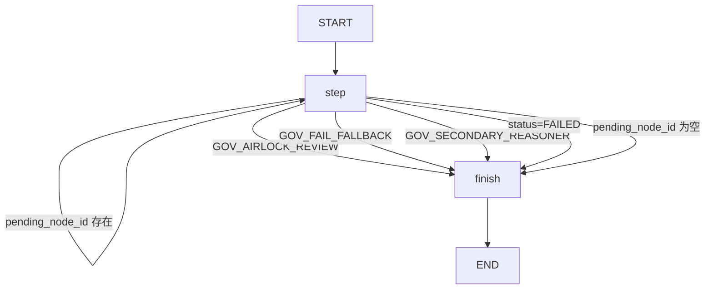

受众：MASTER
标题：Agent 编排详情（当前实现对齐 + 历史草稿）

版本：v1.1
日期：2026-03-18

# 🔀 Agent 编排详情（当前实现对齐）

> 使用优先级：先看本文件“2026-03-18 当前口径”，历史草稿仅作留痕参考。

---

## 0. 2026-03-18 当前口径（优先）

### 0.1 Host/Edge 关键入口

| 侧别 | 路径 | 说明 |
|------|------|------|
| Host | `POST /v1/chat` | 统一聊天入口，返回 SSE |
| Host | `POST /v1/edge/events` | 接收 Edge 事件回流 |
| Host | `POST /v1/agent/run` | Agent Loop SSE |
| Edge | `/v1/edge/*` | speak/barge_in/vts/screenshot/automate/proactive 等 |

### 0.2 /v1/chat 当前调用链

```text
POST /v1/chat
  -> handle_chat
  -> _unified_chat_sse_generator
  -> IntentDecisionEngine.evaluate_intent (Governor)
  -> SceneRouter.route_sse
      -> SCENE_CHAT      : chat_stream_handler
      -> SCENE_VISION_UI : chat_handler_vision
      -> 复杂场景         : chat_handler_complex
          -> resolve_execution_profile
          -> build_*_graph
          -> GraphRuntimeContract.run_graph
```

### 0.3 多 Agent 当前定位

- 默认路径仍是单链路优先（`CHAT_FAST`）。
- 仅在特定执行画像（如 `WORKFLOW_SUPERVISED`）进入监督式多 Agent 分支。
- `agent_dispatch_node` 由 `GraphExecutor` 基于 `active_agent_id` 动态分派，并执行 allowlist 校验。
- 子 Agent 只产出 `AgentArtifact`，最终由 `judge_agent_node` 收口。

### 0.4 代码证据入口

- `host_brain/app/chat_handler.py`
- `host_brain/app/graph/main_chain.py`
- `host_brain/app/graph_config_builder.py`
- `host_brain/app/execution_profile.py`
- `host_brain/integrations/graph_runtime.py`
- `host_brain/integrations/graph_executor.py`
- `host_brain/app/agent_routes.py`

---

## 附录A：2026-03-09 历史草稿（留痕）

> ⚠️ 下述章节保留历史快照，部分路由/节点/模型口径可能与当前代码不一致。

## 一、FastAPI 主控路由总览（历史）

| 方法 | 路径 | 处理函数 | 说明 |
|------|------|----------|------|
| POST | `/v1/chat` | `handle_chat()` | 同步阻塞，完整 Graph 执行，返回 `ChatResponse` JSON |
| GET  | `/v1/chat/stream` | `handle_chat_stream()` | SSE 流式，**绕过 Graph**，直接 `astream_llm_chunks` |
| POST | `/v1/chat/stream` | `handle_chat_stream_post()` | SSE 流式，接受 `ChatRequest` 请求体 |
| POST | `/v1/edge/events` | `receive_edge_events_response()` | Edge 事件回调 |
| GET  | `/health` | `health_check()` | 健康检查 |
| GET  | `/ready` | `environment_readiness()` | 环境就绪检查 |
| GET  | `/obs/metrics` | `obs_metrics()` | 可观测性指标 |

---

## 二、场景路由（pre_intent_classifier，历史）

```
用户输入文本
    │
    ▼ 优先级从高到低
    ├─ 命中截图/屏幕关键词 ──────────────────────────→ SCENE_VISION_UI
    │   (screenshot, 截图, 屏幕, 界面, ui, window...)
    │
    ├─ 命中代码关键词（即使同时命中娱乐词）──────────→ SCENE_WORK_CODE
    │   (code, python, debug, 代码, 编程, 函数...)
    │
    ├─ 命中娱乐关键词（无代码词）────────────────────→ SCENE_CHAT（强制）
    │   (动漫, 电影, 音乐, 游戏, アニメ, 映画...)
    │
    ├─ 命中翻译关键词 ───────────────────────────────→ SCENE_WORK_TRANSLATE
    │   (translate, 翻译, 翻訳, 訳して...)
    │
    ├─ 命中执行意图关键词 ───────────────────────────→ SCENE_EXEC_INTENT
    │   (execute, 执行, 运行, 部署, 安装, 帮我做...)
    │
    └─ 默认 ─────────────────────────────────────────→ SCENE_CHAT
```

> **覆盖机制**：
> - 可通过 `request_body.scene_type` 显式指定场景，跳过分类器
> - 环境变量 `HOST_CHAT_ENABLE_PRECLASSIFIER=false` 可全局禁用分类器

---

## 三、各场景节点编排连线 & 模型配置（历史）

### 场景 A：`SCENE_CHAT`（快速路径，最常见）

```
START
  │
  ▼
┌─────────────────────────────────────────────────────────────────┐
│  chat_direct_ja                                                 │
│  模型：gemini-2.5-flash                                          │
│  超时：max(base_timeout, 10,000ms)  ← 保证不低于 10s            │
│  max_output_tokens：200             ← 限制输出，减少生成时间     │
└─────────────────────────────────────────────────────────────────┘
  │
  ▼
END
```

- fallback_edges：无（单节点，失败即降级到 `SERVICE_UNAVAILABLE`）
- policy_timeout：`max(8,000, min(policy_calc, 12,000))` ms

---

### 场景 B：`SCENE_WORK_CODE`（代码辅助）

```
START
  │
  ▼
core_reasoner_primary（gemini-2.5-pro, 12,000ms）
  │ 正常边
  ▼
workbench_code_assist（gemini-2.5-pro, 10,000ms）
  │
  ▼
consistency_verifier（gemini-2.5-flash-lite, 7,000ms）
  │
  ▼
renderer_ja_c_style（gemini-2.5-flash, 9,000ms）
  │
  ▼
END
```

**fallback_edges：**
- `core_reasoner_primary` → `core_reasoner_secondary`（gemini-2.5-flash, 9,000ms）
- `core_reasoner_secondary` → `consistency_verifier`

---

### 场景 C：`SCENE_WORK_TRANSLATE`（翻译）

```
START
  │
  ▼
core_reasoner_primary（gemini-2.5-pro, 12,000ms）
  │
  ▼
workbench_translate（gemini-2.5-pro, 10,000ms）
  │
  ▼
consistency_verifier（gemini-2.5-flash-lite, 7,000ms）
  │
  ▼
renderer_ja_c_style（gemini-2.5-flash, 9,000ms）
  │
  ▼
END
```

**fallback_edges：**
- `core_reasoner_primary` → `core_reasoner_secondary`（gemini-2.5-flash, 9,000ms）
- `core_reasoner_secondary` → `consistency_verifier`

---

### 场景 D：`SCENE_EXEC_INTENT`（执行意图）

```
START
  │
  ▼
core_reasoner_primary（gemini-2.5-pro, 12,000ms）
  │
  ▼
planner_constraints（gemini-2.5-pro, 8,000ms）
  │
  ▼
tool_planner（gemini-2.5-flash, 8,000ms）
  │
  ▼
safety_verifier（gemini-2.5-flash-lite, 7,000ms）
  │
  ▼
consistency_verifier（gemini-2.5-flash-lite, 7,000ms）
  │
  ▼
renderer_ja_c_style（gemini-2.5-flash, 9,000ms）
  │
  ▼
END
```

**fallback_edges：**
- `core_reasoner_primary` → `core_reasoner_secondary`（gemini-2.5-flash, 9,000ms）
- `core_reasoner_secondary` → `consistency_verifier`

---

### 场景 E：`SCENE_VISION_UI`（视觉/截图）

```
START
  │
  ▼
core_reasoner_primary（gemini-2.5-pro, 12,000ms）
  │
  ▼
planner_constraints（gemini-2.5-pro, 8,000ms）
  │
  ▼
tool_planner（gemini-2.5-flash, 8,000ms）
  │
  ▼
safety_verifier（gemini-2.5-flash-lite, 7,000ms）
  │
  ▼
consistency_verifier（gemini-2.5-flash-lite, 7,000ms）
  │
  ▼
renderer_ja_c_style（gemini-2.5-flash, 9,000ms）
  │
  ▼
END
```

**fallback_edges：**
- `core_reasoner_primary` → `core_reasoner_secondary`（gemini-2.5-flash, 9,000ms）
- `core_reasoner_secondary` → `consistency_verifier`

---

## 四、全节点模型配置汇总表（历史）

| 节点 ID | 角色 | 模型（非CHAT场景） | 模型（CHAT场景） | 超时（非CHAT） | 超时（CHAT） | max_tokens |
|---------|------|-----------------|----------------|-------------|------------|-----------|
| `chat_direct_ja` | 快速对话 | — | **gemini-2.5-flash** | — | **≥10,000ms** | **200** |
| `core_reasoner_primary` | 主推理 | **gemini-2.5-pro** | gemini-2.5-flash | 12,000ms | 5,000ms | — |
| `core_reasoner_secondary` | 降级推理 | gemini-2.5-flash | gemini-2.5-flash | 9,000ms | 3,000ms | — |
| `planner_constraints` | 约束规划 | gemini-2.5-pro | — | 8,000ms | — | — |
| `tool_planner` | 工具规划 | gemini-2.5-flash | — | 8,000ms | — | — |
| `safety_verifier` | 安全验证 | gemini-2.5-flash-lite | — | 7,000ms | — | — |
| `consistency_verifier` | 一致性验证 | gemini-2.5-flash-lite | — | 7,000ms | — | — |
| `renderer_ja_c_style` | 日语渲染 | gemini-2.5-flash | — | 9,000ms | 4,000ms | — |
| `workbench_translate` | 翻译工作台 | gemini-2.5-pro | — | 10,000ms | — | — |
| `workbench_code_assist` | 代码工作台 | gemini-2.5-pro | — | 10,000ms | — | — |

---

## 五、图内治理层（Governor Token 路由，历史）

| `committed_route_token` 值 | 图内行为 |
|---------------------------|---------|
| `GOV_OK_RENDER` | 正常执行，触发 `CommitSnapshot` 生成 |
| `GOV_FAIL_FALLBACK` | 跳过当前节点，直接走 `fallback_map` |
| `GOV_AIRLOCK_REVIEW` | 暂停执行，保存 Checkpoint，等待人工审核 |
| `GOV_SECONDARY_REASONER` | 安全终止，路由到 `finish` |
| `None`（向后兼容） | 保持原有路由逻辑 |

---

## 六、LangGraph 物理拓扑（历史）



> **说明**：LangGraph 实际只有 `step` 和 `finish` 两个**物理节点**。
> `chat_direct_ja`、`core_reasoner_primary` 等是在 `step` 内部通过 `pending_node_id` + `edge_map` 驱动的**逻辑节点**，不是 LangGraph 的物理节点。

---

## 七、流式 Chat 与 Graph Chat 对比（历史）

| 维度 | `/v1/chat`（Graph） | `/v1/chat/stream`（流式） |
|------|-------------------|------------------------|
| 执行路径 | 完整 LangGraph 执行 | 绕过 Graph，直接调用 LLM |
| 响应格式 | JSON `ChatResponse` | SSE `text/event-stream` |
| 场景路由 | 支持全部 5 个场景 | 仅 CHAT 场景 |
| 治理层 | 完整 Governor 治理 | 无治理层 |
| 首字节延迟 | 较高（多节点串行） | 极低（直接流式） |
| 适用场景 | 复杂任务、代码、执行意图 | 日常对话、快速响应 |
