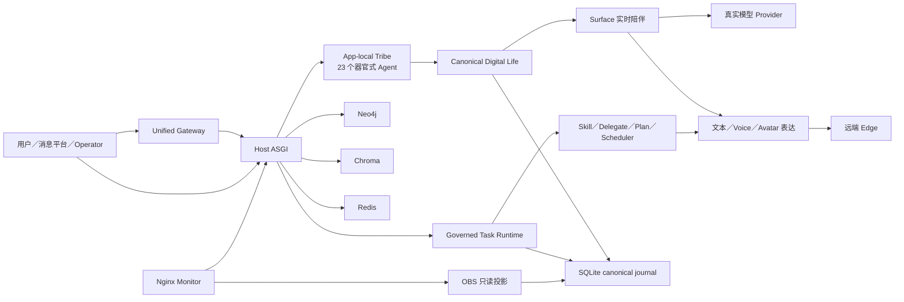

受众：MASTER
标题：Natsume AI 当前架构、双节点环境与验收交接

# Natsume AI 当前架构、双节点环境与验收交接

> 用途：删除 Codex 对话记录前的可持久交接入口。本文区分“当前进程状态”、“已完成的范围限定验收”和“尚未验收”，不将历史回执冒充当前在线状态。快照日期为 2026-08-10。A22 的最终结论以 `runtime/acceptance/a22-final-20260810/evidence-manifest.json` 为机器可读唯一真相；报告内同时固定 commit、migration head、隔离根和各证据 SHA-256。

## 1. 一页结论

| 项目 | 当前结论 |
|---|---|
| 产品定位 | 七海的个人实时情感数字生命，不是通用 Chatbot，也不是 SaaS |
| 整体状态 | A22 自动化范围正在最终冻结；预检已经完成本地全栈、多模态 6、主动陪伴 6、Edge 故障／打断 6、远端 ASR GPU／GPT-SoVITS／声学打断、NE-05 和真实 QQ 自发自收 ACK。A21 仍为 `FAIL_EXTERNAL_LATENCY_BOUND`；人工盲评、训练、三自然日连续性、MiniMax 余额和 VTS 点击授权是明确外部待办，不得冒充完成 |
| Git 真相 | 当前分支为 `dev`。A22 最终 SHA 不在本文自引用，而由 `evidence-manifest.json.repository_commit` 固定；只有该 manifest 为 `PASS` 且 `tracked_worktree_clean=true` 时，才可把 A22 自动化范围写成最终通过 |
| 本机服务现状 | A22 预检期间 Docker 三库、Host、Nginx Monitor、本地 Gateway、Edge SSH 转发和 Host 局域网 TCP 转发处于隔离运行；OBS 会在最终冻结运行重新启动。收口后只清理本轮创建的 A22 资源，不删除历史或用户资源 |
| 本地真实服务栈 | Neo4j、Chroma、Redis 真实写入／重启／重读通过；Host、OBS、Nginx Monitor、Gateway 与真实浏览器曾在同一隔离环境通过 |
| Architecture 2.0 | 非安全静态与主要 Runtime 机械证据大体通过；全系统覆盖率未达门槛，当前 SHA 最终联合验收未完成 |
| 通用搜索 | Research 24 组和 Code 20 组真实双臂收益证据通过；Pentest 依用户要求跳过；生产影响仍关闭 |
| 数字生命 | canonical Life、关系后效和表达协议已接线；A20 新版 48 条真实文本自动 Gate 为 48/48，通过状态仅为 `AUTOMATED_PASS_HUMAN_REVIEW_PENDING`，不得宣称“已经像人”或人工 PASS |
| 语音与 Avatar | 2026-08-10 已复验远端 ASR CUDA READY、GPT-SoVITS READY、单 worker、真实播放、同步 ID、手动与声学 barge-in；VTS 正在等待用户点击授权，因此只记 `ACCEPTANCE_PENDING_EXTERNAL`，不冒充 Avatar PASS |
| 远程 CI | `NOT_RUN_ACCOUNT_QUOTA`，没有删除 workflow，也没有冒充 PASS |

## 2. 当前系统架构



### 2.1 两条主链

**实时陪伴主链**

```text
用户文本／语音／视觉观察
→ UserAffectObservation / AffectFusion
→ EventAppraisal
→ canonical SelfAffect / Episode / Need / Relationship
→ CompanionAct / AffectiveTurnPlan / ExpressionPlan
→ 模型自然措辞
→ 文本、TTS、Avatar
→ accepted outcome / relationship aftereffect
```

用户情绪只是带来源和置信度的观察，不能直接改写七海自身情绪。`Soul.md` 是稳定人格宪法；canonical Digital Life journal 是 self-affect、关系和成长版本的唯一持久写 authority。

无副作用的普通陪伴优先低延迟，不承担重型 TaskGraph 审计。Gateway 回信因需可恢复外发，仍会进入紧凑单节点图和 Outbox。

**受管执行主链**

```text
HostCommand → immutable TaskGraph → Attempt / Lease / Budget / Grant
            → Worker / Tool / External Effect
            → Verification → Acceptance → Outbox → Receipt
```

这条链只服务 Skill、Delegate、Plan、Scheduler、Internal、Operator、Gateway 回信和设备副作，不再反向拖慢普通闲聊。

### 2.2 Tribe 智能体群

Host lifespan 内构造 23 个 app-local 器官式 Agent，分为感知与路由、情感与社会、执行与自主、记忆与语言、身体与稳态、行动与协调、防御与恢复七类。它们不是 23 个独立 LLM，也不是 23 套持久人格；它们产生观察、评估、候选动作和短期状态，长期自我仍只由 canonical Life 保存。

### 2.3 数据与观测

| 存储／进程 | 真实职责 |
|---|---|
| SQLite | Life、关系、TaskGraph、Attempt、Budget、Review、Acceptance、Outbox 与 Receipt 的 canonical ledger |
| Neo4j | 项目／世界图投影，不取代 canonical ledger |
| Chroma | 语义记忆与检索向量 |
| Redis | 锁、限流、竞争与短期缓存 |
| OBS | 从 canonical 数据生成只读投影 |
| Monitor | React/Vite 构建产物，由 Nginx 提供，消费真实 OBS |

## 3. Host 主节点环境

### 3.1 硬件与软件

| 项 | 当前观测 |
|---|---|
| 计算机名 | `YUNSHUIYAO` |
| 系统 | Windows 11 Pro for Workstations `10.0.26200` |
| CPU | AMD Ryzen 7 9800X3D，8 核／16 逻辑核 |
| 内存 | 31.2 GB |
| GPU | NVIDIA GeForce RTX 5080，16303 MiB，驱动 610.74 |
| Python | 3.11.0 |
| Node / npm | Node 24.14.0，npm 11.9.0 |
| Git | 2.52.0.windows.1 |
| Docker | Client 29.2.1；当前 Docker Desktop Linux daemon 未运行 |

### 3.2 网络与端口

| 用途 | 地址 | 说明 |
|---|---|---|
| Host 本机 | `127.0.0.1:18080` | 当前未监听 |
| Host 局域网入口 | `192.168.1.188:18080` | Windows portproxy 转发到 `127.0.0.1:18080`；转发规则当前仍在 |
| Host 以太网地址 | `192.168.1.100/24` | 另一张本地网卡，不是当前 Edge SSH 目标 |
| OBS | `127.0.0.1:18082` | 当前未监听 |
| Nginx Monitor | `127.0.0.1:18180` | 当前未监听 |
| 本地验收 Gateway | `127.0.0.1:29000` | 当前未监听 |
| A19 隔离 Host | `127.0.0.1:32080` | 当前未监听；仅用于 A19 |
| A19 隔离 Gateway | `127.0.0.1:32100` | 当前未监听；仅用于 A19 |
| Edge RPC 本地转发 | `127.0.0.1:17800` | 当前未监听；本轮未请求远端 health |
| Edge Gateway 本地转发 | `127.0.0.1:19000` | 当前未监听 |

### 3.3 运行根与模型路由

- 最后一个 A20 隔离运行根：`D:\Natsume_Ai\runtime\acceptance\a20-final7-f1181ae04-20260809-215626`。
- Host canonical SQLite：`D:\Natsume_Ai\runtime\acceptance\a20-final7-f1181ae04-20260809-215626\host\audit.sqlite3`，停止前约 174 MiB。
- 任务 Workspace：`D:\Natsume_Ai_Acceptance\a20-final7-f1181ae04-20260809-215626\workspaces`。
- 最后使用的 Host 启动环境文件位于运行根下；它包含密钥引用，不得提交、粘贴或对外共享。
- 默认文本 Provider：`deepseek`；Chat、Surface、Cortex、Dispatch、Executive Router、Emotion、SubAgent、Natsume Agent 和各文本 tier 均统一为 `deepseek-v4-flash`。
- `deepseek-v4-flash` 在 RouteCatalog、RouteDecision 和 provider adapter 三层强制 `thinking_mode=disabled`；显式 `enabled` 也不能覆盖这项当前生产策略。
- Gemini 只保留为多模态观察能力和历史候选适配，不再进入默认文本池；文本 Codex migration 在本地运行配置中关闭。
- A19 真实链路最终权威报告：冻结 8 场景 8/8 为 `AUTOMATED_PASS_HUMAN_REVIEW_PENDING`，24/24 轮 Gateway durable outbox 与 surface receipt 均提交，writer probe 通过；24 次成功模型终态和 3 次语义拒绝均为 `deepseek:deepseek-v4-flash`，0 timeout。成功外部调用 latency p50/p95 = 1813/3031ms。所有要求深路径候选证据的最终轮均为双候选、选中项通过且 `benefit_eligible=true`。这证明冻结自动 Gate 通过，不等于三人盲评或新版 48 条人感队列通过。
- A20 最终权威报告：新版 8 个纯文本 family × 6 变体，共 48 条轨迹／144 轮，48/48 为 `AUTOMATED_PASS_HUMAN_REVIEW_PENDING`；144/144 `INPUT_COMPLETED/OK`、TaskGraph `COMPLETED`、`APPROVE`、Gateway durable outbox `COMMITTED` 和 surface receipt 均成立。30 个强制深路径 case 的最终轮全部为双候选、选中项通过且 `benefit_eligible=true`。writer probe 接受 144 轮，canonical writer 全部推进，8 张 legacy table 增量和 4 个 legacy file 变更均为 0。模型审计为 161 个 started、144 个 succeeded、17 个可修复 rejected，所有 attempt 均有唯一终态；0 failed／timeout／cancelled，全部身份为 `deepseek:deepseek-v4-flash`。权威报告 SHA-256 为 `9a4720245f9f97b0c86a2fded3d167b67783090c433491794433ed9d6f12b32b`。人工审核仍为 `PENDING`，不得写成人感人工 PASS。
- Gemini 2.5 候选：`gemini-2.5-flash-lite`；当前 SHA 的 3 轮真实性预检通过，但 8 场景仅 1/8 自动通过、19/24 轮落账，发生 12 次语义拒绝，未提升为默认。
- Gemini 3.6 候选：`gemini-3.6-flash`；A17 worktree 适配将实时车道的 `thinking_mode=disabled` 映射为 `thinking_level=minimal`，并移除 3.6 已弃用的 sampling 参数。3 轮真实性预检 3/3 通过；8 场景仅 2/8 自动通过、18/24 轮落账，发生 3 次语义拒绝和 4 次 15 秒 provider timeout，未提升为默认。
- MiniMax 候选：`MiniMax-M2.7`；实测被 HTTP 402 余额不足阻断，不是质量失败。

### 3.4 最后已验证的 Docker 隔离配置

2026-08-10 A22 预检使用同一组固定镜像，在独立 Compose project、端口和 bind data root 中运行；最终冻结运行仍以 A22 manifest 为准。

| 服务 | 验收项目／容器 | Host 端口 | 固定镜像 digest |
|---|---|---:|---|
| Neo4j | `natsume-a22-preflight-f1181ae04-neo4j` | HTTP 57474，Bolt 57687 | `sha256:409728716bc239f9fa046368ac6ce6ef280f9e5f0bcb7cdd75031a4465cc192d` |
| Chroma | `natsume-a22-preflight-f1181ae04-chroma` | 58000 | `sha256:3a9bcbc609ba6bd42fe3699c2441765d2393143087e814361c5ce5614863419f` |
| Redis | `natsume-a22-preflight-f1181ae04-redis` | 56379 | `sha256:8b81dd37ff027bec4e516d41acfbe9fe2460070dc6d4a4570a2ac5b9d59df065` |

Compose 入口为 `scripts/runtime/docker-compose.external.yml`，正式验收使用非默认端口、独立 bind data root 和 Compose project label。

## 4. Edge 实时节点环境

### 4.1 连接与职责

| 项 | 当前可信信息 |
|---|---|
| SSH | `34145@192.168.1.171` |
| 仓库旧清单 | `configs/deploy/node_inventory_personal_lan.json` 仍写 `192.168.1.101`，这是已知过期配置，恢复时不得照抄 |
| 角色 | 物理实时设备节点：Edge RPC、Unified Gateway、ASR、GPT-SoVITS、扬声器、VTS/VRM/MateEngine |
| Edge RPC | `:17800` |
| Unified Gateway | `:19000` |
| ASR | `:17801` |
| TTS | `:17802` |
| VTube Studio | 本机 WebSocket/API `:8001` |
| Edge 回访 Host | `http://192.168.1.188:18080` |

### 4.2 已知软硬件状态

- 2026-08-10 使用远端 `D:\Natsume_Ai` 和现有虚拟环境启动隔离 Edge；监听 PID 与隔离 `edge.pid` 一致，GPT-SoVITS worker 数为 1。
- 历史真实资源证据的 GPU 为 NVIDIA RTX 3070 Ti 8GB。
- 历史清理 17 个泄漏 GPT-SoVITS worker 后，可用内存约 24.7GB，GPU 使用约 675MB；启动单一真实 worker 后约有 23.6GB 可用内存、GPU 2861/8192MB。这些是历史范围限定样本，不是当前遥测。
- Edge 验收副本曾使用 `D:\Natsume_Ai_acceptance_d7e0cfba8`，数据根为 `D:\Natsume_Ai_acceptance_d7e0cfba8\runtime\edge\acceptance-data`。
- ASR 已通过受控 CUDA DLL 目录恢复为 `device=cuda`、`state=READY`；GPT-SoVITS 为 `backend=gpt_sovits`、`state=READY`。VTS API 明确返回 authentication approval pending，自动重连暂停，未点击授权。

### 4.3 当前语音方案

| 项 | 配置 |
|---|---|
| 展示文本 | 中文 |
| 语音 | 日语 |
| 后端 | GPT-SoVITS V4 |
| 选定方案 | B |
| Voice bank | `configs/voice/gpt_sovits_nanami_v4.json` |
| 推理方式 | 预训练模型 + 参考音频条件 |
| 专用七海微调 checkpoint | 不存在；不得把当前 voice bank 写成“已训练专属模型” |
| T2S 权重 | `GPT_SoVITS/pretrained_models/s1v3.ckpt` |
| VITS 权重 | `GPT_SoVITS/pretrained_models/gsv-v4-pretrained/s2Gv4.pth` |

### 4.4 双端密钥对

只记录变量对，不记录任何值：

```text
EDGE_HMAC_SHARED_KEY
  ↔ HOST_EDGE_RPC_SHARED_KEY

EDGE_GATEWAY_HOST_HMAC_SECRET
  ↔ HOST_EDGE_GATEWAY_HMAC_SECRET

EDGE_GATEWAY_REPLY_HMAC_SECRET
  ↔ HOST_GATEWAY_REPLY_HMAC_SECRET
```

本地私密配置使用 `configs/secrets/secret_store.runtime.local.json` 或启动环境文件，只能运行时注入。仓库只保存 example 和 secret ref。

## 5. 已测试结论

### 5.1 Architecture 2.0 与通用执行

| 范围 | 结论 | 证据边界 |
|---|---|---|
| 非安全静态架构 Gate | `PASS_SCOPE_BOUND` | A01～A08、A10～A11、A13～A14 通过；A09/A12 按用户要求跳过 |
| 全系统 Python 测试 | A22 最终 Gate 待 manifest 固定 | 最近一次基线为 11559 pass、14 skip、0 fail；line 72.22%、branch 55.08%，仍低于 75%／65%。A22 新增回归后的最终数值只从最终 coverage 报告读取 |
| 高风险覆盖 | A22 最终 Gate 待 manifest 固定 | 最近一次基线 line 78.49%、branch 61.75%，低于 90%／85% |
| 改动代码覆盖 | 预检 `PASS` | 最近一次 dirty-worktree 基线 line 95.88%、branch 90.36%，高于 90%／85%；最终提交仍需重跑 |
| Monitor 非安全读模型 | `PASS_SCOPE_BOUND` | line 93.67%，branch 70.83%，function 83.90% |
| 七路受管 Runtime | 预检 `PASS`，最终以 manifest 为准 | `skill/gateway_chat/delegate/plan/scheduler/internal/operator` 已在同一隔离 Host/Gateway 预检；最终提交将重跑并哈希收据 |
| 恢复与 Workspace | `PASS_SCOPE_BOUND` | 多节点 fan-out、Budget 竞争、Review continuation、取消、崩溃恢复、unknown effect reconciliation、Workspace promotion/cleanup 的选定回归通过 |
| 本地真实服务栈 | `PASS_SCOPE_BOUND` | Docker 三库真实读写重启、Host/OBS/Nginx/Gateway、真实 Chrome Monitor、翻译、Memory Store、多 Skill Plan、重复 webhook 通过；远端 Edge 未纳入最终本机收据 |

### 5.2 PlanningSearch

| 域 | 结论 | 真实结果 |
|---|---|---|
| Research | `PASS_REAL_24_PAIRED_EXTERNAL` | 24 组真实双臂；质量提升 0.85416667，bootstrap 95% 下界 0.75，citation validity 1.0，成本比 1.32215978，p95 比 0.98756943，严重错误 0 |
| Code | `PASS_REAL_20_PAIRED_EXTERNAL` | 20 组；selected 20/20 隐藏／静态测试通过，baseline 0/20；40 个真实外部请求和 40 个新 worktree |
| Pentest | `NOT_RUN_USER_SKIPPED` | 用户明确要求跳过，不是 PASS |
| 生产提升 | `OFF` | Research/Code 可产生 promotion proposal，但 `production_influence_enabled=false` |

关键收据 SHA-256：Research `eb17699c0f85b2b9b680f02f5ce1c716726e2f15f2bfd8b72cf437f6c7277894`；Code `9c9938f15d303f5699debc60af5d7ebf09b417f70b4fd2824e8115cf12062170`。

### 5.3 Evolution Lab、Skill、Feedback、Knowledge 与 Identity

| 范围 | 结论 | 证据边界 |
|---|---|---|
| NE-04 Evolution Lab | `PASS` | Research Planning、Proactive、Memory Write 各 baseline/candidate，共 6 个真实 Docker arm；固定 digest、禁网、只读 rootfs、非 root、外部副作用 0；收据 `fddf2471...` |
| NE-05 Skill 生命周期 | 预检 `PASS`，最终以 manifest 为准 | 真实 Skill 专属 Docker Lab、外部 canary、在线 Host activate/review/degrade/rollback 已完成；预检报告 migration 153、全部强制检查通过 |
| NE-06 表达偏好 | `PASS_SCOPE_BOUND` | 真实 Docker 双臂、production Review、3 次真实 DeepSeek Host turn、apply 与 exact rollback，19/19；收据 `8431de7c...`；人感仍未证明 |
| NE-06 Knowledge/Identity | `PASS_SCOPE_BOUND` | 8 Docker arm、4 Review、6 次真实 DeepSeek Host，31/31；Knowledge activate/deprecate 和 Identity exact previous snapshot rollback 通过；收据 `05b95b00...` |

### 5.4 数字生命与人感

| 范围 | 结论 | 真实发现 |
|---|---|---|
| 唯一情感 authority | `PASS_SCOPE_BOUND` | A20 新版 48 条队列共 144/144 个 Gateway/DeepSeek turn 完成；canonical writer 全部推进，8 张 legacy table 增量和 4 个 legacy file 变更均为 0 |
| 范围／隐私／重放 | `PASS_SCOPE_BOUND` | 真实 SQLite 1001 时间推进、4 scope、隐私泄漏 0、重启 digest 一致 |
| 关系后效和 profile rollback | `PASS_SCOPE_BOUND` | 文本策略、Voice/Avatar 协议与 exact predecessor rollback 通过；多日真人关系证据未执行 |
| 旧 48 条真实多轮文本 | `FAIL` | 自动 46 条待人工、2 条失败；单人复核确认模板复用、关系政策口吻、空间／修复表达矛盾；历史收据 `1efd6886...` |
| A20 新版 48 条真实多轮文本 | `AUTOMATED_PASS_HUMAN_REVIEW_PENDING` | 48/48 自动通过，144/144 terminal／TaskGraph／APPROVE／durable outbox／surface receipt 完整；30/30 强制深路径最终选择有效；writer probe 通过，legacy delta 0；权威收据 `9a472024...`。人工盲评未运行，不是人感人工 PASS |
| A21 纯文本首句延迟 | `FAIL_EXTERNAL_LATENCY_BOUND` | 修复评测器和 DeepSeek 慢流式回退后，30/30 轮 `RENDER/COMMIT/APPROVE`；first render p50/p95 = 2790.39/3899.85ms，provider first-token 本身已为 1462.0/2052.6ms，高于 900/1800ms 门槛。代表性 Gateway 6/6 主链与收据完整，但关系修复案例保留 1 个深路径候选质量失败；报告 `730a94ee...`／`d87aa824...` |
| 完整模板删除 | `EXACT_REUSE_REMOVED / MODEL_GENERATION_STILL_FAIL` | 同 3 条 mixed 复验 9/9 落账、exact reuse 0，但 0/3 质量通过；收据 `ab77eb30...` |
| 自然文本留出 | `FAIL` | Flash baseline 1/6，source-bound 候选 2/6；修复略有提升，mixed 无可归因收益 |
| 模型层 Flash 基线 | `FAIL_QUALITY_GATE` | 24/24 落账，8 个诊断仅 3/8 自动通过；人工观察仍有敷衍、替用户管理情绪和公式化修复；收据 `59162da2...` |
| 文本模型统一策略 | `PASS_SCOPE_BOUND / HUMAN_REVIEW_PENDING` | 15 类实际 `.env` 文本路由均解析为 `deepseek:deepseek-v4-flash` 且 `thinking=disabled`。A20 新版 48 条 48/48 自动通过、144/144 轮 durable outbox 与 surface receipt 提交、17 次可修复语义拒绝、0 failed／timeout／cancelled；writer probe 通过，权威收据 SHA-256 为 `9a4720245f9f97b0c86a2fded3d167b67783090c433491794433ed9d6f12b32b`。11 个相关单测文件 577/577、34 个改动 Python 文件 `py_compile` 和 `git diff --check` 通过。该结论只覆盖自动 Gate；三人盲评仍未执行 |
| MiniMax 候选 | `ACCEPTANCE_PENDING_EXTERNAL` | 8 条均在两次真实请求中收到 HTTP 402，零可比较文本；收据 `6bc1e628...` |
| Gemini 2.5 候选 | `FAIL_QUALITY_GATE` | 3/3 真实性预检通过；8 场景 1/8 自动通过、19/24 轮落账、12 次语义拒绝、0 transport timeout；收据 `b814db1e...` |
| Gemini 3.6 Flash 候选 | `FAIL_QUALITY_AND_LATENCY_GATE` | 3/3 真实性预检通过，收据 `c8a68262...`；8 场景 2/8 自动通过、18/24 轮落账、3 次语义拒绝、4 次 15 秒 provider timeout，成功调用 latency p50/p95 = 2484/15078ms；质量收据 `6c10ea08...`。适配通过 78 项定向测试，但仍是未提交 worktree，不是可发布结论 |
| 跨重启连续性 | 结构 `PASS`，人感 `FAIL` | canonical state 与 typed deictic thread 6/6 恢复，但 Flash 回复仍泛化，人工完整通过 0/6；收据 `dbfe4d40...` |
| 真实首句延迟 | `FAIL_EXTERNAL_LATENCY_BOUND` | A21 30 轮最终 first render p50/p95 = 2790.39/3899.85ms；30/30 均为真实 `RENDER/COMMIT/APPROVE`。provider first-token p50/p95 = 1462.0/2052.6ms，供应商分段本身已越过 900/1800ms 目标；不得用 504/841ms 的非可见首事件冒充首句 |
| 三人盲评 | `NOT_RUN` | 不得用当前代理人单人阅读替代 |

A19 修复的是可泛化的运行时约束，而不是降低 Gate：补齐明确留白、混合情绪和关系伤害文本观察；为“道歉未翻篇”和“说了也白说”区分中间态与前向修复；让 canonical REPAIR 覆盖冲突的旧回复复述型 `must_include`；按通用／今晚／到明天拆分留白策略；校准“事件已结束但感受未命名”的合格短回复；并将“空落落／先放着”等擅自命名或搁置表达纳入 typed ambiguous-affect 硬门。

A20 在同一方向继续收口：最近已提交 surface reply 会进入有界对话窗口并阻止相邻轮机械复读；canonical repair 只在已有修复上下文和明确短后续标记下重开；低信息会后场景、未命名感受、重复关系影响和“缺报错正文／代码／复现步骤”的任务交接均有窄硬门或确定性回退。日语 TTS 在安全任务回退时可显式降级为空，不再为配音成对重试耗尽节点预算并阻断中文可见回复。

A20 明确不覆盖：多模态、跨重启、主动陪伴、真实 Edge、Voice／Avatar、Pentest／安全审计、外部平台最终 ACK 和人工盲评。文本 cohort 只断言本地 Gateway durable outbox intake，不断言微信等外部平台已送达。

### 5.5 当前 A22 远端 Edge 真实证据

- Edge RPC 使用真实 HMAC 传输；6 条故障／打断矩阵 6/6 预检通过，覆盖 schema-invalid、错误签名、nonce replay、畸形 barge、空闲 barge 和真实 GPT-SoVITS 播放后手动 barge。
- Voice RPC 与播放事件现会保留同一 `synchronization_id`；真实播放开始和 `TTS_PLAYBACK_INTERRUPTED` 均返回精确 ID，队列最终为 0。报告只声明 Edge 回报播放开始，不冒充真人听音确认。
- ASR GPU 验收为 CUDA READY；真实校准声学输入触发自动 barge-in。最终提交仍会复验并由 A22 manifest 固定 SHA-256。
- VTS 仍是 `authentication approval pending`。除非用户在 VTube Studio 点击授权，否则 Avatar/口型/动作只记 `ACCEPTANCE_PENDING_EXTERNAL`。

## 6. 未测试与未关闭清单

### A22 自动化范围

1. 最终完成条件由 `runtime/acceptance/a22-final-20260810/evidence-manifest.json` 判定：同一最终 commit、migration head 153、隔离运行根、干净 tracked worktree，且所有索引证据都有 SHA-256。
2. 18 条真实驱动已经预检完成：Gemini 3.6 Flash 多模态 6/6、canonical Life 主动陪伴 6/6、远端 Edge 故障／打断 6/6；主动陪伴报告明确没有尝试 Gateway 外发，也不伪造 delivery receipt。
3. 当前已登录 QQ 完成一条明确标注的真实自发自收验收 ACK，并精确读回 message id；这只证明该账号和该平台，不外推微信／Telegram 等平台。
4. 全量、高风险、changed-code coverage Gate 必须在最终 commit 重跑；未达门槛时真实记录 `FAIL_BELOW_GATE`，不能靠排除代码、伪造覆盖或降低门槛改成 PASS。

### 明确外部待办，不阻断 A22 自动化 Goal

1. A20 文本的至少 3 人盲评；自动 48/48 不能升级成人工人感 PASS。
2. A21 的 DeepSeek provider 首 token 外部时延，继续保持 `FAIL_EXTERNAL_LATENCY_BOUND`。
3. MiniMax 余额恢复后的同队列对照。
4. 专属七海 checkpoint 的真实训练、留出盲听和当前 B 方案对照；当前仅为参考音频条件推理。
5. 至少 3 个自然日的真实关系连续性证据。
6. 需要用户在 VTube Studio 点击的 VTS 授权；未授权前 VTS/VRM 不计 PASS。

### 明确跳过，不计入本轮阻断

- Pentest PlanningSearch cohort：`NOT_RUN_USER_SKIPPED`。
- A09 网络安全与 A12 Edge 网络 authority：`NOT_RUN_USER_SKIPPED`。
- Monitor npm security audit：`NOT_RUN_USER_SKIPPED`；`npm ci` 曾报告 7 high、3 moderate，没有被写成 PASS。
- GitHub Actions：`NOT_RUN_ACCOUNT_QUOTA`。

## 7. 恢复工作的正确顺序

1. 先读本文、A22 报告和 `evidence-manifest.json`，不要从旧 Codex 对话推测状态；先验证 manifest 的 commit 是否等于 `git rev-parse HEAD`。
2. 恢复自动化验收时必须新建隔离 acceptance 根，不复用用户正式 Memory、Persona、Gateway 会话或默认 Docker 数据根。
3. 若 A22 manifest 不存在或为 FAIL，按 manifest 的缺失／commit mismatch 列表补跑，不把 `f1181ae` 预检冒充最终提交证据。
4. A22 自动化关闭后，只继续人工盲评、供应商延迟、训练、跨日连续性和 VTS 点击授权等外部待办；它们不能由自动代理伪造。
5. 最终结论只允许 `PASS`、`PASS_SCOPE_BOUND`、`ACCEPTANCE_PENDING_EXTERNAL` 或 `FAIL`。

## 8. 重要文件与证据位置

| 用途 | 位置 |
|---|---|
| 当前机器状态 | `configs/release/current_architecture_status.json` |
| 当前代码架构 | `docs/50_project/arch/CURRENT_CODE_ARCHITECTURE.md` |
| 系统架构 | `docs/50_project/arch/SYSTEM_ARCHITECTURE.md` |
| 部署架构 | `docs/50_project/arch/DEPLOYMENT_ARCHITECTURE.md` |
| 实时验收日志 | `docs/35_quality/LIVE_ACCEPTANCE_VALIDATION.md` |
| 数字生命全栈计划 | `docs/35_quality/DIGITAL_LIFE_FULL_STACK_TEST_PLAN.md` |
| Architecture 2.0 验收计划 | `docs/35_quality/SYSTEM_V2_MASTER_ACCEPTANCE_PLAN.md` |
| 需求到证据追踪 | `docs/60_trace/requirements_trace.md` |
| 本机原始验收数据 | `runtime/acceptance/a15-1c0c225f4-20260807-230003/` |
| Gemini 2.5 模型层复验 | `runtime/acceptance/a16-f1181ae04-20260808-201702/evidence/digital-life/` |
| Gemini 3.6 Flash 模型层复验 | `runtime/acceptance/a17-f1181ae04-20260808-211831/evidence/digital-life/` |
| DeepSeek V4 Flash 非思考模型层复验 | `runtime/acceptance/a18-f1181ae04-20260808-232935/evidence/digital-life/`；权威报告仅为 feasibility `v3` 和 frozen eight `v1`，feasibility `v1/v2` 是参数／适配器预检误调用，不得计入模型结论 |
| A19 DeepSeek 稳定性复验 | `runtime/acceptance/a19-f1181ae04-20260809-001549/evidence/digital-life/deepseek-v4-flash-nonthinking-frozen-eight-v6/dl-live-1786211058045.json`；SHA-256 `24a14771ea590a586bad4c89395eb9f845c8f40f8df4dcf6dcae886215730034` |
| A20 新版 48 条文本权威复验 | `runtime/acceptance/a20-final7-f1181ae04-20260809-215626/evidence/digital-life/full-48-final/dl-live-1786283958004.json`；SHA-256 `9a4720245f9f97b0c86a2fded3d167b67783090c433491794433ed9d6f12b32b`；仅为 `AUTOMATED_PASS_HUMAN_REVIEW_PENDING` |
| A21 首句延迟评测与修复 | `docs/45_testing/test_reports/a21_first_render_latency_20260809.md`；30 轮报告位于 `runtime/acceptance/a21-baseline-f1181ae04-20260809-223504/evidence/latency/zh-buffered-optimal-30/A21_first_render_30.json`，SHA-256 `730a94ee47f031f22b30e0de8f76569625bfca15b0746bd28aec67faa407f24d`；最终 Gateway 2×3 报告 SHA-256 `d87aa824e9cfcf438de770a1c28a876999e86d7a906a8b1a2c02bb6c3dd1fc44` |
| A22 自动化收口说明 | `docs/45_testing/test_reports/a22_automation_acceptance_20260810.md` |
| A22 最终机器证据索引 | `runtime/acceptance/a22-final-20260810/evidence-manifest.json`；文件内记录最终 commit、migration head 153、隔离根、报告摘要和每个证据 SHA-256 |

原始 acceptance 根与 `artifacts/local-gates/` 均占用较多本地空间，且不随 Git 提交保存。删除 Codex 对话不会删除这些文件；若后续要清理工作区磁盘，应先决定是否归档原始收据，不能仅留 SHA-256 就认为仍可复核。

## 9. 删除 Codex 对话前的保留提示

- 已跟踪代码和文档已通过 PR #215 保存在远端 `dev`；对话本身不是代码唯一存储。
- `Codex-Dream-Skin-reference/`、`codex-main-*.png` 和 `miku-*.png` 仍是未跟踪本地资产，不在 Git 或远端分支中。删对话不影响它们，删整个工作区则会丢失。
- 任何 secret、用户正文、语料、模型权重、原始音视频和 Docker volume 都不应为了“保留对话上下文”而提交进仓库。

## 10. 状态语义

| 状态 | 含义 |
|---|---|
| `PASS` | 全部强制范围在指定 SHA 上真实通过 |
| `PASS_SCOPE_BOUND` | 只对明确列出的部分成立，不能上升为整体 PASS |
| `PARTIAL` | 生产代码或 authority 已有，但真实调用、恢复或体验证据不完整 |
| `FAIL` | 已运行并明确未达门槛 |
| `NOT_RUN_USER_SKIPPED` | 用户明确跳过，不是 PASS |
| `NOT_RUN_ACCOUNT_QUOTA` | 账户额度导致未运行，不是 CI 通过 |
| `ACCEPTANCE_PENDING_EXTERNAL` | 只缺外部凭据、远端设备、平台客户端或人工评审 |
