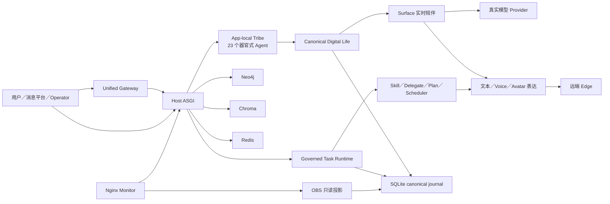

受众：MASTER
标题：Natsume AI 当前架构、双节点环境与验收交接

# Natsume AI 当前架构、双节点环境与验收交接

> 用途：删除 Codex 对话记录前的可持久交接入口。本文区分“当前进程状态”、“已完成的范围限定验收”和“尚未验收”，不将历史回执冒充当前在线状态。快照日期为 2026-08-08。

## 1. 一页结论

| 项目 | 当前结论 |
|---|---|
| 产品定位 | 七海的个人实时情感数字生命，不是通用 Chatbot，也不是 SaaS |
| 整体状态 | `INCOMPLETE`：工程主链大体成立，但人感、实时延迟、当前 Edge 三模态和最终 SHA 全量复验未通过 |
| Git 真相 | 当前工作位于 `codex/system-v2-a15-full-acceptance@b168c4c99`，已推送；校准后相对 `origin/dev@d7e0cfba8` 为落后 0、超前 196，尚未进入 `dev` |
| 本机服务现状 | Docker daemon、Host、OBS 和本地验收 Gateway 当前已停；Nginx Monitor 仍能提供静态页；SSH 本地转发仍监听，但本轮未探测远端 Edge |
| 本地真实服务栈 | Neo4j、Chroma、Redis 真实写入／重启／重读通过；Host、OBS、Nginx Monitor、Gateway 与真实浏览器曾在同一隔离环境通过 |
| Architecture 2.0 | 非安全静态与主要 Runtime 机械证据大体通过；全系统覆盖率未达门槛，当前 SHA 最终联合验收未完成 |
| 通用搜索 | Research 24 组和 Code 20 组真实双臂收益证据通过；Pentest 依用户要求跳过；生产影响仍关闭 |
| 数字生命 | canonical Life、关系后效和表达协议已接线；48 条真实文本人感验收明确失败，不得宣称“已经像人” |
| 语音与 Avatar | 历史远端证据证明 GPT-SoVITS 物理播放和手动打断；当前 Edge/VTS 状态未复验，不是当前 PASS |
| 远程 CI | `NOT_RUN_ACCOUNT_QUOTA`，没有删除 workflow，也没有冒充 PASS |

## 2. 当前系统架构



### 2.1 两条主链

**实时陪伴主链**

```text
用户文本／语音／视觉观察
→ UserAffectObservation / AffectFusion
→ EventAppraisal
→ canonical SelfAffect / Episode / Need / Relationship
→ CompanionAct / AffectiveTurnPlan / ExpressionPlan
→ 模型自然措辞
→ 文本、TTS、Avatar
→ accepted outcome / relationship aftereffect
```

用户情绪只是带来源和置信度的观察，不能直接改写七海自身情绪。`Soul.md` 是稳定人格宪法；canonical Digital Life journal 是 self-affect、关系和成长版本的唯一持久写 authority。

无副作用的普通陪伴优先低延迟，不承担重型 TaskGraph 审计。Gateway 回信因需可恢复外发，仍会进入紧凑单节点图和 Outbox。

**受管执行主链**

```text
HostCommand → immutable TaskGraph → Attempt / Lease / Budget / Grant
            → Worker / Tool / External Effect
            → Verification → Acceptance → Outbox → Receipt
```

这条链只服务 Skill、Delegate、Plan、Scheduler、Internal、Operator、Gateway 回信和设备副作，不再反向拖慢普通闲聊。

### 2.2 Tribe 智能体群

Host lifespan 内构造 23 个 app-local 器官式 Agent，分为感知与路由、情感与社会、执行与自主、记忆与语言、身体与稳态、行动与协调、防御与恢复七类。它们不是 23 个独立 LLM，也不是 23 套持久人格；它们产生观察、评估、候选动作和短期状态，长期自我仍只由 canonical Life 保存。

### 2.3 数据与观测

| 存储／进程 | 真实职责 |
|---|---|
| SQLite | Life、关系、TaskGraph、Attempt、Budget、Review、Acceptance、Outbox 与 Receipt 的 canonical ledger |
| Neo4j | 项目／世界图投影，不取代 canonical ledger |
| Chroma | 语义记忆与检索向量 |
| Redis | 锁、限流、竞争与短期缓存 |
| OBS | 从 canonical 数据生成只读投影 |
| Monitor | React/Vite 构建产物，由 Nginx 提供，消费真实 OBS |

## 3. Host 主节点环境

### 3.1 硬件与软件

| 项 | 当前观测 |
|---|---|
| 计算机名 | `YUNSHUIYAO` |
| 系统 | Windows 11 Pro for Workstations `10.0.26200` |
| CPU | AMD Ryzen 7 9800X3D，8 核／16 逻辑核 |
| 内存 | 31.2 GB |
| GPU | NVIDIA GeForce RTX 5080，16303 MiB，驱动 610.74 |
| Python | 3.11.0 |
| Node / npm | Node 24.14.0，npm 11.9.0 |
| Git | 2.52.0.windows.1 |
| Docker | Client 29.2.1；当前 Docker Desktop Linux daemon 未运行 |

### 3.2 网络与端口

| 用途 | 地址 | 说明 |
|---|---|---|
| Host 本机 | `127.0.0.1:18080` | 当前未监听 |
| Host 局域网入口 | `192.168.1.188:18080` | Windows portproxy 转发到 `127.0.0.1:18080`；转发规则当前仍在 |
| Host 以太网地址 | `192.168.1.100/24` | 另一张本地网卡，不是当前 Edge SSH 目标 |
| OBS | `127.0.0.1:18082` | 当前未监听 |
| Nginx Monitor | `127.0.0.1:18180` | PID 17576；`/monitor/index.html` 当前 HTTP 200，但 Host/OBS 不在线时只能视为静态页 |
| 本地验收 Gateway | `127.0.0.1:29000` | 当前未监听 |
| Edge RPC 本地转发 | `127.0.0.1:17800` | SSH PID 56308 仍监听；本轮未请求远端 health |
| Edge Gateway 本地转发 | `127.0.0.1:19000` | 同一 SSH 转发；“有监听”不等于“远端服务可用” |

### 3.3 运行根与模型路由

- 最后一个 A15 隔离运行根：`D:\Natsume_Ai\runtime\acceptance\a15-1c0c225f4-20260807-230003`。
- Host canonical SQLite：`D:\Natsume_Ai\runtime\acceptance\a15-1c0c225f4-20260807-230003\host\audit.sqlite3`，当前约 0.96 GiB。
- 任务 Workspace：`D:\Natsume_Ai_Acceptance\a15-1c0c225f4-20260807-230003\workspaces`。
- 最后使用的 Host 启动环境文件位于运行根下；它包含密钥引用，不得提交、粘贴或对外共享。
- 默认实时陪伴 Provider：`deepseek`。
- 默认 Chat 模型：`deepseek-v4-flash`。
- Surface 可配深路径模型：`deepseek-v4-pro`，历史对照更慢且修复仍偏公式化，未提升为默认。
- Gemini 候选：`gemini-2.5-flash-lite`；`b168c4c99` 已修复原生 JSON schema 参数映射，真实修复后复测被中止。
- MiniMax 候选：`MiniMax-M2.7`；实测被 HTTP 402 余额不足阻断，不是质量失败。

### 3.4 最后已验证的 Docker 隔离配置

当前 daemon 已停，下表是最后一次真实通过的固定配置，不是“容器此刻正在运行”。

| 服务 | 验收项目／容器 | Host 端口 | 固定镜像 digest |
|---|---|---:|---|
| Neo4j | `natsume-a15-1c0c225f4-neo4j` / `19116692896e` | HTTP 47474，Bolt 47687 | `sha256:409728716bc239f9fa046368ac6ce6ef280f9e5f0bcb7cdd75031a4465cc192d` |
| Chroma | `natsume-a15-1c0c225f4-chroma` / `6229373d0767` | 48000 | `sha256:3a9bcbc609ba6bd42fe3699c2441765d2393143087e814361c5ce5614863419f` |
| Redis | `natsume-a15-1c0c225f4-redis` / `bc35612e2532` | 46379 | `sha256:8b81dd37ff027bec4e516d41acfbe9fe2460070dc6d4a4570a2ac5b9d59df065` |

Compose 入口为 `scripts/runtime/docker-compose.external.yml`，正式验收使用非默认端口、独立 bind data root 和 Compose project label。

## 4. Edge 实时节点环境

### 4.1 连接与职责

| 项 | 当前可信信息 |
|---|---|
| SSH | `34145@192.168.1.171` |
| 仓库旧清单 | `configs/deploy/node_inventory_personal_lan.json` 仍写 `192.168.1.101`，这是已知过期配置，恢复时不得照抄 |
| 角色 | 物理实时设备节点：Edge RPC、Unified Gateway、ASR、GPT-SoVITS、扬声器、VTS/VRM/MateEngine |
| Edge RPC | `:17800` |
| Unified Gateway | `:19000` |
| ASR | `:17801` |
| TTS | `:17802` |
| VTube Studio | 本机 WebSocket/API `:8001` |
| Edge 回访 Host | `http://192.168.1.188:18080` |

### 4.2 已知软硬件状态

- 用户已在 Edge 安装 Python；精确 Python patch 版本和当前虚拟环境本轮未重新采集。
- 历史真实资源证据的 GPU 为 NVIDIA RTX 3070 Ti 8GB。
- 历史清理 17 个泄漏 GPT-SoVITS worker 后，可用内存约 24.7GB，GPU 使用约 675MB；启动单一真实 worker 后约有 23.6GB 可用内存、GPU 2861/8192MB。这些是历史范围限定样本，不是当前遥测。
- Edge 验收副本曾使用 `D:\Natsume_Ai_acceptance_d7e0cfba8`，数据根为 `D:\Natsume_Ai_acceptance_d7e0cfba8\runtime\edge\acceptance-data`。
- ASR 最近真实运行因缺少 `cublas64_12.dll` 自动回退 CPU；功能 READY，但 GPU ASR 未恢复。

### 4.3 当前语音方案

| 项 | 配置 |
|---|---|
| 展示文本 | 中文 |
| 语音 | 日语 |
| 后端 | GPT-SoVITS V4 |
| 选定方案 | B |
| Voice bank | `configs/voice/gpt_sovits_nanami_v4.json` |
| 推理方式 | 预训练模型 + 参考音频条件 |
| 专用七海微调 checkpoint | 不存在；不得把当前 voice bank 写成“已训练专属模型” |
| T2S 权重 | `GPT_SoVITS/pretrained_models/s1v3.ckpt` |
| VITS 权重 | `GPT_SoVITS/pretrained_models/gsv-v4-pretrained/s2Gv4.pth` |

### 4.4 双端密钥对

只记录变量对，不记录任何值：

```text
EDGE_HMAC_SHARED_KEY
  ↔ HOST_EDGE_RPC_SHARED_KEY

EDGE_GATEWAY_HOST_HMAC_SECRET
  ↔ HOST_EDGE_GATEWAY_HMAC_SECRET

EDGE_GATEWAY_REPLY_HMAC_SECRET
  ↔ HOST_GATEWAY_REPLY_HMAC_SECRET
```

本地私密配置使用 `configs/secrets/secret_store.runtime.local.json` 或启动环境文件，只能运行时注入。仓库只保存 example 和 secret ref。

## 5. 已测试结论

### 5.1 Architecture 2.0 与通用执行

| 范围 | 结论 | 证据边界 |
|---|---|---|
| 非安全静态架构 Gate | `PASS_SCOPE_BOUND` | A01～A08、A10～A11、A13～A14 通过；A09/A12 按用户要求跳过 |
| 全系统 Python 测试 | 功能结果通过，覆盖率 Gate 失败 | 10786 outcomes，10776 pass，10 skip，0 fail/error；line 68.50%，branch 51.40%，combined 64.27% |
| 高风险覆盖 | `FAIL_BELOW_GATE` | line 78.49%，branch 61.75% |
| 改动代码覆盖 | `FAIL_BELOW_GATE` | line 82.30%，branch 66.39% |
| Monitor 非安全读模型 | `PASS_SCOPE_BOUND` | line 93.67%，branch 70.83%，function 83.90% |
| 七路受管 Runtime | `WIRED`，最终收口未完成 | `skill/gateway_chat/delegate/plan/scheduler/internal/operator` 均有合同和回归；最终 SHA 真实七路联合复验仍待执行 |
| 恢复与 Workspace | `PASS_SCOPE_BOUND` | 多节点 fan-out、Budget 竞争、Review continuation、取消、崩溃恢复、unknown effect reconciliation、Workspace promotion/cleanup 的选定回归通过 |
| 本地真实服务栈 | `PASS_SCOPE_BOUND` | Docker 三库真实读写重启、Host/OBS/Nginx/Gateway、真实 Chrome Monitor、翻译、Memory Store、多 Skill Plan、重复 webhook 通过；远端 Edge 未纳入最终本机收据 |

### 5.2 PlanningSearch

| 域 | 结论 | 真实结果 |
|---|---|---|
| Research | `PASS_REAL_24_PAIRED_EXTERNAL` | 24 组真实双臂；质量提升 0.85416667，bootstrap 95% 下界 0.75，citation validity 1.0，成本比 1.32215978，p95 比 0.98756943，严重错误 0 |
| Code | `PASS_REAL_20_PAIRED_EXTERNAL` | 20 组；selected 20/20 隐藏／静态测试通过，baseline 0/20；40 个真实外部请求和 40 个新 worktree |
| Pentest | `NOT_RUN_USER_SKIPPED` | 用户明确要求跳过，不是 PASS |
| 生产提升 | `OFF` | Research/Code 可产生 promotion proposal，但 `production_influence_enabled=false` |

关键收据 SHA-256：Research `eb17699c0f85b2b9b680f02f5ce1c716726e2f15f2bfd8b72cf437f6c7277894`；Code `9c9938f15d303f5699debc60af5d7ebf09b417f70b4fd2824e8115cf12062170`。

### 5.3 Evolution Lab、Skill、Feedback、Knowledge 与 Identity

| 范围 | 结论 | 证据边界 |
|---|---|---|
| NE-04 Evolution Lab | `PASS` | Research Planning、Proactive、Memory Write 各 baseline/candidate，共 6 个真实 Docker arm；固定 digest、禁网、只读 rootfs、非 root、外部副作用 0；收据 `fddf2471...` |
| NE-05 Skill 生命周期 | `PARTIAL` | 真实 SQLite/文件 authority 19/19；Compiler、签名隔离、篡改拒绝、activate/replay/rollback/degrade 和 active-version 解析通过；真实 Skill 专属 Docker Lab、外部 canary 和在线 Host 激活未验 |
| NE-06 表达偏好 | `PASS_SCOPE_BOUND` | 真实 Docker 双臂、production Review、3 次真实 DeepSeek Host turn、apply 与 exact rollback，19/19；收据 `8431de7c...`；人感仍未证明 |
| NE-06 Knowledge/Identity | `PASS_SCOPE_BOUND` | 8 Docker arm、4 Review、6 次真实 DeepSeek Host，31/31；Knowledge activate/deprecate 和 Identity exact previous snapshot rollback 通过；收据 `05b95b00...` |

### 5.4 数字生命与人感

| 范围 | 结论 | 真实发现 |
|---|---|---|
| 唯一情感 authority | `PASS_SCOPE_BOUND` | 48 条队列共 144/144 个 Gateway/DeepSeek turn 完成，旧情感 writer 增量 0 |
| 范围／隐私／重放 | `PASS_SCOPE_BOUND` | 真实 SQLite 1001 时间推进、4 scope、隐私泄漏 0、重启 digest 一致 |
| 关系后效和 profile rollback | `PASS_SCOPE_BOUND` | 文本策略、Voice/Avatar 协议与 exact predecessor rollback 通过；多日真人关系证据未执行 |
| 48 条真实多轮文本 | `FAIL` | 自动 46 条待人工、2 条失败；单人复核确认模板复用、关系政策口吻、空间／修复表达矛盾；收据 `1efd6886...` |
| 完整模板删除 | `EXACT_REUSE_REMOVED / MODEL_GENERATION_STILL_FAIL` | 同 3 条 mixed 复验 9/9 落账、exact reuse 0，但 0/3 质量通过；收据 `ab77eb30...` |
| 自然文本留出 | `FAIL` | Flash baseline 1/6，source-bound 候选 2/6；修复略有提升，mixed 无可归因收益 |
| 模型层 Flash 基线 | `FAIL_QUALITY_GATE` | 24/24 落账，8 个诊断仅 3/8 自动通过；人工观察仍有敷衍、替用户管理情绪和公式化修复；收据 `59162da2...` |
| MiniMax 候选 | `ACCEPTANCE_PENDING_EXTERNAL` | 8 条均在两次真实请求中收到 HTTP 402，零可比较文本；收据 `6bc1e628...` |
| Gemini 候选 | `CODE_FIXED / REAL_RETEST_PENDING` | 修复前 transport 可达但输出非 JSON；原生 schema 适配已修复并通过 91 项定向测试，修复后真实复验被中止 |
| 跨重启连续性 | 结构 `PASS`，人感 `FAIL` | canonical state 与 typed deictic thread 6/6 恢复，但 Flash 回复仍泛化，人工完整通过 0/6；收据 `dbfe4d40...` |
| 真实首句延迟 | `FAIL` | 10 轮精确提交复验的 first render p50/p95 = 4892.5/9224.4ms，高于 900/1800ms 目标 |
| 三人盲评 | `NOT_RUN` | 不得用当前代理人单人阅读替代 |

### 5.5 历史远端 Edge 真实证据

- ASR 和 GPT-SoVITS TTS 曾进入 READY，短句物理播放完成。
- 修复 worker 泄漏后，干净启动、真实播放和受控 5 秒 READY timeout 都保持单 worker。
- 三轮 Gateway→Host→TaskGraph→Edge 的最终 Voice 回执为 `TTS_PLAYBACK_FINISHED/APPLIED`。
- 手动打断样本为 16ms／31ms；短句冷启播放开始 2641ms，略高于 2500ms 目标；热缓存 admission 样本为 31ms／62ms。这些都是单样本，不是 p95。
- VTS 历史曾留下 26 帧口型和 68 帧恢复动作的范围证据；最近 A15 状态则是 VTS 未连接／未加载模型。两者范围不同，当前结论仍是 `ACCEPTANCE_PENDING_EXTERNAL`。
- 声学自动 barge-in 没有验收。

## 6. 未测试与未关闭清单

### P0：不关闭就不能声称完成

1. **Git 收口**：当前 196 个提交仍不在 `dev`；需要创建中文 PR、合并，再删除本地／远端临时分支。
2. **当前 SHA 最终复验**：所有代码合并后，在同一 SHA、同一 migration head、同一隔离根重跑本地 Docker、Host、OBS、Monitor、Gateway 和七路主链。
3. **数字生命人感**：当前明确失败。需先完成模型层或版本化真实文本方案，再跑新的 48 条多轮队列和至少 3 名评审盲测，目标总体胜率≥65%。
4. **实时性**：first render p50/p95 远高于 900/1800ms；需从模型首句策略、Host admission/context 和 30% 语义重试率下手，不再增加普通对话审计。
5. **18 条真实驱动场景**：多模态、主动陪伴、Edge 故障／打断各 6 条，尚未在真实驱动上完成。
6. **当前 Edge 三模态联合验收**：重新确认 `192.168.1.171` 上的 Edge RPC、Gateway、ASR、TTS、VTS/VRM 当前状态；实测同一 `synchronization_id` 的文本、声音、表情／动作和打断。

### P1：功能已有，但证据不完整

1. Gemini 原生 JSON schema 修复后的真实模型层留出复验。
2. MiniMax 账户有可用余额后的同队列对照。
3. 专属七海语音 checkpoint 的真实训练、留出语音盲听和当前 B 方案对照；当前只是参考音频条件推理。
4. ASR GPU 运行依赖修复，以及真实声学自动 barge-in。
5. NE-05 真实 Skill 专属 Docker Lab、外部 canary、在线 Host activate/degrade/rollback。
6. 关系后效和偏好成长的跨至少 3 天真实互动证据。
7. QQ、微信、Telegram 等真实平台外发 ACK；当前只证明本地 Gateway SQLite transport/Outbox。
8. 全系统、高风险和 changed-code 覆盖率达到已定 Gate。

### 明确跳过，不计入本轮阻断

- Pentest PlanningSearch cohort：`NOT_RUN_USER_SKIPPED`。
- A09 网络安全与 A12 Edge 网络 authority：`NOT_RUN_USER_SKIPPED`。
- Monitor npm security audit：`NOT_RUN_USER_SKIPPED`；`npm ci` 曾报告 7 high、3 moderate，没有被写成 PASS。
- GitHub Actions：`NOT_RUN_ACCOUNT_QUOTA`。

## 7. 恢复工作的正确顺序

1. 先读本文和 `configs/release/current_architecture_status.json`，不要从旧 Codex 对话推测状态。
2. 确认当前分支已进入 `dev`；若未进入，先收口 Git，不要又建深层堆叠分支。
3. 启动新的隔离 acceptance 根，不复用用户正式 Memory、Persona、Gateway 会话或默认 Docker 数据根。
4. 先完成 Gemini 修复后短复验；若仍不足以解决人感，停止 prompt/Gate 微调，转向模型或版本化真实文本训练。
5. 完成新 48 条队列、三人盲评和首句延迟优化。
6. 在用户当次确认 Edge 可用后，再连接 `192.168.1.171`，完成 Voice/Avatar/ASR/barge-in 与 18 条真实驱动场景。
7. 最后在一个 SHA 上运行本地强制全栈收据；结论只允许 `PASS`、`ACCEPTANCE_PENDING_EXTERNAL` 或 `FAIL`。

## 8. 重要文件与证据位置

| 用途 | 位置 |
|---|---|
| 当前机器状态 | `configs/release/current_architecture_status.json` |
| 当前代码架构 | `docs/50_project/arch/CURRENT_CODE_ARCHITECTURE.md` |
| 系统架构 | `docs/50_project/arch/SYSTEM_ARCHITECTURE.md` |
| 部署架构 | `docs/50_project/arch/DEPLOYMENT_ARCHITECTURE.md` |
| 实时验收日志 | `docs/35_quality/LIVE_ACCEPTANCE_VALIDATION.md` |
| 数字生命全栈计划 | `docs/35_quality/DIGITAL_LIFE_FULL_STACK_TEST_PLAN.md` |
| Architecture 2.0 验收计划 | `docs/35_quality/SYSTEM_V2_MASTER_ACCEPTANCE_PLAN.md` |
| 需求到证据追踪 | `docs/60_trace/requirements_trace.md` |
| 本机原始验收数据 | `runtime/acceptance/a15-1c0c225f4-20260807-230003/` |

原始 acceptance 根当前约 1.50GB，`artifacts/local-gates/` 约 5.72GB。两者均不随 Git 提交保存。删除 Codex 对话不会删除这些文件；若后续要清理工作区磁盘，应先决定是否归档原始收据，不能仅留 SHA-256 就认为仍可复核。

## 9. 删除 Codex 对话前的保留提示

- 已跟踪代码和文档已保存在远端工作分支；对话本身不是代码唯一存储。
- `Codex-Dream-Skin-reference/`、`codex-main-*.png` 和 `miku-*.png` 仍是未跟踪本地资产，不在 Git 或远端分支中。删对话不影响它们，删整个工作区则会丢失。
- 任何 secret、用户正文、语料、模型权重、原始音视频和 Docker volume 都不应为了“保留对话上下文”而提交进仓库。

## 10. 状态语义

| 状态 | 含义 |
|---|---|
| `PASS` | 全部强制范围在指定 SHA 上真实通过 |
| `PASS_SCOPE_BOUND` | 只对明确列出的部分成立，不能上升为整体 PASS |
| `PARTIAL` | 生产代码或 authority 已有，但真实调用、恢复或体验证据不完整 |
| `FAIL` | 已运行并明确未达门槛 |
| `NOT_RUN_USER_SKIPPED` | 用户明确跳过，不是 PASS |
| `NOT_RUN_ACCOUNT_QUOTA` | 账户额度导致未运行，不是 CI 通过 |
| `ACCEPTANCE_PENDING_EXTERNAL` | 只缺外部凭据、远端设备、平台客户端或人工评审 |

