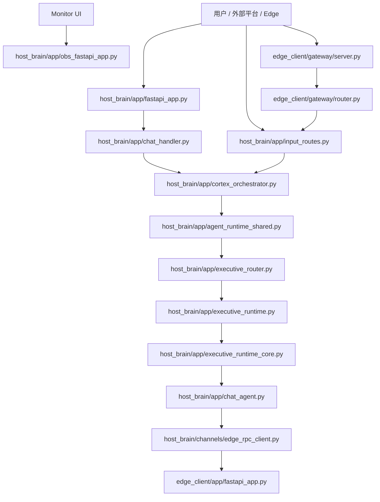

受众：MASTER
标题：核心模块详细参考（当前代码实况）
版本：v2.1
日期：2026-04-19
定位：基于当前仓库真实代码结构，整理当前真正处在主链上的模块、入口关系与职责边界，供故障定位、新成员入门和文档对齐使用。

# 核心模块详细参考（当前代码实况）

## 0. 这份文档回答什么

本文只回答三个问题：

1. 现在真正的入口模块是谁。
2. 从请求进入到结果输出，主链到底经过哪些文件。
3. 哪些模块是“历史设计里重要”，但已经不再是当前代码主链。

## 1. 当前主链总览

## 2. 进程级入口模块

| 模块 | 文件 | 当前职责 | 为什么是核心 |
|---|---|---|---|
| Host 主进程入口 | `host_brain/__main__.py` | 读取环境、执行 startup check、启动 Host Main | 所有主脑流量最终都从这里启动 |
| Observability 入口 | `host_brain/obs_main.py` | 启动独立观测后端 | 当前监控前端的重要后端入口 |
| Edge 入口 | `edge_client/__main__.py` | 装配并启动 Edge RPC | 语音、桌面自动化、VTS 的总入口 |
| Gateway 入口 | `edge_client/gateway/bootstrap.py` | 启动 Unified Message Gateway | 平台消息闭环与外部回复总入口 |

## 3. Host Main 核心入口层

### 3.1 `host_brain/app/fastapi_app.py`

当前职责：

- 创建 Host Main FastAPI app
- 注册 chat / input / tool / bond / canon / scheduler / prompt-config / internal / health / obs / web-ui 路由
- 处理 `/v1/chat`
- 处理 `/v1/edge/events`
- 提供 `/metrics`
- 挂载 `/panel`、`/monitor/*`、`/static/monitor/*`
- 提供 monitor/obs 重定向中间件

为什么核心：

- 它是当前 Host 侧最大的流量汇聚点
- 它决定哪些路由仍在 Host Main 上，哪些可被独立 obs 后端接管

### 3.2 `host_brain/app/obs_fastapi_app.py`

当前职责：

- 启动独立的 Observability FastAPI app
- 预热 runtime snapshot / trace feed / insights summary / digital life overview / life body
- 提供 `/obs/*` 与 `/api/ui/*` 的 Monitor UI 核心只读 API

为什么核心：

- 这是当前“数字生命驾驶舱”后端的真实服务面，而不只是附属指标接口

### 3.3 `host_brain/app/health_routes.py`

当前职责：

- `/health`
- `/ready`
- `/startup`
- `/obs/metrics`
- MCP / canon sync / observability trace 等健康和诊断接口

为什么核心：

- 它是启动、部署、可用性判断的统一出口

## 4. 聊天主链核心模块

### 4.1 `host_brain/app/chat_handler.py`

当前职责：

- `/v1/chat` 的主入口处理
- 调用 `thalamus_agent.classify_and_compile_intent_draft()`
- 构建 emotion / governance snapshot
- 调用 Governor
- 转交 `cortex_orchestrator`

为什么核心：

- 这是“进入主链的第一个真正业务层”

### 4.2 `host_brain/app/cortex_orchestrator.py`

当前职责：

- 作为 Cortex family 的统一入口壳
- 把请求转发到 `_cortex_orchestrator_sse_generator_impl()`

为什么核心：

- 当前链路已经以 `cortex_orchestrator` 为主收口点，而不是旧的 `top_agent`

### 4.3 `host_brain/app/agent_runtime_shared.py`

当前职责：

- 承载 `_cortex_orchestrator_sse_generator_impl()`
- 输入净化、PII scrub
- task progress / recent turn / clarification / phatic 等快路径
- retrieval 启动与等待
- prompt evidence filter
- RecallPackBuilder 组装
- LLM runtime 解析
- 进入 `executive_router`
- 统一 `async_post_process()`

为什么核心：

- 它现在是“聊天中段的真实总装配层”
- 多个旧入口兼容能力已经收口到这里

### 4.4 `host_brain/app/executive_router.py`

当前职责：

- 作为执行层入口壳，把 orchestrator 的结果传给 `executive_runtime`

为什么核心：

- 这是当前调度层与执行层之间最明确的接口边界

### 4.5 `host_brain/app/executive_runtime.py`

当前职责：

- 提供执行层 SSE 入口
- 实现 `recent_turn` / `task_progress` 直达路径
- 为 chat 路由记录 handoff 和 capability telemetry

为什么核心：

- 它是执行层对外的统一门面

### 4.6 `host_brain/app/executive_runtime_core.py`

当前职责：

- `_hard_rule_route()`
- skill/delegate/plan/chat 路由判断
- 器官族路由覆盖
- 可选 `PrefrontalAgent.plan_response()`
- skill 执行、delegate、plan DAG 执行
- 构造 `ChatAgentInput`

为什么核心：

- 这是当前主链真正的“路由与执行引擎”
- 任何把它遗漏掉的链路图，都会把当前架构讲错

### 4.7 `host_brain/app/chat_agent.py`

当前职责：

- 接收 `ChatAgentInput`
- 组装 prompt
- 流式输出 `RENDER` / `SENTENCE` / `COMMIT`
- 统一人格渲染

为什么核心：

- 它是当前用户可见文本的最终生成口
- 但它不再承担路由职责

## 5. 检索、记忆与能力层核心模块

| 模块 | 文件 | 当前职责 |
|---|---|---|
| 检索辅助层 | `host_brain/app/chat_retrieval_helpers.py` | 启动 retrieval、过滤 prompt 证据、构造 recall pack 输入 |
| RecallPack 组装 | `host_brain/app/recall/recall_pack_builder.py` | 将 retrieval 结果裁剪为 prompt 可用 slot |
| 状态仲裁器 | `host_brain/app/memory/state_arbiter.py` | 多状态源优先级裁决 |
| 记忆守卫 | `host_brain/app/memory/memory_guard.py` | 记忆写入资格、幂等、污染拦截 |
| 依赖装配 | `host_brain/app/dependencies.py` | 主链需要的 provider / singleton 装配 |
| 启动预热 | `host_brain/app/startup.py` | Edge 探针、启动预热、warmup |

这些模块不一定总在链路图最上层，但它们共同决定：

- 能否完成 retrieval
- 能否把 recall 注入 prompt
- 能否安全写回记忆
- 能否正确解析 runtime service

## 6. 外部输入与 Gateway 核心模块

### 6.1 `host_brain/app/input_routes.py`

当前职责：

- `/v1/host/input`
- 统一接收 ASR / Gateway 归一化输入
- Gateway 即时 ACK / 进度推送
- 执行质量分析 / 偏航检测 / 重对齐通知
- 内部调用 `cortex_orchestrator`

补充：

- 其他 Edge 运行时事件当前走 `POST /v1/edge/events`，不经过 `POST /v1/host/input`

为什么核心：

- 这是 Gateway 和 ASR 进入主链的统一入口

### 6.2 `edge_client/gateway/bootstrap.py`

当前职责：

- 启动 Gateway
- 装配平台 adapter、router、server、桥接进程/watchdog

### 6.3 `edge_client/gateway/server.py`

当前职责：

- 承接平台 webhook / 网关接口

### 6.4 `edge_client/gateway/router.py`

当前职责：

- 将 `UnifiedMessage` 路由到 Host input 或本地回复链

### 6.5 `edge_client/gateway/outbound.py`

当前职责：

- 将 Host narrative 分发回具体平台 adapter

为什么这 4 个模块一起算核心：

- 它们构成当前“平台消息闭环”的真正链路
- 当前平台适配器已经扩展到 `wechat / qq / feishu / wecom / telegram / line`

## 7. Edge 语音与执行链核心模块

| 模块 | 文件 | 当前职责 |
|---|---|---|
| Edge RPC 入口 | `edge_client/app/fastapi_app.py` | health / speak / barge_in / vts / fallback / screenshot / automate / visual_locate / proactive / wx 查询等端点 |
| Edge 运行时装配 | `edge_client/runtime/bootstrap.py` | 组装 EdgeRuntime、Gateway、语音、Reporter |
| 语音主编排 | `edge_client/runtime/voice_pipeline.py` | 串联 rpc -> queue -> synth -> playback -> vts -> report |
| 语音契约 | `edge_client/rpc/voice.py` | 语音 schema、事件与 ACCEPTED/REJECTED 契约 |
| 资源门控 | `edge_client/rpc/resource_gate.py` | 语音资源互斥与优先级 |
| 播放队列 | `edge_client/actuators/speech.py` | speak / barge-in / playback 状态 |
| TTS 引擎 | `edge_client/actuators/tts_engine.py` | GPT-SoVITS 合成 |
| VTS 驱动 | `edge_client/actuators/vts_driver.py` | 表情、口型、talk gate |
| 事件回传 | `edge_client/rpc/event_reporter.py` | Edge -> Host 事件回流 |

## 8. Observability 与前端核心模块

| 模块 | 文件 | 当前职责 |
|---|---|---|
| Obs 后端入口 | `host_brain/app/obs_fastapi_app.py` | 独立观测服务 |
| Obs 汇总接口 | `host_brain/app/obs_routes_summary.py` | 数字生命体总览、洞察摘要 |
| Obs life-body 接口 | `host_brain/app/obs_routes_life_body.py` | `/obs/life-body`、`/obs/life-timeline`、`/obs/pathologies` 聚合接口 |
| Obs trace 接口 | `host_brain/app/obs_routes_trace.py` | trace、trace feed、tribe events、graph schema |
| Obs 健康接口 | `host_brain/app/obs_routes_health.py` | 服务健康、LLM 节点、organ tribe status |
| Obs 会话接口 | `host_brain/app/obs_routes_sessions.py` | sessions/export |
| Obs 指标接口 | `host_brain/app/obs_routes_metrics.py` | timeseries |
| Web UI 聚合接口 | `host_brain/app/web_ui.py` | `/api/ui/*` 聚合、搜索与链路辅助接口 |
| 前端入口 | `host_brain/app/monitor_ui/src/App.jsx` | 页面路由与 Suspense 入口 |
| 前端导航壳 | `host_brain/app/monitor_ui/src/components/Layout.jsx` | 主导航、轮询、页面结构 |
| 路由懒加载映射 | `host_brain/app/monitor_ui/src/routes/routeLoaders.js` | 页面级 lazy loader 与预取入口 |

补充：

- `DigitalLifeNav.jsx` 当前仓库中仍保留为数字生命体快捷导航组件，但主导航与主路由实际由 `App.jsx`、`Layout.jsx`、`routeLoaders.js` 驱动

## 9. Tribe 层中最关键的控制模块

并不是所有 `tribe/*.py` 都等价重要。对当前主链影响最大的，是这几类：

| 模块 | 文件 | 当前影响 |
|---|---|---|
| 意图编译 | `host_brain/tribe/thalamus_agent.py` | `/v1/chat` 与 `/v1/host/input` 的 canonical intent 收口 |
| 路由覆盖 | `host_brain/tribe/immune_agent.py`、`proprioception_agent.py`、`limbic_agent.py`、`prefrontal_agent.py` | `executive_runtime_core` 路由覆盖与 prefrontal planning |
| 主体注册表 | `host_brain/tribe/registry.py` | 当前 tribe family 列表与 family 解析 |
| 事件总线 | `host_brain/tribe/event_bus.py` | 跨 tribe 事件通信 |

当前必须特别注意的一点：

- `registry.py` 里现在是 `23` 个 family spec，不是旧文档里的 `22`

## 10. 哪些模块已不应再被当作“当前核心入口”

以下文件在当前仓库中已不存在，不应继续出现在“当前主链图”里：

- `host_brain/app/top_agent.py`
- `host_brain/app/dispatch_agent.py`
- `host_brain/app/chat_handler_complex.py`
- `host_brain/app/graph/main_chain.py`

对应地，下列旧名词也不应再用于描述当前代码：

- `SceneRouter.route_sse`
- `MainChain`
- `SCENE_GATEWAY -> top_agent`
- `dispatch_agent 主调度`

## 11. 使用建议

如果要查问题，推荐顺序：

1. 入口问题：`fastapi_app.py` / `obs_fastapi_app.py` / `edge_client/app/fastapi_app.py`
2. 聊天链问题：`chat_handler.py` → `agent_runtime_shared.py` → `executive_runtime_core.py` → `chat_agent.py`
3. 输入回流问题：`input_routes.py` → `cortex_orchestrator.py`
4. 平台消息问题：`gateway/server.py` → `gateway/router.py` → `input_routes.py`
5. 语音执行问题：`edge_client/runtime/bootstrap.py` → `voice_pipeline.py` → `speech.py` / `tts_engine.py` / `vts_driver.py`
