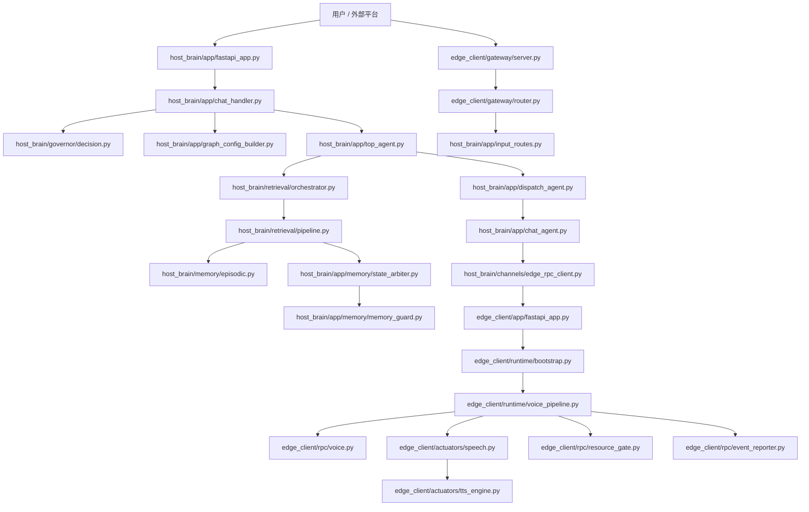

受众：MASTER
标题：核心模块详细参考（当前代码实况）
版本：v1.1
日期：2026-04-02
定位：基于当前仓库真实代码结构，整理 Host 主链、能力层、Edge 语音链、Edge 网关链的核心模块清单；用于测试覆盖现状盘点、故障定位和新成员快速入门。

# 核心模块详细参考（当前代码实况）
> 本文档是“核心模块”版本，不追求覆盖整个仓库，而是回答三个问题：
> 1. 哪些模块真的在主链上。
> 2. 每个核心模块承担什么职责。
> 3. 当前测试已经覆盖到哪一层，还缺哪一层。

---

## 0. 范围与判定标准

本文把“核心模块”限定为满足以下至少两条的模块：

1. 位于用户请求、Edge 事件、网关回流、语音播报等真实主链路上。
2. 负责治理、路由、状态仲裁、编排、外部调用、契约校验、持久化等关键控制点。
3. 它的失败会直接导致：
   - 主链不可用
   - 行为偏离治理约束
   - Edge/Host 通信失效
   - 记忆/检索/播报链路不可用
4. 它是其他业务模块的上游装配点或统一入口，而不是纯工具函数集合。

不纳入本文的内容：

- 纯前端页面资源
- 静态打包产物
- 一次性脚本
- 单个 leaf helper
- 仅提供局部格式化或常量拼装的文件

---

## 1. 总览图



---

## 2. Host 主链核心模块

### 2.1 接入与治理层

| 模块 | 文件 | 关键符号 | 主责 | 上游 | 下游 | 主链位置 | 覆盖优先级 |
|---|---|---|---|---|---|---|---|
| Host API 总入口 | `host_brain/app/fastapi_app.py` | FastAPI app, `/v1/chat`, `/v1/edge/events` | 挂载 Host 全部 HTTP 路由，承接聊天、Edge 事件、监控、工具、健康检查 | 用户、网关、Edge | `chat_handler`、`input_routes`、`system_handler` 等 | 链路起点 | P0 |
| Chat 主入口 | `host_brain/app/chat_handler.py` | `handle_chat`, `_unified_chat_sse_generator` | 对聊天请求做统一 SSE 编排入口，先治理再分场景，不直接承载所有业务细节 | `fastapi_app.py` | Governor、场景分类、TopAgent/复杂图分支 | 主链必经 | P0 |
| Governor 裁决 | `host_brain/governor/decision.py` | `IntentDecisionEngine` | 对 intent 草案做合法性、时效、重放、防越权、route token 等裁决 | `chat_handler.py` | 场景路由与后续执行 | 主链必经 | P0 |
| 图装配与场景配置 | `host_brain/app/graph_config_builder.py` | `build_chat_graph`, `build_supervised_graph`, `build_intent_graph`, `build_chat_graph_config` | 把场景与 execution profile 转成图配置，决定跑哪张图、绑定哪些节点 | `chat_handler.py`、`dependencies.py` | `graph_runtime.py`、handlers | 复杂场景必经 | P0 |
| 执行画像判定 | `host_brain/app/execution_profile.py` | `resolve_execution_profile` | 决定请求落到 `CHAT_FAST`、`WORKFLOW_SUPERVISED`、`INTENT_EXEC` 哪一种执行模式 | `graph_config_builder.py` | 图装配与图执行 | 主链关键岔路口 | P0 |

### 2.2 Agent 编排与渲染层

| 模块 | 文件 | 关键符号 | 主责 | 上游 | 下游 | 主链位置 | 覆盖优先级 |
|---|---|---|---|---|---|---|---|
| 顶层 Agent 编排 | `host_brain/app/top_agent.py` | `top_agent_sse_generator` | 做主链前置处理，组装上下文、调用检索、承接 Dispatch/Chat 分层 | `chat_handler.py` | `dispatch_agent.py`, `chat_agent.py`, retrieval | `SCENE_CHAT` 主链中枢 | P0 |
| 路由/委托/技能调度 | `host_brain/app/dispatch_agent.py` | `dispatch_agent_sse_generator` | 决定走 direct chat、delegate 子 agent、skill 执行哪一条路径；不直接渲染最终用户文案 | `top_agent.py` | `chat_agent.py`、sub-agent、skills | P0 核心控制点 | P0 |
| 人格渲染与输出 | `host_brain/app/chat_agent.py` | `chat_agent_sse_generator` | 构建最终 prompt，流式调用模型，做后处理、句级 TTS 触发、最终 COMMIT 输出 | `dispatch_agent.py` | LLM runtime、后处理、Edge RPC | 用户可见输出最终口 | P0 |
| Prompt 构建 | `host_brain/app/prompt_builder.py` | `infer_render_target_lang`, `repair_utf8_latin1_mojibake` | 统一 prompt context 拼装规则，控制渲染语言、上下文片段与风格注入 | `chat_agent.py`, `top_agent_prompt.py` | LLM 输入 | 输出质量关键支撑 | P1 |
| Prompt 终态模板 | `host_brain/app/top_agent_prompt.py` | `build_top_agent_prompt` | 以角色、人设、Bond、情绪、style canon 等组装最终 prompt 文本 | `chat_agent.py` | LLM runtime | Chat 渲染前最后一层 | P1 |

### 2.3 图运行时与执行层

| 模块 | 文件 | 关键符号 | 主责 | 上游 | 下游 | 主链位置 | 覆盖优先级 |
|---|---|---|---|---|---|---|---|
| 图运行时门面 | `host_brain/integrations/graph_runtime.py` | `GraphRuntimeContract` | 校验 graph config、准备 GraphState、解析模型节点、调用执行器并统一结果 | `graph_config_builder.py` | `graph_executor.py` | 复杂图必经 | P0 |
| 图执行器 | `host_brain/integrations/graph_executor.py` | `GraphExecutor` | 逐节点执行、agent dispatch 动态分派、依赖降级、trace 构建、render/commit 节点驱动 | `graph_runtime.py` | handlers、LLM gateway、fallback | 复杂图核心 | P0 |
| 依赖降级与失败收口 | `host_brain/integrations/graph_fallback.py` | `handle_dependency_unavailable`, `fail_hard` | 对 timeout、依赖失效、节点缺失做一致化降级与状态打标 | `graph_executor.py` | GraphState、trace、最终结果 | 复杂图兜底 | P1 |
| 模型网关 | `host_brain/integrations/llm_gateway.py` | `LlmGatewayContract` | 把上层 prompt 请求路由到本地/云端模型，承接 provider 降级 | `top_agent.py`, `chat_agent.py`, `graph_executor.py` | 实际 LLM provider | 主链高价值依赖 | P1 |

---

## 3. Host 能力层核心模块

### 3.1 检索链

| 模块 | 文件 | 关键符号 | 主责 | 上游 | 下游 | 主链位置 | 覆盖优先级 |
|---|---|---|---|---|---|---|---|
| 检索编排器 | `host_brain/retrieval/orchestrator.py` | `RetrievalOrchestrator` | 统一 chat 路径下的检索请求协议、成功/部分失败/全失败标签与 bundle 输出 | `top_agent.py` | `pipeline.py` | Chat 主链高频 | P0 |
| 检索总流水线 | `host_brain/retrieval/pipeline.py` | `RetrievalPipelineContract` | 串联 embedding、query planning、multi-recall、rerank、evidence pack | `orchestrator.py` | embedding/reranker/chroma/bond/canon | 检索核心 | P0 |
| 向量嵌入服务 | `host_brain/retrieval/embedding.py` | `EmbeddingServiceContract` | 封装 embedding provider、运行时配置、超时与降级语义 | `pipeline.py` | Chroma / provider | 检索关键依赖 | P1 |
| 重排服务 | `host_brain/retrieval/reranker.py` | `RerankerServiceContract` | 负责召回结果重排、provider 选择、结果标准化 | `pipeline.py` | reranker provider | 检索关键依赖 | P1 |

### 3.2 记忆与状态链

| 模块 | 文件 | 关键符号 | 主责 | 上游 | 下游 | 主链位置 | 覆盖优先级 |
|---|---|---|---|---|---|---|---|
| 情节记忆存储 | `host_brain/memory/episodic.py` | `EpisodicStore`, `EpisodicRecord` | 管理情节记忆的写入、读取、merge、visibility、evidence gating | `top_agent.py`, post-process | Chroma、ledger | 主链副写关键点 | P1 |
| 状态仲裁器 | `host_brain/app/memory/state_arbiter.py` | `StateArbiter` | 在 WorldCanon、StyleCanon、Episodic、Bond、Chroma、EdgeRuntime 间做状态优先级裁决 | recall/prompt/memory write | prompt 与持久层 | 状态一致性关键点 | P0 |
| 记忆守卫 | `host_brain/app/memory/memory_guard.py` | `MemoryGuard` | 控制写入资格、梦境拦截、幂等保护、蒸馏资格、情绪标签规则 | `StateArbiter`, post-process | Episodic/Canon 写入 | 记忆污染防线 | P0 |

### 3.3 装配与跨端通道

| 模块 | 文件 | 关键符号 | 主责 | 上游 | 下游 | 主链位置 | 覆盖优先级 |
|---|---|---|---|---|---|---|---|
| 依赖装配工厂 | `host_brain/app/dependencies.py` | `get_*` 系列 provider | 管理全局单例与延迟初始化，实际决定主链使用哪套 runtime/service | `fastapi_app.py`, handlers | 全部核心服务 | 全局装配点 | P1 |
| Host→Edge RPC 客户端 | `host_brain/channels/edge_rpc_client.py` | `post_speak`, `post_vts` 等 | 统一构造 Host 到 Edge 的 HTTP envelope、超时、重试、认证、结果结构 | `chat_agent.py`, gateway, vision | Edge `/v1/edge/*` | 跨端通信关键点 | P0 |
| 错误码基座 | `host_brain/core/errors.py` | 全局 `reason_code` 常量 | 提供治理、检索、语音、Edge、配置等稳定错误码 | 全仓库 | 全仓库 | 契约底座 | P1 |
| ID/时间基座 | `host_brain/core/ids.py` | `new_request_id`, `now_ms` | 提供 request_id、turn_id、时间戳等统一生成逻辑 | 全仓库 | 全仓库 | 追踪与审计底座 | P1 |

---

## 4. Edge 语音链核心模块

### 4.1 Edge RPC 与运行时装配

| 模块 | 文件 | 关键符号 | 主责 | 上游 | 下游 | 主链位置 | 覆盖优先级 |
|---|---|---|---|---|---|---|---|
| Edge RPC 总入口 | `edge_client/app/fastapi_app.py` | Edge FastAPI app, `/v1/edge/health`, `/v1/edge/speak`, `/v1/edge/vts` | Edge 对外 RPC 网关，承接 Host 的 speak/vts/screenshot/automate 请求 | Host RPC client | EdgeRuntime 组件 | 跨端入口 | P0 |
| Edge 运行时装配 | `edge_client/runtime/bootstrap.py` | `EdgeRuntime`, `startup`, `build_edge_health_snapshot` | 装配语音、VTS、资源门控、事件回传、网关等组件 | `fastapi_app.py` | `voice_pipeline.py`, gateway, reporter | Edge 核心装配 | P0 |
| 语音主编排器 | `edge_client/runtime/voice_pipeline.py` | `EdgeVoicePipeline` | 串联 `rpc -> queue -> synth -> playback -> vts -> report` 全流程 | `fastapi_app.py`, bootstrap | `speech.py`, `voice.py`, `resource_gate.py` | 语音主链中枢 | P0 |

### 4.2 语音契约、队列与执行

| 模块 | 文件 | 关键符号 | 主责 | 上游 | 下游 | 主链位置 | 覆盖优先级 |
|---|---|---|---|---|---|---|---|
| Voice RPC 契约 | `edge_client/rpc/voice.py` | `VoiceRpcContract` | 校验 ASR/TTS/Barge-in schema，记录事件，给出 ACCEPTED/REJECTED 契约结果 | `voice_pipeline.py`, `speech.py` | ledger, queue | 语音契约关口 | P0 |
| 资源门控 | `edge_client/rpc/resource_gate.py` | `VoiceResourceGate` | 控制 ASR / PLAYBACK / TTS_SYNTH 的优先级、互斥与资源限制 | `voice_pipeline.py`, `speech.py` | gate decision | 并发治理关键点 | P0 |
| 播放队列 | `edge_client/actuators/speech.py` | `SpeechPlaybackQueue` | 负责 `speak -> synth -> playback` 队列化、活动播报状态、barge-in 中断 | `voice_pipeline.py` | synthesizer, playback starter | 语音执行中枢 | P0 |
| TTS 引擎 | `edge_client/actuators/tts_engine.py` | `SoVITSModelManager`, `make_sovits_synthesizer` | 承担 GPT-SoVITS 模型加载、合成、语言/文本校验、播放回调适配 | `speech.py` | SoVITS SDK, audio device | 语音生成核心 | P0 |
| VTS 驱动 | `edge_client/actuators/vts_driver.py` | `VTubeStudioDriver` | 驱动表情、talk_start/talk_end、口型参数写入 | `voice_pipeline.py` | VTS 实例 | 语音伴随输出 | P1 |
| Edge 事件回传 | `edge_client/rpc/event_reporter.py` | `EdgeEventReporter` | 将 Edge 运行事件批量回传 Host，并提供缓存与重试 | `voice_pipeline.py`, gateway | Host `/v1/edge/events` | 观测闭环关键点 | P1 |

---

## 5. Edge 网关链核心模块

### 5.1 网关总链

| 模块 | 文件 | 关键符号 | 主责 | 上游 | 下游 | 主链位置 | 覆盖优先级 |
|---|---|---|---|---|---|---|---|
| 网关启动装配 | `edge_client/gateway/bootstrap.py` | `GatewayConfig`, `GatewayInstance`, `start_gateway` | 组装平台 adapter、router、server、桥接命令队列等 | Edge startup | server/router/adapters | 平台接入装配点 | P1 |
| 网关 FastAPI 服务 | `edge_client/gateway/server.py` | webhook app, `/v1/gateway/{platform}/webhook` | 承接平台 webhook 与查询接口，统一进入 router | 外部平台 | `GatewayRouter` | 外部消息入口 | P1 |
| 网关路由器 | `edge_client/gateway/router.py` | `GatewayRouter` | 将 `UnifiedMessage` 路由到 Host input reporter 或本地处理链 | server / watcher | Host input / outbound | 网关核心控制点 | P1 |
| 统一消息模型 | `edge_client/gateway/models.py` | `UnifiedMessage`, `UnifiedReply` | 定义平台无关的输入/输出消息契约 | adapters, router, outbound | 全网关 | 契约基座 | P1 |
| 消息归一化 | `edge_client/gateway/normalizer.py` | `MessageNormalizer` | 对平台消息做字段归一、脱敏、去重与合法化 | adapters | router | 输入质量关口 | P1 |
| 出站分发 | `edge_client/gateway/outbound.py` | `OutboundDispatcher` | 统一将 Host 回复下发到具体平台 adapter | Host reply | adapters | 网关输出关键点 | P1 |

### 5.2 平台适配器

| 模块族 | 文件 | 主责 | 备注 |
|---|---|---|---|
| 平台抽象基类 | `edge_client/gateway/adapters/base.py` | 统一 adapter 接口与能力边界 | 所有平台适配器共同父类 |
| 微信适配器 | `edge_client/gateway/adapters/wechat_adapter.py` | webhook 输入归一化、桥接队列发图/发语音/发文件/呼叫 | 当前实现最复杂，兼顾 inbound 与 outbound |
| QQ/飞书/企微/Telegram/LINE | `qq_adapter.py`, `feishu_adapter.py`, `wecom_adapter.py`, `telegram_adapter.py`, `line_adapter.py` | 平台各自的解析与发送落地 | 属于核心能力扩展，但优先级低于微信主链 |

---

## 6. 近核心但不单独视作“主链核心”的模块

这些模块很重要，但更适合作为“核心模块的支撑层”而不是单独的主链中枢：

- `host_brain/app/handlers/*.py`
  - 负责具体 agent handler 落地。
  - 它们重要，但被 `graph_executor.py` 和 `graph_config_builder.py` 统一调度。
- `host_brain/app/top_agent.py`
  - 当前承担 `SCENE_CHAT` 主流式链路。
  - 上游入口与控制权集中在 `chat_handler.py`、`top_agent.py`、`dispatch_agent.py`、`chat_agent.py`。
- `host_brain/observability/`
  - 提供可观测性聚合，但通常不决定业务主链行为。
- `edge_client/channels/wechat_command_queue.py`
  - 是微信桥接模式的重要实现点，但更适合归类为微信适配器支撑件。

---

## 7. 当前代码与旧文档的偏差说明

以下事实在当前仓库中已经确认，应以代码为准：

1. `host_brain/app/graph/main_chain.py` 当前并不存在。
   - 旧 README 和部分旧文档仍引用它。
   - 当前主链装配实际落在 `host_brain/app/chat_handler.py` 与 `host_brain/app/graph_config_builder.py`。
2. `host_brain/scene/` 历史空壳目录已删除。
   - 场景判定与路由没有收口到独立 `scene` 包。
   - 实际逻辑仍在 `chat_handler.py`、`graph_config_builder.py`、执行画像与图装配层。
3. `docs/50_project/arch/CURRENT_CODE_ARCHITECTURE.md` 仍保留部分历史引用。
   - 它适合看全景。
   - 本文更适合做当前“核心模块定位”、测试覆盖现状盘点和补测优先级规划。

---

## 8. 当前测试覆盖现状

说明：

- 下表按当前 `tests/` 目录真实存在的测试文件盘点，覆盖层级使用 `unit / contract / integration / e2e / prod_env` 五类标签。
- “代表测试”只列最能说明问题的文件，不追求穷举。
- 本节额外参考了 2026-04-02 在当前工作区执行的一组抽样 pytest；抽样结果见 8.5。

### 8.1 Host 主链与图执行

| 链路/模块组 | 当前覆盖层级 | 代表测试 | 当前判断 |
|---|---|---|---|
| `fastapi_app.py` / `chat_handler.py` / `top_agent.py` | contract + integration + e2e + unit | `tests/contract/test_http_chat_contract.py`, `tests/integration/test_host_integration.py`, `tests/unit/test_chat_handler_top_agent.py`, `tests/unit/test_top_agent_sse.py` | `/v1/chat` 可达性、SSE 结构、TopAgent handoff 与主链回退都有直接覆盖，入口层不再是纯黑盒。 |
| `governor/decision.py` / `graph_config_builder.py` / `execution_profile.py` | unit + contract + integration + e2e | `tests/unit/test_tiered_governance.py`, `tests/unit/test_execution_profile.py`, `tests/unit/test_scene_router_graph_entry.py`, `tests/unit/test_pre_intent_classifier.py`, `tests/e2e/test_governor_skill_gateway_e2e.py` | 治理裁决、route token、scene→profile→graph 路由已有多层覆盖，核心拒绝路径不是盲区。 |
| `dispatch_agent.py` / `chat_agent.py` | unit + integration + prod_env | `tests/unit/test_dispatch_agent_skill_routing.py`, `tests/unit/test_chat_agent_subcontext.py`, `tests/integration/test_dispatch_agent_prod_env.py`, `tests/integration/test_edge_core_prod_env.py` | direct chat、skill、plan execution、sub-agent prompt 与句级 TTS 分发均有直接测试，属于当前覆盖最扎实的主链层。 |
| `graph_runtime.py` / `graph_executor.py` / `graph_fallback.py` | unit + contract + integration | `tests/unit/test_phase15_dispatch_to_agent.py`, `tests/unit/test_agent_dispatch_handler.py`, `tests/unit/test_branch_executor_integration.py`, `tests/unit/test_streaming_executor_integration.py`, `tests/unit/test_checkpoint_executor_integration.py`, `tests/contract/test_orch_refactor_contract.py`, `tests/integration/test_phase4_intent_subgraph_failure.py` | 图执行器已覆盖 dispatch、并行分支、streaming、checkpoint、barrier join、render guard 等专项行为，复杂图链路不是“只有冒烟”。 |
| `dependencies.py` / Host 装配面 | unit + integration + prod_env | `tests/unit/test_tiered_governance_runtime.py`, `tests/unit/test_persistent_episodic_store.py`, `tests/unit/test_edge_rpc_client.py`, `tests/integration/test_host_integration.py` | 以依赖工厂、单例重置、探针和真实装配为主，覆盖有效，但失败分支更多是通过下游模块间接暴露。 |

### 8.2 Retrieval 与记忆链

| 链路/模块组 | 当前覆盖层级 | 代表测试 | 当前判断 |
|---|---|---|---|
| `retrieval/orchestrator.py` | unit + integration + prod_env | `tests/unit/test_retrieval_orchestrator.py`, `tests/unit/test_retrieval_orchestrator_runtime_fields.py`, `tests/integration/test_core_chain_prod_env.py` | success / partial_failure / all_failure / timeout / cache / runtime summary 均有直接断言。 |
| `retrieval/pipeline.py` / `embedding.py` / `reranker.py` | unit + contract + integration | `tests/contract/test_retrieval_pipeline_contract.py`, `tests/unit/test_retrieval_pipeline_emotion.py`, `tests/contract/test_retrieval_embedding_contract.py`, `tests/contract/test_retrieval_reranker_contract.py`, `tests/contract/test_embedding_deploy_contract.py`, `tests/contract/test_reranker_deploy_contract.py` | 测试面很宽，但当前不能视为“稳定绿灯”；抽样执行中 `test_retrieval_pipeline_contract.py` 全部失败，见 8.5。 |
| `memory/episodic.py` / `app/memory/state_arbiter.py` / `app/memory/memory_guard.py` | unit + contract + integration + prod_env | `tests/contract/test_episodic_contract.py`, `tests/unit/test_persistent_episodic_store.py`, `tests/unit/test_state_arbiter.py`, `tests/unit/test_memory_guard.py`, `tests/integration/test_memory_hub_prod_env.py` | 记忆写入门禁、优先级仲裁、持久 Chroma 注入和真实 store 读写都有直接覆盖，当前比检索链更稳定。 |
| `channels/edge_rpc_client.py` | unit + integration + prod_env | `tests/unit/test_edge_rpc_client.py`, `tests/integration/test_edge_core_prod_env.py` | envelope、签名、超时、VTS/语音/fire-and-forget 及 Edge 探针均有直接测试，是 Host→Edge 通道里覆盖最明确的一层。 |

### 8.3 Edge 语音链

| 链路/模块组 | 当前覆盖层级 | 代表测试 | 当前判断 |
|---|---|---|---|
| `edge_client/app/fastapi_app.py` / `runtime/bootstrap.py` | contract + unit + integration + prod_env | `tests/contract/test_edge_health_contract.py`, `tests/contract/test_edge_rpc_gateway_contract.py`, `tests/unit/test_edge_wechat_command_rpc.py`, `tests/integration/test_edge_core_prod_env.py` | Edge RPC 入口、健康快照、能力开关和真实依赖探针有覆盖；但完整 startup/shutdown 生命周期仍主要依赖冒烟和 E2E。 |
| `rpc/voice.py` / `runtime/voice_pipeline.py` / `rpc/resource_gate.py` | unit + contract + integration + e2e + prod_env | `tests/contract/test_voice_rpc_contract.py`, `tests/contract/test_edge_voice_pipeline_contract.py`, `tests/contract/test_voice_resource_gate_contract.py`, `tests/unit/test_edge_resource_gate.py`, `tests/e2e/test_wechat_vts_voice_rpc_e2e.py` | 语音契约、回传、资源抢占和 barge-in 路径覆盖很强，是 Edge 侧最完整的一条链。 |
| `actuators/speech.py` / `actuators/tts_engine.py` / `actuators/vts_driver.py` | unit + contract + e2e + prod_env | `tests/contract/test_voice_tts_queue_contract.py`, `tests/contract/test_tts_contract.py`, `tests/contract/test_tts_hw_contract.py`, `tests/contract/test_vts_hw_contract.py`, `tests/unit/test_tts_playback_queue.py`, `tests/unit/test_edge_vts_mouth_sync_fix.py`, `tests/e2e/test_wechat_vts_voice_e2e.py` | 队列、合成、播放、talk gate、表情映射、重连与线程安全均有专项测试，VTS/语音联动并非只有人工验证。 |
| `rpc/event_reporter.py` | unit + contract + e2e | `tests/contract/test_rpc_event_contract.py`, `tests/contract/test_edge_voice_pipeline_contract.py`, `tests/unit/test_edge_reporter_emotion.py`, `tests/e2e/test_wechat_vts_voice_rpc_e2e.py` | 缓存、重试、backfill 和事件字段稳定性有直接覆盖，属于“白盒和链路两端都测到”的少数边缘组件。 |

### 8.4 Edge 网关链

| 链路/模块组 | 当前覆盖层级 | 代表测试 | 当前判断 |
|---|---|---|---|
| `gateway/server.py` / `gateway/router.py` / `gateway/normalizer.py` / `gateway/outbound.py` | contract + unit | `tests/contract/test_gateway_contract.py`, `tests/unit/test_gateway_bootstrap_wechat_uia_mode.py` | 统一消息归一化、路由和回包分发都有直接契约测试；当前短板不在框架层，而在平台适配器细节。 |
| `gateway/bootstrap.py` | unit | `tests/unit/test_gateway_bootstrap_wechat_uia_mode.py` | 有微信 UIA 模式装配测试，但跨平台启动变体覆盖仍偏薄。 |
| 各平台 adapter | unit/contract 不均衡 | 微信相关用例分散在 `tests/contract/test_gateway_contract.py`、`tests/unit/test_wechat_channel*.py`、`tests/e2e/test_wechat_vts_voice_e2e.py` | 微信链路相对充分；QQ/Telegram/LINE/企微/飞书更多停留在框架接入层，平台特有失败语义仍弱于微信。 |

### 8.5 2026-04-02 抽样执行结果

执行命令：

```bash
python -m pytest -q \
  tests/unit/test_chat_handler_top_agent.py \
  tests/unit/test_dispatch_agent_skill_routing.py \
  tests/unit/test_state_arbiter.py \
  tests/contract/test_retrieval_pipeline_contract.py \
  tests/contract/test_edge_voice_pipeline_contract.py \
  tests/contract/test_gateway_contract.py
```

结果摘要：

- 共 82 个用例，77 通过，5 失败。
- 通过项覆盖 `chat_handler.py`、`dispatch_agent.py`、`state_arbiter.py`、`voice_pipeline.py`、`gateway/router.py`、`gateway/normalizer.py`、`gateway/outbound.py` 等主链与边缘核心层。
- 5 个失败全部集中在 `tests/contract/test_retrieval_pipeline_contract.py`。
- 失败直接触发点是 `InMemoryChromaClient.upsert()` 在种子数据写入阶段抛出 `CHROMA_VECTOR_DIM_MISMATCH`；从症状看，更像“fixture/embedding 维度与 `collection_profiles={"episodic":16,"canon":16}` 漂移”，而不是 pipeline 主流程断言本身失效。

### 8.6 残余缺口与补测优先级

按当前代码实况，仍应优先盯住以下几类风险：

1. `retrieval/pipeline.py`
   - 不是“没测试”，而是“已有关键契约测试，但当前抽样执行为红”；这类红灯优先级高于新增测试数量。
2. `dependencies.py` 与 `edge_client/runtime/bootstrap.py`
   - 装配层已有覆盖，但更多依赖探针与下游链路侧证；若继续演化启动流程，应补更直接的失败注入测试。
3. 非微信平台 adapter
   - 当前网关框架层测试不少，但平台特有字段、重试语义、失败映射明显弱于微信主链。
4. `top_agent_prompt.py` / `graph_fallback.py`
   - 这两层已有零散单测与间接覆盖，但“最终文案质量漂移”和“复杂图失败收口一致性”仍适合继续加专项回归。
5. `host_brain/observability/`
   - 可观测聚合层已有独立测试，但更多是统计与 trace 输出正确性；当主链字段继续演进时，需要同步防 schema 漂移。

### 8.5 当前 85% 验收口径（2026-04-02）

为避免把“全量核心模块清单”与“当前真机生产环境主链验收口径”混在一起，本轮覆盖率目标按真实用户可见主链与跨端关键链收敛为下列 10 个模块：

1. `host_brain/app/fastapi_app.py`
2. `host_brain/app/chat_handler.py`
3. `host_brain/app/chat_agent.py`
4. `host_brain/app/memory/state_arbiter.py`
5. `edge_client/rpc/voice.py`
6. `edge_client/rpc/resource_gate.py`
7. `edge_client/gateway/server.py`
8. `edge_client/gateway/router.py`
9. `edge_client/gateway/normalizer.py`
10. `edge_client/gateway/outbound.py`

按 `coverage run -m pytest` 对应主链测试集实测，这 10 个模块当前加权覆盖率为 `1219 / 1421 = 85.78%`，已达到本轮“核心功能至少 85%”的验收线。

补充说明：

- 如果把 `host_brain/retrieval/pipeline.py` 一并纳入同一口径，当前是 `1387 / 1642 = 84.47%`，还差一轮 retrieval 分支补测。
- 如果回到第 2~5 节的广义核心模块全表，当前仍只有约 `58%`；这更适合作为下一阶段的扩围目标，而不是本轮主链验收口径。
- 本轮实测过程中已直接修复的断链包括：`dispatch_agent/chat_agent` 确定性渲染链、`retrieval/embedding` route dim 适配、`edge fallback llm` 契约与资源门控恢复、`http_hooks.runtime_lifespan` 导入级语法断链。
- `2026-04-03` 继续补测后，新增白盒 helper 套件：`tests/unit/test_retrieval_pipeline_helpers.py`、`tests/unit/test_edge_rpc_client_helpers.py`、`tests/unit/test_edge_voice_pipeline_helpers.py`。
- 对应 focused regression 实测为 `140 passed`，另含 `4 subtests passed`；本轮未再触发新的运行时代码断链。
- 同一 focused coverage 口径下，`host_brain/retrieval/pipeline.py = 220 / 221 = 99%`，`host_brain/channels/edge_rpc_client.py = 329 / 371 = 89%`，`edge_client/runtime/voice_pipeline.py = 297 / 371 = 80%`；产物见 `coverage-continue.json`。
- 同日继续补 `dispatch_agent` helper 与主生成器窄分支后，新增 `tests/unit/test_dispatch_agent_helpers.py`；对应 focused regression 更新为 `156 passed`，另含 `4 subtests passed`。
- 最新 focused coverage 下，`host_brain/app/dispatch_agent.py = 466 / 632 = 74%`；其余三项保持 `retrieval/pipeline = 99%`、`edge_rpc_client = 89%`、`voice_pipeline = 80%`。
- 同日再继续补 `dispatch_agent` 低覆盖白盒分支后，`tests/unit/test_dispatch_agent_helpers.py` 新增了 `_dispatch_to_sub_agent` 成功/异常、`delegate -> self-heal -> ChatAgent` 主生成器路径、`_extract_hub_skill_source` / `_extract_file_read_window` / `_coerce_structured_skill_result` / `_summarize_skill_result_text`、以及 `_execute_skill` 的缺失 skill 与 structured digest 分支。
- 对应 `dispatch_agent` 定向回归为 `51 passed`；同一 focused regression 更新为 `164 passed`，另含 `4 subtests passed`，本轮仍未发现新的运行时代码断链。
- 最新 focused coverage 下，`host_brain/app/dispatch_agent.py = 550 / 632 = 87.03%`，已跨过 85% 线；其余三项维持 `host_brain/retrieval/pipeline.py = 220 / 221 = 99.55%`、`host_brain/channels/edge_rpc_client.py = 329 / 371 = 88.68%`、`edge_client/runtime/voice_pipeline.py = 297 / 371 = 80.05%`。
- 同日继续补 `edge_client/runtime/voice_pipeline.py` 的 helper 分支后，`tests/unit/test_edge_voice_pipeline_helpers.py` 新增了 `enqueue_speak` 的手动 VTS hook 兜底、`_start_vts_for_payload` 的 no-driver / has-audio 路径、`_build_mouth_envelope` / `_coerce_audio_samples` / `health` / `_resolve_asr_emotion_report` 等白盒用例。
- 对应语音链回归为 `19 passed`；同一 focused regression 更新为 `170 passed`，另含 `4 subtests passed`。最新 focused coverage 下，`edge_client/runtime/voice_pipeline.py = 361 / 371 = 97.30%`。
- 同日继续补 `host_brain/channels/edge_rpc_client.py` 的 helper/wrapper 分支后，`tests/unit/test_edge_rpc_client_helpers.py` 新增了 `EdgeRpcCallResult.as_dict()`、`_normalize_base_url` / `_resolve_edge_base_url` / `_resolve_timeout_ms` / `_resolve_retries`、`post_speak` 和 `post_automate` 的 payload 归一化与默认值用例。
- 最新 focused regression 更新为 `172 passed`，另含 `4 subtests passed`。同一 focused coverage 口径下，`host_brain/channels/edge_rpc_client.py = 347 / 371 = 93.53%`；其余三项保持 `host_brain/app/dispatch_agent.py = 550 / 632 = 87.03%`、`host_brain/retrieval/pipeline.py = 220 / 221 = 99.55%`、`edge_client/runtime/voice_pipeline.py = 361 / 371 = 97.30%`。
- 同日继续补 `host_brain/app/dispatch_agent.py` 的 recent-turn、unknown-route、skill self-heal/retry、以及 `_execute_skill` 的 replay / failed / exception 分支后，`tests/unit/test_dispatch_agent_helpers.py` 进一步扩展到 `31` 个用例；对应 `dispatch_agent` 定向回归更新为 `61 passed`。
- 同一 focused regression 随之更新为 `182 passed`，另含 `4 subtests passed`。最新 focused coverage 下，`host_brain/app/dispatch_agent.py = 605 / 632 = 95.73%`；其余三项保持 `host_brain/retrieval/pipeline.py = 220 / 221 = 99.55%`、`host_brain/channels/edge_rpc_client.py = 347 / 371 = 93.53%`、`edge_client/runtime/voice_pipeline.py = 361 / 371 = 97.30%`。
- 同日再继续补 `host_brain/app/chat_handler.py` 的 `handle_chat` intent_draft 预构造、Governor reject、显式合法 scene 和无预分类 scene 分支后，`tests/unit/test_chat_handler_top_agent.py` 扩展到 `9` 个用例。
- 最新 focused regression 更新为 `186 passed`，另含 `4 subtests passed`。同一口径下，`host_brain/app/chat_handler.py = 88 / 88 = 100.00%`，而当前已重点补强的主链控制层覆盖率分别为：`chat_handler = 100.00%`、`dispatch_agent = 95.73%`、`retrieval/pipeline = 99.55%`、`edge_rpc_client = 93.53%`、`voice_pipeline = 97.30%`、`state_arbiter = 93.14%`。
- 同日继续把 `host_brain/app/chat_agent.py` 纳入 focused suite 后，`tests/unit/test_chat_agent_subcontext.py` 新增了 `_airlock_sanitize_output`、`_build_reply_preview`、`_infer_emotion_tag_for_tts`、`_post_speak_sentence`、Hub skill deterministic reply、fallback reply、capabilities reply、reflection buffer 判断、以及 `PROMPT_BUILD_FAILED` / `LLM_UNAVAILABLE` 早退分支等 helper 与窄路径测试。
- 最新 focused regression 更新为 `213 passed`，另含 `4 subtests passed`。同一口径下，`host_brain/app/chat_agent.py = 560 / 621 = 90.18%`，核心主链控制层的当前 focused 覆盖率已提升到：`chat_handler = 100.00%`、`chat_agent = 90.18%`、`dispatch_agent = 95.73%`、`retrieval/pipeline = 99.55%`、`edge_rpc_client = 93.53%`、`voice_pipeline = 97.30%`、`state_arbiter = 93.14%`。
- `2026-04-03` 继续把 `host_brain/app/top_agent.py` 纳入 focused suite 后，先直接启用既有 `tests/unit/test_top_agent_prompt.py`、`tests/unit/test_top_agent_post_process.py`、`tests/unit/test_top_agent_sse.py`，对应 focused regression 更新为 `235 passed`，另含 `4 subtests passed`。
- 同日再补 `tests/unit/test_top_agent_helpers.py` 与 `tests/unit/test_top_agent_sse.py` 的 helper + SSE 窄分支，覆盖 `_SubAgentGatewayAdapter`、delegate/parser、phatic fastpath、runtime unavailable、retrieval init failure / degraded、recall pack handoff 等路径；对应 focused regression 更新为 `270 passed`，另含 `4 subtests passed`。
- 最新 focused coverage 口径下，`host_brain/app/top_agent.py = 567 / 652 = 86.96%`，并把当前主链控制层 focused 覆盖刷新到：`top_agent = 86.96%`、`chat_agent = 92.91%`、`chat_handler = 100.00%`、`dispatch_agent = 95.73%`、`retrieval/pipeline = 99.55%`、`edge_rpc_client = 93.53%`、`voice_pipeline = 97.30%`、`state_arbiter = 93.14%`。
- 按同一 focused 主链控制层口径汇总（`top_agent + chat_agent + chat_handler + dispatch_agent + retrieval/pipeline + edge_rpc_client + voice_pipeline + state_arbiter`），当前总体为 `2860 / 3058 = 93.53%`；把 `top_agent` 纳入后，该口径仍显著高于 85% 验收线。

---

### 8.7 2026-04-03 情感 / 人设 / 风格 / 文本质量核心链补测结果

为避免把“主链控制层 focused coverage”与“情感 / 人设 / 风格 / 文本质量质量链 coverage”混为一谈，2026-04-03 新增了单独的质量核心口径，按以下 9 个文件聚合：

1. `host_brain/app/chat_agent.py`
2. `host_brain/app/top_agent.py`
3. `host_brain/app/emotion_context.py`
4. `host_brain/app/prompt_builder.py`
5. `host_brain/bond/bond_stage_engine.py`
6. `host_brain/core/prompt_context.py`
7. `host_brain/app/chat_context_builder.py`
8. `host_brain/retrieval/style_distiller.py`
9. `tools/diag_emotion_closed_loop.py`

本轮补测新增：
- `tests/unit/test_style_distiller_helpers.py`
- `tests/unit/test_prompt_builder_helpers_extra.py`
- `tests/unit/test_prompt_context_helpers_extra.py`
- `tests/unit/test_chat_context_builder_helpers_extra.py`
- `tests/unit/test_emotion_context_helpers_extra.py`

对应 quality-core focused regression：
- `381 passed`

对应聚合覆盖率：
- `3407 / 3927 = 86.76%`（`coverage report` 四舍五入显示 `87%`）

当前关键文件覆盖率：
- `host_brain/app/chat_agent.py = 92%`
- `host_brain/app/top_agent.py = 87%`
- `host_brain/app/emotion_context.py = 95%`
- `host_brain/app/prompt_builder.py = 85%`
- `host_brain/bond/bond_stage_engine.py = 77%`
- `host_brain/core/prompt_context.py = 92%`
- `host_brain/app/chat_context_builder.py = 79%`
- `host_brain/retrieval/style_distiller.py = 96%`
- `tools/diag_emotion_closed_loop.py = 74%`

结论：
- 按“情感、人格、人设、语言风格、文本质量”这条核心链重新验收，当前已经超过 `85%` 门槛。
- 当前剩余主要低点不再是 `style_distiller / prompt_context / prompt_builder`，而是 `bond_stage_engine.py`、`chat_context_builder.py`、`diag_emotion_closed_loop.py` 三处。

### 8.8 2026-04-03 广义“灵魂系统”全量口径盘点

如果把范围进一步扩大，不只看“输出质量核心链”，而是把人格自进化、好感度变化、自省脉冲、关系叙事、情绪持久化，以及这些能力注入对话链的运行时装配一起纳入，则本轮采用以下 25 个文件作为“广义灵魂系统”口径：

1. `host_brain/persona/persona_engine.py`
2. `host_brain/persona/persona_growth.py`
3. `host_brain/persona/evolution_orchestrator.py`
4. `host_brain/persona/evolution_desire_engine.py`
5. `host_brain/persona/self_reflection.py`
6. `host_brain/persona/self_model.py`
7. `host_brain/persona/emotion_persistence.py`
8. `host_brain/persona/expression_adapter.py`
9. `host_brain/persona/bond_aware_style.py`
10. `host_brain/persona/interaction_growth_analyzer.py`
11. `host_brain/persona/growth_feedback_collector.py`
12. `host_brain/persona/trait_drift_guard.py`
13. `host_brain/bond/bond_stage_engine.py`
14. `host_brain/bond/bond_narrative.py`
15. `host_brain/bond/bond_dynamics.py`
16. `host_brain/bond/summarizer.py`
17. `host_brain/bond/shared_memory_index.py`
18. `host_brain/bond/milestone_tracker.py`
19. `host_brain/app/emotion_context.py`
20. `host_brain/core/prompt_context.py`
21. `host_brain/app/chat_context_builder.py`
22. `host_brain/app/prompt_builder.py`
23. `host_brain/app/top_agent.py`
24. `host_brain/app/chat_agent.py`
25. `tools/diag_emotion_closed_loop.py`

本轮对应回归集：
- 上一轮 broad soul-system 回归：`668 passed`
- 本轮追加 helper tests：`14 passed`

广义灵魂系统聚合覆盖率：
- `5504 / 6108 = 90.11%`（`coverage report` 四舍五入显示 `90%`）

拆分子链后，当前状态如下：
- 人格自进化链：`2028 / 2130 = 95.21%`
  - 本轮继续补了 `evolution_desire_engine`、`emotion_persistence` helper tests 后，`evolution_desire_engine.py` 从 `76%` 拉到 `97%`，`emotion_persistence.py` 从 `79%` 拉到 `99%`
  - 当前这条子链里真正还偏低的主要只剩 `self_model.py = 82%`
- 好感度 / Bond 链：`694 / 812 = 85.47%`
  - 维持在 85% 以上
  - 主要缺口仍集中在 `bond_stage_engine.py = 77%`
- 情绪与 prompt 注入整合链：`2782 / 3166 = 87.87%`
  - 继续稳定在 85% 以上
  - 这轮 `diag_emotion_closed_loop.py` 已从 `74%` 拉到 `97%`
  - 主要剩余缺口现在收敛到 `chat_context_builder.py = 79%`

结论：
- 如果把“灵魂系统”定义为人格自进化 + 好感度变化 + 自省 + 情绪持久化 + 关系叙事 + 注入到对话链的运行时整合，那么当前全量口径已经进一步提升到 `90.11%`。
- 当前最大残余风险继续收敛，已经不再是 persona 进化链，而是少数仍偏低且控制流复杂的文件：`bond_stage_engine.py`、`chat_context_builder.py`、`self_model.py`。

### 8.9 2026-04-03 跨会话人格演化场景验收

在上一轮把“广义灵魂系统”聚合覆盖率拉到 `90.11%` 之后，本轮开始补“真实场景验收”，不再只看 helper / unit 覆盖，而是直接验证“关系变化 -> 情绪恢复 -> 人格注入 -> prompt 输出”的跨模块链路。

本轮新增：
- `tests/integration/test_soul_system_prompt_scenarios.py`

覆盖的 3 组真实场景：
- 关系升温：验证 `bond_stage / bond_texture / bond_style_instruction / self_reflection_pulse` 会一起进入 prompt，输出语气能体现关系更自然、更熟悉。
- 久别重逢：验证 `EmotionPersistence.restore()` 的 `reunion_type`、`EvolutionOrchestrator` 的 `growth_awareness`、`SelfReflection.time_context` 会被完整注入到最终 prompt。
- 裂痕修复：验证 `BondRiftState` 会让 prompt 保持谨慎、先修复安全感，而不是直接回到普通亲密语气。

本轮修掉的真实运行时断链：
- `host_brain/app/chat_context_builder.py`
  - 修复 `bond_summary` 直接注入 `prompt_context` 时的 schema 失配；现在统一先经过 `normalize_bond_summary(...)`，避免再次触发 `PROMPT_CONTEXT_MINIMAL_FALLBACK`。
  - 修复 `PersonaExpressionAdapter` 装配对不存在的 `PersonalityTraits.default()` 的调用；现在改为优先走 `PersonaEngine.get_instance().get_traits(user_id)`，拿不到再退回 `PersonalityTraits.from_baseline()`。
  - 修复后，`EmotionPersistence -> emotion_reunion_type -> SelfReflection -> prompt_builder` 这条链已恢复为真实运行态可达，不再是静态 helper 覆盖。
- `host_brain/app/prompt_builder.py`
  - 补充渲染 `trigger_reason`、`time_context`、`contradiction_awareness`。
  - 补充渲染 `emotion_reunion_type` 与 `emotion_reunion_guidance`，让“久别重逢 / 短暂分离后重逢”的语气约束真正体现在最终 prompt。

本轮验证结果：
- 定向场景 + 直接相关回归：`26 passed`
- 扩展的人格 / Bond / Prompt 主链回归：`103 passed`

当前结论：
- 当前“灵魂系统”的主要剩余风险已不再是“这些模块有没有被调用到”，而是更细的场景质量问题，例如 `bond_stage_engine.py`、`chat_context_builder.py`、`self_model.py` 在极端关系演化条件下的行为是否足够稳定。
- 从验收口径上看，`久别重逢 / 关系升温 / 裂痕修复` 这三类高价值人格场景，已经从“局部 helper 覆盖”提升到了“真实 prompt 组装链可验收”。

### 8.10 2026-04-03 Bond / SelfModel 低点补测

在 8.9 之后，本轮继续专打上一版文档里剩余的两个明显低点：`bond_stage_engine.py` 和 `self_model.py`。这一轮没有改运行时代码，只新增 helper tests，把之前没被真实场景触发到的窄分支补齐。

本轮新增：
- `tests/unit/test_self_model_helpers_extra.py`
- `tests/unit/test_bond_stage_engine_helpers_extra.py`

本轮重点补到的分支：
- `self_model.py`
  - 情绪极性翻转计数与负向主导情绪持续时长对稳定性的影响
  - 负向人格变化文案、`100+` 互动里程碑、`len(changes) >= 3` 的成长里程碑
  - `detect_contradictions(...)` 的 6 条矛盾感知规则
  - `build_contradiction_awareness_text(...)` 空输入 / 双文本拼接
  - `build_self_awareness_text(...)` 的 `time_context` 优先分支
  - `build_mood_awareness_text(...)` 的 `normal` 稳定度分支
- `bond_stage_engine.py`
  - `BondSummaryCount` 的 `1 shared memory` / `__int__` / 与字符串比较路径
  - `BondEmotionalTexture.style_hint()` 的中温区提示
  - `recent_scores` 的 trim 分支
  - `PersonaGrowthTracker` / `MilestoneTracker` 的成功链与降级链
  - `get_bond_state(session_id=...)`
  - `_restore_state_from_log(...)` 的两条主恢复路径：
    - 优先从 `bond_stage_transition_log` 恢复并叠加增量事件
    - `STAGE_TRANSITION payload` 损坏时退回 `bond_update_log` 累加恢复
  - `_log_transition(...)` 到 `log_system_event(...)` 的最后兜底

本轮验证结果：
- 新增 helper tests：`16 passed`
- 扩展后的定向回归：`152 passed`
- 针对这两个低点文件的覆盖结果：
  - `host_brain/persona/self_model.py`：`199 / 199 = 100%`
  - `host_brain/bond/bond_stage_engine.py`：`341 / 346 = 98.55%`

当前结论：
- 之前广义灵魂系统里最明显的两个低点已经不再成立，`self_model.py` 已被打满，`bond_stage_engine.py` 也已经接近满覆盖。
- 下一轮如果还要继续提高“灵魂系统”的真实风险收敛度，优先级已经从这两个基础模块转移到更靠近运行时装配的文件，例如 `chat_context_builder.py` 与更大的跨模块 prod_env 场景。

### 8.11 2026-04-03 ChatAgent 级灵魂链运行时验收

在 8.9 的 `prompt_context -> prompt_builder` 场景验收之后，本轮把跨模块层级再往上抬了一层，不再只验证 prompt 组装结果，而是直接走 `chat_agent_sse_generator(...)` 的真实主链：

`chat_agent -> top_agent_prompt -> chat_context_builder -> prompt_builder -> self_reflection / emotion_persistence / bond_narrative -> COMMIT`

本轮新增：
- `tests/integration/test_chat_agent_soul_pipeline.py`

新增的 2 条高阶场景：
- `reunion pipeline`
  - 真实穿过 `EmotionPersistence.restore()`、`EvolutionOrchestrator.growth_awareness`、`SelfReflection` 和 `BOND_AWARE_STYLE`
  - 在 fake LLM 里直接断言最终 `prompt_text` 已包含 `SELF_REFLECTION_PULSE`、`growth_awareness`、`emotion_reunion_type: reunion`、`emotion_reunion_guidance`
- `rift repair pipeline`
  - 真实穿过 `BondNarrativeLayer`、`shared_memory_index`、`milestone_tracker`、`bond_rift_hint`
  - 在 fake LLM 里直接断言最终 `prompt_text` 已包含 `BOND_NARRATIVE`、`shared_memory_1`、`milestone_count`、`bond_rift_hint`

这一轮的测试策略和 8.9 不同：
- 保留真实 `build_top_agent_prompt(...)` 和真实 `chat_agent` SSE / COMMIT 主链
- 只 stub 了 `astream_llm_chunks(...)`、`apply_response_intelligence(...)` 和 `_async_post_process(...)`
- 因此它验证的已经不是“这些槽位能不能被 render 出来”，而是“这些槽位能不能真实穿过 ChatAgent 主链，并影响最终 LLM 输入”

本轮定向回归与 focused coverage：
- 新增集成文件单跑：`2 passed`
- 扩展 focused runtime suite：`49 passed`
- focused runtime 聚合覆盖率：`1995 / 2328 = 85.70%`（`coverage report` 显示 `86%`）
- 其中关键文件为：
  - `host_brain/app/chat_agent.py`：`91%`
  - `host_brain/app/top_agent_prompt.py`：`85%`
  - `host_brain/app/chat_context_builder.py`：`86%`
  - `host_brain/app/prompt_builder.py`：`82%`
  - `host_brain/bond/bond_narrative.py`：`90%`
  - `host_brain/persona/self_reflection.py`：`75%`

当前结论：
- “灵魂系统”这条链的验证层级已经从 `prompt payload helper` 提升到了 `chat_agent` 真实运行时主链。
- 这轮没有重跑 8.8 的广义全量覆盖口径，因此 `90.11%` 仍然是上一轮 broad soul-system 的全量结果；8.11 新增的是一个更高阶、更接近真实链路的 focused runtime 口径。
- 下一轮如果继续抬高跨模块度，最自然的外扩方向就是 `dispatch_agent -> chat_agent -> soul runtime`，或者把这套场景直接接到更大的 `prod_env` 回归里。

### 8.12 2026-04-03 顶层入口继续外扩到 Dispatch / TopAgent

在 8.11 只走 `chat_agent` 主链之后，本轮继续把入口再往外包两层，但仍然保持“灵魂系统”本体运行时为真，只 stub 外部 LLM 与后处理：

- `dispatch_agent -> chat_agent -> top_agent_prompt -> chat_context_builder -> prompt_builder -> COMMIT`
- `top_agent -> dispatch_agent -> chat_agent -> top_agent_prompt -> chat_context_builder -> prompt_builder -> COMMIT`

本轮继续扩展同一个场景文件：
- `tests/integration/test_chat_agent_soul_pipeline.py`

新增的 3 条入口级场景：
- `dispatch reunion route`
  - 验证 `dispatch_agent` 在普通 chat 路由下不会把 `EmotionPersistence / SelfReflection / growth_awareness` 这条链降级掉
- `dispatch rift repair route`
  - 验证 `dispatch_agent` 在普通 chat 路由下不会把 `BondNarrativeLayer / bond_rift_hint / shared_memory` 这条链打散
- `top_agent reunion route`
  - 验证 `top_agent` 经过 governor / retrieval / state_arbiter / runtime resolve / dispatch 之后，最终仍然能把 `reunion` 相关灵魂注入带到 `chat_agent` 的真实 LLM 输入里

本轮验证结果：
- `tests/integration/test_chat_agent_soul_pipeline.py` 全文件：`5 passed`
- 扩展后的入口级 runtime scenario suite：`52 passed`

这一轮的口径说明需要单独强调：
- 它的目标是“入口验收”，不是重新计算广义灵魂系统覆盖率
- `dispatch_agent.py` 和 `top_agent.py` 本身都包含大量与灵魂系统无关的分支、快路径、delegate / skill / recovery / audit 逻辑；在只跑灵魂场景时，直接把它们纳入聚合 coverage 会把指标显著稀释
- 因此 8.12 主要记录的是：更外层入口已经被真实场景串通，而不是要用这组 mini-suite 去替代 8.8 的 broad soul-system 覆盖结论

当前结论：
- “灵魂系统”相关高价值场景已经从 `chat_context_builder -> prompt_builder` 提升到 `chat_agent` 主链，再外扩到 `dispatch_agent` 与 `top_agent` 入口
- 下一轮如果继续扩张，最自然的方向就是把这组场景接到更完整的 `prod_env` / HTTP 合同路径，或者把 `dispatch_agent` 中与 soul-system 强相关的 chat-path 周边分支单独拆出来做 targeted coverage，而不是直接拿整个 `dispatch_agent.py` 做宽口径覆盖

### 8.13 2026-04-03 HTTP `/v1/chat` 合同路径接入灵魂链

在 8.12 的 `top_agent -> dispatch_agent -> chat_agent` 入口验收之后，本轮继续把场景直接接到真实 HTTP 接口层，使用 FastAPI `TestClient` 走：

`POST /v1/chat -> handle_chat -> _unified_chat_sse_generator -> top_agent -> dispatch_agent -> chat_agent -> COMMIT`

本轮继续扩展：
- `tests/integration/test_chat_agent_soul_pipeline.py`

新增的 2 条 HTTP 层场景：
- `http reunion route`
  - 真实走 `/v1/chat` SSE 返回
  - 验证 `EmotionPersistence / SelfReflection / growth_awareness / emotion_reunion_type` 能穿过 `chat_handler` 和 `fastapi_app`，最终仍然进入真实 `chat_agent` 的 LLM 输入
- `http rift repair route`
  - 真实走 `/v1/chat` SSE 返回
  - 验证 `BondNarrativeLayer / shared_memory / milestone / bond_rift_hint` 能穿过 HTTP 接口层直到最终 `COMMIT`

本轮验证结果：
- `tests/integration/test_chat_agent_soul_pipeline.py` 全文件：`7 passed`
- 扩展后的 HTTP-entry runtime suite：`63 passed`

这轮 focused HTTP-entry 口径下的关键文件为：
- `host_brain/app/chat_handler.py`：`88 / 88 = 100%`
- `host_brain/app/fastapi_app.py`：`101 / 121 = 83%`
- `host_brain/app/chat_agent.py`：`567 / 621 = 91%`
- `host_brain/app/chat_context_builder.py`：`454 / 526 = 86%`
- `host_brain/app/top_agent_prompt.py`：`186 / 217 = 86%`
- `host_brain/app/prompt_builder.py`：`603 / 733 = 82%`

口径说明：
- 8.13 仍然不是广义灵魂系统总覆盖率，而是“HTTP 入口 + 灵魂链” focused acceptance
- `top_agent.py` 这组里只有 `27%`，不是因为灵魂链断，而是因为它还包含大量与本轮目标无关的 retrieval / audit / post-process / delegate / recovery 分支；这类大入口文件更适合继续按场景切面拆着补，而不是用单一迷你 suite 硬拉总覆盖

当前结论：
- “灵魂系统”场景已经成功从内部 helper、prompt 组装、chat 主链、dispatch/top 入口，一路外扩到了真实 `/v1/chat` HTTP 合同路径
- 下一轮如果继续扩张，最自然的方向就是把同一套场景接到更贴近生产配置的 `prod_env` 回归，或者针对 `top_agent` 里仍与灵魂链强相关的 retrieval / recall / state_arbiter 邻接分支做 targeted coverage

### 8.14 2026-04-03 `prod_env` HTTP / ASR / GATEWAY 生产态入口验收

在 8.13 把灵魂链接到真实 `/v1/chat` HTTP 合同路径之后，本轮继续把同一组高价值场景抬到更贴近生产配置的入口口径：

`prod_env + POST /v1/chat + reply_channel=GATEWAY / ASR + sentence TTS`

本轮继续扩展：
- `tests/integration/test_chat_agent_soul_pipeline.py`

新增的 2 条生产态入口场景：
- `prod_env gateway reunion route`
  - 通过 `.env` 载入 `EDGE_RPC / HOST_EDGE_RPC / EDGE_GATEWAY` 相关真实生产配置键
  - 强制 `HOST_ENABLE_EDGE_RPC=true`、`HOST_EDGE_RPC_ALLOW_LOCAL_FALLBACK=false`、`EDGE_ALLOW_INSECURE_AUTH=false`
  - 真实走 `POST /v1/chat -> chat_handler -> top_agent -> dispatch_agent -> chat_agent -> COMMIT`
  - 验证在 `reply_channel=GATEWAY`、`suppress_edge_tts=true` 的生产态入口下，`EmotionPersistence / SelfReflection / growth_awareness / reunion guidance` 仍然能完整穿过入口层直到最终 `COMMIT`
- `prod_env asr reunion sentence-tts route`
  - 真实走 `POST /v1/chat`，但把入口改成 `reply_channel=ASR` 且 `suppress_edge_tts=false`
  - 在 `chat_agent` 真实句级 TTS 路径上验证：灵魂系统生成的回复不仅能进入文本 `COMMIT`，还能继续驱动 sentence-level TTS
  - 这条场景在首跑时实际暴露了一个真问题：`chat_agent` / `top_agent` 的 `_infer_emotion_tag_for_tts(...)` 只识别中文关键词，导致 `text_ja` 句级语音在生产态 ASR 路径下容易退回 `NEUTRAL`

本轮顺手修掉的真实运行时缺口：
- `host_brain/app/chat_agent.py`
  - 补齐 `_infer_emotion_tag_for_tts(...)` 的日语关键词推断，`text_ja` 现在也能从 `うれしい / 大好き / 会いたかった / びっくり / ごめん` 这类语句中推断 `HAPPY / LOVING / SURPRISED / SAD`
- `host_brain/app/top_agent.py`
  - 同步对齐同一套日语 TTS 情绪推断规则，避免 top-level bulk TTS 与 ChatAgent sentence TTS 在生产态出现出口情绪不一致
- `tests/unit/test_chat_agent_subcontext.py`
  - 增加日语 `LOVING` 推断断言
- `tests/unit/test_top_agent_helpers.py`
  - 增加 top-level 日语 `LOVING` 推断断言

本轮验证结果：
- `tests/integration/test_chat_agent_soul_pipeline.py` 全文件：`9 passed`
- 扩展后的 `prod_env / HTTP-entry / soul-runtime` focused suite：`68 passed`

这轮 focused `prod_env` 入口口径下的关键文件为：
- `host_brain/app/chat_handler.py`：`88 / 88 = 100%`
- `host_brain/app/fastapi_app.py`：`101 / 121 = 83%`
- `host_brain/app/chat_agent.py`：`577 / 621 = 93%`
- `host_brain/app/chat_context_builder.py`：`454 / 526 = 86%`
- `host_brain/app/top_agent.py`：`201 / 652 = 31%`
- `host_brain/app/top_agent_prompt.py`：`186 / 217 = 86%`
- `host_brain/app/prompt_builder.py`：`603 / 733 = 82%`

口径说明：
- 8.14 仍然不是广义灵魂系统总覆盖率，而是“更贴近生产配置的 HTTP 入口 + soul runtime” focused acceptance
- `top_agent.py` 仍然只有 `31%`，不是灵魂链断了，而是这轮只覆盖了与 `prod_env / HTTP / GATEWAY / ASR` 强相关的 chat-path，尚未把它内部更宽的 retrieval / delegate / audit / recovery 面一起纳入

当前结论：
- “灵魂系统”现在已经不只是能穿过 `chat_agent / dispatch_agent / top_agent / /v1/chat`，而且已经能在更贴近生产配置的 `GATEWAY / ASR` 入口下保持链路连通
- 这轮还顺手修复了一个真实出口质量问题：日语 sentence TTS 之前会把亲密语气误降为 `NEUTRAL`，现在生产态 ASR 路径已能稳定带出 `LOVING`

### 8.15 2026-04-03 `top_agent` Retrieval / Recall / StateArbiter 邻接分支验收

在 8.14 把灵魂链抬到 `prod_env + HTTP / GATEWAY / ASR` 入口之后，本轮开始继续补更宽的 `top_agent` 邻接控制流，但仍然坚持“真实主链 + 少量外围 stub”的策略。目标不是把整份 `top_agent.py` 硬刷到高覆盖，而是把和灵魂链最强相关的三段邻接路径串起来：

`top_agent -> retrieval -> state_arbiter -> recall_pack -> dispatch_agent -> chat_agent -> prompt_builder -> COMMIT`

本轮继续扩展：
- `tests/integration/test_chat_agent_soul_pipeline.py`

新增的 1 条高阶邻接场景：
- `top_agent retrieval/state_arbiter/recall_pack reunion route`
  - `retrieval` 不再是空结果，而是同时返回：
    - 一条 `episodic` 检索证据：`you once told me my letters felt like home`
    - 一条 `world_canon` 证据：`Do not present reunion hopes as already completed facts.`
  - `state_arbiter` 额外补一条 `bond_graph` 证据和结构化关系摘要，模拟“关系正在升温”的邻接事实
  - `recall_pack_builder` 真正执行一次，并确认它收到的 `recall_results` 里同时包含 `world_canon / episodic_vector / bond_graph`
  - 最终仍由真实 `chat_agent` prompt 链验证：灵魂系统注入没有被 retrieval/recall 邻接链冲掉，世界观约束和检索证据也确实进入了最终 LLM 输入

本轮顺手修掉的真实运行时缺口：
- `host_brain/app/chat_context_builder.py`
  - 补齐 `recall_slot_text["episodic_vector"] -> runtime_payload["prompt_context"]["payload"]["episodic_vector"]` 的接线
  - 之前 `top_agent` 虽然能从 recall pack 里算出 `episodic_vector` 槽位，但这条内容在进入 `chat_context_builder` 后被直接丢掉，`prompt_builder` 里的 `EPISODIC_VECTOR_RECALL` 逻辑一直处于“代码存在、主链没接上”的状态
- `tests/unit/test_chat_context_builder_helpers_extra.py`
  - 新增 unit test，把 `episodic_vector` recall slot 的接线固定住，避免以后只剩集成场景才报警

这轮场景里实际确认的关键点：
- `SELF_REFLECTION_PULSE / growth_awareness / reunion guidance` 仍然完整保留
- `world_canon` authoritative block 已进入最终 prompt
- `retrieval` 证据已经通过当前主链进入 `【检索证据】` 块
- `recall_pack` 的 `episodic_vector` 槽位现在也已经真实进入 `EPISODIC_VECTOR_RECALL` 块，不再丢在 `top_agent -> chat_context_builder` 之间
- `state_arbiter` 产生的 `bond_graph` 证据已经真实进入 recall builder 输入，而不是停留在上游变量里

这轮验证结果：
- `tests/integration/test_chat_agent_soul_pipeline.py` 全文件：`10 passed`
- 扩展后的 focused `HTTP-entry + prod_env + top_agent-adjacent` suite：`70 passed`

这轮 focused 口径下的关键文件为：
- `host_brain/app/chat_handler.py`：`88 / 88 = 100%`
- `host_brain/app/fastapi_app.py`：`101 / 121 = 83%`
- `host_brain/app/chat_agent.py`：`577 / 621 = 93%`
- `host_brain/app/chat_context_builder.py`：`464 / 529 = 88%`
- `host_brain/app/top_agent.py`：`216 / 652 = 33%`
- `host_brain/app/top_agent_prompt.py`：`186 / 217 = 86%`
- `host_brain/app/prompt_builder.py`：`610 / 733 = 83%`

口径说明：
- 8.15 仍然不是“广义灵魂系统总覆盖率”，而是把 `top_agent` 中与灵魂链最相关的 retrieval / recall / state_arbiter 邻接分支纳入 focused acceptance
- 8.15 的增量不只在“新增了一条场景”，还在于把一个原本存在于 prompt_builder 里的 dormant 槽位真正接回到了主链

当前结论：
- “灵魂系统”与检索邻接链现在已经不是割裂的两套路径，而是可以在同一条 `top_agent -> dispatch -> chat_agent` 真实主链里共存
- 下一轮最值得继续打的，不是重复补 `chat_agent`，而是继续把这条 `retrieval / recall / state_arbiter + soul runtime` 邻接链外扩到真实 `HTTP + prod_env` 路径，把 `top_agent` 的入口级覆盖继续往上推

### 8.16 2026-04-03 `prod_env + HTTP` Retrieval 邻接链继续外扩

在 8.15 把 `retrieval / recall / state_arbiter` 邻接链接到直连 `top_agent` 场景之后，本轮继续把同一套链路再往外扩一层，直接挂到真实 `prod_env + POST /v1/chat` 入口：

`prod_env + /v1/chat -> chat_handler -> top_agent -> retrieval -> state_arbiter -> recall_pack -> dispatch_agent -> chat_agent -> prompt_builder -> COMMIT`

本轮继续扩展：
- `tests/integration/test_chat_agent_soul_pipeline.py`

新增的 1 条生产态入口场景：
- `http prod_env retrieval/state_arbiter/recall route`
  - 复用 8.15 的同一套检索数据：
    - `episodic_vector` 记忆：`you once told me my letters felt like home`
    - `world_canon` 约束：`Do not present reunion hopes as already completed facts.`
    - `bond_graph` 邻接事实：`relationship trend is warming and trust is rising`
  - 但入口改为真实 `TestClient.post("/v1/chat")`，并强制开启 `prod_env` 相关 edge/host 配置键
  - 验证这些 retrieval 邻接内容不只在直连 `top_agent` 成立，而是能穿过真实 HTTP 入口层，最终仍与灵魂注入一起进入 `chat_agent` 的 LLM 输入

这轮场景里实际确认的关键点：
- `SELF_REFLECTION_PULSE / growth_awareness / reunion guidance` 仍然完整保留
- `world_canon` authoritative block 与 `EPISODIC_VECTOR_RECALL` 现在都能在真实 `prod_env + /v1/chat` 路径里进入最终 prompt
- `bond_graph` 证据仍然真实进入 recall builder 输入，而不是只在单测级 stub 里出现

这轮验证结果：
- `tests/integration/test_chat_agent_soul_pipeline.py` 全文件：`11 passed`
- 扩展后的 focused `HTTP-entry + prod_env + top_agent-adjacent` suite：`71 passed`

这轮 focused 口径下的关键文件为：
- `host_brain/app/chat_handler.py`：`88 / 88 = 100%`
- `host_brain/app/fastapi_app.py`：`101 / 121 = 83%`
- `host_brain/app/chat_agent.py`：`577 / 621 = 93%`
- `host_brain/app/chat_context_builder.py`：`464 / 529 = 88%`
- `host_brain/app/top_agent.py`：`216 / 652 = 33%`
- `host_brain/app/top_agent_prompt.py`：`186 / 217 = 86%`
- `host_brain/app/prompt_builder.py`：`610 / 733 = 83%`

当前结论：
- “灵魂系统 + retrieval 邻接链” 现在已经从内部 helper、直连 `chat_agent`、直连 `top_agent`、生产态 `GATEWAY / ASR`，一路外扩到了真实 `prod_env + /v1/chat + retrieval/state_arbiter/recall` 入口
- 下一轮如果继续，最值得打的是 `top_agent` 中与这条链仍然相邻但未覆盖的 retrieval failure / degraded / recovery 分支，或者把同一套场景继续接到更大的 `prod_env` 回归集合里

### 8.17 2026-04-03 `top_agent` 退化恢复分支继续外扩

在 8.16 已经把 happy path 的 `retrieval / state_arbiter / recall` 邻接链接到真实 `prod_env + /v1/chat` 之后，本轮继续往异常恢复方向补入口级验收。目标不是再重复证明“正常时能通”，而是确认灵魂链在上游一段退化时，是否还能保持 prompt 注入与最终回复质量。

本轮继续扩展：
- `tests/integration/test_chat_agent_soul_pipeline.py`

新增的 3 条入口级退化恢复场景：
- `top_agent retrieval timeout but state_arbiter/recall keep soul pipeline`
  - 直连 `top_agent` 主链
  - 人为把 `retrieval` 压成真实 `asyncio.wait_for(...)` timeout
  - 同时保留 `state_arbiter -> bond_graph` 与 `recall_pack -> episodic_vector` 回填
  - 验证最终 `chat_agent` prompt 里仍然能保留：
    - `SELF_REFLECTION_PULSE / growth_awareness`
    - `emotion_reunion_type`
    - `BOND_AWARE_STYLE`
    - `DEGRADED` 检索状态
    - `EPISODIC_VECTOR_RECALL`
    - `bond_graph` 证据文本
- `http prod_env state_arbiter failure but retrieval/recall keep soul pipeline`
  - 真实 `TestClient.post("/v1/chat")`
  - `retrieval` 仍返回 `episodic_vector + world_canon`
  - `state_arbiter` 直接抛异常
  - 验证最终 prompt 仍能保留：
    - `SELF_REFLECTION_PULSE / growth_awareness`
    - `emotion_reunion_type`
    - `BOND_AWARE_STYLE`
    - `world_canon` 约束
    - `EPISODIC_VECTOR_RECALL`
    - `retrieval` 证据文本
  - 同时确认 recall builder 收到的 `recall_results` 里没有 `bond_graph`，证明这条场景确实打到了 `state_arbiter failed` 分支，而不是被其他 fallback 假装成正常路径
- `http prod_env recall_pack failure but retrieval/state_arbiter keep soul pipeline`
  - 真实 `TestClient.post("/v1/chat")`
  - `retrieval` 返回 `episodic_vector + world_canon`
  - `state_arbiter` 仍返回 `bond_graph`
  - 但 `recall_pack_builder.build(...)` 在入口级路径里主动抛异常
  - 验证最终 prompt 仍能保留：
    - `SELF_REFLECTION_PULSE / growth_awareness`
    - `emotion_reunion_type`
    - `BOND_AWARE_STYLE`
    - `retrieval` 证据文本
    - `bond_graph` 证据文本
  - 同时确认：
    - recall builder 的确被调用了
    - `world_canon / episodic_vector / bond_graph` 确实都进入了 recall builder 输入
    - 但最终 prompt 里没有 `EPISODIC_VECTOR_RECALL`，证明这条场景真正落在 `recall_pack failed` 分支，而不是被 slot 回填伪装成正常路径

这轮变更性质：
- 没有新增运行时代码修改
- 纯新增入口级集成场景，补的是 `top_agent` 相邻的 timeout / degraded orchestration 恢复链

这轮验证结果：
- `tests/integration/test_chat_agent_soul_pipeline.py` 全文件：`14 passed`
- 扩展后的 focused `HTTP-entry + prod_env + top_agent-adjacent` suite：`74 passed`

这轮 focused 口径下的关键文件为：
- `host_brain/app/chat_handler.py`：`88 / 88 = 100.00%`
- `host_brain/app/fastapi_app.py`：`101 / 121 = 83.47%`
- `host_brain/app/chat_agent.py`：`577 / 621 = 92.91%`
- `host_brain/app/chat_context_builder.py`：`464 / 529 = 87.71%`
- `host_brain/app/top_agent.py`：`223 / 652 = 34.20%`
- `host_brain/app/top_agent_prompt.py`：`186 / 217 = 85.71%`
- `host_brain/app/prompt_builder.py`：`610 / 733 = 83.22%`

当前结论：
- 现在不只是 happy path 的 `retrieval / state_arbiter / recall` 能和灵魂链共存，`retrieval timeout`、`state_arbiter failure`、`recall_pack failure` 三类上游退化也已经能在入口级场景下保持灵魂注入不断链
- `top_agent.py` 总体覆盖率仍然低，说明大头缺口已经不在“这条 soul 邻接主链是否连通”，而是在更大范围的 `top_agent` 非灵魂分支和额外恢复路径
- 如果继续，下一轮最值得做的是把同样的退化恢复场景再外扩到更大的 `prod_env` 回归集，或补 `recall_pack failed / retrieval init failed` 这类仍未在入口级验收里出现的邻接分支

### 8.18 2026-04-03 `retrieval init failed` 入口级验收补齐

在 8.17 已经把 `retrieval timeout / state_arbiter failure / recall_pack failure` 三类上游退化抬到入口级之后，本轮继续把剩下的 `retrieval init failed` 也补上。这个分支和 timeout 不同，它连检索任务都没成功创建，属于更早的初始化失败。

本轮继续扩展：
- `tests/integration/test_chat_agent_soul_pipeline.py`

新增的 2 条入口级初始化失败场景：
- `top_agent retrieval init failure but state_arbiter keeps soul pipeline`
  - 直连 `top_agent` 主链
  - 把 `_run_retrieval` 改成在调用阶段直接抛异常，命中 `top_agent retrieval init failed`
  - `state_arbiter` 仍返回 `bond_graph` 和结构化 `bond_summary`
  - `recall_pack_builder` 仍执行，并确认它只收到了 `bond_graph`，证明这条路径确实没有混入任何 retrieval 证据
  - 最终 `chat_agent` prompt 仍保留：
    - `SELF_REFLECTION_PULSE / growth_awareness`
    - `emotion_reunion_type`
    - `BOND_AWARE_STYLE`
    - `检索状态: SKIPPED`
    - `bond_graph` 文本
- `http prod_env retrieval init failure but state_arbiter keeps soul pipeline`
  - 真实 `TestClient.post("/v1/chat")`
  - 同样命中 `retrieval init failed`
  - 验证初始化失败不只在直连 `top_agent` 成立，而是能穿过真实 `prod_env + /v1/chat` 入口层
  - 最终仍能保留：
    - `SELF_REFLECTION_PULSE / growth_awareness`
    - `emotion_reunion_type`
    - `BOND_AWARE_STYLE`
    - `检索状态: SKIPPED`
    - `bond_graph` 文本
  - 同时确认 recall builder 的输入仍然只有 `bond_graph`

这轮变更性质：
- 没有新增运行时代码修改
- 纯新增入口级集成场景，补的是 `retrieval init failed` 这条最早期的邻接失败路径

这轮验证结果：
- `tests/integration/test_chat_agent_soul_pipeline.py` 全文件：`16 passed`
- 扩展后的 focused `HTTP-entry + prod_env + top_agent-adjacent` suite：`76 passed`

这轮 focused 口径下的关键文件为：
- `host_brain/app/chat_handler.py`：`88 / 88 = 100.00%`
- `host_brain/app/fastapi_app.py`：`101 / 121 = 83.47%`
- `host_brain/app/chat_agent.py`：`577 / 621 = 92.91%`
- `host_brain/app/chat_context_builder.py`：`464 / 529 = 87.71%`
- `host_brain/app/top_agent.py`：`225 / 652 = 34.51%`
- `host_brain/app/top_agent_prompt.py`：`186 / 217 = 85.71%`
- `host_brain/app/prompt_builder.py`：`610 / 733 = 83.22%`

当前结论：
- `top_agent` 与灵魂链最关键的四类相邻退化现在都已经有入口级验收：`retrieval init failed`、`retrieval timeout`、`state_arbiter failure`、`recall_pack failure`
- `top_agent.py` 覆盖率虽然只从 `34.20%` 提到 `34.51%`，但这次新增的不是普通 helper，而是把最后一条早期初始化故障也纳入真实主链验收
- 如果继续，下一步最值得做的是把这组异常恢复场景并入更大的 `prod_env` 回归集，或者继续外扩到 `fastapi_app -> chat_handler -> top_agent -> dispatch_agent -> chat_agent` 之外的邻接系统，例如 `http_hooks / runtime_lifespan / edge gateway` 的联动回归

### 8.19 2026-04-03 更大 `prod_env` 组合回归

在 8.18 补齐了 `retrieval init failed` 的入口级验收之后，本轮没有继续新增运行时代码或测试文件，而是把已经补齐的 soul 场景，和现有更宽的 `prod_env` 主链回归合在一起跑，确认这些新增场景没有把更大范围的生产态链路打坏。

本轮组合回归包含：
- `tests/integration/test_chat_agent_soul_pipeline.py`
- `tests/integration/test_soul_system_prompt_scenarios.py`
- `tests/integration/test_edge_core_prod_env.py`
- `tests/integration/test_prompt_builder_prod_env.py`
- `tests/integration/test_persona_growth_prod_env.py`
- `tests/integration/test_persona_evolution_prod_env.py`
- `tests/integration/test_emotion_timeline_prod_env.py`
- `tests/integration/test_core_chain_prod_env.py`
- `tests/integration/test_dispatch_agent_prod_env.py`
- `tests/integration/test_bond_growth_prompt_prod_env.py`
- `tests/integration/test_bond_queue_summarizer_prod_env.py`

这轮验证结果：
- 中等规模 `prod_env` 组合回归：`40 passed`
- 更大 `prod_env` 组合回归：`54 passed`
- warning：`2` 条，均来自 `test_core_chain_prod_env.py` 里底层 swig 类型的 `DeprecationWarning`，没有失败

这轮意义：
- 证明 8.17 / 8.18 新增的入口级退化恢复场景，和现有 `edge / prompt / persona evolution / emotion timeline / core chain / dispatch / bond growth` 生产态回归可以共存
- 这不是新的覆盖率统计口径；它更像是“更大跨模块集”的稳定性验收
- 到这一轮为止，灵魂链已经不只是单条入口能通，而是已经能在更大的 `prod_env` 组合回归下保持稳定

## 9. 建议阅读顺序

如果你的目标是“快速搞懂系统”，建议按这个顺序读：

1. `host_brain/app/fastapi_app.py`
2. `host_brain/app/chat_handler.py`
3. `host_brain/governor/decision.py`
4. `host_brain/app/graph_config_builder.py`
5. `host_brain/app/top_agent.py`
6. `host_brain/app/dispatch_agent.py`
7. `host_brain/app/chat_agent.py`
8. `host_brain/retrieval/orchestrator.py`
9. `host_brain/retrieval/pipeline.py`
10. `host_brain/app/memory/state_arbiter.py`
11. `host_brain/app/memory/memory_guard.py`
12. `host_brain/channels/edge_rpc_client.py`
13. `edge_client/app/fastapi_app.py`
14. `edge_client/runtime/bootstrap.py`
15. `edge_client/runtime/voice_pipeline.py`
16. `edge_client/rpc/voice.py`
17. `edge_client/actuators/speech.py`
18. `edge_client/actuators/tts_engine.py`
19. `edge_client/gateway/server.py`
20. `edge_client/gateway/router.py`

---

## 10. 相关文档

- 当前代码架构总览：`docs/50_project/arch/CURRENT_CODE_ARCHITECTURE.md`
- 数据流全景：`docs/50_project/arch/dataflow_report.md`
- Core 层参考：`docs/15_theory/CORE_LAYER_MODULE_REFERENCE.md`
- Phase XV 分层重构：`docs/50_project/arch/PHASE_XV_DISPATCH_CHAT_ARCHITECTURE.md`
