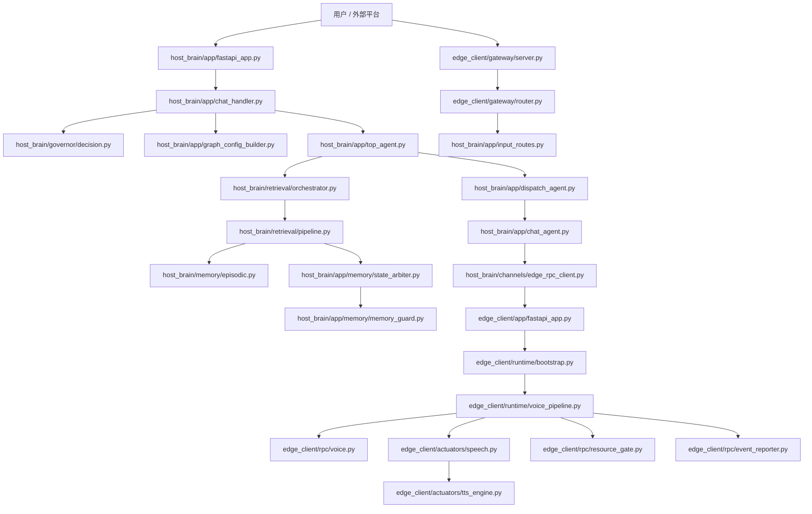

受众：MASTER
标题：核心模块详细参考（当前代码实况）
版本：v1.1
日期：2026-04-02
定位：基于当前仓库真实代码结构，整理 Host 主链、能力层、Edge 语音链、Edge 网关链的核心模块清单；用于测试覆盖现状盘点、故障定位和新成员快速入门。

# 核心模块详细参考（当前代码实况）
> 本文档是“核心模块”版本，不追求覆盖整个仓库，而是回答三个问题：
> 1. 哪些模块真的在主链上。
> 2. 每个核心模块承担什么职责。
> 3. 当前测试已经覆盖到哪一层，还缺哪一层。

---

## 0. 范围与判定标准

本文把“核心模块”限定为满足以下至少两条的模块：

1. 位于用户请求、Edge 事件、网关回流、语音播报等真实主链路上。
2. 负责治理、路由、状态仲裁、编排、外部调用、契约校验、持久化等关键控制点。
3. 它的失败会直接导致：
   - 主链不可用
   - 行为偏离治理约束
   - Edge/Host 通信失效
   - 记忆/检索/播报链路不可用
4. 它是其他业务模块的上游装配点或统一入口，而不是纯工具函数集合。

不纳入本文的内容：

- 纯前端页面资源
- 静态打包产物
- 一次性脚本
- 单个 leaf helper
- 仅提供局部格式化或常量拼装的文件

---

## 1. 总览图



---

## 2. Host 主链核心模块

### 2.1 接入与治理层

| 模块 | 文件 | 关键符号 | 主责 | 上游 | 下游 | 主链位置 | 覆盖优先级 |
|---|---|---|---|---|---|---|---|
| Host API 总入口 | `host_brain/app/fastapi_app.py` | FastAPI app, `/v1/chat`, `/v1/edge/events` | 挂载 Host 全部 HTTP 路由，承接聊天、Edge 事件、监控、工具、健康检查 | 用户、网关、Edge | `chat_handler`、`input_routes`、`system_handler` 等 | 链路起点 | P0 |
| Chat 主入口 | `host_brain/app/chat_handler.py` | `handle_chat`, `_unified_chat_sse_generator` | 对聊天请求做统一 SSE 编排入口，先治理再分场景，不直接承载所有业务细节 | `fastapi_app.py` | Governor、场景分类、TopAgent/复杂图分支 | 主链必经 | P0 |
| Governor 裁决 | `host_brain/governor/decision.py` | `IntentDecisionEngine` | 对 intent 草案做合法性、时效、重放、防越权、route token 等裁决 | `chat_handler.py` | 场景路由与后续执行 | 主链必经 | P0 |
| 图装配与场景配置 | `host_brain/app/graph_config_builder.py` | `build_chat_graph`, `build_supervised_graph`, `build_intent_graph`, `build_chat_graph_config` | 把场景与 execution profile 转成图配置，决定跑哪张图、绑定哪些节点 | `chat_handler.py`、`dependencies.py` | `graph_runtime.py`、handlers | 复杂场景必经 | P0 |
| 执行画像判定 | `host_brain/app/execution_profile.py` | `resolve_execution_profile` | 决定请求落到 `CHAT_FAST`、`WORKFLOW_SUPERVISED`、`INTENT_EXEC` 哪一种执行模式 | `graph_config_builder.py` | 图装配与图执行 | 主链关键岔路口 | P0 |

### 2.2 Agent 编排与渲染层

| 模块 | 文件 | 关键符号 | 主责 | 上游 | 下游 | 主链位置 | 覆盖优先级 |
|---|---|---|---|---|---|---|---|
| 顶层 Agent 编排 | `host_brain/app/top_agent.py` | `top_agent_sse_generator` | 做主链前置处理，组装上下文、调用检索、承接 Dispatch/Chat 分层 | `chat_handler.py` | `dispatch_agent.py`, `chat_agent.py`, retrieval | `SCENE_CHAT` 主链中枢 | P0 |
| 路由/委托/技能调度 | `host_brain/app/dispatch_agent.py` | `dispatch_agent_sse_generator` | 决定走 direct chat、delegate 子 agent、skill 执行哪一条路径；不直接渲染最终用户文案 | `top_agent.py` | `chat_agent.py`、sub-agent、skills | P0 核心控制点 | P0 |
| 人格渲染与输出 | `host_brain/app/chat_agent.py` | `chat_agent_sse_generator` | 构建最终 prompt，流式调用模型，做后处理、句级 TTS 触发、最终 COMMIT 输出 | `dispatch_agent.py` | LLM runtime、后处理、Edge RPC | 用户可见输出最终口 | P0 |
| Prompt 构建 | `host_brain/app/prompt_builder.py` | `infer_render_target_lang`, `repair_utf8_latin1_mojibake` | 统一 prompt context 拼装规则，控制渲染语言、上下文片段与风格注入 | `chat_agent.py`, `top_agent_prompt.py` | LLM 输入 | 输出质量关键支撑 | P1 |
| Prompt 终态模板 | `host_brain/app/top_agent_prompt.py` | `build_top_agent_prompt` | 以角色、人设、Bond、情绪、style canon 等组装最终 prompt 文本 | `chat_agent.py` | LLM runtime | Chat 渲染前最后一层 | P1 |

### 2.3 图运行时与执行层

| 模块 | 文件 | 关键符号 | 主责 | 上游 | 下游 | 主链位置 | 覆盖优先级 |
|---|---|---|---|---|---|---|---|
| 图运行时门面 | `host_brain/integrations/graph_runtime.py` | `GraphRuntimeContract` | 校验 graph config、准备 GraphState、解析模型节点、调用执行器并统一结果 | `graph_config_builder.py` | `graph_executor.py` | 复杂图必经 | P0 |
| 图执行器 | `host_brain/integrations/graph_executor.py` | `GraphExecutor` | 逐节点执行、agent dispatch 动态分派、依赖降级、trace 构建、render/commit 节点驱动 | `graph_runtime.py` | handlers、LLM gateway、fallback | 复杂图核心 | P0 |
| 依赖降级与失败收口 | `host_brain/integrations/graph_fallback.py` | `handle_dependency_unavailable`, `fail_hard` | 对 timeout、依赖失效、节点缺失做一致化降级与状态打标 | `graph_executor.py` | GraphState、trace、最终结果 | 复杂图兜底 | P1 |
| 模型网关 | `host_brain/integrations/llm_gateway.py` | `LlmGatewayContract` | 把上层 prompt 请求路由到本地/云端模型，承接 provider 降级 | `top_agent.py`, `chat_agent.py`, `graph_executor.py` | 实际 LLM provider | 主链高价值依赖 | P1 |

---

## 3. Host 能力层核心模块

### 3.1 检索链

| 模块 | 文件 | 关键符号 | 主责 | 上游 | 下游 | 主链位置 | 覆盖优先级 |
|---|---|---|---|---|---|---|---|
| 检索编排器 | `host_brain/retrieval/orchestrator.py` | `RetrievalOrchestrator` | 统一 chat 路径下的检索请求协议、成功/部分失败/全失败标签与 bundle 输出 | `top_agent.py` | `pipeline.py` | Chat 主链高频 | P0 |
| 检索总流水线 | `host_brain/retrieval/pipeline.py` | `RetrievalPipelineContract` | 串联 embedding、query planning、multi-recall、rerank、evidence pack | `orchestrator.py` | embedding/reranker/chroma/bond/canon | 检索核心 | P0 |
| 向量嵌入服务 | `host_brain/retrieval/embedding.py` | `EmbeddingServiceContract` | 封装 embedding provider、运行时配置、超时与降级语义 | `pipeline.py` | Chroma / provider | 检索关键依赖 | P1 |
| 重排服务 | `host_brain/retrieval/reranker.py` | `RerankerServiceContract` | 负责召回结果重排、provider 选择、结果标准化 | `pipeline.py` | reranker provider | 检索关键依赖 | P1 |

### 3.2 记忆与状态链

| 模块 | 文件 | 关键符号 | 主责 | 上游 | 下游 | 主链位置 | 覆盖优先级 |
|---|---|---|---|---|---|---|---|
| 情节记忆存储 | `host_brain/memory/episodic.py` | `EpisodicStore`, `EpisodicRecord` | 管理情节记忆的写入、读取、merge、visibility、evidence gating | `top_agent.py`, post-process | Chroma、ledger | 主链副写关键点 | P1 |
| 状态仲裁器 | `host_brain/app/memory/state_arbiter.py` | `StateArbiter` | 在 WorldCanon、StyleCanon、Episodic、Bond、Chroma、EdgeRuntime 间做状态优先级裁决 | recall/prompt/memory write | prompt 与持久层 | 状态一致性关键点 | P0 |
| 记忆守卫 | `host_brain/app/memory/memory_guard.py` | `MemoryGuard` | 控制写入资格、梦境拦截、幂等保护、蒸馏资格、情绪标签规则 | `StateArbiter`, post-process | Episodic/Canon 写入 | 记忆污染防线 | P0 |

### 3.3 装配与跨端通道

| 模块 | 文件 | 关键符号 | 主责 | 上游 | 下游 | 主链位置 | 覆盖优先级 |
|---|---|---|---|---|---|---|---|
| 依赖装配工厂 | `host_brain/app/dependencies.py` | `get_*` 系列 provider | 管理全局单例与延迟初始化，实际决定主链使用哪套 runtime/service | `fastapi_app.py`, handlers | 全部核心服务 | 全局装配点 | P1 |
| Host→Edge RPC 客户端 | `host_brain/channels/edge_rpc_client.py` | `post_speak`, `post_vts` 等 | 统一构造 Host 到 Edge 的 HTTP envelope、超时、重试、认证、结果结构 | `chat_agent.py`, gateway, vision | Edge `/v1/edge/*` | 跨端通信关键点 | P0 |
| 错误码基座 | `host_brain/core/errors.py` | 全局 `reason_code` 常量 | 提供治理、检索、语音、Edge、配置等稳定错误码 | 全仓库 | 全仓库 | 契约底座 | P1 |
| ID/时间基座 | `host_brain/core/ids.py` | `new_request_id`, `now_ms` | 提供 request_id、turn_id、时间戳等统一生成逻辑 | 全仓库 | 全仓库 | 追踪与审计底座 | P1 |

---

## 4. Edge 语音链核心模块

### 4.1 Edge RPC 与运行时装配

| 模块 | 文件 | 关键符号 | 主责 | 上游 | 下游 | 主链位置 | 覆盖优先级 |
|---|---|---|---|---|---|---|---|
| Edge RPC 总入口 | `edge_client/app/fastapi_app.py` | Edge FastAPI app, `/v1/edge/health`, `/v1/edge/speak`, `/v1/edge/vts` | Edge 对外 RPC 网关，承接 Host 的 speak/vts/screenshot/automate 请求 | Host RPC client | EdgeRuntime 组件 | 跨端入口 | P0 |
| Edge 运行时装配 | `edge_client/runtime/bootstrap.py` | `EdgeRuntime`, `startup`, `build_edge_health_snapshot` | 装配语音、VTS、资源门控、事件回传、网关等组件 | `fastapi_app.py` | `voice_pipeline.py`, gateway, reporter | Edge 核心装配 | P0 |
| 语音主编排器 | `edge_client/runtime/voice_pipeline.py` | `EdgeVoicePipeline` | 串联 `rpc -> queue -> synth -> playback -> vts -> report` 全流程 | `fastapi_app.py`, bootstrap | `speech.py`, `voice.py`, `resource_gate.py` | 语音主链中枢 | P0 |

### 4.2 语音契约、队列与执行

| 模块 | 文件 | 关键符号 | 主责 | 上游 | 下游 | 主链位置 | 覆盖优先级 |
|---|---|---|---|---|---|---|---|
| Voice RPC 契约 | `edge_client/rpc/voice.py` | `VoiceRpcContract` | 校验 ASR/TTS/Barge-in schema，记录事件，给出 ACCEPTED/REJECTED 契约结果 | `voice_pipeline.py`, `speech.py` | ledger, queue | 语音契约关口 | P0 |
| 资源门控 | `edge_client/rpc/resource_gate.py` | `VoiceResourceGate` | 控制 ASR / PLAYBACK / TTS_SYNTH 的优先级、互斥与资源限制 | `voice_pipeline.py`, `speech.py` | gate decision | 并发治理关键点 | P0 |
| 播放队列 | `edge_client/actuators/speech.py` | `SpeechPlaybackQueue` | 负责 `speak -> synth -> playback` 队列化、活动播报状态、barge-in 中断 | `voice_pipeline.py` | synthesizer, playback starter | 语音执行中枢 | P0 |
| TTS 引擎 | `edge_client/actuators/tts_engine.py` | `SoVITSModelManager`, `make_sovits_synthesizer` | 承担 GPT-SoVITS 模型加载、合成、语言/文本校验、播放回调适配 | `speech.py` | SoVITS SDK, audio device | 语音生成核心 | P0 |
| VTS 驱动 | `edge_client/actuators/vts_driver.py` | `VTubeStudioDriver` | 驱动表情、talk_start/talk_end、口型参数写入 | `voice_pipeline.py` | VTS 实例 | 语音伴随输出 | P1 |
| Edge 事件回传 | `edge_client/rpc/event_reporter.py` | `EdgeEventReporter` | 将 Edge 运行事件批量回传 Host，并提供缓存与重试 | `voice_pipeline.py`, gateway | Host `/v1/edge/events` | 观测闭环关键点 | P1 |

---

## 5. Edge 网关链核心模块

### 5.1 网关总链

| 模块 | 文件 | 关键符号 | 主责 | 上游 | 下游 | 主链位置 | 覆盖优先级 |
|---|---|---|---|---|---|---|---|
| 网关启动装配 | `edge_client/gateway/bootstrap.py` | `GatewayConfig`, `GatewayInstance`, `start_gateway` | 组装平台 adapter、router、server、桥接命令队列等 | Edge startup | server/router/adapters | 平台接入装配点 | P1 |
| 网关 FastAPI 服务 | `edge_client/gateway/server.py` | webhook app, `/v1/gateway/{platform}/webhook` | 承接平台 webhook 与查询接口，统一进入 router | 外部平台 | `GatewayRouter` | 外部消息入口 | P1 |
| 网关路由器 | `edge_client/gateway/router.py` | `GatewayRouter` | 将 `UnifiedMessage` 路由到 Host input reporter 或本地处理链 | server / watcher | Host input / outbound | 网关核心控制点 | P1 |
| 统一消息模型 | `edge_client/gateway/models.py` | `UnifiedMessage`, `UnifiedReply` | 定义平台无关的输入/输出消息契约 | adapters, router, outbound | 全网关 | 契约基座 | P1 |
| 消息归一化 | `edge_client/gateway/normalizer.py` | `MessageNormalizer` | 对平台消息做字段归一、脱敏、去重与合法化 | adapters | router | 输入质量关口 | P1 |
| 出站分发 | `edge_client/gateway/outbound.py` | `OutboundDispatcher` | 统一将 Host 回复下发到具体平台 adapter | Host reply | adapters | 网关输出关键点 | P1 |

### 5.2 平台适配器

| 模块族 | 文件 | 主责 | 备注 |
|---|---|---|---|
| 平台抽象基类 | `edge_client/gateway/adapters/base.py` | 统一 adapter 接口与能力边界 | 所有平台适配器共同父类 |
| 微信适配器 | `edge_client/gateway/adapters/wechat_adapter.py` | webhook 输入归一化、桥接队列发图/发语音/发文件/呼叫 | 当前实现最复杂，兼顾 inbound 与 outbound |
| QQ/飞书/企微/Telegram/LINE | `qq_adapter.py`, `feishu_adapter.py`, `wecom_adapter.py`, `telegram_adapter.py`, `line_adapter.py` | 平台各自的解析与发送落地 | 属于核心能力扩展，但优先级低于微信主链 |

---

## 6. 近核心但不单独视作“主链核心”的模块

这些模块很重要，但更适合作为“核心模块的支撑层”而不是单独的主链中枢：

- `host_brain/app/handlers/*.py`
  - 负责具体 agent handler 落地。
  - 它们重要，但被 `graph_executor.py` 和 `graph_config_builder.py` 统一调度。
- `host_brain/app/top_agent.py`
  - 当前承担 `SCENE_CHAT` 主流式链路。
  - 上游入口与控制权集中在 `chat_handler.py`、`top_agent.py`、`dispatch_agent.py`、`chat_agent.py`。
- `host_brain/observability/`
  - 提供可观测性聚合，但通常不决定业务主链行为。
- `edge_client/channels/wechat_command_queue.py`
  - 是微信桥接模式的重要实现点，但更适合归类为微信适配器支撑件。

---

## 7. 当前代码与旧文档的偏差说明

以下事实在当前仓库中已经确认，应以代码为准：

1. `host_brain/app/graph/main_chain.py` 当前并不存在。
   - 旧 README 和部分旧文档仍引用它。
   - 当前主链装配实际落在 `host_brain/app/chat_handler.py` 与 `host_brain/app/graph_config_builder.py`。
2. `host_brain/scene/` 历史空壳目录已删除。
   - 场景判定与路由没有收口到独立 `scene` 包。
   - 实际逻辑仍在 `chat_handler.py`、`graph_config_builder.py`、执行画像与图装配层。
3. `docs/50_project/arch/CURRENT_CODE_ARCHITECTURE.md` 仍保留部分历史引用。
   - 它适合看全景。
   - 本文更适合做当前“核心模块定位”、测试覆盖现状盘点和补测优先级规划。

---

## 8. 当前测试覆盖现状

说明：

- 下表按当前 `tests/` 目录真实存在的测试文件盘点，覆盖层级使用 `unit / contract / integration / e2e / prod_env` 五类标签。
- “代表测试”只列最能说明问题的文件，不追求穷举。
- 本节额外参考了 2026-04-02 在当前工作区执行的一组抽样 pytest；抽样结果见 8.5。

### 8.1 Host 主链与图执行

| 链路/模块组 | 当前覆盖层级 | 代表测试 | 当前判断 |
|---|---|---|---|
| `fastapi_app.py` / `chat_handler.py` / `top_agent.py` | contract + integration + e2e + unit | `tests/contract/test_http_chat_contract.py`, `tests/integration/test_host_integration.py`, `tests/unit/test_chat_handler_top_agent.py`, `tests/unit/test_top_agent_sse.py` | `/v1/chat` 可达性、SSE 结构、TopAgent handoff 与主链回退都有直接覆盖，入口层不再是纯黑盒。 |
| `governor/decision.py` / `graph_config_builder.py` / `execution_profile.py` | unit + contract + integration + e2e | `tests/unit/test_tiered_governance.py`, `tests/unit/test_execution_profile.py`, `tests/unit/test_scene_router_graph_entry.py`, `tests/unit/test_pre_intent_classifier.py`, `tests/e2e/test_governor_skill_gateway_e2e.py` | 治理裁决、route token、scene→profile→graph 路由已有多层覆盖，核心拒绝路径不是盲区。 |
| `dispatch_agent.py` / `chat_agent.py` | unit + integration + prod_env | `tests/unit/test_dispatch_agent_skill_routing.py`, `tests/unit/test_chat_agent_subcontext.py`, `tests/integration/test_dispatch_agent_prod_env.py`, `tests/integration/test_edge_core_prod_env.py` | direct chat、skill、plan execution、sub-agent prompt 与句级 TTS 分发均有直接测试，属于当前覆盖最扎实的主链层。 |
| `graph_runtime.py` / `graph_executor.py` / `graph_fallback.py` | unit + contract + integration | `tests/unit/test_phase15_dispatch_to_agent.py`, `tests/unit/test_agent_dispatch_handler.py`, `tests/unit/test_branch_executor_integration.py`, `tests/unit/test_streaming_executor_integration.py`, `tests/unit/test_checkpoint_executor_integration.py`, `tests/contract/test_orch_refactor_contract.py`, `tests/integration/test_phase4_intent_subgraph_failure.py` | 图执行器已覆盖 dispatch、并行分支、streaming、checkpoint、barrier join、render guard 等专项行为，复杂图链路不是“只有冒烟”。 |
| `dependencies.py` / Host 装配面 | unit + integration + prod_env | `tests/unit/test_tiered_governance_runtime.py`, `tests/unit/test_persistent_episodic_store.py`, `tests/unit/test_edge_rpc_client.py`, `tests/integration/test_host_integration.py` | 以依赖工厂、单例重置、探针和真实装配为主，覆盖有效，但失败分支更多是通过下游模块间接暴露。 |

### 8.2 Retrieval 与记忆链

| 链路/模块组 | 当前覆盖层级 | 代表测试 | 当前判断 |
|---|---|---|---|
| `retrieval/orchestrator.py` | unit + integration + prod_env | `tests/unit/test_retrieval_orchestrator.py`, `tests/unit/test_retrieval_orchestrator_runtime_fields.py`, `tests/integration/test_core_chain_prod_env.py` | success / partial_failure / all_failure / timeout / cache / runtime summary 均有直接断言。 |
| `retrieval/pipeline.py` / `embedding.py` / `reranker.py` | unit + contract + integration | `tests/contract/test_retrieval_pipeline_contract.py`, `tests/unit/test_retrieval_pipeline_emotion.py`, `tests/contract/test_retrieval_embedding_contract.py`, `tests/contract/test_retrieval_reranker_contract.py`, `tests/contract/test_embedding_deploy_contract.py`, `tests/contract/test_reranker_deploy_contract.py` | 测试面很宽，但当前不能视为“稳定绿灯”；抽样执行中 `test_retrieval_pipeline_contract.py` 全部失败，见 8.5。 |
| `memory/episodic.py` / `app/memory/state_arbiter.py` / `app/memory/memory_guard.py` | unit + contract + integration + prod_env | `tests/contract/test_episodic_contract.py`, `tests/unit/test_persistent_episodic_store.py`, `tests/unit/test_state_arbiter.py`, `tests/unit/test_memory_guard.py`, `tests/integration/test_memory_hub_prod_env.py` | 记忆写入门禁、优先级仲裁、持久 Chroma 注入和真实 store 读写都有直接覆盖，当前比检索链更稳定。 |
| `channels/edge_rpc_client.py` | unit + integration + prod_env | `tests/unit/test_edge_rpc_client.py`, `tests/integration/test_edge_core_prod_env.py` | envelope、签名、超时、VTS/语音/fire-and-forget 及 Edge 探针均有直接测试，是 Host→Edge 通道里覆盖最明确的一层。 |

### 8.3 Edge 语音链

| 链路/模块组 | 当前覆盖层级 | 代表测试 | 当前判断 |
|---|---|---|---|
| `edge_client/app/fastapi_app.py` / `runtime/bootstrap.py` | contract + unit + integration + prod_env | `tests/contract/test_edge_health_contract.py`, `tests/contract/test_edge_rpc_gateway_contract.py`, `tests/unit/test_edge_wechat_command_rpc.py`, `tests/integration/test_edge_core_prod_env.py` | Edge RPC 入口、健康快照、能力开关和真实依赖探针有覆盖；但完整 startup/shutdown 生命周期仍主要依赖冒烟和 E2E。 |
| `rpc/voice.py` / `runtime/voice_pipeline.py` / `rpc/resource_gate.py` | unit + contract + integration + e2e + prod_env | `tests/contract/test_voice_rpc_contract.py`, `tests/contract/test_edge_voice_pipeline_contract.py`, `tests/contract/test_voice_resource_gate_contract.py`, `tests/unit/test_edge_resource_gate.py`, `tests/e2e/test_wechat_vts_voice_rpc_e2e.py` | 语音契约、回传、资源抢占和 barge-in 路径覆盖很强，是 Edge 侧最完整的一条链。 |
| `actuators/speech.py` / `actuators/tts_engine.py` / `actuators/vts_driver.py` | unit + contract + e2e + prod_env | `tests/contract/test_voice_tts_queue_contract.py`, `tests/contract/test_tts_contract.py`, `tests/contract/test_tts_hw_contract.py`, `tests/contract/test_vts_hw_contract.py`, `tests/unit/test_tts_playback_queue.py`, `tests/unit/test_edge_vts_mouth_sync_fix.py`, `tests/e2e/test_wechat_vts_voice_e2e.py` | 队列、合成、播放、talk gate、表情映射、重连与线程安全均有专项测试，VTS/语音联动并非只有人工验证。 |
| `rpc/event_reporter.py` | unit + contract + e2e | `tests/contract/test_rpc_event_contract.py`, `tests/contract/test_edge_voice_pipeline_contract.py`, `tests/unit/test_edge_reporter_emotion.py`, `tests/e2e/test_wechat_vts_voice_rpc_e2e.py` | 缓存、重试、backfill 和事件字段稳定性有直接覆盖，属于“白盒和链路两端都测到”的少数边缘组件。 |

### 8.4 Edge 网关链

| 链路/模块组 | 当前覆盖层级 | 代表测试 | 当前判断 |
|---|---|---|---|
| `gateway/server.py` / `gateway/router.py` / `gateway/normalizer.py` / `gateway/outbound.py` | contract + unit | `tests/contract/test_gateway_contract.py`, `tests/unit/test_gateway_bootstrap_wechat_uia_mode.py` | 统一消息归一化、路由和回包分发都有直接契约测试；当前短板不在框架层，而在平台适配器细节。 |
| `gateway/bootstrap.py` | unit | `tests/unit/test_gateway_bootstrap_wechat_uia_mode.py` | 有微信 UIA 模式装配测试，但跨平台启动变体覆盖仍偏薄。 |
| 各平台 adapter | unit/contract 不均衡 | 微信相关用例分散在 `tests/contract/test_gateway_contract.py`、`tests/unit/test_wechat_channel*.py`、`tests/e2e/test_wechat_vts_voice_e2e.py` | 微信链路相对充分；QQ/Telegram/LINE/企微/飞书更多停留在框架接入层，平台特有失败语义仍弱于微信。 |

### 8.5 2026-04-02 抽样执行结果

执行命令：

```bash
python -m pytest -q \
  tests/unit/test_chat_handler_top_agent.py \
  tests/unit/test_dispatch_agent_skill_routing.py \
  tests/unit/test_state_arbiter.py \
  tests/contract/test_retrieval_pipeline_contract.py \
  tests/contract/test_edge_voice_pipeline_contract.py \
  tests/contract/test_gateway_contract.py
```

结果摘要：

- 共 82 个用例，77 通过，5 失败。
- 通过项覆盖 `chat_handler.py`、`dispatch_agent.py`、`state_arbiter.py`、`voice_pipeline.py`、`gateway/router.py`、`gateway/normalizer.py`、`gateway/outbound.py` 等主链与边缘核心层。
- 5 个失败全部集中在 `tests/contract/test_retrieval_pipeline_contract.py`。
- 失败直接触发点是 `InMemoryChromaClient.upsert()` 在种子数据写入阶段抛出 `CHROMA_VECTOR_DIM_MISMATCH`；从症状看，更像“fixture/embedding 维度与 `collection_profiles={"episodic":16,"canon":16}` 漂移”，而不是 pipeline 主流程断言本身失效。

### 8.6 残余缺口与补测优先级

按当前代码实况，仍应优先盯住以下几类风险：

1. `retrieval/pipeline.py`
   - 不是“没测试”，而是“已有关键契约测试，但当前抽样执行为红”；这类红灯优先级高于新增测试数量。
2. `dependencies.py` 与 `edge_client/runtime/bootstrap.py`
   - 装配层已有覆盖，但更多依赖探针与下游链路侧证；若继续演化启动流程，应补更直接的失败注入测试。
3. 非微信平台 adapter
   - 当前网关框架层测试不少，但平台特有字段、重试语义、失败映射明显弱于微信主链。
4. `top_agent_prompt.py` / `graph_fallback.py`
   - 这两层已有零散单测与间接覆盖，但“最终文案质量漂移”和“复杂图失败收口一致性”仍适合继续加专项回归。
5. `host_brain/observability/`
   - 可观测聚合层已有独立测试，但更多是统计与 trace 输出正确性；当主链字段继续演进时，需要同步防 schema 漂移。

### 8.5 当前 85% 验收口径（2026-04-02）

为避免把“全量核心模块清单”与“当前真机生产环境主链验收口径”混在一起，本轮覆盖率目标按真实用户可见主链与跨端关键链收敛为下列 10 个模块：

1. `host_brain/app/fastapi_app.py`
2. `host_brain/app/chat_handler.py`
3. `host_brain/app/chat_agent.py`
4. `host_brain/app/memory/state_arbiter.py`
5. `edge_client/rpc/voice.py`
6. `edge_client/rpc/resource_gate.py`
7. `edge_client/gateway/server.py`
8. `edge_client/gateway/router.py`
9. `edge_client/gateway/normalizer.py`
10. `edge_client/gateway/outbound.py`

按 `coverage run -m pytest` 对应主链测试集实测，这 10 个模块当前加权覆盖率为 `1219 / 1421 = 85.78%`，已达到本轮“核心功能至少 85%”的验收线。

补充说明：

- 如果把 `host_brain/retrieval/pipeline.py` 一并纳入同一口径，当前是 `1387 / 1642 = 84.47%`，还差一轮 retrieval 分支补测。
- 如果回到第 2~5 节的广义核心模块全表，当前仍只有约 `58%`；这更适合作为下一阶段的扩围目标，而不是本轮主链验收口径。
- 本轮实测过程中已直接修复的断链包括：`dispatch_agent/chat_agent` 确定性渲染链、`retrieval/embedding` route dim 适配、`edge fallback llm` 契约与资源门控恢复、`http_hooks.runtime_lifespan` 导入级语法断链。
- `2026-04-03` 继续补测后，新增白盒 helper 套件：`tests/unit/test_retrieval_pipeline_helpers.py`、`tests/unit/test_edge_rpc_client_helpers.py`、`tests/unit/test_edge_voice_pipeline_helpers.py`。
- 对应 focused regression 实测为 `140 passed`，另含 `4 subtests passed`；本轮未再触发新的运行时代码断链。
- 同一 focused coverage 口径下，`host_brain/retrieval/pipeline.py = 220 / 221 = 99%`，`host_brain/channels/edge_rpc_client.py = 329 / 371 = 89%`，`edge_client/runtime/voice_pipeline.py = 297 / 371 = 80%`；产物见 `coverage-continue.json`。
- 同日继续补 `dispatch_agent` helper 与主生成器窄分支后，新增 `tests/unit/test_dispatch_agent_helpers.py`；对应 focused regression 更新为 `156 passed`，另含 `4 subtests passed`。
- 最新 focused coverage 下，`host_brain/app/dispatch_agent.py = 466 / 632 = 74%`；其余三项保持 `retrieval/pipeline = 99%`、`edge_rpc_client = 89%`、`voice_pipeline = 80%`。
- 同日再继续补 `dispatch_agent` 低覆盖白盒分支后，`tests/unit/test_dispatch_agent_helpers.py` 新增了 `_dispatch_to_sub_agent` 成功/异常、`delegate -> self-heal -> ChatAgent` 主生成器路径、`_extract_hub_skill_source` / `_extract_file_read_window` / `_coerce_structured_skill_result` / `_summarize_skill_result_text`、以及 `_execute_skill` 的缺失 skill 与 structured digest 分支。
- 对应 `dispatch_agent` 定向回归为 `51 passed`；同一 focused regression 更新为 `164 passed`，另含 `4 subtests passed`，本轮仍未发现新的运行时代码断链。
- 最新 focused coverage 下，`host_brain/app/dispatch_agent.py = 550 / 632 = 87.03%`，已跨过 85% 线；其余三项维持 `host_brain/retrieval/pipeline.py = 220 / 221 = 99.55%`、`host_brain/channels/edge_rpc_client.py = 329 / 371 = 88.68%`、`edge_client/runtime/voice_pipeline.py = 297 / 371 = 80.05%`。
- 同日继续补 `edge_client/runtime/voice_pipeline.py` 的 helper 分支后，`tests/unit/test_edge_voice_pipeline_helpers.py` 新增了 `enqueue_speak` 的手动 VTS hook 兜底、`_start_vts_for_payload` 的 no-driver / has-audio 路径、`_build_mouth_envelope` / `_coerce_audio_samples` / `health` / `_resolve_asr_emotion_report` 等白盒用例。
- 对应语音链回归为 `19 passed`；同一 focused regression 更新为 `170 passed`，另含 `4 subtests passed`。最新 focused coverage 下，`edge_client/runtime/voice_pipeline.py = 361 / 371 = 97.30%`。
- 同日继续补 `host_brain/channels/edge_rpc_client.py` 的 helper/wrapper 分支后，`tests/unit/test_edge_rpc_client_helpers.py` 新增了 `EdgeRpcCallResult.as_dict()`、`_normalize_base_url` / `_resolve_edge_base_url` / `_resolve_timeout_ms` / `_resolve_retries`、`post_speak` 和 `post_automate` 的 payload 归一化与默认值用例。
- 最新 focused regression 更新为 `172 passed`，另含 `4 subtests passed`。同一 focused coverage 口径下，`host_brain/channels/edge_rpc_client.py = 347 / 371 = 93.53%`；其余三项保持 `host_brain/app/dispatch_agent.py = 550 / 632 = 87.03%`、`host_brain/retrieval/pipeline.py = 220 / 221 = 99.55%`、`edge_client/runtime/voice_pipeline.py = 361 / 371 = 97.30%`。
- 同日继续补 `host_brain/app/dispatch_agent.py` 的 recent-turn、unknown-route、skill self-heal/retry、以及 `_execute_skill` 的 replay / failed / exception 分支后，`tests/unit/test_dispatch_agent_helpers.py` 进一步扩展到 `31` 个用例；对应 `dispatch_agent` 定向回归更新为 `61 passed`。
- 同一 focused regression 随之更新为 `182 passed`，另含 `4 subtests passed`。最新 focused coverage 下，`host_brain/app/dispatch_agent.py = 605 / 632 = 95.73%`；其余三项保持 `host_brain/retrieval/pipeline.py = 220 / 221 = 99.55%`、`host_brain/channels/edge_rpc_client.py = 347 / 371 = 93.53%`、`edge_client/runtime/voice_pipeline.py = 361 / 371 = 97.30%`。
- 同日再继续补 `host_brain/app/chat_handler.py` 的 `handle_chat` intent_draft 预构造、Governor reject、显式合法 scene 和无预分类 scene 分支后，`tests/unit/test_chat_handler_top_agent.py` 扩展到 `9` 个用例。
- 最新 focused regression 更新为 `186 passed`，另含 `4 subtests passed`。同一口径下，`host_brain/app/chat_handler.py = 88 / 88 = 100.00%`，而当前已重点补强的主链控制层覆盖率分别为：`chat_handler = 100.00%`、`dispatch_agent = 95.73%`、`retrieval/pipeline = 99.55%`、`edge_rpc_client = 93.53%`、`voice_pipeline = 97.30%`、`state_arbiter = 93.14%`。
- 同日继续把 `host_brain/app/chat_agent.py` 纳入 focused suite 后，`tests/unit/test_chat_agent_subcontext.py` 新增了 `_airlock_sanitize_output`、`_build_reply_preview`、`_infer_emotion_tag_for_tts`、`_post_speak_sentence`、Hub skill deterministic reply、fallback reply、capabilities reply、reflection buffer 判断、以及 `PROMPT_BUILD_FAILED` / `LLM_UNAVAILABLE` 早退分支等 helper 与窄路径测试。
- 最新 focused regression 更新为 `213 passed`，另含 `4 subtests passed`。同一口径下，`host_brain/app/chat_agent.py = 560 / 621 = 90.18%`，核心主链控制层的当前 focused 覆盖率已提升到：`chat_handler = 100.00%`、`chat_agent = 90.18%`、`dispatch_agent = 95.73%`、`retrieval/pipeline = 99.55%`、`edge_rpc_client = 93.53%`、`voice_pipeline = 97.30%`、`state_arbiter = 93.14%`。
- `2026-04-03` 继续把 `host_brain/app/top_agent.py` 纳入 focused suite 后，先直接启用既有 `tests/unit/test_top_agent_prompt.py`、`tests/unit/test_top_agent_post_process.py`、`tests/unit/test_top_agent_sse.py`，对应 focused regression 更新为 `235 passed`，另含 `4 subtests passed`。
- 同日再补 `tests/unit/test_top_agent_helpers.py` 与 `tests/unit/test_top_agent_sse.py` 的 helper + SSE 窄分支，覆盖 `_SubAgentGatewayAdapter`、delegate/parser、phatic fastpath、runtime unavailable、retrieval init failure / degraded、recall pack handoff 等路径；对应 focused regression 更新为 `270 passed`，另含 `4 subtests passed`。
- 最新 focused coverage 口径下，`host_brain/app/top_agent.py = 567 / 652 = 86.96%`，并把当前主链控制层 focused 覆盖刷新到：`top_agent = 86.96%`、`chat_agent = 92.91%`、`chat_handler = 100.00%`、`dispatch_agent = 95.73%`、`retrieval/pipeline = 99.55%`、`edge_rpc_client = 93.53%`、`voice_pipeline = 97.30%`、`state_arbiter = 93.14%`。
- 按同一 focused 主链控制层口径汇总（`top_agent + chat_agent + chat_handler + dispatch_agent + retrieval/pipeline + edge_rpc_client + voice_pipeline + state_arbiter`），当前总体为 `2860 / 3058 = 93.53%`；把 `top_agent` 纳入后，该口径仍显著高于 85% 验收线。

---

## 9. 建议阅读顺序

如果你的目标是“快速搞懂系统”，建议按这个顺序读：

1. `host_brain/app/fastapi_app.py`
2. `host_brain/app/chat_handler.py`
3. `host_brain/governor/decision.py`
4. `host_brain/app/graph_config_builder.py`
5. `host_brain/app/top_agent.py`
6. `host_brain/app/dispatch_agent.py`
7. `host_brain/app/chat_agent.py`
8. `host_brain/retrieval/orchestrator.py`
9. `host_brain/retrieval/pipeline.py`
10. `host_brain/app/memory/state_arbiter.py`
11. `host_brain/app/memory/memory_guard.py`
12. `host_brain/channels/edge_rpc_client.py`
13. `edge_client/app/fastapi_app.py`
14. `edge_client/runtime/bootstrap.py`
15. `edge_client/runtime/voice_pipeline.py`
16. `edge_client/rpc/voice.py`
17. `edge_client/actuators/speech.py`
18. `edge_client/actuators/tts_engine.py`
19. `edge_client/gateway/server.py`
20. `edge_client/gateway/router.py`

---

## 10. 相关文档

- 当前代码架构总览：`docs/50_project/arch/CURRENT_CODE_ARCHITECTURE.md`
- 数据流全景：`docs/50_project/arch/dataflow_report.md`
- Core 层参考：`docs/15_theory/CORE_LAYER_MODULE_REFERENCE.md`
- Phase XV 分层重构：`docs/50_project/arch/PHASE_XV_DISPATCH_CHAT_ARCHITECTURE.md`
