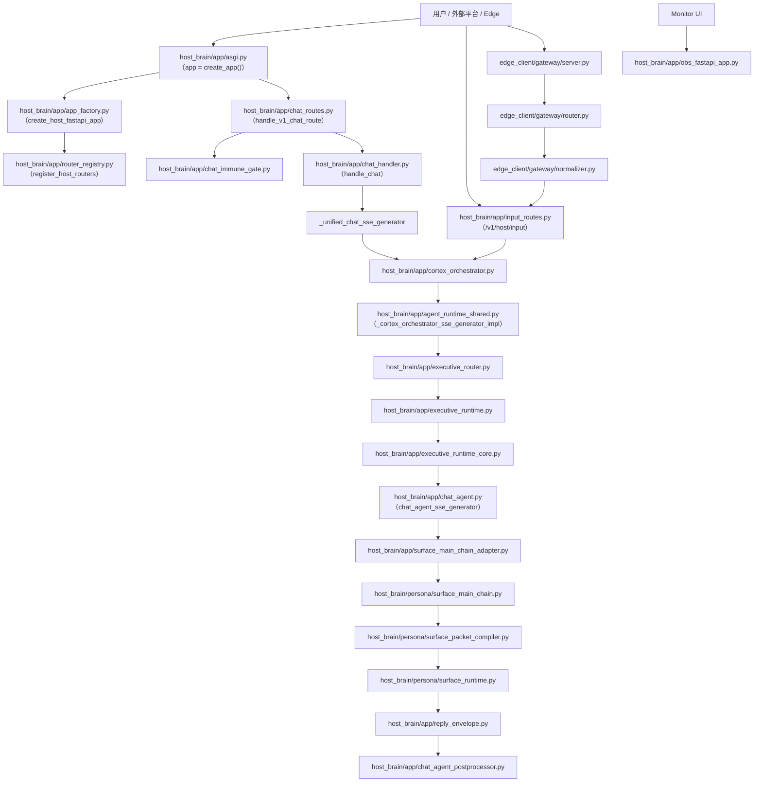

受众：MASTER
标题：核心模块详细参考（当前代码实况）

版本：v3.2
日期：2026-06-05
定位：基于当前仓库真实代码结构，整理处在主链上的模块、入口关系与职责边界。供故障定位、新成员入门和文档对齐使用。若历史方案文档与本文冲突，以本文与代码为准。

# 核心模块详细参考（当前代码实况）

## 0. 这份文档回答什么

只回答四个问题：

1. 现在真正的入口模块是谁。
2. 从请求进入到结果输出，主链到底经过哪些文件。
3. 每个核心模块当前的职责边界是什么、跟谁交互。
4. 哪些模块是"历史设计里重要"，但已经不再是当前代码主链。

## 1. 当前主链总览



## 2. 进程级入口模块

| 模块 | 文件 | 当前职责 | 为什么是核心 |
|---|---|---|---|
| Host 主进程入口 | `host_brain/__main__.py` | 加载 `.env` / `runtime/host/host.runtime.env`、startup-check、启动 uvicorn 加载 `host_brain.app.asgi:app` | 所有主脑流量从这里启动 |
| Observability 入口 | `host_brain/obs_main.py` | 启动独立观测后端，加载 `host_brain.app.obs_fastapi_app:app` | 独立监控后端进程 |
| Edge 入口 | `edge_client/__main__.py` | 装配并启动 Edge RPC | 语音、桌面自动化、ASR、VTS/VRM、Desktop Pet 转发的总入口 |
| Gateway 入口 | `edge_client/gateway/bootstrap.py` | 启动 Unified Message Gateway | 平台消息闭环与外部回复总入口 |
| Desktop Pet 入口 | `desktop_pet/main.cjs` | 启动 Electron + Live2D 透明桌宠窗口，并暴露本地 `/health`、`/action` | 本地桌宠运行面入口 |

## 3. Host Main FastAPI 装配三件套

旧的单文件 `host_brain/app/fastapi_app.py` 已被以下三件套替代（Host 端旧文件已删除）：

### 3.1 `host_brain/app/asgi.py`

当前职责：

- 暴露 `app = create_app()`，作为 uvicorn 加载点
- 配置 `lifespan`（`runtime_lifespan`）、`runtime_metrics`
- 装配 `chat_endpoint`、`edge_events_endpoint`、`root_endpoint` 三个面向用户的 endpoint，并把它们通过 `create_host_fastapi_app` 注入

为什么核心：**这是 Host Main 的 ASGI 真入口**，所有路由、中间件最终都挂到这个 `app` 上。

### 3.2 `host_brain/app/app_factory.py`

当前职责：

- 提供 `create_host_fastapi_app(...)`：组装 `FastAPI` 实例
- 通过 `wire_route_providers(...)` 注入 ledger / tool broker / tool catalog / bond engine / scheduler 的 dependency provider
- 调用 `register_host_routers(app)` 注入业务路由
- 通过 `configure_http_middleware(app)` 装配 CORS / GZip / 中间件
- 注册全局异常 handler 与 request-id / audit 中间件
- 直接绑定 `/v1/chat`、`/v1/edge/events`、`/metrics`、`/`

为什么核心：**Host Main 路由组装的唯一入口**，所有依赖注入也在这里收口。

### 3.3 `host_brain/app/router_registry.py`

当前职责：

- `register_host_routers(app)`：按固定顺序 `include_router`：`canon_router`、`scheduler_router`、`host_scheduler_router(prefix="/host-scheduler")`、`tool_router`、`tool_kits_alias_router`、`prompt_config_router`、`bond_router`、`agent_router`、`input_router`、`internal_tribe_router`、`internal_codex_router`、`internal_security_immune_router`、`mateengine_router`、`health_router`
- `wire_route_providers(...)`：装配各路由的回调 provider（在 `app_factory` 之前调用）

为什么核心：**Host Main 全部业务路由的唯一注册点**，避免分散注册导致的顺序歧义。

## 4. 聊天主链核心模块

### 4.1 `host_brain/app/chat_routes.py`

当前职责：

- `handle_v1_chat_route(...)`：`/v1/chat` 的真正入口
- 调用 `notify_user_interaction()` 触发用户活动信号
- 构建 `bio_ops_runtime_trace`（即使失败也降级），写入 `request.state`
- 调用 `evaluate_immune_gate_fn`，得到 immune 决策（ALLOW/REPORT/BLOCK）
- BLOCK 时直接返回 `sse_single_commit`，写入 `IMMUNE_BLOCKED_HIGH_RISK`
- 否则委托 `handle_chat_fn`（即 `handle_chat`）继续处理

为什么核心：**所有 chat 请求都先经过这里**，是 immune 拦截的统一执行点。

### 4.2 `host_brain/app/chat_immune_gate.py`

当前职责：

- `evaluate_immune_gate_for_chat(request_body)`：调用 `security_immune` 模块对消息做风险评估
- `schedule_chat_immune_gate_event(...)`：异步把 immune 决策写到 ledger（不阻塞主链）

### 4.3 `host_brain/app/chat_handler.py`

当前职责：

- `handle_chat(request_body, request, metrics) -> StreamingResponse`：
  - sys_mode 门控（`HOST_SYS_MODE=locked` 拒绝；`maintenance` 返回维护提示）
  - 解析 `person_id`、`session_id`、`render_target_lang`
  - 委托 `_unified_chat_sse_generator(...)` 流式生成
- `_unified_chat_sse_generator(...)`：
  - 发出 `PRESENCE(THINKING)`
  - 调用 `thalamus_agent.classify_and_compile_intent_draft` 得到 canonical intent
  - 调用 `_evaluate_governor_with_timing` 在 `_GOVERNOR_EXECUTOR`（线程池）做 governor 鉴权
  - 发出 `PRESENCE(GOV_APPROVED)`
  - 委托 `cortex_orchestrator_sse_generator(...)` 接管后续 SSE
- MateEngine lifecycle cue：
  - `_send_delayed_mateengine_thinking_cue`、`_send_mateengine_state_cue`、`_send_mateengine_chat_bubble` 负责把 thinking / speaking / home 等对话生命周期投到本地桌宠表现层
  - 该链路只做外显表现，不改变 memory / policy / audit 事实

为什么核心：**所有 chat 请求的统一 SSE 生成器**；handler 之上是路由层，之下是编排层。

### 4.4 `host_brain/app/cortex_orchestrator.py`

当前职责：薄壳。把 `record_user_turn` 写入 `conversation/writer`，再委托给 `agent_runtime_shared._cortex_orchestrator_sse_generator_impl`。

为什么仍然存在：保持「Cortex 编排入口」的语义身份；真正实现在 shared 文件内便于共享与测试。

### 4.5 `host_brain/app/agent_runtime_shared.py`

当前职责：编排链路的**实现主体**（5060+ 行）。包含：

- `_cortex_orchestrator_sse_generator_impl`：完整的 SSE 编排逻辑（route 分发、retrieval 预取、handoff、PII 净化、surface 上下文准备、commit、async post-process）
- 大量直接路由（recent_turn / task_progress / contextual_memory / contextual_style / contextual_session / previous_meaning）的 fastpath 构造器
- airlock 输入/输出净化函数
- `_write_surface_main_chain_memory_sync`：surface 主链 commit 后的记忆回写
- `_async_post_process`：commit 之后的副作用 schedule（TTS、记忆、bond、observability）

为什么核心：**当前编排逻辑事实上的中心**。chat handler / cortex_orchestrator / executive_router 都委托这里。

### 4.6 `host_brain/app/executive_router.py`

当前职责：薄壳。`executive_router_sse_generator(...)` 直接 `await` `executive_runtime.executive_runtime_sse_generator(...)`。

### 4.7 `host_brain/app/executive_runtime.py`

当前职责：

- `executive_runtime_sse_generator(...)`：路由层（dispatch 层）入口
- `try_handle_recent_turn_direct_route(...)` / `try_handle_task_progress_direct_route(...)`：直接路由 fastpath 处理
- `stream_chat_route(...)`：chat route 的流式委托
- `record_executive_handoff(...)`、`record_runtime_capability_execution(...)`：handoff 落地
- `_legacy_direct_text_routes_enabled()`：旧直接路由的总开关（默认关闭，仅作 A/B）

### 4.8 `host_brain/app/executive_runtime_core.py`

当前职责：

- 路由决策器：`_hard_rule_route(...)`、`_should_force_complex_plan(...)`
- intent → route 分发的核心规则
- 多步任务识别、skill/delegate target 抽取
- 内存上下文构建（`_build_memory_exec_context`）

为什么核心：**executive 层的"硬规则"决策点**——大量来自 prefrontal / cortex_route_decider 的决策落地在这里。

### 4.9 `host_brain/app/chat_agent.py`（3361 行）

当前职责：

- `chat_agent_sse_generator(agent_input: ChatAgentInput) -> AsyncGenerator[str, None]`：ChatAgent 的 SSE 入口
- 启动时调用 `surface_main_chain_required` / `surface_main_chain_enabled`，决定是否走 Surface 主链
- Surface 启用时 → 委托 `surface_main_chain_sse_generator`
- 否则走兼容 fallback 路径（旧风格）
- 提供 `SubAgentContext` / `ChatAgentInput` / `_resolve_minimal_fallback_text` 等数据契约
- 直接处理 sub-agent 场景（保留某些 sub-agent 结果给用户、否则抑制）

为什么核心：**Surface 主链与旧链的开关枢纽**；任何 chat reply 必须经过这里。

### 4.10 `host_brain/app/chat_agent_preprocessor.py`（1623 行）

当前职责：从 `chat_agent.py` 拆分出来的"输入预处理与配置渲染"部分：

- 模板加载、本地化（`_resolve_template_text_localized`、`_load_template_mapping`）
- airlock 输入净化（`_airlock_sanitize_input`，部分函数）
- 文本切句、长度截断（`_split_text_into_sentences`、`_truncate_text_to_*`）
- render_policy 解析（`_extract_render_policy_limits`、`_coerce_render_policy_score`）

### 4.11 `host_brain/app/chat_agent_postprocessor.py`

当前职责：commit 之后的轻量后处理：

- `scrub_pii_egress`：PII 净化
- `schedule_async_post_process`：调度异步 post-process（TTS、记忆、bond）
- `trigger_tts_after_commit`：commit 后触发 TTS（按 broca 参数）
- `_post_speak_sentence`：单句语音落地
- `log_input_completed`：input ack 写入

### 4.12 `host_brain/app/chat_payload_builder.py`（1363 行）

当前职责：从 `prompt_builder` 抽出来的 payload 构造器，专门负责把 `ChatAgentInput` 编译成 LLM provider 需要的 payload：

- system / user / assistant 消息片段拼接
- soul.md / 风格 anchor / 必要事实注入
- token budget 控制
- multi-turn history 拼装与截断

### 4.13 `host_brain/app/cortex_prompt_builder.py`

当前职责：cortex 路由 prompt 的专用构建器（决定意图分类的 prompt）。

### 4.14 `host_brain/app/prompt_builder.py` + `prompt_builder_utils.py`

当前职责：旧 `prompt_builder` 拆分后的两份：

- `prompt_builder_utils.py`：通用工具函数（PII 检测、模板格式化、文本特征识别）
- `prompt_builder.py`：剩余的旧链 prompt 构造能力（仅在非 Surface 主链路径上仍被使用）

**注意：旧 prompt_builder 不再是 normal chat 的最终作者**，只能给 Surface 主链提供 facts/state/perception 输入，详见 `CURRENT_CODE_ARCHITECTURE.md §0.1`。

### 4.15 `host_brain/app/graph_config_builder.py` + `graph_config_llm_runtime.py`

当前职责：旧 `graph_config_builder` 拆出的两份：

- `graph_config_builder.py`：scene 分类常量（`SCENE_CHAT` / `ALLOWED_EXPLICIT_SCENE_TYPES` 等）+ graph 配置基础
- `graph_config_llm_runtime.py`：LLM-driven runtime config 解析

### 4.16 `host_brain/app/reply_envelope.py`

当前职责：Surface 主链产物的 commit 包装：

- 把 `SurfaceRuntimeResult.selected_text` 转成 SSE 的 COMMIT 事件
- 注入 trace_stage_meta、observation_codes、natsume_emotion_tag
- 与 `reply_modality_router` 协同，决定文字 / 媒体 / 多模态 commit

### 4.17 `host_brain/app/reply_modality_router.py`

当前职责：媒体场景的最终作者：

- 图片 / 贴纸 / 表情包社交回复决策
- 选择模板媒体或触发结构化 reaction
- 与 surface chain 互斥：媒体场景下 surface chain 让位

### 4.18 `host_brain/app/reply_form_decider.py` / `reply_performance.py` / `reply_plan.py`

辅助：

- `reply_form_decider.py`：决定回复形式（text / sticker / no-reply）
- `reply_performance.py`：commit 性能记录
- `reply_plan.py`：旧链 reply plan 的兼容外壳（不再是最终作者）

## 5. Surface 主链核心模块（host_brain/persona/）

### 5.1 `surface_main_chain.py`

当前职责：Surface 主链的 facade。提供 `SurfaceMainChainInput` / `SurfaceMainChainResult`。

### 5.2 `surface_packet_compiler.py`

当前职责：把高层输入（`SurfaceMainChainInput` / `CompiledSurfaceInput`）编译成 surface runtime 可消费的 packet（`SurfaceTaskControl`、必要事实、style anchor、must_not_do）。

### 5.3 `surface_runtime.py`（1995 行）

当前职责：Surface 主链的运行时。`SurfaceRuntime.run(...)` 返回 `SurfaceRuntimeResult`：

- 多候选生成与重排
- continuity / quality / fluency / collocation 评分
- affect-aware reranking
- penalize 元语言 / 自指 / 句柄类输出
- 输出 `selected_text` + `observation_codes` + `natsume_emotion_tag`

### 5.4 `surface_memory_recall.py`（4484 行）

当前职责：Surface 主链的**记忆召回包**：

- 调用 `RecallFusionServiceContract` 与 `LifeMemoryStore` 拿候选
- 决定 `RECALL_POLICY_MUST/MAY/NO`
- 应用 `surface_memory_recall_decision_matrix`
- 输出压缩后的 `MemoryRecallPacket`，仅向主链注入"必要事实 + 时间锚 + 引语"

为什么核心：normal chat 的记忆事实**只通过这里**注入主链；旧的 retrieval bridge 已被替换。

### 5.5 `surface_affect_control.py` / `surface_influence_packet.py` / `surface_organ_influence.py`

当前职责：将情绪 / 器官信号 / 关系状态压缩成 `SurfaceAffectControlPacket` / `SurfaceInfluencePacket`，作为 surface runtime 的"克制度"控制输入。

### 5.6 `surface_scene_quality_pack.py` / `surface_original_quote_bank.py` / `surface_low_info_guidance.py`

当前职责：

- `surface_scene_quality_pack`：场景质量样本库（人物 / 关系 / 情绪场景）
- `surface_original_quote_bank`：原作引语库（Sora 风格 anchor）
- `surface_low_info_guidance`：低信息回合的指导

### 5.7 `isolated_surface_harness.py` / `isolated_surface_continuity.py`

当前职责：Surface 主链的**离线评估 harness**：

- 在不依赖完整 host 的情况下跑 surface candidate 评分
- continuity（三层连续性）评估、cluster 报告、challenge eval
- A/B 比较与 weak-pass 重试
- 仅在测试与离线 quality eval 中使用，不进 chat 主链

### 5.8 `galgame_text_contract.py` / `galgame_text_scorer.py` / `galgame_taste_guard.py` / `sample_guided_text_scorer.py`

当前职责：galgame 风格守卫与文本质量评分，作为 `surface_runtime` reranker 的一部分。

### 5.9 `inner_world.py` / `inner_activity_agent.py` / `offline_continuity.py` / `inner_monologue.py`

当前职责：Phase XVI 离线内心世界 + 内在活动驱动：

- `inner_world.py`：核心内在时钟 / 孤独 / 期待 / 状态漂移
- `inner_activity_agent.py`：后台 idle 活动产生（被 ANS scheduler 触发）
- `offline_continuity.py`：唤醒时的状态注入
- `inner_monologue.py`：内独白生成

### 5.10 `emotional_silence.py` / `emotional_proactive.py`

当前职责：

- Phase XVIII 沉默能力：5 级回复意愿（NORMAL → MUTE）
- 主动情绪发声（aftereffects、proactive episodes）

### 5.11 `evolution_orchestrator.py` / `evolution_desire_engine.py` / `interaction_pattern_analyzer.py` / `emergent_growth_engine.py`

当前职责：Phase XIX 涌现成长：分析对话模式、产生成长笔记、注入 `self_reflection_pulse`。

### 5.12 `motive_engine.py` / `motive_runtime.py` / `drift_detector.py` / `trait_drift_guard.py` / `self_reflection.py` / `self_model.py`

当前职责：动机 / 漂移守卫 / 自我反思。

### 5.13 `assistant_followup_surface.py` / `image_social_surface.py` / `soul_reply_surface.py`

当前职责：辅助 surface（assistant followup / 图片社交 / 灵魂回复风格）。

## 6. 记忆与召回（host_brain/memory + host_brain/retrieval）

### 6.1 `memory/life_memory.py`（8260 行）

当前职责：**Life Memory SSOT**（生活记忆唯一真源）：

- `LifeMemoryStore`（SQLite-backed）：把每一轮 user/perception/scheduler/inner item 当作一条 life episode + evidence
- 真值状态：`CANDIDATE / VERIFIED / CORRECTED / SUPPRESSED / NARRATIVE_ONLY`
- 状态：`ACTIVE / SUPPRESSED`
- open-loop 状态机：`OPEN / CLOSED / CANCELLED / SUPERSEDED`
- 衰减档位：`memory_strength` + `decay_profile_id` + `retention_state`
- 类目：`chat / perception / action / background / inner / reflection / semantic`
- 各种 recall guard（synthetic 过滤、anaphoric selection、时间窗、语料范围）
- `LifeMemoryConsolidator`：sleep replay 压缩 + 语义蒸馏

为什么核心：**当前 normal chat 的记忆主源**；vector / semantic 层是它的衍生层，不是首要作者。

### 6.2 `memory/life_memory_query.py`

当前职责：查询计划器：

- `plan_life_memory_query(query, ...)`：解析查询的时间锚（today / yesterday / day_before / recent_days / date_prefix / unspecified / all_time）
- domain 推断（lightnovel_recommendation / recommendation 等）
- 输出可执行的 query plan

### 6.3 `memory/long_term_distiller.py` / `memory/distillation.py`

当前职责：长期蒸馏：

- 持久化的语义蒸馏（防止递归）
- 把 episodic memory 蒸馏成 semantic 层

### 6.4 `memory/episodic.py` / `episodic_memory_graph.py`

当前职责：episodic 兼容层（部分查询路径仍走这里）+ 内存图（关联结构）。

### 6.5 `memory/canon_world_store.py` / `canon_style_store.py` / `canon_helpers.py` / `canon_schemas.py` / `canon_sync.py` / `canon_vector_*`

当前职责：Canon 三件套（world / style / character）：

- 显式真源（人物设定 / 世界观 / 风格 anchor）
- vector projection 与 auto-sync 把 canon 投影到向量空间

### 6.6 `memory/chroma_client.py`

当前职责：Chroma 向量库客户端封装。

### 6.7 `memory/context_compressor.py` / `memory/consolidation_trigger.py` / `memory_worth_evaluator.py`

当前职责：

- `context_compressor`：surface chain 之前的"上下文压缩"（不是最终作者）
- `consolidation_trigger`：何时触发 sleep replay
- `memory_worth_evaluator`：决定哪些事件值得长期保存

### 6.8 `retrieval/recall_fusion.py`（1396 行）

当前职责：召回融合服务契约 `RecallFusionServiceContract`：

- 多路召回（vector / FTS / canon / world / artifact / life_memory）
- hybrid fusion（vector_weight + fts_weight）
- 候选过滤、anaphoric 选择处理、deep review 路由
- 仅向 surface chain 暴露压缩后的 fact list

### 6.9 `retrieval/recall_fusion_stores.py` / `recall_fusion_config.py` / `recall_fusion_utils.py`

当前职责：路由 store 实现 + 运行时配置 + 工具函数。

### 6.10 `retrieval/full_text_searcher.py`

当前职责：FTS5 全文检索器（hybrid fusion 的 lexical 部分）。

### 6.11 `retrieval/__init__.py` 重要说明

旧的 Agentic RAG pipeline / orchestrator stack **已从此包移除**。当前文本生成只走：

```
RecallFusionServiceContract
  → host_brain/persona/surface_memory_recall.py
  → 仅向 ReplyControlPacket 注入压缩后的 facts
```

## 7. Tribe 23 个器官族（host_brain/tribe/）

事实清单（`registry.py:_DEFAULT_FAMILY_SPECS`）：

```
cortex / thalamus / ans / hippocampus / limbic / prefrontal /
social_brain / endocrine / immune / pain_reward / language /
somatic / peripheral / circadian / proprioception /
initiative_governor / default_mode / mirror_neuron /
interoception / motor_cortex / cerebellum / glymphatic / vestibular
```

每个 family 至少绑定一个默认 agent（`HostTribeRegistry._bootstrap_default_agents`）。

主要 agent 与 chat 主链的交互：

- `cortex_agent` + `cortex_route_decider` + `cortex_intent_analyzer` + `cortex_context_collector`：cortex 编排辅助
- `thalamus_agent`：canonical intent 收口（chat / delegate / skill / plan）
- `prefrontal_agent`：路由决策、漂移注入、`plan_response`
- `language_system_agent`：发声统一化（dispatch_speak）
- `hippocampus_agent`：episodic store / recall fusion
- `limbic_agent`：emotion / motive / body sense
- `social_brain_agent`：bond / style adapter
- `immune_agent`：input gate / prompt guard / risk scan
- `endocrine_agent`：hormone baseline / gate state
- `pain_reward_agent`：pain / reward / hedonic
- `mirror_neuron_agent` / `interoception_agent` / `proprioception_agent` / `somatic_agent`：身体感知
- `motor_cortex_agent` / `cerebellum_agent`：行为协调
- `peripheral_agent`：平台适配 / motor gate
- `circadian_agent` / `glymphatic_agent` / `vestibular_agent` / `default_mode_agent` / `initiative_governor_agent`：周期、清理、平衡、默认模式、主动性治理

升级状态：23 个 family 全部完成 P0~P4 批次的"A 级升级"，灰度开关全数删除。详见 `docs/35_quality/ORGAN_TRIBE_UPGRADE_PLAN.md`。

## 8. 输入、Gateway 与外显入口

### 8.1 `host_brain/app/input_routes.py`（2107 行）

当前职责：`/v1/host/input` 入口：

- 接收 ASR / Gateway 归一化 input
- 调用 `input_service_*`（ack / log / quality / gateway）做规范化与回写
- 触发 chat handler 或 thread resolver
- input dispatch 使用专用线程池

### 8.2 `host_brain/app/edge_event_routes.py`

当前职责：`/v1/edge/events` 入口：

- 接收 Edge 端事件回流（VTS、状态、本地能力变化）
- 写入 ledger，必要时触发 tribe event

### 8.3 `edge_client/gateway/server.py` / `router.py` / `normalizer.py`

当前职责：

- `server.py`：Gateway HTTP 服务（端口 19000）
- `router.py`：把 inbound 消息分发到对应平台 adapter
- `normalizer.py`：把多平台消息归一化为统一 input contract

### 8.4 `edge_client/gateway/adapters/`

当前职责：6 个平台 adapter（wechat / qq / feishu / wecom / telegram / line），每个 adapter 负责：

- 入站消息接收（webhook 或长连接）
- 媒体下载（图片 / 文件 / 语音 / 视频）
- 出站消息发送（含 humanize 节奏控制）

### 8.5 `edge_client/gateway/humanize_sender.py`

当前职责：humanize 出站节奏：把长文本 / 多句拆分成"人类节奏"的多条消息。

### 8.6 `host_brain/channels/edge_rpc_client.py`

当前职责：Host → Edge / Gateway / Desktop Pet 的出站 RPC helper：

- `post_speak` / `post_barge_in` / `post_asr_control`：语音链路控制
- `post_vts` / `post_avatar_behavior`：VTS/VRM avatar 状态与高层行为
- `post_desktop_pet`：默认直连 `desktop_pet`，也可经 Edge `/v1/edge/desktop_pet` 转发
- `post_screenshot` / `post_automate` / `post_visual_locate`：桌面感知与自动化能力
- `post_gateway_reply`：Gateway 出站回复

### 8.7 `desktop_pet/main.cjs`

当前职责：Electron + Live2D 本地桌宠运行时：

- 创建透明、置顶、无边框窗口
- 暴露 `GET /health` 与 `POST /action`
- 处理 show / hide / preset / touch / emote / speak / click_through / status 等高层动作
- 只作为本地外显运行面，不承担记忆、人格策略或审计事实

### 8.8 `host_brain/app/mateengine_routes.py` + `host_brain/channels/mateengine.py`

当前职责：MateEngine 本地桌宠桥：

- `mateengine_routes.py`：提供 `/v1/mateengine/capabilities`、`/health`、`/signal`、`/say`、`/action`
- `mateengine.py`：把 Host 高层动作转成 MateEngine UDP signal 或 HTTP bridge 命令
- 支持 state / pose / mouth / freeze / gesture / action_sequence 等本地表现动作
- 从 chat lifecycle cue 接收 thinking / speaking / home 等状态，但不成为事实源

## 9. Bio-Ops（host_brain/bio_ops/）

新增子系统，为 advanced Codex 模式提供 **proposal-only** 的辅助：

- `contracts.py`：`BioOpsTask` / `BioOpsArtifact` / `BioOpsResult` / `BioOpsSchedule`
- `adoption.py`：候选采纳决策（accepted / rejected / pending_review / blocked / not_applicable）
- `capabilities.py`（3758 行）：能力清单与匹配
- `daily_cycle.py`：每日 BioOps cycle artifact runner（schedule_id + write_policy + output_root）
- `owner_inbox.py` + `owner_consumer.py`：owner 收件箱与消费者，处理 import 通道（公众号 / 文档 / 邮件等）
- `runtime_trace.py`：在 chat preflight 阶段构建 BioOps trace（即使失败也降级到 `BIO_OPS_CHAT_PREFLIGHT_TRACE_FAILED`）
- `scheduler.py` / `workflow.py` / `safety.py` / `runner.py` / `registry.py` / `artifact_store.py`

陪伴整合：BioOps trace 在 `chat_routes.handle_v1_chat_route` 中被构建并写入 `request.state.bio_ops_runtime_trace`，commit 阶段写回 SSE。

## 10. Codex Runtime（host_brain/codex_runtime/）

新增 **WorkOrder-first** 执行面：

- `work_order.py`：`CodexWorkOrder` 数据契约
- `result_contract.py`：`CodexRuntimeResult`
- `executor.py` / `production_executor.py`（3030 行）：work order 执行器
- `production_studio.py`：产线工作室（与 studios/ 协同）
- `studios/`：四类工作室
  - `code_studio.py`：代码任务
  - `finance_studio.py`：金融任务
  - `research_studio.py`：研究任务
  - `skill_forge_studio.py`：skill 锻造
- `lightnovel_deep_reviewer.py`（1591 行）+ `lightnovel_epub_builder.py`：轻小说深度评审与 EPUB 输出
- `browser_researcher.py`：浏览器型研究员
- `generic_evidence_reviewer.py`：通用证据评审
- `verification_policy.py` / `review_policy.py` / `workspace_policy.py`：策略层
- `immune.py` / `job_registry.py` / `prompt_profiles.py` / `skill_ids.py` / `artifact_store.py`：基础设施

入口路由：`/internal/codex/work-orders/preview|execute`、`/internal/codex/owner-directives`、`/internal/codex/jobs/{job_id}`、`/internal/codex/immune/proposal|dispatch|auto-state`。

## 11. Security Immune（host_brain/security_immune/）

新增**授权网络防御免疫层**（MVP 默认 observe-only）：

- `agent.py`：`SecurityImmuneAgent` 单例 + `get_security_immune_agent()`
- `policy.py`：`SecurityImmunePolicy`
- `actions.py`：`SecurityResponseExecutor`（响应动作执行）
- `models.py`：`SecuritySignal` / `SecuritySnapshot` / `IncidentRecord` / `ResponseAction` / `AssetSnapshot` / `ActionExecutionResult`
- `evidence.py` / `local_sensor.py` / `verdict.py` / `providers/`

入口路由：`/internal/security/runtime`、`/internal/security/hunt/run-once`、`/internal/security/probe/heartbeat`。

与 chat 主链关系：`chat_immune_gate.py` 是 chat 入口的免疫闸门；`security_immune` 是更广的"授权网络防御"，两者协同但互不替代。

## 12. Observability Backend（host_brain/app/obs_*.py）

独立进程（`obs_main.py`），FastAPI app 来自 `obs_fastapi_app.py`。

- `obs_routes_core.py`：`/obs/*` 主路由（include health / sessions / trace / metrics 子路由）
- `obs_routes_health.py`：`/obs/*` 健康检查
- `obs_routes_sessions.py`：`/obs/sessions/*`
- `obs_routes_trace.py`：`/obs/trace/*`（trace 落盘 + 查询）
- `obs_routes_metrics.py`：`/obs/metrics/*`
- `obs_routes_summary.py`：digital_life_overview / insights_summary 预热缓存
- `obs_routes_life_body.py`：life-body 多维数据（脏器、神经、激素、循环…）+ 预热缓存
- `obs_routes_digital_life_soak.py`：24h soak 跑批与查询
- `obs_routes_codex_bio_ops.py`：Codex / BioOps 统一观测
- `obs_routes_security_immune.py`：security immune 观测
- `obs_routes_sysmode.py`：sys_mode 切换
- `obs_routes_stats_*.py`：统计聚合（agent / capability / governor / input / system / capability_agent / capability_skill / input_dispatch / input_humanoid）
- `obs_routes_stats_system.py`：补充 `/obs/avatar/state` 与 `/obs/avatar/behavior`，供 Monitor UI 读取 avatar 状态与发送安全高层行为

预热缓存：在 lifespan 启动时同步预热 `runtime_snapshot`、`trace_feed`、`insights_summary`、`digital_life_overview`、`life_body`，启动后周期刷新。

## 13. Bond / Canon / Scheduler / Tools

### 13.1 Bond（`host_brain/bond/`）

- `user_identity.py`：`resolve_person_id` 等用户身份解析
- Bond stage / interaction state 持久化（带 SQLite migrations）

### 13.2 Canon（`host_brain/canon/`）

三大 canon 子系统：

- `character/`：人物 canon
- `style/`：风格 canon
- `world/`：世界 canon

与 `memory/canon_*` 协同：memory 端做 vector projection 与 auto-sync，canon 端做"显式真源"管理。

### 13.3 Scheduler（`host_brain/scheduler/`）

- `scheduler_routes.py`：`/scheduler/*`
- `task_registry.py`：`SchedulerTaskRegistry` 单例
- `health.py`：`SchedulerHealthReporter`
- 与 `host_brain/app/automation/scheduler_routes.py` 协同（后者在 `/host-scheduler/*` 提供 automation 内嵌调度）

### 13.4 Tools（`host_brain/tools/` + `host_brain/skills/`）

- `tool_routes.py`：`/tools/*` + 别名 `/tool_kits/*`
- `skills/hub/`：external skill hub
- `skills/impl/`：内置 57+ 技能实现
- `skills/custom_providers/`：自定义 provider
- `mcp/`：MCP 工具桥接

## 14. Audit / Conversation / Core

- `audit/sqlite_ledger.py`：`SQLiteLedger` 统一审计落盘（带 migrations）
- `conversation/writer.py`：`record_user_turn` 统一会话落库
- `core/ids.py`：`new_request_id` / `now_ms` 等通用 id / 时间工具
- `core/`：其它共享 helper

## 15. 不再代表当前事实的模块

下列旧模块要么已删除、要么已被新链路取代，**不要**作为当前任务来源：

| 旧模块 / 设计 | 当前事实 |
|---|---|
| `host_brain/app/fastapi_app.py`（Host 端） | 已删除；由 `asgi.py + app_factory.py + router_registry.py` 替代 |
| 旧 `prompt_builder.py` 单文件 | 已拆为 `prompt_builder.py` + `prompt_builder_utils.py` + `node_generation_prompt.py` + `chat_payload_builder.py`，且已不是 normal chat 最终作者 |
| 旧 `graph_config_builder.py` 单文件 | 已拆为 `graph_config_builder.py` + `graph_config_llm_runtime.py` |
| Agentic RAG pipeline / orchestrator stack | 已从 `retrieval/__init__.py` 移除；当前走 `RecallFusionServiceContract` + `surface_memory_recall` |
| 旧的 `obs_routes_stats_capability.py` 大文件 | 已拆为 `obs_routes_stats_capability.py` + `obs_routes_stats_capability_agent.py` + `obs_routes_stats_capability_skill.py` |
| 旧的 `obs_routes_stats_input.py` 大文件 | 已拆为 `obs_routes_stats_input.py` + `obs_routes_stats_input_dispatch.py` + `obs_routes_stats_input_humanoid.py` |
| 旧的 `obs_routes_core.py` 巨型文件 | 已拆为 `obs_routes_core.py` + `obs_routes_health.py` + `obs_routes_sessions.py` + `obs_routes_trace.py` + `obs_routes_metrics.py` 等 |
| 旧的 `chat_context_builder.py` | 已删除；上下文构建拆分到 `chat_payload_builder.py` + `chat_agent_preprocessor.py` + `host_brain/app/context/` 子包 |
| Tribe family 灰度开关 | 已全部删除（P0~P4 批次） |
| `style_canon` / `persona_utterance` 召回路由 | 已删除（`refactor(retrieval): 彻底删除废弃的 ...`） |
| 旧 `surface_renderer` 路径 | 已退役（`remove retired surface renderer path`） |
| `test-only emotion utterance recall index` | 已删除 |
| `code_agent_handler.py` | 已删除（chat 路径已不再依赖） |
| 旧的 `entry_routing.py` | 已被 `executive_router` + `router_registry` 取代 |

## 16. 关键不变量（与 CURRENT_CODE_ARCHITECTURE 一致）

1. normal chat 文本最终作者只能是 `SurfaceMainChain`。
2. 旧链能力只能注入 facts/state/memory/perception，不能写最终回复。
3. 媒体场景（图片/贴纸/表情）的最终作者是结构化 `reply_modality_router`。
4. 文本质量回归（A/B 不通过）的旧链能力不允许进入 normal chat live path。
5. Observability Backend 与 Host Main 是两个独立 ASGI app。
6. 23 个 tribe family 没有灰度开关，全部直接生效。
7. life memory（`LifeMemoryStore`）是当前记忆 SSOT；vector / semantic 是衍生层。
8. Desktop Pet / MateEngine / VTS / VRM 只属于外显执行与状态观测面，不提供记忆、人格策略或审计事实。
