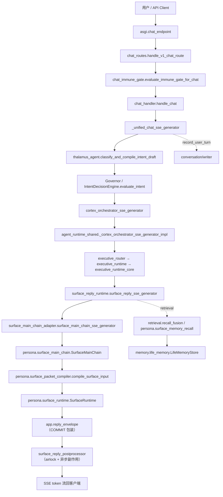

受众：MASTER
标题：当前代码架构总览（2026-06-23）

版本：v3.3
日期：2026-06-23
分析锚点：dev@b28c20a2
定位：以当前仓库代码为唯一真源，描述运行面、入口、主链、目录与监控前端结构。若历史方案文档与本文冲突，以本文与代码为准。

# 当前代码架构总览（2026-06-23）

## 0. 快速导航

- 仓库入口：`README.md`
- 核心模块详解：`docs/50_project/arch/CORE_MODULES_DETAILED_REFERENCE.md`
- 数据流补充：`docs/50_project/arch/dataflow_report.md`
- 前端主体化方案：`docs/50_project/arch/DIGITAL_LIFE_BODY_FRONTEND_ARCHITECTURE_20260419.md`
- Desktop Pet 契约：`docs/30_devspec/desktop_pet_runtime.md`
- MateEngine Bridge 契约：`docs/30_devspec/mateengine_bridge.md`
- 历史架构快照：`docs/_history/2026-04-22_arch_snapshot/`

## 0.1 Normal Chat 主链记忆（高优先级，2026-05-30 续期）

这条记录是后续 normal chat 重构的**主线约束**。若历史方案、旧链文档或局部测试与本节冲突，以本节为准。

- 旧 `prompt_builder` 主链是「完整能力库」，**不是**当前 normal chat 文本质量阶段的 live 主链。
- `/v1/chat` 当前 live 主链是 **SurfaceMainChain + ReplyEnvelope**：
  `asgi.chat_endpoint → chat_routes.handle_v1_chat_route → chat_handler.handle_chat/_unified_chat_sse_generator → thalamus_agent.classify_and_compile_intent_draft → Governor/IntentDecisionEngine.evaluate_intent → cortex_orchestrator → agent_runtime_shared → executive_router → executive_runtime → executive_runtime_core → surface_reply_runtime.surface_reply_sse_generator → surface_main_chain_adapter.surface_main_chain_sse_generator → persona.surface_main_chain.SurfaceMainChain → ReplyEnvelope`。
- 文本质量未过关前，不再继续把旧链能力模块塞回 normal chat live path。
- 旧链能力（reply_plan、validator、fallback、fastpath、transport ack、thread resolver、cache、memory）只能向 SurfaceMainChain 提供 `facts / state / memory / perception / performance / media action`，不能写最终人格回复。
- normal chat 最终文本作者**只能**是 `SurfaceMainChain`，最终对外 commit 由 `ReplyEnvelope` 包装；不是旧 `ChatAgent`、也不是 `SurfaceReply` body。媒体场景（图片、贴纸、表情包）的最终作者只能是结构化 reaction/media selector（`reply_modality_router.py`）。
- `/v1/host/input` 不是转发 `/v1/chat`。它是 ASR/Gateway ingress，独立完成字段校验、ASR 噪声门、Gateway 去重、多模态暂存、Immune gate、person_id / inner-life catchup 后，直接构造内部 `ChatRequest` 进入 Cortex orchestrator pipeline。
- 任何模块若导致文本质量下降，只能保留在实验链或非聊天任务链，不进入 normal chat 主线。
- 子代理（sub-agent）回复必要时绕过 surface chain，但仍受 `surface_reply_postprocessor` 的 airlock 净化与 envelope 包装。

## 1. 代码证据入口

以下文件构成当前代码架构的**直接证据入口**，文档表述若与这些文件不符，以代码为准：

进程入口：
- `host_brain/__main__.py` — Host Main 进程入口
- `host_brain/obs_main.py` — Observability 后端进程入口
- `edge_client/__main__.py` — Edge RPC 进程入口
- `edge_client/gateway/bootstrap.py` — Unified Message Gateway 进程入口
- `desktop_pet/main.cjs` — Electron + Live2D 本地桌宠进程入口

Host Main FastAPI 装配：
- `host_brain/app/asgi.py` — ASGI 入口与 `app = create_app()`
- `host_brain/app/app_factory.py` — `create_host_fastapi_app()`
- `host_brain/app/router_registry.py` — 注册全部 Host Main 路由
- `host_brain/app/digital_life_routes.py` — `/v1/digital-life/*` 数字生命体运行态 API
- `host_brain/app/memory_routes.py` — `/v1/memory/*` 记忆调试 / rebuild / sanitize API
- `host_brain/app/mateengine_routes.py` — `/v1/mateengine/*` Host 路由
- `host_brain/app/pentest_routes.py` — `/v1/pentest/*` 授权 pentest 工作台 API
- `host_brain/channels/mateengine.py` — MateEngine UDP signal / HTTP bridge 通道

Chat 主链与编排：
- `host_brain/app/chat_routes.py` — `/v1/chat` 鉴权 / immune gate 入口
- `host_brain/app/chat_handler.py` — `handle_chat` 与统一 SSE 生成器
- `host_brain/app/cortex_orchestrator.py` — Cortex 编排入口（薄壳）
- `host_brain/app/agent_runtime_shared.py` — 编排与回流主体（巨型实现层）
- `host_brain/app/executive_router.py` / `executive_runtime.py` / `executive_runtime_core.py`
- `host_brain/app/surface_reply_runtime.py`、`surface_reply_preprocessor.py`、`surface_reply_postprocessor.py`、`surface_main_chain.py`
- `host_brain/app/surface_main_chain_adapter.py` — Surface 主链 SSE 适配器
- `host_brain/persona/surface_main_chain.py` — Surface 主链 facade
- `host_brain/persona/surface_runtime.py`、`surface_packet_compiler.py`、`isolated_surface_harness.py`

输入入口：
- `host_brain/app/input_routes.py` — `/v1/host/input`（Gateway / ASR 归一化输入）
- `host_brain/app/edge_event_routes.py` — `/v1/edge/events`

观测入口：
- `host_brain/app/obs_fastapi_app.py` — 独立 Observability App
- `host_brain/app/obs_routes_*.py` — `/obs/*` 路由族

Tribe / 23 个器官族：
- `host_brain/tribe/registry.py` — `_DEFAULT_FAMILY_SPECS` 23 项
- `host_brain/tribe/__init__.py` — 23 个 agent 类与单例 getter

Monitor UI：
- `host_brain/app/monitor_ui/src/App.jsx`
- `host_brain/app/monitor_ui/src/app/routeManifest.jsx`
- `host_brain/app/monitor_ui/src/app/shell/Layout.jsx`
- `host_brain/app/monitor_ui/src/routes/routeLoaders.js`
- `host_brain/app/monitor_ui/src/features/`
- `host_brain/app/monitor_ui/src/features/life/components/AvatarStateCard.jsx`

## 2. 当前运行面

| 运行面 | 入口文件 | 默认端口 | 当前职责 |
|---|---|---:|---|
| Host Main | `host_brain/__main__.py`（→ `host_brain.app.asgi:app`） | 8000 | 主聊天入口、Tribe / 调度 / Tool / Bond / Canon / Prompt / Internal / Health / Input 等业务路由，兼容 `/obs/*` |
| Observability Backend | `host_brain/obs_main.py`（→ `host_brain.app.obs_fastapi_app:app`） | 18082 | 独立观测后端，承接重型监控查询、Monitor UI Web 资源、`/api/ui/*` 与 `/obs/*` |
| Edge RPC | `edge_client/__main__.py` | 17800 | TTS、ASR、VTS/VRM、avatar state、desktop pet 转发、barge-in、截图、自动化、视觉定位、主动推送、fallback、微信查询等能力入口 |
| Unified Message Gateway | `edge_client/gateway/bootstrap.py` | 19000 | 外部平台消息接入与回推 |
| Monitor UI Source | `host_brain/app/monitor_ui/` | - | React 监控前端源码 |
| Monitor UI Static | `host_brain/app/static/monitor/` | - | 构建产物，由 Observability Backend 静态托管（也支持 Host Main fallback） |
| Desktop Pet | `desktop_pet/main.cjs` | 18788 | Electron 透明本地桌宠窗口，直接渲染 Live2D 并暴露 `/health`、`/action` |
| MateEngine Bridge | `host_brain/channels/mateengine.py` + `host_brain/app/mateengine_routes.py` | 32145 / 18770 | Host 到 MateEngine 的本地表现层桥，支持 signal、say、state、pose、mouth、gesture/action sequence |

补充说明：

- Host Main 仍保留 `/obs/*` 兼容入口（位于 `obs_routes_*.py` 的内嵌路由），主要用于本地一体化运行排障。
- `host_brain/app/asgi.py + app_factory.py + router_registry.py` 三件套替代了旧的 `fastapi_app.py`（Host 端旧文件已删除；obs 端 `obs_fastapi_app.py` 仍保留，因为 obs 后端是独立进程）。
- Observability Backend 启动时会预热 `runtime snapshot`、`trace feed`、`insights summary`、`digital-life overview`、`life-body` 五类缓存。
- Desktop Pet 与 MateEngine 都是本地外显面，不是记忆、人格策略或审计事实来源；Host 仍是决策与事实主权域。

## 3. 代码目录主干

```text
Natsume_Ai/
├─ host_brain/                 # Host 主脑
│  ├─ __main__.py              # Host Main 进程入口
│  ├─ obs_main.py              # Observability 后端进程入口
│  ├─ app/                     # FastAPI、聊天运行时、obs 路由、监控前端源码
│  │  ├─ asgi.py / app_factory.py / router_registry.py   # Host Main FastAPI 装配
│  │  ├─ chat_routes.py / chat_handler.py                # /v1/chat 入口
│  │  ├─ surface_reply_runtime.py / surface_reply_preprocessor.py /
│  │  │   surface_reply_postprocessor.py / surface_main_chain.py
│  │  ├─ surface_main_chain_adapter.py / surface_context_packet.py /
│  │  │   surface_emotion_bond_flow.py
│  │  ├─ cortex_orchestrator.py / executive_*.py /
│  │  │   agent_runtime_shared.py（编排实现主体）
│  │  ├─ obs_*.py             # 内嵌 /obs/* 路由（Host 兼容 + Obs 后端共用）
│  │  ├─ obs_fastapi_app.py   # Observability 后端 FastAPI app
│  │  ├─ digital_life_routes.py / memory_routes.py / pentest_routes.py
│  │  │                         # 数字生命体、记忆调试、授权 pentest API
│  │  ├─ mateengine_routes.py # /v1/mateengine/* 本地桌宠表现层路由
│  │  ├─ monitor_ui/          # React feature-sliced 前端源码（7 大导航 + 35+ route）
│  │  └─ static/monitor/      # 构建产物
│  ├─ tribe/                  # 23 个器官族 agent + 事件总线 + 注册表 + handoff
│  ├─ persona/                # Surface 主链全家桶 + 情绪/人格/沉默/孤独/成长
│  │  ├─ surface_main_chain.py / surface_runtime.py /
│  │  │   surface_packet_compiler.py / surface_memory_recall.py /
│  │  │   surface_affect_control.py / surface_influence_packet.py /
│  │  │   surface_organ_influence.py / surface_original_quote_bank.py /
│  │  │   surface_scene_quality_pack.py / surface_low_info_guidance.py
│  │  ├─ isolated_surface_harness.py / isolated_surface_continuity.py
│  │  ├─ inner_world.py / inner_activity_agent.py / offline_continuity.py
│  │  ├─ inner_monologue.py / motive_engine.py
│  │  ├─ text_quality_gate.py / galgame_taste_guard.py
│  │  ├─ emotional_silence.py / emotional_proactive.py /
│  │  │   evolution_orchestrator.py / interaction_pattern_analyzer.py
│  │  └─ galgame_text_contract.py / galgame_text_scorer.py / sample_guided_text_scorer.py
│  ├─ memory/                 # 记忆 SSOT
│  │  ├─ life_memory.py（LifeMemoryStore，SQLite-backed life episodes）
│  │  ├─ life_memory_query.py / long_term_distiller.py / distillation.py
│  │  ├─ episodic.py / episodic_memory_graph.py / chroma_client.py
│  │  ├─ canon_world_store.py / canon_helpers.py / canon_schemas.py /
│  │  │   canon_sync.py / canon_vector_*（当前无 canon_style_store.py）
│  │  └─ context_compressor.py / consolidation_trigger.py / memory_worth_evaluator.py
│  ├─ retrieval/              # 召回融合层
│  │  ├─ recall_fusion.py（RecallFusionServiceContract）
│  │  ├─ recall_fusion_stores.py / recall_fusion_config.py
│  │  ├─ full_text_searcher.py（FTS5 混合检索）
│  │  └─ hybrid_fusion.py / audit_preview.py / recall_schemas.py
│  ├─ bio_ops/                # Codex Bio-Operations Layer（proposal-only）
│  │  ├─ adoption.py / capabilities.py / contracts.py
│  │  ├─ daily_cycle.py / owner_inbox.py / owner_consumer.py
│  │  ├─ runtime_trace.py / scheduler.py / workflow.py / safety.py
│  ├─ codex_runtime/          # WorkOrder-first 执行面
│  │  ├─ executor.py / production_executor.py / production_studio.py
│  │  ├─ work_order.py / result_contract.py / verification_policy.py
│  │  ├─ studios/             # code / finance / research / skill_forge
│  │  ├─ lightnovel_deep_reviewer.py / lightnovel_epub_builder.py /
│  │  │   browser_researcher.py / generic_evidence_reviewer.py
│  ├─ security_immune/        # 授权网络防御免疫层
│  │  ├─ agent.py / policy.py / actions.py / models.py
│  │  ├─ providers/ / evidence.py / local_sensor.py / verdict.py
│  ├─ bond/                   # Bond 关系动力（Stage / 用户身份）
│  ├─ canon/                  # 人物 / 世界 canon（当前没有 style/ 活动子系统）
│  ├─ governor/ scheduler/    # 治理与调度
│  ├─ observability/          # 观测聚合与查询
│  ├─ conversation/ core/ audit/ release/ tools/ skills/ mcp/
│  ├─ channels/
│  │  └─ mateengine.py       # MateEngine UDP signal / HTTP bridge 通道
│  ├─ integrations/ reasoning/ runtime/ lsp/ evolution_lab/
│  ├─ immune_memory/ organ_ops/ airlock/
│  └─ app/
│     ├─ handlers/            # 9 个 Agent handler（chat/emotion/intent/judge/repair/retrieval/supervisor/translate）
│     ├─ context/             # 21 个上下文模块（interaction/dialogue/drive/affect/soul/topic/persona_expression 等）
│     ├─ agents/              # 4 个 Agent 基础设施（contract/registry/react_loop/tool_registry）
│     ├─ memory/              # 5 个 App 层记忆模块（state_arbiter/memory_guard/distillation_engine/episodic_store）
│     ├─ automation/          # 3 个自动化模块（task_scheduler/scheduler_routes/host_desktop）
│     ├─ vision/              # 5 个视觉模块（action_planner/agent_loop/clawdbot_protocol/ui_assertion/edge_rpc_client）
│     ├─ llm/                 # 模型路由矩阵（routing_matrix）
│     ├─ schemas/             # 核心数据结构（agent_envelope/memory_types/routing_types）
│     ├─ settings/            # 7 个 Settings 模块（base/core/llm/observability/tribe/capability_forge）
│     ├─ recall/              # 语义召回（semantic_recall）
│     └─ graph/               # 图类型定义（chain_types）
├─ edge_client/                # Edge RPC、语音执行、网关、平台适配器
│  ├─ __main__.py / app/ runtime/ senses/ actuators/ rpc/
│  ├─ runtime/avatar_behavior.py / voice_pipeline.py  # avatar 状态与语音/口型行为链
│  ├─ actuators/fanout_avatar_driver.py / vts_driver.py / vrm_bridge_driver.py
│  ├─ gateway/                # Unified Message Gateway
│  │  ├─ bootstrap.py / server.py / router.py / normalizer.py /
│  │  │   humanize_sender.py / models.py
│  │  ├─ adapters/            # wechat / qq / feishu / wecom / telegram / line
│  │  └─ media/
│  ├─ channels/               # 通道基类与 input reporter
│  ├─ tribe/                  # 边缘侧 peripheral / somatic agent
│  └─ security_probe/         # 边缘侧安全采集
├─ desktop_pet/                # Electron + PixiJS + Live2D 透明本地桌宠
├─ integrations/mateengine/    # MateEngine patcher / bridge plugin 集成资产
├─ configs/                   # 模型 / 部署 / 发布 / 密钥模板
├─ data/                      # 风格库 / 样本库（surface_scene_quality_pack 等）
├─ docs/                      # 白皮书 / PRD / DevSpec / Project / Trace
├─ scripts/runtime/           # Host 侧启动 / 停止 / 运维脚本
├─ tests/                     # unit / integration / acceptance / fixtures
└─ tools/                     # 诊断 / 回放 / 静态扫描 / 文档门禁
```

## 4. Host Main FastAPI 装配（2026-05-30 关键变化）

旧的单文件 `host_brain/app/fastapi_app.py` 已被三件套替换，进程内组装顺序：

```
host_brain/__main__.py
  → 加载 .env / 启动 startup-check
  → uvicorn.run("host_brain.app.asgi:app")
host_brain/app/asgi.py
  → app = create_app() → host_brain/app/app_factory.create_host_fastapi_app(...)
host_brain/app/app_factory.py
  → 注入 lifespan / metrics / 各 dependency provider
  → register_host_routers(app)（来自 router_registry）
  → configure_http_middleware(app)
  → 全局异常 handler、request-id 中间件
  → 显式注册 /v1/chat、/v1/edge/events、/metrics、/
host_brain/app/router_registry.py
  → wire_route_providers(...)（注入 ledger/tool/bond/scheduler 等）
  → 顺序 include_router：
       canon_router, scheduler_router, host_scheduler_router,
       tool_router, tool_kits_alias_router, prompt_config_router,
       bond_router, agent_router, input_router,
       internal_tribe_router, internal_codex_router,
       internal_security_immune_router,
       digital_life_router, memory_router, mateengine_router,
       pentest_router, health_router
```

## 5. 主链 SSE 路径（normal chat）



要点：

- **SSE 三阶段**：`PRESENCE → COMMIT → POST`。前端只渲染 `PRESENCE`/`COMMIT`，后处理在 `POST` 静默落地。
- **Surface 主链**默认对所有 normal chat 启用，由 `surface_main_chain_required()` 与 `surface_main_chain_enabled()` 二重判断；sub-agent 场景可绕过。
- **Immune Gate** 在路由层执行（`chat_routes.py`），决定是否拒绝或仅 report。
- **Thalamus** 统一收口 canonical intent（route=chat/delegate/skill/plan）。
- **Governor** 鉴权使用线程池 (`HOST_GOVERNOR_EXECUTOR_WORKERS`)。

## 6. 路由表（Host Main）

| Prefix | Router 来源 | 主要端点 |
|---|---|---|
| `/v1/chat` | `app_factory` 直接注册 | POST 聊天入口（SSE） |
| `/v1/edge/events` | `app_factory` 直接注册 | POST Edge 事件回流 |
| `/v1/host/input` | `input_routes` | POST Gateway/ASR 归一化输入 |
| `/v1/digital-life/*` | `digital_life_routes` | 数字生命体 state/runtime/environment/growth/proactive/organs/experience |
| `/v1/memory/*` | `memory_routes` | 记忆上下文 debug、health、recent events、rebuild、sanitize、spine backfill |
| `/v1/agent/*` | `agent_routes` | Agent loop 操作 |
| `/v1/mateengine/*` | `mateengine_routes` | MateEngine capabilities / health / signal / say / action |
| `/v1/pentest/*` | `pentest_routes` | 授权 pentest capabilities/environment/runs/report/side-effect approval |
| `/canon/*` | `canon_routes` | Canon 提案、文档、记录 |
| `/bond/*` | `bond_routes` | Bond stage、interaction 状态 |
| `/scheduler/*` | `scheduler.scheduler_routes` | 持久化调度器 |
| `/host-scheduler/*` | `app.automation.scheduler_routes` | Automation 内嵌调度 |
| `/tools/*` + 别名 | `tool_routes` | Tool catalog / broker / kits |
| `/prompt-config/*` | `prompt_config_routes` | 提示词模板治理 |
| `/internal/tribe_*`, `/internal/llm/gemini_key`, `/internal/edge_command/*`, `/internal/immune/reset` | `internal_tribe_routes` | 内部 tribe 状态 / 事件 / immune reset |
| `/internal/codex/*` | `internal_codex_routes` | Agent Runtime WorkOrder preview/execute、jobs、owner-directives、immune proposal/dispatch |
| `/internal/security/*` | `internal_security_immune_routes` | Security immune runtime / hunt / probe |
| `/health` `/ready` `/startup` `/health/mcp` `/health/canon_sync` `/health/env-readiness` `/obs/metrics` | `health_routes` | 健康与诊断 |
| `/metrics` `/` `/docs` `/redoc` | `app_factory` 直接注册 | Prometheus / 根重定向 |

注：

- `/obs/*` 在 Host Main 上以兼容方式存在（部分路由），完整 `/obs/*` 与 `/api/ui/*` 主战场在 Observability Backend。
- `/v1/host/input` 是 ASR/Gateway ingress，不是 `/v1/chat` 的转发别名。它在 `input_routes.receive_input` 内完成 ASR/Gateway 校验、ASR 噪声门、Gateway 去重、Immune gate、身份解析、inner-life catchup 和 gateway progress fastpath；之后由 `_dispatch_to_graph → _run_cortex_orchestrator_pipeline` 构造内部 `ChatRequest`，直接调用 `cortex_orchestrator_sse_generator` 并收集 COMMIT。Gateway 入口的最终回推由 `_deliver_gateway_reply` 负责。
- `/v1/edge/events` 是 Edge events 入口，用于 Edge 状态、本地能力、VTS/VRM 等事件回流。

Edge RPC 主要能力入口（`edge_client/app/fastapi_app.py`）：

- `GET /v1/edge/health`
- `GET /v1/edge/avatar_state`
- `POST /v1/edge/speak`
- `POST /v1/edge/barge_in`
- `POST /v1/edge/asr`
- `POST /v1/edge/vts`
- `POST /v1/edge/desktop_pet`
- `POST /v1/edge/fallback/*`
- `POST /v1/edge/screenshot`
- `POST /v1/edge/automate`
- `POST /v1/edge/visual_locate`
- `POST /v1/edge/proactive_push`
- `GET /v1/edge/proactive_messages`
- `POST /v1/edge/wx/*`

## 7. Observability Backend 路由表

| Prefix | Router 来源 | 主要端点 |
|---|---|---|
| `/api/ui/*` | `web_ui` | Monitor UI 配置/状态/资源 |
| `/obs/*` | `obs_routes`（含 health/sessions/trace/metrics 子路由 include） | 主观测 API |
| `/obs/*` | `obs_routes_health` / `obs_routes_trace` / `obs_routes_summary` / `obs_routes_life_body` / `obs_routes_digital_life_soak` | health 检查、trace 落盘、digital life overview、life body、24h soak |

预热缓存：digital_life_overview / insights_summary / life_body 在 lifespan 启动时同步预热并周期刷新。

## 8. Tribe 23 个器官族（registry 真源）

代码事实（`host_brain/tribe/registry.py:_DEFAULT_FAMILY_SPECS`）：

```
cortex, thalamus, ans, hippocampus, limbic, prefrontal,
social_brain, endocrine, immune, pain_reward, language,
somatic, peripheral, circadian, proprioception,
initiative_governor, default_mode, mirror_neuron,
interoception, motor_cortex, cerebellum, glymphatic, vestibular
```

23 个 family。每个 family 至少绑定一个默认 agent（`HostTribeRegistry._bootstrap_default_agents`）。

family 升级状态：

- 全部 23 个 family 已完成 P0~P4 批次的"A 级升级"；
- 历史的灰度开关（feat-flag）已在 P0~P4 各批次中**全部删除**；
- 升级总览见 `docs/35_quality/ORGAN_TRIBE_UPGRADE_PLAN.md`（已标记完成）。

## 9. Monitor UI 当前结构

Monitor UI 当前是 React + HashRouter 的 **feature-sliced** 架构：`App.jsx` 只装配路由壳，导航事实来自 `app/routeManifest.jsx`，布局在 `app/shell/Layout.jsx`，页面通过 `routes/routeLoaders.js` lazy load，业务代码下沉到 `features/{life,observability,operations,execution,security,integrations}`。

当前导航分组（`ROUTE_NAV_GROUPS`）：

- **Cockpit**：`/cockpit`
- **Life Systems**：生命时间轴、病灶、情绪、关系、记忆、运行态、存在态、内在世界、回复策略、自我
- **Observability**：生命体征、Sessions、Trace、BioOps、Metrics、Insights、调试、告警、日志
- **Operations**：Prompt、Persona、System、Canon
- **Execution**：Gateway、Skills、Tools、Automation、Agent Loop、Tribe、Edge Command
- **Security Lab**：Pentest、Pentest run detail、Security Immune
- **Integrations**：Body Integration

数字生命体总览页通过 `features/life/components/DigitalLifeAvatarSection.jsx` 挂载 `AvatarStateCard.jsx`，只读展示 Edge / MateEngine / VRM 的 avatar 驱动、语音口型、安全开关与行为状态；行为按钮通过 `/obs/avatar/behavior` 走 Edge avatar behavior 接口。Edge/DesktopPet/MateEngine/VTS/VRM 在 UI 中是外显执行与观测面，不是事实、记忆或政策源。

新增/当前重点页面（vs. 2026-04-22 快照）：

- `/observability/bio-ops`（legacy `/codex-bio-ops`）— `CodexBioOpsObservability.jsx`：BioOps & Codex Runtime 统一观测
- `/life/timeline`（legacy `/life-timeline`）— `LifeTimelinePage.jsx`：生命时间轴
- `/life/pathologies` + `/life/pathologies/:pathologyId` — 病灶中心 / 病灶详情
- `/security/pentest` + `/security/pentest/runs/:runId` — 授权 pentest 工作台与 run detail
- 多个旧高密度页面（Trace / Insights / Automation / Tools / Gateway 等）已拆入 `features/<domain>/components/` 与对应 controller/model/query 文件

## 10. 推荐阅读顺序（2026-06-23）

1. `README.md`
2. `docs/50_project/arch/CURRENT_CODE_ARCHITECTURE.md`（本文件）
3. `docs/50_project/arch/CORE_MODULES_DETAILED_REFERENCE.md`
4. `docs/50_project/arch/dataflow_report.md`
5. `docs/50_project/arch/DIGITAL_LIFE_BODY_FRONTEND_ARCHITECTURE_20260419.md`
6. `docs/30_devspec/desktop_pet_runtime.md`
7. `docs/30_devspec/mateengine_bridge.md`
8. `docs/15_theory/architecture_overview.md`
9. `docs/60_trace/requirements_trace.md`

## 11. 不再代表当前事实的文档

下列文档已被重写或归档；如发现冲突以新版与代码为准：

- 旧版 `CURRENT_CODE_ARCHITECTURE.md`（v2.2，2026-04-22）→ `docs/_history/2026-04-22_arch_snapshot/`
- 旧版 `CORE_MODULES_DETAILED_REFERENCE.md`（v2.1，2026-04-19）→ 同上
- 旧版 `dataflow_report.md` → 同上
- 任何提到 `host_brain/app/fastapi_app.py` 作为 Host Main 入口的文档段落（已被 `asgi.py + app_factory.py` 替代）
- 任何把 `prompt_builder` 作为"normal chat 主作者"的描述（已转为 SurfaceMainChain）
- 任何把"灰度开关"作为 tribe family 状态描述的章节（开关已全数删除）
- 任何把 `/v1/host/input` 描述为转发 `/v1/chat` 的段落（当前它是独立 ASR/Gateway ingress，并直接进入 Cortex orchestrator pipeline）
- 任何把 `StyleCanon` / `host_brain/canon/style/` / `memory/canon_style_store.py` 写成当前活动模块的段落（当前源码没有这些活动路径）

## 12. 关键不变量（与 0.1 一致）

1. normal chat 文本最终作者只能是 `SurfaceMainChain`。
2. 旧链能力只能注入 facts/state/memory/perception，不能写最终回复。
3. 媒体场景（图片/贴纸/表情）的最终作者是结构化 `reply_modality_router`。
4. 文本质量回归（A/B 不通过）的旧链能力不允许进入 normal chat live path。
5. Observability Backend 的预热失败不阻断 Host Main 启动；反之亦然。
6. Host Main 与 Obs Backend 是两个独立 ASGI app，不能彼此 import 路由实现细节。
7. Desktop Pet / MateEngine / VTS / VRM 都是外显执行面，不是记忆、人格策略或审计事实来源。
8. `/v1/host/input` 是 ASR/Gateway ingress，自行执行校验、噪声门、去重、Immune gate 和 Gateway 回推；不是 `/v1/chat` wrapper。
9. `StyleCanon` 不是当前活动模块；当前源码没有 `host_brain/canon/style/` 与 `memory/canon_style_store.py`。
