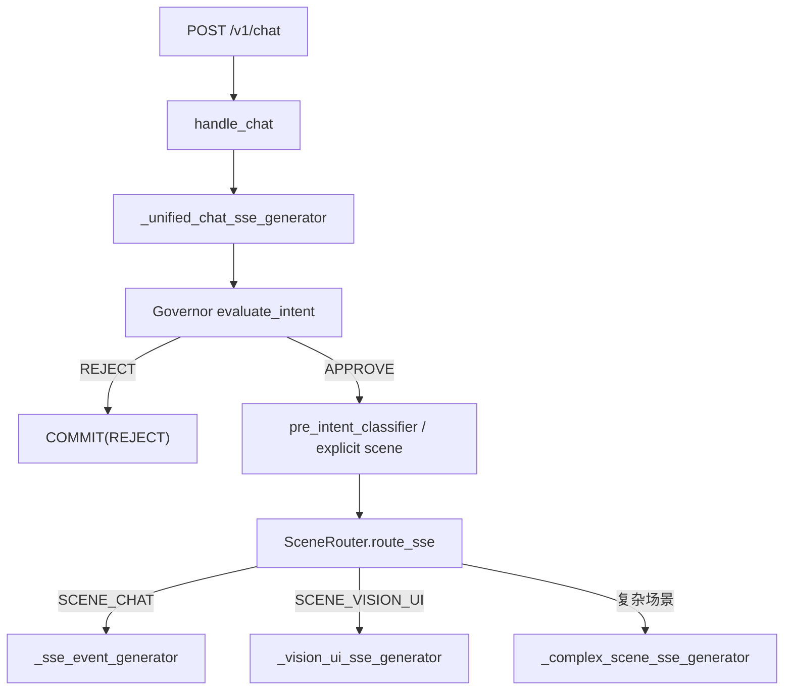
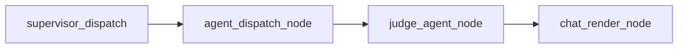
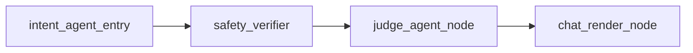

受众：MASTER
标题：当前代码架构总览（2026-03-24）

版本：v1.4
日期：2026-03-26

# 🏗️ 当前代码架构总览（2026-03-26）

> 本文档是“当前代码事实对齐稿”，用于快速回答：目录怎么分层、请求怎么流转、多 Agent 在哪里生效、图编排如何落地。

## 0. 快速导航

- 🧭 入口与范围：第 1 节
- 🧱 目录结构：第 3 节
- 🔗 服务请求链路：第 6 节
- 🤖 多 Agent 治理：第 7 节
- 🕸️ 图编排：第 8 节
- 📡 对外 API：第 9 节

## 1. 目标与范围

本文件基于当前仓库代码结构整理，覆盖以下主题：

- 目录结构
- 分层架构
- 功能模块
- 服务请求链路
- 多 Agent 治理
- 图编排（Graph Orchestration）

> 说明：本文只描述“当前代码已实现事实”，不按历史重构阶段或未落地方案叙述。

## 2. 代码证据入口

- Host API 入口：`host_brain/app/fastapi_app.py`
- Chat 总入口：`host_brain/app/chat_handler.py`
- Chat 流式链路：`host_brain/app/top_agent.py`
- 复杂场景链路：`host_brain/app/chat_handler_complex.py`
- 场景路由与主链：`host_brain/app/graph/main_chain.py`
- 图配置构建：`host_brain/app/graph_config_builder.py`
- 执行画像：`host_brain/app/execution_profile.py`
- 图运行时（门面）：`host_brain/integrations/graph_runtime.py`
- 图执行器：`host_brain/integrations/graph_executor.py`
- 图契约/降级/模型解析：`host_brain/integrations/graph_contract.py`、`host_brain/integrations/graph_fallback.py`、`host_brain/integrations/graph_model_resolve.py`
- 多 Agent handlers：`host_brain/app/handlers/*.py`
- Agent Loop API：`host_brain/app/agent_routes.py`
- Edge RPC 网关：`edge_client/app/fastapi_app.py`

## 3. 目录结构（当前主干）

```text
Natsume_Ai/
├─ host_brain/
│  ├─ app/             # FastAPI、chat入口、graph配置、handlers
│  │  ├─ agents/       # 多 Agent 契约与注册（agent_contract / registry / react_loop）
│  │  ├─ automation/   # Host 侧任务调度路由（scheduler_routes / task_scheduler）
│  │  ├─ graph/        # 主链路时序编排器（MainChain + SceneRouter）
│  │  ├─ handlers/     # 多 Agent handler（supervisor/chat/code/translate/intent/retrieval/judge）
│  │  ├─ llm/          # 模型路由矩阵（能力路由 + 降级链）
│  │  ├─ memory/       # 状态源仲裁器（StateArbiter）+ 记忆写入守卫（MemoryGuard）
│  │  ├─ recall/       # RecallPack 组装器（token 预算截断 + 冲突检测）
│  │  ├─ schemas/      # 核心数据结构与枚举（ProposalType / TaskType / ContextPack 等）
│  │  ├─ skills/       # Skill/MCP 权限模型（PermissionGuard + HotLoader）
│  │  ├─ vision/       # UI 自动化断言协议（前置+后置断言 + 敏感界面检测）
│  │  ├─ monitor_ui/   # 监控面板前端源码（React + Vite SPA）
│  │  └─ static/       # 监控面板构建产物（FastAPI 静态托管）
│  ├─ airlock/         # 气闸隔离层（脱敏/隔离 + subprocess/Docker 双后端沙箱）
│  ├─ audit/           # SQLite 审计账本（WAL + 迁移 + 保留策略）
│  ├─ bond/            # 关系动力学与阶段引擎（Neo4j SSOT + 异步写入队列）
│  │  ├─ shared_memory_index.py  # 共同记忆索引（Phase V）
│  │  ├─ milestone_tracker.py    # 里程碑感知（Phase V）
│  │  └─ bond_narrative.py       # 关系叙事生成（Phase V）
│  ├─ canon/           # 正典资产（style/ + world/ 条目文件）
│  ├─ channels/        # Edge RPC / VTS 渠道适配
│  ├─ core/            # 核心模块（配置快照、错误码、ID、QA、Key Profile、情感时间线）
│  ├─ data/            # Host 本地数据目录（含 vault/）
│  ├─ governor/        # 意图裁决、规则、token、限流（含 Redis/SQLite 后端）
│  ├─ integrations/    # 集成层（LangGraph 图编排四层 + LLM 网关 + Evidence Plane）
│  ├─ lsp/             # Artifact Vault SSOT 接口层（产物仓库读写，唯一授权写入入口）
│  ├─ mcp/             # MCP 注册与桥接（tool_broker / tool_registry）
│  ├─ memory/          # 记忆系统（Chroma 向量存储 / 情景记忆 / Canon 同步 / 向量投影）
│  ├─ observability/   # 可观测性（跨端时间线 / 时钟漂移 / 阈值告警 / 长期 KPI）
│  ├─ release/         # 发布清单管理（model_plane digest 门禁）
│  ├─ retrieval/       # 检索管线（Orchestrator / 多路召回融合 / 混合检索 / 重排 / Evidence Pack）
│  ├─ scheduler/       # 调度器（CRON 任务 SQLite 持久化 / 重启自动恢复）
│  ├─ persona/         # 灵魂系统（Phase I-VIII 全部完成，2026-03-23）
│  │  ├─ persona_engine.py      # PersonaEngine + 7 维特质向量（Phase I）
│  │  ├─ personality_traits.py  # PersonalityTraits 数据结构
│  │  ├─ emotion_reactivity.py  # 情感-人格耦合（Phase II）
│  │  ├─ expression_adapter.py  # 表达策略适配器（Phase II）
│  │  ├─ self_model.py          # 自我意识模型（Phase III）
│  │  ├─ self_reflection.py     # 自省日记（Phase III）
│  │  ├─ persona_growth.py      # 人格成长系统（Phase IV）
│  │  ├─ trait_drift_guard.py   # 安全机制（Phase IV）
│  │  ├─ drift_detector.py      # 人格漂移检测（Phase VI）
│  │  ├─ emotion_persistence.py # 跨会话情感连续性（Phase VII）
│  │  └─ proactive_voice.py     # 场景化主动表达（Phase VIII）
│  ├─ skills/          # 技能系统（SkillRegistry 装饰器注册 / MCP-to-Skill 桥接 / IDE 技能包）
│  ├─ tools/           # 工具系统（Broker / Catalog / MCP 适配 / Selector）
│  └─ vision/          # 视觉链（多检测器注册表 / 摄像头事件 / 屏幕 OCR）
├─ edge_client/
│  ├─ app/             # Edge FastAPI RPC 网关（/v1/edge/*）
│  ├─ actuators/       # TTS/VTS 执行（语音合成 + VTS WebSocket 驱动）
│  ├─ channels/        # 本地渠道适配（保留 input_reporter / command queue）
│  ├─ gateway/         # 统一消息网关（:19000，Phase 1-5 全部完成）
│  │  ├─ adapters/     # 平台适配器（wechat/qq/feishu/wecom/telegram）
│  │  ├─ media/        # 多媒体处理（image/voice/file handler）
│  │  ├─ models.py     # UnifiedMessage / UnifiedReply / Platform / MsgType
│  │  ├─ normalizer.py # 去重 + 脱敏 + 校验（MessageNormalizer）
│  │  ├─ router.py     # 路由到 Host Brain（复用 EdgeInputReporter）
│  │  ├─ outbound.py   # 回复分发器（OutboundDispatcher）
│  │  ├─ server.py     # FastAPI Webhook Server
│  │  └─ bootstrap.py  # start_gateway() 一键启动
│  ├─ services/        # Edge 侧服务层
│  │  ├─ wx_db_service.py  # 微信解密数据库查询（联系人/消息/搜索/朋友圈）
│  │  └─ wx_watcher.py    # watchdog 文件系统监听（延迟 <100ms）
│  ├─ proofs/          # 资源证明与门控（before/after 证据采集）
│  ├─ rpc/             # 事件上报、认证、协议（含 fallback_llm / resource_gate）
│  ├─ runtime/         # 运行时引导与健康快照
│  └─ senses/          # ASR/VAD 感知
├─ configs/
│  ├─ model_plane/     # model profiles / node registry
│  ├─ deploy/          # 部署配置（节点清单）
│  ├─ release/         # 发布配置（里程碑 JSON）
│  ├─ secrets/         # 密钥配置模板
│  └─ vts/             # VTS 相关配置
├─ flows/              # Flow 导出与 active.pointer
├─ docs/
├─ scripts/
│  └─ runtime/         # 本地服务启停 / 环境检查 / 报告生成
├─ tests/
│  ├─ unit/
│  ├─ integration/
│  ├─ contract/
│  ├─ e2e/
│  └─ fixtures/
└─ tools/
   ├─ bench/           # 性能基准测试
   ├─ doc_lint/        # 文档检查与交付门禁
   ├─ replay/          # 审计回放工具
   ├─ static_scan/     # 静态扫描工具（Bond SSOT 单写者检查）
   └─ wx4_decrypt.py   # 微信数据库解密脚本（pymem 提取密钥 + AES-256-CBC 解密）
```

## 4. 分层架构

### 4.1 接入层（API Entry）

- Host FastAPI：`host_brain/app/fastapi_app.py`
  - 核心入口：`POST /v1/chat`
  - 辅助入口：`POST /v1/edge/events`、`GET /metrics`、`GET /panel`、`GET /`
  - 通过 `include_router` 挂载 `web_ui/canon/scheduler/tool/bond/obs/agent/input/health`
- Edge FastAPI：`edge_client/app/fastapi_app.py`
  - 核心端点：`/v1/edge/health`、`/v1/edge/speak`、`/v1/edge/vts`、`/v1/edge/screenshot`、`/v1/edge/automate` 等

### 4.2 治理层（Governor + 约束）

- Chat 主链在 `_unified_chat_sse_generator` 中先做 Governor 裁决：
  - 审批通过才进入场景路由
  - 拒绝立即返回 `COMMIT: REJECT`
- 图执行态通过 `GraphState` 维护治理字段：
  - `committed_route_token`
  - `execution_profile`
  - `active_agent_id`
  - `handoff_history`

### 4.3 编排层（Scene + Graph）

- 场景级分流：`SceneRouter.route_sse`
  - `SCENE_CHAT` → token stream
  - `SCENE_GATEWAY` → Gateway 薄适配层（转交 `top_agent.py`）
  - `SCENE_VISION_UI` → vision 链路
  - 其他复杂场景 → graph 链路
- 图构建层：`graph_config_builder.py`
  - `build_chat_graph`
  - `build_supervised_graph`
  - `build_intent_graph`
  - `build_chat_graph_config`
- 图运行时层：`GraphRuntimeContract.run_graph` + `GraphExecutor`

### 4.4 业务能力层（Retrieval/Memory/Bond/Audit/Edge）

- Retrieval：`get_retrieval_orchestrator()` + `RetrievalPipelineContract`
- 记忆：`persist_chat_episodic_memory` + `EpisodicStore`
- Bond：`BondDynamicsWriter` + `BondStageEngine`
- 审计：`SQLiteLedger`（Host 与图运行时写入）
- 端侧执行：TTS/VTS/截图/自动化通过 Edge RPC 通道落地

## 5. 功能模块拆分

### 5.1 Host 侧核心模块

| 模块 | 代码位置 | 职责 |
|---|---|---|
| Chat 入口 | `host_brain/app/chat_handler.py` | Governor 鉴权 + 场景分类 + SceneRouter 分发 |
| Chat 流式 | `host_brain/app/top_agent.py` | `SCENE_CHAT` token SSE、检索、后处理、COMMIT |
| 复杂场景 | `host_brain/app/chat_handler_complex.py` | 构图、跑图、节点级进度 SSE、最终 COMMIT |
| Scene Router | `host_brain/app/graph/main_chain.py` | 按 scene_type 路由到 gateway/vision/chat/complex |
| Gateway 回复 | `host_brain/app/top_agent.py` | Gateway 文本回复复用共享 `top_agent` 主链 |
| 多 Agent handlers | `host_brain/app/handlers/*.py` | supervisor/chat/code/translate/intent/retrieval/judge/gateway |
| 图运行时 | `host_brain/integrations/graph_runtime.py` | 校验配置、解析模型、执行图、返回统一结果 |
| 图执行器 | `host_brain/integrations/graph_executor.py` | 单步执行、动态分派、降级、trace 记录 |
| 状态源仲裁器 | `host_brain/app/memory/state_arbiter.py` | 六路状态源优先级仲裁（WorldCanon > StyleCanon > Episodic > Bond > Chroma > Edge）|
| 记忆写入守卫 | `host_brain/app/memory/memory_guard.py` | 7 条记忆写入硬性规则（轮次/标签/蒸馏/幂等/Dream 拦截等）|
| RecallPack 组装器 | `host_brain/app/recall/recall_pack_builder.py` | 七路召回证据按 token 预算组装（总上限 2700）|
| 模型路由矩阵 | `host_brain/app/llm/routing_matrix.py` | 能力路由（chat/reasoning/dream/diary）+ 降级链 |
| 失败语义矩阵 | `host_brain/app/failure_matrix.py` | 统一失败事件处理（替代各模块分散 try/except）|
| 情感上下文 | `host_brain/app/emotion_context.py` | 情感归一化 / 快照 / 治理快照 / VAD 映射 |
| Artifact Vault | `host_brain/lsp/vault.py` | 产物仓库读写（唯一授权写入入口）|
| MCP 桥接 | `host_brain/mcp/tool_broker.py` | MCP 工具注册与桥接 |
| 可观测性 | `host_brain/observability/` | 跨端时间线聚合 / 时钟漂移 / 阈值告警 / 长期 KPI |
| 发布清单 | `host_brain/release/` | model_plane digest 门禁与发布清单管理 |
| 视觉链 | `host_brain/vision/` | 多检测器注册表 / 摄像头事件 / 屏幕 OCR |

### 5.2 Edge 侧核心模块

| 模块 | 代码位置 | 职责 |
|---|---|---|
| RPC 网关 | `edge_client/app/fastapi_app.py` | 对外提供 `/v1/edge/*`，含鉴权与能力开关 |
| 运行时引导 | `edge_client/runtime/bootstrap.py` | 组装 ASR/TTS/VTS/Reporter/Gateway 等运行组件 |
| 语音感知 | `edge_client/senses/asr.py` | ASR 采集与状态控制 |
| 执行动作 | `edge_client/actuators/vts_driver.py` | `talk_start/talk_end/set_expression/trigger_hotkey` |
| 事件上报 | `edge_client/rpc/event_reporter.py` | 批量上报到 Host `/v1/edge/events` |
| 资源证明 | `edge_client/proofs/resource_gate.py` | before/after 证据采集（写入 Vault 的原始材料来源）|
| 兜底模型门控 | `edge_client/fallback_model.py` | FallbackModelGate（draft_only 标记，默认卸载）|
| **统一消息网关** | `edge_client/gateway/` | 跨平台消息接入（微信/QQ/飞书/企微/Telegram），监听 :19000 |
| 微信数据库服务 | `edge_client/services/wx_db_service.py` | 解密 SQLite 查询（联系人/消息/搜索/朋友圈）|
| 微信文件监听 | `edge_client/services/wx_watcher.py` | watchdog 实时监听，消息延迟 <100ms |

## 6. 服务请求链路

### 6.1 `POST /v1/chat` 端到端链路



#### 6.1.1 `SCENE_CHAT` 分支

- 文件：`host_brain/app/top_agent.py`
- 关键流程：
  1. 检索（可跳过/降级）
  2. 构建 prompt/context
  3. LLM 流式输出 token/SENTENCE
  4. 并行后处理：Airlock、Episodic、Bond、VTS、TTS
  5. 发出 `COMMIT(APPROVE)`

#### 6.1.2 复杂场景分支

- 文件：`host_brain/app/chat_handler_complex.py`
- 关键流程：
  1. `resolve_execution_profile`
  2. `build_*_graph`
  3. `get_graph_runtime().run_graph(...)`
  4. 输出 `GRAPH_START/NODE_*/GRAPH_DONE/COMMIT`

### 6.2 `POST /v1/edge/events` 回流链路

- Host 接收端：`host_brain/app/fastapi_app.py` → `receive_edge_events_response`
- Edge 上报端：`edge_client/rpc/event_reporter.py`（批量上报）

### 6.3 `POST /v1/agent/run` 自动化链路

- 入口：`host_brain/app/agent_routes.py`
- SSE 循环：`_agent_loop_sse_generator`
- 可选执行后端：
  - `MockClawdbotClient`
  - `ClawdbotClient`
  - `EdgeRpcClient`

## 7. 多 Agent 治理（当前实现）

### 7.1 角色与职责

- `supervisor_dispatch_handler`：从 scene/rule/LLM proposal 选择 `active_agent_id`
- `agent_dispatch_node`：由 `GraphExecutor` 按 `active_agent_id` 动态分派 handler
- 子 Agent handlers：只产出 `agent_artifacts`，不直接改图控制流
- `judge_agent_handler`：汇总工件并产出 `judge_result`

### 7.2 关键治理约束

- 分派白名单：`agent_dispatch_allowlist`
  - 配置来源：`graph_config_builder.py` 的 node binding
  - 执行兜底：`graph_executor.py` 再次校验
- 动态分派映射：`_AGENT_HANDLER_MAP`
  - `chat_agent/code_agent/translate_agent/intent_agent/judge_agent/retrieval_agent`
- `need_judge` 快路径：
  - `false` 时可跳过 judge 直达渲染节点

## 8. 图编排（Graph Orchestration）

### 8.1 执行画像与图形态

- 执行画像常量：`host_brain/app/execution_profile.py`
  - `PROFILE_CHAT_FAST`
  - `PROFILE_WORKFLOW_SUPERVISED`
  - `PROFILE_INTENT_EXEC`

- 图构建函数：`host_brain/app/graph_config_builder.py`
  - `build_chat_graph(...)`
  - `build_supervised_graph(...)`
  - `build_intent_graph(...)`

### 8.2 典型节点序列





### 8.3 运行时分层

| 层 | 代码 | 责任 |
|---|---|---|
| 契约层 | `graph_contract.py` | 图配置校验、共享类型、状态常量 |
| 模型解析层 | `graph_model_resolve.py` | node/profile 解析与参数哈希 |
| 执行层 | `graph_executor.py` | 节点调度、动态分派、trace、降级跳转 |
| 降级层 | `graph_fallback.py` | timeout/dependency/error 的统一降级 |
| 门面层 | `graph_runtime.py` | run_graph 主流程编排与结果归一 |

## 9. 当前对外 API（关键入口）

### 9.1 Host（`host_brain/app/fastapi_app.py`）

**直接挂载：**
- `POST /v1/chat`
- `POST /v1/edge/events`
- `GET /metrics`
- `GET /panel`
- `GET /`

**通过 `agent_router` 挂载（前缀 `/v1/agent`）：**
- `POST /v1/agent/run`
- `GET /v1/agent/info`

**通过 `health_router` 挂载：**
- `GET /health`
- `GET /ready`
- `GET /obs/metrics`
- `GET /health/mcp`
- `GET /health/canon_sync`
- `POST /observability/trace`
- `GET /startup`

**通过 `obs_router` 挂载（前缀 `/api/obs`）：**
- `GET /api/obs/services/health`
- `GET /api/obs/sessions`
- `GET /api/obs/trace/{request_id}`
- `GET /api/obs/metrics/timeseries`
- `GET /api/obs/governor/stats`
- `GET /api/obs/errors`
- `GET /api/obs/memory/stats`
- `GET /api/obs/checkpoints`
- `GET /api/obs/vault/stats`
- 及其他观测端点（详见 `host_brain/app/obs_routes.py`）

**通过 `bond_router` 挂载（前缀 `/v1/bond`）：**
- `GET /v1/bond/health`
- `GET /v1/bond/users`
- `GET /v1/bond/summary/{user_id}`
- `GET /v1/bond/stage/{user_id}`
- `POST /v1/bond/event`

**通过 `input_router` 挂载：**
- `POST /input`

### 9.2 Edge（`edge_client/app/fastapi_app.py`）

- `GET /v1/edge/health`
- `POST /v1/edge/speak`
- `POST /v1/edge/barge_in`
- `POST /v1/edge/vts`
- `POST /v1/edge/screenshot`
- `POST /v1/edge/automate`
- `POST /v1/edge/proactive_push`
- `GET /v1/edge/proactive_messages`
- `GET /v1/edge/wx/contacts` — 微信联系人列表（WxDbService）
- `GET /v1/edge/wx/messages` — 微信聊天记录查询
- `POST /v1/edge/wx/search` — 微信全文搜索
- `POST /v1/edge/wx/refresh` — 重新执行解密（密钥变化时）
- `GET /v1/edge/wx/stats` — 解密数据库统计
- `GET /v1/edge/wx/moments` — 朋友圈读取（Sns.db）

### 9.3 统一消息网关（`edge_client/gateway/server.py`，:19000）

- `POST /v1/gateway/{platform}/webhook` — 接收平台消息推送（wechat/qq/feishu/wecom/telegram）
- `POST /v1/gateway/reply` — Host Brain 回复指令分发
- `GET /v1/gateway/health` — 各平台适配器健康检查
- `GET /v1/gateway/stats` — 标准化 + 路由统计

## 10. 维护约定

- 当 `host_brain/app/graph_config_builder.py`、`host_brain/integrations/graph_*`、`host_brain/app/handlers/*` 发生结构变更时，需同步更新本文。
- 当 `/v1/chat` 主链分支规则变化时，需同步更新"6.1 请求链路"。
- 当新增 Agent 或调整 dispatch/judge 规则时，需同步更新"7. 多 Agent 治理"。
- 当新增顶层目录或 `host_brain/app/` 下新增子目录时，需同步更新"3. 目录结构"。
- 当新增 Host 或 Edge 对外 API 端点时，需同步更新"9. 当前对外 API"。
- `host_brain/obs/` 历史 shim 已删除；当前以 `host_brain/observability/` 为唯一观测实现路径。

## 11. 关联文档

- 架构总览入口：`README.md`
- 数据流文档：`docs/50_project/arch/dataflow_report.md`
- 多 Agent 历史演进：`docs/50_project/arch/AGENT_ORCHESTRATION_DETAIL.md`
- 统一消息网关设计：`docs/50_project/arch/UNIFIED_MESSAGE_GATEWAY_DESIGN.md`
- 灵魂系统升级路径：`docs/15_theory/SOUL_SYSTEM_FULL_UPGRADE_PATH.md`
