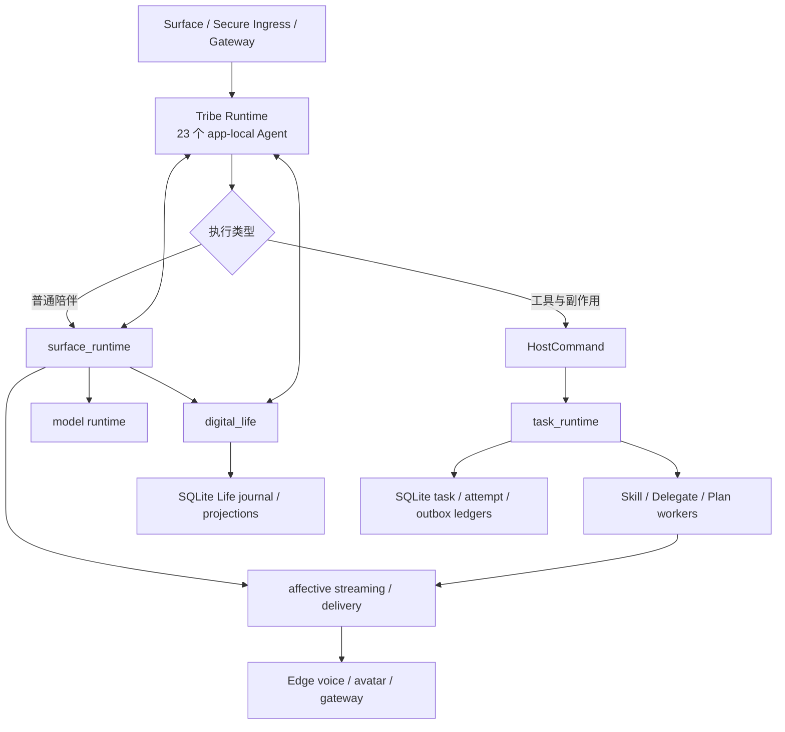

受众：CODEX
标题：Natsume AI 当前代码架构

# 当前代码架构

本文只描述当前分支真实存在的生产边界，不把目标合同或测试夹具写成已完成能力。

## 1. 总体形态

普通聊天与外部副作用路径被明确分开：前者以首字延迟和自然表达为优先，后者以授权、恢复和幂等为优先。

## 2. Tribe 智能体群

`host_brain/tribe/` 是 Host 内部的器官式智能体层。生产 ASGI composition 在每个 Host lifespan 内构造一个 `TribeRuntimeScope`，绑定独立的 `TribeStateRegistry`、`HostTribeRegistry`、有界 `InMemoryTribeEventBus` 和固定 `TribeAgentCatalog`。启动阶段解析全部 Agent、注入 `TribeApplicationPorts`，随后注册事件订阅；请求和后台执行通过 owner-bound `ContextVar` 进入准确的 app-local scope，不允许模块级 fallback 创建第二套 Tribe。

当前生产 catalog 包含 23 个 Agent 家族：

| 子系统 | Agent | 当前职责 |
|---|---|---|
| 感知与路由 | Cortex、Thalamus | context collection、intent compile、route、handoff |
| 情感与社会 | Limbic、Mirror Neuron、Social Brain、Pain/Reward | appraisal contribution、共情、关系语境、奖惩信号 |
| 执行与自主 | Prefrontal、Initiative Governor、Default Mode | 反思、漂移约束、动机、准备度、内在活动 |
| 记忆与语言 | Hippocampus、Language System | 情景存取、recall fusion、语言风格和语气 |
| 身体与稳态 | ANS、Endocrine、Somatic、Interoception、Circadian、Proprioception | 模式、身体信号、昼夜、能量与认知负荷 |
| 行动与协调 | Motor Cortex、Cerebellum、Vestibular、Peripheral | 行动计划、误差修正、稳定与平台动作 |
| 防御与恢复 | Immune、Glymphatic | 输入防护、风险扫描、恢复、整理与噪声衰减 |

这不是 23 个独立 LLM，也不是 23 套持久 authority。各 Agent 可以产生观察、评估、短期状态、handoff 和行动意图；`canonical Life journal` 仍是 self affect、关系和成长的唯一写 authority。在 canonical affect 模式下，Limbic、Default Mode 等旧 mutable writer 会被显式退役或降为只读贡献者。Tribe event bus 上限为 2048 条进程内事件，部分 `TribeStateRegistry` 状态也只用于运行投影，不能宣称具备跨重启生命连续性。

## 3. 情感生命

主要代码位于 `host_brain/digital_life/`：

| 模块 | 当前职责 |
|---|---|
| `text_affect_observer.py` | 纯领域、低置信的用户文本情绪观察；不依赖 Host app，也不能写七海 self affect |
| `affect_fusion.py` | 合并文本、声学等用户观察，保留低置信与冲突 |
| `affective_turn_planner.py` | 生成本轮 appraisal、self affect、companion act 与表达引用 |
| `domain_reducer.py` / `reducer.py` | 确定性折叠 Life 事件和有界状态 |
| `relationship_lifecycle.py` | 关系 episode、裂痕、修复与 aftereffect |
| `companion_profile_lifecycle.py` | 低风险偏好版本、canary 与回滚 |
| `companion_proactive.py` | 主动陪伴候选与权限约束 |
| `companion_voice.py` | 情绪到语音 profile 的选择 |
| `affective_expression_delivery.py` | 表达计划的幂等交付状态 |
| `service.py` / `repository_port.py` | canonical Life command/event 和持久化端口 |

跨模块合同位于 `natsume_contracts/life/`。canonical Life journal 是 self affect 和关系演化的写 authority；其他旧情绪模块只允许作为只读兼容投影或受计量入口。

## 4. 对话与表达

`host_brain/surface_runtime/` 负责普通对话上下文、记忆 grounding、情感计划和流式输出。`affective_streaming.py` 管理稳定分句与打断；`life_context.py` 和 `life_projection.py` 读取 canonical Life 状态。纯文本回复不再把双方情绪重置为 `NEUTRAL`。冲突／修复深路径在一次外部模型调用中生成两个候选；日语声线模式保留每个候选的中文正文、日语正文和情绪字段，确定性选择后才交给统一 Surface 解析与交付。

双候选是措辞选择策略，不是模型车道 authority。`runtime_path=realtime_companion` 由 Host 在路由承诺后写入，单回复和 buffered 双候选都使用 `CHAT_SURFACE_REALTIME／Tier B`；只有不属于普通陪伴的 Task／复杂执行 Surface 才使用 `CHAT_SURFACE／Tier A`。这样保留关系边界与候选择优，不会因为低置信情绪观察把日常对话静默升级到高延迟 Pro 模型。

多轮连续性以 `conversation_turn.turn_index` 为 canonical 顺序；`ContextRepository` 和 Surface 专用 `RuntimeReadRepository` 都必须使用该顺序，`ts_ms` 只描述各进程观察到的墙钟时间。Fusion 在本轮没有新 appraisal 时，只能从仍活跃且未解决的 canonical episode 派生受控 continuity enum；它不会复制历史原文、创建第二份 self-affect 或增加 journal 写入。Planner 将该 enum 冻结进同一 `AffectiveTurnPlan`，让“没事”仍保留未解决低落、让新好消息同时承接此前不安。`GIVE_SPACE` 的候选还会在本地硬拒绝要求用户主动想念／联系的反向施压，不能只靠软分数带过。

Surface packet 继续保持最多 8 条事实，但不再机械保留前 8 条泛化状态。必要事实、真实最近对话、陪伴动作、continuity、记忆线索、已完成的子代理结果和输入感知边界优先，身份／后台状态等低优先事实只填剩余槽位。continuity 另以内部 typed field 穿过 packet compiler，输出 Gate 不再依赖可能被截掉的中文 marker：未解决低落不能被宣布为“那就好／一切正常”，混合结果必须至少保留一处不安、没底、顾虑或慢慢消化的语义。命中后复用既有唯一语义重试；无 typed continuity 的普通聊天不执行这两个 Gate。

当前语言策略为中文文本展示、日语 TTS。Host 通过 `ExpressionPlan` 选择 voice profile；目标 Edge 使用 `configs/voice/gpt_sovits_nanami_v4.json` 与 GPT-SoVITS V4 权重生成语音。

Edge 的 persistent TTS adapter 在子进程发出 `ready` 前拥有该进程的唯一生命周期责任。启动、模型加载、READY 等待或 READY 拒绝任一步失败，都必须在返回 Manager 之前同步 `close()`；不能把超时 worker 留给 GC，也不能让下一次合成在旧 worker 仍占 RAM／VRAM 时继续创建新进程。合成阶段的超时沿用同一 fail-closed 回收规则，下一次请求才允许启动一个干净 worker。

远端 A15 已验证该边界：清理 17 个历史残留后，干净启动、真实物理播放和受控 5 秒 READY timeout 全部结束于单一常驻 worker；Voice terminal receipt 为 `TTS_PLAYBACK_FINISHED/APPLIED`，超时探针返回后没有新增 PID、RAM 或 VRAM 常驻。Avatar 仍因 VTS 未连接独立拒绝，不能由 Voice PASS 推高。

## 5. Governed Task Runtime

`host_brain/task_runtime/` 仍负责所有有副作用路线：

- immutable TaskGraph 与 DAG scheduling；
- node attempt、lease、budget、grant 和 review；
- verification、acceptance、effect、outbox 与 receipt；
- cancel、retry、checkpoint、unknown effect reconciliation 和 restart recovery。

Host 侧 `GovernedHostRuntime` 只保留生命周期与应用 facade；直接 Skill policy、Delegate target 校验和 Review continuation reduction 位于无状态 `governed_host_admission_helpers.py`。当前 facade 为 1454 行，仍受 `<1500` 结构 Gate 约束，不能靠扩大巨石白名单通过。

Delegate 采用显式目标策略，而不是重新启用旧全局 SubAgent Dispatcher。`pentest_agent` 保持 `PORT_FREE_READ_ONLY`、零模型／工具用量证明和执行前 Review；低风险 `translate_agent` 使用 `MODEL_BACKED_READ_ONLY`，只获得 canonical `ModelAttemptService`，模型调用受当前 TaskNode 的 Token／时间／重试／成本预算 guard 约束，不获得工具、嵌套路由或副作用端口，也不要求用户为普通翻译手工审批。两者的结果都必须回到同一 Node Verification／Acceptance。

这些机制不得被重新加到无副作用的普通闲聊首字路径中。

普通实时 Chat 的记忆规划先产生 `NO_RECALL／MAY_RECALL／MUST_RECALL`，再决定是否访问长期记忆。`NO_RECALL` 在计划边界不再进入短期显式记忆兼容 helper；该 helper 旧实现本身也有内容级短路，因此此处是 authority 和调用合同收敛，不能单独作为已证明的 SQLite 性能收益。Surface 仍按自己的连续性合同读取一次有界近期窗口，不删除关系连续性或显式记忆召回。

轻小说深读是普通召回之后的领域增强，不属于所有陪伴回合的固定前置步骤。消息先通过无 IO 的必要条件判定；只有可能在询问选书或详情时，才读取 durable 最近推荐上下文并运行 packet-aware 完整判定。无关陪伴消息不会读取推荐偏好或加载深读持久化模块；真正的指代追问只读取一次上下文，仍保留 cache、网页深读和 evidence 回写。

Gateway Chat 因跨进程投递仍会生成紧凑 TaskGraph 和 durable Acceptance Effect，但它不再同步执行全部派生投影。编译器把可信 `route_type=chat` 固化在 `conversation.user_turn`；dispatcher 只同步提交 canonical 用户轮次和 `surface.reply_delivery`，随后唤醒唯一 app-local recovery Runtime，继续处理 Life、foreground affect、Expression、Memory 与 preference。Dispatcher 在 worker thread 调用同步 handler；两个保留异步调用合同的 Life handler 还会把内部同步 SQLite 主体显式交给 worker thread，避免后台恢复阻塞下一轮 ASGI admission。用户轮次提交失败会阻断 delivery；未标记旧图以及 Plan、Skill、Operator 等路线仍保持完整 effect 顺序。这样保留重启恢复与幂等，不让普通对话承担所有后台状态更新的墙钟时间。

## 6. Host、OBS 与 Composition

`host_brain/composition/` 构造 Host、Life、Task Runtime 等 app-local 对象图。OBS 通过显式 projection ports 读取 canonical store；Monitor UI 只消费读模型和提交 Operator 命令，不拥有业务状态。

Surface 的 `RecallFusionService` 同样由一个 Host application scope 拥有。它复用 Host authority owner 已创建的 `EpisodicStore.chroma`，而不是每个情绪回合重新解析 Chroma 配置、创建 HTTP client 和构造另一份服务。服务本身只在调用栈内保存 route rows／candidate，允许并发只读调用；底层 client 的关闭权仍只属于 EpisodicStore owner。

实时性能计时属于既有响应 trace，不是新的审计子系统。Retrieval 只添加有界整数阶段耗时，Cortex 记录 persona prefetch、retrieval wait、prompt filter、general preference pack、LLM route resolve 和 context total；这些字段随本轮内存 packet 进入原 COMMIT，不触发额外 SQLite 写。

OBS 与 Host 当前共享 canonical SQLite 文件，但只有 Host 业务仓储拥有 canonical 状态写 authority；OBS 只写可重建的 Operator projection。Task 详情采用“缺失优先、最旧优先”的 16 项轮转批次，并在每次派生写后留下 5 ms 的 cooperative writer window，防止 Sidecar 连续 `BEGIN IMMEDIATE` 饿死交互式 Task 写入。Chat worker projection 使用独立连接在线程执行；Task Runtime 仍等待其确定终局后再结算 Budget、Verification 和 Acceptance，因此这里只解除事件循环阻塞，不放宽持久边界。

真实五端加 Docker 复验中，Task 详情每波最多刷新 16 个，index 加详情最多 17 个；三轮 worker projection 到后预算落盘为 187／94／49 ms，修复前峰值为 2,880 ms。该结果证明派生 writer 公平性已进入实际 composition，但不代表普通聊天端到端实时门槛已经通过。

独立 OBS composition 为派生 projection store 启用一小时恢复检查点，而 Host 进程内其他 Store 保持原合同。该策略不降低当前文档刷新频率；`AuthenticatedHostProjectionSources` 只在 `source_instance_id` 切换时强制写 lineage，同一实例的 revision 进入普通检查点。这样仍保存每个退役实例并防止旧实例重放，又不会把 Host 的普通轮询变成逐次历史。大检查点再使用透明压缩，避免个人运行环境因 Monitor 历史重复快照持续膨胀。

`host_brain/app/asgi.py` 只保留 Host composition root 与 lifespan 顺序，当前 1396 行并继续受 `<1400` Gate 约束。Scheduler 的主动任务、Life tick/reconciliation、Life/Embodiment outbox drain 和两个轻量 pump 集中在 `host_scheduler_runtime_handlers.py`；该对象只持有 app-local handler 与后台 task 生命周期，Scheduler ledger、Life journal 和 Embodiment outbox 仍分别是 durable authority。

机器状态保留 OBS 显式组合根的端点和 locator 清零计数，防止重新引入隐藏 Service Locator。

## 7. Edge 与 Gateway

`edge_client/` 包含：

- RPC health、session、lease、fence 与 receipt；
- ASR、GPT-SoVITS TTS 和 voice pipeline；
- VTube Studio expression 映射与 embodiment runtime；
- Unified Gateway 的入站、SQLite transport、outbound 与平台 adapter。

Edge 当前部署在另一台电脑上。本轮已在用户授权下完成远端 Edge RPC、GPT-SoVITS TTS 物理播放、VTS 口型／身体动作、断线恢复和 Gateway 往返；VTS 情绪热键、barge-in 与常驻 ASR 噪声门控仍未通过，因此不能把远端三模态整体标为 `PASS`。

## 8. 数据与外部服务

SQLite 保存 canonical Life、Task、Review、Outbox、Gateway 等本地权威数据。Neo4j、Chroma、Redis 由 Docker 提供图、向量和协调能力，属于可重建投影或外部依赖，不覆盖 canonical ledger。

## 9. 当前边界

- 真实 provider 的端到端首字延迟尚未达最终门槛。
- Tribe event bus 与部分器官投影仍为进程内状态；只有 canonical Life 结果具备持久重放语义。
- 远端 Edge RPC、TTS、VTS 传输与口型已有局部实测；常驻 ASR 噪声门控、情绪热键、barge-in 和完整三模态同步仍未通过。
- 真实多轮盲测、长期关系自然度和兼容 writer 运行清零仍待完成。
- 完整 Docker／Host／OBS／Monitor／Gateway 故障验收尚未在当前 commit 集中执行。

## 10. 2026-08-04 观测主链收口

- `host_brain/input_runtime/worker_dispatch.py` 在 Governed Gateway 回复被 Acceptance 持久提交后，生成两个安全枚举：`acceptance_effect_outbox` 与 `OUTBOX_COMMITTED`；它不宣称外部平台已收到消息。
- `host_brain/input_runtime/audit.py` 和 `observability_runtime/projection_ledger_view.py` 只允许这两个枚举进入公开读模型，继续剔除回复正文和私有字段。
- `obs_routes_stats_input_humanoid.py` 将当前闭环定义为 canonical Reply Outbox commit 或有证据的 legacy terminal 信号；新样本不再依赖已退役的 ACK/progress 事件，旧样本仍按原事实保留。
- `observability_runtime/life_body_source.py` 从 `digital_life_runtime_snapshot.hard_state.emotion_tag` 派生 `currentEmotion`；Monitor hook 同时兼容旧投影，但不再因缺少旧 `emotion_context` 显示待连接。
- 当前真实新样本为三条签名 Gateway 路线，最新有效时间桶回复提交率、闭环率和完成率均为 100%；这不是全系统最终验收。

## 11. 2026-08-05 职责边界收口

本轮没有扩大 `core_architecture_policy.json` 的大文件白名单，而是把 A03 报出的 15 个热点拆成生产可复用的边界：

| 原入口 | 新边界 |
|---|---|
| `surface_main_chain_adapter.py` | `surface_affective_native_stream.py`、`surface_affective_delivery.py`、`surface_main_chain_support.py` |
| `domain_reducer.py` | `affective_domain_reducer.py`、`relationship_domain_reducer.py`、`domain_reducer_support.py` |
| `acceptance_effects.py` | `operator_acceptance_effects.py`、`acceptance_effect_support.py` |
| `governed_route_executors.py` | `governed_expression_delivery.py`、`governed_route_support.py` |
| `embodiment.py` | `embodiment_commands.py` |
| TTS、检索、迁移、Grant、Life delivery、terminal reconciliation、Tribe 订阅 | 分别进入同域的 prosody／projection／compiler／delivery／classifier／event-handler 模块 |

当前工作树上的 A01～A14 静态架构门禁为 `PASS`，migration catalog head 为 `0153`。这只关闭静态职责和目录合同漂移；A15 必须绑定提交 SHA 重新启动真实 Docker、Host、OBS、Monitor、Gateway 和可用 Edge 后才能形成最终结论。

## 12. PlanningSearch Research 的双臂身份

Research 的可验收单位不是一个共享 profile prompt，而是两个预注册 arm。baseline 和 selected 可以共享 provider、model、budget 与冻结 corpus，却必须分别绑定自己的 candidate path、source set、graph/path digest 和渲染后的 prompt digest。外部模型 receipt 只有与对应 arm 的 durable prompt identity 精确一致时才可进入配对终态；调用者临时提交的摘要不具 authority。

0107 以前的 RunSpec 没有 per-arm 字段，读取时仍使用历史 `profile.prompt_digest`，序列化也不补空字段，从而保持既有 canonical JSON 和 exact replay。新真实 cohort 必须先渲染两只 arm、持久预注册各自摘要，再允许任何外部请求开始。A15 Research 已按该合同完成单题预检和 24 题正式队列；Code 与 Pentest 仍待验收。

Research 的货币成本不从 token 总数随意估算。Vault-backed provider adapter 只对已知官方 endpoint、已知模型和完整 provider-owned cache token breakdown 应用代码侧版本化价目；生成 `model_cost_micros` 的同时把 cost policy digest 写入 transport measurement。其他 provider／代理仍必须自己回传 canonical cost，否则 benefit evidence fail-closed。普通对话只多携带已有 usage 中的一个成本整数和策略摘要，不增加模型调用、数据库事务或同步审计步骤。

真实双臂完成后，回答正文不会进入 0107 或 0136。runner 只把新鲜结果封装为没有序列化接口的进程内 transient output，交给独立隐藏质量评审；paired terminal replay 的 transient 列表固定为空。隐藏评审看不到 arm role，使用另一条 canonical 外部 ModelAttempt，并把自己的 prompt、transport、usage、cost 和响应摘要绑定到质量 receipt。这样既能实际评估内容，也不会把私人研究正文扩散成永久审计数据。

固定队列不是在测试代码里伪造 selected path。每题先把同一三来源 snapshot 交给公共 `GoalPlanningService`：NEVER 形成 secondary quick-answer baseline，AUTO 必须实际触发条件 L3 并选择 primary 与 independent。随后 source IDs 才解析为冻结正文和 citation options。expected points 不在 snapshot 或执行 prompt 中，只由独立隐藏评审读取，因此搜索器和执行模型不能直接看到评分答案。

`1c9c2b2bd` 的 24 题真实队列已形成可重开 SQLite 验证的权威证据：质量均值提升 0.85416667、bootstrap 95% 下界 0.75、两臂 citation validity 均为 1.0、严重错误为 0、成本比 1.32215978、p95 延迟比 0.98756943。最终 report 允许提出 promotion proposal，但生产影响位仍为 false；搜索服务没有自行把 L3 切为生产 authority。Research 通过满足了非 Pentest 第二领域的必要收益条件，不代表 Code／Pentest 或 PlanningSearch 总体验收完成。
