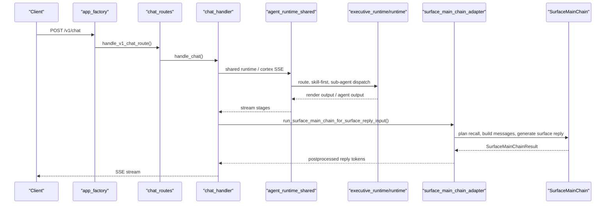

受众：MASTER
标题：当前代码架构总览

# CURRENT_CODE_ARCHITECTURE

版本：v4.3 Living
最后同步：2026-07-10

本文件记录当前工作区代码事实。若本文与代码冲突，以代码为准；若历史文档与本文冲突，以本文和代码为准。

## 1. 运行面

| 运行面 | 入口 | 配置/端口 | 说明 |
|---|---|---|---|
| Host Main | `host_brain/__main__.py` -> `host_brain.app.asgi:app` | `HOST_APP_PORT`，CLI fallback `8000` | 主 API、聊天主链、工具、记忆、数字生命、Pentest |
| Obs Backend | `host_brain/obs_main.py` -> `host_brain.app.obs_fastapi_app:app` | `HOST_OBS_APP_PORT`，fallback `18082` | 独立监控后端；包含 `/obs/*` 和 `/api/ui/*` |
| Monitor Proxy | `scripts/runtime/start_monitor_proxy.ps1` | `HOST_MONITOR_PROXY_PORT`，fallback `18180` | Nginx 静态代理 `/monitor/`，并代理 Host/Obs upstream |
| Edge RPC | `edge_client/__main__.py` | `EDGE_RPC_PORT`，fallback `17800` | Edge 侧 FastAPI RPC |
| Unified Gateway | `edge_client/gateway/bootstrap.py` | `EDGE_GATEWAY_PORT`，fallback `19000` | 平台消息 webhook、输入回流、回复分发 |
| Desktop Pet | `desktop_pet/main.cjs` | `NATSUME_DESKTOP_PET_PORT`，fallback `18788` | Electron + Live2D 本地窗口与 HTTP 控制面 |
| MateEngine/VRM | `host_brain/channels/mateengine.py`、`edge_client/config.py` | UDP `32145`，bridge `18770` | Host MateEngine signal/action，Edge VRM bridge 配置 |

## 2. 目录规模

| 路径 | 当前规模 | 说明 |
|---|---:|---|
| `host_brain/app/` | 228 `.py` | Host app、chat 主链、路由、Obs app、monitor-facing API |
| `host_brain/persona/` | 75 `.py` | Persona、inner world、reply plan、Surface 主链 |
| `host_brain/persona/surface/` | 17 `.py` | Surface 数据模型、prompt、校验、候选评分和 scoring 子包 |
| `host_brain/pentest/` | 124 `.py` | Pentest 工具、agent、adversarial、swarm、online、安全边界 |
| `host_brain/runtime/` | 6 `.py` | 数字生命后台 tick、连续性、器官与自主发起 |
| `host_brain/memory/` | 24 `.py` | LifeMemoryStore、召回、Canon、上下文压缩 |
| `host_brain/tribe/` | 34 `.py` | HostTribeRegistry、事件总线、agent 实现 |
| `host_brain/governor/` | 10 `.py` | 决策治理、规则、rate limit、token budget |
| `host_brain/agent_runtime/` | 28 `.py` | Agent v2 执行适配、canonical v3 contracts、durable TaskStore shadow |
| `host_brain/skills/impl/` | 25 executor 文件 | 普通 skill executor；不包含 Pentest 执行器 |
| `edge_client/` | 80 `.py` | Edge RPC、Gateway、平台适配器 |
| `host_brain/app/monitor_ui/src/` | 458 源文件 | React Monitor UI 源码 |

## 3. Host Main 装配

`host_brain/app/app_factory.py` 是 Host FastAPI 装配点：

```text
create_host_fastapi_app()
  -> wire_route_providers()
  -> register_host_routers(app)
  -> configure_http_middleware(app)
  -> app.post("/v1/chat")(chat_endpoint)
  -> app.post("/v1/edge/events")(edge_events_endpoint)
  -> app.get("/metrics")
  -> app.get("/")
```

`host_brain/app/router_registry.py` 当前 include 顺序：

```text
canon -> scheduler -> host_scheduler(/host-scheduler) -> tools -> tool alias
-> prompt_config -> bond -> agent -> input -> internal_tribe
-> internal_codex -> internal_security_immune -> digital_life
-> memory -> mateengine -> pentest -> health
```

注意：`/v1/chat` 与 `/v1/edge/events` 是 `app_factory.py` 直接注册，不在 `router_registry.py` include 列表中。

Observability 路由（`host_brain/app/obs_routes_*.py`，23 个文件，~14K 行）不在 `router_registry.py` 中注册，而是通过 `host_brain/app/obs_routes.py` 聚合器在 `obs_fastapi_app.py` 中单独装配。

## 4. Host 路由前缀

| 前缀 | 模块 | 说明 |
|---|---|---|
| `/v1/chat` | `app_factory.py` + `chat_routes.py` | SSE 聊天入口 |
| `/v1/edge/events` | `app_factory.py` | Edge 事件回流 |
| `/canon` | `canon_routes.py` | Canon proposal/document/hotword |
| `/scheduler` | `host_brain/scheduler/scheduler_routes.py` | Scheduler API |
| `/host-scheduler/*` | `app/automation/scheduler_routes.py` | Host scheduler API |
| `/tools` | `tool_routes.py` | Tool catalog、execute、custom providers、hub |
| `/prompt-config` | `prompt_config_routes.py` | Prompt template/catalog |
| `/bond` | `bond_routes.py` | 关系与羁绊状态 |
| `/v1/agent` | `agent_routes.py` | Agent run/info |
| `/v1/host/input` | `input_routes.py` | ASR/Gateway 统一输入回流 |
| `/internal/*` | `internal_tribe_routes.py`、`internal_agent_routes.py`、`internal_security_immune_routes.py` | 内部 Tribe/Codex/security API |
| `/v1/digital-life` | `digital_life_routes.py` | 数字生命状态、tick、主动发起、器官（18 个端点含 3 个 proactive） |
| `/v1/digital-life/proactive/*` | `digital_life_routes.py` | Proactive 主动发起（attempt/recent/episodes） |
| `/obs/proactive-autonomy` | `obs_routes_proactive_autonomy.py` | Proactive autonomy 快照 |
| `/v1/memory` | `memory_routes.py` | 记忆健康、事件、重建、清理 |
| `/v1/mateengine` | `mateengine_routes.py` | capabilities/health/signal/say/action |
| `/v1/pentest` | `pentest_routes.py` | Pentest capabilities/environment/runs/events/report/knowledge |
| `/health`、`/ready`、`/startup` | `health_routes.py` | 健康与启动状态 |
| `/metrics` | `app_factory.py` | Host runtime metrics |

## 5. Chat 主链



关键文件：

| 文件 | 职责 |
|---|---|
| `host_brain/app/chat_routes.py` | `/v1/chat` request wrapper、immune gate、BioOps preflight |
| `host_brain/app/chat_handler.py` | 主 SSE generator |
| `host_brain/app/agent_runtime_shared.py` | 共享 runtime hub、检索预取、子 agent gateway |
| `host_brain/executive_runtime/runtime.py` | legacy Executive 运行核心与 route outcome 收口 |
| `host_brain/executive_runtime/route_planning.py` | 硬规则路由与复杂计划判定 |
| `host_brain/executive_runtime/skill_execution.py` | legacy Skill/Plan 执行 |
| `host_brain/app/surface_main_chain_adapter.py` | App 层到 Persona Surface 主链的桥接 |
| `host_brain/persona/surface_main_chain.py` | SurfaceMainChain 入口 |
| `host_brain/persona/surface_runtime.py` | 直接 LLM 生成、task mode、hard gate 检查 |
| `host_brain/persona/surface_memory_recall.py` | Surface 记忆召回计划与 evidence 组织 |
| `host_brain/persona/surface_packet_compiler.py` | ReplyControlPacket 编译 |

### 5.1 Canonical Task Runtime（当前为 legacy-authoritative shadow）

```text
AgentJobRegistry (LEGACY read authority)
  -> optional redacted mirror/reconcile
  -> DurableTaskStore (0052 base + 0054 recovery)
       -> TaskGraph / TaskNode CAS
       -> Attempt -> active Lease(owner, fencing_token, expiry) -> Heartbeat
       -> IdempotencyReservation -> RECOVERY_REQUIRED
              -> Ed25519 SIDE_EFFECT_CONFIRMED + receipt -> COMMITTED
              \-> Ed25519 NO_SIDE_EFFECT -> RELEASED / lease-fenced REACQUIRE
       -> BudgetReservation
       -> transactional Outbox(event/aggregate/attempt/payload/time/evidence bound)
```

- `host_brain/agent_runtime/task_store.py` 不创建 schema；0052/0054 未应用、缺 recovery 字段或缺 `RECOVERY_REQUIRED` 状态时拒绝启动。0052 不可变；0054 是 forward-only upgrade。
- 所有公开 mutation 只读构造时注入的可信 clock，不接受 caller `now`。reservation 与正常 commit/renew 绑定 active attempt lease、owner 和 fencing token；lease 接管后旧 worker 无法提交，expiry 只能先进入 `RECOVERY_REQUIRED`。
- reconciliation action 全部验证 Ed25519 公钥 attestation。COMMIT/RELEASE 不要求原 lease 仍活跃；REACQUIRE 必须绑定新 active lease/fence。签名绑定 action、outcome、reservation/fingerprint、recovery version、actor、attestation ref，并在 COMMIT 时额外绑定 receipt；RELEASE 与 REACQUIRE 签名不可互换。
- node cancel 同事务把 attempt 置为 `CANCEL_REQUESTED`、active lease 置为 `CANCELLED`、RESERVED operation 置为 `RECOVERY_REQUIRED`。未澄清 operation 存在时 node 保持 `CANCEL_REQUESTED`；signed COMMIT/RELEASE 后才可由 startup recovery 收敛 `CANCELLED`。
- attempt 进入 SUCCEEDED/FAILED/CANCELLED 时同事务关闭 lease；startup 会独立清理 terminal attempt 的 orphan active lease。direct cancel 清理 node 下所有 active lease，不以 attempt live 状态为前提。
- Outbox 事件精确绑定 aggregate/version/event/attempt 与 canonical `taskstore://event/...` payload；availability 来自可信 clock，evidence 仅接受有界 durable refs。任何不匹配都回滚状态。
- Graph/Node/Budget/Outbox/legacy snapshot 的 durable JSON 会重验 schema、结构和 SQL/JSON identity，并递归拒绝 duplicate keys 与 NaN/±Infinity；损坏时返回稳定错误，不降级为空对象，也不覆盖原行。
- 0052 legacy receipt 的完整原值仅保存在 0054 audit raw 列；普通 Store read 对 COMMITTED 行返回安全 `legacy-receipt://` ref、digest 与 null marker，不返回 raw/control/oversize 内容。
- legacy shadow 拒绝旧 `updated_at_ms`；相同时间相同 digest 幂等，相同时间不同 digest CAS 冲突，防止乱序状态回滚。
- 当前没有 canonical scheduler/worker 主链切流；`AgentJobRegistry` 仍是唯一读权威，shadow 故障不改变旧 API 返回。

## 6. Persona / Surface

当前 Persona 层（75 文件，120+ 类）按 Phase I-XVI 组织。主干管线：

### 6.1 人格与状态

| 组 | 关键文件 | 行数 | 说明 |
|---|---|---|---|
| 核心引擎 | `persona_engine.py`、`personality_traits.py` | 520 + 396 | 7 维特质向量（warmth/curiosity/humor/sensitivity/assertiveness/playfulness/resilience）、表达 hint、Canon JSON 持久化 |
| 内在世界 | `inner_world.py`、`inner_activity_agent.py`、`inner_monologue.py` | 2,565 + 1,829 + 1,387 | 离线状态机（loneliness 0.05/hr accumulation）、独白质量评分、体感模型 |
| 情感系统 | `emotional_proactive.py`、`emotional_silence.py`、`emotion_persistence.py`、`emotion_reactivity.py` | 845 + 727 + 552 + 386 | 主动发起冲动、沉默状态引擎、跨会话持久化、反应性调校 |
| 成长演化 | `evolution_orchestrator.py`、`evolution_desire_engine.py`、`trait_drift_guard.py`、`drift_detector.py`、`emergent_growth_engine.py` | 964 + 664 + 435 + 686 + 501 | 演化编排、意愿引擎、特质漂移守护、涌现成长 |
| 主动语音 | `proactive_voice.py` | 1,477 | 场景感知主动表达（LATE_NIGHT/LONG_ABSENT/POST_INTENSE/TOPIC_FOLLOWUP/MORNING_GREET/HOLIDAY_GREET），24h 冷却 |

### 6.2 回复规划与质量

| 组 | 关键文件 | 行数 | 说明 |
|---|---|---|---|
| 回复规划 | `reply_plan.py`、`reply_tactics.py`、`reply_validator.py` | 2,172 + 287 + 1,254 | 回复轨迹规划、战术选择、质量校验 V2 |
| 文本质量 | `text_quality_gate.py`、`galgame_text_contract.py`、`galgame_text_scorer.py`、`sample_guided_text_scorer.py` | 1,118 + 1,631 + 383 + 1,203 | 文本质量门控、Visual Novel 风格契约与评分 |
| 动机 | `motive_engine.py`、`motive_runtime.py` | 448 + 143 | reach_out/continuity/withdraw/self_protect 动机计算 |

### 6.3 Surface 生成管线

```text
SurfaceMainChain (surface_main_chain.py, 250 行)
  → SurfaceRuntime (surface_runtime.py, 2,668 行) — LLM 运行时编排
  → SurfaceMemoryRecall (surface_memory_recall.py, 4,539 行) — 记忆召回注入
  → SurfacePacketCompiler (surface_packet_compiler.py, 713 行) — 多包编译为统一输入
  → CandidateScoring (surface/candidate_scoring.py, 1,912 行) — 候选评分与选择
    → scoring/parse.py (262 行) — 候选解析、问题预算计数
    → scoring/stage_positions.py (406 行) — 场景位置评分（back/morning/low-energy/self-doubt/positive）
    → scoring/control_affect.py (398 行) — 情感控制评分（情绪基调 + 关系距离）
    → scoring/texture.py (273 行) — 纹理评分（签名纹理命中 + 场景质量样本评分）
    → scoring/constants.py (37 行) — 本地评分常量
```

### 6.4 关键数据模型

- **`ReplyControlPacket`**：inner-state leakage 字段 — `inner_weather`、`body_state_hint`、`care_signal`、`continuity_signal`、`tension_hint`、`liveliness`、`active_loops`。将角色内部状态泄漏给 Surface LLM，但不暴露原始私密思维。
- **`SurfaceInfluencePacket`**：7 种子影响类型 — Task、Affect、Relationship、Memory、Continuity、Safety、Delivery。
- **`IsolatedSurfaceInput`**：Pydantic v1/v2 双兼容，携带 MemoryRecallPacket + ReplyControlPacket + SurfaceInfluencePacket。
- **`PersonalityTraits`**：7 维连续向量 [0.0, 1.0]，阈值触发表达 hint（非开关）。

### 6.5 `persona/surface/` 子包

共 17 个 Python 文件（11 个 surface/ 根 + 6 个 scoring/）：

| 模块 | 行数 | 职责 |
|---|---|---|
| `candidate_scoring.py` | 1,912 | 核心候选评分和选择管线 |
| `scene_constants.py` | 1,587 | 场景标记常量（back/morning/low-energy 等） |
| `continuity_detectors.py` | 1,140 | 连续性/边界/场景相关性检测 |
| `prompt_construction.py` | 717 | Surface LLM 调用的 prompt 构造 |
| `relationship_affect.py` | 360 | 关系距离和情感基调评分 |
| `scoring_texture.py` | 251 | 纹理评分桥接 |
| `fact_handling.py` | 226 | Fact 处理与 must-not-do 合并 |
| `data_models.py` | 210 | ReplyControlPacket、IsolatedSurfaceInput 等数据模型 |
| `input_validation.py` | 112 | Surface 输入校验 |
| `util.py` | 56 | 纯文本/集合工具函数 |
| `scoring/` (6 文件) | ~1,395 | 评分子管线（见 6.3） |

## 7. Pentest

Pentest 不属于普通 skill executor。它有独立 API、handler、ToolSpec、executor 和安全 guard。

| 事实 | 当前值 |
|---|---|
| ToolSpec 文件 | `host_brain/pentest/tools/tool_specs.py` |
| Executor 文件 | `host_brain/pentest/tools/tool_executors.py`（6,029 行） |
| ToolSpec 数 | 88 |
| Executor 数 | 92 |
| Side-effect ToolSpec 数 | 37 |
| 缺 executor 的 ToolSpec | 0 |
| Kali wrapper class | 17 |
| API prefix | `/v1/pentest` |
| Handler | `host_brain/app/handlers/pentest_agent_handler.py`（1,604 行）、`pentest_attack_agent_handler.py`（172 行） |
| 专项文档 | `docs/50_project/arch/PENTEST_MODULES_ARCHITECTURE.md`、`host_brain/pentest/CAPABILITY.md` |

### 7.1 规划器（三条路径）

当前存在三条规划路径，由 `agent/compat.py:LegacyKernelAdapter` 和环境变量 `PENTEST_COGNITIVE_KERNEL` 控制：

| 规划器 | 文件 | 行数 | 说明 |
|---|---|---|---|
| MCTS | `mcts_planner.py` | 1,111 | 经典蒙特卡洛树搜索 |
| ReAct | `llm_react_planner.py` | 710 | LLM 驱动的 ReAct 循环（Thought→Action→Observation） |
| Cognitive | `agent/cognitive_engine.py` | 834 | LLM 假设生成 + 信念加权评分，替代旧 action_policy + MCTS 管线 |

### 7.2 Agent 内部子包

`pentest/agent/`（31 文件，8,906 行）核心模块按职责分组：

| 组 | 关键文件 | 行数 | 说明 |
|---|---|---|---|
| 认知 | `cognitive_engine.py`、`meta_cognition.py`、`situation_analyzer.py` | 834 + 288 + 352 | LLM 假设生成、实时决策质量监控、态势分析 |
| 信念/目标 | `belief_model.py`、`goal_model.py` | 394 + 416 | 贝叶斯信念系统（时间衰减）、显式目标声明（shell/root/domain_admin 等） |
| 演化 | `evolution_core.py` | 693 | Observe→Reflect→Adapt→Evolve 统一循环 |
| 攻击 | `attack_planner.py`、`exploit_engine.py`、`payload_factory.py`、`attack_chain.py`、`vuln_chain.py` | 333 + 323 + 290 + 213 + 189 | 攻击规划、利用引擎、payload 工厂 |
| 知识 | `knowledge_store.py`、`knowledge.py`、`threat_intel.py`、`online_research.py` | 领域 SQLite Store + runtime adapters | Pentest 自有持久化、promotion candidate、在线研究聚合；active 路径不直接读写 WorldCanon |
| 约束 | `opsec.py`、`budget.py`、`reward.py` | 433 + 75 + 102 | OPSEC 规则与规避、多维预算、奖励画像（4 种 profile） |
| 策略 | `strategy_escalator.py`、`playbook.py`、`biz_logic_probe.py` | 256 + 225 + 215 | 策略升级、可复用攻击模板、业务逻辑探测 |

Pentest 知识只有一个运行时权威：`PentestKnowledgeAccess` 直接访问 Pentest 领域 SQLite Store，DB 默认路径按模块绝对锚定。成功链、反思、pitfall、command 与 technique 进入 `pentest-domain-*` namespace；需要进入通用 Canon 的内容只生成 `PENDING_REVIEW` promotion candidate。运行时不再提供 mode 开关、WorldCanon 目录读取、shadow 对账或回退分支。历史数据转换与 cutover receipt 仅属于显式离线迁移 API，不参与 production 读路径。

### 7.3 报告模块

- `phase6_report.py`（492 行）：实际报告生成入口。
- `report/json_report.py`（5 行）/ `report/markdown_report.py`（20 行）：存根，实际逻辑在 `phase6_report.py`。
- `report/compliance.py`（139 行）：PCI-DSS 4.0 / HIPAA / SOC2 / ISO 27001 / GDPR 合规映射。

安全边界：

- `ScopeGuard`、`RateLimiter`、`ExecutorGuard` 在 executor 层参与执行前校验。
- Side-effect 工具还需要 `allow_exploit`、Governor/approval token 和 manifest guard。
- Web 侧 Phase 4/5 approval 端点要求 `PENTEST_WEB_LAB_MODE=true`。
- `ONLINE_SCAN_MODE` 只有 `offline` 与 `manual`，没有 `auto`。

## 8. Tribe

`host_brain/tribe/`：34 文件，23,534 行。

- `registry.py`：`_DEFAULT_FAMILY_SPECS`（23 个 family spec），`_bootstrap_default_agents()`（实际 bootstrap 24 个默认 `TribeAgentDescriptor`）。
- Agent class 总计 26 个（23 个 brain-region agent + `cortex_intent_analyzer`、`cortex_context_collector`、`edge_command_pusher`）。
- Agent 大小分布（按行数降序）：

| Agent 文件 | 行数 |
|---|---:|
| `thalamus_agent.py` | 4,014 |
| `limbic_agent.py` | 1,922 |
| `prefrontal_agent.py` | 1,584 |
| `immune_agent.py` | 1,469 |
| `tribe_state.py` | 1,119 |
| `social_brain_agent.py` | 1,116 |
| `ans_agent.py` | 1,051 |
| `pain_reward_agent.py` | 817 |
| `cortex_agent.py` | 780 |
| `hippocampus_agent.py` | 781 |
| `motor_cortex_agent.py` | 664 |
| `language_system_agent.py` | 619 |
| `default_mode_agent.py` | 515 |
| `peripheral_agent.py` | 506 |
| `endocrine_agent.py` | 481 |
| `circadian_agent.py` | 469 |
| `mirror_neuron_agent.py` | 462 |
| `glymphatic_agent.py` | 453 |
| `cerebellum_agent.py` | 446 |
| `somatic_agent.py` | 422 |
| `proprioception_agent.py` | 432 |
| `interoception_agent.py` | 432 |
| `initiative_governor_agent.py` | 420 |
| `vestibular_agent.py` | 348 |

- 辅助模块：`event_bus.py`（374 行，pub/sub 事件总线，1,024 事件环形缓冲）、`handoff.py`（145 行）、`cortex_route_decider.py`（131 行）、`cortex_context_collector.py`（441 行）、`edge_command_pusher.py`（343 行，独立运行能力，不在 registry 默认 family 列表中）。
- 当前 family：`cortex, thalamus, ans, hippocampus, limbic, prefrontal, social_brain, endocrine, immune, pain_reward, language, somatic, peripheral, circadian, proprioception, initiative_governor, default_mode, mirror_neuron, interoception, motor_cortex, cerebellum, glymphatic, vestibular`。

## 9. Monitor UI

源文件：`host_brain/app/monitor_ui/src/app/routeManifest.jsx`

- 当前 route manifest：37 条 route，35 条进入导航。
- 静态构建产物：`host_brain/app/static/monitor/`。
- 运行暴露方式：`scripts/runtime/start_monitor_proxy.ps1` 生成 Nginx 配置，将 `/monitor/` 指向静态目录，并将 `/obs/`、`/api/ui/` 代理到 Obs backend。
- Host app 当前没有在 `app_factory.py` 里直接 `mount("/monitor", ...)`。

### 9.1 导航分组

| 导航组 | 路由数 | 代表路由 |
|---|---|---|
| Cockpit | 1 | `/cockpit` — DigitalLifeOverview |
| Life Systems | 7 | `/life/timeline`、`/inner-world`、`/proactive-autonomy`、`/life/runtime`、`/emotion-dashboard`、`/life/body`、`/life/self-model` |
| Observability | 3 | `/observability/trace`、`/observability/sessions`、`/observability/metrics` |
| Operations | 8 | `/chat/debug`、`/tools`、`/canon`、`/bond`、`/gateway` 等 |
| Execution | 5 | Skills、Automation、Scheduler、Agent 配置等 |
| Security Lab | 3 | `/security/pentest`、`/security/pentest/detail`、`/security/immune` |
| Integrations | 8 | `/integrations/*` — 各平台（微信/QQ/飞书/Telegram/Line 等）配置页 |

## 10. Digital Life 运行时

`/v1/digital-life`（`digital_life_routes.py`，175 行）提供 18 个端点。`/obs/proactive-autonomy`（`obs_routes_proactive_autonomy.py`，94 行）提供 proactive autonomy 快照。

### 10.1 端点分类

| 类别 | 端点 | 说明 |
|---|---|---|
| 状态 | `GET /state`、`GET /runtime/health`、`GET /environment/current` | 完整状态快照、运行时健康、环境信息 |
| 器官 | `GET /organs/state` | 23 个器官的运行时状态（limbic/social_brain/hippocampus/default_mode/circadian/glymphatic/endocrine/immune/prefrontal/initiative_governor/motor_cortex/cerebellum/vestibular/somatic/interoception/thalamus/language_system/mirror_neuron/pain_reward/ans/peripheral/proprioception/cortex） |
| 驱动/体现 | `GET /inner-drive/current`、`GET /embodiment/current`、`GET /action/current` | 内在驱动、当前体现、当前生命行为 |
| 生命周期 | `POST /tick`、`POST /advance` | 手动 tick、推进内部生命到当前时刻 |
| **Proactive** | `POST /proactive/attempt`、`GET /proactive/recent`、`GET /proactive/episodes/recent` | 主动发起尝试（支持 dry-run）、近期 outbox、近期 proactive episodes |
| 经验 | `GET /experience/recent`、`POST /experience/ingest` | 近期经验、经验摄入 |
| 成长 | `GET /growth/state`、`GET /learning/recent`、`GET /causality/recent` | 成长状态、近期学习事件、因果链 |
| 工作环境 | `POST /work-event` | 记录工作环境事件 |

### 10.2 Proactive 回路

```text
DigitalLifeSupervisor.tick_loop() (runtime/digital_life_supervisor.py, 1,235 行)
  → autonomous_self.apply_autonomous_self_cycle() (1,009 行)
    → 8 维自适应特质评分 (curiosity/assertiveness/playfulness/sensitivity/resilience/restraint/warmth)
    → compute_dialogue_state_closure()
  → PersonaProactiveVoice.evaluate() (persona/proactive_voice.py, 1,477 行)
    → 场景匹配 (LATE_NIGHT/LONG_ABSENT/POST_INTENSE/TOPIC_FOLLOWUP/MORNING_GREET/HOLIDAY_GREET)
    → 24h per-type 冷却
  → EmotionalProactiveEpisode 追踪 (persona/emotional_proactive.py, 845 行)
  → proactive_voice.generate() → ProactiveExpression
  → life_continuity.record_proactive_outbox()
  → Edge RPC proactive_push → 外显执行
```

## 11. 已知仍需同步的文档

本轮已同步 README、当前架构、核心模块参考、Pentest 能力边界和 Pentest 专项架构。以下文档仍可能含旧口径，需要按后续任务逐个校正：

- `docs/30_devspec/DevSpec.md`
- `docs/20_prd/PRD.md`
- `docs/15_theory/*`
- `Soul.md`
