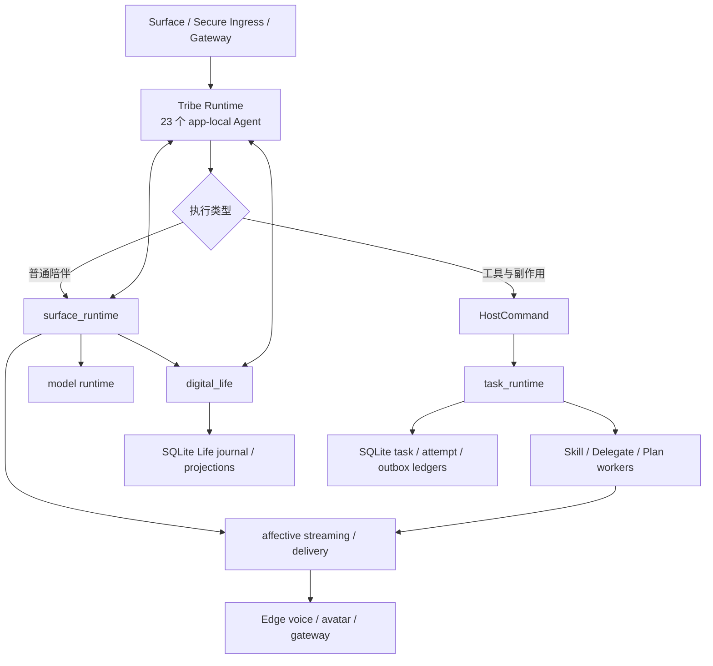

受众：CODEX
标题：Natsume AI 当前代码架构

# 当前代码架构

本文只描述当前分支真实存在的生产边界，不把目标合同或测试夹具写成已完成能力。

## 1. 总体形态

普通聊天与外部副作用路径被明确分开：前者以首字延迟和自然表达为优先，后者以授权、恢复和幂等为优先。

## 2. Tribe 智能体群

`host_brain/tribe/` 是 Host 内部的器官式智能体层。生产 ASGI composition 在每个 Host lifespan 内构造一个 `TribeRuntimeScope`，绑定独立的 `TribeStateRegistry`、`HostTribeRegistry`、有界 `InMemoryTribeEventBus` 和固定 `TribeAgentCatalog`。启动阶段解析全部 Agent、注入 `TribeApplicationPorts`，随后注册事件订阅；请求和后台执行通过 owner-bound `ContextVar` 进入准确的 app-local scope，不允许模块级 fallback 创建第二套 Tribe。

当前生产 catalog 包含 23 个 Agent 家族：

| 子系统 | Agent | 当前职责 |
|---|---|---|
| 感知与路由 | Cortex、Thalamus | context collection、intent compile、route、handoff |
| 情感与社会 | Limbic、Mirror Neuron、Social Brain、Pain/Reward | appraisal contribution、共情、关系语境、奖惩信号 |
| 执行与自主 | Prefrontal、Initiative Governor、Default Mode | 反思、漂移约束、动机、准备度、内在活动 |
| 记忆与语言 | Hippocampus、Language System | 情景存取、recall fusion、语言风格和语气 |
| 身体与稳态 | ANS、Endocrine、Somatic、Interoception、Circadian、Proprioception | 模式、身体信号、昼夜、能量与认知负荷 |
| 行动与协调 | Motor Cortex、Cerebellum、Vestibular、Peripheral | 行动计划、误差修正、稳定与平台动作 |
| 防御与恢复 | Immune、Glymphatic | 输入防护、风险扫描、恢复、整理与噪声衰减 |

这不是 23 个独立 LLM，也不是 23 套持久 authority。各 Agent 可以产生观察、评估、短期状态、handoff 和行动意图；`canonical Life journal` 仍是 self affect、关系和成长的唯一写 authority。在 canonical affect 模式下，Limbic、Default Mode 等旧 mutable writer 会被显式退役或降为只读贡献者。Tribe event bus 上限为 2048 条进程内事件，部分 `TribeStateRegistry` 状态也只用于运行投影，不能宣称具备跨重启生命连续性。

## 3. 情感生命

主要代码位于 `host_brain/digital_life/`：

| 模块 | 当前职责 |
|---|---|
| `affect_fusion.py` | 合并文本、声学等用户观察，保留低置信与冲突 |
| `affective_turn_planner.py` | 生成本轮 appraisal、self affect、companion act 与表达引用 |
| `domain_reducer.py` / `reducer.py` | 确定性折叠 Life 事件和有界状态 |
| `relationship_lifecycle.py` | 关系 episode、裂痕、修复与 aftereffect |
| `companion_profile_lifecycle.py` | 低风险偏好版本、canary 与回滚 |
| `companion_proactive.py` | 主动陪伴候选与权限约束 |
| `companion_voice.py` | 情绪到语音 profile 的选择 |
| `affective_expression_delivery.py` | 表达计划的幂等交付状态 |
| `service.py` / `repository_port.py` | canonical Life command/event 和持久化端口 |

跨模块合同位于 `natsume_contracts/life/`。canonical Life journal 是 self affect 和关系演化的写 authority；其他旧情绪模块只允许作为只读兼容投影或受计量入口。

## 4. 对话与表达

`host_brain/surface_runtime/` 负责普通对话上下文、记忆 grounding、情感计划和流式输出。`affective_streaming.py` 管理稳定分句与打断；`life_context.py` 和 `life_projection.py` 读取 canonical Life 状态。纯文本回复不再把双方情绪重置为 `NEUTRAL`。

当前语言策略为中文文本展示、日语 TTS。Host 通过 `ExpressionPlan` 选择 voice profile；目标 Edge 使用 `configs/voice/gpt_sovits_nanami_v4.json` 与 GPT-SoVITS V4 权重生成语音。

## 5. Governed Task Runtime

`host_brain/task_runtime/` 仍负责所有有副作用路线：

- immutable TaskGraph 与 DAG scheduling；
- node attempt、lease、budget、grant 和 review；
- verification、acceptance、effect、outbox 与 receipt；
- cancel、retry、checkpoint、unknown effect reconciliation 和 restart recovery。

Host 侧 `GovernedHostRuntime` 只保留生命周期与应用 facade；直接 Skill policy、Delegate target 校验和 Review continuation reduction 位于无状态 `governed_host_admission_helpers.py`。当前 facade 为 1454 行，仍受 `<1500` 结构 Gate 约束，不能靠扩大巨石白名单通过。

这些机制不得被重新加到无副作用的普通闲聊首字路径中。

## 6. Host、OBS 与 Composition

`host_brain/composition/` 构造 Host、Life、Task Runtime 等 app-local 对象图。OBS 通过显式 projection ports 读取 canonical store；Monitor UI 只消费读模型和提交 Operator 命令，不拥有业务状态。

`host_brain/app/asgi.py` 只保留 Host composition root 与 lifespan 顺序，当前 1396 行并继续受 `<1400` Gate 约束。Scheduler 的主动任务、Life tick/reconciliation、Life/Embodiment outbox drain 和两个轻量 pump 集中在 `host_scheduler_runtime_handlers.py`；该对象只持有 app-local handler 与后台 task 生命周期，Scheduler ledger、Life journal 和 Embodiment outbox 仍分别是 durable authority。

机器状态保留 OBS 显式组合根的端点和 locator 清零计数，防止重新引入隐藏 Service Locator。

## 7. Edge 与 Gateway

`edge_client/` 包含：

- RPC health、session、lease、fence 与 receipt；
- ASR、GPT-SoVITS TTS 和 voice pipeline；
- VTube Studio expression 映射与 embodiment runtime；
- Unified Gateway 的入站、SQLite transport、outbound 与平台 adapter。

Edge 当前部署在另一台电脑上。本分支只完成 Host 接线、配置和本机语音验证，未形成远端硬件 `PASS`。

## 8. 数据与外部服务

SQLite 保存 canonical Life、Task、Review、Outbox、Gateway 等本地权威数据。Neo4j、Chroma、Redis 由 Docker 提供图、向量和协调能力，属于可重建投影或外部依赖，不覆盖 canonical ledger。

## 9. 当前边界

- 真实 provider 的端到端首字延迟尚未达最终门槛。
- Tribe event bus 与部分器官投影仍为进程内状态；只有 canonical Life 结果具备持久重放语义。
- 远端 Edge、VTS/VRM、barge-in 和三模态同步尚未真实验收。
- 真实多轮盲测、长期关系自然度和兼容 writer 运行清零仍待完成。
- 完整 Docker／Host／OBS／Monitor／Gateway 故障验收尚未在当前 commit 集中执行。
