受众：MASTER
标题：Natsume AI 数据流与回执架构事实

# Natsume AI 数据流与回执架构事实

版本：v3.39

核对日期：2026-07-28

文档类型：`CURRENT_DATA_FLOW / CODE_FACTS`

总体状态：`FULL_ARCHITECTURE_INCOMPLETE`

本文不用理想化的箭头代替生产代码，只描述当前 composition 真正能够触发的数据流、状态流、副作用流和回执边界。架构总览见 [CURRENT_CODE_ARCHITECTURE.md](CURRENT_CODE_ARCHITECTURE.md)，最终目标见 [TARGET_ARCHITECTURE.md](TARGET_ARCHITECTURE.md)，差距见 [ARCHITECTURE_GAP_MATRIX.md](ARCHITECTURE_GAP_MATRIX.md)，实施顺序见 [NEXT_GENERATION_EVOLUTION_EXECUTION.md](../../30_devspec/NEXT_GENERATION_EVOLUTION_EXECUTION.md)。

> 情感链路当前为 PARTIAL。0143 已提供一个真实、可重放的 canonical
> LifeCommand → life_event_journal → state.affective 内核：typed observation
> 与 typed Appraisal 分离，只有 Appraisal command 可以创建 mixed
> self-affect/episode，regulation 只记录表达约束。Host Input 的
> `AffectFusionService` 已经把受信任的 Observation/Appraisal ingress 接入该内核；
> 普通 Chat 仍只在其已启用 route 上具备这条链，delivery-success relationship
> reconciliation、旧 organ writer 清零、真实 Voice/Avatar 物理回执与全栈恢复仍缺，
> 因此不能把现有流写成完整生产闭环。Host-local runtime、Limbic 与 Surface 的旧情感
> 上下文只可作为待替换的 compatibility 输入，不能被解释为 canonical self-affect writer。

签名 Gateway 的实际身份流已补上一条前置绑定，而不是先以 `default` 写情感再补 authority：

```text
Secure Ingress(principal, tenant, claim, audit)
  + signed Gateway body(from_id, conversation_id)
  → SecureGatewayConversationScopeV1
  → opaque relationship_subject + opaque session + tenant workspace
  → AffectFusion / Appraisal / aftereffect / preference proposal
  → Governed Runtime → Runtime Context re-validates the same scope
  → World / Scene / AffectiveTurnPlan
```

`from_id` 缺失时该外部输入被持久拒绝；conversation 不能替代 relationship subject。scope contract 本身
不保留原始 sender/conversation，Secure Ingress principal 仍只作为 command/grant/delivery authority。没有
signed scope 的内部离线 helper 不能算 Gateway 生产流，真实多用户平台、模型和远端 Edge 仍待 DL-07。

对于已进入 governed TaskGraph 的 Gateway Chat，transport source 也不再把 `ExpressionPlanV1` 标成
TTS suppression：worker 保留同一份冻结 plan，Acceptance 后才由 Host-owned embodiment outbox 追加
Voice/Avatar protocol intent。仅未受治理的 legacy fallback 仍为避免与 `_deliver_gateway_reply` 重复而
保持抑制；两者都不是远端设备已播放或已转场的 receipt。

公开旧 Bond 写流现已被截断：`POST /bond/event` 不读取 writer provider，也不产生 score、stage、
self-affect 或关系事件，而是返回 `410 LEGACY_BOND_WRITE_RETIRED`。Monitor 不再拥有人工补录 API/
表单；其 Bond 页面只能读取历史 projection。因而实际关系流只能是
`accepted reply → canonical relationship episode → next input aftereffect`，不能从 HTTP/UI 的积分
补录旁路写回。

NE-01 代码封口后的证据流固定为：

```text
七类真实入口
  → HostCommand / immutable TaskGraph
  → Attempt / Lease / child Budget / Review
  → WorkerProjection / Verification / Acceptance
  → Effect / Outbox / Receipt
  → query-only 同库七路线收据

进程崩溃
  → fresh process 重开 canonical ledger
  → exact checkpoint 或 case-bound signed reconciliation
  → 已验收 worker 不重跑
  → Graph/Budget/Workspace 唯一终态
```

这条流在当前提交上已有 24 个恢复用例；生产 feature promotion、网络和外部
服务流仍没有执行，继续进入 NE-07 分支，而不是从本地收据推导为 `PASS`。

并发 outer settlement 崩溃后的当前数据流为：

```text
两个根节点形成 durable outcome
→ 0090 outer settlement 前进程硬退出
→ 新 Host 从 exact admission + scheduler snapshot 重开
→ resolver=0 / worker=0
→ FAILURE 或 BUDGET：提交唯一 Graph/Budget terminal
   REVIEW：提交 BLOCKED，保留 WAITING_ACCEPTANCE_REVIEW
→ Review reject：下一进程提交唯一 0135 denial settlement
→ inventory 只保留仍有 actionable node 的 BLOCKED 图
→ 终态再次启动 inventory=0
```

这条筛选不改写 Graph、Node 或 Budget，只防止终态 block 被误当成仍有执行权。

Review continuation 坏前缀的当前恢复流如下：

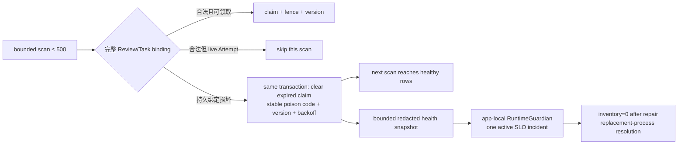

`D` 只修改 0096 delivery coordination，不修改 ReviewItem、TaskNode 或
Attempt。健康投影只含计数、采样规模、截断标记、时间和 opaque digest；
Review ID 与原始错误正文不会进入 Guardian journal。当前没有独立 terminal
DLQ/Operator 修复 UI，跨进程及时性仍由 polling、lease 和 takeover 提供。

混合 fan-out 崩溃后的当前恢复流为：

```text
left ACCEPTED + right RESERVED/RUNNING
→ 进程硬退出
→ live Lease：DEFERRED（零 worker）
→ Lease 过期：RECOVERY_REQUIRED + current hold
→ exact case-bound Ed25519 REACQUIRE
→ 新 owner / higher fence 执行 right（left 不重跑）
→ join 依赖满足后执行
→ child terminal 缓冲并进入 parallel settlement
→ 唯一 Graph COMPLETED receipt
→ 再次启动 inventory=0 / worker=0
```

取消绑定的 COMMIT/RELEASE 同样先重开目标 Operation proof，再由唯一
cancellation continuation 收口 Graph；handler response loss 不会产生第二次
目标 mutation。上述均为本地 feature-enabled 证据，不代表生产开关已开启。

签名终态在 handler 崩溃窗口中的当前数据流为：

```text
current recovery case
→ 独立签名 evidence
→ 外层 governed Review / Preview / Acceptance
→ 目标 Operation + Outbox UoW
→ [handler 进程可在此硬退出]
→ 新进程重开 proof 与 handler receipt
→ COMMIT: Verification / Acceptance continuation（worker=0）
   RELEASE: failure terminal replay（worker=0）
→ 终态 Host startup inventory=0
```

case ref 与 subject digest 同时约束 evidence 和 Effect payload；目标 mutation
已经提交时，响应丢失不会回退为“未知并重做”。该流目前只证明 checkpoint
COMMIT 与无 intent RELEASE，不覆盖 cancellation-bound 组合。

Scheduler clock 的当前一轮数据流先冻结再执行：

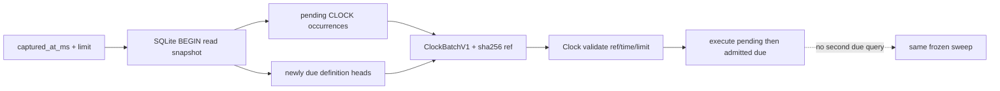

`B` 使用深层 JSON round-trip 切断 nested mapping alias。控制路线的正式
验收另从同一 canonical SQLite 私下加载 Command/WorkOrder/TaskGraph，
核对 digest 并重验 policy，随后只把 policy 的安全字段写入 evidence
digest；raw admission payload 不流出 reader。clean SHA `2a88f56e` 的
同库收据已证明七路 PASS，三条 control surface 各有一个 policy，其他路线
为零；这不改变三路其它控制仍为 `PARTIAL` 的事实。

Operator 命令的数据流先经过 active/retired 分界，而不是把未实现命令送入
handler 前统一阻断：

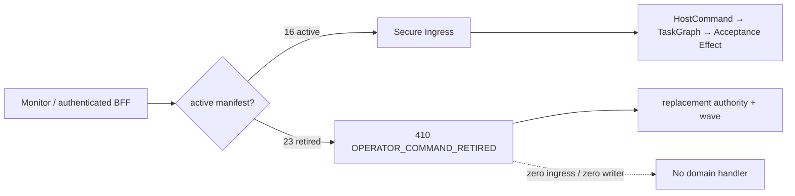

active manifest、OpenAPI、生成式 client 与 domain registry 使用同一 16 项
集合；Monitor 的 retired entry 没有 `commandId`，所以浏览器在 fetch 前
拒绝。Avatar/Mate 的替代链是已治理 Edge，Tool/Hunt 的替代链属于
Tool/Internal/Scheduler，Forge/Canon/Bio/Bond 等待 NE-05/06 version
activation。后文 `14/37、23 blocked` 是历史数据流；当前 inventory 为
`16 active / 23 retired / 39 known / blocked=0`。

Scheduler、Internal、Operator 的已启用 control transport 数据流如下：

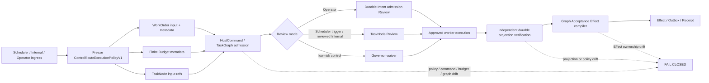

Policy 会在 initial、exact replay、Review continuation 和 recovery 重开。
Operator 不再因 control policy 产生第二个 TaskNode Review。Review 和 Task
状态使用同一 TaskStore clock；同一 Operation status version 的 recovery
hold 只能 exact replay 唯一 current case，Budget 或 Lease 的后续推进不会
产生第二个签名对账目标。

Plan/Delegate 当前新增的执行政策流如下；虚线表示漂移时在执行或副作用前
失败关闭：

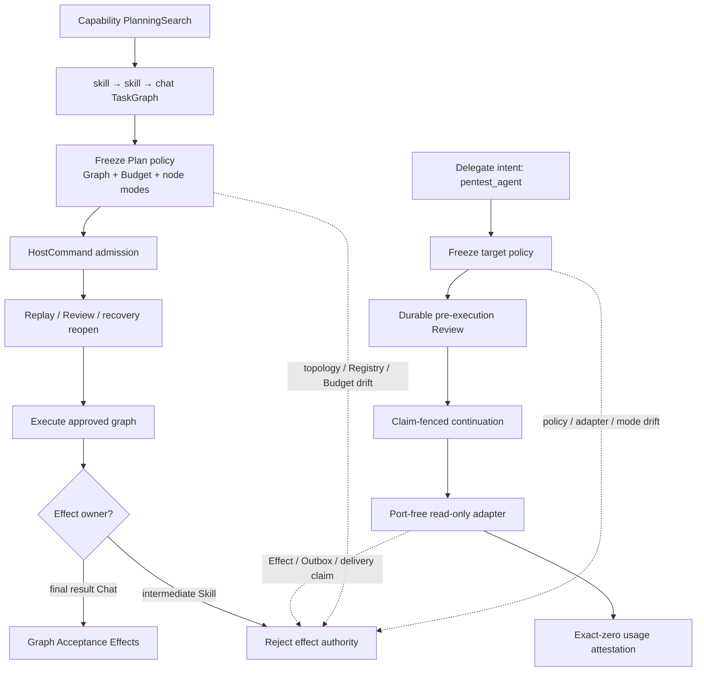

Plan policy 在首次 admission 前写入 WorkOrder metadata，恢复路径只重开同一
不可变图，不重新选路。Delegate policy 同时写入 input/metadata，Graph Budget
允许模型维度精确为零，但外层 dispatch、时间、并发与 retry 仍有界。当前
真实 SQLite 已覆盖 Review continuation；clean-SHA `2a88f56e` 的同库七路线
收据已重开这条数据流，因此当前启用 Plan/Delegate 范围为 `COMPLETE`。

Skill 的当前执行流先做 policy partition；虚线入口只能拒绝，不能进入
handler：

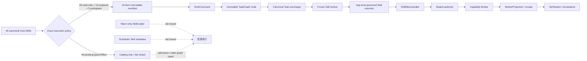

缺 policy、descriptor 一致性、governed context、node grant、durable ledger
或 app-local ports 时，流程在 handler 前拒绝；receipt 写失败也不能返回
成功。read-only 不取得裸模型端口；proposal-only 只能形成候选/staging；
三条 Workspace 写在 Acceptance 后晋升。包含用户可见 Domain lifecycle、
持久 browser profile/session 或其它外部 mutation 的能力留在 blocked 分支。
本图描述当前启用范围，不把 49 个 blocked 能力伪装为已实现。
独立旧 Personality catalog 的 19 个条目和动态 MCP 条目都不进入该图的
可执行分支；前者 manifest 为 0，后者明确 blocked。

Chat/Plan 模型预算的当前生产等价数据流如下：

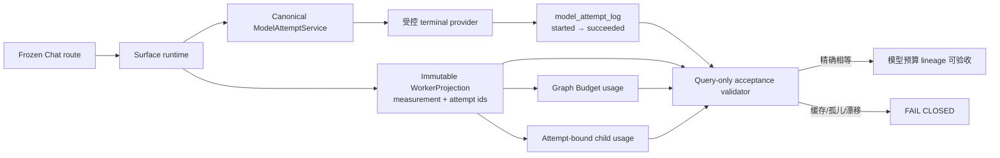

内部额度 guard 只在 Surface 调用期间存在，不进入 Life acceptance trace、Effect 或公开 receipt；公开证据只保留 provider/model/route 标识、digest 和用量。Direct Chat 与 Plan synthesis 使用不同的新请求，replay 只能重开同一 durable lineage，不能再次调用 provider。受控 provider 不等同于真实外部模型验收。

七路线提交绑定验收是完全只读的数据流，不取得 Task Runtime 写 authority：

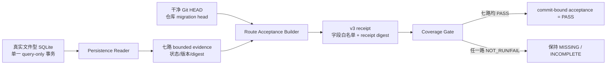

Reader 会把 Command→Graph→Node→Attempt→Lease→Operation→父子 Budget→Verification→Acceptance→Artifact/Projection→Effect→Outbox/Receipt 作为一条证据链，并证明当前 recovery/reconciliation/cancellation 集为空。它先严格重开 raw admission typed contracts 与 digest，但不输出它们；Chat/Plan 还要重开 ModelAttempt 和 Worker model budget，三控制路线各重开一个 policy。干净提交 `2a88f56e2dc7c68d7f37100c6c2d408bc2fdf6a0` 的正式同库收据使七路 Gate 均走 `PASS` 分支，并关闭 Chat、Skill 与当前启用 Plan/Delegate 的全部路线控制；Scheduler/Internal/Operator 仍独立保持 `PARTIAL / INCOMPLETE`。

当前本地七路数据生成流已经在干净提交上形成正式收据：

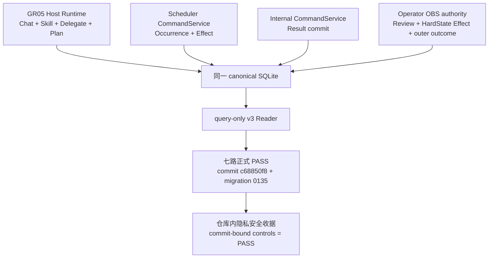

bounded deterministic worker 只替代业务计算，不替代 CommandService、TaskGraph、Grant、Budget、Review、Verification、Acceptance、Effect、Outbox 或 claim settlement。它不产生真实模型或 PlanningSearch 收益结论。

节点 Acceptance/Review 的当前持久流为：

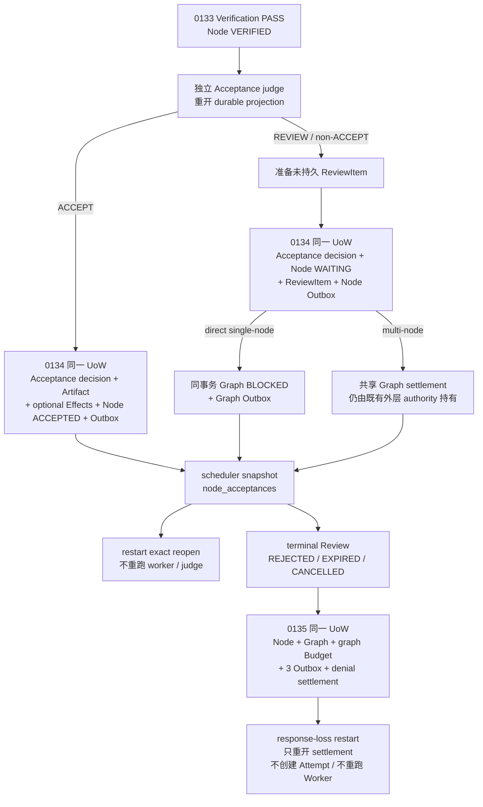

ReviewStore 与 TaskStore 通过 `review_pending_uow.py` 共用唯一 pending INSERT writer；Node 等待、Review 和 Acceptance decision 不允许分开落账。自动接受路径也不允许先提交 Node 再补 artifact/decision。0135 的 terminal writer 重新打开 exact Review version/digest 和所有相关聚合：PRE Review 只有零 Attempt 才能取消，POST Review 必须绑定 0134 Acceptance 与 `SUCCEEDED` Attempt；任一 Outbox 或已有 `BLOCKED` decision 漂移都会阻断。响应丢失只重开相同 settlement，不重新取得执行 authority。

节点验证的当前持久流为：

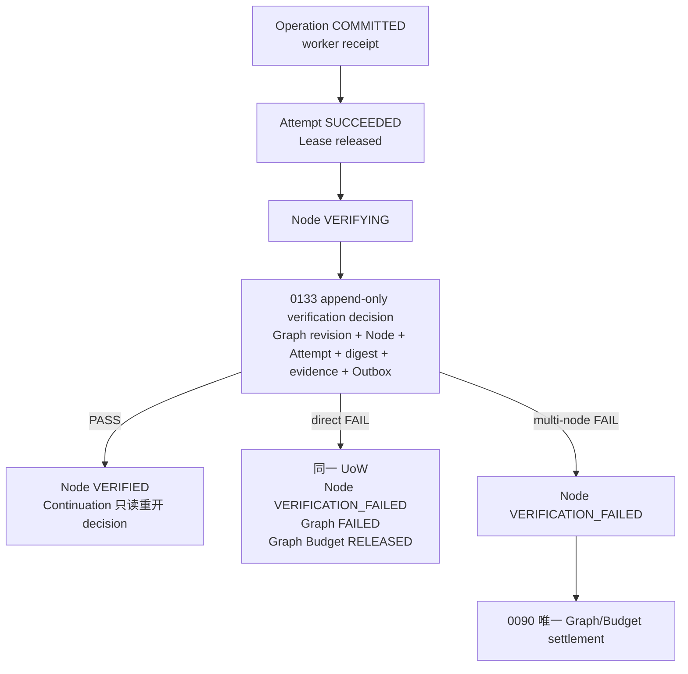

Node transition 与 decision 不能分开提交。直接失败的三类聚合和 Outbox 任一漂移都会整体回滚；首次事务已提交但响应丢失时，Runtime 用完全相同参数重试，由 Store 校验 exact replay。该流没有改变多节点 Graph 的 0090 terminal authority，也不证明一般 cancellation/recovery 已完成。

Plan 节点审批数据流为：`SkillRegistry.require_confirm → PlanningCapability.requires_review → selected candidate policy + catalog ref → PlanningGraphCompiler 重绑定 actual node_id → WorkOrderV3.node_review_policies → Scheduler per-node Review gate → 0096 continuation claim → renewed node-grant batch`。第一次执行已 accepted 的前驱 projection 保留原 grant；续跑中首次执行的节点使用续签 grant；atomic-success finalizer分别核对两类 immutable authority。candidate key 不会流入最终 WorkOrder，缺失 node coverage 或畸形 policy 在 worker 前阻断。

节点预算数据流保持一个总额度和每次 Attempt 一个执行边界：

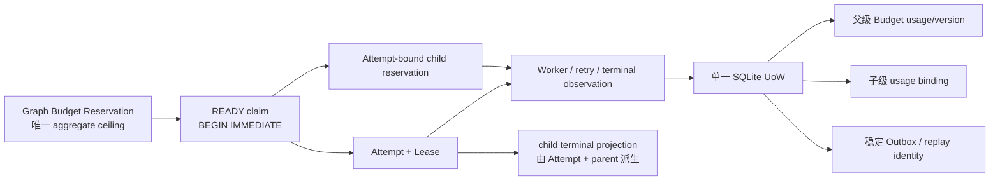

缺失 child、graph/revision/node/attempt 漂移或父子任一侧写入失败都会在 worker 前失败关闭。父级竞争只产生一个 canonical EXCEEDED winner；子级记录用于解释哪个 Attempt 消费了什么，不能把 Graph 总额度复制给每个节点。升级回填从既有 Attempt 与 BudgetUsage 重建历史用量，不增加剩余额度。

当前 authority 数据流为：`ASGI/CLI → fresh ProcessApplicationPorts → HostAuthorityRuntimeOwner → frozen Host/Agent/Context/Startup ports → router/runtime`。没有发布或查找全局 ports 的中间步骤，Host builder 缺少显式 ports 时直接失败。生产 locator consumer/import/module/field/lock/ref 全为 0；pytest-only bridge 不进入该图。底层 canonical ledger、Episodic/LifeMemory、Prompt/Route/Provider/ModelAttempt 与 Capability runtime 流由 `HostAuthorityRuntimeOwner` 固定；ResourceManager status 则经 0123 Runtime Event journal 绑定 Host lease/fence。外部 Chroma/Neo4j namespace 与其它外部资源恢复仍未闭环。本文后续更大的 locator 数字只作为历史快照。

只读 Delegate 的预算数据流为：`canonical Delegate dispatch 预扣 1 次工具调用 → port-free pentest adapter → server 生成 exact-zero usage attestation → frozen executor 重验完整 Task/Grant/Invocation lineage → WorkerBudgetUsage → durable Budget settlement`。adapter 不接收可消费资源的 port，因此零 token/tool/retry/model-cost 是可验证的正向声明，不是从字段缺失推断；旧 intent/repair Agent trace 不进入这条流。任一非零、digest 或 lineage 漂移都会在 WorkerProjection COMMIT 前停止。

当前通用 worker 证据流为：

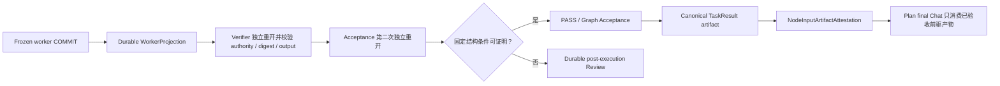

worker 的调用栈对象不会直接流入 Acceptance 作为信任输入。TaskResult artifact 只在 Node 已验收后形成，attestation 精确绑定 artifact ref、worker receipt、payload digest 和整个 bundle digest；普通 Chat 没有前驱产物时继续使用其原始只读 retrieval 流。

当前 Operation hold 消解流为：`0130 current hold → Secure Ingress 签名请求与 exact case identity → 0131 append-only evidence → risk-4 Review → immutable TaskGraph/Acceptance Effect → 既有 Operation+Outbox SQLite UoW → case current=false 复验 → v5 handler receipt`。任何 case/digest/intent/version 漂移都在 mutation 前失败；mutation 后若无法证明 case 已关闭则返回 UNKNOWN，不能提交伪成功。checkpoint conflict 没有进入这条正向流，继续隔离。

当前 Chat 本地投影与外部回复流为：

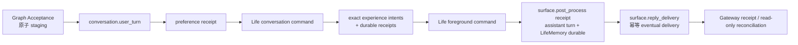

Life command receipt只证明 intent 已写入，不能越过 `B1/B2`。首次调用可领取并执行同一 command 的 exact intent；reclaimed Effect 只读检查回执，后台 worker可在崩溃后完成 pending intent。任一 intent 集合、payload digest、result target/status 或 request identity 漂移都会让 Effect 保持 `UNKNOWN`，有序 dispatcher 因而不会进入 `D`。这条链不把 Gateway 网络发送描述为 Host SQLite 的同一事务。

当前 Direct Agent Skill 写产物流为：

```mermaid
flowchart LR
    I["Direct Skill admission\nSkillRegistry risk/confirm"] --> R["risk-4 durable Review\n唯一 CONSUMED task/node subject"]
    R --> V["server-bound WorkOrderV3\nTask/Attempt/Lease/Grant/Budget authority"]
    V --> C["sealed CapabilityBroker\nprivate codex_runtime ports"]
    C --> W["isolated Git Workspace\nprotected stage ref/digest"]
    W --> P["immutable WorkerProjection\nNODE proposal only"]
    P --> A["Graph Verification / Acceptance"]
    A --> E["agent.workspace_artifact_promote\nterminal Preview + Effect fence"]
    E --> H["Accepted handler reopens\nadmission/projection/lineage/seal"]
    H --> L["0116 ACTIVE→ACCEPTED→PROMOTED\nsource branch unchanged"]
    L --> X["conversation / Life / delivery Effects"]
```

公共 payload 不能提供图、Review、Workspace 或 owner authority；promotion 是可见 Effect 的前置阶段，未知结果会停止后续分派并进入 reconciliation。该流只覆盖三条登记的 risk-4 Agent Skill，Domain Pack、其它 Skill 与一般失败/取消仍不在正向路径。

当前 Operation 恢复分流为：

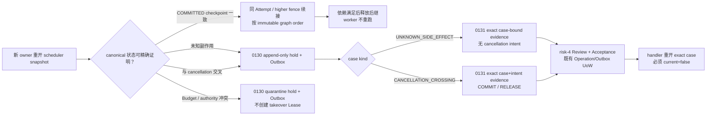

0130 case 的 ref/digest 是可恢复的停机事实，不是 `NO_SIDE_EFFECT` 证明。0131 只允许既有签名 reconciliation 精确消费一个 current UNKNOWN/CANCELLATION case；case/outbox/evidence 的 exact replay、版本新鲜度、动作矩阵与 active Lease 都由 canonical Store/trigger 复验。任何漂移都失败关闭，checkpoint conflict 不进入正向流。已验证图形包括五节点菱形和八个并行根节点，但不据此外推为无限规模或所有 failure/cancellation 类别。

Scheduler 管理写流已统一为：

```mermaid
flowchart LR
    H["/scheduler 或 /host-scheduler\ncreate/update/delete/enable/disable"] --> I["Scheduler Secure Ingress\n冻结 method/path/body/claim"]
    I --> G["typed Governor\nHostCommand surface=SCHEDULER"]
    G --> T["immutable TaskGraph\nAttempt / Lease / Grant / Budget"]
    T --> R["Review / Verification / Acceptance\nterminal Preview"]
    R --> E["operator.state_control Effect"]
    E --> O["scheduler_admin_operation_result\ncanonical definition head"]
    O --> C["完成原 HTTP claim"]
    C -. "崩溃重启只读重开同一 receipt" .-> O
```

list/get/health 不进入写流；trigger 沿既有 governed occurrence 流。operation receipt 已提交而 claim 尚未完成时，恢复只能补齐同一 claim，不能再次调用 definition mutation。

签名 Operation reconciliation 的当前数据流把秘密材料和执行图物理分离：

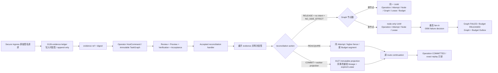

WorkOrder、TaskGraph、Review authority 和 Acceptance Effect 都不保存 `attestation_signature`；只有 evidence ledger 保存并在读取时复验它。`REACQUIRE` 不能创建第二 Attempt 或第二图，也不能越过 Budget/Lease。checkpoint `COMMIT` 不使用 cancellation intent，只接受 canonical `worker-projection://.../<sha256>`；读取层与 mutation UoW 都重验 immutable admission、Graph/Node/Attempt、Operation scope/fingerprint、旧 Lease expiry 和投影 digest。无取消意图的 `RELEASE` 是互斥的 raw-failure 窄窗：只接受 ACTIVE Graph、未终结目标 Attempt/Node、已到期旧 Lease、唯一 graph Budget、零 WorkerProjection/Acceptance Effect 和 `NO_SIDE_EFFECT/no receipt`。单节点仍在一个 UoW 写六个聚合终态；多节点第一 UoW 只关闭 Operation/Attempt/Node/Lease，Graph/Budget 保持 ACTIVE，重启后由 0090 独立原子结算。v4 receipt 只摘要不会变化的 node failure，因而两阶段 exact replay 使用同一 receipt。其它未签名 `RELEASE`、任意 transport receipt、其它 failure/cancellation 和一般批次仍不在正向链内。

不依赖取消意图的 general Acceptance Effect 使用独立的证据流，不能与上面的 Operation evidence 或 0098 cancellation proof 混用：

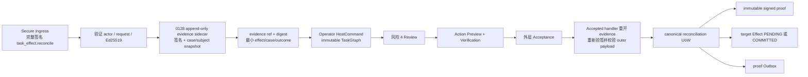

`NO_SIDE_EFFECT` 必须绑定 executor quiescence，目标 Effect 只能回到带专用 reason 的可重试 `PENDING`；`SIDE_EFFECT_CONFIRMED` 必须绑定 durable downstream receipt，目标 Effect 才可固定为 `COMMITTED`。Review 前不写 proof，response loss 只重开相同 evidence/proof/effect/handler receipt。0128 在数据库边界禁止 evidence/case/proof UPDATE/DELETE，并拒绝 subject、signature、proof/outbox 或 target Effect identity 漂移。该流只覆盖 `GENERAL_UNKNOWN_EFFECT`，取消绑定的 Effect 对账继续使用 0098 合同；部署 key、真实 HTTP/network canary 与多节点恢复未运行。

DL-03 后，情感 admission 与关系后效应的 canonical 路径已从生产 ASGI Input composition
进入 Life kernel，而 replay/render 仍无副作用。`AffectFusionService` 将
`ChatRequest` 中的文本、自述或允许的结构化声学/视觉摘要解析为**用户观察**；
它按 `workspace_id + relationship_subject_id + session_id` 建立 affect opaque aggregate
scope，保留冲突 ref 和 TTL，且不将 raw audio/image/text/model-chain 写入
journal。深路径至多生成两个 appraisal 候选；选定 appraisal 的自身意义、边界
和关系判断才会形成七海的 mixed self-affect。没有内部 provenance marker 的
外部 affective context 只能作为不可信输入，不能伪造 canonical head。最新 DL-02 细化将
`user_boundary_or_space`、`natsume_may_have_hurt_user` 与 `user_mixed_affect` 作为 bounded
Appraisal event kind：它们分别冻结 `GIVE_SPACE`、`REPAIR` 与 `HOLD_COMPLEXITY`，并只通过
七海自己的 component 进入 `state.affective`。每个选定 candidate 会紧随 appraisal 写入
`affective_regulation_decided`；其 `reason_refs` 带 exact `appraisal://` identity，Surface 只消费
本请求匹配的 regulation。用户的 `SAD/HAPPY` 分布、原话和原始模态不会越过这条边界成为
self-affect 或 Surface 的可伪造输入。

final ASR 的输入适配再加一道语义门：Edge 的关键词 bootstrap、外带 emotion tag、强度、context
和任意 observation list 不是用户自述，进入 Host 前一律剥离；文本本身仍可由既有 TEXT observer
在低置信下解释。只有显式可用、未降级的声学 attestation 可生成一条 source-bound、5 秒 TTL
的 typed ACOUSTIC observation。该 observation 仍须走 Fusion/Appraisal，不能直写 self-affect、
关系、Bond、TTS 或 Avatar；远端 Edge 尚未启动。
canonical Life composition 同时让 Limbic 的 event-bus compatibility consumer no-op，因此它不会把
同一声学 event 留在 process-local registry 或 legacy timeline，避免下一轮从旧 observation cache
重新取得表达权。

`RelationshipLifecycleService` 在当前输入前先重开关系 aggregate 的 accepted aftereffect。只有
`REPAIR_ACCEPTED` 会作为 opaque `relationship-aftereffect://` evidence 进入 Fusion，继而生成
`relationship_repair_accepted → RELIEF / CARE → EXPRESS`；关系修复没有 raw text 回灌，也不恢复
proactive permission。foreground Surface 不读取该 permission 作静默开关，Scheduler 才拥有其主动
delivery 解释权。

另一路只有在 transient 输入明确指向七海、且不包含 stop marker 时才成立：
`directed_disrespect_toward_natsume → HURT / CAUTION → CONTAIN → SET_BOUNDARY → GENTLE_BOUNDARY`。
其 Appraisal/episode 只保存 opaque event ref；普通用户挫败没有这条边。若输入含 `闭嘴`、`别来烦我`、
`少管我` 或 `滚开`，Fusion 与 RelationshipLifecycle 同时优先 `BOUNDARY/GIVE_SPACE`，关系 aftereffect
持久禁用 unsolicited Scheduler contact，不让受伤表达抢占用户边界。

当前 production fusion 还对极窄的、直接指向七海的威胁、贬损和比较产生自有的
`ANGER`、`HURT` 或低强度 `JEALOUSY` appraisal；这不是读取用户的 emotion tag。用户
空间、边界和修复信号优先，会阻断这条解释。首个 `RegulationDecisionV1` 与 appraisal/
episode 位于同一 immutable command payload，reducer 复验 subject、时间和 episode binding 后才更新
`last_regulation`；因此没有“先写情绪、崩溃后才补表达约束”的可见窗口。`JEALOUSY` 只可进入
克制的 `CONTAINED_JEALOUSY` ExpressionPlan，不能授予排他、追问或回应压力。

`/v1/edge/events` 位于这条流的最外层：它只把原始 Edge 事件写入 evidence ledger。历史上
`EMOTION_DETECTED` 会直接触发 Bond 更新并按用户 emotion tag 直驱 VTS；该旁路已退役。最终 ASR 文本仍可在
白名单、置信度和去重 Gate 后进入 ASR→Input bridge，而孤立的 Edge 情绪事件缺少 `workspace + relationship_subject`
时必须停在 evidence 层，不能形成 self-affect、关系事件或 Avatar 命令。

~~~mermaid
flowchart LR
    I["Secure Input / Chat / Gateway"] --> P["InputRuntimeApplicationPorts"]
    P --> F["AffectFusionService"]
    F --> O["UserAffectObservationV1\nTTL / confidence / conflict ref"]
    O --> C["affective_observation_recorded"]
    C --> J["immutable life_event_journal"]
    F --> A["bounded EventAppraisalV1\n最多两个候选"]
    A --> E["affective_event_appraised\nappraisal + episode + first Regulation"]
    E --> J
    J --> S["CAS state.affective\nself component / episode / mood / need"]
    J --> H["0143 affective_life_event_v1\nread-only head"]
    S --> N["trusted internal normalize bridge"]
    N --> G["Governor / Surface"]
    G --> R["accepted foreground Life receipt"]
    R --> E1["relationship_response_accepted\nprovisional episode"]
    E1 --> J
    I --> A1["下一次用户输入\nopaque digest only"]
    A1 --> E2["relational_aftereffect_recorded"]
    E2 --> J
    J --> RH["0144 relationship_life_event_v1\nworkspace + subject head"]
~~~

`RelationshipLifecycleService` 只有在 accepted Surface reply 或 governed
`life.foreground_completed` effect 已取得 canonical Life receipt 后，才提交
`relationship_response_accepted`。它以 `workspace_id + relationship_subject_id`
作为长期 relation aggregate，`session_id` 仅在事件中保留；因此跨 session 可连续、
跨 workspace 不泄漏。下一次输入只保存 opaque user/reply digest 并关联最近 active
episode，写入 `relational_aftereffect_recorded`。`BOUNDARY` 会撤销主动权限并增加
rupture，`MISUNDERSTOOD` 与 `REPAIR_UNRESOLVED` 保留 repair required；`SILENCE` 与
`DELIVERY_FAILED` 不改变 trust/safety/permission，`REPAIR_ACCEPTED` 才允许谨慎回暖。
0144 的 SQLite trigger 只允许 Life event journal 生成派生行，读侧可按 compound cursor
重开；response loss 只重开 deterministic command，不重复创建 episode。

Surface 不能直接读写关系账本：Input runtime 只把 canonical result 标成 trusted hand-off，
reply compiler 才把它变成“尊重空间、不索取回应、不把修复说成完成、不使用排他或
负罪施压”的 facts/must-not/style anchors。外部 `emotion_context` 没有 marker 时被忽略。
生产 `HostBondRuntime` 默认关闭 score-driven automatic stage transition；production Host 已删除旧
Bond queue/writer construction，只有 no-write retired adapter 与 score/stage read projection 保留，不能
再由 queue crash、full 或 fallback 影响关系事实。

历史通用 Skill 的 `emotion_update → old emotion/VTS` 与 `bond_score_update → Bond queue` 支线也已被物理删除：
production provider catalog、Tool executor、built-in registry/policy 和 Scheduler-add 均不能解析它们，`emotion_get`/
`bond_score_get`/`emotion_query`/`bond_query` 也不再把 caller-shaped compatibility context 伪装成七海自身或关系读取。
自然语言的“你现在心情如何 / 我们是什么关系”改为 `Thalamus → canonical-bound chat → frozen AffectiveTurnPlan`
而非 `Skill DAG → legacy query`；唯一可用读取方向仍为 exact-scope 的 canonical Life projection。
同一条流不再经过 `Supervisor → emotion_agent → compatibility emotion_context → recommended_emotion_tag`：
旧 Agent 的 allowlist、handler、prompt 和 ReAct tool 均已删除；历史深度观察字段只留下
`LEGACY_DEEP_AFFECT_SIGNAL_SUPPRESSED` 审计标记，不能冒充触发 Fusion。真正的 canonical Fusion 深路径仍按观察/冲突/
边界/修复/distress 生成最多两个候选，主候选被拒绝时只尝试第二候选一次，并以 stable appraisal command identity 在
restart 时重开相同 receipt；legacy delegate target 只会降级为 canonical chat。

DL-04/05 的本地表达链只在上述 trusted hand-off 存在时启用 native sentence stream：
它不再让 Surface model 的 `natsume_emotion_tag` 覆盖 canonical self-affect，也不会由
plain-text parser 将双方状态重置为 `NEUTRAL`。普通低歧义回合逐句 staging；高歧义、
边界和修复回合保留两候 buffered selection。`ModelAttemptService.stream_with_result()` 可在
每个 typed delta 后，以唯一 provider-owned final response 回传模型/transport 与可选 usage；只有完整
token、completion token、cost 才称 usage 已证明；native stream
只在首个 delta 前明确收到 `MODEL_STREAM_RESULT_UNSUPPORTED` 时回退兼容 stream，并在最终
trace 标记无终态 usage。`0145_affective_turn_delivery.sql` 只投影 plan/sync/sentence digest，
不复制句子正文、原始观察或私密媒体。DL-05 在同一 immutable plan 下为每个稳定句生成 Voice
`SPEAK` 和 Avatar `TRANSITION` 成对 Host protocol；结束和打断生成 `RELEASE`/`CANCEL`。
`0146_affective_expression_delivery.sql` 只投影 channel/action、sync、self-affect revision、avatar
predecessor 与 Host staging status，绝不复制文本、原始媒体或模型推理。该读模型的 “last accepted”
是**最后一次 Host 暂存**，不是远端设备实际状态。

受治理 Chat 的 scope 数据流现进一步固定为：

```text
POST /v1/chat（本机个人 UI）
  → HostDefaultUserId 派生 subject/principal + personal workspace
  → 覆盖 caller person/workspace（含 nested emotion-context workspace）
  → AffectFusion / Cortex prefetch / RuntimeContext v1
  → governed Chat
```

当 server-owned `CHAT_SURFACE` 路由明确选择支持 final-usage stream 的 provider 时，最后一跳的
受治理执行顺序进一步固定为：

```text
frozen AffectiveTurnPlan
  → PLAN_FROZEN (0149 SQLite)
  → provider typed delta
  → SENTENCE_STAGED (0149 SQLite)
  → SSE SENTENCE
  → STREAM_COMPLETED
  → Task Verification / Acceptance
```

首句前的模型协议、预算或运行时失败改为 `STREAM_INTERRUPTED → REJECT`，不会制造一个尚未可见却
需要 unknown-effect replay 的任务；可见前缀仍由 `0150` 在替代 attempt 前强制 reconciliation。该
图已经由受控 OpenAI-compatible ASGI transport 验证，尚未成为真实 provider、connection resume 或
远端 Voice/Avatar 的验收证据。

上图是 `LOCAL_PERSONAL_UNATTESTED` scope，不含 Secure Ingress claim、audit 或 tenant；它不能承载
Gateway 或多用户身份。那些输入必须走下列签名数据流：

```text
Secure Ingress service principal
  → HostCommand / TaskNode lease / node grant / Gateway authority audit
RuntimeContext v1 relationship subject + workspace
  → AffectiveTurnPlan / sentence receipt / ModelAttempt.model_node_id
  → Task Acceptance
  → conversation + Life + Memory + reply delivery projection
```

前一行的 service principal 不能落入后一行的 relationship state。原生句流从同一不可变
`ModelBudgetGuard` 取得 `node_id`，以 `model_node_id` 写入 canonical ModelAttempt；route acceptance
重新打开 audit 时会拒绝缺失或漂移的 node binding。受控 SQLite 集成已在两句 stream、Acceptance effect
和 Gateway delivery 上验证该分离。普通 Chat、连接恢复、真实 provider、远端 Edge 和物理 Voice/Avatar
receipt 仍不在这份局部数据流的证明范围内。

对这条**受治理**句流，Voice/Avatar 不能在 speculative 阶段跟随文本提前发送；但 Acceptance 也不能
重新按段落切分已经可见的文字。Surface 将本地 Gate 后的稳定句序列冻结到内部 summary，
`foreground_completed` 只在 Task Acceptance 后把该序列编译为每句一对 Voice `SPEAK` / Avatar
`TRANSITION`，并追加覆盖已完成前缀的一对 `RELEASE`。`FrozenChatRouteExecutor` 重新比对每句文本、
plan、sync、self-affect revision、workspace、relationship subject、session 与 Host staging receipt；
任意合并、遗漏、重复或漂移都阻断 effect。`0146` 只记录这份 Host protocol 的不可变投影，仍不代表
远端 TTS 已播放或 Avatar 已应用。

已接受表达继续进入本地 outbox 时，边界严格为：

```text
Task Acceptance
  → reopen Life foreground receipt (APPLIED)
  → reopen terminal Action Preview
  → rebuild frozen plan + accepted narrative + protocol
  → Host durable embodiment outbox (idempotent enqueue / exact reopen)
  → later Edge dispatch and independent physical receipt
```

前四步是当前 DL-05 的本机证据；最后一步尚未运行。outbox row 不回写 self-affect，也不把
Host admission 写成 Voice/TTS/Avatar 已完成。

0147 将 `companion_profile` 作为同一 relation aggregate 的 bounded head，而不是 Surface、TTS
或 Avatar 各自缓存一个“偏好”。`CompanionProfileLifecycleService` 只重开 append-only
`relational_aftereffect_recorded` 事件：五条独立 user-input ref、跨至少三 UTC 日、`HELPFUL`、
boundary-safe 且 `helpfulness>=0.85` 的证据才能建立 candidate；candidate 再收集五次后续
strong aftereffect 后会由同一 canonical lifecycle 自动 active。每个 learned profile 的 rollback ref 固定指向候选创建时的 active
profile，不能挑一个方便的旧版本。普通文本 classifier 仅 `0.72`，因此不会写入或推进这条成长链。
planner 从 trusted relationship hand-off 读取 CANARY 或 ACTIVE profile，把同一 profile id/digest/
revision 冻结进 `AffectiveTurnPlanV1`、`ExpressionPlanV1`、Voice `SPEAK` 和 Avatar `TRANSITION`；
它只能改变受限表达锚点、TTS rate、动作强度或把主动时段进一步收紧，不能改变 Soul、许可或 self-affect。

0148 的 direct profile-control flow 不让请求指定 aftereffect 或直接写 profile：

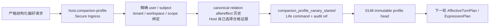

请求只可创建五互动 CANARY；它不能携带自然语言理由、Soul patch、emotion、relationship consent、原始媒体
或任意 command，且不直接 activation。claim 完成中断后，Host 以相同 Secure Ingress audit ref 重开已提交的
Life receipt，不产生第二个 candidate。

明确回应反馈使用另一条 receipt-bound 的权限边界，不能把 chat keyword 或 persona proposal 伪装为强证据：

```mermaid
flowchart LR
    U["签名 HELPFUL / NEUTRAL / MISUNDERSTOOD / BOUNDARY"] --> SI["host.companion-feedback\nSecure Ingress"]
    SI --> R["active provisional response receipt\n精确 scope 验证"]
    R --> A["relational_aftereffect_recorded\nopaque audit + response refs"]
    A --> C["已有 CANARY 才可计一次\ncanary interaction"]
    C --> P["第五次合格后由 canonical lifecycle 自动 activation"]
```

`HELPFUL` 是唯一映射为 `0.95` 的 strong aftereffect；其余反馈仍会正常影响关系修复/边界状态，
但不能成为 profile 成长成功。没有 active receipt、跨 user/workspace、service principal、重复 JSON key
或额外 rating 字段都会失败关闭。feedback 的 Secure Ingress audit ref 是 crash/retry 的重开键，而非原始
对话正文。

profile rollback 也不允许 caller 选择历史版本；它以当前 head 作为唯一可验证输入：

```mermaid
flowchart LR
    U["signed current active profile identity"] --> SI["host.companion-profile-rollback\nSecure Ingress"]
    SI --> B["user / subject / tenant / workspace\ncompanion:profile:rollback"]
    B --> H["current active profile\nfrozen predecessor only"]
    H --> R["companion_profile_rolled_back\nsource_control_ref + Life receipt"]
    R --> D["duplicate / restart\nreopen exact receipt"]
```

`rollback_profile_id` 从不属于 wire body。current identity 已漂移、service principal、跨 scope 或额外
target 字段均 fail closed；Voice/Avatar/文本随后只读新的 active profile projection。

```mermaid
flowchart LR
    H["trusted AffectFusion hand-off"] --> P["AffectiveTurnPlanV1\nself-affect + CompanionAct + ExpressionPlan"]
    R["canonical companion profile\nCANARY or ACTIVE"] --> P
    P -->|"low ambiguity"| M["ModelAttempt typed delta + final result / conditional usage stream"]
    P -->|"repair / conflict / boundary"| C["two-candidate buffered selection"]
    M --> G["local consistency + non-manipulation Gate"]
    G --> I["surface_sentence_delivery_intent\ncanonical Life journal"]
    I --> E["Voice SPEAK + Avatar TRANSITION\nHOST_PROTOCOL_STAGED"]
    E --> S["SSE visible sentence"]
    S --> F["foreground_completed\nRELEASE or accepted relationship aftereffect"]
    I --> R["0145 text delivery digest projection"]
    E --> X["0146 expression protocol projection\nnot an Edge-applied receipt"]
    R --> CP["0147 profile lifecycle projection\nopaque evidence and bounded head"]
```

当前已有显式 provider-final result 与条件 usage 合同；Vault-backed openai、openai_compatible 与 deepseek 已在 transport adapter 请求 stream_options.include_usage 并转发 provider final usage、transport identity 与调用延迟。缺 token/completion/cost、终局帧或 identity 的 guarded attempt 仍失败关闭；这不构成真实 provider 运行证据，且它本身不创建
用户可见 authority。`0149` 现在让带 node-bound `ModelBudgetGuard` 的**冻结 Chat vertical slice**先写
`TaskChatDeliveryStore`，再让唯一已落库的 `TASK_NODE_SENTENCE_STAGED` 事件经 Frozen executor 与 Worker
转发：每句同时绑定 graph/revision/node/attempt/lease owner/fence/node grant、self、relationship subject、
workspace、plan/sync/self-affect revision；旧 lease、grant 或 payload drift 一律拒绝。它不改变 Life、Memory、
TTS、Avatar 或 transport，后者仍只在 Task Acceptance effect 后执行。`0150` 在替代 attempt 写新 `PLAN_FROZEN`
的同一 SQLite 事务中检查相同 immutable node 的前序 delivery evidence；替代 attempt 或同 attempt 重入会被
`TASK_CHAT_DELIVERY_RECOVERY_REQUIRED` 阻断，不能盲目再次调用模型。普通 Chat 的治理切流、受认证 connection resume、
跨进程完整 recovery、远端 Edge、真实 TTS/Avatar channel receipt 与全服务栈验收仍不在这条本地 Host protocol
切片的完成范围。

`DL-06_HOST_EMOTION_RUNTIME_CUTOVER_SLICE` 已令 production Host root 不再构造
`HostEmotionRuntime`，且 ASGI 为 Input 与 Tribe 都注入 lazy Life command provider；二者在
authority 存在时均经 `AffectFusionService` 形成 scoped observation/appraisal。因而 global
`user_emotion_profile` 在 production 留空，不能跨 workspace/person/session 汇总并反馈为七海的
感受。旧 runtime 类不由任何 Input/Tribe composition 构造；缺 Life authority 的解析稳定拒绝。
随后 canonical
`TribeApplicationPorts` 也成为 Limbic compatibility writer 的 gate：旧 persistence/metabolism/
timeline/decay 与 Bond、任务成功、幽默、孤独、风险拦截、内感受、interaction-recorded callback 在 production 只能返回 `RETIRED_CANONICAL_LIFE`，不会再把观察或
回调追加为另一个 self-affect 事实。Endocrine 的 delta buffer/last-state/hint/fan-out 也由同一 gate
拒绝；Circadian/MirrorNeuron 不再直写其私有字段。BodySense 生产读取现改为
`relationship_subject_id → LifeSnapshotReader → project_body_sense_from_life_snapshot → Surface/Motive`：
没有 subject 时 fail closed，绝不解析 global singleton；legacy tick/loneliness/conversation mutation 返回
`RETIRED_CANONICAL_LIFE`，retired tick 不发布 `BODY_SENSE_UPDATED`。Motive 每次只对当前输入快照新建
无状态投影，已不再保存模块级 engine；production volatile Bond queue 已无 worker/backlog。production
`HostMemoryRuntimeOwner` 不再从旧 action log hydrate mutable `EmotionTimeline`，而是返回不含 emotion tag 的
`RetiredEmotionTimelineProjection`；Lifecycle snapshot/proactive dispatch 忽略该 marker，canonical Limbic/
Prefrontal 也不会读取它。user profile 仅保留为用户 observation，不能覆盖七海 self-affect；其它 compatibility
reader 与真实服务验收仍待处理。

Lifecycle OBS snapshot 的 rollback window 也已显式化：production composition 设置
`require_canonical_life_snapshot`，所以 reader 缺失只能走 canonical degraded projection，不能倒回
`legacy_runtime_snapshot_assembler`。同一 app-local ports instance 的
`compatibility_projection_usage` 只输出固定 projection ID、legacy read count 与 suppressed fallback
count；它既不接收 scope/content，也不参与 Life journal。离线/测试 graph 若特意走旧 assembler 会留下
read count，正式 Host 应持续为零；这个单点计量不替代其他 compatibility reader 的清点或真实服务验收。

默认模式私密活动的实际读流已改为：`LifeSnapshotReader → project_inner_world_state → bounded self_affect /
relationship_state → inner_activity_agent`。来源 marker 存在时，inner activity 直接从 canonical mood 与 mixed
component 得到当前 emotion，并把关系纹理作为独立 context；它不回读 legacy timeline，也不向 SocialBrain/Bond
要 score。该投影丢弃 episode trigger/evidence、workspace/subject identity 与 intimacy consent，避免生成链路把
关系数值误当授权；高连续性 background tick 也不再调用 legacy Limbic metabolism。此数据流仅覆盖 default-mode
reader，不替代其余 compatibility reader、真实 TTS/Avatar/Edge 或服务栈验收。

后台人格演化的关系流则刻意停在 scope 边界：

```text
Scheduler evolution intent（persona identity）
→ canonical Tribe authority 判断
→ 缺 exact workspace + relationship subject
→ DEFERRED + CANONICAL_RELATIONSHIP_SCOPE_REQUIRED
→ 不调用 legacy EvolutionOrchestrator

禁止：intent、EVOLUTION_CYCLE_TRIGGERED、BOND_STAGE_CHANGED、LONELINESS_SIGNAL、IMMUNE_BLOCK
→ SocialBrain / legacy Bond / legacy EvolutionOrchestrator → milestone / persona proposal
```

这不是忽略关系连续性，而是拒绝用无 scope 的旧积分伪造关系事实。只有将来携带并验证 exact canonical
`RelationshipStateV2` 的调用才能加入该输入；在此之前，background evolution 不得推动亲密、主动或人格变化。

同一 Prefrontal compatibility hook 的反馈流为：`INTERACTION_RECORDED raw text + session` 在 canonical
authority 下直接终止为 `LEGACY_SESSION_FEEDBACK_GROWTH_RETIRED`，不会经过 legacy `session → Bond user`
或 `PersonaGrowthTracker`。只有已接受回复产生的 durable、relationship-scoped aftereffect 能在未来作为
低风险表达学习证据；该 future flow 目前尚未由此 compatibility hook 实现。人格 drift 仅可流向
Governor restrict-only 约束，不能再流向 Limbic、Endocrine、PainReward、Interoception 或
`HUMOR_LANDED`/`TASK_SUCCESS` 旧状态事件。

历史 weekly 模型成长流也在同一边界停止：

```text
emergent_growth_weekly compatibility invocation
→ canonical Prefrontal authority preflight
→ DEFERRED + CANONICAL_RELATIONAL_AFTEREFFECT_REQUIRED
→ 不解析 model port / 不调用 LLM / 不读取 episodic store / 不 stage Persona proposal

status query → RETIRED + LEGACY_EMERGENT_GROWTH_RETIRED
```

该 Skill 不再允许 Scheduler 自动登记。legacy typed-model 流只用于隔离 rollback，不能把 raw text 变成
canonical 成长证据；正向低风险适应必须由 accepted、scope-bound aftereffect 驱动的 companion profile
生命周期完成。

legacy Prefrontal 自传记忆也在同一边界终止：

```text
raw narrative + global endocrine / immune / Bond state
→ canonical Prefrontal authority preflight
→ RETIRED_CANONICAL_LIFE + LEGACY_PREFRONTAL_GROWTH_RETIRED
→ 不写 TribeStateRegistry / EventBus / legacy Hippocampus

accepted aftereffect → proposal → Review → version activation
→ 才是未来可审计的长期成长或记忆写入链
```

该退役结果不等于拒绝长期记忆，而是拒绝把一次未经接受、无 relationship scope 的文本直接固化为七海的经历。

内在活动的 canonical 流则只读：

```text
canonical Life head → Limbic.tick_inner_world() bounded projection
→ inner_world compatibility adapter
→ 仅返回 projection + legacy_side_effects_suppressed

禁止：Tribe/ANS EventBus、DefaultMode inline tick、EVOLUTION_CYCLE_TRIGGERED、
raw monologue → background episodic memory
inner_world_session_end → RETIRED + LEGACY_INNER_WORLD_SESSION_END_RETIRED
```

这个边界没有抹掉七海的连续在场感：后续表达仍读同一 self-affect/relationship projection；它只拒绝将
私密独白或 caller VAD 伪装成另一个可写的生命、关系或人格事实。

普通 Chat 的关系读取流现为：

```text
AffectFusion internal envelope
  → scope/schema/self-id validation
  → CanonicalRelationshipProjection
  → Prompt Context + Interaction Facts
  → Surface relationship_state / canonical-aware affect-control gate
```

validation 同时绑定 `workspace_id + relationship_subject_id + session_id`，并要求 envelope、relationship turn
context 与 `RelationshipStateV2` 三层 schema 一致。成功时 legacy prompt vector 只保留 `FRIEND / stepsibling`
的非浪漫表达纹理；旧 Bond score/stage、consent 或高 trust 不能提升亲密、排他、依赖或主动权限。失败时生成
`CANONICAL_RELATIONSHIP_REJECTED` 的安全朋友投影，而非读回 Bond fallback。该流与相邻普通 Chat/Surface 回归
目前为 `179 passed in 63.85s`，不包含真实 provider、Edge、Monitor 或 DL-07 服务栈。
最后一跳不会重新相信 compatibility payload：`surface_affect_control` 若看到 canonical/rejected authority，就忽略
旧显式 lover distance、closeness、恋人 clue 和 lover task，仅保留 `familiar` 或因 rupture/rejected 而收紧的
`guarded`。该最终 Gate 定向回归为 `82 passed in 21.18s`。

`Soul.md` 的运行时数据流与关系流严格分离：

```text
immutable Soul.md + digest
  → SoulCompiler allowlisted runtime projection
  → Surface / Cortex / node generation prompt

scope-verified RelationshipStateV2 + frozen AffectiveTurnPlanV1
  → current address / distance / self-affect / expression constraints
```

前一条只给出稳定人格、措辞质感与非操控底线，后一条才给出当前关系事实；三个 prompt consumer 都调用同一
`render_runtime_soul_prompt()`，因此既不会回退原始 Soul 文本，也不能从旧 Bond、阶段阈值、恋人示例、记忆或
请求内 `emotion_tag` 推导出称呼、亲密或七海的自我感受。DL-00 的 72 条场景清单只作为冻结测量合同：它要求
48 条真实多轮轨迹与至少 3 位独立评审的盲测，未取得这些真实证据时状态始终为 `MEASUREMENT_PENDING`。

Cortex 的检索分支使用同一 authority：

```text
AffectFusion internal envelope
  → scope/schema/self-id validation
  → bounded retrieval relationship projection
  → retrieval + Motive prefetch
  → governed Chat input
```

只要 envelope 声称 canonical，预取就不会访问 legacy state-arbiter Bond。有效投影仅提供
`FRIEND / stepsibling / familiar` 与有限 texture；drift 或不完整 hand-off 为 `guarded`，不携带 score、恋人 stage
或 proactive permission。该路径的定向验证为 `34 passed in 5.64s`。

`affective_time_advanced` 只按 command timestamp 和 episode half-life 衰减；
`affective_episode_resolved` 只删除对应 active head 并留下 immutable journal
evidence。snapshot 和 0143 projection 只保存 event/subject/ref digest 与 cursor
字段。`normalize_chat_emotion_context(raw)` 对 replay/render 和 trusted fused
context 都不写状态。Input/Tribe composition 不会解析或调用旧
`HostEmotionRuntime.ingest → vector/timeline/profile`；遗漏 Life authority 时稳定
`CANONICAL_AFFECT_FUSION_NOT_INJECTED`，不能退回 compatibility runtime。
`ResponseFormDecider` 继续由 Input composition 独占并做原子额度检查，不是 affect authority。

DL-06 的 Scheduler 主动消息已开始走同一条 canonical 边界。accepted foreground
reply 先把 `CompanionProactiveTargetV1` 与 provisional relationship episode 原子写入同一
Life command；这个 target 绑定 workspace、relationship subject、session、route 与来源
receipt，但登记不等于主动许可。read-only registry 只重开 explicit `ALLOWED`、无
repair/active episode 且 scope-valid 的 target，Scheduler 再从与 frozen Scene 匹配的集合稳定
选择一个 aggregate。`companion_proactive` adapter 读取其 `relationship_v2`、`state.affective`、
clock 和 admitted timezone，先验证无给空间 regulation、能量和休息需要，才调用既有的纯
impulse/risk 算法；Bond score、legacy `state.affect`、旧 `last_target`、私密 inner note 和
project title 不会进入该输入。decision trace 只记录 content digest；真正的消息仅存在于已经
授权的 outbox payload。用于 delivery-success 对账的私有关系 context 只保留在该 canonical
outbox 行，进入 Preview 和 Gateway 前会被剥离，不能成为外发 metadata。transport 成功先固定
`LifeDeliveryReceipt`；app-local relationship reconciler 再重验 receipt/outbox 的 id、key、
payload/authorization digest 及 target/scope，才追加 `relationship_proactive_delivered`。若进程
在这两步之间中断，Host lifespan 或下一 outbox tick 只读扫描已完成 receipt 并 exact-replay
该 relation command，永不重发 Gateway。这个 receipt 仅表示 Host/Gateway accepted，不能代表
第三方平台送达或用户已阅读。未知/拒绝、裂痕、等待后效应或自我克制均为 hold，而不是用沉默
惩罚用户。

最新的 scheduler 命令不再把 decision 当成一段可覆盖的 `state_patch`。它先冻结
`AffectiveTurnPlanV1 → ExpressionPlanV1.synchronization_id`，将 scope、两条 revision、content digest、
decision id 和下次可联系时间随同唯一的 `proactive.gateway` intent 提交；reducer 必须同时重验两者才会更新
bounded cadence head。delivery receipt 打开的 `PROACTIVE_MESSAGE` 若完整 24 小时没有新的用户输入，下一 tick
会生成 source-bound `SILENCE` aftereffect：关闭 episode、指数放慢下一次联系，且保持 trust/safety/permission 与
`last_user_seen_ms` 不变。流程被真实 SQLite command、outbox、receipt 和 restart 重放测试覆盖；本地 transport
handler 只用于 Host-side integration，不能当作真实 Gateway、平台或远端设备回执。

历史 `proactive_talk` 不再属于这张发送图：它已从 production Skill、Tool、executor 和新 Scheduler
definition 输入移除，Host composition 还会对升级前遗留的 `proactive_talk_periodic` head 执行 CAS disable。
若已有 occurrence 跨升级存活，它只能验证原有的 immutable Scene identity 后结束为
`LEGACY_PROACTIVE_TALK_RETIRED`；不会读取旧 Bond/EmotionTimeline/Limbic，也不会产生 outbox 或 Gateway
effect。这样 crash recovery 不会把旧模板路径重新变成第二条主动发送 authority。

OBS 读取也遵循同一单一事实原则：

```mermaid
flowchart LR
    L["canonical Life snapshot"] --> SA["Natsume self-affect"]
    L --> UA["bounded user-affect observation"]
    L --> RS["bounded relationship texture"]
    SA --> O["OBS runtime snapshot"]
    UA --> O
    RS --> O
    O -. "reader failure" .-> D["degraded; no legacy fallback"]
```

已退役的 Gateway progress fastpath 不在这条情感数据流中。若 rollback-window helper 被显式调用，只有
`DurableTaskStatusProjection → FRIEND/CALM technical wording`，没有 `payload → Bond/SocialBrain` 或
`payload user emotion → Natsume self-affect` 的箭头；因此它不能绕过 `AffectiveTurnPlan` 伪造关系或情绪。

`LifecycleRuntimeApplicationPorts.get_life_snapshot_reader` 已在 production Host composition 中接入。snapshot
reader 以当前 relationship subject 重开一条 canonical head，固定输出 `self_id=natsume_ai`、self-affect 与用户
observation 的分离视图；后者只能解释用户状态，不能改写前者。reader 已组成后，任何读取失败或 identity drift
都会停在 degraded，不会调用 SocialBrain/Bond、Limbic、Prefrontal 或 retired EmotionTimeline。该本地 reader-cutover
集合为 `67 passed in 10.65s`，未包含 OBS 进程、真实 Host、Gateway、远端 Edge 或 DL-07 服务栈。

主动许可的写入口不复用 generic Life HTTP command，也不解析“你可以常来找我”之类的
自然语言。`POST /v1/digital-life/relationship/proactive-permission` 先以 exact raw JSON 建立
`CompanionProactivePermissionRequestV1`，再由 server-owned `host.companion-contact` Secure
Ingress policy 要求 `companion:contact:write`。只有签名 `user` principal 等于
`relationship_subject_id`、tenant 等于 `workspace_id` 时，audit ref 才会成为 `USER_EXPLICIT`
evidence 并调用 canonical `RelationshipLifecycleService.record_proactive_permission`。claim 完成结果
绑定 `life-command://...`；duplicate 与进程重启只重开同一 command，不能成为第二个关系 writer。

```mermaid
flowchart LR
    U["signed user contact control\nstrict ALLOWED / DENIED"] --> SI["Secure Ingress\nuser + tenant + scope exact bind"]
    SI --> R
    F["accepted foreground reply"] --> T["CompanionProactiveTargetV1 + provisional episode\n同一 Life command"]
    T --> X["read-only durable target registry\nscope / permission / active episode filter"]
    X --> L["one frozen-Scene-compatible Life snapshot"]
    L --> R["relationship_v2: explicit permission"]
    L --> A["state.affective: mood / need / regulation"]
    L --> C["clock + admitted timezone"]
    R --> G{"ALLOWED / no rupture / no episode?"}
    A --> G
    C --> G
    G -->|no| H["hold: no outbox"]
    G -->|yes| I["canonical companion impulse adapter"]
    I --> O["authorized proactive.gateway outbox\nprivate reconciliation context"]
    I --> D["bounded decision trace + content digest"]
    O --> GY["Gateway transport accepted\nimmutable LifeDeliveryReceipt"]
    GY --> Q["revalidate receipt + scope + target\nrelationship_proactive_delivered"]
    Q --> E["PROACTIVE_MESSAGE episode\nwait for real next user input"]
    GY -. "crash after receipt" .-> RS["Host startup / outbox tick\nreceipt-only reconciliation, no resend"]
    RS --> Q
```

Internal 后置审核取消的数据流只覆盖一个精确终态：Operator Secure Ingress → immutable `BLOCKED` cancellation intent → trusted `CANCELLED` final decision → restart terminal worker → deterministic nonacceptance claim → tombstone/Workspace cleanup。intent 不能冒充 final decision，任何 lineage 漂移均 fail-closed；该流不处理一般取消、多节点或 unknown effect。

Internal 前置 checkpoint 取消现在另有一条更窄的可恢复数据流：共享中立合同只接受 `RELEASED + RELEASE + NO_SIDE_EFFECT + no receipt`，或 `COMMITTED + COMMIT + SIDE_EFFECT_CONFIRMED + durable receipt`；Graph/Node/Attempt/Lease 还必须由同一 trusted cancellation decision 收敛为 `CANCELLED`。terminal worker 先提交 deterministic Secure Ingress claim result，再清理 Workspace 和未 sealed stage。无副作用 result 保持 v1 digest 兼容，confirmed-effect result 使用 v2 绑定 action/outcome/receipt；后者不等于 Agent result 或 Acceptance。没有 cancellation intent 的精确 raw failure 不复用该合同，而是从签名六聚合失败终态生成独立 `task-terminal://internal-raw-failure/...` result，并同样执行 claim-before-cleanup。一般 unknown effect、混合终态、缺 proof、proof/receipt 篡改或任一 lineage 漂移都会保留现场并失败关闭。

Operation 预留后的已知执行中断现在先进入一个不做副作用归因的持久分类流。exact live fence 校验、`RESERVED → RECOVERY_REQUIRED` mutation、Operation Outbox、0130 recovery case 与 case Outbox 在同一个 canonical SQLite UoW 中完成；Hold/Outbox 任一步失败都会回滚 marker。marker 成功后 Runtime 只读重开 exact Operation version 对应的唯一 current case，再继续 Budget metering 和 recovery receipt。调用方取消不会被转成普通失败，而是持久标记后继续向上传播。

```mermaid
flowchart LR
    I["worker / heartbeat / caller interruption"] --> F["exact Attempt + Lease + owner + fence + Operation version"]
    F --> M["同一 SQLite UoW\nRECOVERY_REQUIRED + Operation Outbox + 0130 case + case Outbox"]
    M --> H["只读重开唯一 current case；不重跑 worker"]
    H --> S["signed Operation reconciliation"]
    S -->|COMMIT + SIDE_EFFECT_CONFIRMED + receipt| C["已发生副作用的可信证据"]
    S -->|RELEASE + cancellation intent| R["释放 Operation / cancellation continuation"]
    S -->|RELEASE + no intent + NO_SIDE_EFFECT| N["node failure UoW\nOperation / Attempt / Node / Lease"]
    N -->|single node| T["Graph / Budget 同 UoW 终结"]
    N -->|multi node| P["Graph / Budget 保持 ACTIVE"]
    P --> J["restart re-entry\n0090 Graph/Budget settlement"]
```

初始 marker 只把已知中断从 `RESERVED` 立即推进为待对账状态；它本身不关闭 Attempt/Node/Graph/Budget/Lease，不清理 Workspace，也不从异常类型推断外部动作。unknown/cancellation case 的 current 性只随 exact Operation version 与取消身份变化：后续 Budget 计量、Lease 过期或 Attempt/Node/Graph 围栏仍留在历史 subject 中，但不会让未决 case 从恢复 inventory 消失；后到的 Graph cancellation 会追加 intent-bound successor，并使旧 unknown case退出 current。只有后续签名、无取消、无投影/Effect、过期 Lease、唯一 graph Budget 的 `NO_SIDE_EFFECT` 证据才能终结该精确节点；多节点 Graph/Budget 只能由 0090 fan-in 终结，READY sibling 在裁决前不会执行。其它场景无法取得完整签名证据时必须继续 hold；本地临时密钥证明也不替代默认关闭的 Operator HTTP/key canary。

Edge 入站与下行现在都明确分权：`EMOTION_DETECTED`、`USER_REACTION` 等入站 telemetry 只进入 Host 审计观察，不能直接调用 Bond writer、改变 self-affect 或驱动 VTS；只有 final ASR 文本可进入标准 Host Input，再经 Fusion/Appraisal/accepted plan 取得表达因果。Tribe 的平台/情绪事件同样只进入 Host-owned state observation，不再直接取得客户端；旧内部 POST 立即返回 authority-required。Obs `edge.command.push` 的首条窄链已成为正向 issuer：只允许 `edge.somatic + emotion_state_command`，经 Secure Ingress、risk-4 Review、TaskGraph、Acceptance Effect 与 terminal Preview 写入 durable outbox。低层网络发送仍由独立 `HostEmbodimentRuntime` worker 完成；真实 Edge/Gateway canary 尚未执行。

同一规则覆盖普通回复的收尾阶段：`agent_runtime.postprocess` 不再调用 `apply_surface_emotion_bond_flow`、
`CortexAgent.post_process_bond_update`、Tribe `CONVERSATION_ENDED`，也不直接推送 VTS/整段 TTS。它只能写
`RETIRED_CANONICAL_LIFE` trace；有效 relationship effect 必须由 Task Acceptance 后的 canonical Life command 与
下一次输入关联的 aftereffect 形成，Voice/Avatar 只能由冻结 `ExpressionPlanV1` 的 protocol effect 发起。

```mermaid
flowchart LR
    O["Tribe platform / emotion observation"] --> S["Host-owned state only"]
    O -. "no direct transport" .-> X["retired global Edge owner"]
    T["Governed TaskGraph node"] --> A["Verification + Acceptance"]
    A --> P["exact Action Preview proof"]
    P --> E["explicit EdgeCommandPusher"]
    E --> R["Edge receipt / reconciliation"]
    T -. "production issuer missing" .-> P
```

```mermaid
flowchart LR
    C["ASGI composition root"] --> CP["explicit ProcessApplicationPorts"]
    CP --> AU["HostAuthorityRuntimeOwner"]
    AU --> P["frozen HostRoutePorts"]
    AU --> DB["canonical ledger + Memory + Model + Capability"]
    L["lifespan Life command service"] --> A["HostLifeRouteAuthority"]
    R["lifespan Life snapshot reader"] --> A
    A --> P
    P --> D["Digital Life router factory"]
    P --> M["Memory router factory"]
    P --> I["Internal owner directive"]
    P --> H["Health / readiness"]
    P --> O["Obs Capability Forge adapter"]
    D --> X["stable 503 or zero delivery on missing authority"]
    M --> X
    I --> X
    H --> X
    O --> X
```

## 1. 如何读本文

本文对每条数据流使用四种定级：

| 定级 | 含义 | 可否当作当前生产事实 |
|---|---|---|
| `WIRED` | 入口、生产 composition、持久化与回执主链均已接通 | 可以，但仍受表内明示限制约束 |
| `PARTIAL` | 主要资产或部分路径存在，但未形成完整闭环 | 只能按已实现范围引用 |
| `BROKEN` | 表面有 adapter 或 lifecycle wiring，首个真实请求仍会在合同或 admission 处阻断 | 不能宣称可用 |
| `TARGET` | 只存在于目标架构或待实施合同 | 不是当前事实 |

三种容易混淆的语义必须分开：

1. **接受成功**：某个请求已被 inbox 或 Host TaskGraph 持久化，不等于外部副作用已发生。
2. **执行验收成功**：Graph 已通过 Verification/Acceptance，不等于 conversation、Life、Gateway 等后续 effect 已全部提交。
3. **外部效果确认**：Gateway/Edge adapter 已返回对应层级的确认证据。它不能由 Task receipt 或 HTTP 200 替代。

## 2. 全局数据流总览

```mermaid
flowchart TD
    UI["Chat / Host API"] --> Cortex["Cortex + Governor"]
    GW["Gateway 已验证输入"] --> Ingress["Host Secure Ingress"]
    Ingress --> Cortex

    Cortex --> Route{"route"}
    Route -->|chat| Chat["Frozen Chat node"]
    Route -->|skill| Skill["Frozen Skill node"]
    Route -->|delegate| Delegate["Frozen Delegate node\n仅 pentest_agent 有内层授权"]
    Route -->|plan| Plan["已批准 steps 的拓扑合法化"]

    Chat --> Compile["HostCommand + WorkOrderV3 + TaskGraph"]
    Skill --> Compile
    Delegate --> Compile
    Plan --> Compile
    Compile --> PolicyGate["atomic policy capability + node-grant service\n+ parent grant：admission 前 fail-close"]
    PolicyGate --> Admission["HostCommandRepository 原子 admission"]
    Admission --> GraphHook["private Graph insert hook\n同一 admission UoW，唯一调用"]
    GraphHook --> Schema["0090 + 0092；atomic 时再校验 0091\nBudget / worker 前 fail-fast"]
    Schema --> Runtime["Durable Task Runtime"]
    Runtime --> Worker["Attempt + Lease + Grant + Budget + Worker\n已登记 production Skill 只消费 admission-frozen payload"]
    Runtime -.->|"atomic production default ON\nbounded fan-out default OFF"| ShadowFanOut["atomic outer authority\nbounded 时 ready sibling 有界 child"]
    ShadowFanOut -.-> NodeLocal["child deferred authority\nAttempt/Node/Lease/Reservation\nBudget usage/EXCEEDED"]
    NodeLocal -.-> Worker
    Worker --> HB["Durable heartbeat\nLease → Reservation"]
    HB --> Checkpoint{"checkpoint 可提交?"}
    Checkpoint -->|是| VA["COMMIT → Verification + Acceptance"]
    Checkpoint -->|否| Recovery["RECOVERY_REQUIRED\n禁止 COMMIT"]
    VA -.-> DurableOutcome["node-local durable outcome\nreceipt ↔ latest Attempt/Node"]
    DurableOutcome -.-> OuterSettle["outer/live + ACTIVE re-entry\ndurable Node/latest Attempt outcomes\nrecovery > Budget > failure > review\n原子 Graph + 可选 Budget + Outbox + 0090 decision"]
    OuterSettle -.-> RevisionedOutbox["0095 Graph exact revision/payload\nID/key 保持升级前稳定\n歧义 producer 事务失败"]
    RevisionedOutbox -.-> RuntimeEvent["新 Event = graph_id@revision\nsource_ref 一 Outbox 一 Event\nlegacy 重投 exact replay"]
    DurableOutcome -.-> AtomicSuccess["atomic policy + 全 Node ACCEPTED\ncanonical projections + exact grant map\n显式 result projection"]
    AtomicSuccess -.-> SuccessUow["单 UoW：Graph COMPLETED + Budget CONSUMED\n两 Outbox + 全图 effect intents + 0091 decision"]
    SuccessUow -.-> RevisionedOutbox
    Runtime -.-> Reentry["crash/re-entry\nACTIVE 多节点 durable snapshot"]
    Reentry -.-> Idle{"live Node / active Attempt / ACTIVE Lease?"}
    Idle -->|"是"| InProgress["GOVERNED_EXECUTION_IN_PROGRESS\n不 resolve worker / 不抢 authority"]
    Idle -->|"否"| OuterSettle
    OuterSettle -.-> Window{"结算 ownership fence\n或 CAS 后重读 active ownership?"}
    Window -->|"是"| InProgress
    Window -->|"纯 CAS"| Conflict["GOVERNED_DURABLE_STATE_CONFLICT"]
    VA --> Receipt["Execution receipt"]
    VA --> EffectHook["private Effect insert hook\n3 个 canonical UoW / 6 个调用点"]
    EffectHook --> Effects["Acceptance effect intents"]
    SuccessUow --> Receipt
    SuccessUow --> EffectHook
    Effects --> Conversation["Conversation / Life / Memory"]
    Effects --> Delivery["Gateway / Edge 副作用"]

    CancelUI["Task Runtime UI\n选择 exact graph revision"] -.-> CancelBff["同源 Operator BFF\ntask_graph.cancel"]
    CancelBff -.-> CancelGateway["Operator Command Gateway\nobs:write + task-runtime:cancel"]
    CancelOff["feature flag 默认 OFF\nENFORCE + Gateway 可用\n否则启动 fail closed"] -.-> CancelGateway
    CancelGateway -.-> CancelVerify["Secure Ingress + typed Governor\ncommitted audit/claim + canonical body"]
    CancelVerify -.-> ControlGraph["独立 Operator HostCommand / TaskGraph\nAttempt + Lease + Grant + Budget"]
    ControlGraph -.-> ControlReview["Operator control Review\nVerification + Acceptance"]
    ControlReview -.-> ControlPreview["terminal Action Preview\nexact control/action/context/grant"]
    ControlPreview -.-> ControlEffect["task.operator_control Acceptance Effect\n重开 committed Secure Ingress authority"]
    ControlEffect -.-> CancelRoute["原目标 graph 的 owning surface\nHost / Internal / Scheduler / Operator"]
    CancelRoute -.-> CancelIntent["0092 phase 1 UoW\nintent + Graph BLOCKED + durable fences"]
    LocalRegistry["process-shared LocalGraphExecutionRegistry\nHost / Internal / Scheduler / 0094 worker\nquiescence only，非 durable authority"]
    Runtime -.-> LocalRegistry
    SchedulerWO -.-> LocalRegistry
    InternalWO -.-> LocalRegistry
    CancelIntent -.-> LocalJoin["intent 提交后才 cancel/join\n本进程 child + heartbeat"]
    LocalRegistry -.-> LocalJoin
    LocalJoin -.-> CancelReconcile["active ownership / operation / effect / review\nadvance + reconciliation gate"]
    CancelScan["0094 composition-owned scanner\nrecovery-scoped worker"] -.-> CancelClaim["协调 claim + heartbeat\nexpired takeover / stale fence"]
    CancelClaim -.-> CancelAdmission["HostCommandRepository exact revision\n重建 replay admission\nBEGIN IMMEDIATE 后采样 lease 时钟"]
    CancelAdmission -.-> LocalJoin
    CancelReconcile -.->|"本地 pending 非空或 durable facts 未收敛"| CancelDefer["0094 durable defer\n不伪造业务完成"]
    CancelDefer -.-> CancelScan
    CancelReconcile -.-> CancelFinal["phase 2 UoW\nGraph CANCELLED + Budget + Outbox + decision"]
    CancelFinal -.-> RevisionedOutbox
    CancelFinal -.-> CancelComplete["0092 FINALIZED + decision 后\n才清理 0094 协调行"]
    CancelFinal -.-> Receipt
    CancelRoute -.-> CancelFailure["下游异常后读取 exact durable intent\n无 intent=明确未执行；匹配=可能已执行\n不可判定则保守 uncertain"]

    StartupRecover["startup recover_startup"] -.-> TerminalInventory["0099 inventory：单次最多 10,000 terminal Graph\nappend-only case/proof/supersession；migration 不修业务行"]
    TerminalState["BLOCKED / FAILED / CANCELLED / COMPLETED\n+ unsettled Budget"] -.-> NoSilentRepair["Runtime re-entry 不静默修复"]
    NoSilentRepair -.-> TerminalInventory
    TerminalInventory -.-> ExactAuto["仅 FAILED + exact atomic failure bundle\n+ ACTIVE/EXCEEDED Budget\n显式 default-OFF system auto"]
    TerminalInventory -.-> SignedRepair["BLOCKED failure / legacy CANCELLED\nEd25519 signed task_terminal.reconcile"]
    TerminalInventory -.-> Quarantine["COMPLETED / structural ambiguity\nquarantine only"]

    Scheduler["Scheduler"] --> SchedulerWO["WorkOrderV3 + Budget + child grant"]
    SchedulerWO --> Admission
    Worker -.-> SchedulerPlan["immutable scheduler operation plan\nhandler 调用数 = 0"]
    SchedulerPlan -.-> VA
    EffectHook -.-> SchedulerEffect["scheduler.operation.execute\nGraph Acceptance 同 UoW staging"]
    SchedulerEffect -.-> SchedulerDispatcher["shared app-local AcceptanceEffectDispatcher\nclaim + derived Preview + recovery"]
    SchedulerDispatcher -.-> SchedulerHandler["real Scheduler handler\n只在 Acceptance 后"]
    SchedulerHandler -.-> SchedulerResult["immutable SchedulerExecutionResultRepository\nactual result receipt"]
    SchedulerResult -.-> SchedulerClaim["native ingress 绑定 actual receipt\nOperator 独立 outcome 仅在可归因后封口"]
    Internal["Internal Agent"] --> InternalWO["边界 v2 → WorkOrderV3\nBudget + child grant"]
    InternalWO --> Admission
    Worker -.-> ProtectedStage["protected raw artifact stage\nexact inventory + optional write manifest/patch"]
    ProtectedStage -.-> InternalEffect["internal.agent.result_commit\npost-Acceptance exact TaskStore evidence"]
    InternalEffect -.-> WorkspacePromotion["no-change 或 sealed write delta 重验\n确定性 accepted HEAD\n0116 ACTIVE→ACCEPTED→PROMOTED"]

    classDef wired fill:#dff5e1,stroke:#1b7f3a,color:#102a17;
    classDef partial fill:#fff3cd,stroke:#a87500,color:#332400;
    class UI,GW,Ingress,Cortex,Route,Chat,Skill,Compile,Admission,GraphHook,Schema,Worker,HB,Checkpoint,VA,Receipt,EffectHook,Effects,Internal,InternalWO,RevisionedOutbox,RuntimeEvent wired;
    class Delegate,Plan,PolicyGate,Runtime,ShadowFanOut,NodeLocal,DurableOutcome,AtomicSuccess,SuccessUow,Reentry,Idle,InProgress,OuterSettle,Window,Conflict,Recovery,Conversation,Delivery,CancelCaller,CancelVerify,ControlGraph,ControlReview,ControlPreview,ControlEffect,CancelIntent,LocalRegistry,LocalJoin,CancelScan,CancelClaim,CancelAdmission,CancelReconcile,CancelDefer,CancelFinal,CancelComplete,StartupRecover,TerminalInventory,TerminalState,NoSilentRepair,ExactAuto,SignedRepair,Quarantine,Scheduler,SchedulerWO,SchedulerPlan,SchedulerEffect,SchedulerDispatcher,SchedulerHandler,SchedulerResult,SchedulerClaim,ProtectedStage,InternalEffect,WorkspacePromotion partial;
```

Review 控制使用同一外层链，而不是从 Obs 直接写 ReviewStore：`task_review.approve/reject/resume → Operator HostCommand/TaskGraph → terminal Preview → task.operator_control → app-local TaskReviewCommandService`。approve 的普通 bearer 只在 service 调用返回值中短暂存在并立即丢弃；外层结果、WorkOrder 和 SQLite 只包含 `review-token://...` 公共引用。普通 resume API 只接受 bearer 并拒绝公共引用；Operator resume 在完成自己的治理图后，用 ReviewStore 中的 hash 校验公共引用并一次性消费。历史 approve/cancel replay 读取已提交 outer Effect 与原 authority，不再调用原 writer。

### 2.1 Chat 与 Host Input 的显式 Tribe 端口边界

```mermaid
flowchart LR
    Root["Host ASGI composition root"] --> Surface["SurfaceRuntimePorts\nAgentRuntime + Life authority"]
    Root --> Tribe["TribeRuntimeAgentPorts\nexact Host-owned Agent catalog"]
    Root --> Input["InputRuntimeApplicationPorts"]
    Tribe --> Input
    Input --> Chat["普通 Chat handler"]
    Input --> Gateway["Gateway / ASR input normalization"]
    Tribe --> Startup["startup / lifespan warmup"]
    Chat --> Cortex["Governor → Cortex → governed runtime"]
    Gateway --> Cortex
```

普通 Chat、Gateway 与 ASR 通过 ASGI 传入的 `InputRuntimeApplicationPorts` 取得 Thalamus/ANS/Immune；缺少端口分别以稳定 reason code 拒绝，不回退请求期 singleton。`TribeRuntimeAgentPorts` 绑定当前 `TribeRuntimeScope.require_agent()`，因此与 cross-Agent compatibility getter 解析同一个 Host-owned catalog；production provider 已从 singleton getter 改为 Agent constructor。Host bind 后不发布进程级 active context，lifespan/background execution 与 HTTP middleware 分别激活 exact scope；两个重叠 execution 已证明 Agent/registry identity 隔离，解绑后的继承 context 失败关闭。该证据仅覆盖 Tribe execution boundary，不等同完整 Host multi-app、Chat acceptance 或 NE-01 完成。生产 Service Locator 已物理清零；历史测试批次相互重叠，不能相加。

普通 Cortex 的检索支路也不再在 helper 内重新发现依赖：`AgentRuntimeApplicationPorts.run_retrieval()` 从同一 Host scope 传入会话历史、偏好构造器和 recall factory；factory 在 composition 内绑定 ledger、Life memory 与 Bond Neo4j。`chat_retrieval_helpers.py` 只消费这些显式输入，缺失的低层 authority 只能让该检索支路降级，不能回退至 `process_services`。这只说明读取依赖的解析边界已收口，尚不等于可见对话在 Acceptance 后原子提交。

上图的核心结论是：

- Host `chat` / `skill` / `delegate` / `plan` 四路已经进入共用 Governed Runtime，不再允许失败后退回 Executive 执行。D10 已让 `pentest_agent` Delegate 带着冻结的 command/graph/node/attempt/lease/fence/parent+node grant invocation 执行；真正调用前重验 node grant，Attempt/Lease/Fence 仍由外层 durable worker 保持。该 handler 仅生成无副作用的 Domain Pack/SecureRun handoff，且不写 legacy `skill_exec_log`。`intent_agent`、`translate_agent`、`vision_agent`、`repair_agent` 与未注册 target 均在 HostCommand/TaskGraph admission 前拒绝，因此 Delegate 通用平台仍未完成。
- Cortex 已不再保留 contextual-session/style、clarification、LLM unavailable 或异步 post-process 的 direct-reply compatibility branch，Surface 的 `schedule_async_post_process()` fire-and-forget 入口也已删除。canonical route 未通过 Governed Runtime `supports()` 时会在任何可见对话写入前返回拒绝；通过后 Cortex 仅生成冻结上下文，TaskGraph 的 Verification/Acceptance 才决定可见结果和后续 effect，提交后的 Life/Conversation 投影经 durable `surface.post_process` outbox 处理。
- `app/intelligent_runtime.py` 已物理删除，不能再产生任何 planning outline、SkillDag hint 或执行 authority；`SkillComposer` 也不再暴露 SkillDag 执行方法。旧 Executive 的 `route_planning`、`conversation_execution`、application `composition`、application port wiring 与 legacy diagnostic direct-skill matrix 已物理删除；`executive_runtime/runtime.py` 和 stale app wrapper 均只能拒绝 canonical route。Executive 内的 Forge override call 已移除，纯 SkillDag adapter 零生产调用；但独立 Forge `runtime-match` 尚未退役，不能把这次删除表述为全局 authority 清零。任何后续动作仍必须从 Governed admission 生成新的 immutable TaskGraph。
- direct `skill` 与 selected `plan` 中的登记 production target 都会在 admission 内把 `codex_production` adapter payload（含 profile/default 展开）冻结到 `WorkOrderV3.input_pack.frozen_node_executor_payloads[node_id]`。Plan 只从 immutable node binding 对应的 approved candidate input 生成该 payload；任意 caller-supplied frozen payload、candidate route/target/objective/args 漂移都会在 admission 前拒绝，replan 则按新 graph revision 生成新的 node-bound payload。payload digest、V2 adapter work-order identity 与 root/graph/node/revision/scope/fingerprint/Review/approval lineage 都在 Frozen Skill Worker 中重验；通过后才可进入 Broker，且一律同步执行，不能恢复旧 background daemon。replay comparison 只将该嵌套载荷中的轮换 Review/approval ref 和派生 digest 归一化，runtime 仍只消费 durable 首次准入载荷，其他任一字段漂移均拒绝。此切片不把 legacy adapter 形状提升为第二份 TaskGraph authority；signed multi-node node failure 已有独立恢复证据，但其它恢复类别和全路线 acceptance 仍未完成。

- Plan 已能编译为多节点 TaskGraph，但当前只排序 Governor 已批准的 steps，不会从目标生成多个竞争方案。
- Task Runtime 当前为 `PARTIAL_ATOMIC_DEFAULT / NE01_IN_PROGRESS`。新生产 Graph 已使用 0090/0091 原子终态；Budget 高竞争唯一 winner、single-node canonical COMMITTED checkpoint continuation、scheduler-owned 多节点 exact COMMITTED checkpoint continuation、signed multi-node `NO_SIDE_EFFECT` node failure→0090 settlement、exact operation-free persisted Attempt takeover、ACCEPTED→Effect restart 和 0099 窄 terminal reconciliation已有证据。正数 `time_ms` 从 durable remaining projection 取得 worker 截止：零剩余会在 Operation reservation 前写 `TIME_GUARD` 拒绝；一般两节点 Graph 已证明前驱 elapsed usage 会缩减后继截止，后继 timeout 写 rejected usage 并保留 Operation=`RECOVERY_REQUIRED`，Graph 不伪造终态。`time_ms=0` 仍表示未设截止。多节点 checkpoint continuation 只接受 `EXACT_ACCEPTED / EXACT_REJECTED / MISSING` 并复用同 Attempt 的更高 fence，accepted 回到 READY sibling、rejected 进入并行结算，worker 不重跑。bounded fan-out/cancellation仍 OFF；其它 general/unknown-effect/failure/cancellation batch recovery、完整 DEGRADE/REVIEW、外部 deployment inventory/remediation、现实 resolver、部署凭据、完整 key lifecycle和真实 canary仍缺。
- Chat 的 frozen model budget guard 属于执行约束，不是公开投影数据：route executor 先精确验证 terminal 携带的 guard 和 measurement，worker 再从公开 `audit_refs.trace_stage_meta` 移除已消费 guard，只把 typed `budget_usage.measurements` 写入 WorkerProjection。这样既保留 fail-closed Budget 证据，也不会让 `max_output_tokens/max_token_count` 绕过 projection 的敏感 token 字段门禁。
- Preview 数据流固定为 `canonical WorkOrder → Runtime Context projection → Scene sha256 identity → Guardian exact authority → issue → terminal reopen`。同 Guardian lease 续租只能单调延长 expiry；terminal proof 的 boundary 使用独立 `action_args` 副本，再把 proof 注入 handler payload，因而不会形成 `payload → proof → boundary → payload` 循环。
- focused 拆分后的数据方向仍是 `聚焦 helper/wiring/mixin → 原 authority owner`：Acceptance common/Surface 与独立 sys-mode/general-Effect handlers 不取得第二 writer；general Effect evidence/proof 两个 Store mixin 和 Runtime service/dispatcher/port 都复用 canonical TaskStore connection/UoW；Internal/runtime-context wiring 不取得 ASGI lifespan/task owner，Scheduler retry mixin 复用原 repository connection/UoW。共享合同流固定为 `SQLite feature-canary repository → contracts/task_runtime_feature_canary ← Task Runtime` 与 `Host Composition → contracts/host_lifecycle ← App lifecycle`；旧路径仅同对象重导出，不能形成第二合同 authority。Acceptance 当前为966+368行，general Effect persistence为1426+716行、Runtime为793+88+34行；ASGI/Scheduler保持1389/2942行。967行 Budget rejection Store只拥有受约束的 C mutation，444行 terminal resolver只读重开exact internal/canonical终态，93行 route helper只做纯authority绑定。当前独立 Gate 1～14=`PASS`、Gate 1 SCC=`[]`；NE-01保持`PARTIAL / IN_PROGRESS`，`REMOTE_CI=NOT_RUN_ACCOUNT_QUOTA`。
- Operator continuation 不把 `secure_ingress_idempotency_claim.result_ref` 当成任意非空 bearer。ASGI 从同一个 app-local OBS composition 向 Task Runtime 注入 Outcome Journal 的只读 lookup；HostCommand validation 精确绑定 checksum-chained outer receipt、claim/audit、command/action/scopes/body、`SUCCEEDED` 终态和可重建 domain result。lookup 缺失、异常、记录缺失或字段漂移均 fail closed，且 validation 不创建第二个 Journal/Store/UoW。
- 0095 的 CREATED 由 immutable HostCommand evidence 回填，ACTIVE 等由 deterministic legacy ID/key 重算；升级保持 ID/key，新增 revisioned payload。旧 payload 仅 replay 兼容；source-ref 围栏收敛 legacy 重投。`created_ts=0` 容差可用于 current revisioned 与 legacy unrevisioned 两种可重建 candidate，但除 timestamp 外必须全字段 exact。PlanningRecovery 显式 opt-in 同事务 Graph Outbox inventory 并使用真实 terminal ref；默认 snapshot 不扫描 Outbox。Operator/Review exact revision。
- Lifecycle 未完成统一返回 `TASK_RUNTIME_LIFECYCLE_RETRY_REQUIRED`并锁死 bind/activate，只保留 `aclose` 重试。Coordinator admission close/drain/aclose 或 worker quiescence 任一失败都不关 Store；Coordinator 与 worker 都静默后才 drain Outbox/关 infrastructure。
- Scheduler governed occurrence 已把执行流拆成两段：Task worker 只生成 immutable operation plan；Graph Verification/Acceptance 与 `scheduler.operation.execute` staging 同 TaskStore UoW，shared app-local dispatcher 在提交后才调用真实 handler，并把实际结果写回既有 immutable Scheduler result ledger。0117 在 occurrence admission 的同一 `BEGIN IMMEDIATE` 中把 live DUE retry row 原子转为 occurrence-bound owner/fence；独立 execution lifecycle 在 dispatch 前 renew、运行中 heartbeat，过期 lease 不能自我复活，第二实例/stale fence不能 dispatch/clear/defer，backoff 取真实失败时刻。该 Clock 定向批次为 19 项、47.53 秒。definition/admin、mutable batch freezing、通用未知效果人工归因和 canary 仍未完成。
- Internal 状态为 `PARTIAL / INTERNAL_WRITE_PROMOTION_AND_SIGNED_RAW_FAILURE_CLAIM_BEFORE_CLEANUP`。外部入口只接受未准入的 v2 描述，准入后的 worker、Agent executor、Review 和 Workspace 直接消费同一个 `WorkOrderV3`。raw material 进入 exact-inventory protected stage，公共 projection 只含 ref/digest 与摘要。具备 exact Workspace authority 的 write 额外密封 frozen-base path manifest 与 binary patch；Acceptance 重算 delta、生成 deterministic accepted HEAD 并经 0116 晋升，源分支不移动。首次 activation 与生命周期 supervisor 周期扫描 sealed checkpoint，以更高 fence 重建唯一 projection 并继续原图，Agent 不重跑；A/B/C 仍是三个独立原子边界。terminal worker 处理精确 sealed abandon/cleanup 与两类 signed cancellation。当前 no-intent signed raw failure 另由一个 SQLite UoW 写 Operation `RELEASED`、Attempt/Node/Graph `FAILED`、Lease `EXPIRED`、Budget `RELEASED` 及 Outbox；Internal 必须先提交独立 deterministic claim，才清理未 sealed Git Workspace/stage，claim outage 时现场不动。Direct Agent Skill 不继承这些 Internal claim semantics；route-specific reconciler 现同时处理 Direct success/Verification failure 和至多一个 reviewed Plan 写节点的 whole-graph success/downstream failure/downstream post-review cancellation，再复用 shared lifecycle cleaner。Plan 取消路径必须重开 finalized intent/decision，并证明 accepted writer 三份 node-state snapshot 同版本且零 Effect。其它 terminal matrix、多 Workspace、一般 unknown effect、general `settle_worker` crash bundle、Domain Pack/其它 Skill、handle-level TOCTOU、OS/container isolation 与七路线验收仍未完成。
- post-COMMIT settlement 流程为：`Operation COMMITTED → BudgetUsage identity 不确定 → RECOVERY_REQUIRED → Lease 到期 → higher-fence checkpoint takeover → EXACT_ACCEPTED / EXACT_REJECTED / MISSING / CONFLICT`。共享 `EXCEEDED` 下的 `MISSING` 只能在同一 snapshot 证明唯一 winner 后补写为 version-stable、共享 winner Outbox/dimensions 的 `ALREADY_EXCEEDED`。正向流现覆盖双 checkpoint、four-root mixed settlement、五节点菱形与八个并行根节点；依赖只在前驱 accepted 后释放，worker 不重跑。`CONFLICT`、unknown `RESERVED/RECOVERY_REQUIRED` 与 cancellation crossing 会在新 Lease 前写 0130 exact hold + Outbox：conflict quarantine，后两类进入各自 signed reconciliation。无限规模、其它 failure/cancellation、自动归因和部署 fan-out仍缺。

```mermaid
flowchart LR
    A["Owner A\nOperation COMMITTED\nworker usage MISSING"] --> B["Sibling winner\nBudget EXCEEDED"]
    B --> C["Lease 到期\ncanonical scheduler snapshot"]
    C --> D{"唯一 winner authority\n完整且未漂移？"}
    D -- "否" --> H["RECOVERY_REQUIRED\n零新 Lease"]
    D -- "是" --> E["Owner B higher fence\n补写 ALREADY_EXCEEDED"]
    E --> F{"写响应与首次读取\n是否再次丢失？"}
    F -- "否" --> S["parallel settlement\nBLOCKED / RELEASED"]
    F -- "是" --> G["Owner C higher fence\n重验 winner + sibling"]
    G --> S
```

- bounded fan-out 仍是默认关闭的 Host 组合能力：仅设置环境变量不会启用。启动时必须从 canonical SQLite 重开 migration 0120 的不可变 receipt，使用独立 Ed25519 公钥验签，并精确匹配当前 build SHA、migration version、atomic success policy 和 fan-out event buffer digest；缺失、过期、伪签名或任一漂移都在路由开放前失败关闭。该门禁不是实际 canary，真实 Docker/Host/Obs/Monitor/Edge/Gateway 服务栈验收仍属于 NE-07。
- pre-Operation Attempt 流程为：`Node/Attempt RUNNING 且 Operation 不存在 → 单一 scheduler snapshot 校验 latest Attempt、过期 Lease、ACTIVE/EXCEEDED graph Budget 与 canonical PRECHARGE → TaskLeaseTakeoverAuthorityMixin 借用 TaskStore BEGIN IMMEDIATE 重验 deterministic reservation id + scope/fingerprint 均不存在 → Attempt/owner/TTL/version/mode/reservation 生成确定性 Lease+初始 Heartbeat identity → 同 Attempt、更高 fence Lease → worker 首次调用`。响应丢失重入必须在同一事务核对exact Lease、唯一初始Heartbeat、历史fence+1、未过期TTL和Outbox；参数或行漂移零写拒绝。mixin与纯identity模块都不创建连接、事务或第二 writer。普通Attempt/Lease/Operation authority先要求唯一ACTIVE graph Budget。任一 sibling live owner 先返回 `GOVERNED_EXECUTION_IN_PROGRESS`；Operation 在 absence 检查窗口出现则进入 `RECOVERY_REQUIRED`，不得启动或重放 worker。Operation 已预留后的异常只保留 reconciliation authority，不转普通失败。
- Acceptance 只在同一事务中生成 effect intents；下游副作用使用持久队列最终一致，不是全局单事务。
- TaskStore 生产写流已收窄到两个 private hook：Graph/Node 只能由 `HostCommandRepository._admit_normalized() → _insert_graph_from_host_command_in_transaction()` 在同一 admission UoW 写入，生产调用数为 1；Effect 只能由 `transition_graph_and_stage_acceptance_effects`、`commit_node_acceptance`、`complete_parallel_graph_success` 三个 canonical UoW 通过 `_stage_acceptance_effect_intent_in_transaction()` 写入，共 6 个调用点。对应 Graph/Node/Effect INSERT SQL 也各自只在这两个 hook 中。public `create_graph`、`insert_graph_in_transaction`、`stage_acceptance_effect_intent` 已删除。
- 0124/0125 将 Graph admission 与 Effect staging 提升为窄范围的 `APPLICATION_AND_SQL_ADMISSION_AND_EFFECT_STAGING_WRITE_AUTHORITIES_SEALED`。0126 另行封闭签名 Operation evidence：只接受精确绑定当前 `RECOVERY_REQUIRED` version 的已验签 append，同 request drift 失败关闭，UPDATE/DELETE 由 trigger 拒绝。三者互不替代；其它运行期 mutation、wave integration 与 NE-01 仍未完成。

Host lifecycle 的当前数据流为：

```mermaid
flowchart LR
    ASGI["Host create_app"] --> Container["HostLifecycleContainer"]
    ASGI --> HostBundle["HostLifecycleApplicationPorts\nRouteCatalog · Bond · session stores\nVTS ledger · TTS/meta"]
    ASGI --> MemoryOwner["HostMemoryRuntimeOwner\nper Host root"]
    ASGI --> GovernanceOwner["HostGovernanceRuntimeOwner\nper Host epoch"]
    Ledger["exact transitional ledger"] --> MemoryOwner
    MemoryOwner --> MemoryState["MemoryGuard · StateArbiters\nDistillationEngine"]
    MemoryOwner --> MemoryRead["SemanticRecaller · EmotionTimeline"]
    GovernanceOwner --> Decision["TokenService · IntentDecisionEngine"]
    GovernanceOwner --> Discovery["SkillRegistry · Scorecard\nMCPToolRegistry · ToolCatalog"]
    Guardian["app-local RuntimeGuardian"] --> Preview["Life Action Preview\nfail closed without authority"]
    HostBundle --> AgentScope["AgentRuntimeApplicationScope\nLife authority ready 后才发布"]
    AgentScope --> AgentPorts["immutable AgentRuntimeApplicationPorts"]
    AgentPorts --> AgentConsumers["Input → Cortex · Life projection\nconversation Acceptance effect"]
    Container --> Start["factory/start success\nthen publish"]
    Start --> Services["ActivityMonitor + ResourceManager + ModeTransition"]
    Container --> Bootstrap["CoreSettings.sys_mode\nbootstrap only"]
    Bootstrap --> HardState["HostHardStateOwner\nproduction writes require durable bind"]
    Lease["Host runtime scope · owner\nlease · fencing token"] --> Journal["0115 append-only event\n+ canonical head"]
    Lease --> ResourceJournal["0123 ResourceManager status\nappend-only Runtime Event"]
    HardState --> Journal
    Journal --> CAS["verify full chain + expected head\nevent/head one UoW"]
    CAS --> ModeChange["commit then immutable replacement\nno env write"]
    Journal --> Restart["restart / rotated fence\nrecover verified head"]
    HardState --> Endocrine["frozen snapshot\nresolver called after lock release"]
    HardState --> ModeReaders["Chat · Tribe · Lifecycle · Scheduler\nexplicit mode / shared owner"]
    ModeReaders --> DurableProjection["runtime projection → Obs Life Body\ndurable read-only"]
    Services --> Readers["Chat/Input · Tool · Scheduler · Guardian heartbeat · snapshot"]
    Services --> Snapshot["OBS/runtime snapshot\nread-only; no lazy start"]
    Container --> ResourceLoop["Resource startup sample\nsole owned loop"]
    ResourceLoop --> StatusOwner["bounded status owner\npending exact replay"]
    StatusOwner --> ResourceJournal
    ResourceJournal --> ObsJob["standalone Obs durable reader\nlatest head per scope"]
    ObsJob --> ResourceProjection["QueryProjectionStore\nMonitor resource status"]
    ASGI --> TribeScope["app-local TribeRuntimeScope"]
    TribeScope --> TribeShared["fresh state registry · Host registry · event bus"]
    TribeScope --> AgentCatalog["fresh 23-Agent catalog\nconstructors + lazy exact instances"]
    TribeShared --> TribeContext["exact-owner runtime context"]
    AgentCatalog --> TribeContext
    TribeContext --> TribeAgents["legacy getters borrow exact Host objects\nexecution-local scope; stale or cross-scope rejected"]
    Container --> Close["closing fence → unpublish\nblock begin → exact-once close"]
```

Activity factory 失败不会发布 Mode；`aclose()` 进入 closing 后新 `begin()` 必须失败。ASGI 把 typed Host bundle 显式传给 Lifecycle、Tribe、Input、Agent、Context、Startup、Multimodal 与 heartbeat。Authority migration-first 后建立 exact ledger、Memory、Model 与 Capability 图，启动顺序为 Authority→Governance→Bond；ResourceManager 则延后到 Task Runtime→Host lease/fence→Guardian 之后。关闭顺序先 drain admission 与 Scheduler，再写 ResourceManager stopped revision，之后才能关闭 Task Runtime、Workspace/Activity 和 Host lease；status append 不确定时保留后续 authority。Obs 不访问 Host 内存或共享文件，只将 0123 durable head 物化为 Monitor read model。Tribe 启动、订阅、内部路由与关闭都消费 scope-owned exact bus/registry/state/Agent catalog；23 个 Agent setter/backing singleton 与 state/Host registry/event bus fallback 已归零，无 exact context 失败关闭。EventBus 仍是易失通知面。生产 locator 和 ResourceManager shared status authority 已物理清零；外部 namespace、其它 crash recovery、generic Delegate、真实 executor 与完整 Host/Worker/Obs authority 仍未闭环。

```mermaid
flowchart LR
    ROOT["Host create_app composition root"] --> BUNDLE["typed HostLifecycleApplicationPorts"]
    BUNDLE --> LIFE["LifecycleRuntimeApplicationPorts"]
    BUNDLE --> TRIBE["TribeApplicationPorts"]
    BUNDLE --> INPUT["InputRuntimeApplicationPorts"]
    LIFE --> JOBS["Scheduler / Life jobs / snapshot"]
    TRIBE --> SHARED["scope-owned state / registry / bus"]
    TRIBE --> AGENTS["scope-owned 23-Agent catalog\nprocess-fenced compatibility view"]
    INPUT --> INGRESS["Host Input / Gateway ingress"]
    BUNDLE --> AGENT_SCOPE["AgentRuntimeApplicationScope\nLife-bound publish / close"]
    AGENT_SCOPE --> AGENT_PORTS["AgentRuntimeApplicationPorts"]
    AGENT_PORTS --> CORTEX["Input → Cortex"]
    AGENT_PORTS --> EFFECTS["Life projection / conversation Acceptance"]
    BUNDLE --> MODEL["ApplicationModelAttemptServicePort provider"]
    CLI["CLI startup check"] --> PORTS["fresh ProcessApplicationPorts"]
    ROOT --> PORTS
    PORTS --> BUNDLE
```

## 3. 入口与路由分流

Tribe state-helper 流把 Host ledger 显式传给偏好包、对话经历 read pack 与 `IntentSequenceAllocator`；该切片的 `3/15/6、Container48/2/45` 只作历史。现行生产 locator consumer/import/module/field/lock/ref 全为 0，ResourceManager status 由 0123 journal 持久化。Host-root owner 与底层 Authority identity 隔离仍不能替代外部 namespace、其它外部资源恢复、Chat TaskGraph、Acceptance、Outbox、正式 evolution activation 或 Tribe app-local 隔离。

### 3.1 Host 对话入口

Host lifespan 先固定 `SurfaceRuntimePorts`（AgentRuntime ports + Life authority），经 Internal/Tool Runtime 到 frozen Chat；普通 `/v1/chat` 同时接收 ASGI 注入的 `InputRuntimeApplicationPorts`，只用它获取 Intent、Governor 和情绪上下文。缺端口在入口失败关闭，不再从 locator 或请求期 composition 回退。#103+#104 rebase 的定向并集为 `196 passed in 21.08s`；这不改变 visible turn、Memory/Life、delivery 必须在 Acceptance 后提交的边界。

[cortex_runtime.py](../../../host_brain/agent_runtime/cortex_runtime.py) 把 `chat` / `skill` / `delegate` / `plan` 定义为 canonical governed route。数据流是：

```text
normalized request
  → route decision
  → Governor APPROVE + grant
  → GovernedHostRuntime.supports(route)
  → immutable command/graph contracts
```

这四路有两个关键 fail-closed 规则：

1. Governor 未批准不进入 worker。
2. Governed Runtime 不可用或不支持 route 时，返回 `GOVERNED_RUNTIME_UNAVAILABLE` / `GOVERNED_ROUTE_UNSUPPORTED`，不回退 Executive。

canonical route 不会在 graph Acceptance 之前写入 user turn。`task_progress` 和 `recent_turn` 是独立的 durable projection/read route：Governor 批准后仅返回暂态 Task 或 conversation projection，不创建 Task/Attempt，也不写入 visible conversation、Memory、Life、Preference、Outbox 或 Delivery，更不进入 Executive。若要把查询结果写入历史，必须先重新准入 immutable TaskGraph。

### 3.2 Gateway / Host Input 入口

Gateway 不直接调用 Host worker。它先完成签名验证、规范化与 durable inbox 接收，再由 worker 单次回报 Host `/v1/host/input`。Host 的 [ingress.py](../../../host_brain/input_runtime/ingress.py) 验证 secure claim 与幂等键，然后经 [cortex_dispatch.py](../../../host_brain/input_runtime/cortex_dispatch.py) 进入同一 Cortex/Governor 链。

Gateway 的 intake ack 只表示“已持久接收”。Gateway 只在 Host 返回可验证的 Host input receipt 后才把 inbox 标记为完成。该回执要绑定 source、body digest 和 idempotency digest，不仅检查 HTTP 200。

受认证 Host Input/Gateway 在 Governor 前冻结 Secure Ingress principal，并在 direct `chat/skill/delegate` 与 approved-plan admission 中保留同一 `surface / principal / claim_ref / audit_ref / body SHA-256`。Plan 在首次 HostCommand/TaskGraph admission 前以 base request/session/principal 只读预检 parent Governor binding，direct route 也先预检，child grant 派生再复验。只有成对 ref 与 Gateway source 同时存在时 surface 为 `GATEWAY`；其他认证输入为 `HOST_INPUT`，无 ingress 才是 `CHAT`。半绑定 ref、畸形摘要或 parent binding 漂移会失败关闭。D10 只把这个 authority 继续传给 `pentest_agent` 的内层 immutable invocation；其余 Delegate target 在 admission 前失败关闭，Plan 也仍不会生成候选方案。

Host 内的 Canon/Tool/Bond HTTP 与对应 OBS command adapter 现在从同一个 app-local frozen `HostRoutePorts` 解析依赖；router factory 在 app 构造时闭包绑定，运行期不再通过 module setter 或 `process_services` fallback 改写三类 provider。因此同解释器多 Host app 的请求不会因后构造 app 而串到另一对象图。该数据流边界仅覆盖三类 route；其余 OBS/Scheduler/Review/Life/Tribe locator 尚未迁移。

### 3.3 入口状态表

| 来源 | 当前入口 | 进入 canonical TaskGraph | 状态 | 边界 |
|---|---|---:|---|---|
| Host Chat/API | Cortex | 是 | `WIRED` | 仅四条 canonical route |
| Visual Agent legacy HTTP | `/v1/agent/run` compatibility adapter + vision chat format fence | 否 | `RETIRED_COMPATIBILITY_ONLY` | raw loop/client 与 Ledger writer 已删除；兼容 route 只返回 `AGENT_INIT → LOOP_DONE / REJECTED`，视觉聊天非 `text` 值在 runtime/model/Prompt/Memory/Ledger 前固定拒绝。正向能力必须重新 admission 为 immutable TaskGraph revision |
| Gateway | durable inbox → Host Input | 是 | `WIRED_OUTER_ADMISSION` | principal、claim/audit、body digest 与 surface 贯通 Governor/HostCommand；可能提交时间不明的请求进 uncertain DLQ，不盲目重试 |
| Scheduler | governed scheduler adapter | 是 | `WIRED` | Clock/Manual occurrence，完整 child grant/Review/Verification/Acceptance/Receipt |
| Internal Agent | internal task adapter | 是 | `WIRED` | 入口只接受未准入 v2 描述；V3/顶层图身份拒绝，清除 caller authority 后才编译 V3；`delegate:agent_runtime` child grant 验证后才调用 executor |
| Read projection | `task_progress` / `recent_turn` | 否 | `WIRED_READ_ONLY` | 读取 durable projection，不拥有任务状态 |
| Executive | partially retired fail-closed guard | 否 | `PARTIAL_RETIRED_FAIL_CLOSED / PRODUCTION_OFF` | 无 Executive 生产调用、无 `route_planning`/`conversation_execution`/application `composition`/application port wiring、无 legacy diagnostic direct-skill matrix、无 SkillDag worker 执行、无内存 registry；Executive 内 Forge override call 已删除，纯 SkillDag adapter 仅兼容合同，cycle 只能投影为空 batch 并以 `PLAN_CYCLE` 拒绝。独立 Forge `runtime-match` 仍是待退役边界 |

## 4. Host 四路 Governed Runtime

[governed_task_adapter.py](../../../host_brain/app/governed_task_adapter.py) 是 Host 四路的生产 adapter。它把 route 产物编译为 `HostCommand + WorkOrderV3 + TaskGraph`，再交给 [governed_command.py](../../../host_brain/orchestration/governed_command.py) 与 `GovernedCommandApplication`。[governed_task_authority.py](../../../host_brain/app/governed_task_authority.py) 独立承担无状态的 exact replay、lineage 与 fail-closed 校验：chat/delegate/skill 先走共同 binding，只有 skill 叠加 direct-skill 专属 metadata，避免 replay 路径因错误复用 validator 被拒绝。

| route | 冻结输入 | worker 主行为 | 当前状态 | 未完成语义 |
|---|---|---|---|---|
| `chat` | prompt、conversation context、reply channel | 调用 Surface Reply，输出冻结 worker projection | `WIRED` | conversation 与 delivery 是 Acceptance 后最终一致 |
| `skill` | target skill、arguments、capability scope | 验证 node-bound grant，执行 frozen governed skill，校验 durable skill receipt | `WIRED` | 只证明冻结 skill vertical slice，不等于所有 legacy skill 路径已删除 |
| `delegate` | 精确 `target_id`、上下文和超时 | 经 frozen delegate port 调用指定 sub-agent | `PARTIAL` | outer graph 受治理，但内部 dispatcher 尚未消费 node grant/Attempt；worker 不得从 context 重新选 route 或 target |
| `plan` | server-owned `CAPABILITY_SEARCH_V1` 的 task/tag/risk 与 Governor binding | 冻结 Registry → L1/L2/条件 L3 → selected-only context → immutable multi-node graph | `PARTIAL` | 仅 Research/Frontend 的窄 catalog；顶层或 `args` 的 `planned_steps/steps` 在上下文构造和 admission 前拒绝，Code/Research/Pentest 的通用生产切流与收益尚未证明 |

### 4.1 Chat

Chat worker 经 [route_execution_ports.py](../../../host_brain/app/route_execution_ports.py) 组装 `SurfaceReplyInput`，使用已批准的输入与 recall packet 调用 Surface Reply。worker 本身不获得 Governor 或 Gateway delivery authority；交付权由 Acceptance Effect Compiler 从已 admission 的 command 重建。

因此正确语义不是“生成文字后立即写对话并发送”，而是：

```text
frozen chat execution
  → worker projection
  → verification
  → graph acceptance
  → graph-scoped conversation/life/delivery effect intents
```

### 4.2 Skill

Direct Skill worker 使用每节点 child grant，从 durable grant ledger 加载授权，再执行 frozen governed skill。之后它记录 governed skill execution，校验 durable receipt projection，并返回 worker commit 和可计量 budget usage。

这条链建立了 `command → graph/node → attempt → child grant → worker receipt` lineage。Executive legacy SkillDag 生产执行、`route_planning`、`conversation_execution`、application `composition`、application port wiring、legacy diagnostic direct-skill matrix 和进程内 registry 已删除；Executive 内 Forge route override call 与独立 Forge approval/runtime-match authority 也已删除，留下的纯 SkillDag adapter 不拥有 worker 或 production caller。它检测到 dependency cycle 时只保留空 batch，admission 返回 `PLAN_CYCLE`，绝不改写为串行执行。后续约束重点是完成真实外部 canary 与全程序验收。

### 4.3 外部 Skill 生命周期（NE-05）

外部 bundle 不会因为存在于目录中就进入运行时。Compiler 只生成 unsigned
content-addressed bundle、inventory、CycloneDX SBOM 与签名申请；签名接收先
完成 quarantine/stage。外部 canary 通过 0141 pending operation 和 Outbox
派发，只有有效 fence 能结算；响应不明或 claim 过期进入 reconciliation。
activate 会在同一 SQLite UoW 中重开 Supply Chain、0138 Lab
report/run/sandbox、proposal 与 exact ReviewItem，再提交 evidence、maturity、
active projection、operation 和 terminal receipt。回滚重开目标旧版本自己的
历史 evidence，不能复制当前版本证据。

```mermaid
flowchart LR
    Intake[签名 Intake] --> Verify[签名 / SBOM / Sandbox 验证]
    Verify --> Quarantine[Quarantine]
    Quarantine --> Stage[STAGED]
    Lab[0138 Lab Report / Run / Sandbox] --> Evidence[0141 SkillActivationEvidenceV2]
    Review[Review] --> Evidence
    Stage --> Evidence
    Canary[0141 Canary Outbox] --> Evidence
    Evidence --> Gate{atomic activation gate}
    Gate -->|拒绝| Rejected[零 lifecycle mutation]
    Gate -->|通过| Active[active projection + terminal receipt]
    Active --> Runtime[Host 只解析 active version binding]
    Active --> Degrade[DEGRADED receipt]
    Active --> Rollback[ROLLED_BACK receipt]
```

Host 当前只允许 `builtin-skill-alias.v1` 把批准版本绑定到可信内置 handler；
未知 adapter/protocol、缺 handler 或 maturity 超出静态风险上限会令启动失败。
运行时不扫描目录，也不 import 外部 bundle Python。旧 V1 mutation
service/repository、hot loader、Supply Chain 公共 activate/reject 与 Forge
runtime authority 已删除。外部 provider 的真实 canary 尚未在 NE-07 服务栈中
执行，所以本链只能定级为本地代码波次通过，不能把 fixture 写成生产外部激活。

### 4.4 Feedback、Knowledge 与 Identity 演化（NE-06）

NE-06 把长期变化限定为 proposal 流：旧增长入口只生成
`FeedbackProposalV1`，Knowledge 先保存 workspace-scoped
`KnowledgeEntryV2/DecisionRecordV1`，Identity 先注册
`IdentityMigrationPlanV2`。0110 只读保留；0142 是唯一 mutation authority，
负责真实证据解析、active projection CAS 与 terminal receipt。

```mermaid
flowchart LR
    Outcome[任务结果 / 用户反馈] --> Feedback[FeedbackProposal]
    Fact[Life 或 Project 事实] --> Knowledge[KnowledgeEntry proposal]
    Snapshot[Identity snapshot + diff] --> Identity[MigrationPlan]
    Feedback --> Ledger[0142 immutable version / proposal ledger]
    Knowledge --> Ledger
    Identity --> Ledger
    Lab[0138 trusted Lab / regression] --> Gate{Review + evidence resolver}
    Ledger --> Gate
    Gate -->|拒绝 / 保持 proposal| Pending[只读 proposal]
    Gate -->|通过| UoW[decision + operation + active CAS + receipt]
    UoW --> Active[版本化 active projection]
    Active --> Rollback[exact previous rollback / deprecation]
```

运行时反馈、知识和人格入口都没有直接 active writer。Input、Tribe、
Task acceptance 与 Scheduler 只 stage proposal；V2 service 必须重开真实
Lab/Review/version 后才能切换 active truth。Knowledge reader 已接入 Host
lifespan，默认 SHADOW，可按 CANARY/ENFORCE 切流；旧直接 add writer 失败关闭。
Identity release 激活会切换真实 snapshot owner，rollback 恢复 exact previous
snapshot/version。真实部署切流和全服务栈仍待 NE-07。

### 4.5 Delegate

Delegate worker 仅接受冻结的 `target_id`。D10 的 [governed_delegate_dispatch.py](../../../host_brain/app/governed_delegate_dispatch.py) 只注册 `pentest_agent`，将 command/request/session/principal、root WorkOrder、graph/revision/node、attempt、lease/owner/fence、parent/node grant、objective 与 input reference 冻结为一次 invocation；调用前重新校验 node grant，并只投影无副作用的 Domain Pack/SecureRun handoff。它不经过旧 `SubAgentDispatcher`、全局 Agent gateway 或独立 `skill_exec_log`。

旧 `SubAgentDispatcher` 现在是无状态 fail-closed compatibility gate：任何 direct request 都在读取 context、加载 handler、构造 gateway 或写日志之前返回 `LEGACY_SUB_AGENT_DISPATCH_RETIRED`。Executive compatibility ports、runtime wiring 和 `_dispatch_to_sub_agent` 已不再携带 request factory 或 dispatcher accessor。`intent_agent_handler` 也只输出待重新 admission 的 handoff，不能使用 legacy source/gateway 生成模型结果。保留的 request codec 不形成执行路径；该负向封口不替代 `pentest_agent` 以外 target 的正向迁移，也不提升 Delegate 路线为 `COMPLETE`。

`intent_agent`、`translate_agent`、`vision_agent`、`repair_agent` 以及未注册 target 会在 direct/Plan admission 前失败关闭。故该实现保证已启用目标执行的是上游冻结决定，而不是 worker 内重新选择 agent；它不代表 child agent 的全部工作已迁入同一 TaskGraph，也不代表一般 Delegate 平台已经完成。

### 4.6 Plan

[plan_intent_search.py](../../../host_brain/orchestration/plan_intent_search.py) 仍保留纯 compatibility/contract adapter，用于读取已批准的 `planned_steps/steps` 并检查拓扑；它没有 Host production adapter import 或调用点，不能从 caller 输入获得执行 authority。[planning_execution.py](../../../host_brain/orchestration/planning_execution.py) 只接收 SearchResult，再交给 [planning_graph_compiler.py](../../../host_brain/orchestration/planning_graph_compiler.py) 编译成不可变 TaskGraph。

唯一生产入口是显式 `route=plan + target_id=planning_search + args.planning_mode=CAPABILITY_SEARCH_V1`。顶层或 `args` 中出现 `planned_steps/steps` 均在 Host 上下文构造和 admission 前拒绝。普通用户输入中，只有 Thalamus server-owned rule 识别出的明确 Research/调研和 Frontend/可用性计划会填入 `task`、受限 tag 与最大风险；`compile_intent_draft()` 只保留这一声明合同，Governor schema/binding 再冻结它。仅建议、禁止调用工具、通用目标、Code/Pentest 不会由这条规则获得执行 authority。随后它经 [capability_plan_search.py](../../../host_brain/orchestration/capability_plan_search.py) 从 app-composed `SkillRegistry` 冻结至少两项 `scope=host`、`require_confirm=false`、风险不高于 Governor-bound 上限且标签匹配的能力元数据；[capability_domain.py](../../../host_brain/planning_search/capability_domain.py) 用公共 L1/L2/条件 L3 在虚拟态选择两项不同 Skill 的有界顺序路径，服务端冻结为 `skill → skill → chat`。每个选中节点使用 Task Runtime 的标准 `receipt_ref + narrative` 输出合同。只有搜索选中后，`compilation_context_resolver` 才重建 selected-only `approved_candidate_inputs`，再进入 compiler/admission；Registry handler、未选候选和 worker 都不进入搜索，worker 不会重规划。若携带显式、Governor-bound `failure_replan`，同一路径必须先由 `GovernedPlanningRecoveryService` 重开 canonical `FAILED` graph、quiescence 和 failure evidence，才可创建同 root 的 revision `+1`；它不是 worker 失败后的自动触发器。

Risk 收紧发生在 Registry 快照前：`requested_max_risk_level` 与 Governor approved binding 的整数 risk ceiling 取最小值，Governor decision ref 进入 virtual-state source refs；缺失、布尔值、非整数或越界 ceiling 均在搜索前失败关闭。该数据流只减少 Research/Frontend capability catalog 的候选，不能把 intent 参数提升为 grant，也不扩展到一般 Plan、Code 或 Pentest。

当前 Plan **不会**：

- 把旧 `planned_steps/steps` 或普通 Plan 输入作为生产执行授权；
- 在通用普通 Plan 输入中根据虚拟状态动态生成领域 successor（当前仅 capability mode 的受限 catalog 可以）；
- 在真实 Code/Research 场景中证明 Graph Search 或 MCTS 收益；
- 在 worker 失败时自动生成 revision + 1 并继续调度。

显式 failure-replan metadata 现可由 Host capability route 走 canonical durable recovery 构造 graph revision + 1；它仍只是人工/显式恢复，不是完整的自动或 failure-adaptive 重规划闭环。

### 4.7 PlanningSearch shadow calibration

Pentest 的公共 L3 只在纯虚拟状态中计算。0105 提供通用、append-only 的 calibration repository，但它不是执行 authority：只有调用方显式把 repository 注入 Pentest kernel context 时，adapter 才会写 prediction；候选 target 会在计算 candidate fingerprint 前收口到授权 scope，真实动作始终来自 L1/L2 baseline。

```text
L1/L2 baseline selection ───────────────────────────────→ actual Pentest action
       │                                                        │
       └→ L3 virtual shadow → immutable prediction ────────────┤
                                                                ▼
     explicit SQLite CalibrationRepository ← UNVERIFIED_RUNTIME_RECORD projection
                   │ busy/schema/drift
                   └→ observable unavailable event; baseline continues
```

prediction 固定 virtual state digest、baseline/executed/shadow path、trace、budget 与纯虚拟 counters；outcome 固定实际执行的 baseline candidate、规范化结果摘要和 verifier label。两表禁止 update/delete，重复只允许 exact replay，身份、candidate 或 outcome drift 一律拒绝；repository 会验证 table/index/FK/trigger 物理语义，防止 catalog-only replay 掩盖半残 schema。当前 runtime record 没有 durable Task/Run receipt，因此该 outcome 不能证明未执行的 L3 路径收益，也不能喂给 promotion；repository 未注入时仅保留兼容内存 ledger，注入库不可用时只记录 unavailable 事件而不阻断 baseline。

### 4.8 Code 动态 pure-shadow flow

```text
frozen CodeTaskSnapshot (opaque refs + digest + registered patch catalog)
  → CodeSuccessorCatalog: inspect → registered patch → unit/rollback
  → pure L1/L2; L3 only if frozen virtual_model_ready=true
  → selected path rechecked against the same catalog
  → catalog-derived approved_candidate_inputs
  → immutable PlanningCompilationContext
  → optional compile / governed initial or replan preparation
```

该流在 D16 结束于纯编译准备：snapshot 不包含 source text、worktree handle、凭据或 executor；候选不携带 budget、review、workspace 或 approval authority；`intent_draft` 被拒绝，避免覆盖 catalog-derived args。context 的 `approval_ref` 必须与 parent Governor grant 一致，state/goal/objective 也必须对齐。这里没有真实 workspace ACL、模型/工具/测试调用、Task admission、receipt 或生产 side effect；中间虚拟 state 也不能直接编译为 replan 图，直到 durable predecessor lineage 被另行设计。

### 4.9 D20a～D20c Research 冻结语料、citation 与外部模型证据流

```text
ResearchTaskSnapshot
  (public task/corpus refs + source_id/ref/digest + bounded ranking metadata;
   no dedicated locator/source-body/answer-key/verifier-decision field;
   task text is not content-level DLP)
  → ResearchSuccessorCatalog
    在当前虚拟状态中动态给出 query、quick-answer、primary-source、
    independent-source、cross-check、resolve-conflict（仅冻结需求要求时）或 stop
  → L2 public authority/relevance/read-cost ranking
  → L3 virtual transition/reward only when virtual_transition_ready=true
  → SearchResult + trace only (no source read, answer, graph or execution)

trusted experiment root + FrozenResearchCorpusManifest
  → 仅 manifest 列出的 repository-relative regular file
  → 读取前后 file identity + byte-count + digest checks
  → trusted private experiment consumer
  → public receipt: source_id/ref/digest/size/authority only

ResearchTaskSnapshot + manifest + ResearchCorpusBindingV1
  → exact corpus/source id/ref/digest/tier handshake
  → fresh FrozenResearchCorpusLoader per verify()
  → reopen cited source; verify UTF-8 byte boundary + span SHA-256
  → path/body-free ResearchVerifierReceiptV1
  → typed projection/models (no connection or write authority)
  → canonical JSON codec (no SQLite owner)
  → SQLiteResearchShadowLedger (single connection/transaction/UoW owner)
  → 0107 reopen registration + RunSpec + two persisted arms
  → exact terminal receipt/replay only when plan/model/verifier/evidence digest all match

owner-randomized 0107 RunSpec (CSPRNG order + cohort key digest only)
  + private prompt/messages (never written to 0107)
  → ResearchPairedExecutionRunner derives deterministic execution identity
  → 0121 reservation → fenced call claim → EXTERNAL_CALL_STARTED
  → restart: empty canonical audit only → explicit retry authorization;
             audit without 0107 arm evidence → RECONCILIATION_REQUIRED
  → AttestedExternalResearchAdapter
  → canonical ModelAttemptService foreground request
  → accept only one non-cached SUCCEEDED attempt with exact route/output identity
  → require rendered prompt digest + canonical tool/token/cost + provider/total latency
  → embedded ExternalProviderRunAttestationV1
  → profile-bound strict JSON citation-output parser (discard answer body)
  → fresh citation verifier → 0107 arm evidence → 0121 EVIDENCE_PERSISTED
  → both persisted arms: pair token/latency bound → exact terminal receipt
  → ResearchModelExecutionReceiptV1
  → still shadow ledger only; no promotion authority
```

`FrozenResearchCorpusLoader` 在稳定受信输入中拒绝绝对/遍历/ADS colon/case-alias 语法、link/symlink 和 Windows reparse component、非普通文件、root escape 及任何未列入 manifest 的来源。它有意与 planner 分离：planner 只看公开 metadata，公开 receipt 也同时省略本机 locator 与正文 bytes。D20b 的 verifier 在构造和验证两阶段分别精确比较 snapshot、manifest、binding 及新打开 document 的 corpus/source id/ref/digest/tier；调用方不能交入 executor loader 或未经核验的有效率。D20c 的 paired runner 不接收可替换的 plan、budget 或 arm order，而是重开 0107 RunSpec；新 RunSpec 先在 SQLite 写事务内由 ledger owner 对 cohort key 的 digest 建稳定 identity，精确 replay 在取熵前返回已有规格，只有新 identity 才以 CSPRNG 选择 `BASELINE/SELECTED` 顺序。raw cohort key、prompt 和 response 都不进入账本；旧 RunSpec 与 terminal receipt 只能只读重开，不能生成新的外呼或 terminal receipt。profile 的 output-schema digest 必须在任何模型调用前等于 `ResearchCitationOutputParserV1` 的固定 JSON envelope digest；parser 严格拒绝额外字段、非 JSON、越界或重复 span，并丢弃 answer 正文后只交出 citation span。它要求每个新 arm 使用 fresh verifier，且 profile prompt digest、工具调用数、单臂/成对 token 与时延超过预算均失败关闭。已有 evidence 只重开，`EXTERNAL_CALL_STARTED` 后只有空 canonical audit 才会落 retry authorization；有 audit 而无 evidence 必须冻结 reconciliation。adapter 不能从 caller 获得 provider/model/base URL/cache 控制；它在调用前先经 `AttemptAuditLookup` 确认该 execution ID 不存在 canonical audit row，任何已有行或 lookup 故障均阻断外呼并要求 reconciliation。随后只向已 composition 的模型 authority 发出一个 request，并拒绝 cache、多 attempt、route/output 漂移、缺 prompt digest/工具/token/成本或 provider/总延迟的结果。签发前它还必须重开同一 request 的 canonical audit started/terminal rows，要求 terminal record 和 provider latency 精确一致。普通 request 仍不能自行压低 route-owned retry ceiling；本地 SQLite audit reopen 与 in-process model double 都不等于已经验收的真实 provider 调用。D20a～D20c 未接入生产 Research route、TaskGraph、Host、BrowserWorker、网页抓取、真实 credential/provider execution、独立信任域 verifier 或 paired cohort；它不提供 benefit/promotion authority 或 OS/tenant/sandbox 隔离。Research 为 `ACCEPTANCE_PENDING_EXTERNAL`，benefit 仍为 `UNPROVEN`。

本轮 transport 数据流改为 `Vault-backed adapter → server-owned endpoint classification → ProviderResponse metadata → ModelAttempt terminal audit → D20c attestation`。分类器只持久化 SHA-256 identity digest 和 `transport_external`，不会把 URL、query、userinfo 或 credential 带入账本；HTTPS 域名以外的 localhost、`.local`、非全局 IP、无 endpoint 的 Codex CLI 和未知 transport 都是非外部。D20c 必须在 result terminal row 与重新读取的 audit row 上同时得到相同 digest 和 `true`，否则不能进入 `benefit_eligible`。这只是阻断伪外部证据，真实 endpoint 可达性和 cohort 收益仍待外部验收。

后续 Research 收益流已冻结为 `24 项 preregistered spec → 48 条 paired arm terminal receipt → 48 条独立 hidden-verifier quality receipt → deterministic paired bootstrap/report → EvolutionProposal`。每条 quality receipt 绑定 run/role/arm execution、被评估 response digest、独立 verifier execution/attempt、隐藏 profile/rubric 和外部 transport attestation。evaluator 会重验 workload/run/terminal identity、owner-randomized 标记、双臂相同 provider/model、verifier profile，再计算包含 verifier 请求的成本与时延。阈值失败保留 reason code，通过也只开放 proposal；不得出现 `report → production policy` 直连。当前只落地 spec/receipt/evaluator，虚线中的 SQLite cohort owner、真实 provider 执行和 proposal repository 尚未接线。

### 4.10 D17–D19 Code historical trusted-process experiment, controlled pytest and durable evidence flow

```text
registered clean protected source (unshared non-link .git; local Git config is trusted)
  + exact six-field isolation manifest + frozen commit + source fingerprint
  → git clone --bare --no-local (disposable private bare; sanitized Git env,
     no system/global config, file transport only, standard LFS smudge skipped,
     private empty hooks path; remote removed)
  → baseline detached worktree ─┐
                                ├→ lower-case repository-relative API → trusted executor
  → selected detached worktree ─┘
  → D19 preregistered frozen `python -m pytest -q <repo-relative-test>`
     (worktree root, shell-free child, no PYTHONPATH, plugin autoload off)
  → path-free command/exit/output-digest/duration verifier receipt per arm
  → tracked diff + untracked-file content digest; ignored artifacts fail closed
  → compare private bare refs unchanged
  → remove both worktrees + private bare
  → recheck protected source HEAD / refs / status / worktree / Git-control fingerprint
  → path-free VERIFIED_CLEAN receipt (private bare/worktrees/run root removed
     and protected source fingerprint unchanged)
  → 0106 preregistration transaction A: workload + optional exact verifier plan
  → 0106 preregistration transaction B: exact RunSpec
  → D19 terminal-evidence transaction only after both arms + VERIFIED_CLEAN:
     BASELINE/SELECTED evidence/outcome + cleanup + terminal receipt
  → terminal reader requires two run/arm/plan/budget-bound controlled arms whose
     outcome/verifier/controlled PASS-or-FAIL states agree exactly;
     a started arm has already reserved its frozen command budget even on timeout/error
  → EXPERIMENT_EVIDENCE_ONLY (no production influence, winner or promotion)
```

该 adapter 与 D16 compiler、W2 WorkspaceRuntime、Host、TaskGraph、AgentExecutor 都没有接线。路径 API 会在文件 I/O 前拒绝 padding、case alias、Windows trailing-dot/space、reserved device、`.git`、absolute path、`..`、ACL 外和 symlink component；不可信 model、skill/plugin 或 hidden-oracle 绝不能传入。D19 的 verifier 把同主机 child 仅用作受控仓库测试命令：它实际强制冻结 argv、paired `max_test_commands` / `max_wall_time_ms`、worktree cwd、`shell=False`、无 `PYTHONPATH` 与关闭自动插件加载，并只持久化无路径摘要；实际解释器路径先被同次 child 核验，持久化的是无主机路径的冻结 portable argv digest。`PASS` 必须对应 exit code `0`，receipt 还会绑定 exact run/arm/plan/budget，并在 terminal replay 重验两个 arm 的 aggregate test/wall limit 及 outcome/verifier/controlled status 一致性；FAIL 也是必须保留的终态观察，不代表 `COMPLETED_CLEAN` 变成通过。没有受控 receipt 的 D17 verifier 仍必须与 executor cost 完全相等。arm 在 child 可能启动前就预留冻结 command count，所以 timeout/policy error 也不能同一 pair 内重试规避预算。它不能强杀子进程树，也没有 CPU/内存、container、tenant、文件系统或网络隔离。本地 source、pytest 测试及 user-site 依赖仍是受信输入；为 Windows user-site discovery 会保留 `APPDATA`，且未设 `PYTHONNOUSERSITE`。0106 先独立 append-only preregister workload/plan，再独立 preregister RunSpec；只有正常 runner cleanup 成功后的 terminal-evidence transaction 才写两 arm evidence/outcome、cleanup 和 terminal receipt。SQL/Python 会再验证 registration/spec 绑定、两个 arm、source/commit/policy 一致性及 cleanup gate，并以 immutable trigger、canonical JSON/digest 和 restart replay 拒绝漂移。它是真实本地 Git + durable experiment evidence 机械链，但口径仍仅为 `PRIVATE_BARE_WORKTREE_TRUSTED_PROCESS_ONLY` / `network_isolation=NOT_ENFORCED`：模型/provider/tool/token/cost 不受 D19 预算治理，也没有隐藏 oracle、durable cleanup lease/retry、真实 20 项 cohort 或收益/promotion 结论。

## 5. TaskGraph 状态流与回执

### 5.1 Admission

[host_command_repository.py](../../../host_brain/persistence/host_command_repository.py) 的 admission 同时绑定：

- immutable `HostCommand`；
- 显式 `WorkOrderV3`；
- 显式 `BudgetPolicy`；
- runtime assignment；
- TaskGraph 及 revision。

它在事务内写入 durable state 并生成 `TASK_GRAPH_CREATED` / `HOST_COMMAND_ADMITTED` outbox 事件。非 `WorkOrderV3` 或没有 BudgetPolicy 的请求不会被自动升级，而是 fail closed。

若图声明可选 `ATOMIC_GRAPH_SUCCESS_V1`，`GovernedCommandApplication` 会在调用 repository admission 前确认 Coordinator capability、node-grant service 和 parent Governor grant；不支持的生产进程不会先留下半份 admission。admission 后派生的 node grant map 必须精确覆盖全部 TaskNode，Coordinator 不接受缺项或多项。

### 5.2 Coordinator

[coordinator.py](../../../host_brain/task_runtime/coordinator.py) 对可运行节点进行：

```text
claim runnable node
  → create/load Attempt
  → acquire Lease + fence
  → reserve idempotency + budget
  → PRE review if required
  → execute worker with node-bound grant
  → verification
  → POST acceptance review if required
  → atomic freeze exact NODE effects + immutable result artifact
  → accept node + append Attempt-bound Node Outbox
  → progress dependants
  → finalize graph receipt
```

| 能力 | 当前事实 | 定级 |
|---|---|---|
| 持久 admission | command/work order/assignment/graph 原子绑定 | `WIRED` |
| 依赖推进 | 能从 `BLOCKED` 推进到 `READY`，拒绝未知依赖与环 | `WIRED` |
| Attempt / Lease / Fence | durable 状态与 fencing 已存在 | `WIRED` |
| Idempotency | 有 reservation、commit 和 conflict 语义 | `WIRED` |
| Budget | Host 四路、Scheduler、Internal 有预留、计量和结算；8/16/32 线程与跨进程只有一个 `EXCEEDED` winner/Outbox，其他 sibling 为引用 winner 的 `ALREADY_EXCEEDED` | `CONTENTION_PROVEN / PROGRAM_PARTIAL` |
| Review | PRE/POST waiting、durable token/checkpoint、拒绝/过期、0096 continuation coordination | `WIRED_SLICE` |
| Resume | 消费 token 后由 composition worker 按原 HostCommand surface 自动重调度；PRE 无伪 Attempt，POST 不重跑 worker | `WIRED_0096` |
| B0/B1 调度决策 | Coordinator 从 durable snapshot 消费稳定 READY/fan-in/retry due 决策 | `WIRED_PARTIAL_RUNTIME` |
| 原子 claim | ACTIVE graph + Budget concurrency 下原子写 Attempt/Node/Lease/Heartbeat/Outbox，并支持 exact replay | `WIRED` |
| Node Acceptance / result artifact | 0102+GR06 将 production normal/checkpoint/Review 的 exact NODE Effect set、`ACCEPTED`、artifact 与 Attempt-bound Node Outbox 放入一个 UoW；response loss 只能 exact replay，Effect claim 必须重验同 lineage artifact。后继只消费 compiler-owned、同 graph/revision 的全部前驱 refs。新 admission 拒绝空合同，startup 隔离 active legacy 空合同/缺 artifact和缺 exact artifact 的可投递 terminal legacy Effect。public Graph create/transaction insert 与 standalone Effect stage 已删除；生产 Graph/Effect 只能经过各自私有 canonical UoW hook。0124 物理封闭 Graph/Node/HostCommand 新准入 INSERT，0125 封闭 Effect 新 INSERT 与非规范初始状态；既有行及其它 mutation 不在该声明内 | `UNIFIED_APPLICATION_STORE_UOW_WIRED / APPLICATION_AND_SQL_ADMISSION_AND_EFFECT_STAGING_WRITE_AUTHORITIES_SEALED` |
| Completion policy | TaskGraph v1 可选 `ATOMIC_GRAPH_SUCCESS_V1` 必须显式 sink result；新生产 builder 与新 PlanningGraph 默认 atomic，失败重规划继承 previous revision，历史 legacy 多 sink 无 result | `ATOMIC_DEFAULT_LEGACY_COMPAT` |
| DAG 并发 | `atomic_graph_success_enabled` 对生产默认 ON，Scheduler/Internal/Operator显式 ON；`bounded_fanout_enabled` 独立默认 OFF。atomic 可单节点/串行 outer 封口；bounded 才允许 ready sibling 实际有界并发 | `ATOMIC_DEFAULT_FANOUT_OFF` |
| 并行合流 | progress 用 `fanout_event_buffer_size` 个 semaphore slot（默认 32、非正值拒绝）限制在途事件，并为每个 child 预留独立 control 容量；size=1 慢消费者仍会反压 child，自发 `CancelledError` 也不会因 progress 满而丢失监督信号。fan-in 只在依赖 `ACCEPTED` 后执行 | `SHADOW_BOUNDED_FLOW` |
| 并行 child authority | deferred child 只拥有 Attempt/Node/Lease/Reservation 与 Budget usage/`EXCEEDED`；不能终结 Graph 或把 Budget 置为 `RELEASED/CONSUMED`。正常非接受等待所有已启动 sibling 到 durable node-local terminal，不再 fail-fast | `SHADOW_NODE_LOCAL_AUTHORITY` |
| Admission / grant 门禁 | atomic capability、node-grant service、parent grant 在 repository admission 前校验；Coordinator 直入要求 exact node grant map | `B5_FAIL_CLOSED_SHADOW` |
| Schema 前置门禁 | Budget/worker 前验证 `0090` 与 `0092`；atomic policy 还验证 `0091` | `B5C_FAIL_FAST_WIRED` |
| 共享终态 authority | live/re-entry 从 durable Node/Attempt/Reservation/BudgetUsage 重建同一 payload/ref；outcomes 全量覆盖 admitted Graph durable terminal Nodes/latest stable Attempts（含非 selected `RETRY_PENDING`），当前 batch 仅定优先级/selected。ownership/CAS 后 active ownership 映射 `IN_PROGRESS`，纯 CAS为 conflict | `B4_LIVE_AND_REENTRY_OUTER_WIRED` |
| 并行终态证据 | pre-reservation failure、Budget overrun、post-review、Review denial ref fence 与 crash re-entry failure-over-review/live authority preservation 均有集成证据，包含结算提交响应丢失 exact replay；伪 receipt/旧 Attempt lineage、digest/payload/Outbox/replay 漂移被拒绝 | `INTEGRATION_AND_STORE_CONTRACT_PROVEN` |
| 未决副作用与执行恢复 | post-COMMIT continuation 接受 exact Reservation/Outbox/Attempt/历史 Lease/WorkerProjection/graph Budget，按 `EXACT_ACCEPTED / EXACT_REJECTED / MISSING` 收口且不重跑 worker。双 checkpoint、four-root、五节点菱形与八根节点已按 graph order 证明；pre-Operation 窄窗仍要求 Operation absence 后才复用同 Attempt、签发 higher fence。signed `RELEASE + NO_SIDE_EFFECT` 可只关闭多节点目标 Operation/Attempt/Node/Lease，再由0090终结Graph/Budget，READY sibling零执行且v4 receipt稳定。未知外部副作用、取消交叉和 `CONFLICT` 不自动恢复：0130 在新 Lease 前冻结 current-version hold + Outbox，分别进入 signed reconciliation 或 quarantine。无限规模、其它 failure/cancellation、Workspace 终态和部署 fan-out仍缺 | `GENERAL_SHAPE_COMMITTED_CHECKPOINT_RECOVERY_LOCAL_PROVEN / SIGNED_MULTINODE_NODE_FAILURE_0090_LOCAL_PROVEN / DURABLE_UNKNOWN_CANCELLATION_CONFLICT_HOLD_LOCAL_PROVEN / GENERAL_RECOVERY_INCOMPLETE` |
| crash/re-entry 终态 | `ACTIVE` 多节点 Graph 从 durable Node/latest Attempt 复原 outcomes；`BLOCKED/FAILED/CANCELLED/COMPLETED + 未结 Budget` 不由 Runtime 重入静默修复，改由 0099 immutable case/proof/supersession authority 分类 | `B4_ACTIVE_REENTRY_WIRED_TERMINAL_REPAIR_EXPLICIT` |
| 0099 历史终态对账 | schema-only migration；readiness 比较 3 table/4 index/10 trigger canonical SQL 并做 Python case/subject/proof 复核；`recover_startup` 后单次最多 inventory 10,000 个 terminal Graph。仅 `FAILED + exact atomic failure bundle + 唯一 graph-scope ACTIVE/EXCEEDED Budget` 可由默认开启的 system auto 精确处理；child/missing/multi Budget、PENDING/CONSUMED 或 Graph/Node/Review/Attempt/Lease/并行终态不一致只 quarantine。0090 唯一且 0091/0092 完整验证；未决 case graph-wide 围栏普通 Graph/cancellation request 与 Budget transition/consume/usage/retry，只有 0099 UoW bypass；每个历史 case 的 supersession chain 最终须可信 proof，healthy closure 只能 signed `NONE` 且零业务写 | `AUTO_EXACT_ON / OPERATOR_OFF / CANARY_NOT_RUN` |
| 决策记录 | canonical payload 与 Graph、可选 Budget、Outbox 同事务写 `0090`。selected `BUDGET_BLOCKED` 绑定 rejected usage；共享超额后的被动 blocked sibling 不要求本地 rejected usage。每个 row 读取校验 digest、精确 Graph/可选 Budget Outbox 与 Attempt，BUDGET 另校验 usage；terminal replay 还校验 Graph target/version | `B4_CANONICAL_DECISION_JOURNAL_WIRED` |
| marker 历史扫描 | 0095 令所有 `TASK_GRAPH` Outbox 精确绑定现存 revision，完整 taskbatch marker 缺行/错绑扫描按 `graph_id + revision` 覆盖 multi-revision 历史；decision getter 同时复核 exact Outbox revision | `WIRED_0095_REVISIONED_GRAPH_OUTBOX` |
| failure replan evidence | scheduler snapshot 默认不扫 Outbox；PlanningRecovery 显式 opt-in，在同一读事务选择唯一 terminal Graph Outbox 的真实 payload ref。0100 append-only supersession 与 `admit_replan()` 单事务重新核验 same-root `FAILED` predecessor、精确 Outbox 和静止 facts，再原子写 revision+1 admission/supersession；共享 Store/Review fence 阻止旧 revision 再 mutation/continuation。response loss exact replay，故障注入全回滚。当前保守拒绝 `BLOCKED`、所有历史 Review continuation 与所有 Acceptance Effect，自动 replan/生产 canary仍缺 | `PARTIAL_DURABLE_SUPERSESSION_SAFE_SUBSET` |
| PRE Review 观察 | `WAITING_APPROVAL` 已纳入统一 0090 outcome；合法无 worker Attempt，receipt/decision 使用 `attempt_id=null`，其它状态仍强制真实 Attempt | `WIRED_0096_OPTIONAL_ATTEMPT` |
| atomic 成功 UoW | 全 Node Accepted 后单事务提交 Graph COMPLETED、Budget CONSUMED、两 Outbox、全图 effect intents 与 0091 decision；结果只取显式 result 的 canonical projection。新生产 Graph 已使用该路径，历史 legacy仍只读兼容 | `PRODUCTION_DEFAULT_TARGETED_VALIDATION_PASSED_WAVE_CANARY_PENDING` |
| legacy ACCEPTED→Effect 重启 | Node ACCEPTED、Graph ACTIVE、Effect 未落盘时，共享 `AcceptedGraphFinalizationRuntime` 从 exact Operation checkpoint/canonical WorkerProjection 重建 Effect，并原子提交 Graph+Effect；篡改 fail closed，重放不新增 Effect，worker 不重跑 | `PROVEN_NARROW_RESTART_FINALIZATION` |
| projection / replay | projection 重算 digest并绑定 command/request/route/target/graph/node/attempt/receipt/grant；completed replay 只读 0091、不重编 effects；双响应丢失重读 terminal authority | `B5_ADVERSARIAL_PROVEN_SHADOW` |
| Durable Graph 取消 | `task_graph.cancel`、Operation/Effect/terminal reconciliation 均经默认关闭入口。0098 处理 Effect 不确定性；启用 cancellation 时，0099 production gate阻断 current terminal anomaly、缺失 trusted proof/supersession closure 的历史 case与任何 quarantine，但不阻断 terminal remediation Operator 本身。外部 deployment inventory、凭据/key lifecycle/canary未知 | `B5C_WIRED_DEFAULT_OFF_PRODUCTION_OFF` |
| Outbox 并发发布 | 0093 持久化 owner/token/expiry/单调 fence 并支持 takeover。0095 按 `type + id + revision` 隔离 head；CREATED 用 HostCommand evidence，ACTIVE 等用 deterministic legacy ID/key 重算，无法解析则迁移阻断。升级保持 Outbox ID/key，新增 `@revision` payload；旧 payload 仅 replay 兼容。新 Event=`graph_id@revision`，旧 journal 经 source Outbox exact read；unique partial source-ref 防重复投影，Operator/Review exact revision。publisher 继续 claim→幂等 append→fenced complete；`DRAINED` 仅在 total_pending=0 | `WIRED_0093_CLAIM_0095_REVISION_IDENTITY` |
| Budget 并发 CAS | winning rejected usage 独占 `ACTIVE→EXCEEDED` 与唯一 Outbox；sibling只追加 `ALREADY_EXCEEDED`并引用 winner。0090 decision 写/读/replay 在单一读快照中重验 Reservation 精确版本、sole winner Outbox、Attempt/Graph lineage与全部 sibling；charge attempts 至少为 `max(configured retries, concurrency + 1)`；concurrency=8 时连续 8 次 conflict 后第 9 次成功；线程/跨进程/restart/interleave 已验证 | `UNIQUE_WINNER_AND_ADMITTED_WAVE_RETRY_PROVEN` |
| Retry/backoff | Coordinator 仅对 reservation 前显式 marker 重试；并行 deferred child 使用 domain-separated node-only usage identity 与 `schedule_retry_node_outcome`，保持 Graph ACTIVE，提交响应丢失 exact replay 不重复扣费。无前置 Review 的到期 `RETRY_PENDING` 由同一 `BEGIN IMMEDIATE` 同时 promotion 为 READY 并领取 Attempt/Lease/Heartbeat/Outbox；注入 Attempt Outbox 漂移会回滚 promotion。需要新 Review 的重试先持久化 Review，不能绕过审批。预算拒绝只落 Budget `EXCEEDED` 与 node-local terminal，再交 outer 裁决。生产 resolver 尚无现实 marker 来源 | `PARTIAL_B4_SAFE_RETRY` |
| Pre-reservation failure | 普通/耗尽的 direct、non-deferred failure 通过 `fail_running_attempt_bundle` 在同一 SQLite UoW 原子落 Attempt FAILED、Node FAILED、Graph FAILED/BLOCKED、Lease RELEASED、精确 graph-scope Budget RELEASED、四条 attempt/evidence-bound Outbox 与一条无 attempt lineage 的 `BUDGET_RESERVATION_RELEASED` Outbox；Budget/outbox/version/timestamp 精确 replay，任一 Outbox fault 回滚全部。已有 reservation 时拒绝；并行 deferred child 仍由 outer settlement 收口共享 Budget | `WIRED_NARROW_BOUNDARY` |
| 执行心跳 | reservation 后后台先续 Lease 再续 Reservation；流事件和最终结果均 checkpoint，停止/join 后才用最新 version COMMIT。续租同参响应丢失可精确重放 | `WIRED` |
| 心跳失败 | 未形成 exact canonical COMMITTED checkpoint 时返回 `RECOVERY_REQUIRED` 且不 COMMIT；只有精确 signed reconciliation 或上表窄窗可继续。多节点 `NO_SIDE_EFFECT` 只授予 node-local failure，Graph/Budget 仍由0090裁决。0096 Review continuation是另一条 task-bound 协调链；这些都不代表 asyncio 能撤销外部副作用，也不代表 general recovery 完成 | `FAIL_CLOSED_WITH_NARROW_TAKEOVER` |

启动恢复数据流为 migration → TaskStore 0093/0094/0095/0098/0099 与 Review 0096 readiness → `task_store.recover_startup` → 0099 单次最多 10,000 个 terminal Graph inventory → 可选且默认关闭的 exact system auto → publisher → recovery outbox publish → RuntimeGroup 激活共享 Acceptance Effect owner、Host/Internal/Scheduler/Operator → `HostCommandRepository.list_nonterminal_admission_page()` 按 Host surface 与 immutable `(created_at_ms, command_id)` keyset 分页读取 `CREATED/ACTIVE/BLOCKED` admission → `HostStartupGraphContinuation` 验证 surface digest、页序、页尾 cursor、重复身份与整轮上限并精确重开 Host-owned immutable tuple → Host/Internal lifecycle survivor start → scheduler clock 与 cancellation/Review workers。foreign surface 不进入 Host 页，超过 100 条继续下一页；cursor/tuple/snapshot/receipt 漂移失败关闭，live Lease 或已有执行 owner只记 `DEFERRED`。独立进程写入 101 个真实 SQLite admission 后，新 Runtime 跨两页全部发现。supervisor 只按 timer/wake 再次调用同一 continuation，不构造请求、不重新 Governor/规划，也不直接抢 Lease 或重放 worker；关停先停止新扫描并等待活动 scan 完成。0099 inventory 是显式历史终态分类，Host/Internal survivor 是 exact admission/checkpoint 的周期发现，两者都不是 general recovery；signed node-local failure 已提交的 ACTIVE 多节点图可由同一 DAG re-entry 进入0090结算，但其它 batch/pre-budget/unknown-effect 仍不会被循环自动修复。

控制面补充流位于 Host mandatory pass 与 Scheduler clock 之间：App composition 注入 continuation/supervisor factory → RuntimeGroup 以 `INTERNAL/SCHEDULER/OPERATOR` 的独立 surface digest 调用同一分页器 → continuation 重验 immutable tuple 与 TaskStore snapshot → RuntimeGroup 依据 command surface/Operator target 路由到唯一 `internal_agent/scheduler/operator.continue_startup_admission()` → Internal 路线再由窄 `internal_startup_admission` 模块校验并进入既有 governed execution/Acceptance Effect 链。mandatory pass 成功后才启动 `governed-control-survivor-continuation`；重复 boot 请求由 startup lock 合并，periodic scan 与 Operation re-entry 通过 execution lock 串行。关停先 request-stop/join control supervisor，活动扫描完成后才关闭各 runtime admission。Internal sealed-checkpoint supervisor 仍独立存在，两个发现者即使看到同一图也只能由 canonical Lease/registry 决定执行，不能各自创造 worker authority。

Host 跨进程安全恢复分两条数据流。PRE-OPERATION：旧进程提交 `Attempt RUNNING + Lease ACTIVE + PRECHARGE` 后退出，且 Operation inventory 为 0 → 新 Host scanner 等旧 Lease 到期 → classifier 绑定同一 Attempt → 原 Lease `EXPIRED`、新 owner `fence + 1` → reserve Operation → worker → WorkerProjection/receipt → Verification → Acceptance → Lease release/Graph complete。COMMITTED CHECKPOINT：旧进程已经提交 WorkerProjection、Operation receipt 和 BudgetUsage 后退出 → 新 Host scanner 取得更高 Lease → `resolve_existing_operation()` 解析同一 receipt → checkpoint continuation → Verification/Acceptance，worker 分支调用次数为 0。依赖图恢复先重开已 ACCEPTED root artifact，再只对 RUNNING child 使用前一流；完成后第三进程 inventory 为空。RESERVED 且结果未知的 Operation 不进入任一自动流，仍转 reconciliation。

拒绝性 Review continuation 的数据流独立于 worker re-entry：`REJECTED/EXPIRED/CANCELLED` claim → immutable `denied_review_node_id`（无 node grant）→ scheduler 读取同一 TaskGraph snapshot → 精确等待节点/无活跃 sibling 检查 → ReviewStore 重开 `REVIEW_DENIED` → 既有 terminal release、Verification/Acceptance receipt 与 outbox 路径。claim 指向未知节点、携带 grant、节点已离开等待 checkpoint、sibling 正在执行或 Review disposition 变化时，流程在任何状态 mutation 前以 durable-state conflict 失败关闭；不得把拒绝当成可重跑 worker 的许可。

Budget 的 token/cost 在 provider 没有返回真实计量时保持 `UNMEASURED`，不做伪精确估算。一般两节点 ready claim 已证明 `concurrency=1` 进入 Attempt-bound child reservation；READY claim 同事务按 active fenced Lease 执行并发容量，Attempt 终态释放 slot。合同层可描述 `DEGRADE/REVIEW`，但 canonical runtime 当前只支持 `BLOCK`，其余动作在 Store/Outbox 之前以稳定 reason fail closed；完整取消释放、预算例外或 replacement Graph 驱动的真实 `DEGRADE/REVIEW` 与 program-wide coverage 仍没有闭环。

### 5.3 Scheduler Clock/Effect 与 Internal result 边界

[scheduler/governed_runtime.py](../../../host_brain/scheduler/governed_runtime.py) 已构造 `WorkOrderV3 + BudgetPolicy`，以 `delegate:<worker_key>` 冻结 TaskNode。`operation_plan.py` 的 worker 在 durable child grant、occurrence、definition 和 fingerprint 全部重验后只生成 `scheduler.operation.execute` descriptor，不调用领域 handler；canonical WorkerProjection 是 Acceptance 前的 plan checkpoint。Graph Verification/Acceptance 与 Effect staging 使用同一 TaskStore UoW。提交后，共享 app-local dispatcher 才派生 exact Preview 并交给 `accepted_operation.py` 调用真实 handler；实际结果写原有 immutable result repository，native claim 只凭该 result receipt 收口；Operator 外层继续持有独立的 checksum-chained outcome receipt，并只在实际结果可归因后收口。

Review 前 handler 调用数为 0，Effect commit 后为 1；duplicate 只读重放实际 result。过期 claim 或 handler 调用后的响应丢失必须先按 operation/result authority 对账，不能盲目再次执行。后续 Scheduler admin 切片已关闭 definition/admin 的 route-local direct authority；mutable batch、一般未知外部效果人工归因、wave integration 与 canary 仍不在该 occurrence 流证明范围。

Clock 的 occurrence admission 不再经历“清 DUE claim→另行领取 occurrence claim”的空窗：repository 在同一事务校验 live DUE owner/fence、插入 immutable occurrence、推进 definition head，并把 retry row 的 key/type 原子转成 occurrence/`OCCURRENCE`，保持同 owner/fence 后续租。Clock 仅接受返回的 exact occurrence claim。dispatch 前和执行中 heartbeat 续租；lease 已过期的 owner不能自我续活，clear/defer 也必须使用当前实际时间与 exact owner/fence。故慢执行不会被第二实例重复 dispatch，异常退避也不再基于旧 tick timestamp。

[internal_task_runtime.py](../../../host_brain/app/internal_task_runtime.py) 在认证 ingress 只接受未准入的 v2 `AgentWorkOrder` 描述；显式 V3 或顶层 graph identity 会以 `INTERNAL_RUNTIME_PRE_ADMITTED_WORK_ORDER_FORBIDDEN` 拒绝，随后才清除调用方伪造的 lineage/approval authority 并构造 `WorkOrderV3 + BudgetPolicy`。TaskNode 冻结为 `delegate:agent_runtime`；worker 只有在 durable child grant 完整验证后才把冻结的 V3 直接交给 Agent executor，禁止 V3→v2 compatibility projection。

因此实际流程是：

```text
authenticated Internal ingress
  → Secure Ingress principal + Governor grant
  → strip caller authority; compile WorkOrderV3 + positive BudgetPolicy
  → HostCommandRepository atomic admission
  → TaskNode delegate:agent_runtime + child-grant verification
  → PRE Review if required
  → native WorkOrderV3 Agent executor (external accepts pre-admission v2 only; V3/graph identity rejects)
  → raw work-order/prompt/metadata/result/changed-files/verification
    写入 protected exact-inventory stage
  → write result 额外密封 frozen-base path manifest + binary patch
  → WorkerProjection 只携带 protected stage ref/digest + bounded summary
  → Verification + Acceptance / POST Review
  → internal.agent.result_commit Acceptance Effect
  → reopen exact TaskStore Node=ACCEPTED / Attempt=SUCCEEDED
    / Lease=RELEASED / Node artifact / claimed Effect
  → no-change HEAD；或逐字重算 sealed patch 后生成 deterministic accepted HEAD
    （source branch 不移动）
  → 0116 ACTIVE → ACCEPTED → PROMOTED
  → canonical Agent result repository
  → exact COMMITTED result receipt
  → ingress claim terminalization + replay
```

未 sealed 的精确取消分支按以下顺序执行，任何一步不成立都不能越过 claim 去删现场：

```mermaid
flowchart LR
    T["TaskGraph / Node / Attempt / Lease = CANCELLED"] --> P["签名 reconciliation proof"]
    P --> R{"exact terminal matrix"}
    R --> N["RELEASED / RELEASE<br/>NO_SIDE_EFFECT / no receipt"]
    R --> E["COMMITTED / COMMIT<br/>SIDE_EFFECT_CONFIRMED / durable receipt"]
    N --> D["trusted cancellation intent + final decision"]
    E --> D
    D --> C["deterministic Secure Ingress claim COMMITTED"]
    C --> W["Workspace cleanup receipt"]
    W --> S["discard unsealed protected stage"]
    P -. "缺失 / 篡改 / 一般 unknown effect" .-> H["保留 Workspace 与 stage，失败关闭"]
    R -. "混合 / 缺 receipt" .-> H
```

前置 Review 不执行 handler，且在尚无 worker receipt 时保持 ingress claim result 未绑定；内部 acceptance decision 不是 `ACCEPT` 时不允许进入 canonical result commit。`artifact_store_read_model.py` 只重开/校验 seal inventory、promotion、recovery envelope 与 tombstone；`workspace_write_promotion.py` 只把 frozen-base delta 变成密封候选和确定性 accepted HEAD；`internal_startup_checkpoint_continuation.py` 只续接 exact admission；`periodic_durable_continuation.py` 只提供 lifecycle cadence/wake/stop；`internal_agent_sealed_checkpoint_recovery.py` 在精确 lineage 与更高 fence 下重建唯一 WorkerProjection；`node_worker_stream.py` 只归一化 stream 与中断心跳；`operation_recovery_checkpoint_loader.py` 只校验、接管并加载 COMMITTED checkpoint。上述 continuation/recovery 流均禁止 supervisor 自行调用 Agent/worker。failure service 和 Store UoW 现在可关闭签名 `NO_SIDE_EFFECT` 的单节点整图或多节点目标节点；后者只由0090继续Graph/Budget结算，不授权 sibling worker。Internal terminal worker 的 deterministic raw-failure claim/真实 Git cleanup 仍是单节点专属链。Direct Agent Skill write 由另一条 Acceptance promotion Effect 完成，不能借用这条 terminal recovery。一般 crash-left unsealed cleanup、未知外部效果、其它失败/取消、其它批处理、Domain Pack/其它 Skill、handle-level TOCTOU、OS/container isolation 与七路线验收仍未完成；外部 v2 ingress compatibility 不拥有 Internal worker execution authority。NE-01 仍 `PARTIAL / IN_PROGRESS`，`REMOTE_CI=NOT_RUN_ACCOUNT_QUOTA`。

## 6. Acceptance Effect 与对话提交语义

[acceptance_effects.py](../../../host_brain/task_runtime/acceptance_effects.py) 在 graph 验收后从受信 worker projection 编译 graph-scoped effects。当前主要 effect 类型是：

1. `conversation.user_turn`；
2. `life.foreground_completed`；
3. 在存在 reply channel/target 时的 `surface.reply_delivery`；
4. Internal Agent 路线的 `internal.agent.result_commit`。

worker 不能提供这些 effect 的 authority 或 idempotency key。Compiler 只使用已接纳 HostCommand 和 graph 事实重建，避免 worker 扩权。

Legacy completion 的崩溃重入也经过同一编译/落库边界。`AcceptedGraphFinalizationRuntime` 不信任 terminal replay 的任意 mapping，而是要求 Store 返回 exact COMMITTED Operation checkpoint，并验证历史 Lease、Attempt SUCCEEDED、COMMITTED Outbox evidence、hash receipt 与 canonical WorkerProjection lineage；随后才在一个 UoW 中提交 Graph COMPLETED 和 Effect intents。测试覆盖 ACCEPTED 已提交但 Effect 为空的进程退出、重启无 worker replay、重复执行 Effect 幂等，以及篡改 projection 时零 Effect/Graph 不完成。

[acceptance_effect_dispatcher.py](../../../host_brain/task_runtime/acceptance_effect_dispatcher.py) 使用 durable queue、lease 和 fence 按以下语义顺序提交：

```mermaid
flowchart LR
    Claim["Effect claim + fence"] --> Handler["领域 handler"]
    Handler --> Visible["visible turn exact row/event reopen"]
    Handler --> Privacy["Preference store gate\nmissing/non-bool: fail closed + zero write"]
    Privacy -->|"config false/malformed env → bool false"| Disabled["DISABLED receipt\nzero event/profile"]
    Privacy -->|"enabled"| Preference["0118 event + sealed child profile\n+ evaluation receipt / same UoW"]
    Preference --> DeliveryBinding["admitted-time + exact conversation/session\ncanonical delivery digest"]
    Handler --> Life["Life projection exact command receipt"]
    Handler --> Surface["Surface exact Gateway outbox identity"]
    Handler --> InternalResult["Internal canonical result reopen"]
    Surface -->|"响应丢失或不完整"| Unknown["UNKNOWN / no blind replay"]
    Unknown --> Query["internal_reply HMAC + timestamp + nonce\nread-only query"]
    Query -->|"same SQLite payload effect_id + exact durable identity"| Surface
    Query -->|"NOT_FOUND / drift / uncertain"| Pending["UNKNOWN / reconciliation pending"]
    Claim --> Observer["Recovery observer"]
    Observer --> Guardian["app-local RuntimeGuardian durable SLO"]
```

visible turn、Preference evaluation 与 Life conversation projection 是三个独立 post-Acceptance Effect。visible turn 精确重开 `MemoryEvent`。Preference store gate缺失/非`bool`时失败关闭且零写；配置false或malformed env保守解析为`bool false`，只写`DISABLED` receipt且event/current profile/child version均为0。启用路径以effect-bound operation ID在0118同一SQLite UoW写event、append-only child profile与evaluation receipt；parent receipt可见后trigger封住child集，reconcile比较声明与实际全集以发现绕过trigger的篡改，零信号写真实`NO_SIGNAL`。推荐反馈只读取admitted-time以前且exact person/conversation/session的delivery，并将canonical full-delivery digest放入evidence。Surface response loss只允许通过`internal_reply` HMAC只读query；Gateway从同一SQLite outbox snapshot的canonical payload精确校验`effect_id`，Host重新派生delivery/payload digest后才归因，`NOT_FOUND`永远不是`NO_SIDE_EFFECT`。

### 6.1 Operator `sys_mode.switch` 的 Review、Effect 与 outer receipt

```mermaid
sequenceDiagram
    participant O as Operator / OBS HTTP
    participant I as Secure OBS Ingress
    participant G as GovernedOperatorRuntime
    participant R as Task Review continuation
    participant E as Shared AcceptanceEffectRuntime
    participant H as HostHardStateOwner / 0115
    O->>I: sys_mode.switch signed command
    I->>G: server-owned claim/audit/body authority
    G->>R: typed HostCommand + immutable TaskGraph
    R-->>I: WAITING_REVIEW; outer claim remains unsettled
    R->>G: exact approved continuation
    G->>E: host.sys_mode_transition effect
    alt effect terminal COMMITTED
        E->>H: exact Preview proof + event identity
        H-->>E: MODE_CHANGED event or NO_CHANGE
        E-->>I: terminal continuation result
        I-->>O: finalize outer WAL and central claim
    else RECOVERY_PENDING or uncertain
        E-->>R: durable defer; do not terminalize outer claim
    else Review CANCELLED
        R->>R: reopen exact Task cancellation authority
        R-->>I: terminal denial only when durable evidence matches
    end
```

Host 与 Operator 不再各自启动一套 Effect recovery loop；一个 app-local `AcceptanceEffectRuntime` 同时拥有 claim/retry/recovery。Review admission 已持久化而 outer WAL append 失败时，重启阶段保持 OBS admission 关闭：零条Review转UNCERTAIN，唯一六种合法状态重开Secure Ingress、HostCommand、TaskNode、ReviewItem与terminal continuation后恢复同一 `WAITING_REVIEW`，多条或绑定漂移阻断启动。HardState 调用后的响应丢失、`success=False` 或归因异常必须先重开 exact event；已提交则 `REPLAYED`，读取不确定则保持 `PENDING + RECONCILIATION_REQUIRED`/`UNKNOWN`，只有权威不存在才普通失败。历史成功和未知结果都使用永久 event ID，不受 `history(limit)` 影响，也不再次执行 mode transition。`NO_CHANGE` 没有 event，外层 `side_effects_executed=false`。关停时先停止并排空 Secure OBS ingress，再停止 Scheduler producer，随后关闭 Task Runtime/Effect owner、quiesce Workspace，最后才停止 ModeTransition/Activity 依赖、关闭 command/security stores 并清空 app state；关键关闭失败保留依赖与发布引用以供重试。

取消并发下必须区分“成功证据”和“失败不确定性”：`COMMITTED + durable receipt` 是正向证据，可自动解除 cancellation fence；普通 handler/transport `FAILED` 可能发生在外部副作用之后，不能推导 `NO_SIDE_EFFECT`。因此取消前已失败及取消后 in-flight 失败都保持 `RECONCILIATION_REQUIRED`。0098 不改写这些 Effect/fence 行，而是追加 immutable case/proof；PENDING proof 的 `NO_SIDE_EFFECT` 或 `SIDE_EFFECT_CONFIRMED + receipt` 只影响之后的新 cancellation decision。对已 FINALIZED 历史 decision，correction 只在 trusted read 时复核原 decision ref/payload digest，旧 decision、fence、evidence 均保持原字节。迟到 commit/fail/reschedule 与已有 PENDING proof 冲突时在同一事务拒绝。

Obs 读取不借用 Host 进程内 Task container：`obs_fastapi_app` 仅在 `HOST_NLE_OPERATOR_VIEWS_ENABLED=true` 时，从 ledger canonical DB path 创建只继承 read/validation mixin 的 `EffectReconciliationQueryRepository`，数据库连接强制 `mode=ro + query_only=ON`。开关关闭时不触发 0098；开启后 candidates/cases/challenge 只接受 `obs:task-runtime:read`，通用 Operator read scope 无权读取。cases/proof 为最小投影，challenge 把离线签名所需 exact subject 编码为 canonical-JSON base64url，并附 SHA-256 供传输后复核。

0099 terminal reconciliation 在主 Host 与独立 Obs 都提供 `candidates/cases/challenge` 三条 GET，并要求 `obs:task-runtime:read`；两处都只构造同 canonical SQLite 的 `mode=ro + query_only=ON` reader，禁止 fallback 到完整 `DurableTaskStore`。Cases 只给最小摘要，subject snapshot 不出库。Challenge 从 OperatorQueryGateway request context 取得认证 principal，接收 `attestation_ref/key_id/issued_ts_ms`，在 authority 已绑定 key ID 时拒绝不一致请求；权威 builder 用 case、current subject 与确定性 Graph/Budget Outbox 生成 Store 实际验证的 final canonical bytes和 `command_request`。HTTP → 真实 Ed25519 → Store round-trip 已通过，但外部 key lifecycle/canary 未验证。

D7b 后独立 Obs 与主 Host 同时保留以下必须区分的数据流：

```text
create_obs_app
  → ObsApplicationPorts
  → 21 registered producer callbacks（registration，不是运行成功证明）
      → 21 declared non-TYPED_UNAVAILABLE（非运行成功证明）
          → 17 durable/static/app-owned source callbacks
          → 4 AUTHENTICATED_HOST_READ（Forge / Semantic / Governance / Organ）
          → 0 process-local module-cache coupled callbacks
          → 8 DURABLE_READ_PARTIAL（缺 source/target 时仍写 typed unavailable）
              → Life Body 读取同 app runtime / overview / insights / trace roots
              → 再读 canonical ledger 有界 lineage；不读取 Host/process locator
              → root missing / invalid / stale / ledger failure 写 SOURCE_UNAVAILABLE
  → app-local ProjectionJobDaemon
  → QueryProjectionStore
  → /health DEGRADED（missing=0、typed-unavailable=0，但 partial=8；认证源另看运行态）

36 identified production projection endpoints (35 HTTP + 1 WebSocket)
and identified projection/stats queries / sessions + prompt cache
  → request.app.state.obs_route_ports
  → app-local QueryProjectionStore / ProjectionLedgerView / response single-flight
  → 0 Obs-route consumers of compatibility global query helpers
  → 0 global locator/helper definitions in the four audited projection modules

19 D4-migrated production GET routes
  → read_process_projection(explicit app-local store, ...)
  → no process store discovery

5 mounted /api/ui/* GET routes
  → require_obs_query_projection_store
  → current app-local QueryProjectionStore

7 remaining mounted GET routes
  → Security 3 + Skill 1 + Life 1 + Semantic 1 + Governance 1
  → require_obs_query_projection_store
  → current app-local QueryProjectionStore

6 Host projection GET routes
  → world 1 + canon/startup 2 + memory 3
  → Host lifespan-owned ObsRoutePorts
  → current canonical QueryProjectionStore

Host sys-mode command adapters
  → HostRoutePorts.mode_transition_service_provider
  → missing provider fails closed

Life action-preview
  → ObsRoutePorts.life_action_context_provider + approval_token_validator
  → missing/untrusted authority remains unavailable
  → DRY_RUN only; no execution authority

Host /internal/obs-sources/{mode,capability-forge,semantic-recall,governance,runtime}
  → dedicated HOST_OBS_READ_TOKEN
  → per-Host-lifespan source_instance_id + per-contract monotonic revision
  → Host composition public serialization + contract validation
  → Host route public serialization + contract validation
  → bounded DNS + no-proxy/no-redirect transport + 1 MiB monotonic total deadline
  → Obs public serialization + contract validation + local clock bounds
  → per-path app-local cache + generic QueryProjectionStore durable lineage CAS/journal
      → same epoch revision/observed/evidence rollback rejected
      → complete historical epoch inventory rejects every retired epoch replay

capability-forge endpoint → capability-forge-operator job → one document
semantic-recall endpoint → semantic-recall-stats job → one document
governance endpoint → governance-snapshot job → one document
runtime endpoint → organ-tribe job → one document

Capability v1 compatibility child provider failure
  → only that child becomes typed SOURCE_UNAVAILABLE
  → capability-forge remains available when its own authority is valid

Host lifespan
  → 捕获 resource manager / episodic store / semantic recaller 实例
  → GovernedSkillExecutionPorts immutable snapshot
  → Direct Skill worker thread
  → 不在执行期回读 process_services
  → runtime A/B 交错与单侧关闭保持各自实例
```

21个producer callback执行路径不调用`process_services`。Host source endpoint不在GET时构造服务；ASGI lifespan预热并捕获provider、关闭时清空，但其底层Mode/Forge/ledger/Semantic/Governance/Scheduler/Tribe仍来自process authority。合同只递归约束`timestamp`、`*_ts_ms`、`*_at_ms`字段不晚于Host observed，不是“所有future字段”过滤器；Obs允许相对本地接收时钟最多5秒skew，正evidence最大年龄120秒，并把freshness写成`min(source evidence, local receive)`。五路径分别缓存，lineage以SQLite单事务CAS更新当前head并从immutable journal读取完整epoch历史。三层公共序列化与合同复验保护通用payload；Organ `key_metrics`另以逐agent显式数值/布尔allowlist阻断任意state标量。

Forge、Semantic Recall公开运行配置、Governance只读快照与Organ分别从独立endpoint/contract/cache/failure domain进入四个job并各写一个文档；生产Semantic/Governance不读取Capability v1的兼容内嵌child，因此Forge/ledger endpoint故障不会连带阻断二者。反向也隔离：兼容 child provider 异常只会把 Capability v1 中对应字段降级为有类型的`SOURCE_UNAVAILABLE`，不会在 Forge 自身 authority 有效时使 capability-forge endpoint 失效。Forge/Organ/sys-mode等运行时来源缺token、Host或有效证据时仍失败关闭。mode transition history 由 0115 journal 持久化；auto-rules、last-interaction 与 mode-event outcome 由 0129 policy journal 持久化，二者都绑定同一 Host runtime authority。Organ 指标仍是易失派生状态，Organ不是Life authority。D6的Memory/VTS冷读、0103迁移与ModelAttempt口径继续有效。

D7a把`obs_routes*.py`中的`process_services`与`_get_ledger`直接词法引用从5降至0；后续切片又物理删除生产 locator container/facade/environment/wiring，让 Tribe shared state/registry/bus/23-Agent catalog 归 Host scope，并退役无上下文 fallback；Obs Organ registry 现在只保存 Agent ID/族名，不再保存已删除的模块单例名。现行生产 inventory 为 consumer/import/module/field/lock/ref 全 0。0123 又把 ResourceManager shared status file 改成 Host-fenced Runtime Event journal，Obs 只读 canonical head。当前 Operator 为 `16 active / 23 retired / 39 known / blocked=0`；长期目标两条新命令与既有状态控制共用受治理 Acceptance Effect，但真实 workspace-bound executor、易失 Endocrine 事件缓冲/last state、易失 bus、其它资源恢复和完整 Host/Worker/Obs composition仍是缺口。Scheduler CRUD HTTP 已切流但也只有本地 SQLite 证据。`REMOTE_CI=NOT_RUN_ACCOUNT_QUOTA`。

Ledger-stats 的 source job 对每张表按公开时间戳与 `id/rowid` 倒序取最近 5,001 行，再升序物化最新 5,000 行。内容 digest 未变化时复用原 source identity，`QueryProjectionStore` 只刷新 freshness，journal 的唯一 source tuple 不新增；新增事实才推进 cursor 并追加 journal。`truncated` 表示物化窗口之外仍有旧尾部；查询只在 `start_ms` 严格晚于最老保留时间时服务最新有界窗口，同毫秒边界、直接全表读取和未命中的 request ID 返回 typed truncated。source unavailable 与 retention 外查询也走 typed fail-closed。

ModelAttempt 终态先按 `attempt_id` 去重，再进入健康与用量投影。prompt、completion、total 只保留 provider 明确测量值；两子维度齐全时才可推导 total。LLM 总览、模型分组和时序桶携带 measured-call coverage 与 lower-bound，前端以“不可测”或“≥下界”表达，不能把缺测补零。LLM Gateway 健康把 canonical terminal Attempt 与显式 pool 事件按有效事件时间和持久身份全局稳定排序后再截取滚动窗口，不能由数据源追加顺序决定健康结果。

```text
conversation.user_turn
  → life.foreground_completed
  → surface.reply_delivery
```

某个较早 effect 未提交时，当次 graph dispatch 不继续提交后续 effect。失败会保留原因并按队列策略 reschedule；这不是一个跨所有存储与外部系统的原子事务。

### 6.1 Conversation / Life / Memory 实际提交链

```mermaid
flowchart LR
    Accept["Graph Acceptance"] --> Intents["事务内写 effect intents"]
    Intents --> UserTurn["durable user turn"]
    UserTurn --> LifeCmd["Life foreground command"]
    LifeCmd --> Reducer["Life reducer: event + snapshot + projection intents"]
    Reducer --> Projection["surface.post_process projection"]
    Projection --> Assistant["durable assistant turn"]
    Projection --> Memory["LifeMemory admit_chat"]
    Intents --> Delivery["ordered reply delivery effect"]
    LifeCmd -. effect order gate .-> Delivery

    Legacy["Noncanonical compatibility path"] -. create_task soft failure .-> LegacyPost["legacy post-process"]
    PersonaCandidate["Bond / Interaction / Emergent candidates"] --> PersonaFence["PersonaEngine central authority fence"]
    PersonaFence -. reject legacy write .-> Persona["Production Persona traits"]
    PersonaMigration["Explicit audited migration"] --> Persona
    Scene["SceneDecision"] -. flag default off .-> Surface["Surface / Proactive eligibility"]

    classDef wired fill:#dff5e1,stroke:#1b7f3a,color:#102a17;
    classDef partial fill:#fff3cd,stroke:#a87500,color:#332400;
    classDef unsafe fill:#fde2e2,stroke:#b42318,color:#3d0b08;
    class Accept,Intents,UserTurn,LifeCmd,Reducer,Projection,Assistant,Memory wired;
    class Delivery,Legacy,LegacyPost,Scene,Surface partial;
    class PersonaCandidate,PersonaFence partial;
    class PersonaMigration,Persona wired;
```

[acceptance_effect_handlers.py](../../../host_brain/app/acceptance_effect_handlers.py) 分别调用 durable conversation writer、提交 `LifeCommand` 和进入 Gateway delivery。Conversation/Life handler 都在返回后以独立 reader 重开 exact authority，writer 异常也只允许只读 reconcile；Surface response 必须携带 exact Gateway outbox identity，否则保持未知。[life_projection_handlers.py](../../../host_brain/app/life_projection_handlers.py) 再由 Life projection 触发 `_async_post_process`。

[postprocess.py](../../../host_brain/agent_runtime/postprocess.py) 在 Life projection mode 下对 assistant turn 和 LifeMemory admission 使用 durable-required 语义；失败会向上抛出，不当作成功。它明确退役旧 Tribe 对话结束、关系补写与 direct VTS/整段 TTS，不再以“回复收尾”为由重复执行已由 canonical Life/Task Acceptance 拥有的副作用。

因此 canonical 对话的准确定级是 `POST_ACCEPTANCE_DURABLE_EVENTUAL`：

- graph Acceptance 与 effect intents 原子绑定；
- user turn 与 Life command 的 response-loss 可用 exact authority 对账；assistant turn、Memory 和 delivery仍分阶段持久提交；
- 队列可重试并保存状态；
- Surface 未知响应只能经 authenticated Gateway read-only query 精确重开；`NOT_FOUND`、identity drift 或 query 不确定时不重发、不伪造成功；
- 不存在把上述所有操作包进单个数据库事务的语义。

## 7. Gateway 双向链路

```mermaid
sequenceDiagram
    participant P as Platform
    participant G as Gateway Durable Runtime
    participant H as Host Secure Ingress
    participant T as Host Task Runtime
    participant E as Acceptance Effect Dispatcher
    participant A as Platform Adapter

    P->>G: signed webhook
    G->>G: verify + normalize + persist inbox
    G-->>P: intake ack
    G->>H: signed /v1/host/input (single attempt)
    H->>T: Governor + HostCommand + graph
    T-->>H: authenticated Host execution receipt
    H-->>G: host-input-result receipt + digests
    G->>G: complete inbox

    T->>E: accepted reply effect
    E->>G: HMAC /v1/gateway/reply + delivery_id
    G->>G: persist outbox + lease/fence
    G->>A: frozen outbound payload
    A-->>G: confirmed evidence or uncertain outcome
    G-->>E: queued/sent state with outbox identity
```

### 7.1 Inbound

[delivery_runtime.py](../../../edge_client/gateway/delivery_runtime.py) 对 inbound 先持久化、后 dispatch；worker 使用 lease/fence claim inbox。[input_reporter.py](../../../edge_client/channels/input_reporter.py) 对 Host 使用签名身份和幂等头，并验证 Host receipt 与 body/idempotency digest。

一旦 dispatch 已开始却无法确定 Host 是否已提交，Gateway 不会盲目重发，而会把记录转入 uncertain DLQ。这是 at-most-once 副作用与不确定性之间的显式取舍。

### 7.2 Outbound reply

accepted reply effect 经 [gateway_delivery.py](../../../host_brain/input_runtime/gateway_delivery.py) 调用 [edge_transport.py](../../../host_brain/channels/edge_transport.py) 的 `submit_gateway_reply`，使用稳定 `delivery_id` 和 HMAC 发送 `/v1/gateway/reply`。Gateway server 把 payload 放入 durable outbox，并以 platform + conversation 作 ordering key。

Host 侧只把精确回传的 outbox/delivery/platform/conversation/payload digest 当提交证据；HTTP 500、缺字段或 response loss 都不能证明 Gateway 未持久化。当前没有 Host 可调用的 authenticated Gateway outbox read API，因此这类 Effect 在恢复时保持 `UNKNOWN`，不会以普通 retry 再次发送。

[outbound.py](../../../edge_client/gateway/outbound.py) 在 dispatch 前验证并冻结 payload。只有 adapter 返回确认证据时才能写入 ACK；在 send boundary 之后发生异常或返回 false 会被定级为 `MAY_HAVE_COMMITTED` / uncertain，不会伪造成功。

### 7.3 两种“成功”

| 回应 | 证明什么 | 不证明什么 |
|---|---|---|
| Gateway `queued/accepted` | 冻结 payload 已进 durable outbox | 平台用户已收到 |
| Gateway `sent/ACKED` | platform adapter 已返回按合同可接受的确认证据 | 不同平台对“最终呈现”的所有业务语义 |

## 8. Edge 设备与实体副作用

Host 只创建版本化 `EmbodimentCommand`，不导入设备 driver。[embodiment.py](../../../host_brain/channels/embodiment.py) 把 avatar、voice、desktop 等意图发送给 Edge；Edge 是唯一物理 actuator。D8 后，Host 不再通过 module-global outbox、lease 或 receipt observer 共享这条 authority：每个 ASGI lifespan 创建一个 [`HostEmbodimentRuntime`](../../../host_brain/channels/embodiment.py)。0104 同时让每条新 outbox 记录绑定不可变 `runtime_scope_id`，并以 durable runtime lease/fence 保证同一 canonical DB/scope 只有一个 Host 进程可 claim 或投递；第二实例失败关闭，历史无 scope 行不被接管。NE-01 的首条 Operator 正向链在这条队列之前增加 `Secure Ingress → TaskGraph → Review → Acceptance → edge.embodiment_enqueue → terminal Preview`，只把 `edge.somatic` 表情命令编译成确定性的 `set_expression`。

该 runtime 的 Edge session/owner 由 normalized canonical DB path 的稳定 hash 派生，并在持有当前 Host runtime fence 时保存 Edge 返回的精确 lease/fence。替代进程重启后读取该 credential，以同 session/owner 做 exact reconnect；若旧 Edge lease 仍 live，必须请求原子轮换 fence，且只接受新 lease ID 与旧 fence 加一的回包，才开放路由。回包、精确重连或 Host authority 任一不成立都会失败关闭；不同 store 不会争用默认 lease；同一 store 的第二 app 无 durable Host lease，不能借不同进程内身份获得第二 writer。

| 阶段 | 当前流程 | 当前定级 |
|---|---|---|
| 选定 Host 路径入队 | 持有 exact ActionPreview 的 Life VTS/MateEngine 与 Gateway/Edge 出站从 app runtime 入队；Operator `edge.command.push` 另经 immutable TaskGraph、risk-4 Review 与 `edge.embodiment_enqueue` 在 Acceptance 后写入同一队列。新命令响应为 `PENDING / DURABLY_QUEUED`；旧 reply-performance、Gateway voice、chat cue 等缺证明调用失败关闭。精确重复返回既有 durable 状态，只有既有 `APPLIED` receipt 才能令 `physical_effect_verified=true` | `FIRST_GOVERNED_EXPRESSION_SLICE` |
| Host writer authority | 新行必须匹配 canonical DB 的 `runtime_scope_id`；enqueue、claim、过期、收口、对账与 Edge credential persistence 各自在同一 SQLite 写事务复验当前 durable runtime lease/fence，第二实例与旧 fence 失败关闭 | `WIRED_FOR_D8_SCOPE` |
| 正常投递 | Host `PENDING → DISPATCHING`，取得 Edge session lease/fence 后 HMAC RPC；Edge 按 command/idempotency key 持久去重并写 durable receipt | `WIRED_FOR_D8_SCOPE` |
| 不确定性 | 过期 claim 转 `IN_DOUBT`；Host 只发 receipt query，绝不 submit/retry。FOUND receipt 必须以 command/key identity 与 receipt digest CAS 收口；重复同 digest 不重复推进 observer/audit，`NOT_FOUND`、传输/校验失败保持 `IN_DOUBT` | `WIRED_FOR_D8_SCOPE` |
| 未迁移路径 | 其余 legacy direct adapter 和 Edge command type 仍未经过 Operator TaskGraph；并非每个 Host embodiment 调用都先经过 Host Acceptance Effect Outbox | `INCOMPLETE` |

```text
Host ASGI lifespan
  → build Task Runtime and apply canonical migrations
  → construct migration-gated Life authority and Query Projection store
  → acquire one durable Host runtime lease for canonical DB runtime_scope
  → second app for the same scope fails closed
  → HostEmbodimentRuntime (scope-filtered outbox / dispatcher / observers)
  → inherited live Edge lease: exact reconnect + rotate fence, verify new lease/fence+1
  → durable enqueue acknowledgement only
  → claim PENDING command
  → load or persist exact Edge session / owner / lease / fence
  → HMAC Edge command RPC
  → Edge SQLite command/key dedupe + immutable owner authority + durable receipt

Obs edge.command.push
  → Secure Ingress exact request/claim/audit
  → typed Governor action + OPERATOR HostCommand
  → immutable one-node TaskGraph + risk-4 Review
  → Attempt / Lease / node Grant / Budget / Verification / Acceptance
  → deterministic edge.embodiment_enqueue Acceptance Effect
  → terminal Preview reopens Graph / Context / Scene / Guardian / Effect
  → HostEmbodimentRuntime durable set_expression outbox
  → exact replay reopens the same row; no second enqueue

claim expiry or unknown command outcome
  → Host IN_DOUBT
  → HMAC+nonce read-only /v1/edge/embodiment/receipt
  → owner + current session + lease + fencing token + exact command_id/key
  → FOUND: identity + receipt-digest CAS settle
  → legacy ownerless / NOT_FOUND / lookup error: keep IN_DOUBT
  → never replay or resubmit the physical command
```

[`embodiment_outbox_repository.py`](../../../host_brain/persistence/embodiment_outbox_repository.py) 管理 Host scope、runtime lease、outbox 和 Edge reconnect credential；[`embodiment_runtime.py`](../../../edge_client/gateway/embodiment_runtime.py) 管理 Edge 端 durable owner authority 与 receipt。receipt query 本身不执行命令：它只在同 owner 的 current live lease/session/fence 内返回同一 `command_id + idempotency_key` 的 receipt；legacy ownerless、跨 owner/session 或不匹配查询得到 `NOT_FOUND` 且不泄漏 receipt。Host transport 的明文 HTTP 只允许 loopback/localhost，非 loopback 必须使用 HTTPS并在创建 client 前失败关闭。

真实 child Edge 的 loopback TCP/HMAC/SQLite 历史测试已覆盖命令、receipt query 和重启后的 exact replay；本轮 Operator 集成则使用真实 Host SQLite 与记录型 async physical port，证明 Acceptance 前后边界、唯一入队、一次 dispatch 和 `IN_DOUBT` 只读对账。两类证据都没有在本轮拉起真实 Edge/Gateway/MateEngine/设备，因此不证明 TTS、VTS、桌面或任何硬件物理效果；物理效果保持 `NOT_TESTED`。所有外部副作用统一先经 Host Acceptance Effect Outbox 仍是目标，当前只完成首条表情命令切片。

## 9. Memory、Persona 与 Scene

### 9.1 Memory read

[chat_retrieval_helpers.py](../../../host_brain/app/chat_retrieval_helpers.py) 使用 [surface_memory_recall.py](../../../host_brain/persona/surface_memory_recall.py) 规划 recall，在多个 typed store 上执行 MUST/MAY/NO 范围的查询、覆盖与证据检查，最终压缩为 `MemoryRecallPacket` 交给 Surface Reply。

对话模型消费的是 packet，不是未经约束的全库原始行。这条 read path 已接通，但仍是调用期检索，不等于 Knowledge OS 或可演化知识层已实现。

### 9.2 Memory write

canonical 写路径是：

```text
Graph Acceptance
  → Acceptance Effect Dispatcher
  → durable user turn
  → Life foreground command
  → Life projection
  → durable assistant turn + LifeMemory.admit_chat
```

非 canonical compatibility path 仍可以用 `asyncio.create_task()` 启动 legacy post-process，某些失败只降级记录。因此 Memory 不能简化标记为“全入口强持久”；对 Host 四路的准确说法是 `WIRED_POST_ACCEPTANCE_EVENTUAL`。

### 9.3 Persona

[persona_engine.py](../../../host_brain/persona/persona_engine.py) 已把 `apply_growth_delta()` 变为中央 fail-close 兼容围栏。所有非迁移调用都会返回稳定的 `PERSONA_GROWTH_AUTHORITY_CLOSED`，且不会修改 trait 或写入变更日志。

[persona_growth.py](../../../host_brain/persona/persona_growth.py) 的 stage/milestone、interaction cycle，以及 [emergent_growth_engine.py](../../../host_brain/persona/emergent_growth_engine.py) 的 emergent weekly 当前只生成经过 drift guard 的 candidate；它们不会消费 one-time 标志、weekly cumulative、change history 或 feedback buffer。显式历史迁移只能通过带 `migration_id`、actor 和 evidence 的 `apply_migration_growth_delta()` 写入，并产生结构化审计。

`T-PERSONA-FENCE-01` 会拒绝生产代码重新调用 legacy writer、legacy rollback、
在迁移命名空间之外构造 authority，或绕过引擎直接修改 `_user_traits`。
0142 已实现
`proposal → trusted Lab → Review → version activation → exact rollback`；
显式 migration authority 是唯一 trait mutation path。当前定级为
`CODE_COMPLETE_LOCAL / ACCEPTANCE_PENDING_NE07`。

[prefrontal_agent.py](../../../host_brain/tribe/prefrontal_agent.py) 已修正
`PersonaGrowthTracker.on_interaction_cycle()` 参数链，并将 stage、milestone、
interaction、emergent 与 response feedback 归一为 proposal-only。异常写入
0142 privacy-bounded failure evidence 并由 Obs 汇总，不能再静默冒充成功。

### 9.4 Scene

[world_observation_journal.py](../../../host_brain/persistence/world_observation_journal.py) 通过 0111 为每个 workspace/subject 维护原子 head，持久端而非 caller 分配连续 revision。Host lifespan 中的 [world_observation_application.py](../../../host_brain/runtime/world_observation_application.py) 只把 Secure Ingress principal、既有 Bond/Emotion 投影与 composition-owned environment 转为 canonical RuntimeEvent 和 observation batch；raw request body 不能提交 scene 或 constraints。每次 append 同时校验 source event、Host runtime lease/fence、server time、active TTL target 和 authority lineage，显式 expiry transition 而非读取负责推进 TTL。`WorldResolver` 捕获 exact head 后只读分页到该 revision，并核对 digest chain、物理列/JSON 与 terminal digest。

0137 长期目标数据流不允许 UI 或 caller 直接写 World：

```mermaid
flowchart LR
    O["认证 Operator activate/revoke"] --> I["Secure Ingress + Governor"]
    I --> T["HostCommand → TaskGraph → Review"]
    T --> P["Action Preview + Acceptance Effect"]
    P --> G["0137 append-only goal event/head"]
    G --> W["World observation typed goal facts"]
    W --> C["ContextPack / IntentFrame freeze"]
    C --> A["Intent admission reopen current identity"]
    G -->|"revoke/replace"| X["0111 SOURCE_REVOKED expiry"]
```

0137 trigger 与 repository 同时复验 Host runtime scope/owner/lease/fence、
expected version 和 previous digest；event/head 在同一事务提交，response-loss
按 operation ID exact replay。只有 active goal 可生成
`goal.long_term.ref/constraint`；撤销不会依赖 TTL 等待，也不会因读取续期。

[scene_resolver.py](../../../host_brain/runtime/scene_resolver.py) 是 NE-03 的 canonical、workspace/subject-scoped 场景解析边界。它只接受不可变 `WorldSnapshotV2` 与 typed `SceneResolutionInputV1`，Guardian status/digest 必须从 composition 注入的 `RuntimeGuardian.snapshot` 读取，caller 不能指定最终 scene、constraints 或伪造 `READY`。八类场景、fingerprint、digest chain、tail refresh 与 1001+ replay 已覆盖；0112 对 `SCENE_STATE/<scope digest>/<revision>` 建立唯一 CAS，并以 Host lease trigger 阻断旧进程追加。

Host 请求经 [context_application.py](../../../host_brain/runtime/context_application.py) 将重开的 World 与 Scene 冻结进 `WorkOrderV3.input_pack`。Surface eligibility、proactive dispatch 和 Task admission 都要求完整且可重开的 `scene_identity_v2`，上下文漂移失败关闭。旧 [scene_policy.py](../../../host_brain/persona/scene_policy.py) 定义仍保留用于兼容，但已无这三处生产 `build_scene_decision()` 调用；这是三消费者切流，不是预测型 World/Scene 模型完成。

### 9.5 Intent 与 Runtime Guardian

`IntentArbiter` 不能裸信 `IntentFrameV1` 的 digest；生产 [production_intent_authority.py](../../../host_brain/runtime/production_intent_authority.py) 重开 canonical HostCommand、WorkOrder、TaskGraph/node、ContextPack、Scene、action、Grant、composition-owned policy 和 0137 current goal identity。[Intent admission](../../../host_brain/runtime/intent_admission.py) 在 TaskGraph 已持久化、worker/child grant 执行前先仲裁所有节点，写入 node preparation、graph prepared marker、最终节点 receipt 与 graph complete marker；中途崩溃只能按 exact identity 修复。goal refs 或 typed constraint 在 Context freeze 后漂移时旧图失败关闭。`BLOCK` 与无效 evidence 失败关闭，`REVIEW` 经 Task Runtime durable ReviewStore 和一次性 continuation 恢复；输出固定 `permission_effect=RESTRICT_ONLY`、`execution_authorized=false`。

`RuntimeGuardian` 由 Host ASGI lifespan 中的 [runtime/production_composition.py](../../../host_brain/runtime/production_composition.py) 构造，并绑定同一 runtime scope/owner/lease/fence。Health/heartbeat 与已审计高风险前门通过 typed degradation port 消费 Guardian；每个 lifespan 的 [`ServiceHealthHeartbeat`](../../../host_brain/app/observability_runtime/service_health_heartbeat.py) 独占并关闭自身 heartbeat/keepalive task、observer、probe cache 与 HTTP transport，禁止跨 Host scope 改绑、读取、取消或关闭。没有 observer 的 compatibility probe 只能刷新自己的兼容 cache，不能回退写入全局 degradation reducer；独立 Obs health projection 和 probe registry 只读 durable ledger/projection，不能读任何跨进程不可见 cache。兼容顶层 helper 不是 Host production authority；Host lifespan 不再构造、绑定或在 shutdown 解绑 process-owned MCP broker。legacy global degradation 只能通过显式 compatibility adapter 使用。Guardian 先得到不可变 next-state、再持久化并替换本地投影，重放校验 RuntimeEvent envelope、revision/digest chain 和 from/to identity。

[action_preview_resolver.py](../../../host_brain/runtime/action_preview_resolver.py) 不接受 caller 自报的 `verified_node_grant` 或 action authority。它在签发和执行两个时点重开 immutable HostCommand/WorkOrder/TaskGraph、Attempt/Lease、parent/node Grant、ContextPack、Scene、Guardian，以及 Acceptance Effect claim/artifact；derived terminal 还按 event ID 递归重开 origin Attempt/Lease，而不是把中间 receipt 当继续权限；receipt 固定 `authority_granted=false`。Scheduler 下游、Proactive 和 Life delivery 使用 typed EffectDescriptor 限制 exact scope/args。Acceptance surface Gateway 只允许 effect 精确绑定的最小文本，任意 `raw_extra`、媒体、二次回复或内容漂移在网络前拒绝；公开具身 submit/enqueue 同样必须重开 exact proof，只有已 claim durable outbox 的私有 submitter 可继续。终端正向覆盖 Acceptance surface Gateway、Scheduler-derived Life Edge/Gateway/VTS/MateEngine，以及 Operator sys-mode、长期目标、terminal、Edge、Operation/Effect reconciliation、`task.operator_control` 与 `operator.state_control`。旧 WorkOrder/effect、reply-performance/Gateway voice/Avatar 直通失败关闭；这证明局部安全执行链，不代表 Operator 平面或其它具身功能已全部迁移。

签名终态修复的完整命令不会进入通用 TaskGraph：

```mermaid
flowchart LR
    O["认证 Operator 请求"] --> S["Secure Ingress 验签与权限绑定"]
    S --> J["0119 append-only signed command"]
    J --> H["HostCommand / immutable TaskGraph\n仅 signed ref + digest"]
    H --> R["durable Review continuation"]
    R --> W["Worker 生成 terminal reconciliation Effect"]
    W --> A["Acceptance"]
    A --> P["Action Preview 重开 Graph/Grant/Scene/Guardian"]
    P --> E["Accepted handler 重开 0119 exact command"]
    E --> T["0099 proof + Budget/Outbox 原子修复"]
    T --> X["Effect / Task receipt exact replay"]
```

`attestation_signature` 与 key ID 仅存在于 0119 专用权威表；WorkOrder、TaskGraph、Review 和 Effect payload 只携带不敏感的 ref/digest。风险级别 4 触发 durable Review，风险级别 5 仍是不可批准的绝对阻断。Review 前 0099 proof 与目标 Budget 不变化；Acceptance 后 handler 才能重开并执行。当前证据来自真实 SQLite 的本地集成，未覆盖 HTTP/network canary 或 NE-07 全服务栈。

0113 Service Catalog 的应用数据流现在通过 [rollout_authority.py](../../../host_brain/service_catalog/rollout_authority.py) 中的 repository Protocol 进入 [SQLiteServiceCatalogRolloutRepository](../../../host_brain/persistence/service_catalog_rollout_repository.py)。authority 只拥有合同、Protocol 和 Guardian Observer；具体 SQLite 连接、SQL 与事务归 persistence repository。Host 生产入口以 ENFORCE 为默认目标，但 fresh DB 必须逐级真实启动 AUDIT→SHADOW→PREFLIGHT→CANARY→ENFORCE，每阶段通过真实 HTTP Host/Guardian identity 后才推进 head，中间 listener 关闭后才进入下一阶段。Pending health 必须同时绑定 exact operation ID digest、snapshot、stage 与 candidate；另一个健康 listener 不得替它推进 head。`REGISTERED` 崩溃以同 operation ID 续跑；stop 失败或 listener 未停时维持 `STARTING` 等待对账，绝不伪造 `ROLLED_BACK`。`ACTIVATION_STARTED` receipt 与 rollout head 在同一 repository 事务内提交，任一写入失败共同回滚；Store 与 SQLite trigger 继续拒绝非法 event/status、terminal-first、第二终态、stage/rank 漂移、runtime-scope/activation identity 漂移、rollback-ref replay drift 与 stage skip/regression。`host_startup.py` 与 ASGI 仍是 concrete repository wiring，typed composition 和部署多实例 canary 均未完成。

Windows 强杀后的 Host 替换流现在是：

```mermaid
flowchart LR
    K["旧 Host 被强杀\nshutdown hook 未运行"] --> L["30 秒 embodiment Lease 仍存活"]
    L --> W["replacement 仅重试精确 authority unavailable\n默认 35 秒有界等待"]
    W -->|"旧 heartbeat 仍活跃"| B["超时失败\n不抢占"]
    W -->|"Lease 自然到期"| F["repository 原子取得更高 fence"]
    F --> C["继续 Service Catalog candidate 启动"]
    C --> H["最终 stage / owner / digest health identity"]
```

`ForceRestart` 在新 Host 前先按同一显式 runtime root 停止旧 Monitor/Obs 并
复核端口；首次 catalog 等待同时观察 launcher PID，进程退出即失败。配置、
存储、Edge rebind 等非 authority 错误不进入等待循环。该流已通过
`33 passed in 34.32s` 的定向合同，但更高 fence 的真实服务栈接管仍待重跑，
因此不是恢复 `PASS`。

0112 Runtime Context 的 schema readiness 也已沿同一分层方向迁移：runtime 只通过 `RuntimeEventStore` readiness port 发起检查，具体 SQLite/schema 读取归 `RuntimeEventRepository`；World Observation 的 `_write_lock` 只是 `RLock` 命名误判，现为 `_transition_lock`，不形成第二数据库 writer。该切片无新 migration。Global SQLite boundary 与 Gate 10 已 `PASS`。

Obs projection 生命周期现在只有一条生产控制流：`ObsApplicationPorts` bundle 先执行内部原子 single-use claim，`ObsApplicationContainer.compose()` 创建 app-local daemon，嵌套 ASGI `lifespan` 唯一调用 `start_projection_jobs()`，启动后才 `yield`。finally 先 stop/join 并等待 background/manual in-flight fence，再释放 exact leader lease、关闭 owned SQLite，最后清除 app state。stop timeout 或 rollback close failure 会保留原 container/ports 句柄，供后续精确重试。`dataclasses.replace()` 继承同一 claim，不能生成可二次消费的 derived bundle；全新独立 ports/app 则保持隔离。无 module-global daemon，无新 migration。

Gate 6 最终定向集合为 `19 passed`；原始证据批次重叠禁止相加。该切片完成时 full architecture static 从 `FAIL [1,6,10]` 变为 `FAIL [1,11]`，后续 Gate 1/11 曾在各自提交绑定快照关闭；那些静态 PASS 只属于历史提交。

当前监督流是 `ProjectionJobDaemon wave → secret-free health_snapshot → ObsApplicationContainer → GET /health`。普通 job/lease acquire/renew 失败只投影 job 名、错误类型和 opaque incident，线程继续下一 wave；成功 wave 清零连续失败并标记恢复；进程控制异常使 daemon 进入 `FAILED`，显式 close 前拒绝重启。首批合同/单测 `6 passed in 13.13s`；首次受影响回归 `67 passed, 1 failed in 169.29s`，补齐旧 Host fixture lifespan 后单 case `1 passed in 22.08s`，最终受影响集合 `68 passed in 211.30s`，批次重叠不得相加。该流仍是 app-local 内存监督，不是 durable SLO event：Guardian acknowledgement、跨进程历史、production canary 和 wave integration 均未完成；NE-01 继续 `PARTIAL / IN_PROGRESS`，`REMOTE_CI=NOT_RUN_ACCOUNT_QUOTA`。

Service Catalog 分层切片随后把启动数据流固定为 `Host/ASGI → service_catalog/startup_coordinator.py → ServiceCatalogRolloutAuthority Protocol → SQLiteServiceCatalogRolloutRepository`；DTO、校验和 port 从 `contracts/service_catalog.py` 进入，旧 composition/类型路径仅作同对象重导出，`rollout_authority.py` 只观察 Guardian。该流清除了 application→composition 两条与 Catalog persistence→application 一条依赖，Gate 1 SCC 缩为 application/persistence；该切片完成时仍有 11 条 persistence→application 反向依赖（PlanningSearch 7、Evolution/Lab/Skill/World 4）。验证为 contract/unit `61 passed`、真实 socket integration `7 passed`、边界复跑 `7 passed`，集合可能重叠不得相加。

PlanningSearch 持久化合同分层切片把仓储依赖流改为 `SQLite repositories → contracts/planning_search`，不再形成 `persistence → planning_search application`。core、benchmark、calibration、code、research 八组合同与模型由纯合同包持有，旧 application 模块只做同对象兼容重导出，因此调用者的 `__all__`、类型 identity、`isinstance` 与序列化形状不变。code benchmark、calibration、research shadow 三条 SQLite 流合计清除 7 条反向依赖；边界 `5 passed`，D13/D18/D19/D20 `60 passed, 1 skipped`（Windows 无 symlink 权限）。Gate 1 仍因 Evolution/Lab/Skill/World 4 条反向依赖维持 `FAIL`，application/persistence SCC 未消失；application→composition=0、Edge violation=0、reverse import=0，Gate 6/10 保持 `PASS`。该数据流调整无 migration，也没有增加候选生成、执行或收益 authority；wave integration=`NOT_RUN_PER_WAVE_POLICY`、`REMOTE_CI=NOT_RUN_ACCOUNT_QUOTA`。

最终合同切片把剩余仓储依赖流固定为 `Evolution Governance / Evolution Lab / Skill Lifecycle / World Observation repositories → contracts/{evolution,evolution_lab,skill_lifecycle,runtime_context}`。旧 Evolution/Lab/Runtime Context 模块仅同对象重导出，Skill Lifecycle 应用模块只保留服务与合同重导出，因此不再存在 `persistence → application` 回流。fresh static Gate 1 `issues=[]`、SCC=`[]`、persistence→application=0、Edge finding/violation=0、reverse imports=`[]`，Gate 6/10 继续通过。边界 `4 passed`、相关定向 `32 passed`、py_compile/diff-check 通过；无 migration。该流只收口类型依赖方向，不新增 Lab、Skill activation、Feedback/Knowledge/Identity 或 PlanningSearch 的生产 authority。

0122 在不改变 0108 V1 的前提下增加一条 proposal-only 的 V2 Lab evidence 流。`LabDatasetV1` 只在 runner 内存中使用，runner 重算其 canonical digest、record count 和 workspace-bound manifest；isolated executor 必须返回 no-network/read-only/temporary-output sandbox receipt 与零 effect audit，独立 verifier 必须提供同一 execution 的 identity、version、digest 与 evidence digest。repository 在一个 SQLite 事务中先写 evidence 再写 run；任一 run 写入失败共同回滚。report 只能关联已经精确持久化的所有 arm，proposal 仍固定 `review_required=true` 和 `production_influence_enabled=false`。这条数据流是结构性本地 SQLite 边界，并不证明真实 container、只读 mount、network namespace、外部模型、Golden Experiment 或生产侧零 effect。

```mermaid
flowchart LR
    Manifest["冻结 DatasetManifestV1\nworkspace + digest + schema + count"] --> Reader["V2 DatasetReader"]
    Reader --> Rehash["Runner 重算 dataset digest"]
    Rehash --> Executor["窄 IsolatedLabExecutor port"]
    Executor --> Sandbox["SandboxReceiptV1\nnetwork off / readonly / temporary"]
    Executor --> Audit["EffectAuditReceiptV1\neffect_count = 0"]
    Executor --> Verifier["独立 V2LabVerifier"]
    Verifier --> Verify["VerificationReceiptV1\nidentity + evidence digest"]
    Sandbox --> Ledger["0122 V2 evidence + run\n同一 SQLite transaction"]
    Audit --> Ledger
    Verify --> Ledger
    Ledger --> Report["immutable ExperimentReportV2"]
    Report --> Proposal["EvolutionProposalV2\nReview required / no production influence"]
```

随后 Gate 11 把 Tool 对象流固定为 `Host ASGI lifespan → GovernedHostToolRuntimeComposition → ToolRuntimeBoundary → ToolBroker`；process Broker accessor/slot/provider 保持删除，唯一 app-local constructor count=1。该切片的提交绑定静态快照与当前分支独立全量静态结果均为 `PASS`，但证据范围仍分别绑定各自提交。真实 workspace-bound governed executor 与剩余全局对象图仍缺，NE-01 继续 `PARTIAL / IN_PROGRESS`，wave integration=`NOT_RUN_PER_WAVE_POLICY`、`REMOTE_CI=NOT_RUN_ACCOUNT_QUOTA`。

```mermaid
flowchart LR
    Claim["Ports bundle atomic claim"] --> Compose["Compose app-local daemon"]
    Compose --> Start["Lifespan start_projection_jobs"]
    Start --> Yield["ASGI yield"]
    Yield --> Fence["Stop + join + in-flight fence"]
    Fence --> Lease["Release exact leader lease"]
    Lease --> Close["Close owned SQLite"]
    Close --> Clear["Clear app state"]
    Fence -. "timeout / close failure" .-> Retry["Retain exact handles for retry"]
```

```mermaid
flowchart LR
    Obs[0111 workspace Observation Journal] --> World[WorldResolver]
    World --> Snapshot[WorldSnapshotV2]
    Snapshot --> Scene[SceneResolver]
    Scene --> Decision[SceneDecisionV2 + revision/digest]
    Decision --> Surface[Surface eligibility]
    Decision --> Proactive[Proactive eligibility]
    Decision --> Task[Task admission context]
    Decision --> Authority[IntentAuthorityPort attestation]
    Authority --> Intent[IntentArbiter]
    Intent --> Preview[restrict-only Preview / Grant gate]
    Preview --> Terminal[exact Skill / Delegate / Proactive / Edge effect]
    Health[health probes] --> Guardian[RuntimeGuardian]
    Lease[Host runtime lease] --> Guardian
    Lease --> Obs
    Lease --> Scene
    Source[Canonical observation source verifier] --> Obs
    Guardian --> Events[(0112 CAS Runtime Event ledger)]
    Scene --> Events
    Catalog[Catalog authority / repository Protocol] --> CatalogRepo[(0113 SQLite rollout repository)]
    CatalogRepo --> Guardian
    CatalogRepo --> HostStart[real Uvicorn candidate]
```

本数据流切片的本地证据分组为 Runtime Context `7 passed`、Catalog unit/contract `15 passed`、真实 Host socket integration `6 passed`、Repository/Global 独立复跑 `16 passed`；最后一组与 15 项有重叠，禁止合计。wave integration=`NOT_RUN_PER_WAVE_POLICY`，`REMOTE_CI=NOT_RUN_ACCOUNT_QUOTA`。

Guardian、Scene transition 与 ContextPack 构造均不得写 Memory/Life；Surface、Proactive 和 Task 已消费一致的 scene revision/digest。长周期目标尚无独立 durable owner，Bond 原始证据仍来自既有上游投影，因此空 `long_term_goal_refs` 不得被臆造值填充。

兼容 World projection 不参与 Scene authority：它只按 `(key, source_ref)` 保留来源，值不同的来源形成只读 `competing_facts`，同值多来源是 corroboration；任何一方都不能用较高 confidence 静默覆盖另一来源。

### 9.6 Host HardState durable mode flow

```mermaid
sequenceDiagram
    participant H as Host ASGI lifespan
    participant O as HostHardStateOwner
    participant J as SQLiteHardStateJournal
    participant L as Host runtime lease
    participant D as 0115 event/head
    H->>L: obtain scope/owner/lease/fence
    H->>J: bind canonical DB + authority provider
    J->>D: verify migration, full chain and head
    J-->>O: load or initialize verified snapshot
    O->>J: transition(expected revision/mode, event identity)
    J->>L: reopen exact active authority
    J->>D: BEGIN IMMEDIATE; append event + advance head
    D-->>J: commit
    J-->>O: committed snapshot
    O->>O: replace immutable memory state
```

0129 的 policy 写流与 0115 mode transition 并列，不允许 Obs 或 caller 直接修改进程内状态：

```mermaid
flowchart LR
    O["Operator Secure Ingress"] --> G["HostCommand / immutable TaskGraph"]
    G --> R["Review + Preview + Verification + Acceptance"]
    R --> E["operator.state_control Effect"]
    E --> A["Accepted state-control handler"]
    A --> S["Scheduler canonical repository"]
    A --> P["HostModePolicyOwner"]
    P --> J["0129 event + head UoW"]
    J --> H["Host runtime-fenced snapshot"]
```

production owner 在 bind 前拒绝写入。0115、0129 与 0137 的 trigger/repository 都验证 exact lease/fence；各自 event/head 同事务，故 append 或 head 故障会共同回滚。restart/new fence 先采用 durable head，exact operation replay 返回原结果且不重复写入，payload drift、并发 stale head、released/expired lease 和 tamper 失败关闭。`sys_mode.switch`、`sys_mode.auto_rules.update/event.submit`、`scheduler.task.enable/disable` 与 `long_term_goal.activate/revoke` 已进入 governed vertical slice；Scheduler CRUD HTTP 另以 `SCHEDULER` surface 使用相同 accepted effect，双前缀 direct writer 已归零。当前 Operator 为 `16 active / 23 retired / 39 known / blocked=0`。完整 Host 进程重启、production canary 和 NE-07 全栈仍未完成。

| 能力 | 读路径 | 写路径 | 定级 |
|---|---|---|---|
| Memory | typed recall → compressed packet → Surface | Acceptance → Life projection → assistant/Memory | `WIRED_POST_ACCEPTANCE_EVENTUAL` |
| Persona | Surface/relationship 等多处读 | legacy 写入中央拒绝；仅显式审计迁移可写 | `CENTRAL_FENCE_WIRED` |
| Scene | RuntimeContextApplication → SceneResolver → Surface/Proactive/Task | resolver + app-local Guardian 推导 scene；仅追加 lease-bound 0112 transition | `PARTIAL_NE03_THREE_CONSUMERS_WIRED` |
| Intent | ProductionIntentAuthority → IntentArbiter → durable Task admission/Review | authority attested；仅输出限制；`execution_authorized=false` | `PARTIAL_NE03_PRODUCTION_ADMISSION_WIRED` |
| Action Preview | canonical authority reopen → RuntimeEvent receipt → execution-point reopen | receipt 不授予权限；旧任务/effect 与未 Governed Operator 直写失败关闭 | `PARTIAL_NE03_PRODUCTION_AUTHORITY_WIRED_LOCAL_ACCEPTANCE_PASSED` |
| Runtime Guardian / Catalog | Host lifespan health/degradation/maintenance/SLO + 0113 五阶段 rollout | lease-bound Guardian event；Catalog operation/receipt/head append-only | `PARTIAL_NE03_ENFORCE_TARGET_WIRED_LOCAL_ACCEPTANCE_PASSED` |
| World Model | server observation → 0111 ObservationPort → WorldResolver | lease/source authority 分配 revision/expiry；captured-head Resolver 纯读 | `PARTIAL_NE03_PRODUCTION_OBSERVATION_WIRED` |
| Host HardState | bootstrap candidate → app-local owner → 0115 journal/head → explicit consumers | exact Host lease/fence；event/head 同 UoW；commit 后替换内存；restart 完整 replay | `WIRED_DURABLE_MODE_AUTHORITY / NE01_IN_PROGRESS` |

## 10. 回执与证据分层

系统中的 receipt 不是一张可通用替换的“成功证明”。每一层只对自己的责任边界负责。

| 证据/回执 | 生成者 | 权威范围 | 不可替代 |
|---|---|---|---|
| Secure ingress claim/audit | Host/Gateway ingress | 身份、签名、nonce、body digest | Task execution receipt |
| Gateway inbox intake ack | Gateway durable runtime | inbound 已持久接收 | Host 已执行 |
| Host admission outbox | HostCommandRepository | command/work order/graph 已绑定 | worker 或 graph 已完成 |
| Node worker receipt/projection | frozen worker | 某一 node attempt 的执行结果 | graph Acceptance |
| Graph execution receipt | Task Runtime | graph revision 已通过或被拒绝 | conversation/delivery effect 已提交 |
| Acceptance Effect receipt | Effect Dispatcher | 某个 graph-scoped effect 已提交 | 其他 effects 已提交 |
| Gateway adapter ACK | Gateway outbound | adapter 已提供确认证据 | 平台端所有终端呈现语义 |
| Edge embodiment receipt | Edge actuator runtime | 某个设备命令的 durable 处理结果 | 任意其他 Task/effect 的成功 |

只读 projection 和 Operator UI 必须从上述 durable 事实派生，不得自行提升为新的执行真相。

## 11. 失败、重试与不确定性

| 失败位置 | 当前行为 | 安全属性 | 缺口 |
|---|---|---|---|
| Host command admission 前 | fail closed，不创建可执行 graph | 不先写 canonical user turn | Scheduler/Internal 合同仍会在此阻断 |
| Worker 执行前 | Lease/fence、idempotency reservation、budget/review 约束 | 降低重复执行 | 现实 resolver marker、batch/pre-budget recovery 未完整 |
| Verification/Acceptance | 拒绝 node/graph，不生成已批准副作用 | worker 不直接获得对外 authority | 自动 revision + 1 replan 未闭环 |
| Acceptance effect | durable queue 保留状态并 reschedule | graph result 与 effect state 可分辨 | 不是全局原子提交 |
| Gateway dispatch 开始后无回执 | uncertain DLQ，不盲目重发 | 优先避免重复外部副作用 | 需要 Operator 对账/处置 |
| Edge device dispatch 中崩溃 | 恢复为 `IN_DOUBT`，不盲目重执行 | 防止重复物理动作 | 需要外部状态核对 |
| 历史 terminal Graph + 未结 Budget | Runtime re-entry 不隐式修复；0099 inventory 后 exact auto / signed / quarantine 三分，未决 case graph-wide 围栏普通 Graph/cancellation request 与 Budget transition/consume/usage/retry，仅 0099 UoW bypass；旧 case 通过 supersession 链最终收敛到可信 proof | 不把 child/missing/multi Budget 或任一完整终态漂移伪装成可恢复；healthy closure 仅 signed `NONE` 且零业务写 | 外部 inventory、key lifecycle、remediation 与 canary 未知 |
| Legacy post-process | 某些路径异步启动并降级失败 | 不阻断 legacy reply | 没有 canonical 路径的强语义 |

## 12. 目标数据流（不是当前现状）

本节全部标记为 `TARGET`。它用于约束后续重构，不能与上文已接线事实混写。

```text
All ingress sources
  → Secure Ingress + Identity + Scope + Governor
  → HostCommand + Intent/Scene/World Context
  → domain-neutral PlanningSearch over virtual state
  → immutable TaskGraph revision
  → parallel/retry-capable Durable Task Runtime
  → Verification + Acceptance
  → transactional effect intents
  → all external writers through durable outbox
  → immutable scoped receipts
  → read-only projections
```

从当前流程到目标流程的必要变更是：

1. 守护 B5C cancellation、Operation/Effect reconciliation、0098 append-only/trusted-overlay 与 0099 append-only terminal case/proof/supersession 合同；每个历史 case 链必须最终收敛到可信 proof。在目标部署执行 inventory/remediation，补齐 credential/key lifecycle 和 production canary。0099 只关闭窄历史终态，不得被泛化成通用恢复。
2. 持续守护已通过的 0099 主 Host/独立 Obs query-only 边界与 final-binding round-trip（server-bound actor、key mismatch rejection、time/ref、deterministic Outbox、command request），并保持 system auto 默认 OFF、唯一 graph-scope exact-only 与结构 quarantine 分类；持续守护 0096 `WAITING_APPROVAL` optional-attempt observation。
3. 持续守护 0095 revisioned TaskGraph Outbox：歧义回填必须整笔事务失败，Graph/non-Graph trigger/readiness 必须 exact，multi-revision marker 扫描、revision 内顺序、revision 间独立推进、Runtime Event 与 Operator exact read 必须持续通过；跨进程 drain authority 继续保留 0093 expired takeover、stale fence 和 append/complete 响应丢失回归矩阵。
4. 将可证明无副作用的现实 resolver 瞬态来源映射到现有 safe-retry marker；持续守护已完成的 Budget unique-winner 与无前置 Review 到期 retry 的 promotion+claim 单事务，完成历史半状态 reconciliation，以及 exact operation-free Attempt 窄窗之外的 general/multi-node/batch recovery。两类 takeover 都不得被泛化。
5. 对已接通的 0096 Resume continuation 做跨进程故障矩阵和 canary：原子 enqueue、到期 sweep、claim takeover/stale fence、精确 surface 路由、POST no-rerun、grant renewal 与关闭 quiescence。
6. 从 objective/context 生成多个可比较计划，为 L1/L2/L3 提供真实虚拟 successor 与 durable calibration。

Pentest 的对应数据流现为 `current AgentState + manifest/policy → L1 executable roots + contract-deferred successor catalog → descriptor-only virtual transition → capability-filtered deeper successors → L3 shadow trace → 0105 prediction/outcome`。depth 0 不读取 deferred catalog；只有前一虚拟节点提供所需 capability 后，后续 expander 才返回该 descriptor。AgentLoop 实际执行仍只消费 L1/L2 baseline root。catalog digest/count 与 state digest 一并进入 shadow calibration，未知 Store 故障只产生可观察降级，不能改变真实选择。

固定校准协议把后续 Pentest 数据流冻结为
`30 项 preregistration → 当前 authority 派生 successor catalog → shadow
prediction → 授权 Task terminal → independent Verification → receipt-bound
outcome → calibration/safety report → cross-domain promotion proposal`。catalog
digest 必须同时绑定 environment/scope、capability manifest、facts、policy、
virtual state 与排序去重 candidate IDs；30 项必须逐项拥有不同 Task receipt、
Verification receipt、verifier execution 和 prediction identity。promotion
Gate 还要重验内容寻址的 Pentest report 与至少一个合格的 Research/Code
benefit report。最后一条边只到 Review proposal，不存在
`proposal → production L3` 直连；当前虚线中的统一 SQLite cohort owner、真实
实验、Review 和 activation 尚未接线。

Code 固定收益数据流为 `20 项 preregistration → owner-randomized baseline/selected → 同 commit 独立 fresh worktree → fresh external model execution → hidden/static verifier → PASS 或 FAIL terminal observation → cleanup receipt → paired evaluator → proposal-only report`。测试失败不能在 terminal 前被过滤；`COMPLETED_CLEAN` 表示证据与清理完整，不等于测试 PASS。evaluator 不写生产策略，也不能将 report 直接变成 L3 influence。
7. 失败重规划必须自动生成同一 graph ID 的 revision + 1，而不修改旧图或在 worker 内偷偷重规划。
8. 所有 Gateway、Edge、Memory、Knowledge、Persona 写操作统一从 Acceptance Effect Outbox 获取 authority 与幂等身份。
9. 保持 Persona 中央围栏，把无副作用 candidate 接入 proposal、shadow、Review、版本激活和可回滚流程，禁止恢复 direct writer。
10. 建立默认启用、有单 writer 和 transition journal 的 Scene/World/Intent context，并使其变成 TaskGraph 输入事实。
11. W0 继续在 D0 canonical path fence 之上熔断未授权写入。W1/0101 把逻辑 workspace 精确绑定到 graph epoch/root WorkOrder/owner/configured-root/allow-list。W2 的认证 Internal 和三条已登记 Direct Agent Skill 执行 `server-derived workspace_id → source commit freeze → lease/worktree → worker protected stage → optional bounded manifest/binary patch → Acceptance/real TaskStore evidence → live delta byte recheck → deterministic accepted HEAD → 0116 ACTIVE→ACCEPTED→PROMOTED`。Internal 继续用 canonical result/terminal cleanup；Skill 由 WorkerProjection 的 bounded proposal 编译成先于可见 Effect 的 promotion Effect，handler 重开 exact admission、Node/Attempt/Lease/Preview/Effect/seal 后才提升。commit 已生成但 lifecycle 事务回滚时，新 Runtime 可得到同一 HEAD；seal 后漂移在 artifact promotion 前失败。两种 Internal signed cancellation terminal 与 signed raw-failure terminal 仍必须先提交各自 claim 再清理现场。Domain Pack/其它 Skill、一般 crash-left/unknown-effect/其它 failure/cancel、general `settle_worker` crash bundle、逐操作 fence/强杀、handle-level TOCTOU 与 OS/container/tenant 隔离仍未解决。

## 13. 代码证据索引

| 数据流 | 主要生产证据 |
|---|---|
| Cortex/Governor 与四路分流 | [cortex_runtime.py](../../../host_brain/agent_runtime/cortex_runtime.py)，[governed_task_adapter.py](../../../host_brain/app/governed_task_adapter.py)，[governed_host_contracts.py](../../../host_brain/app/governed_host_contracts.py)，[governed_frozen_skill_runtime.py](../../../host_brain/app/governed_frozen_skill_runtime.py) |
| Host command admission | [governed_command.py](../../../host_brain/orchestration/governed_command.py)，[host_command_repository.py](../../../host_brain/persistence/host_command_repository.py)，[host_command_repository_codec.py](../../../host_brain/persistence/host_command_repository_codec.py)；只有 repository 持连接/UoW |
| TaskGraph runtime | [coordinator.py](../../../host_brain/task_runtime/coordinator.py)，[dag_scheduler.py](../../../host_brain/task_runtime/dag_scheduler.py)，[task_repository.py](../../../host_brain/persistence/task_repository.py) |
| TaskNode result artifact | [node_artifact.py](../../../host_brain/contracts/agent_runtime/node_artifact.py)，[task_node_artifact_store.py](../../../host_brain/persistence/task_node_artifact_store.py)，[node_execution_runtime.py](../../../host_brain/task_runtime/node_execution_runtime.py)，[governed_workers.py](../../../host_brain/task_runtime/governed_workers.py) |
| 0099 historical terminal reconciliation | [terminal_state_reconciliation.py](../../../host_brain/task_runtime/terminal_state_reconciliation.py)，[task_terminal_reconciliation_store.py](../../../host_brain/persistence/task_terminal_reconciliation_store.py)，[terminal_reconciliation_query_repository.py](../../../host_brain/persistence/terminal_reconciliation_query_repository.py) |
| Budget contention / narrow recovery | [task_budget_usage_store.py](../../../host_brain/persistence/task_budget_usage_store.py)，[task_operation_checkpoint_store.py](../../../host_brain/persistence/task_operation_checkpoint_store.py)，[operation_recovery_runtime.py](../../../host_brain/task_runtime/operation_recovery_runtime.py)，[accepted_graph_finalization.py](../../../host_brain/task_runtime/accepted_graph_finalization.py) |
| Governed Skill model budget | [governed_skill_budget.py](../../../host_brain/model_runtime/governed_skill_budget.py)，[governed_skill_execution.py](../../../host_brain/app/governed_skill_execution.py)，[governed_frozen_skill_runtime.py](../../../host_brain/app/governed_frozen_skill_runtime.py)，[registry.py](../../../host_brain/skills/registry.py) |
| Plan search/compiler | [plan_intent_search.py](../../../host_brain/orchestration/plan_intent_search.py)，[planning_execution.py](../../../host_brain/orchestration/planning_execution.py)，[planning_graph_compiler.py](../../../host_brain/orchestration/planning_graph_compiler.py) |
| Scheduler/Internal | [scheduler/governed_runtime.py](../../../host_brain/scheduler/governed_runtime.py)，[scheduler/command_service.py](../../../host_brain/scheduler/command_service.py)，[internal_task_runtime.py](../../../host_brain/app/internal_task_runtime.py)（occurrence/internal 已接通 canonical admission；Scheduler 管理命令仍是 NE-01 待迁移边界） |
| Read projection / Executive retirement | [read_routes.py](../../../host_brain/agent_runtime/read_routes.py)，[cortex_runtime.py](../../../host_brain/agent_runtime/cortex_runtime.py)，[runtime.py](../../../host_brain/executive_runtime/runtime.py) |
| Workspace 路径围栏与 W2 worktree/lease/cleanup 资产 | [workspace_paths.py](../../../host_brain/agent_runtime/workspace_paths.py)，[workspace_repository.py](../../../host_brain/persistence/workspace_repository.py)，[workspace_operation_fencing.py](../../../host_brain/persistence/workspace_operation_fencing.py)，[workspace_allocator.py](../../../host_brain/agent_runtime/workspace_allocator.py)，[workspace_runtime.py](../../../host_brain/agent_runtime/workspace_runtime.py)，[workspace_policy.py](../../../host_brain/agent_runtime/workspace_policy.py)，[agent_workspace.py](../../../host_brain/composition/agent_workspace.py) |
| Direct Agent Skill Workspace promotion | [governed_skill_work_order.py](../../../host_brain/agent_runtime/governed_skill_work_order.py)，[accepted_workspace_artifact.py](../../../host_brain/agent_runtime/accepted_workspace_artifact.py)，[governed_frozen_skill_runtime.py](../../../host_brain/app/governed_frozen_skill_runtime.py)，[agent_workspace_acceptance_effect.py](../../../host_brain/task_runtime/agent_workspace_acceptance_effect.py)，[acceptance_effects.py](../../../host_brain/task_runtime/acceptance_effects.py)，[acceptance_effect_dispatcher.py](../../../host_brain/task_runtime/acceptance_effect_dispatcher.py) |
| D17/D18 Code private-bare benchmark experiment ledger | [code_benchmark_models.py](../../../host_brain/planning_search/code_benchmark_models.py)，[code_benchmark_sandbox.py](../../../host_brain/planning_search/code_benchmark_sandbox.py)，[code_benchmark_ledger.py](../../../host_brain/planning_search/code_benchmark_ledger.py)，[code_benchmark_ledger_repository.py](../../../host_brain/persistence/code_benchmark_ledger_repository.py) |
| Acceptance effects | [acceptance_effects.py](../../../host_brain/task_runtime/acceptance_effects.py)，[acceptance_effect_dispatcher.py](../../../host_brain/task_runtime/acceptance_effect_dispatcher.py)，[acceptance_effect_handlers.py](../../../host_brain/app/acceptance_effect_handlers.py) |
| Life/Memory post-process | [digital_life/service.py](../../../host_brain/digital_life/service.py)，[life_projection_handlers.py](../../../host_brain/app/life_projection_handlers.py)，[postprocess.py](../../../host_brain/agent_runtime/postprocess.py) |
| Gateway inbound/outbound | [delivery_runtime.py](../../../edge_client/gateway/delivery_runtime.py)，[input_reporter.py](../../../edge_client/channels/input_reporter.py)，[ingress.py](../../../host_brain/input_runtime/ingress.py)，[gateway_transport_repository.py](../../../host_brain/persistence/gateway_transport_repository.py)，[outbound.py](../../../edge_client/gateway/outbound.py) |
| Edge embodiment | [embodiment.py](../../../host_brain/channels/embodiment.py)，[embodiment_outbox_repository.py](../../../host_brain/persistence/embodiment_outbox_repository.py)，[embodiment_runtime.py](../../../edge_client/gateway/embodiment_runtime.py) |
| Memory recall | [chat_retrieval_helpers.py](../../../host_brain/app/chat_retrieval_helpers.py)，[surface_memory_recall.py](../../../host_brain/persona/surface_memory_recall.py) |
| Persona/Scene/World | [persona_engine.py](../../../host_brain/persona/persona_engine.py)，[persona_growth.py](../../../host_brain/persona/persona_growth.py)，[scene_policy.py](../../../host_brain/persona/scene_policy.py)，[surface_runtime/eligibility.py](../../../host_brain/surface_runtime/eligibility.py)，[runtime/world_model.py](../../../host_brain/runtime/world_model.py) |

## 14. 封板口径

本文可以支持的结论是：

```text
Host canonical four-route data flow        WIRED
Durable TaskGraph execution                PARTIAL
TaskStore admission/effect staging authority SEALED / OTHER MUTATIONS INCOMPLETE
Scheduler governed admission               WIRED
Internal governed admission                WIRED
Conversation effects                       POST_ACCEPTANCE_DURABLE_EVENTUAL
Gateway durable transport                  WIRED_WITH_UNCERTAIN_DLQ
Edge as sole physical actuator             WIRED
All Host external effects via one outbox    NOT YET TRUE
Memory canonical write path                 WIRED_EVENTUAL
Persona evolution authority                CENTRAL_FENCE_WIRED / PROPOSAL PIPELINE MISSING
Workspace authority                        PARTIAL_INTERNAL_AND_REVIEWED_AGENT_SKILL_PROMOTION / DOMAIN_PACK_GENERAL_RECOVERY_STRONG_ISOLATION MISSING
Scene context                               PARTIAL_THREE_CONSUMERS_WIRED
Full Architecture                           INCOMPLETE
```

因此，当前不应使用“全入口统一”、“通用智能规划已完成”、“所有副作用全局原子提交”或“人格已可安全长期自主演化”作为封板结论。

### 终态对账 canary 数据流

```mermaid
flowchart LR
    HC["Canonical HostCommand admission"] --> DB["隔离真实 SQLite"]
    DB --> R["Runtime restart + bounded inventory"]
    R --> E["EXACT_REPAIRABLE"]
    R --> S["SIGNED_REPAIR_REQUIRED"]
    E --> P["System proof + Budget RELEASED"]
    S --> F["保持原状态 + readiness fail closed"]
```

本切片只证明本地 exact-auto 的机械恢复和非 exact 围栏；它没有执行签名 Operator HTTP、外部 Effect reconciliation、真实 Gateway/Edge 或 Docker 服务栈。

### Agent 多轮模型预算流（2026-07-26）

```mermaid
flowchart TD
    F["FrozenNodeInput.budget"] --> G["build_governed_model_budget_guard"]
    G --> C["Chat single model request"]
    G --> I["Internal AgentRuntimeExecutor"]
    F --> SA["sealed Skill authority budget_json"]
    SA --> V3["server-bound WorkOrderV3"]
    V3 --> A["AgentExecutor ReAct loop"]
    I --> A
    A --> R["ModelAttemptResult trace"]
    R --> X{"fresh + complete + exact-once?"}
    X -->|no| STOP["fail closed; no next call"]
    X -->|yes| REM["subtract token / retry / cost / elapsed"]
    REM -->|remaining| A
    R --> U["typed WorkerBudgetUsage"]
    U --> D["Durable Task Budget settlement"]
```

sealed Skill authority 只携带 canonical Budget JSON，不接收 payload 自证；
Internal 直接消费 frozen projection。两条路径最终共享相同 guard 和
measurement validator。该图不表示持久预算已 program-wide 完成，也不表示
七路线 acceptance 或真实 provider canary 已通过。

### 普通受治理 Skill 模型预算流（2026-07-26）

```mermaid
flowchart LR
    META["SkillMeta.model_budget_required"] --> TASK["ACTIVE Task Budget"]
    TASK --> PORT["GovernedSkillModelBudgetRuntime"]
    PORT --> CALL["canonical ModelAttempt"]
    CALL --> MEASURE{"fresh complete exact measurement?"}
    MEASURE -->|"no"| BLOCK["fail closed"]
    MEASURE -->|"yes"| REM["strict remaining guard"]
    REM --> PORT
    MEASURE --> ATTEST["server usage attestation"]
    ATTEST --> REOPEN["frozen worker reopens Task lineage"]
    REOPEN --> USAGE["typed WorkerBudgetUsage"]
    USAGE --> SETTLE["durable Budget settlement"]
```

未声明的普通 Skill 不获得裸 `ModelAttemptService`。attestation 必须精确绑定
request、Budget、Graph revision、Node 与 Attempt，且只承载 canonical
measurement；它本身不拥有预算写 authority。当前只证明这一普通 Skill 模型
旁路被关闭，不代表 Delegate、外部工具、所有 legacy 调用或跨 route 累计成本
已经 program-wide 收口。

## `RESERVED` 未知副作用跨进程恢复流

```mermaid
flowchart LR
    A["Process A: Operation RESERVED"] --> X["hard exit before worker"]
    X --> L{"original Lease live?"}
    L -->|"yes"| D["Host startup DEFERRED; worker = 0"]
    L -->|"no"| H["RECOVERY_REQUIRED + immutable current hold"]
    H --> P{"exact case-bound Ed25519 NO_SIDE_EFFECT?"}
    P -->|"no"| H
    P -->|"yes"| F["same Attempt; unique highest old fence + 1"]
    F --> S["TaskStore verifies proof\nsnapshot emits minimal execution fence"]
    S --> R["Host survivor re-enters immutable admission"]
    R --> O{"DAG owner / Lease / fence exact?"}
    O -->|"no"| H
    O -->|"yes"| W["worker exactly once"]
    W --> V["Verification → Acceptance → Graph complete"]
    V --> Z["fresh restart: zero replay"]
```

签名和 current-case subject 只存在 reconciliation evidence/Operation proof
authority；scheduler snapshot 不复制签名、scope、fingerprint、receipt 或
reconciler，只输出 Store 已验签的最小 execution-fence 投影。
HostCommand、WorkOrder、Assignment 与 TaskGraph 不因恢复增加权限。图中
`Host survivor` 只是发现与重入，不是第二个 scheduler。

## Direct Agent Skill Workspace 终态流

```mermaid
flowchart TD
    W["write Agent Skill worker"] --> SEAL["sealed stage + path manifest + patch"]
    SEAL --> OK{"execution success?"}
    OK -->|"yes"| PI["immutable projection\npromotion intent"]
    OK -->|"no"| FD["immutable projection\nterminal descriptor only"]
    PI --> VA["Verification → Acceptance"]
    VA --> FX["agent.workspace_artifact_promote Effect"]
    FX --> PRO["Workspace PROMOTED"]
    FD --> VF["durable Verification failure\nGraph/Budget terminal"]
    VF --> SR["Skill terminal reconciler\nreopen exact lineage"]
    SR --> AB["Workspace ABANDONED"]
    PRO --> LC["shared lifecycle cleanup"]
    AB --> LC
    LC --> RC["cleanup receipt + Workspace CLEANED"]
    RC --> RE["fresh restart: zero replay"]
```

失败分支不产生 Acceptance Effect，也不把 raw 文件复制到 WorkerProjection；
它只保留与密封 stage 完全一致的 ref/digest 以及公开结果 digest。Skill
reconciler 只有在 HostCommand、node route、WorkOrderV3、Workspace epoch、
Attempt、Lease、Operation checkpoint 和 canonical terminal decision
全部一致时才允许 ABANDON，否则保持 stage 并报告 `BLOCKED`。

Internal reconciler 在 staging inventory 中跳过精确归属于 Direct Skill 的
artifact，但仍拥有通用 terminal lifecycle cleanup。因此分类 authority
按 route 分开，物理 cleanup 仍只有一个 owner。该前序 flow 的真实
SQLite+Git 只证明 Direct Skill success 与 Verification failure；下一节
补充受限 Plan single-writer success/downstream-failure/downstream-cancellation。其它 terminal
matrix、强隔离和 NE-07 服务栈仍未验收。

## Plan 写节点整图成功/失败/取消流

```mermaid
flowchart LR
    A["Plan admission"] --> B["one reviewed write node"]
    B --> C["workspace proposal\nno Effect"]
    C --> D["node ACCEPTED"]
    D --> E{"downstream/result"}
    E -->|"accepted"| F["graph-success UoW"]
    F --> G["node promotion Effect"]
    G --> H["Preview + dispatch"]
    H --> I["PROMOTED → CLEANED"]
    E -->|"verification failed"| J["Graph FAILED"]
    J --> K["reopen acceptance/artifact/operation\nand prove effect count = 0"]
    K --> L["ABANDONED → CLEANED"]
    E -->|"waiting review + governed cancel"| M["immutable BLOCKED intent"]
    M --> N["trusted CANCELLED decision"]
    N --> O["writer remains ACCEPTED\nthree snapshots exact"]
    O --> K
```

根 command fingerprint 继续绑定整张图，写 Effect 使用 root fingerprint 与
node id 派生的 node operation fingerprint。这样 exact replay 能区分图内
节点，又不会让 node WorkOrder 改写 command identity。成功、失败与取消三条
路径均在 fresh Runtime 重开真实 SQLite/Git 状态；取消 intent 不被改写为
最终结果，`CANCELLED` 只来自可信 decision。缺失任一 identity、Review、
Runtime Context/Scene、Preview、零 Effect 或 finalized cancellation 证明时
保持 fail-closed。

## Direct Skill 验收评审取消后的 Workspace 流

```mermaid
flowchart LR
    A["Direct Agent Skill worker"] --> B["Attempt SUCCEEDED\nOperation COMMITTED"]
    B --> C["Verification PASS"]
    C --> D["Acceptance REVIEW\nReviewItem pending"]
    D --> E["Node WAITING_ACCEPTANCE_REVIEW\nGraph BLOCKED"]
    E --> F["Secure Ingress cancellation"]
    F --> G["immutable BLOCKED intent"]
    G --> H["trusted CANCELLED decision"]
    H --> I["Graph / Node / Review CANCELLED"]
    I --> J{"Effect count = 0\nand versions exact?"}
    J -->|"yes"| K["Workspace ABANDONED"]
    K --> L["fresh lifecycle cleanup"]
    L --> M["Workspace CLEANED"]
    J -->|"no"| N["BLOCKED\nWorkspace remains ACTIVE"]
```

取消 intent、final decision 与当前 Graph/Node 是四份独立事实。terminal
reconciler 先解释 route-specific Review 顺序，Workspace repository 再在
最终 CAS 中只读复核 ref/digest、Graph version、四份 Node state 和 exact
Attempt 的 Effect 数量。已有 Effect 的故障注入证明该流不会把可能已经开始的
外部提交误当成可删除临时文件；正常路径则在 fresh Runtime 中完成
`ABANDONED → CLEANED` 且不修改 source HEAD。

## Direct Skill checkpoint 前签名失败流

```mermaid
flowchart LR
    A["Direct Agent Skill"] --> B["sealed Workspace stage"]
    B --> C["process/response interruption"]
    C --> D["Operation RECOVERY_REQUIRED"]
    D --> E["Lease expires"]
    E --> F["Ed25519 RELEASE + NO_SIDE_EFFECT"]
    F --> G["atomic Task failure UoW"]
    G --> H["Operation/Attempt/Node/Graph/Lease/Budget + 6 Outboxes"]
    H --> I["TaskStore cryptographic reopen"]
    I --> J["Workspace structural proof"]
    J --> K{"zero downstream authority?"}
    K -->|"yes"| L["ABANDONED → CLEANED"]
    K -->|"no / tampered"| M["BLOCKED + ACTIVE"]
```

这个流不会将已密封 stage 当作已提交 checkpoint，也不会重新执行 worker。
TaskStore 的 cryptographic reopen 和 Workspace repository 的 structural
reopen 缺一不可：前者防止伪签名，后者防止签名后的 Task/Outbox/Effect
状态漂移。正常与阻断路径都保留源 Git HEAD；只有完整无副作用终态可以删除
隔离 worktree。

## Plan 写节点多节点签名失败流

```mermaid
flowchart LR
    A["read node ACCEPTED"] --> B["writer Review approved"]
    B --> C["Workspace write + sealed stage"]
    C --> D["pre-checkpoint interruption"]
    D --> E["Operation RECOVERY_REQUIRED"]
    E --> F["signed RELEASE / NO_SIDE_EFFECT"]
    F --> G["writer Node FAILED"]
    G --> H["Graph/Budget remain ACTIVE"]
    H --> I["fresh Runtime rebuilds outcomes"]
    I --> J["0090 FAILURE decision"]
    J --> K["Graph FAILED + Budget RELEASED"]
    K --> L["TaskStore cryptographic reopen"]
    L --> M["Workspace current-decision proof"]
    M --> N["ABANDONED → CLEANED"]
```

进入 Review 时形成的历史 0090 `REVIEW` row 不会被覆盖。current-decision
reader 验证所有历史 rows 与 Outbox，只选择绑定当前 Graph version 的最终
`FAILURE`。节点失败阶段的 Attempt/Node/Lease/Operation Outbox 与 0090
阶段的 Graph/Budget Outbox分别由各自 UoW 负责；两组证据都完整时才删除
worktree。结果节点在失败后不会被调度。

## Plan 写节点 post-COMMIT Budget rejection 流

```mermaid
flowchart LR
    A["reviewed writer"] --> B["Workspace write + sealed stage"]
    B --> C["WorkerProjection + Operation COMMITTED"]
    C --> D["actual BudgetUsage rejected"]
    D --> E["unique EXCEEDED winner"]
    E --> F["child Node/Attempt FAILED + Lease RELEASED"]
    F --> G{"all sibling fences closed?"}
    G -->|"no"| H["defer shared settlement"]
    H --> G
    G -->|"yes"| I["0090 BUDGET decision"]
    I --> J["Graph BLOCKED + Budget RELEASED"]
    J --> K["fresh terminal authority reopen"]
    K --> L{"current Outboxes + zero downstream authority?"}
    L -->|"yes"| C2["repository CAS\nindependent proof reopen"]
    C2 --> M["Workspace ABANDONED → CLEANED"]
    L -->|"no"| N["BLOCKED + ACTIVE Workspace"]
    C2 -->|"drift"| N
```

另一个 owner 已关闭 winner 时，可以从 exact durable terminal 重建
replayed outcome；winner 尚在执行时不得由 sibling 合成。`ALREADY_EXCEEDED`
usage 只引用 winner Outbox，不拥有 Graph terminal selection。整个流不重跑
writer/result，也不移动 source HEAD。repository CAS 在同一写事务重新查询
而不是接收上层布尔结论；删除 current 0090 Budget Outbox 后，直调 Workspace
runtime 也会在 artifact abandoner 前失败关闭。

## Plan 签名失败与时间预算拒绝交叉流

```mermaid
flowchart LR
    A["reviewed writer"] --> B["Workspace write + sealed stage"]
    B --> C["pre-checkpoint interruption"]
    C --> D["actual elapsed time EXCEEDED"]
    D --> E["signed RELEASE / NO_SIDE_EFFECT"]
    E --> F["Operation RELEASED\nNode/Attempt FAILED\nLease EXPIRED"]
    F --> G["fresh Runtime"]
    G --> H["0090 BUDGET decision"]
    H --> I["Graph BLOCKED + Budget RELEASED"]
    I --> J{"failure ref + winner usage + child binding exact?"}
    J -->|"yes"| K["Plan-only combined authority"]
    K --> L["Workspace CAS reopens proof"]
    L --> M["ABANDONED → CLEANED"]
    J -->|"no"| N["BLOCKED + ACTIVE Workspace"]
    L -->|"drift"| N
```

此流与 post-COMMIT Budget rejection 不同：Operation 由密码学
`NO_SIDE_EFFECT` proof 关闭为 `RELEASED`，而不是保留已提交 checkpoint；
共享 Graph 仍由 0090 Budget authority 结算。TaskStore 和 Workspace
repository 都要求 selected outcome 同时绑定签名失败 `error_ref` 与唯一
rejected `usage_id`，并验证同 Attempt 的 child BudgetReservation/Usage。
node-failure kind 与 Accepted handler receipt ref 在 0090 前后保持稳定；
response loss 只重放已提交 reconciliation，不重签、不重跑 writer 或 result。
Graph/Node 裸状态、任意 `BLOCKED` decision 或缺失 Budget Outbox 均不能形成
cleanup authority。

## runtime_repo 只读检查快照流

```mermaid
flowchart LR
    A["inspect WorkOrder\nruntime_repo"] --> B["WorkspacePolicy"]
    B --> C["trusted source\nHEAD^{commit}"]
    C --> D["git archive\ntracked tree only"]
    D --> E{"member safe?"}
    E -->|"no"| F["BLOCKED\nno executor call"]
    E -->|"yes"| G["runtime-owned ephemeral snapshot\nno .git / dirty / untracked"]
    G --> H["Agent + Verification + Acceptance"]
    H --> I["result binds git-commit ref"]
    I --> J["explicit snapshot cleanup"]
    G -. "fixture writes" .-> K["snapshot only"]
    K -.-> L["live checkout unchanged"]
```

该流不创建新的 Workspace write authority，也不复用 W2 lifecycle：read-only
snapshot 是可丢弃输入副本，W2 durable worktree 仍只服务已准入写节点。恶意进程
能够绕过目录边界的问题仍属于 OS/container/tenant isolation，当前不得标记为
完成。

## Workspace cleanup health 与 shutdown retry 流

```mermaid
flowchart TD
    A["cleanup worker"] --> B["app-local health_snapshot"]
    B --> C["sanitize\nstatus/count/time/error type only"]
    C --> D["/health runtime_components"]
    C --> E["/ready runtime_components"]
    D --> F{"configured unhealthy?"}
    E --> F
    F -->|"yes"| G["DEGRADED + not ready"]
    F -->|"no"| H["preserve existing health/readiness"]

    I["Host shutdown\nTask Runtime drained"] --> J["Workspace close attempt 1"]
    J -->|"success"| N["continue dependency withdrawal"]
    J -->|"failure"| K["same-handle bounded retry"]
    K -->|"success"| N
    K -->|"failure"| L["retain Workspace/Task handles"]
    L --> M["HOST_RUNTIME_SHUTDOWN_RETRY_REQUIRED\nstop teardown"]
```

health/readiness 是只读投影，不会运行 cleanup 或修改 repository。关停重试复用
同一 container，不重建 Runtime、不重新分配 lease，也不把 close exception
解释为 cleanup 成功。

## cleanup Guardian 与多节点 Budget 流

```mermaid
flowchart TD
    A["Workspace cleanup pass"] --> B{"repository / Git success?"}
    B -->|"no"| C["reuse one opaque incident id"]
    C --> D["app-local Guardian observer"]
    D --> E["runtime-scoped SLO breach"]
    B -->|"yes"| F["reopen durable Guardian history"]
    F --> G{"owned active breach?"}
    G -->|"yes"| H["append SLO resolution"]
    G -->|"no"| I["exact no-op"]
    D -->|"append fails"| J["worker DEGRADED\nhealth/readiness fail closed"]

    K["Graph Budget ACTIVE"] --> L["claim root + child concurrency"]
    L --> M["root ACCEPTED\nelapsed usage persisted"]
    M --> N["claim final with remaining time"]
    N --> O{"worker finishes before remaining time?"}
    O -->|"no"| P["rejected time usage"]
    P --> Q["Operation RECOVERY_REQUIRED"]
    Q --> R["Graph stays ACTIVE\nno blind replay or fake terminal"]
```

cleanup flow 不把异常正文或物理 identity 写入 journal；成功轮询也不制造心跳
事件。Budget flow 使用已有 graph/child ledger，而不是新建路由专用计数器。
两者都只增加可恢复证据，不代替 OS supervisor 或一般 reconciliation。

### 结构拆分后的不变数据流

职责拆分不改变数据流：retry request 先由纯 identity builder 生成
`usage_id/digest/evidence_refs`，无 I/O facade 选择 graph-terminal 或
node-only 参数，随后仍只进入同一个 `_schedule_retry()` writer transaction。
Operation checkpoint 仍在 Store 的单一 SQLite read snapshot 中读取四类记录，
再把已读取的 Outbox/Reservation 映射交给纯 validator；validator 不重新查询
数据库，也不能拼装另一份 authority。

## NE-02 cohort evidence 与 promotion 数据流

```mermaid
sequenceDiagram
    participant O as Cohort Owner
    participant S as Lower Source Ledger
    participant L as 0136 Cohort Ledger
    participant R as Review

    O->>L: preregister exact 24/20/30 spec
    loop each frozen workload
        O->>S: reopen terminal/calibration/receipt facts
        S-->>O: content-addressed authority proof
        O->>L: append member + proof
    end
    O->>L: seal complete evidence set
    L-->>O: immutable report
    O->>L: safe Pentest + non-Pentest benefit
    L-->>R: Review-required proposal only
    Note over L,R: activation=false, production influence=false
```

同一 `(domain, cohort, version, workload)` 重放先从 0136 重开 canonical
evidence/proof，不再次访问来源 ledger。报告写入前由 SQL trigger 和 repository
共同要求精确成员数，重开时重新计算 evidence-set digest。promotion evidence
和 proposal 在一个事务中写入；任何报告缺失、eligibility 不足或 digest 漂移
均整体回滚。真实模型/实验没有在本流中被 fixture 替代。

## NE-04 可信隔离实验操作与证据流

```mermaid
sequenceDiagram
    participant R as "Trusted Lab Runner"
    participant L as "0138 Operation Ledger"
    participant D as "Docker Sandbox"
    participant V as "Independent Verifier"
    participant Q as "Query-only Obs Projection"
    participant O as "Operator / Review"

    R->>L: reserve(spec digest, variant, owner, lease)
    alt 首次 claim
        L-->>R: RUNNING + fence + execution_authorized
        R->>D: create digest-pinned isolated container
        D-->>R: output + sanitized inspect facts
        R->>V: frozen dataset + output digest
        V-->>R: verification receipt
        R->>L: atomic trusted run + COMPLETED event/head
    else 活租约重复请求
        L-->>R: replayed RUNNING, execution_authorized=false
    else 租约过期或外部终态未知
        L-->>R: RECONCILIATION_REQUIRED + new fence
    else 已完成响应丢失
        L-->>R: exact durable receipt
    end
    R->>L: append report + proposal only
    Q->>L: mode=ro + query_only reopen full evidence chain
    L-->>Q: privacy-bounded suite/report/arm/proposal
    Q-->>O: read-only evidence, production influence=false
```

0138 不会把 0108/0122 记录升级成可信证据。0139 把 trusted redaction receipt
移入独立 namespace；0140 将 digest-only receipt、manifest 与 sanitized
dataset 放进同一 repository UoW，raw trace 不落库。operation head 与
append-only event chain 同事务 CAS；只有新 claim 能启动容器。实际生产
composition 已把 synthetic/redacted dataset reader、受限 trace intake、
专用 digest-pinned Docker executor、独立 verifier 和两个 repository 接成
闭合对象图；executor 不使用 Airlock 的 subprocess fallback。
六个真实 arm 已重新绑定 image/engine/container/command/inspect、只读
dataset/runtime/rootfs、隔离临时 bind output、禁网、非 root、security option、
cap drop、资源限制和零 effect audit。容器完成后先持久 receipt 再清理；
response loss 重开原 receipt，未知结果保留容器事实并进入 reconciliation。
Obs 的第 22 个 producer 只用 SQLite `mode=ro/query_only` 重开 suite、report、
spec、run、operation event/head 和 proposal，再把隐私有界结果写入 Query
Projection；Monitor 的“演化实验室”页面没有激活控件。clean-commit 正式
suite receipt 仍必须在实现提交后独立生成；本波 Gate 1～14 与统一
static/doc Gate 已通过，但不能只凭流图宣称整个演化计划完成。

```mermaid
flowchart LR
    T["Raw real trace（仅进程内）"]
    R["Deterministic redactor"]
    D["source/rules digest"]
    U["0140 atomic UoW"]
    S["Sanitized content-addressed dataset"]
    M["DatasetManifest + RedactionReceipt"]
    T --> R --> D --> U
    R --> S --> U
    U --> M
    T -. "禁止写入" .-> X["Durable DB"]
```

```mermaid
flowchart LR
    S["Frozen ExperimentSpecV2"]
    R["0138 fenced claim"]
    D["Digest-pinned Docker"]
    I["Reopened inspect facts"]
    V["Independent verifier"]
    L["Trusted run/report ledger"]
    P["Review-required proposal"]
    S --> R --> D --> I --> V --> L --> P
    D -. "unknown terminal" .-> X["RECONCILIATION_REQUIRED"]
    L -. "exact replay" .-> E["same receipt; no new container"]
```
