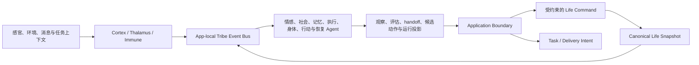
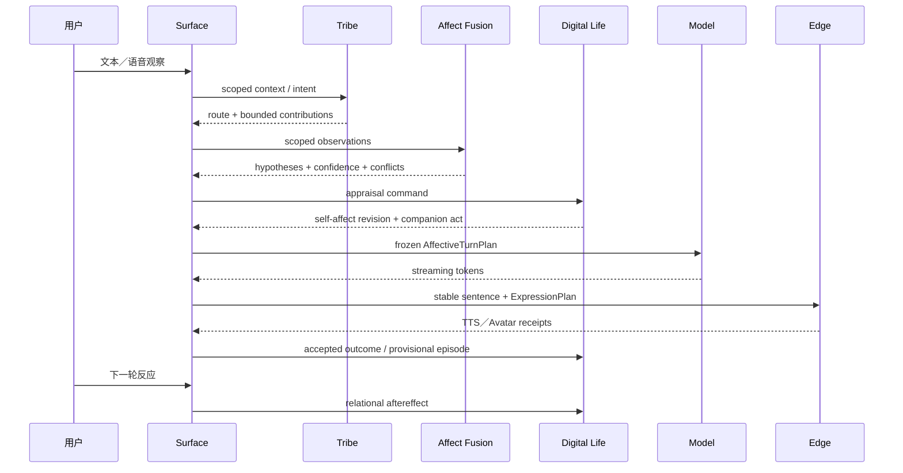
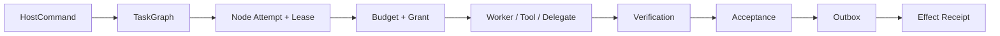
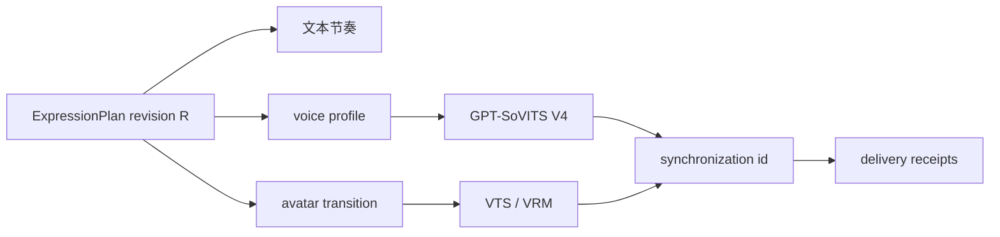

受众：CODEX
标题：Natsume AI 数据流架构

# 数据流架构

## 1. Tribe 智能体协作



生产 Host 为 23 个 Agent 构造一个 owner-bound runtime scope。事件与 `TribeStateRegistry` 只承担进程内协作；它们不能直接成为七海长期自我。需要改变 self affect、关系、成长或主动节律的贡献必须经过 application boundary，写为可重放的 canonical Life command。有外部副作用的动作则进入 Task 或 Delivery 路径。

## 2. 普通情感对话



关键不变量：用户 observation 不直接写 self affect；纯文本回合不重置为中性；已交付分句不重复；技术失败不当作关系拒绝。

## 3. 有副作用的任务



节点失败、取消、重试和未知副作用在 Task Runtime 内恢复。只有 accepted effect 才进入外部交付。

## 4. 语音与 Avatar



当前方案显示中文文本、生成日语语音。各通道独立失败与降级，不反向修改七海情绪。

## 5. 主动陪伴

```text
relationship state + unresolved episodes + time + user state + permission
→ proactive candidate
→ quiet-hour / refusal / frequency policy
→ accepted delivery intent
→ Gateway/Edge
→ next user response or technical outcome
→ durable aftereffect
```

明确拒绝立即生效；连续忽略只降低频率，不扣信任，也不升级追问。

## 6. 偏好成长

```text
independent aftereffects
→ low-risk preference proposal
→ confidence and boundary checks
→ 5-interaction canary
→ activate version
→ next-turn text/TTS/avatar behavior
→ exact rollback when degraded
```

核心人格、价值观、亲密身份和敏感推断不进入自动成长。

## 7. 观测流

canonical SQLite ledgers 生成只读 projection，OBS 注册并刷新 projection jobs，Monitor 通过 OBS/Host API 展示状态。Monitor 的 React state、toast 或缓存不是业务成功证据。

## 8. 数据保留

| 数据 | 默认策略 |
|---|---|
| 原始音频／图像 | 不落盘 |
| 用户正文 | 对话存储按用户配置；不进入 affect journal |
| Affect observation | 脱敏摘要、TTL、证据 digest |
| Self affect snapshot | 有界 head，可由 journal 重放 |
| Relation episode | 结构化意义与未解决线程 |
| Task／effect receipt | 幂等与恢复所需最小字段 |
| 模型／语料／密钥 | 仓库外保存 |
