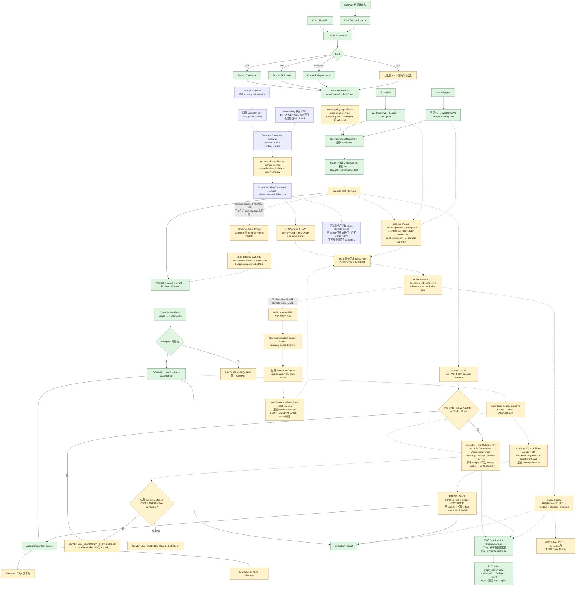
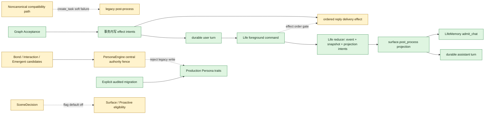
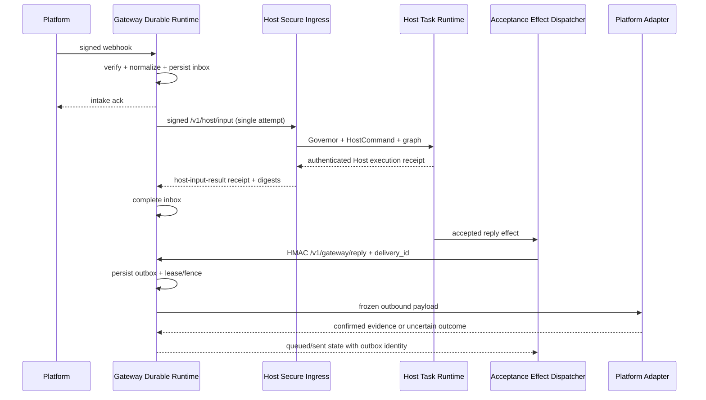

受众：MASTER
标题：Natsume AI 数据流与回执架构事实

# Natsume AI 数据流与回执架构事实

版本：v1.5

核对日期：2026-07-16

文档类型：`CURRENT_DATA_FLOW / CODE_FACTS`

总体状态：`FULL_ARCHITECTURE_INCOMPLETE`

本文不用理想化的箭头代替生产代码，只描述当前 composition 真正能够触发的数据流、状态流、副作用流和回执边界。架构总览见 [CURRENT_CODE_ARCHITECTURE.md](CURRENT_CODE_ARCHITECTURE.md)，最终目标见 [TARGET_ARCHITECTURE.md](TARGET_ARCHITECTURE.md)，差距见 [ARCHITECTURE_GAP_MATRIX.md](ARCHITECTURE_GAP_MATRIX.md)，实施顺序见 [NEXT_GENERATION_EVOLUTION_EXECUTION.md](../../30_devspec/NEXT_GENERATION_EVOLUTION_EXECUTION.md)。

## 1. 如何读本文

本文对每条数据流使用四种定级：

| 定级 | 含义 | 可否当作当前生产事实 |
|---|---|---|
| `WIRED` | 入口、生产 composition、持久化与回执主链均已接通 | 可以，但仍受表内明示限制约束 |
| `PARTIAL` | 主要资产或部分路径存在，但未形成完整闭环 | 只能按已实现范围引用 |
| `BROKEN` | 表面有 adapter 或 lifecycle wiring，首个真实请求仍会在合同或 admission 处阻断 | 不能宣称可用 |
| `TARGET` | 只存在于目标架构或待实施合同 | 不是当前事实 |

三种容易混淆的语义必须分开：

1. **接受成功**：某个请求已被 inbox 或 Host TaskGraph 持久化，不等于外部副作用已发生。
2. **执行验收成功**：Graph 已通过 Verification/Acceptance，不等于 conversation、Life、Gateway 等后续 effect 已全部提交。
3. **外部效果确认**：Gateway/Edge adapter 已返回对应层级的确认证据。它不能由 Task receipt 或 HTTP 200 替代。

## 2. 全局数据流总览



上图的核心结论是：

- Host `chat` / `skill` / `delegate` / `plan` 四路已经进入共用 Governed Runtime，不再允许失败后退回 Executive 执行。
- Plan 已能编译为多节点 TaskGraph，但当前只排序 Governor 已批准的 steps，不会从目标生成多个竞争方案。
- Task Runtime 当前为 `PARTIAL_B5C_DURABLE_CANCELLATION_SHADOW / PRODUCTION_OFF`。Cancellation Operator authority/入口与 Operation 签名对账均为 `WIRED_DEFAULT_OFF / CANARY_NOT_RUN`。Effect `FAILED` 的自动误收口已封死；PENDING classifier 仅允许 exact virgin tuple逻辑取消。Production authority 下 fenceable retry PENDING 不可达，防御分支只处理 legacy/imported/cross-table corruption。Effect 签名对账、旧 `FAILED_EVIDENCE`、历史 retry-PENDING + CANCELLED fence与其他历史修复、Budget 高竞争、部署凭据和真实 canary 尚缺；FINALIZED replay 不自动改写旧 evidence，atomic/bounded/cancellation 均保持 OFF。
- 0095 的 CREATED 由 immutable HostCommand evidence 回填，ACTIVE 等由 deterministic legacy ID/key 重算；升级保持 ID/key，新增 revisioned payload。旧 payload 仅 replay 兼容；source-ref 围栏收敛 legacy 重投。`created_ts=0` 容差可用于 current revisioned 与 legacy unrevisioned 两种可重建 candidate，但除 timestamp 外必须全字段 exact。PlanningRecovery 显式 opt-in 同事务 Graph Outbox inventory 并使用真实 terminal ref；默认 snapshot 不扫描 Outbox。Operator/Review exact revision。
- Lifecycle 未完成统一返回 `TASK_RUNTIME_LIFECYCLE_RETRY_REQUIRED`并锁死 bind/activate，只保留 `aclose` 重试。Coordinator admission close/drain/aclose 或 worker quiescence 任一失败都不关 Store；Coordinator 与 worker 都静默后才 drain Outbox/关 infrastructure。
- Scheduler 与 Internal Agent 均已通过真实 occurrence/admission；Internal 的 v2 只在 ingress/executor 兼容边界存在，canonical lineage 使用 V3。
- Acceptance 只在同一事务中生成 effect intents；下游副作用使用持久队列最终一致，不是全局单事务。

## 3. 入口与路由分流

### 3.1 Host 对话入口

[cortex_runtime.py](../../../host_brain/agent_runtime/cortex_runtime.py) 把 `chat` / `skill` / `delegate` / `plan` 定义为 canonical governed route。数据流是：

```text
normalized request
  → route decision
  → Governor APPROVE + grant
  → GovernedHostRuntime.supports(route)
  → immutable command/graph contracts
```

这四路有两个关键 fail-closed 规则：

1. Governor 未批准不进入 worker。
2. Governed Runtime 不可用或不支持 route 时，返回 `GOVERNED_RUNTIME_UNAVAILABLE` / `GOVERNED_ROUTE_UNSUPPORTED`，不回退 Executive。

canonical route 不会在 graph Acceptance 之前写入 user turn。`task_progress` 和 `recent_turn` 是独立的 durable projection/read route：Governor 批准后持久化可见对话轮次，直接读取 Task 或 conversation projection，不创建 Task/Attempt，也不进入 Executive。

### 3.2 Gateway / Host Input 入口

Gateway 不直接调用 Host worker。它先完成签名验证、规范化与 durable inbox 接收，再由 worker 单次回报 Host `/v1/host/input`。Host 的 [ingress.py](../../../host_brain/input_runtime/ingress.py) 验证 secure claim 与幂等键，然后经 [cortex_dispatch.py](../../../host_brain/input_runtime/cortex_dispatch.py) 进入同一 Cortex/Governor 链。

Gateway 的 intake ack 只表示“已持久接收”。Gateway 只在 Host 返回可验证的 Host input receipt 后才把 inbox 标记为完成。该回执要绑定 source、body digest 和 idempotency digest，不仅检查 HTTP 200。

### 3.3 入口状态表

| 来源 | 当前入口 | 进入 canonical TaskGraph | 状态 | 边界 |
|---|---|---:|---|---|
| Host Chat/API | Cortex | 是 | `WIRED` | 仅四条 canonical route |
| Gateway | durable inbox → Host Input | 是 | `WIRED` | 可能提交时间不明的请求进 uncertain DLQ，不盲目重试 |
| Scheduler | governed scheduler adapter | 是 | `WIRED` | Clock/Manual occurrence，完整 child grant/Review/Verification/Acceptance/Receipt |
| Internal Agent | internal task adapter | 是 | `WIRED` | 边界 v2 清除 caller authority 后编译 V3；`delegate:agent_runtime` child grant 验证后才调用 executor |
| Read projection | `task_progress` / `recent_turn` | 否 | `WIRED_READ_ONLY` | 读取 durable projection，不拥有任务状态 |
| Executive | retired guard | 否 | `RETIRED` | 无生产调用、无 SkillDag 执行、无内存 registry |

## 4. Host 四路 Governed Runtime

[governed_task_adapter.py](../../../host_brain/app/governed_task_adapter.py) 是 Host 四路的生产 adapter。它把 route 产物编译为 `HostCommand + WorkOrderV3 + TaskGraph`，再交给 [governed_command.py](../../../host_brain/orchestration/governed_command.py) 与 `GovernedCommandApplication`。[governed_task_authority.py](../../../host_brain/app/governed_task_authority.py) 独立承担无状态的 exact replay、lineage 与 fail-closed 校验：chat/delegate/skill 先走共同 binding，只有 skill 叠加 direct-skill 专属 metadata，避免 replay 路径因错误复用 validator 被拒绝。

| route | 冻结输入 | worker 主行为 | 当前状态 | 未完成语义 |
|---|---|---|---|---|
| `chat` | prompt、conversation context、reply channel | 调用 Surface Reply，输出冻结 worker projection | `WIRED` | conversation 与 delivery 是 Acceptance 后最终一致 |
| `skill` | target skill、arguments、capability scope | 验证 node-bound grant，执行 frozen governed skill，校验 durable skill receipt | `WIRED` | 只证明冻结 skill vertical slice，不等于所有 legacy skill 路径已删除 |
| `delegate` | 精确 `target_id`、上下文和超时 | 经 frozen delegate port 调用指定 sub-agent | `WIRED` | worker 不得从 context 重新选 route 或 target |
| `plan` | Governor 已批准 `planned_steps/steps` | 拓扑合法化 → selected path → immutable multi-node graph | `PARTIAL` | 不生成竞争计划，不做真实 successor search，不完成动态 replan |

### 4.1 Chat

Chat worker 经 [route_execution_ports.py](../../../host_brain/app/route_execution_ports.py) 组装 `SurfaceReplyInput`，使用已批准的输入与 recall packet 调用 Surface Reply。worker 本身不获得 Governor 或 Gateway delivery authority；交付权由 Acceptance Effect Compiler 从已 admission 的 command 重建。

因此正确语义不是“生成文字后立即写对话并发送”，而是：

```text
frozen chat execution
  → worker projection
  → verification
  → graph acceptance
  → graph-scoped conversation/life/delivery effect intents
```

### 4.2 Skill

Direct Skill worker 使用每节点 child grant，从 durable grant ledger 加载授权，再执行 frozen governed skill。之后它记录 governed skill execution，校验 durable receipt projection，并返回 worker commit 和可计量 budget usage。

这条链建立了 `command → graph/node → attempt → child grant → worker receipt` lineage。Executive legacy SkillDag 生产执行和进程内 registry 已删除；后续约束重点是把 Internal 与领域兼容入口全部迁入同一 lineage。

### 4.3 Delegate

Delegate worker 仅接受冻结的 `target_id`。[route_execution_ports.py](../../../host_brain/app/route_execution_ports.py) 会拒绝上下文中企图带入的 route/planning authority，并在 dispatcher 返回后再次校验 target。

这保证了 worker 执行的是上游冻结决定，不是在 worker 内部重新选择 agent。它不代表 child agent 内部的所有工作也已转换为同一 TaskGraph。

### 4.4 Plan

[plan_intent_search.py](../../../host_brain/orchestration/plan_intent_search.py) 只接受 `route=plan`，从 Governor 已批准的 `planned_steps/steps` 构造候选，检查 `skill` / `delegate` / `chat` 节点与依赖，选出完整合法的拓扑顺序。[planning_execution.py](../../../host_brain/orchestration/planning_execution.py) 把 search result 交给 [planning_graph_compiler.py](../../../host_brain/orchestration/planning_graph_compiler.py)，编译成不可变 TaskGraph。

当前 Plan **不会**：

- 从目标生成多个实质不同的候选方案；
- 根据虚拟状态动态生成 successor；
- 在真实 Code/Research 场景中证明 Graph Search 或 MCTS 收益；
- 在 worker 失败时自动生成 revision + 1 并继续调度。

显式 failure-replan metadata 可以构造 graph revision + 1，但这只是合同能力，不是完整的自动重规划闭环。

## 5. TaskGraph 状态流与回执

### 5.1 Admission

[host_command_repository.py](../../../host_brain/persistence/host_command_repository.py) 的 admission 同时绑定：

- immutable `HostCommand`；
- 显式 `WorkOrderV3`；
- 显式 `BudgetPolicy`；
- runtime assignment；
- TaskGraph 及 revision。

它在事务内写入 durable state 并生成 `TASK_GRAPH_CREATED` / `HOST_COMMAND_ADMITTED` outbox 事件。非 `WorkOrderV3` 或没有 BudgetPolicy 的请求不会被自动升级，而是 fail closed。

若图声明可选 `ATOMIC_GRAPH_SUCCESS_V1`，`GovernedCommandApplication` 会在调用 repository admission 前确认 Coordinator capability、node-grant service 和 parent Governor grant；不支持的生产进程不会先留下半份 admission。admission 后派生的 node grant map 必须精确覆盖全部 TaskNode，Coordinator 不接受缺项或多项。

### 5.2 Coordinator

[coordinator.py](../../../host_brain/task_runtime/coordinator.py) 对可运行节点进行：

```text
claim runnable node
  → create/load Attempt
  → acquire Lease + fence
  → reserve idempotency + budget
  → PRE review if required
  → execute worker with node-bound grant
  → verification
  → POST acceptance review if required
  → accept/reject node
  → progress dependants
  → finalize graph receipt
```

| 能力 | 当前事实 | 定级 |
|---|---|---|
| 持久 admission | command/work order/assignment/graph 原子绑定 | `WIRED` |
| 依赖推进 | 能从 `BLOCKED` 推进到 `READY`，拒绝未知依赖与环 | `WIRED` |
| Attempt / Lease / Fence | durable 状态与 fencing 已存在 | `WIRED` |
| Idempotency | 有 reservation、commit 和 conflict 语义 | `WIRED` |
| Budget | Host 四路、Scheduler、Internal 有预留、计量和结算 | `PARTIAL` |
| Review | PRE/POST waiting、durable token/checkpoint、拒绝/过期、0096 continuation coordination | `WIRED_SLICE` |
| Resume | 消费 token 后由 composition worker 按原 HostCommand surface 自动重调度；PRE 无伪 Attempt，POST 不重跑 worker | `WIRED_0096` |
| B0/B1 调度决策 | Coordinator 从 durable snapshot 消费稳定 READY/fan-in/retry due 决策 | `WIRED_PARTIAL_RUNTIME` |
| 原子 claim | ACTIVE graph + Budget concurrency 下原子写 Attempt/Node/Lease/Heartbeat/Outbox，并支持 exact replay | `WIRED` |
| Completion policy | TaskGraph v1 可选 `ATOMIC_GRAPH_SUCCESS_V1` 必须显式 sink result；legacy 多 sink 无 result。PlanningGraphCompiler 默认 legacy，只有显式请求/重规划继承才 atomic | `B5_DURABLE_POLICY_WIRED_SHADOW` |
| DAG 并发 | `atomic_graph_success_enabled` 与 `bounded_fanout_enabled` 独立默认 OFF，三处生产 composition 未启用。atomic 可单节点/串行 outer 封口；bounded 才允许 terminal-leaf 实际有界并发 | `PARTIAL_B5C_DURABLE_CANCELLATION_SHADOW` |
| 并行合流 | progress 用 `fanout_event_buffer_size` 个 semaphore slot（默认 32、非正值拒绝）限制在途事件，并为每个 child 预留独立 control 容量；size=1 慢消费者仍会反压 child，自发 `CancelledError` 也不会因 progress 满而丢失监督信号。fan-in 只在依赖 `ACCEPTED` 后执行 | `SHADOW_BOUNDED_FLOW` |
| 并行 child authority | deferred child 只拥有 Attempt/Node/Lease/Reservation 与 Budget usage/`EXCEEDED`；不能终结 Graph 或把 Budget 置为 `RELEASED/CONSUMED`。正常非接受等待所有已启动 sibling 到 durable node-local terminal，不再 fail-fast | `SHADOW_NODE_LOCAL_AUTHORITY` |
| Admission / grant 门禁 | atomic capability、node-grant service、parent grant 在 repository admission 前校验；Coordinator 直入要求 exact node grant map | `B5_FAIL_CLOSED_SHADOW` |
| Schema 前置门禁 | Budget/worker 前验证 `0090` 与 `0092`；atomic policy 还验证 `0091` | `B5C_FAIL_FAST_WIRED` |
| 共享终态 authority | live/re-entry 从 durable Node/Attempt/Reservation/BudgetUsage 重建同一 payload/ref；outcomes 全量覆盖 admitted Graph durable terminal Nodes/latest stable Attempts（含非 selected `RETRY_PENDING`），当前 batch 仅定优先级/selected。ownership/CAS 后 active ownership 映射 `IN_PROGRESS`，纯 CAS为 conflict | `B4_LIVE_AND_REENTRY_OUTER_WIRED` |
| 并行终态证据 | pre-reservation failure、Budget overrun、post-review、Review denial ref fence 与 crash re-entry failure-over-review/live authority preservation 均有集成证据，包含结算提交响应丢失 exact replay；伪 receipt/旧 Attempt lineage、digest/payload/Outbox/replay 漂移被拒绝 | `INTEGRATION_AND_STORE_CONTRACT_PROVEN` |
| 未决副作用恢复 | post-reservation worker failure 若 Operation Reservation 仍为 `RESERVED/RECOVERY_REQUIRED`，child 返回 `RECOVERY_REQUIRED` 并立即停掉 bounded batch；被 join 的 unfinished siblings 可保留 `RUNNING` recovery obligation，后续重入继续返回既有 `RECOVERY_REQUIRED`。Graph/Budget 保持未终结；自动 reconciliation/continuation 仍未实现 | `FAIL_CLOSED_PARTIAL_RECOVERY` |
| crash/re-entry 终态 | `ACTIVE` 多节点 Graph 从 durable Node/latest Attempt 复原 outcomes，按 recovery > Budget > failure > review 复用 outer snapshot transaction。历史 `BLOCKED + failure Node` 或 `FAILED + ACTIVE Budget` 半提交状态不自动修复，归 reconciliation | `B4_ACTIVE_REENTRY_WIRED_HISTORY_PARTIAL` |
| 决策记录 | canonical payload 与 Graph、可选 Budget、Outbox 同事务写 `0090`。selected `BUDGET_BLOCKED` 绑定 rejected usage；共享超额后的被动 blocked sibling 不要求本地 rejected usage。每个 row 读取校验 digest、精确 Graph/可选 Budget Outbox 与 Attempt，BUDGET 另校验 usage；terminal replay 还校验 Graph target/version | `B4_CANONICAL_DECISION_JOURNAL_WIRED` |
| marker 历史扫描 | 0095 令所有 `TASK_GRAPH` Outbox 精确绑定现存 revision，完整 taskbatch marker 缺行/错绑扫描按 `graph_id + revision` 覆盖 multi-revision 历史；decision getter 同时复核 exact Outbox revision | `WIRED_0095_REVISIONED_GRAPH_OUTBOX` |
| failure replan evidence | scheduler snapshot 默认不扫 Outbox；PlanningRecovery 显式 opt-in，在同一读事务选择唯一 terminal Graph Outbox 的真实 payload ref。legacy ref 原样保留；仅旧版或替代 Store 未提供可选扩展字段时合成 revisioned fallback，生产 DurableTaskStore 提供 inventory 后，畸形、缺行或歧义均 fail closed | `WIRED_0095_DURABLE_EVIDENCE_COMPAT` |
| PRE Review 观察 | `WAITING_APPROVAL` 已纳入统一 0090 outcome；合法无 worker Attempt，receipt/decision 使用 `attempt_id=null`，其它状态仍强制真实 Attempt | `WIRED_0096_OPTIONAL_ATTEMPT` |
| atomic 成功 UoW | 全 Node Accepted 后单事务提交 Graph COMPLETED、Budget CONSUMED、两 Outbox、全图 effect intents 与 0091 decision；结果只取显式 result 的 canonical projection | `B5_SHADOW_WIRED` |
| projection / replay | projection 重算 digest并绑定 command/request/route/target/graph/node/attempt/receipt/grant；completed replay 只读 0091、不重编 effects；双响应丢失重读 terminal authority | `B5_ADVERSARIAL_PROVEN_SHADOW` |
| Durable Graph 取消 | `task_graph.cancel` 与 `task_operation.reconcile` 均经默认关闭的受控 Operator 入口；Operation service 已完成 composition、OBS 注册与公钥注入。一般 Effect `FAILED` 不代表无副作用，新路径保持 `RECONCILIATION_REQUIRED`；仅带 receipt 的 `COMMITTED` 自动收口。PENDING 仅 exact virgin tuple可逻辑取消；current canonical authority 下 fenceable retry tuple不可达，遇到它只按 legacy/imported/corruption 保守阻断。Effect 签名对账、旧 `FAILED_EVIDENCE`、历史 retry-PENDING + CANCELLED fence修复/隔离、部署凭据/canary 未完成；FINALIZED replay 不得自动改写旧 evidence | `B5C_WIRED_DEFAULT_OFF_PRODUCTION_OFF` |
| Outbox 并发发布 | 0093 持久化 owner/token/expiry/单调 fence 并支持 takeover。0095 按 `type + id + revision` 隔离 head；CREATED 用 HostCommand evidence，ACTIVE 等用 deterministic legacy ID/key 重算，无法解析则迁移阻断。升级保持 Outbox ID/key，新增 `@revision` payload；旧 payload 仅 replay 兼容。新 Event=`graph_id@revision`，旧 journal 经 source Outbox exact read；unique partial source-ref 防重复投影，Operator/Review exact revision。publisher 继续 claim→幂等 append→fenced complete；`DRAINED` 仅在 total_pending=0 | `WIRED_0093_CLAIM_0095_REVISION_IDENTITY` |
| Budget 并发 CAS | B4 可由 child 记录 usage/`EXCEEDED`，outer 再统一 release；固定 CAS 重试上限及 `ALREADY_EXCEEDED` 在 concurrency > 4 下的唯一语义仍未收敛 | `P1_SEMANTICS_INCOMPLETE` |
| Retry/backoff | Coordinator 仅对 reservation 前显式 marker 重试；并行 deferred child 使用 domain-separated node-only usage identity 与 `schedule_retry_node_outcome`，保持 Graph ACTIVE，提交响应丢失 exact replay 不重复扣费；预算拒绝只落 Budget `EXCEEDED` 与 node-local terminal，再交 outer 裁决。生产 resolver 尚无现实 marker 来源 | `PARTIAL_B4_SAFE_RETRY` |
| Pre-reservation failure | 普通/耗尽 failure 通过 `fail_running_attempt_bundle` 原子落 Attempt FAILED、Node FAILED、Graph FAILED/BLOCKED、Lease RELEASED 和四条 attempt/evidence-bound Outbox；已有 reservation 时拒绝，Budget finalize 在 bundle 外 | `WIRED_NARROW_BOUNDARY` |
| 执行心跳 | reservation 后后台先续 Lease 再续 Reservation；流事件和最终结果均 checkpoint，停止/join 后才用最新 version COMMIT。续租同参响应丢失可精确重放 | `WIRED` |
| 心跳失败 | 任一 Task Attempt/Lease 续租或版本检查失败返回 `RECOVERY_REQUIRED`，Worker 结果绝不 COMMIT；一般 recoverable Attempt 的在线 takeover 与即时 reconciliation 尚未实现。0096 的 Review claim heartbeat 丢失后，未完成 READY/首次 worker 校验的执行被 fence；已通过首次校验的 blocking 调用继续由 Task Attempt/Lease 管理，旧 Review owner不得 complete/defer，后续 owner按 durable checkpoint 接管。它不伪称 asyncio cancellation 能撤销外部副作用 | `FAIL_CLOSED_PARTIAL_RECOVERY` |

启动恢复数据流为 migration → TaskStore 0093/0094/0095、Review 0096 与 grant uniqueness 0097 readiness → `task_store.recover_startup` → publisher → recovery outbox publish → Outbox 后台 worker → surface runtime activation → cancellation/Review continuation workers；恢复抛错会在 admission 可用前 fail closed。ASGI 还会把配置逻辑 owner 派生为每次 container construction 唯一的 execution owner。该顺序已能 takeover 到期 Outbox、cancellation coordination 与 Review continuation claim；0094 未收敛 operation/effect/review cancellation 事实时仍只 durable defer，一般 recoverable Attempt 的在线自动 continuation 仍未统一。

Budget 的 token/cost 在 provider 没有返回真实计量时保持 `UNMEASURED`，不做伪精确估算。concurrency charge 和超限后的完整 `DEGRADE` / `REVIEW` 分支还没有闭环。

### 5.3 Scheduler 与 Internal 已接通

[scheduler/governed_runtime.py](../../../host_brain/scheduler/governed_runtime.py) 已构造 `WorkOrderV3 + BudgetPolicy`，以 `delegate:<worker_key>` 冻结 TaskNode，并在 handler 前验证 durable child grant。真实测试已贯通 Attempt、Budget consumed、Review waiver、Verification、Acceptance、Receipt 与 replay。

[internal_task_runtime.py](../../../host_brain/app/internal_task_runtime.py) 在认证 ingress 接受兼容 `AgentWorkOrder`，清除调用方伪造的 lineage/approval authority 后立即构造 `WorkOrderV3 + BudgetPolicy`。TaskNode 冻结为 `delegate:agent_runtime`；worker 只有在 durable child grant 完整验证后才向既有 Agent executor 投影兼容对象。

因此实际流程是：

```text
authenticated Internal ingress
  → Secure Ingress principal + Governor grant
  → strip caller authority; compile WorkOrderV3 + positive BudgetPolicy
  → HostCommandRepository atomic admission
  → TaskNode delegate:agent_runtime + child-grant verification
  → PRE Review if required
  → existing Agent executor compatibility projection
  → durable result + Verification + Acceptance / POST Review
  → execution receipt + replay
```

前置 Review 不执行 handler，且在尚无 worker receipt 时保持 ingress claim result 未绑定；执行结果声明 `review_required` 或内部 Acceptance 为 `REVIEW` 时进入 `WAITING_ACCEPTANCE_REVIEW`，即使已有 pre-acceptance worker receipt 也不得提前完成 ingress。0096 后，ReviewStore 的终态 mutation 与 continuation enqueue 同事务；worker 按 surface 重入并通过 completion hook 收口 Host effect 或 Internal/Scheduler secure-ingress result。续跑 credential 覆盖 budget time window 加 child TTL、最多 24 小时；READY 与首次 worker entry 分别校验 live claim 和 exact Attempt/Lease。拒绝/过期使用 durable decision ref，历史 POST receipt 只有 exact lineage CAS 才能替换。

## 6. Acceptance Effect 与对话提交语义

[acceptance_effects.py](../../../host_brain/task_runtime/acceptance_effects.py) 在 graph 验收后从受信 worker projection 编译 graph-scoped effects。当前主要 effect 类型是：

1. `conversation.user_turn`；
2. `life.foreground_completed`；
3. 在存在 reply channel/target 时的 `surface.reply_delivery`。

worker 不能提供这些 effect 的 authority 或 idempotency key。Compiler 只使用已接纳 HostCommand 和 graph 事实重建，避免 worker 扩权。

[acceptance_effect_dispatcher.py](../../../host_brain/task_runtime/acceptance_effect_dispatcher.py) 使用 durable queue、lease 和 fence 按以下语义顺序提交：

取消并发下必须区分“成功证据”和“失败不确定性”：`COMMITTED + durable receipt` 是正向证据，可自动解除 cancellation fence；普通 handler/transport `FAILED` 可能发生在外部副作用之后，不能推导 `NO_SIDE_EFFECT`。因此取消前已失败及取消后 in-flight 失败都保持 `RECONCILIATION_REQUIRED`。当前数据结构没有可信的本地前置失败证明，旧 `FAILED_EVIDENCE` 只兼容读取并等待历史修复；签名 Effect 对账尚未接通。PENDING tuple 的附加防线只把 exact virgin epoch分类为 CANCELLED；canonical claim/fence authority 不会把 handler-run retry epoch带进此路径，因此 retry 分支是 legacy/imported/cross-table corruption hardening，不是正常 reschedule/cancel 竞态。历史 retry-PENDING + CANCELLED fence必须在 production enablement 前 audit/repair/quarantine，已有 FINALIZED decision 不得被 replay 自动改写。

```text
conversation.user_turn
  → life.foreground_completed
  → surface.reply_delivery
```

某个较早 effect 未提交时，当次 graph dispatch 不继续提交后续 effect。失败会保留原因并按队列策略 reschedule；这不是一个跨所有存储与外部系统的原子事务。

### 6.1 Conversation / Life / Memory 实际提交链



[acceptance_effect_handlers.py](../../../host_brain/app/acceptance_effect_handlers.py) 分别调用 durable conversation writer、提交 `LifeCommand` 和进入 Gateway delivery。[life_projection_handlers.py](../../../host_brain/app/life_projection_handlers.py) 再由 Life projection 触发 `_async_post_process`。

[postprocess.py](../../../host_brain/agent_runtime/postprocess.py) 在 Life projection mode 下对 assistant turn 和 LifeMemory admission 使用 durable-required 语义；失败会向上抛出，不当作成功。它随后在该 mode 提前返回，避免重复执行 persona/tribe mutation 和 VTS/TTS。

因此 canonical 对话的准确定级是 `POST_ACCEPTANCE_DURABLE_EVENTUAL`：

- graph Acceptance 与 effect intents 原子绑定；
- user turn、Life command、assistant turn、Memory 和 delivery 分阶段持久提交；
- 队列可重试并保存状态；
- 不存在把上述所有操作包进单个数据库事务的语义。

## 7. Gateway 双向链路



### 7.1 Inbound

[delivery_runtime.py](../../../edge_client/gateway/delivery_runtime.py) 对 inbound 先持久化、后 dispatch；worker 使用 lease/fence claim inbox。[input_reporter.py](../../../edge_client/channels/input_reporter.py) 对 Host 使用签名身份和幂等头，并验证 Host receipt 与 body/idempotency digest。

一旦 dispatch 已开始却无法确定 Host 是否已提交，Gateway 不会盲目重发，而会把记录转入 uncertain DLQ。这是 at-most-once 副作用与不确定性之间的显式取舍。

### 7.2 Outbound reply

accepted reply effect 经 [gateway_delivery.py](../../../host_brain/input_runtime/gateway_delivery.py) 调用 [edge_transport.py](../../../host_brain/channels/edge_transport.py) 的 `submit_gateway_reply`，使用稳定 `delivery_id` 和 HMAC 发送 `/v1/gateway/reply`。Gateway server 把 payload 放入 durable outbox，并以 platform + conversation 作 ordering key。

[outbound.py](../../../edge_client/gateway/outbound.py) 在 dispatch 前验证并冻结 payload。只有 adapter 返回确认证据时才能写入 ACK；在 send boundary 之后发生异常或返回 false 会被定级为 `MAY_HAVE_COMMITTED` / uncertain，不会伪造成功。

### 7.3 两种“成功”

| 回应 | 证明什么 | 不证明什么 |
|---|---|---|
| Gateway `queued/accepted` | 冻结 payload 已进 durable outbox | 平台用户已收到 |
| Gateway `sent/ACKED` | platform adapter 已返回按合同可接受的确认证据 | 不同平台对“最终呈现”的所有业务语义 |

## 8. Edge 设备与实体副作用

Host 只创建版本化 `EmbodimentCommand`，不导入设备 driver。[embodiment.py](../../../host_brain/channels/embodiment.py) 把 avatar、voice、desktop 等意图发送给 Edge；Edge 是唯一物理 actuator。

当前存在两条 Host 提交方式：

| 方式 | 流程 | 状态 |
|---|---|---|
| Host durable embodiment outbox | enqueue → lease/fence → Edge RPC → durable receipt / `IN_DOUBT` | `WIRED` |
| async direct submit | 取得 durable Edge session lease/fence → Edge RPC → Edge 持久 claim → device effect → receipt | `PARTIAL` |

[embodiment_outbox_repository.py](../../../host_brain/persistence/embodiment_outbox_repository.py) 管理 Host outbox 的 `PENDING → DISPATCHING → completed/IN_DOUBT`。[embodiment_runtime.py](../../../edge_client/gateway/embodiment_runtime.py) 在 Edge 端用 command/idempotency key 去重；若进程崩溃时命令处于 `DISPATCHING` 但没有 receipt，恢复后标记 `IN_DOUBT`，不盲目重执行物理动作。

边界是：Edge 端的持久化与回执已成立，但并非每个 Host embodiment 调用都先写 Host Acceptance Effect Outbox。因此“所有外部副作用均统一通过 Host effect outbox”仍是 `TARGET`，不是当前事实。

## 9. Memory、Persona 与 Scene

### 9.1 Memory read

[chat_retrieval_helpers.py](../../../host_brain/app/chat_retrieval_helpers.py) 使用 [surface_memory_recall.py](../../../host_brain/persona/surface_memory_recall.py) 规划 recall，在多个 typed store 上执行 MUST/MAY/NO 范围的查询、覆盖与证据检查，最终压缩为 `MemoryRecallPacket` 交给 Surface Reply。

对话模型消费的是 packet，不是未经约束的全库原始行。这条 read path 已接通，但仍是调用期检索，不等于 Knowledge OS 或可演化知识层已实现。

### 9.2 Memory write

canonical 写路径是：

```text
Graph Acceptance
  → Acceptance Effect Dispatcher
  → durable user turn
  → Life foreground command
  → Life projection
  → durable assistant turn + LifeMemory.admit_chat
```

非 canonical compatibility path 仍可以用 `asyncio.create_task()` 启动 legacy post-process，某些失败只降级记录。因此 Memory 不能简化标记为“全入口强持久”；对 Host 四路的准确说法是 `WIRED_POST_ACCEPTANCE_EVENTUAL`。

### 9.3 Persona

[persona_engine.py](../../../host_brain/persona/persona_engine.py) 已把 `apply_growth_delta()` 变为中央 fail-close 兼容围栏。所有非迁移调用都会返回稳定的 `PERSONA_GROWTH_AUTHORITY_CLOSED`，且不会修改 trait 或写入变更日志。

[persona_growth.py](../../../host_brain/persona/persona_growth.py) 的 stage/milestone、interaction cycle，以及 [emergent_growth_engine.py](../../../host_brain/persona/emergent_growth_engine.py) 的 emergent weekly 当前只生成经过 drift guard 的 candidate；它们不会消费 one-time 标志、weekly cumulative、change history 或 feedback buffer。显式历史迁移只能通过带 `migration_id`、actor 和 evidence 的 `apply_migration_growth_delta()` 写入，并产生结构化审计。

`T-PERSONA-FENCE-01` 会拒绝生产代码重新调用 legacy writer、在迁移命名空间之外构造迁移 authority，或绕过引擎直接修改 `_user_traits`。当前定级为 `CENTRAL_FENCE_WIRED`：旧直写已归零，但 `proposal → Lab/shadow → Review → version activation → rollback` 尚待 NE-06 实现，因此人格长期演化仍不可用。

[prefrontal_agent.py](../../../host_brain/tribe/prefrontal_agent.py) 对 `PersonaGrowthTracker.on_interaction_cycle()` 的调用参数与真实签名不匹配，`TypeError` 会被吞掉/降级。该 experience-feedback 分支是 `PARTIAL_BROKEN_PATH`，不能作为人格演化已闭环的证据。

### 9.4 Scene

[scene_policy.py](../../../host_brain/persona/scene_policy.py) 会构造过期、只读、限制性的 `SceneDecision`。它已被 [surface_runtime/eligibility.py](../../../host_brain/surface_runtime/eligibility.py) 和 [proactive_voice.py](../../../host_brain/persona/proactive_voice.py) 消费，用于约束 Surface 表达和主动性 eligibility。

但生产 feature flag `HOST_LIFE_PROJECTION_ENABLED` 默认为关闭，当前也没有 canonical Scene aggregate、transition journal 或统一 Task context authority。因此定级是 `PARTIAL_DEFAULT_OFF`，不是全局 Scene Engine。

| 能力 | 读路径 | 写路径 | 定级 |
|---|---|---|---|
| Memory | typed recall → compressed packet → Surface | Acceptance → Life projection → assistant/Memory | `WIRED_POST_ACCEPTANCE_EVENTUAL` |
| Persona | Surface/relationship 等多处读 | legacy 写入中央拒绝；仅显式审计迁移可写 | `CENTRAL_FENCE_WIRED` |
| Scene | Surface/Proactive eligibility | 无 canonical scene write API | `PARTIAL_DEFAULT_OFF` |
| World Model | read-only fact projection | 无生产 write API | `PARTIAL` |

## 10. 回执与证据分层

系统中的 receipt 不是一张可通用替换的“成功证明”。每一层只对自己的责任边界负责。

| 证据/回执 | 生成者 | 权威范围 | 不可替代 |
|---|---|---|---|
| Secure ingress claim/audit | Host/Gateway ingress | 身份、签名、nonce、body digest | Task execution receipt |
| Gateway inbox intake ack | Gateway durable runtime | inbound 已持久接收 | Host 已执行 |
| Host admission outbox | HostCommandRepository | command/work order/graph 已绑定 | worker 或 graph 已完成 |
| Node worker receipt/projection | frozen worker | 某一 node attempt 的执行结果 | graph Acceptance |
| Graph execution receipt | Task Runtime | graph revision 已通过或被拒绝 | conversation/delivery effect 已提交 |
| Acceptance Effect receipt | Effect Dispatcher | 某个 graph-scoped effect 已提交 | 其他 effects 已提交 |
| Gateway adapter ACK | Gateway outbound | adapter 已提供确认证据 | 平台端所有终端呈现语义 |
| Edge embodiment receipt | Edge actuator runtime | 某个设备命令的 durable 处理结果 | 任意其他 Task/effect 的成功 |

只读 projection 和 Operator UI 必须从上述 durable 事实派生，不得自行提升为新的执行真相。

## 11. 失败、重试与不确定性

| 失败位置 | 当前行为 | 安全属性 | 缺口 |
|---|---|---|---|
| Host command admission 前 | fail closed，不创建可执行 graph | 不先写 canonical user turn | Scheduler/Internal 合同仍会在此阻断 |
| Worker 执行前 | Lease/fence、idempotency reservation、budget/review 约束 | 降低重复执行 | runtime retry/backoff 未完整 |
| Verification/Acceptance | 拒绝 node/graph，不生成已批准副作用 | worker 不直接获得对外 authority | 自动 revision + 1 replan 未闭环 |
| Acceptance effect | durable queue 保留状态并 reschedule | graph result 与 effect state 可分辨 | 不是全局原子提交 |
| Gateway dispatch 开始后无回执 | uncertain DLQ，不盲目重发 | 优先避免重复外部副作用 | 需要 Operator 对账/处置 |
| Edge device dispatch 中崩溃 | 恢复为 `IN_DOUBT`，不盲目重执行 | 防止重复物理动作 | 需要外部状态核对 |
| Legacy post-process | 某些路径异步启动并降级失败 | 不阻断 legacy reply | 没有 canonical 路径的强语义 |

## 12. 目标数据流（不是当前现状）

本节全部标记为 `TARGET`。它用于约束后续重构，不能与上文已接线事实混写。

```text
All ingress sources
  → Secure Ingress + Identity + Scope + Governor
  → HostCommand + Intent/Scene/World Context
  → domain-neutral PlanningSearch over virtual state
  → immutable TaskGraph revision
  → parallel/retry-capable Durable Task Runtime
  → Verification + Acceptance
  → transactional effect intents
  → all external writers through durable outbox
  → immutable scoped receipts
  → read-only projections
```

从当前流程到目标流程的必要变更是：

1. 守护 B5C 已接线的 cancellation 与签名 Operation reconciliation；补齐签名 Effect reconciliation、legacy `FAILED_EVIDENCE`/历史修复、部署凭据和 production canary。0094 worker 与 Operation service 均属已实现范围，后续不得重复列项。
2. 在 reconciliation 中识别并修复历史 `BLOCKED + failure Node` / `FAILED + ACTIVE Budget` 半提交状态；持续守护 0096 `WAITING_APPROVAL` optional-attempt observation。
3. 持续守护 0095 revisioned TaskGraph Outbox：歧义回填必须整笔事务失败，Graph/non-Graph trigger/readiness 必须 exact，multi-revision marker 扫描、revision 内顺序、revision 间独立推进、Runtime Event 与 Operator exact read 必须持续通过；跨进程 drain authority 继续保留 0093 expired takeover、stale fence 和 append/complete 响应丢失回归矩阵。
4. 将可证明无副作用的现实 resolver 瞬态来源映射到现有 safe-retry marker，收敛 Budget CAS 固定重试与 `ALREADY_EXCEEDED` 语义，再完成 promotion+claim 单事务、reservation 后即时 reconciliation 与 mid-attempt online takeover。
5. 对已接通的 0096 Resume continuation 做跨进程故障矩阵和 canary：原子 enqueue、到期 sweep、claim takeover/stale fence、精确 surface 路由、POST no-rerun、grant renewal 与关闭 quiescence。
6. 从 objective/context 生成多个可比较计划，为 L1/L2/L3 提供真实虚拟 successor 与 durable calibration。
7. 失败重规划必须自动生成同一 graph ID 的 revision + 1，而不修改旧图或在 worker 内偷偷重规划。
8. 所有 Gateway、Edge、Memory、Knowledge、Persona 写操作统一从 Acceptance Effect Outbox 获取 authority 与幂等身份。
9. 保持 Persona 中央围栏，把无副作用 candidate 接入 proposal、shadow、Review、版本激活和可回滚流程，禁止恢复 direct writer。
10. 建立默认启用、有单 writer 和 transition journal 的 Scene/World/Intent context，并使其变成 TaskGraph 输入事实。
11. 在 D0 canonical path fence 之上建立 per-task durable workspace authority 与隔离 worktree；任意 shell 字符串、文件句柄和 reparse-point 竞态不能用路径规范化的通过代替。

## 13. 代码证据索引

| 数据流 | 主要生产证据 |
|---|---|
| Cortex/Governor 与四路分流 | [cortex_runtime.py](../../../host_brain/agent_runtime/cortex_runtime.py)，[governed_task_adapter.py](../../../host_brain/app/governed_task_adapter.py) |
| Host command admission | [governed_command.py](../../../host_brain/orchestration/governed_command.py)，[host_command_repository.py](../../../host_brain/persistence/host_command_repository.py) |
| TaskGraph runtime | [coordinator.py](../../../host_brain/task_runtime/coordinator.py)，[dag_scheduler.py](../../../host_brain/task_runtime/dag_scheduler.py)，[task_repository.py](../../../host_brain/persistence/task_repository.py) |
| Plan search/compiler | [plan_intent_search.py](../../../host_brain/orchestration/plan_intent_search.py)，[planning_execution.py](../../../host_brain/orchestration/planning_execution.py)，[planning_graph_compiler.py](../../../host_brain/orchestration/planning_graph_compiler.py) |
| Scheduler/Internal | [scheduler/governed_runtime.py](../../../host_brain/scheduler/governed_runtime.py)，[internal_task_runtime.py](../../../host_brain/app/internal_task_runtime.py)（均已接通 canonical admission） |
| Read projection / Executive retirement | [read_routes.py](../../../host_brain/agent_runtime/read_routes.py)，[cortex_runtime.py](../../../host_brain/agent_runtime/cortex_runtime.py)，[runtime.py](../../../host_brain/executive_runtime/runtime.py) |
| Workspace 路径围栏 | [workspace_paths.py](../../../host_brain/agent_runtime/workspace_paths.py)，[agent_tools.py](../../../host_brain/agent_runtime/agent_tools.py)，[verification_policy.py](../../../host_brain/agent_runtime/verification_policy.py) |
| Acceptance effects | [acceptance_effects.py](../../../host_brain/task_runtime/acceptance_effects.py)，[acceptance_effect_dispatcher.py](../../../host_brain/task_runtime/acceptance_effect_dispatcher.py)，[acceptance_effect_handlers.py](../../../host_brain/app/acceptance_effect_handlers.py) |
| Life/Memory post-process | [digital_life/service.py](../../../host_brain/digital_life/service.py)，[life_projection_handlers.py](../../../host_brain/app/life_projection_handlers.py)，[postprocess.py](../../../host_brain/agent_runtime/postprocess.py) |
| Gateway inbound/outbound | [delivery_runtime.py](../../../edge_client/gateway/delivery_runtime.py)，[input_reporter.py](../../../edge_client/channels/input_reporter.py)，[ingress.py](../../../host_brain/input_runtime/ingress.py)，[gateway_transport_repository.py](../../../host_brain/persistence/gateway_transport_repository.py)，[outbound.py](../../../edge_client/gateway/outbound.py) |
| Edge embodiment | [embodiment.py](../../../host_brain/channels/embodiment.py)，[embodiment_outbox_repository.py](../../../host_brain/persistence/embodiment_outbox_repository.py)，[embodiment_runtime.py](../../../edge_client/gateway/embodiment_runtime.py) |
| Memory recall | [chat_retrieval_helpers.py](../../../host_brain/app/chat_retrieval_helpers.py)，[surface_memory_recall.py](../../../host_brain/persona/surface_memory_recall.py) |
| Persona/Scene/World | [persona_engine.py](../../../host_brain/persona/persona_engine.py)，[persona_growth.py](../../../host_brain/persona/persona_growth.py)，[scene_policy.py](../../../host_brain/persona/scene_policy.py)，[surface_runtime/eligibility.py](../../../host_brain/surface_runtime/eligibility.py)，[runtime/world_model.py](../../../host_brain/runtime/world_model.py) |

## 14. 封板口径

本文可以支持的结论是：

```text
Host canonical four-route data flow        WIRED
Durable TaskGraph execution                PARTIAL
Scheduler governed admission               WIRED
Internal governed admission                WIRED
Conversation effects                       POST_ACCEPTANCE_DURABLE_EVENTUAL
Gateway durable transport                  WIRED_WITH_UNCERTAIN_DLQ
Edge as sole physical actuator             WIRED
All Host external effects via one outbox    NOT YET TRUE
Memory canonical write path                 WIRED_EVENTUAL
Persona evolution authority                CENTRAL_FENCE_WIRED / PROPOSAL PIPELINE MISSING
Workspace path safety                      D0_WIRED / DURABLE ISOLATION INCOMPLETE
Scene context                               PARTIAL_DEFAULT_OFF
Full Architecture                           INCOMPLETE
```

因此，当前不应使用“全入口统一”、“通用智能规划已完成”、“所有副作用全局原子提交”或“人格已可安全长期自主演化”作为封板结论。
